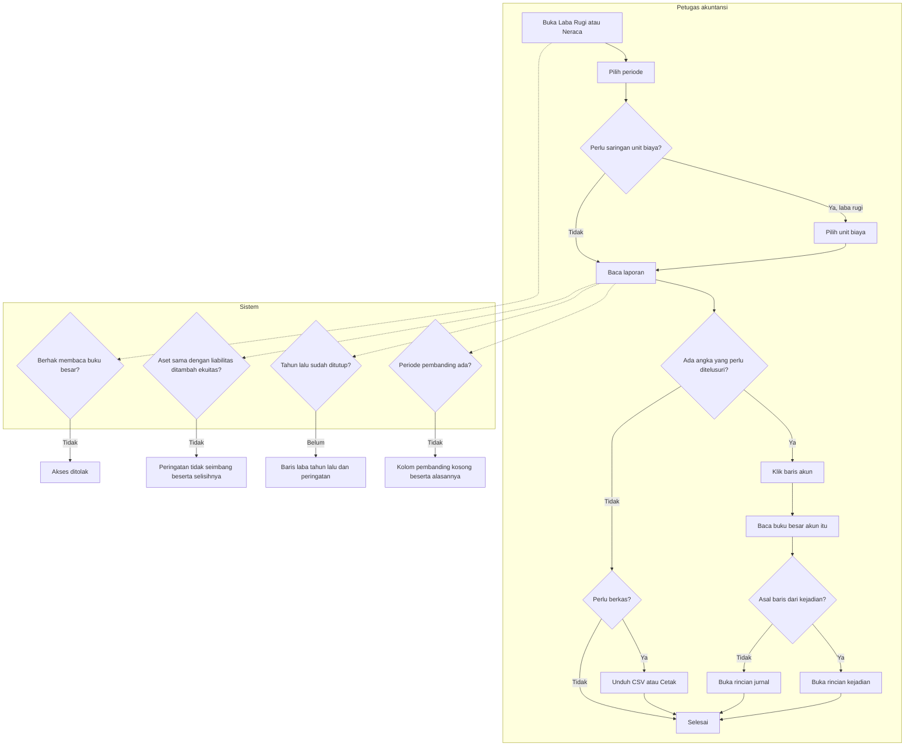

# Accounting — Membaca dan Menelusuri Laporan Keuangan

| Field | Nilai |
|---|---|
| Status | **`approved`** Rizki, 24 November 2026 (`GATE-DESAIN-1124`) |
| Dasar | `ACC-DEC-141`..`155` |
| Lingkup | Laba rugi, neraca, buku besar, dan unduhan CSV (ACC-FIN-005 + 008) |

## Tujuan

Petugas akuntansi dan pimpinan membaca kinerja (laba rugi) dan posisi keuangan (neraca) satu bulan,
lalu menelusuri angka yang janggal sampai ke jurnal dan asal transaksinya. Tidak ada data yang
diubah di sepanjang alur ini.

## Alur

## Tabel langkah

| No | Langkah | Pelaku | Masukan | Keluaran | Bila gagal, petugas… |
|---:|---|---|---|---|---|
| 1 | Membuka laporan | Petugas | Menu Laba Rugi atau Neraca | Layar laporan | Ditolak hak akses → meminta admin memberi hak Buku Besar |
| 2 | Memilih periode | Petugas | Periode bulan | Laporan periode itu dan pembandingnya | Periode belum ada → meminta pembuatan periode tahun buku |
| 3 | Menyaring unit biaya (laba rugi saja) | Petugas | Unit biaya | Laba rugi bagian unit itu, dengan catatan bahwa baris tanpa unit tidak ikut | Unit tidak ditemukan → memilih unit dari daftar |
| 4 | Membaca peringatan | Petugas | — | Peringatan tahun lalu belum ditutup atau neraca tidak seimbang | Tahun lalu belum ditutup → mengajukan tutup tahun lewat layar Tutup Tahun; tidak seimbang → memeriksa Neraca Saldo dan melapor ke pengelola sistem |
| 5 | Menelusuri angka | Petugas | Klik baris akun | Buku besar akun itu pada rentang kolom yang diklik | Tautan tidak terbaca di tab lain → memilih akun kembali di Buku Besar |
| 6 | Membuka asal | Petugas | Klik nomor jurnal atau asal kejadian | Rincian jurnal atau rincian kejadian | Tidak berhak membuka layar tujuan → meminta hak yang sesuai |
| 7 | Mengunduh atau mencetak | Petugas | Tombol Unduh CSV atau Cetak | Berkas CSV atau dokumen cetak | Buku besar terlalu banyak baris → mempersempit rentang tanggal |

## Jalur tidak normal

| Keadaan | Yang terlihat petugas | Contoh |
|---|---|---|
| Tahun buku pertama di sistem | Kolom pembanding dan selisih tampil `—` beserta alasannya | Laba rugi November 2026, padahal 2025 tidak ada di sistem |
| Tahun lalu belum ditutup | Baris Laba Tahun Lalu Belum Ditutup dan peringatan | Neraca Maret 2027 sebelum tutup tahun 2026 |
| Jurnal koreksi disahkan sesudah laporan dibuka | Angka berubah saat laporan dibuka ulang; tidak ada laporan tersimpan yang basi | Koreksi November disahkan pukul 11.00, laporan dibuka ulang pukul 11.05 |
| Neraca tidak seimbang | Laporan tetap tampil dengan selisihnya | Hanya terjadi bila ada data rusak |
