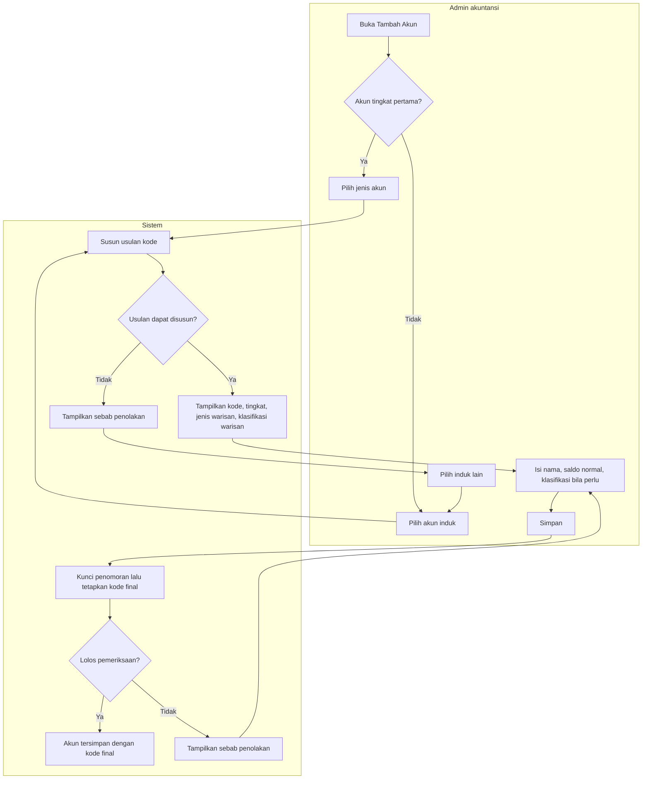
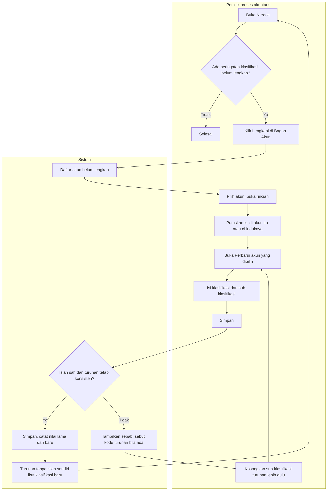

# Accounting — Menambah Akun dan Melengkapi Klasifikasi Laporan

| Field | Nilai |
|---|---|
| Status | **`approved`** Rizki, 25 November 2026 (`GATE-DESAIN-1125`) |
| Dasar | `ACC-DEC-162`..`170`, `172`, `173` |
| Lingkup | Tambah akun dengan kode otomatis dan jenis warisan; melengkapi klasifikasi Lancar/Tidak Lancar dari peringatan neraca |

## Tujuan

Admin akuntansi menambah akun tanpa memikirkan nomor kodenya, dan pemilik proses akuntansi
melengkapi klasifikasi laporan supaya rasio keuangan dapat dihitung. Kedua alur hanya mengubah
bagan akun; tidak ada jurnal yang dibuat.

## Alur 1 — Menambah akun

| Langkah | Pelaku | Masukan | Keluaran | Bila gagal, petugas melakukan |
|---|---|---|---|---|
| Pilih jenis (tingkat pertama) | Admin | Jenis akun | Usulan kode akar | Akar jenis itu sudah ada → batalkan, pilih induk di bawah akar itu |
| Pilih induk | Admin | Akun induk dari daftar | Usulan kode, tingkat, jenis | Induk sudah bertransaksi → pilih induk lain atau buat grup baru; induk di tingkat 5 → pilih induk lebih tinggi; nomor di bawah induk penuh → pilih atau buat induk lain |
| Isi sisa form | Admin | Nama, saldo normal, klasifikasi | — | Klasifikasi ditolak (mis. sub-klasifikasi pada akun Tidak Lancar) → ubah isian klasifikasi atau pilih "Ikut induk" |
| Simpan | Sistem | Isian form | Akun dengan kode final | Kode baru saja dipakai penyimpanan lain → simpan ulang, kode berikutnya diberikan; kode final berbeda dari usulan → cukup dibaca dari pemberitahuan |

**Contoh.** Admin memilih induk 1-1000 Kas dan Setara Kas → usulan 1-1005, jenis Aset, ikut induk
Lancar · Kas dan Setara Kas. Admin mengisi "Bank Mandiri", saldo normal Debit, lalu menyimpan →
tersimpan 1-1005.

## Alur 2 — Melengkapi klasifikasi dari neraca

| Langkah | Pelaku | Masukan | Keluaran | Bila gagal, petugas melakukan |
|---|---|---|---|---|
| Baca peringatan | Pemilik | Neraca satu periode | Jumlah dan kode akun bersaldo yang belum lengkap | — |
| Buka daftar tersaring | Sistem | Tautan dari neraca | Seluruh akun belum lengkap, tanpa melihat saldo | Daftar kosong padahal neraca memberi peringatan → muat ulang; peringatan neraca hanya menghitung akun bersaldo |
| Putuskan tingkat pengisian | Pemilik | Pohon akun | Akun yang akan diisi (biasanya grup tingkat 2) | — |
| Isi dan simpan | Pemilik | Klasifikasi, sub-klasifikasi | Klasifikasi tersimpan, turunan ikut | Klasifikasi pada akun Ekuitas/Pendapatan/Beban → bukan akun yang tepat, pilih akun Aset atau Liabilitas; turunan memakai sub-klasifikasi sendiri → buka turunan yang disebut, kosongkan atau ganti sub-klasifikasinya, lalu ulangi |
| Periksa ulang | Pemilik | Neraca yang sama | Peringatan berkurang atau hilang | Masih ada → ulangi untuk akun yang tersisa |

**Contoh.** Neraca 2026-09 menyebut 1002, 1-1003, 1-1004 belum lengkap. Pemilik mengisi 1-1000 Kas dan
Setara Kas dengan Lancar · Kas dan Setara Kas → ketiganya ikut dan hilang dari peringatan.
