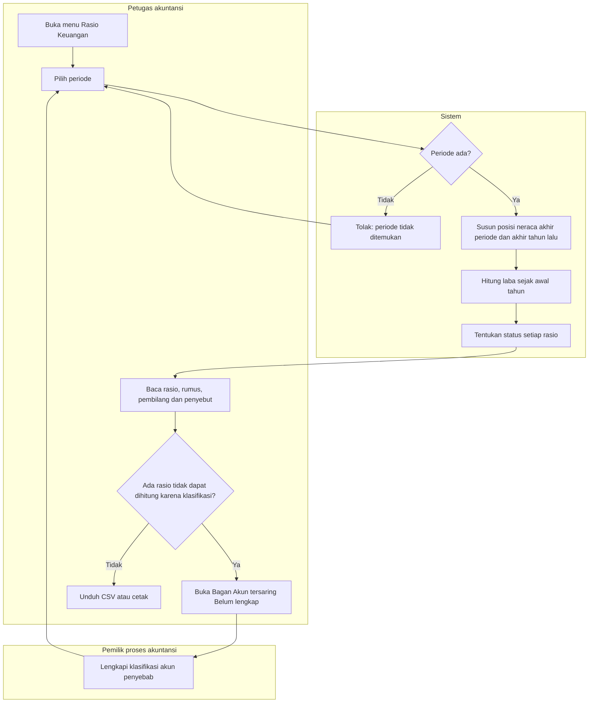

# Accounting — Membaca Rasio Keuangan

| Field | Nilai |
|---|---|
| Status | **`approved`** Rizki, 26 November 2026 (`GATE-DESAIN-1126`) |
| Dasar | `ACC-DEC-161`, `174`..`184` |
| Lingkup | Membuka rasio keuangan satu periode, memahami rasio yang tidak dapat dihitung, dan melengkapi klasifikasi akun penyebabnya |

## Tujuan

Petugas akuntansi melihat delapan rasio keuangan sebuah periode beserta asal angkanya. Rasio yang
datanya belum cukup tidak pernah tampil sebagai angka; layar menyebut sebabnya supaya petugas tahu apa
yang harus dilengkapi. Alur ini hanya membaca; tidak ada jurnal yang dibuat.

## Alur

## Langkah

| Langkah | Pelaku | Masukan | Keluaran | Bila gagal |
|---|---|---|---|---|
| Buka menu dan pilih periode | Petugas | Periode | Permintaan rasio | Tanpa hak baca buku besar: layar menolak; minta hak ke admin |
| Periksa periode | Sistem | Badan hukum, periode | Periode atau penolakan | Periode tidak ada: pilih periode lain atau bangkitkan tahun bukunya di Periode Akuntansi |
| Susun posisi dan laba | Sistem | Jurnal disahkan | Total aset, liabilitas, ekuitas, laba sejak awal tahun | — |
| Tentukan status | Sistem | Klasifikasi akun, tahun buku lalu, keseimbangan neraca | Dihitung, N/A, tidak dapat dihitung, atau tidak sah beserta alasannya | Bukan galat; alasan tampil di setiap rasio |
| Lengkapi klasifikasi | Pemilik proses akuntansi | Akun yang disebut layar | Klasifikasi tersimpan | Ditolak bila isian tidak berlaku (lihat alur Master COA) |
| Unduh atau cetak | Petugas | — | Berkas CSV atau cetakan | Unduhan gagal: pesan di layar; coba lagi |

## Jalur yang sering ditemui

| Keadaan | Yang terlihat petugas | Tindakan |
|---|---|---|
| Tahun buku lalu belum ada di sistem | Seluruh kolom pembanding, serta ROA dan ROE kolom kini, bertuliskan tidak dapat dihitung | Bangkitkan tahun buku lalu bila memang dibutuhkan |
| Akun bersaldo belum diklasifikasi | Current, Quick, dan Cash tidak dapat dihitung; peringatan menyebut akunnya | Lengkapi lewat tautan ke Bagan Akun |
| Neraca tidak seimbang | Tujuh rasio tidak sah; hanya Net Profit Margin yang tampil | Periksa Neraca Saldo periode itu |
| Penyebut nol | Rasio bertuliskan N/A | Tidak ada; memang tidak terdefinisi |
