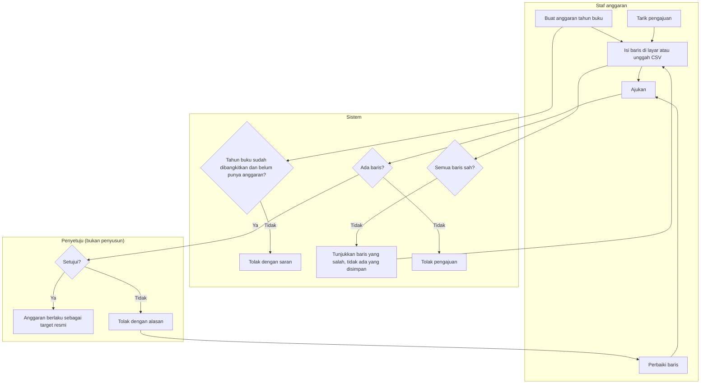
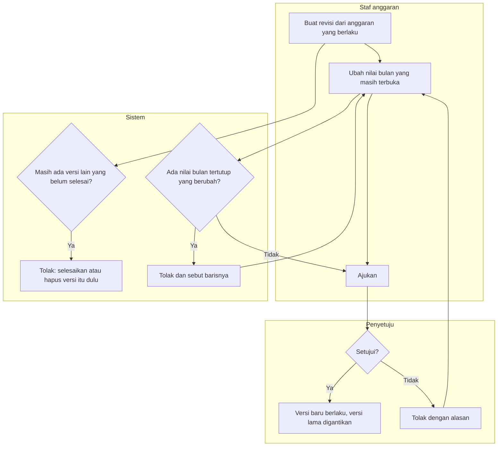

# Accounting — Menyusun, Menyetujui, dan Merevisi Anggaran

| Field | Nilai |
|---|---|
| Status | **`draft`** — menunggu gerbang desain Rizki |
| Dasar | `ACC-DEC-185`..`199` |
| Lingkup | Membuat anggaran tahun buku, mengisi baris, mengajukan, menyetujui atau menolak, dan merevisi di tengah tahun |

## Tujuan

Staf anggaran menyusun anggaran pendapatan dan beban satu tahun buku; pengguna lain yang berwenang
menyetujuinya sehingga target resmi berlaku. Bila perlu diubah di tengah tahun, dibuat versi baru tanpa
mengubah target bulan yang sudah ditutup. Alur ini tidak membuat jurnal.

## Alur 1 — Menyusun dan menyetujui

## Alur 2 — Revisi di tengah tahun

## Langkah

| Langkah | Pelaku | Masukan | Keluaran | Bila gagal |
|---|---|---|---|---|
| Buat anggaran | Staf anggaran | Tahun buku, keterangan | Versi 1 Draft | Tahun belum dibangkitkan: bangkitkan di Periode Akuntansi. Sudah ada: buka versi yang ada atau buat revisi |
| Isi baris | Staf anggaran | Akun, unit biaya, nilai per bulan / CSV | Baris tersimpan | Baris salah disebut nomornya; perbaiki lalu simpan/unggah ulang |
| Ajukan | Staf anggaran | — | Diajukan | Tanpa baris: isi baris dulu |
| Tarik | Pengaju | — | Kembali Draft | Hanya pengaju yang bisa |
| Setujui / Tolak | Penyetuju | Alasan bila menolak | Disetujui / Ditolak | Pengaju tidak bisa menyetujui sendiri: minta penyetuju lain |
| Revisi | Staf anggaran | — | Versi baru Draft berisi salinan baris | Masih ada versi lain yang belum selesai: selesaikan atau hapus |
| Hapus | Staf anggaran | — | Versi terhapus | Hanya Draft/Ditolak |
