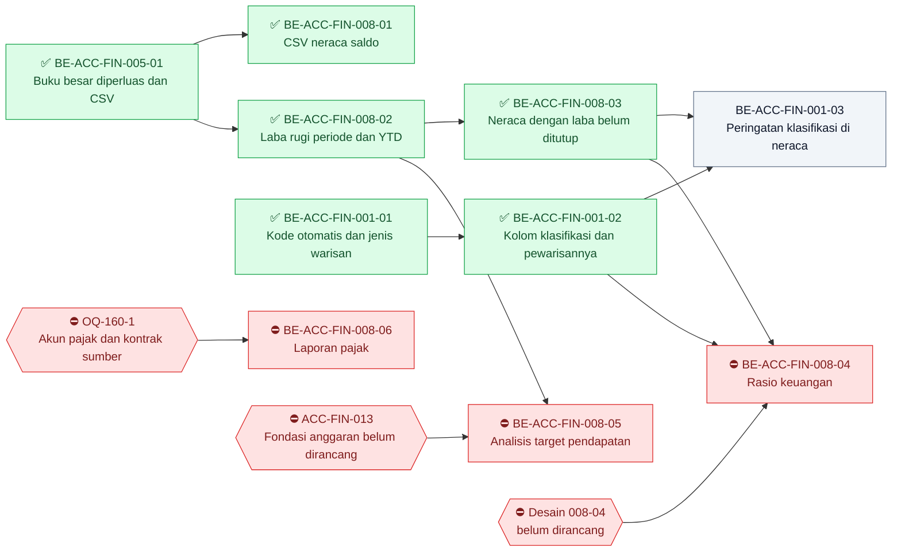

# Roadmap Delivery Backend — Accounting Finishing (ACC-FIN-005, ACC-FIN-008 sebagian, ACC-FIN-001 Master COA)

## Metadata

```yaml
blueprint_id: ACC-BP-001
blueprint_revision: 19
blueprint_status: approved              # FIN-0/FIN-1: GATE-DESAIN-1124 (24 Nov 2026); ACC-FIN-001: GATE-DESAIN-1125 (25 Nov 2026)
roadmap_revision: 2                     # 1 = 24 Nov 2026 (FIN-0, FIN-1); 2 = 25 Nov 2026 (+ FIN-2..FIN-4 Master COA)
roadmap_status: APPROVED                # revisi 2 disusun atas perintah Rizki sesudah GATE-DESAIN-1125 ("saya setujui, lanjut plan-module-delivery")
approved_by: [Rizki]
approved_at: 2026-11-25
source_backend: 0f67c5c2                # rizkiG; revisi 1 disusun pada 1f353c45
source_frontend: a2ddb52d2              # RizkiV2; revisi 1 disusun pada 22894248
decision_revision: 20                   # 00-interview-decisions.md, ACC-DEC-141..173
contracts: [ACC-API-0.17, ACC-API-0.18, ACC-VALIDATION-0.12, ACC-VALIDATION-0.13, ACC-PERMISSION-0.8, ACC-PERMISSION-0.9, ACC-TEST bagian 4 dan 5]
design_inputs: [02-backend-architecture.md bagian 25 dan 26, 04-prd-to-mvp.md bagian 30 dan 31, erd/data-dictionary.md bagian 20 dan 21, flowcharts/06-laporan-keuangan.md, flowcharts/07-master-coa.md]
requirement_source: MASTER PRD ACC-FIN-PRD-001 (24 Nov 2026) + keputusan tertulis Rizki 25 Nov 2026 - ClickUp belum terbaca (U-01)
clickup_refs: [z8m132yv7x Transaksi, z8m132yv84 Laporan Keuangan]
scope_waves: [FIN-0, FIN-1, FIN-2, FIN-3, FIN-4]
excluded_scope: [ACC-FIN-008 rasio keuangan (008-04, belum dirancang), ACC-FIN-008 target pendapatan (008-05), ACC-FIN-008 laporan pajak (008-06), ACC-FIN-002 kunci grup COA]
task_namespace: BE-ACC-FIN-<nomor kebutuhan PRD>-<urut>
acceptance_policy: automated test bukan acceptance criterion (ACC-DEC-081); unit test tidak ditulis (kesepakatan kerja Rizki)
migration: satu - AddChartOfAccountReportClassification (BE-ACC-FIN-001-02), diizinkan Rizki 25 Nov 2026 (OQ-167-1), dibuat dan diterapkan Rizki sendiri
```

**Namespace task.** `BE-ACC-FIN-005-01` dibaca "task backend pertama untuk kebutuhan PRD ACC-FIN-005".
Nomor kebutuhan dipertahankan supaya setiap task langsung tertelusur ke PRD dan ClickUp, dan nomor
urut memberi ruang bagi satu kebutuhan yang dipecah menjadi beberapa task. Namespace ini tidak
bertabrakan dengan roadmap yang ada: `BE-ACC-001`..`015` (MVP) dan `BE-ACC-P2-001`..`035` (Phase 2).

**Arti tanda status pada dokumen ini.**

| Tanda | Artinya |
| :---: | --- |
| ✅ | Selesai. Acceptance criteria dan DoD **terbukti**, buktinya ada pada laporan task |
| 🟡 | Sebagian. Source-nya sudah ada, tetapi acceptance criteria belum terbukti penuh. **Belum selesai** |
| ⛔ | Terblokir. Prasyaratnya belum terpenuhi, dan task **tidak boleh dimulai** |
| tanpa tanda | Belum dikerjakan |

## Grafik Urutan Dependency



| Gelombang | Boleh mulai setelah | Task |
| ---: | --- | --- |
| 1 | — | ✅ `BE-ACC-FIN-005-01` (`FIN-0`); `BE-ACC-FIN-001-01` (`FIN-2`) |
| 2 | `BE-ACC-FIN-005-01` / `BE-ACC-FIN-001-01` | ✅ `BE-ACC-FIN-008-01` (`FIN-0`), ✅ `BE-ACC-FIN-008-02` (`FIN-1`); `BE-ACC-FIN-001-02` (`FIN-3`, sesudah `001-01`) |
| 3 | `BE-ACC-FIN-008-02` | ✅ `BE-ACC-FIN-008-03` (`FIN-1`) |
| 4 | `BE-ACC-FIN-001-02` dan `BE-ACC-FIN-008-03` | `BE-ACC-FIN-001-03` (`FIN-4`) |
| — | ⛔ menunggu desain 008-04, `BE-ACC-FIN-008-03`, `BE-ACC-FIN-001-02` | `BE-ACC-FIN-008-04` |
| — | ⛔ menunggu ACC-FIN-013 dan `BE-ACC-FIN-008-02` | `BE-ACC-FIN-008-05` |
| — | ⛔ menunggu `OQ-160-1` | `BE-ACC-FIN-008-06` |

Jumlah panah: 12. Jumlah entri kolom `Dependency` pada ringkasan task: 12.

**Gelombang eksekusi dan gelombang pengiriman berbeda arti.** Gelombang eksekusi (1–4) adalah urutan
teknis menurut prasyarat. Gelombang pengiriman (`FIN-0`..`FIN-4`) adalah paket yang diuji bersama dari
layar, sesuai PRD bagian 30.7 dan 31.7. `BE-ACC-FIN-001-01` tidak punya prasyarat teknis, tetapi
urutan pengerjaan Rizki menempatkannya sesudah koreksi laba ditahan (`ACC-DEC-171`), yang dikerjakan
Rizki lewat layar dan bukan task roadmap.

**Perubahan revisi 2.** + `BE-ACC-FIN-001-01`..`03`. Blocker `008-04`..`06` diperbarui: `U-05`,
`C-02`, dan `U-07` sudah tertutup arahnya (`ACC-DEC-161`, `159`, `160`), sehingga yang tersisa adalah
desain atau kontrak masing-masing. `008-04` kini juga bergantung pada `001-02` (penghitung
klasifikasi).

## Baca ini lebih dahulu

### Batas wewenang roadmap ini

| Boleh | Tidak boleh |
|---|---|
| Menambah method, DTO, enum, dan berkas `partial` di `GeneralLedger/` dan `MasterData/ChartOfAccount/` | Menambah tabel; menambah kolom **selain** dua kolom klasifikasi `BE-ACC-FIN-001-02` |
| Menambah action pada `GeneralLedgerController` dan `ChartOfAccountController` | Menjalankan `dotnet ef migrations add` atau menerapkan migration — **Rizki sendiri** |
| Menyunting `AccChartOfAccount` dan `AccChartOfAccountConfiguration` untuk dua kolom klasifikasi | Menambah controller baru (modul akses kedua di Akses Role) |
| Memakai `LoggerService` dan pola `pg_advisory_xact_lock` yang ada | Menambah baris di `Program.cs` |
| Membaca tabel milik modul lain (`MstCostCenter`, `MstLegalEntity`) | Menulis ke database lewat SQL; data uji hanya lewat layar atau API |

### Catatan yang mengikat setiap task backend

1. **QBE preflight dan kesesuaian engineering** diselesaikan pada waktu eksekusi dari `AGENTS.md`
   backend dan dokumen engineering canonical `QuilvianEngineeringSkills`, bukan dari roadmap ini.
2. **Build dijalankan Rizki.** Agent memberi perintah `dotnet build -p:RunAnalyzers=false` beserta yang
   harus diperhatikan; agent tidak menjalankannya.
3. **Nol baris komentar** pada kode baru (`//`, `///`, `/* */`). Komentar lama yang ikut dipindah ke
   berkas `partial` dibiarkan apa adanya.
4. **Hanya jurnal `Posted`.** Setiap query baris jurnal berangkat dari `BarisDisahkan(legalEntityId)` atau
   penyaring `Posted` yang sudah ada di service; tidak ada query baris jurnal yang ditulis ulang dari nol.
5. **Nominal tidak pernah masuk log** (`BE-ACC-P2-033`, `ACC-DEC-155`).
6. **Uji tanpa SQL tulis.** Data uji dibuat lewat layar atau API yang ada.
7. **Migration.** Agent berhenti sebelum `dotnet ef migrations add`, termasuk pada task yang memang
   membutuhkannya; sebelum Rizki menjalankannya, model dibandingkan dengan snapshot supaya model modul
   lain tidak ikut tersapu.

### Batas cakupan ACC-FIN-008 dan ACC-FIN-001

ACC-FIN-008 pada PRD memuat enam laporan; roadmap ini merencanakan tiga (neraca saldo + CSV, laba rugi,
neraca). Tiga sisanya tercatat sebagai task ⛔ `008-04`..`06`. ACC-FIN-008 **tidak boleh** ditandai
selesai sebelum ketiganya dikerjakan atau dikeluarkan dari lingkup lewat keputusan Rizki.

ACC-FIN-001 direncanakan lewat `001-01`..`03` (kode otomatis, jenis warisan, klasifikasi laporan).
Penguncian grup COA adalah ACC-FIN-002 dan belum dirancang; definisi grupnya sudah dikunci
`ACC-DEC-165`.

## Ringkasan task

| Task ID | Outcome | Requirement / decision | Kontrak | Reuse | Cakupan | Dependency | Acceptance criteria | Verifikasi | Risiko / pemilik | DoD |
| --- | --- | --- | --- | --- | --- | --- | --- | --- | --- | --- |
| ✅ `BE-ACC-FIN-005-01` | Buku besar dapat disaring unit biaya, membawa asal jurnal, punya ringkasan saldo, dan dapat diunduh CSV | `FR-FIN-001`..`005`; `ACC-DEC-141`, `147`, `148`, `149`, `155` | `ACC-API-0.17` (`movements`, `movements/summary`, `movements/export`); `VAL-GL-01`..`03`, `06` | `BarisDisahkan`, `GetMovementsAsync`, `LoggerService` | Lihat kartu | — | AC-1..AC-8 kartu | Swagger + layar, `F10`, `F12`, `F13`, `F15`, `F16`, `F19` | Pemecahan `partial` menggeser `GetMovementsAsync` — regresi buku besar; Rizki | Kartu |
| ✅ `BE-ACC-FIN-008-01` | Neraca saldo dapat diunduh CSV | `FR-FIN-030`; `ACC-DEC-149`, `153`, `155` | `ACC-API-0.17` (`trial-balance/export`) | `GetTrialBalanceAsync`, `AccLedgerCsv` | Lihat kartu | `BE-ACC-FIN-005-01` | AC-1..AC-5 | `F18`, `F16`, `F20` | Rendah; Rizki | Kartu |
| ✅ `BE-ACC-FIN-008-02` | Laba rugi periode dan YTD dengan pembanding, tanpa jurnal `JT`, dapat disaring unit biaya, tercatat saat dibuka, dapat diunduh | `FR-FIN-010`..`015`; `ACC-DEC-142`, `144`..`147`, `149`, `150`, `155` | `ACC-API-0.17` (`income-statement`, `/export`); `VAL-GL-01`, `04`, `05`, `08` | `BarisDisahkan`, `AccJournalTypeService.CariMenurutKodeAsync`, `AccLedgerCsv` | Lihat kartu | `BE-ACC-FIN-005-01` | AC-1..AC-10 | `F1`..`F3`, `F6`, `F7`, `F8`, `F9`, `F11`, `F16`, `F17` | Rumus pengecualian `JT` dan hierarki; Rizki | Kartu |
| ✅ `BE-ACC-FIN-008-03` | Neraca per akhir periode dengan pembanding, dua baris laba belum ditutup, status seimbang, tercatat saat dibuka, dapat diunduh | `FR-FIN-012`, `014`, `015`, `020`..`022`; `ACC-DEC-143`..`146`, `149`, `150`, `154`, `155` | `ACC-API-0.17` (`balance-sheet`, `/export`); `VAL-GL-04`, `05`, `07`..`09` | Penyusun hierarki dan rentang periode dari `008-02` | Lihat kartu | `BE-ACC-FIN-008-02` | AC-1..AC-9 | `F4`, `F5`, `F8`, `F9`, `F14`, `F16`, `F17` | Rumus laba tahun berjalan; Rizki | Kartu |
| ✅ `BE-ACC-FIN-001-01` | Kode akun disusun backend dengan pratinjau dan aman dari simpan bersamaan; jenis akun anak diwarisi | `FR-FIN-050`..`053`, `058`; `ACC-DEC-162`..`166`, `170`, `172` | `ACC-API-0.18` (`GET next-code`, `POST`, `PUT`); `VAL-COA-01`..`06`, `13`..`15`; `ACC-PERMISSION-0.9` | `CreateAsync`, `PeriksaIndukAsync`, `PeriksaTingkatTerhadapInduk`, `KodeKembar`, pola kunci `AccJournalService` | Lihat kartu | — | AC-1..AC-9 | Swagger + skrip serentak, `F25`..`F33`, `F40` | Kunci + transaksi di `CreateAsync`; tangkapan `23505`; Rizki | Kartu |
| ✅ `BE-ACC-FIN-001-02` | Klasifikasi Lancar/Tidak Lancar dan sub-klasifikasi tersimpan, diwariskan, divalidasi, tercatat, dan dapat disaring | `FR-FIN-054`..`056`, `058`; `ACC-DEC-167`..`169`, `173` | `ACC-API-0.18` (`GET /`, `/{id}`, `/tree`, `POST`, `PUT` + `Classification`); `VAL-COA-07`..`12`; `ACC-PERMISSION-0.9`; kamus data bagian 21 | `AmbilTurunanAsync`, pola `HitungSaldoAsync` static, `TanpaNominal` | Lihat kartu | `BE-ACC-FIN-001-01` | AC-1..AC-10 | Swagger + layar, `F34`..`F37`, `F39`..`F41` | Migration dan snapshot; aturan turunan `VAL-COA-11`; Rizki | Kartu |
| `BE-ACC-FIN-001-03` | Neraca menyebut akun bersaldo yang klasifikasinya belum lengkap tanpa mengubah angka | `FR-FIN-057`; `ACC-DEC-168`, `173` butir 5–6 | `ACC-API-0.18` (`GET /balance-sheet`); `ACC-PERMISSION-0.9` | `MuatAkunLaporanAsync`, `AccChartOfAccountClassification` | Lihat kartu | `BE-ACC-FIN-001-02`, `BE-ACC-FIN-008-03` | AC-1..AC-6 | `F38`, regresi `F8`, `F9` | Menyentuh FIN-1 (izin `ACC-DEC-171` lewat `168`); Rizki | Kartu |
| ⛔ `BE-ACC-FIN-008-04` | Rasio keuangan | ACC-FIN-008 (PRD); `ACC-DEC-161` | Belum dirancang | `AccChartOfAccountClassification` (`001-02`) | Belum dirancang | Desain 008-04, `BE-ACC-FIN-008-03`, `BE-ACC-FIN-001-02` | — | — | Rizki | — |
| ⛔ `BE-ACC-FIN-008-05` | Analisis target pendapatan | ACC-FIN-008 (PRD); `ACC-DEC-159` | Belum dirancang | — | Belum dirancang | ACC-FIN-013, `BE-ACC-FIN-008-02` | — | — | Rizki; owner Procurement untuk ratifikasi | — |
| ⛔ `BE-ACC-FIN-008-06` | Laporan pajak | ACC-FIN-008 (PRD); `ACC-DEC-160` | Belum dirancang | — | Belum dirancang | `OQ-160-1` | — | — | Rizki + PIC Pajak + owner modul sumber | — |

---

## ✅ `BE-ACC-FIN-005-01` — Buku besar diperluas dan CSV

**Status:** ✅ SELESAI (development), 25 November 2026. QBE Strict `PASS`; build `PASS` (Rizki, DLL 09:01:06 WIB, 25 November 2026). AC-1..AC-7 `RUNTIME VERIFIED` (API 12/12, layar 14/14, 24 November 2026; uji ulang sesudah penguatan 25 November 2026: B7 dan layar U1–U10 10/10). AC-8 `SOURCE VERIFIED` tujuh butir + runtime `WAIVED` atas keputusan Rizki (`ACC-DEC-156`); `F19` ditunda ke UAT/verifikasi kinerja. UAT belum dijalankan — milik tim UAT. Bukti: [laporan BE-ACC-FIN-005-01](../task/report/backend/BE-ACC-FIN-005-01.md) bagian 5, 6, 8, 9.

**Gelombang pengiriman:** `FIN-0`. **Pasangan frontend:** `FE-ACC-FIN-005-01`.

| Field | Isi |
|---|---|
| Requirement | ACC-FIN-005 (PRD; ClickUp `z8m132yv7x` subtask Download Excel (CSV), Detail General Ledger, General Ledger Report, Overview Ledger); `FR-FIN-001`..`005` |
| Decision | `ACC-DEC-141`, `147` butir 1 dan 4, `148`, `149`, `155` butir 2–4 |
| Kontrak | `ACC-API-0.17` grup General Ledger: `GET /movements` (diperluas), `GET /movements/summary`, `GET /movements/export`; `VAL-GL-01`, `02`, `03`, `06`; `ACC-PERMISSION-0.8` |
| Desain | `02-backend-architecture.md` bagian 25.3–25.5, 25.7 |

**Implementasi yang sudah ada.** `AccGeneralLedgerService.GetMovementsAsync` sudah menyaring badan
hukum, akun, dan rentang tanggal; menghitung saldo pembuka sebelum rentang; dan menjaga saldo berjalan
tetap benar lintas halaman. `BarisDisahkan` sudah menjamin hanya jurnal `Posted`. Endpoint
`GET /movements` sudah dikonsumsi `use-general-ledger.jsx`.

**Cakupan.**
1. Jadikan `AccGeneralLedgerService` `partial`; pindahkan `GetMovementsAsync` ke
   `AccGeneralLedgerService.Movement.cs`.
2. Tambah `CostCenterId` pada `LedgerMovementQuery`; validasi `VAL-GL-01`; terapkan penyaring
   sebelum saldo pembuka dihitung.
3. Tambah sebelas field pada `LedgerMovementResponse`; isi asal jurnal sekali per halaman menurut
   urutan bagian 25.5.
4. Tambah `LedgerMovementSummaryResponse` dan `GetMovementSummaryAsync`.
5. Tambah `AccLedgerCsv` (statis) dan `BuildMovementCsvAsync` di `AccGeneralLedgerService.Export.cs`.
6. Tambah enum `LedgerSourceKind`.
7. Tambah dua action pada `GeneralLedgerController`: `movements/summary`, `movements/export`; unduhan
   dicatat `GeneralLedger.Export`.

**Berkas dan service terdampak.**

| Berkas | Status |
|---|---|
| `GeneralLedger/Services/AccGeneralLedgerService.cs` | Diperbarui — `partial`, `GetMovementsAsync` dipindah |
| `GeneralLedger/Services/AccGeneralLedgerService.Movement.cs` | Baru |
| `GeneralLedger/Services/AccGeneralLedgerService.Export.cs` | Baru |
| `GeneralLedger/Services/AccLedgerCsv.cs` | Baru |
| `GeneralLedger/DTOs/GeneralLedgerDtos.cs` | Diperbarui |
| `GeneralLedger/Enums/LedgerSourceKind.cs` | Baru |
| `GeneralLedger/Controllers/GeneralLedgerController.cs` | Diperbarui — dua action |

**Kontrak API.**

| Method | Path | Hak | Request | Response |
|---|---|---|---|---|
| `GET` | `/api/v1/corporate/accounting/general-ledger/movements` | `GeneralLedger : Read` | `LedgerMovementQuery` + `CostCenterId?` | `ApiResponse<PagedResult<LedgerMovementResponse>>` + 11 field |
| `GET` | `.../general-ledger/movements/summary` | `GeneralLedger : Read` | `LegalEntityId`, `AccountId`, `DateFrom?`, `DateTo?`, `CostCenterId?` | `ApiResponse<LedgerMovementSummaryResponse>` |
| `GET` | `.../general-ledger/movements/export` | `GeneralLedger : Read` | sama dengan `summary` | `text/csv` |

**Aturan bisnis.**

| Aturan | Contoh |
|---|---|
| Saringan unit biaya diterapkan sebelum saldo pembuka, sehingga ketiga saldo adalah bagian unit itu | Beban Obat: Radiologi Rp 4.000.000 + Farmasi Rp 9.000.000; saring Radiologi → saldo akhir Rp 4.000.000 |
| Asal jurnal ditentukan berurutan: Koreksi → Tutup Tahun → Kejadian → Jurnal Berulang → Manual | Jurnal JB pembalik jurnal kejadian → `Koreksi · JU/2026/11/00031`, bukan Kejadian |
| Unit biaya nonaktif tetap diterima sebagai saringan | Unit yang dinonaktifkan Oktober tetap dapat dipakai menelusuri baris September |
| CSV memuat seluruh baris; lebih dari 50.000 baris ditolak `422` | 640 baris pada 26 halaman → satu berkas 642 baris data (saldo awal, 640 mutasi, saldo akhir) |
| Teks berawalan `=`, `+`, `-`, `@` di CSV diberi awalan `'` | Keterangan `=SUM(A1)` ditulis `'=SUM(A1)` |
| Pembacaan mutasi dan ringkasan **tidak** dicatat; unduhan dicatat tanpa nominal | — |

**Acceptance criteria.**

| # | Kriteria |
|---|---|
| AC-1 | Tanpa `CostCenterId`, isi dan urutan baris serta `RunningBalance` sama persis dengan sebelum perubahan untuk akun dan rentang yang sama |
| AC-2 | Dengan `CostCenterId`, hanya baris unit itu yang tampil, dan `RunningBalance` baris pertama halaman 1 = saldo pembuka unit + mutasi baris itu |
| AC-3 | Setiap baris membawa `JournalId`, `JournalTypeCode`, `SourceKind`, `SourceLabel`; tepat satu dari `AccountingEventId`, `RecurringTemplateId`, `ReversalOfJournalId` terisi sesuai `SourceKind`, atau ketiganya kosong untuk Manual dan Tutup Tahun |
| AC-4 | `summary` mengembalikan `ClosingBalance = OpeningBalance + TotalDebit − TotalCredit` dan sama dengan `RunningBalance` baris terakhir halaman terakhir |
| AC-5 | `export` mengembalikan berkas CSV sesuai bagian 25.7 (BOM, `;`, desimal koma, kepala laporan, saldo awal dan akhir) dengan nama `buku-besar_{kode akun}_{yyyyMMdd}-{yyyyMMdd}.csv` |
| AC-6 | Unduhan menghasilkan satu baris log `GeneralLedger.Export` berisi jenis laporan, saringan, jumlah baris — tanpa nominal |
| AC-7 | `CostCenterId` badan hukum lain → `400` "Unit biaya tidak ditemukan pada badan hukum ini." |
| AC-8 | Lebih dari 50.000 baris → `422` dengan jumlah barisnya disebut |

**Skenario negatif.**

| Skenario | Hasil |
|---|---|
| `CostCenterId` acak yang tidak ada | `400` |
| `DateTo` sebelum `DateFrom` pada `summary` dan `export` | `400`, pesan lama |
| Pengguna tanpa `GeneralLedger : Read` memanggil ketiga endpoint | `403` |
| Jurnal Draft dan Disetujui di akun yang sama | Tidak muncul di daftar, ringkasan, maupun CSV |
| Keterangan jurnal memuat `;` dan `"` | CSV tetap satu kolom per field; tanda kutip digandakan |

**Skenario regresi.**

| Skenario | Hasil |
|---|---|
| Layar Buku Besar yang ada (sebelum `FE-ACC-FIN-005-01`) dibuka | Tampil seperti sebelumnya; field baru diabaikan |
| `GET /trial-balance` dan `GET /account-balance/{id}` | Tidak berubah, termasuk log neraca saldo yang ada |
| Halaman 2 dan 3 akun yang sama | Saldo berjalan bersambung seperti sebelumnya |

**Skenario UAT.** `F10`, `F12`, `F13`, `F15`, `F16`, `F19` (`testing/acceptance-test-matrix.md` bagian 4).

**Bukti implementasi yang dikumpulkan.**
- Diff berkas di atas; bukti nol perubahan di `Program.cs`, `Migrations/`, dan konfigurasi EF.
- QBE preflight lulus.
- Keluaran `dotnet build -p:RunAnalyzers=false` dari Rizki: 0 galat.
- JSON respons Swagger untuk: tanpa saringan, dengan unit biaya, jurnal hasil kejadian, jurnal koreksi.
- Berkas CSV hasil unduhan dan tangkapan Excel komputer rumah sakit (`F20`).
- Kutipan log unduhan tanpa nominal.
- Laporan `task/report/backend/BE-ACC-FIN-005-01.md` dengan status Implementation, Developer
  Verification, dan UAT dipisah.

**DoD.** AC-1..AC-8 terbukti; laporan ditulis; roadmap dan traceability diperbarui.

---

## ✅ `BE-ACC-FIN-008-01` — CSV neraca saldo

**Status:** ✅ SELESAI (development), 25 November 2026. AC-1..AC-5 `RUNTIME VERIFIED` (uji API 8/8, uji layar bersama `FE-ACC-FIN-008-01` 11/11); build `PASS` (Rizki, DLL 09:01:06 WIB); QBE Strict 2 berkas `PASS`. Batas `ACC-DEC-157` `SOURCE VERIFIED` (runtime tidak dapat dicapai di data dev). UAT belum dijalankan — milik tim UAT. Bukti: [laporan BE-ACC-FIN-008-01](../task/report/backend/BE-ACC-FIN-008-01.md).

**Gelombang pengiriman:** `FIN-0`. **Pasangan frontend:** `FE-ACC-FIN-008-01`.

| Field | Isi |
|---|---|
| Requirement | ACC-FIN-008 bagian Trial Balance (PRD; ClickUp `z8m132yv84`); `FR-FIN-030` |
| Decision | `ACC-DEC-149`, `153`, `155` butir 3–4 |
| Kontrak | `ACC-API-0.17` `GET /general-ledger/trial-balance/export`; `ACC-PERMISSION-0.8` |
| Desain | `02-backend-architecture.md` bagian 25.7 |

**Implementasi yang sudah ada.** `GetTrialBalanceAsync` dan `GET /trial-balance` beserta lognya.
`AccLedgerCsv` dan pola unduhan dari `BE-ACC-FIN-005-01`.

**Cakupan.** `BuildTrialBalanceCsvAsync` di `AccGeneralLedgerService.Export.cs` yang memanggil
`GetTrialBalanceAsync` lalu menyusun CSV; satu action `trial-balance/export`.

**Berkas terdampak.** `AccGeneralLedgerService.Export.cs`, `GeneralLedgerController.cs`.

**Kontrak API.** `GET /api/v1/corporate/accounting/general-ledger/trial-balance/export?LegalEntityId=&PeriodCode=`
→ `text/csv`, nama `neraca-saldo_{kode periode}.csv`; `404` bila periode tidak ada.

**Aturan bisnis.** Isi CSV sama persis dengan respons `GET /trial-balance`: kolom kode akun, nama akun,
saldo awal, debit, kredit, saldo akhir; satu baris total; satu baris status seimbang. **Contoh:** 112
akun → 112 baris akun + 1 baris total + 1 baris status.

**Acceptance criteria.**

| # | Kriteria |
|---|---|
| AC-1 | Berkas berisi baris akun yang sama dan berurutan sama dengan `GET /trial-balance` periode yang sama |
| AC-2 | Total debit dan total kredit di berkas sama dengan respons JSON |
| AC-3 | Bentuk berkas mengikuti bagian 25.7 |
| AC-4 | Satu baris log `GeneralLedger.Export` tanpa nominal; log `GeneralLedger.TrialBalance` yang ada tidak ikut tertulis dua kali oleh unduhan |
| AC-5 | Periode tidak ada → `404`, JSON, bukan berkas |

**Skenario negatif.** Tanpa hak → `403`; `PeriodCode` kosong → `404` (perilaku `GetTrialBalanceAsync` yang ada).

**Skenario regresi.** `GET /trial-balance` dan layar Neraca Saldo tidak berubah.

**Skenario UAT.** `F18`, `F16`, `F20`.

**Bukti.** Diff; build Rizki; berkas CSV dan tangkapan Excel; kutipan log; laporan
`task/report/backend/BE-ACC-FIN-008-01.md`.

**DoD.** AC-1..AC-5 terbukti; laporan; roadmap dan traceability diperbarui.

---

## ✅ `BE-ACC-FIN-008-02` — Laba rugi periode dan YTD

**Status:** ✅ SELESAI (development), 25 November 2026. AC-1..AC-10 `RUNTIME VERIFIED`: uji API 13 PASS + 2 diganti uji tutup tahun 5/5 PASS (JT/2019/12/00001 dan pembaliknya, akun kontra 4-1002, pembanding 2020 lawan 2019 — data uji 2019/2020 dibuat lewat aplikasi atas persetujuan Rizki, tercatat di `persiapan.json`). Build `PASS` (Rizki, DLL 09:48:52 WIB); QBE Strict 5 berkas `PASS`. UAT belum dijalankan — milik tim UAT. Bukti: [laporan BE-ACC-FIN-008-02](../task/report/backend/BE-ACC-FIN-008-02.md).

**Gelombang pengiriman:** `FIN-1`. **Pasangan frontend:** `FE-ACC-FIN-008-02`.

| Field | Isi |
|---|---|
| Requirement | ACC-FIN-008 bagian Income Statement (PRD; ClickUp `z8m132yv84`); `FR-FIN-010`..`015` |
| Decision | `ACC-DEC-142`, `144`, `145`, `146`, `147` butir 2 dan 4, `149`, `150`, `155` |
| Kontrak | `ACC-API-0.17` `GET /general-ledger/income-statement`, `/income-statement/export`; `VAL-GL-01`, `04`, `05`, `08`; `ACC-PERMISSION-0.8` |
| Desain | `02-backend-architecture.md` bagian 25.6, 25.7 |

**Implementasi yang sudah ada.** `BarisDisahkan`; `AccJournalTypeService.CariMenurutKodeAsync`; pola
log neraca saldo; `AccLedgerCsv`.

**Cakupan.**
1. `FinancialStatementDtos.cs`: `IncomeStatementQuery`, `IncomeStatementResponse`,
   `FinancialStatementSectionResponse`, `FinancialStatementRowResponse`,
   `FinancialStatementAmountsResponse`.
2. Enum `FinancialStatementRowKind`.
3. `AccGeneralLedgerService.FinancialStatement.cs`: penentu rentang periode (`AwalTB`, pembanding),
   penyaring pengecualian `JT`, penjumlah per akun, penyusun hierarki — dibuat dapat dipakai ulang
   `008-03` — dan `GetIncomeStatementAsync`.
4. `BuildIncomeStatementCsvAsync`.
5. Dua action; pembacaan dicatat `FinancialStatement.IncomeStatement`, unduhan `GeneralLedger.Export`.

**Berkas terdampak.** `FinancialStatementDtos.cs` (baru), `FinancialStatementRowKind.cs` (baru),
`AccGeneralLedgerService.FinancialStatement.cs` (baru), `AccGeneralLedgerService.Export.cs`,
`GeneralLedgerController.cs`.

**Kontrak API.**

| Method | Path | Request | Response |
|---|---|---|---|
| `GET` | `.../general-ledger/income-statement` | `LegalEntityId`, `PeriodCode`, `CostCenterId?`, `IncludeZeroAccounts` | `ApiResponse<IncomeStatementResponse>` |
| `GET` | `.../general-ledger/income-statement/export` | sama | `text/csv`, `laba-rugi_{kode periode}[_{kode unit}].csv` |

**Aturan bisnis.**

| Aturan | Contoh |
|---|---|
| Kolom: periode, pembanding periode yang sama tahun lalu, YTD, YTD tahun lalu, dan selisih masing-masing | November 2026 lawan November 2025; Januari–November 2026 lawan Januari–November 2025 |
| Jurnal `JT` dan pembaliknya dikecualikan | Tahun 2026 ditutup `JT` 31 Desember: laba Januari–Desember tetap Rp 200.000.000 |
| Pendapatan = kredit − debit; Beban = debit − kredit; akun kontra negatif | Potongan Pendapatan saldo debit Rp 5.000.000 → −5.000.000 |
| Pembanding tidak ada → `null` dan alasan, bukan `0` | Tahun buku pertama 2026 |
| Akun nol di semua kolom disembunyikan kecuali `IncludeZeroAccounts` | — |
| Saringan unit biaya mengisi `CostCenterNotice` | — |
| Induk berjenis lain → anak naik ke leluhur sejenis terdekat atau akar kelompok | Cadangan `C-05` |

**Acceptance criteria.**

| # | Kriteria |
|---|---|
| AC-1 | Respons memuat tepat dua bagian, Pendapatan lalu Beban, dan `NetIncome` = total Pendapatan − total Beban di setiap kolom |
| AC-2 | YTD periode terakhir tahun buku = saldo akun Pendapatan dan Beban di neraca saldo periode itu dikurangi pengaruh jurnal `JT` (`F6`) |
| AC-3 | Jurnal `JT` dan pembaliknya tidak mengubah angka mana pun (`F2`, `F3`) |
| AC-4 | Tahun buku tanpa pendahulu → `ComparisonAvailable = false`, kolom pembanding `null`, alasan terisi (`F7`) |
| AC-5 | Akun kontra negatif dan mengurangi subtotal induknya (`F8`) |
| AC-6 | `IncludeZeroAccounts = false` menyembunyikan akun nol di semua kolom dan induk yang semua anaknya tersembunyi; `true` menampilkan semuanya (`F9`) |
| AC-7 | Dengan `CostCenterId`, hanya baris unit itu yang dihitung dan `CostCenterNotice` terisi (`F11`) |
| AC-8 | Hanya jurnal `Posted` (`F1`) |
| AC-9 | Pembacaan menghasilkan satu log `FinancialStatement.IncomeStatement`; unduhan satu log `GeneralLedger.Export`; keduanya tanpa nominal (`F17`) |
| AC-10 | CSV memuat seluruh baris yang tampil termasuk subtotal, total, dan laba bersih, dengan angka sama dengan JSON |

**Skenario negatif.**

| Skenario | Hasil |
|---|---|
| `PeriodCode` `2026/11` | `400` `VAL-GL-04` |
| Periode tahun yang belum dibuat | `404` |
| Unit biaya badan hukum lain | `400` |
| Tanpa hak | `403` pada keduanya |
| Jenis jurnal `JT` tidak ada di master | Tidak ada yang dikecualikan; laporan tetap jalan |

**Skenario regresi.** Buku besar, neraca saldo, dan pratinjau tutup tahun tidak berubah angka maupun
lognya.

**Skenario UAT.** `F1`, `F2`, `F3`, `F6`, `F7`, `F8`, `F9`, `F11`, `F16`, `F17`.

**Bukti.** Diff; build Rizki; JSON laba rugi untuk tahun buku uji (sebelum dan sesudah `JT`, dengan dan
tanpa unit biaya); tangkapan pencocokan `F6` dengan neraca saldo; berkas CSV; kutipan log; laporan
`task/report/backend/BE-ACC-FIN-008-02.md`.

**DoD.** AC-1..AC-10 terbukti; laporan; roadmap dan traceability diperbarui.

---

## ✅ `BE-ACC-FIN-008-03` — Neraca dengan laba belum ditutup

**Status:** ✅ SELESAI (development), 25 November 2026. AC-1..AC-9 `RUNTIME VERIFIED`: uji API 12/12 + uji tutup tahun 2020 4/4 (`F5`, `F8`; data uji 2020 dibuat lewat aplikasi atas persetujuan Rizki, tercatat di `persiapan.json`). Build `PASS` (Rizki, DLL 10:54:02 WIB); QBE Strict 4 berkas `PASS`. UAT belum dijalankan — milik tim UAT. Bukti: [laporan BE-ACC-FIN-008-03](../task/report/backend/BE-ACC-FIN-008-03.md).

**Gelombang pengiriman:** `FIN-1`. **Pasangan frontend:** `FE-ACC-FIN-008-03`.

| Field | Isi |
|---|---|
| Requirement | ACC-FIN-008 bagian Balance Sheet (PRD; ClickUp `z8m132yv84`); `FR-FIN-012`, `014`, `015`, `020`..`022` |
| Decision | `ACC-DEC-143`, `144`, `145`, `146`, `147` butir 3, `149`, `150`, `154`, `155` |
| Kontrak | `ACC-API-0.17` `GET /general-ledger/balance-sheet`, `/balance-sheet/export`; `VAL-GL-04`, `05`, `07`, `08`, `09` |
| Desain | `02-backend-architecture.md` bagian 25.6, 25.7 |

**Implementasi yang sudah ada.** Penentu rentang periode, penjumlah per akun, dan penyusun hierarki dari
`BE-ACC-FIN-008-02`; `AccLedgerCsv`.

**Cakupan.** `BalanceSheetQuery`, `BalanceSheetResponse`; `GetBalanceSheetAsync` (saldo per akun sampai
tanggal, dua baris laba hitungan, daftar tahun belum ditutup, status seimbang); `BuildBalanceSheetCsvAsync`;
dua action dengan log `FinancialStatement.BalanceSheet` dan `GeneralLedger.Export`.

**Berkas terdampak.** `FinancialStatementDtos.cs`, `AccGeneralLedgerService.FinancialStatement.cs`,
`AccGeneralLedgerService.Export.cs`, `GeneralLedgerController.cs`.

**Kontrak API.**

| Method | Path | Request | Response |
|---|---|---|---|
| `GET` | `.../general-ledger/balance-sheet` | `LegalEntityId`, `PeriodCode`, `IncludeZeroAccounts` | `ApiResponse<BalanceSheetResponse>` |
| `GET` | `.../general-ledger/balance-sheet/export` | sama | `text/csv`, `neraca_{kode periode}.csv` |

**Aturan bisnis.**

| Aturan | Contoh |
|---|---|
| Saldo per `EndDate` periode, pembanding per `EndDate` terakhir tahun buku lalu; semua jurnal `Posted` termasuk `JT` | 30 November 2026 lawan 31 Desember 2025 |
| Laba Tahun Berjalan = Σ(kredit − debit) Pendapatan dan Beban sejak awal tahun buku sampai tanggal | Januari–Maret 2027: Rp 45.000.000 |
| Laba Tahun Lalu Belum Ditutup = Σ(kredit − debit) Pendapatan dan Beban sebelum awal tahun buku; tampil hanya bila ≠ 0, dengan daftar tahunnya | 2026 belum ditutup: Rp 200.000.000, `UnclosedFiscalYears = [2026]` |
| `CostCenterId` diabaikan | — |
| Tidak seimbang tetap `200` dengan `IsBalanced = false` dan `Difference` | Selisih Rp 100 |

**Acceptance criteria.**

| # | Kriteria |
|---|---|
| AC-1 | Tepat tiga bagian: Aset, Liabilitas, Ekuitas; baris laba ber-`RowKind = 3` di Ekuitas |
| AC-2 | Data sehat → `IsBalanced = true` di kedua kolom (`F4`) |
| AC-3 | Tahun lalu belum ditutup → baris dan `UnclosedFiscalYears` terisi (`F4`) |
| AC-4 | Sesudah `JT` tahun itu disahkan → baris tahun lalu hilang, Laba Ditahan naik sebesar nilai itu, total ekuitas tetap (`F5`) |
| AC-5 | Akun kontra negatif (`F8`); akun nol mengikuti `IncludeZeroAccounts` (`F9`) |
| AC-6 | Pembanding tidak ada → `null` dan alasan |
| AC-7 | `CostCenterId` yang dikirim tidak mengubah angka |
| AC-8 | Log pembacaan dan unduhan tanpa nominal, termasuk `Difference` (`F17`) |
| AC-9 | CSV memuat seluruh baris, total liabilitas dan ekuitas, dan status seimbang |

**Skenario negatif.** Bentuk periode salah → `400`; periode tidak ada → `404`; tanpa hak → `403`.

**Skenario regresi.** Laba rugi (`008-02`) tidak berubah angka sesudah penyusun hierarki dipakai bersama;
buku besar dan neraca saldo tidak berubah.

**Skenario UAT.** `F4`, `F5`, `F8`, `F9`, `F14` (sisi data), `F16`, `F17`.

**Bukti.** Diff; build Rizki; JSON neraca untuk tahun uji sebelum dan sesudah `JT`; berkas CSV; kutipan
log; laporan `task/report/backend/BE-ACC-FIN-008-03.md`.

**DoD.** AC-1..AC-9 terbukti; laporan; roadmap dan traceability diperbarui.

---

## ✅ `BE-ACC-FIN-001-01` — Kode otomatis dan jenis warisan

**Status:** ✅ SELESAI (development), 25 November 2026. AC-1..AC-9 `RUNTIME VERIFIED`: uji API `01-uji-api.mjs` 14/15 + uji tambahan `02-uji-jenis-tak-dikenal.mjs` 2/2 (A3 gagal hanya pada asersi pesan jalur query; penolakan `400` benar, jalur body terbukti di B2). Batas kapasitas 9/999/99 `SOURCE VERIFIED`. Build `PASS` (Rizki, DLL 15:06:02 WIB); QBE Strict 4 berkas `PASS`. Delapan akun uji dinonaktifkan. Field klasifikasi warisan pada respons pratinjau sengaja ditunda ke `001-02`. UAT belum dijalankan — milik tim UAT. Bukti: [laporan BE-ACC-FIN-001-01](../task/report/backend/BE-ACC-FIN-001-01.md).

| Field | Isi |
|---|---|
| Requirement | ACC-FIN-001 (PRD; task analis COA 25 November 2026: induk dipilih dari daftar, kode otomatis, tingkat manual 1–5); `FR-FIN-050`, `051`, `052`, `053`, `058` |
| Decision | `ACC-DEC-162`, `163`, `164`, `166`, `170`, `172` |
| Kontrak | `ACC-API-0.18`: `GET /chart-of-accounts/next-code` (baru), `POST /chart-of-accounts` (`AccountCode` dan `AccountType` dilonggarkan), `PUT /chart-of-accounts/{id}` (aturan `VAL-COA-05`); `ACC-VALIDATION-0.13` `VAL-COA-01`..`06`, `13`, `14`, `15`; `ACC-PERMISSION-0.9` |
| Desain | `02-backend-architecture.md` bagian 26.3–26.6 |

**Implementasi yang sudah ada.** `AccChartOfAccountService.CreateAsync` sudah memeriksa badan hukum,
induk (ada, sebadan hukum, tanpa lingkaran), induk bertransaksi, dan tingkat = induk + 1, lalu menjadikan
induk tidak menerima transaksi. `UpdateAsync` sudah mengunci kode sesudah dipakai jurnal `Posted`.
`KodeKembar` memberi `409` kode ganda. Pola kunci `pg_advisory_xact_lock(hashtext(...))` di dalam
transaksi ada di `AccJournalService` dan `AccYearEndClosingService`, berikut tangkapan `DbUpdateException`
indeks unik.

**Cakupan.**
1. Jadikan `AccChartOfAccountService` `partial`; tambah `AccChartOfAccountService.Code.cs` berisi penyusun
   kode menurut tabel bagian 26.6 dan `GetNextCodeAsync`.
2. `ChartOfAccountDtos.cs`: `CreateChartOfAccountRequest.AccountCode` menjadi `string?` (tetap ≤ 20, tidak
   wajib); `AccountType` menjadi `AccountType?`; tambah `ChartOfAccountNextCodeQuery` dan
   `ChartOfAccountNextCodeResponse`. Kelompok `Classification` **bukan** bagian task ini (`001-02`).
3. `CreateAsync`: langkah 1–12 bagian 26.6 kecuali langkah 7 (klasifikasi). Jenis diwarisi atau
   diperiksa (bagian 26.5); transaksi + kunci `ACC_COA_KODE_{LegalEntityId:N}_{lingkup}` bila Npgsql;
   kode kosong disusun di dalam kunci; pelanggaran indeks unik → `409` `VAL-COA-15`; pesan sukses memuat
   kode final.
4. `UpdateAsync`: induk baru berjenis lain → `409` `VAL-COA-05`. Kode tidak disusun ulang.
5. `ChartOfAccountController`: action `GET next-code` dengan
   `[AccessAction("Create", "Create Chart of Account", Description = "Melihat usulan kode akun baru", AccessType = AccessTypes.Create, SortOrder = 2)]`
   dan `[AccessPermission("ChartOfAccount", "Create")]`. Rute literal `next-code` tidak bentrok dengan
   `{id:guid}`.

**Berkas dan service terdampak.**

| Berkas | Status |
|---|---|
| `MasterData/ChartOfAccount/Services/AccChartOfAccountService.cs` | Diperbarui — `partial`, `CreateAsync`, `UpdateAsync` |
| `MasterData/ChartOfAccount/Services/AccChartOfAccountService.Code.cs` | Baru |
| `MasterData/ChartOfAccount/DTOs/ChartOfAccountDtos.cs` | Diperbarui |
| `MasterData/ChartOfAccount/Controllers/ChartOfAccountController.cs` | Diperbarui — satu action |

Nol migration, nol perubahan model dan konfigurasi EF, nol baris `Program.cs`.

**Kontrak API.**

| Method | Path | Hak | Request | Response |
|---|---|---|---|---|
| `GET` | `/api/v1/corporate/accounting/master-data/chart-of-accounts/next-code` | `ChartOfAccount : Create` | `LegalEntityId`, `ParentAccountId?`, `AccountType?` | `ApiResponse<ChartOfAccountNextCodeResponse>` |
| `POST` | `.../chart-of-accounts` | `ChartOfAccount : Create` | `CreateChartOfAccountRequest` — `AccountCode?`, `AccountType?` | `ApiResponse<ChartOfAccountDetailResponse>` `201` |
| `PUT` | `.../chart-of-accounts/{id}` | `ChartOfAccount : Update` | Tidak berubah | Tidak berubah; + `409` `VAL-COA-05` |

**Aturan bisnis.**

| Aturan | Contoh (DB dev 25 November 2026) |
|---|---|
| Bentuk kode dipilih dari kode induk; nomor = terbesar + 1, celah tidak diisi | Induk 1-1000 → `1-1005`; 1-0000 → `1-5000`; 3-0000 → `3-4000` |
| Induk tingkat 3 atau di luar pola → `{kode induk}.NN` | 1-3001 → `1-3001.01`; 9901 → `9901.01` |
| Satu akar per jenis | Akar Aset kedua → `409` |
| Kode yang dikirim (jalur impor) dipakai apa adanya, hanya diperiksa unik dan ≤ 20 | `110101` dari ekspor `gl_coa` tetap `110101` |
| Jenis anak = jenis induk; kosong diwarisi | Induk 1-1000 + jenis Liabilitas → `409` |
| Pratinjau tidak mengunci dan tidak menulis; kode final saat simpan | Dua petugas melihat `1-1005`; yang menyimpan kedua mendapat `1-1006` |

**Acceptance criteria.**

| # | Kriteria |
|---|---|
| AC-1 | `POST` tanpa kode di bawah 1-1000 → `201`, `AccountCode = 1-1005`, pesan "Akun berhasil ditambahkan dengan kode 1-1005." (`F25`) |
| AC-2 | `next-code` mengembalikan `1-5000` (induk 1-0000), `3-4000` (3-0000), `1-3001.01` (1-3001), beserta tingkat, jenis, dan `SuggestedNormalBalance`; tanpa induk berjenis Aset → `409` `VAL-COA-06` (`F26`, `F29`) |
| AC-3 | `POST` berkode `9901` dipertahankan; anaknya mendapat `9901.01` (`F27`) |
| AC-4 | Dua `POST` serentak tanpa kode di bawah induk yang sama → dua kode berurutan, nol `409` (`F28`) |
| AC-5 | Kode hasil lebih dari 20 karakter → `409` `VAL-COA-14` (`F30`); batas 9 / 999 / 99 (`VAL-COA-13`) `SOURCE VERIFIED` |
| AC-6 | Jenis: kosong dengan induk → jenis induk; berbeda → `409`; tanpa induk kosong atau `0` → `400` (`F31`) |
| AC-7 | `PUT` memindah akun ke induk berjenis lain → `409` (`F32`); kode masih dapat diubah selama belum `Posted`, dan terkunci sesudahnya (`F33`, regresi) |
| AC-8 | `next-code` tanpa `ChartOfAccount : Create` → `403` (`F40` bagian 1) |
| AC-9 | Permintaan lama yang mengirim kode dan jenis yang sama dengan induk tetap `201` — kompatibilitas |

**Skenario negatif.**

| Skenario | Hasil |
|---|---|
| Induk sudah dipakai jurnal `Posted` (mis. 1-1004) pada `next-code` dan `POST` | `409` pesan lama "… sudah memiliki transaksi …" |
| Induk di tingkat 5 | `400` pesan lama |
| `ParentAccountId` acak | `400` "Akun induk tidak ditemukan." |
| Kode manual 21 karakter | `400` `VAL-COA-01` |
| Kode manual kembar | `409` `VAL-COA-02` |

**Skenario regresi.** `GET /options`, `/tree`, `/{id}`, aktifkan/nonaktifkan tidak berubah; form jurnal,
buku besar, laba rugi, dan neraca tidak berubah angka.

**Skenario UAT.** `F25`..`F33`, `F40` (`testing/acceptance-test-matrix.md` bagian 5).

**Bukti implementasi yang dikumpulkan.**
- Diff berkas di atas; bukti nol perubahan `Program.cs`, `Migrations/`, model, dan konfigurasi EF.
- QBE preflight lulus.
- Keluaran `dotnet build -p:RunAnalyzers=false` dari Rizki: 0 galat.
- JSON `next-code` dan `POST` untuk AC-1..AC-7; keluaran skrip dua `POST` serentak.
- Laporan `task/report/backend/BE-ACC-FIN-001-01.md` dengan status Implementation, Developer
  Verification, dan UAT dipisah.

**DoD.** AC-1..AC-9 terbukti; akun uji dinonaktifkan sesudah uji; laporan ditulis; roadmap dan
traceability diperbarui.

---

## ✅ `BE-ACC-FIN-001-02` — Kolom klasifikasi dan pewarisannya

**Status:** ✅ SELESAI (development), 26 November 2026. AC-1..AC-10 `RUNTIME VERIFIED`: uji API K0–K12 12/13 + uji ulang log K11b 1/1 (K11 awal FAIL karena `LoggerService` tidak menyimpan muatan; rincian nilai lama → baru kini di teks pesan). Migration `AddChartOfAccountReportClassification` diterapkan Rizki sesudah koreksi agent (hasil awal tersapu lima operasi HR, gagal `42701`, dipangkas jadi dua kolom). Build `PASS` (DLL 26 November 2026 09:30:58 WIB); QBE Strict `PASS`. UAT belum dijalankan — milik tim UAT. Bukti: [laporan BE-ACC-FIN-001-02](../task/report/backend/BE-ACC-FIN-001-02.md).
**Prasyarat:** `BE-ACC-FIN-001-01` (berkas `partial` dan `CreateAsync` yang sama).

| Field | Isi |
|---|---|
| Requirement | ACC-FIN-001 + rasio ACC-FIN-008 (`ACC-DEC-161` butir 10); `FR-FIN-054`, `055`, `056`, `058` |
| Decision | `ACC-DEC-167`, `168`, `169`, `173`; izin migration `OQ-167-1` (25 November 2026) |
| Kontrak | `ACC-API-0.18`: `GET /`, `/{id}`, `/tree` (field klasifikasi, `UnclassifiedOnly`), `POST` dan `PUT` (kelompok `Classification`); `VAL-COA-07`..`12`; `ACC-PERMISSION-0.9` (log `ChartOfAccount.Classification`); kamus data bagian 21 |
| Desain | `02-backend-architecture.md` bagian 26.3, 26.8, 26.10–26.12 |

**Implementasi yang sudah ada.** `AmbilTurunanAsync` (turunan dan kedalaman); pola service `static`
menerima `ApplicationDbContext` (`HitungSaldoAsync`); pola `bool?` "kosong = jangan diubah" pada
`IsControlAccount`; `CatatAsync` + `TanpaNominal` di controller.

**Cakupan.**
1. Enum `AccountReportClassification`, `CurrentAssetCategory`, `ClassificationGapKind`.
2. `AccChartOfAccount` + dua properti nullable; `AccChartOfAccountConfiguration` + dua properti
   `HasConversion<int>()`, `IsRequired(false)`, tanpa `HasDefaultValue`, tanpa index.
3. **Berhenti untuk migration.** Agent membandingkan model dengan snapshot, memberi Rizki perintah
   `dotnet ef migrations add AddChartOfAccountReportClassification` beserta isi yang diharapkan (dua
   `AddColumn<int>` nullable, dua `DropColumn` di `Down`). Rizki membuat dan menerapkannya. Agent lalu
   memeriksa berkas migration secara baca-saja: hanya dua kolom itu.
4. `AccChartOfAccountClassification` (static): `MuatAsync`, `Hitung`, `Celah` — bagian 26.8.
5. `AccChartOfAccountService.Classification.cs`: aturan 1–5 bagian 26.8 dan penerapannya; kunci
   `ACC_COA_KLASIFIKASI_{LegalEntityId:N}` dalam transaksi; dipanggil `CreateAsync` (bila
   `Classification` dikirim) dan `UpdateAsync` (bila `Classification` dikirim atau induk berganti).
6. DTO: `ChartOfAccountClassificationRequest`; `Classification` pada `Create`/`UpdateChartOfAccountRequest`;
   field klasifikasi pada `ListResponse`, `DetailResponse` (+ akun sumber), `TreeResponse`;
   `UnclassifiedOnly` pada `ChartOfAccountPagedQuery`.
7. `GetPagedAsync`, `GetByIdAsync`, `GetTreeAsync` mengisi field efektif dari satu `MuatAsync` per badan
   hukum; `UnclassifiedOnly = true` disaring dan dihalamankan di memori.
8. `ChartOfAccountController`: `Create` dan `Update` menulis log `ChartOfAccount.Classification`
   (`Before`/`After`) hanya bila nilai milik akun berubah; hasil service membawa kedua nilai itu.

**Berkas dan service terdampak.**

| Berkas | Status |
|---|---|
| `MasterData/ChartOfAccount/Enums/AccountReportClassification.cs`, `CurrentAssetCategory.cs`, `ClassificationGapKind.cs` | Baru |
| `MasterData/ChartOfAccount/Models/AccChartOfAccount.cs` | Diperbarui — dua properti |
| `Repositories/Configurations/Corporate/AccountingManagement/MasterData/AccChartOfAccountConfiguration.cs` | Diperbarui — dua properti |
| `Migrations/{timestamp}_AddChartOfAccountReportClassification.cs` + designer + snapshot | Baru / diperbarui — **dibuat Rizki** |
| `MasterData/ChartOfAccount/Services/AccChartOfAccountClassification.cs` | Baru |
| `MasterData/ChartOfAccount/Services/AccChartOfAccountService.Classification.cs` | Baru |
| `MasterData/ChartOfAccount/Services/AccChartOfAccountService.cs` | Diperbarui — `CreateAsync`, `UpdateAsync`, pemetaan respons |
| `MasterData/ChartOfAccount/DTOs/ChartOfAccountDtos.cs` | Diperbarui |
| `MasterData/ChartOfAccount/Controllers/ChartOfAccountController.cs` | Diperbarui — log klasifikasi |

**Kontrak API.**

| Method | Path | Hak | Perubahan |
|---|---|---|---|
| `GET` | `.../chart-of-accounts` | `ChartOfAccount : Read` | + `UnclassifiedOnly`; + field klasifikasi dan `ClassificationGap` |
| `GET` | `.../chart-of-accounts/{id}` | `ChartOfAccount : Read` | + field klasifikasi dan akun sumbernya |
| `GET` | `.../chart-of-accounts/tree` | `ChartOfAccount : Read` | + field klasifikasi |
| `POST` | `.../chart-of-accounts` | `ChartOfAccount : Create` | + `Classification?` (kosong = ikut leluhur) |
| `PUT` | `.../chart-of-accounts/{id}` | `ChartOfAccount : Update` | + `Classification?` (tidak dikirim = tidak berubah; dikirim = ganti penuh) |

**Aturan bisnis.**

| Aturan | Contoh |
|---|---|
| Efektif = milik sendiri, atau leluhur terdekat yang mengisi | 1-1000 Lancar · Kas → 1-1004 ikut, sumber 1-1000 |
| Sub-klasifikasi hanya berlaku selama efektif Lancar | 1-1003 diubah Tidak Lancar → sub-klasifikasi warisan tidak berlaku |
| Klasifikasi hanya Aset/Liabilitas; sub-klasifikasi hanya Aset Lancar | 4-1002 diisi Lancar → `400` |
| Turunan bersub-klasifikasi sendiri tidak boleh kehilangan Lancar | 1-1004 menyimpan Kas; 1-1000 diubah Tidak Lancar → `409` menyebut 1-1004 |
| Belum lengkap = akun penerima transaksi Aset/Liabilitas tanpa klasifikasi efektif, atau Aset Lancar tanpa sub-klasifikasi | 1-2001 dengan 1-2000 kosong → `MissingReportClassification` |
| Tidak ada pengisian otomatis; jurnal ke akun belum lengkap tetap diterima | — |

**Acceptance criteria.**

| # | Kriteria |
|---|---|
| AC-1 | Migration hanya berisi dua kolom nullable; snapshot tidak kehilangan maupun menambah entity modul lain |
| AC-2 | `PUT` 1-1000 dengan `Classification { 1, 1 }` → rincian 1-1004 `EffectiveReportClassification = 1`, `EffectiveCurrentAssetCategory = 1`, sumber `1-1000` (`F34`) |
| AC-3 | `VAL-COA-08`, `09`, `10` → `400` dengan pesan kontrak (`F35`) |
| AC-4 | `VAL-COA-11` → `409` menyebut kode turunan, pada `PUT` klasifikasi maupun `PUT` pindah induk (`F36`) |
| AC-5 | 1-1003 diisi Tidak Lancar → efektif Tidak Lancar, sub-klasifikasi efektif `null`; 1-1004 tetap Lancar · Kas (`F37`) |
| AC-6 | `PUT` tanpa `classification` tidak mengubah nilai tersimpan; `classification` berisi `null` mengosongkan |
| AC-7 | Log `ChartOfAccount.Classification` berisi `AccountCode`, `Before`, `After`, hanya bila berubah (`F39`) |
| AC-8 | `UnclassifiedOnly = true` hanya mengembalikan akun ber-`ClassificationGap`; tanpa `LegalEntityId` → `400` `VAL-COA-12` |
| AC-9 | Jurnal manual ke akun belum lengkap diterima seperti biasa (`F41`) |
| AC-10 | `PUT` berkelompok `classification` tanpa `ChartOfAccount : Update` → `403` (`F40` bagian 2) |

**Skenario negatif.** `reportClassification: 3` → `400` `VAL-COA-07`; sub-klasifikasi pada 2-1001 → `400`;
pindah akun bersub-klasifikasi ke induk Tidak Lancar → `409`.

**Skenario regresi.** `BE-ACC-FIN-001-01` (kode otomatis, jenis warisan) tetap lulus; daftar akun tanpa
`UnclassifiedOnly` tetap berhalaman di database dengan urutan yang sama; laporan keuangan tidak berubah
angka.

**Skenario UAT.** `F34`..`F37`, `F39`, `F40`, `F41`.

**Bukti.** Diff; isi berkas migration; build Rizki; JSON rincian sebelum dan sesudah klasifikasi; kutipan
log; laporan `task/report/backend/BE-ACC-FIN-001-02.md`.

**DoD.** AC-1..AC-10 terbukti; laporan; roadmap dan traceability diperbarui.

---

## `BE-ACC-FIN-001-03` — Peringatan klasifikasi di neraca

**Status:** belum dikerjakan. **Gelombang pengiriman:** `FIN-4`. **Pasangan frontend:** `FE-ACC-FIN-001-03`.
**Prasyarat:** `BE-ACC-FIN-001-02` (penghitung klasifikasi), `BE-ACC-FIN-008-03` (neraca).

| Field | Isi |
|---|---|
| Requirement | `FR-FIN-057` |
| Decision | `ACC-DEC-168`, `173` butir 5 dan 6; menyentuh FIN-1 sebagai dependency yang disetujui (`ACC-DEC-171`) |
| Kontrak | `ACC-API-0.18` `GET /general-ledger/balance-sheet` (+ `UnclassifiedAccountCount`, `ClassificationGaps`); `ACC-PERMISSION-0.9` (muatan log) |
| Desain | `02-backend-architecture.md` bagian 26.9 |

**Implementasi yang sudah ada.** `GetBalanceSheetAsync` dan `MuatAkunLaporanAsync` (seluruh akun badan
hukum, `AsNoTracking`); nilai per akun untuk kolom berjalan dan pembanding; log
`FinancialStatement.BalanceSheet`.

**Cakupan.**
1. `AkunLaporan` dan `MuatAkunLaporanAsync` + `IsPostable`, `ReportClassification`, `CurrentAssetCategory`.
2. `GetBalanceSheetAsync`: panggil `AccChartOfAccountClassification.Hitung` sekali; isi
   `ClassificationGaps` untuk akun ber-`Celah` yang nilainya tidak nol pada kolom berjalan atau pembanding,
   urut kode; `UnclassifiedAccountCount`.
3. `FinancialStatementDtos.cs`: dua field `BalanceSheetResponse` + `FinancialStatementClassificationGapResponse`.
4. Controller: muatan log `FinancialStatement.BalanceSheet` + `UnclassifiedAccountCount`.

**Berkas terdampak.** `GeneralLedger/Services/AccGeneralLedgerService.FinancialStatement.cs`,
`GeneralLedger/DTOs/FinancialStatementDtos.cs`, `GeneralLedger/Controllers/GeneralLedgerController.cs`.

**Kontrak API.** `GET /api/v1/corporate/accounting/general-ledger/balance-sheet` — request tidak berubah;
respons + dua field. `/balance-sheet/export` tidak berubah.

**Aturan bisnis.**

| Aturan | Contoh |
|---|---|
| Hanya akun bersaldo (kolom berjalan atau pembanding) yang disebut | 1-3001 Persediaan Obat bernilai nol di kedua kolom → tidak disebut |
| Angka, susunan, `IsBalanced`, CSV tidak berubah | Total aset 2026-09 tetap Rp 3.230.000 sebelum dan sesudah klasifikasi |
| Nominal tidak masuk log; cukup jumlah akun | `UnclassifiedAccountCount: 3` |

**Acceptance criteria.**

| # | Kriteria |
|---|---|
| AC-1 | Sebelum klasifikasi diisi, `ClassificationGaps` neraca 2026-09 memuat akun Aset/Liabilitas penerima transaksi yang bersaldo, tanpa akun bernilai nol (`F38`) |
| AC-2 | Sesudah 1-1000 diklasifikasi, 1002, 1-1003, 1-1004 keluar dari daftar |
| AC-3 | `Sections`, `TotalLiabilitiesAndEquity`, `IsBalanced`, `Difference` identik sebelum dan sesudah (`F38`) |
| AC-4 | Isi CSV neraca identik sebelum dan sesudah |
| AC-5 | Log `FinancialStatement.BalanceSheet` memuat `UnclassifiedAccountCount`, tanpa nominal |
| AC-6 | Laba rugi tidak berubah angka maupun susunan (pemuat akun dipakai bersama) — regresi `F8`, `F9` |

**Skenario negatif.** Periode tidak ada → `404` lama; tanpa hak → `403` lama.

**Skenario UAT.** `F38`; regresi `F8`, `F9`, `F14`.

**Bukti.** Diff; build Rizki; JSON neraca sebelum dan sesudah `F34`; dua berkas CSV; kutipan log; laporan
`task/report/backend/BE-ACC-FIN-001-03.md`.

**DoD.** AC-1..AC-6 terbukti; laporan; roadmap dan traceability diperbarui.

---

## Sisa cakupan ACC-FIN-008 — task ⛔ belum dirancang

Ketiga task berikut dicatat supaya ACC-FIN-008 tidak terbaca selesai. Masing-masing **belum punya
desain maupun kontrak**; arahnya sudah diputuskan 25 November 2026, sehingga yang dibutuhkan berikutnya
adalah `design-business-module` per task (dan `grill-me` untuk butir yang belum terkunci).

| Task | Isi | Arah yang sudah diputuskan | Blocker tersisa | Pekerjaan yang tetap berjalan |
|---|---|---|---|---|
| ⛔ `BE-ACC-FIN-008-04` Rasio keuangan | Delapan rasio tahap pertama | `ACC-DEC-161` (rasio, aturan N/A, rata-rata saldo ROA/ROE), `167`, `168` | Desain 008-04 belum ada; butuh penghitung klasifikasi `001-02` dan neraca `008-03` | Seluruh `FIN-2`..`FIN-4` |
| ⛔ `BE-ACC-FIN-008-05` Analisis target pendapatan | Realisasi lawan target per badan hukum dan COA | `ACC-DEC-159` (anggaran milik Accounting, `PrcBudget` tetap milik Procurement) | Fondasi anggaran ACC-FIN-013 belum dirancang; ratifikasi Procurement `OQ-159-1` hanya untuk integrasi | Seluruh `FIN-2`..`FIN-4` |
| ⛔ `BE-ACC-FIN-008-06` Laporan pajak | Cakupan A rekap akun pajak; Cakupan B transaksi dan rekonsiliasi | `ACC-DEC-160` | `OQ-160-1` — akun pajak yang berlaku (Cakupan A) dan kontrak sumber data (Cakupan B) | Seluruh `FIN-2`..`FIN-4` |

## Keputusan terbuka yang tidak memblokir

| ID | Isi | Perlakuan pada roadmap ini |
|---|---|---|
| `OQ-173-1` | Neraca terkelompok Lancar/Tidak Lancar | Tidak memblokir; `001-03` tidak mengubah susunan neraca |
| `OQ-158-1` | `CariJurnalPenutupAsync` menahan penyusunan ulang tutup tahun sesudah `JT` dibalik | Tidak memblokir; temuan tercatat |
| `U-01` | Isi ClickUp belum diverifikasi | Tidak memblokir. Bila ClickUp berbeda, roadmap diamandemen |

`C-05` tertutup oleh `ACC-DEC-166` dan dikerjakan `001-01`; aturan cadangan `ACC-DEC-146` butir 5 di
`008-02`/`008-03` tetap sebagai pengaman data lama.

## Coverage gap yang diketahui

| Requirement | Gap | Alasan |
|---|---|---|
| ACC-FIN-008 rasio, target, pajak | Belum ada task terancang | Bagian *Sisa cakupan* |
| ACC-FIN-002 kunci grup COA | Belum ada task | Belum dirancang; definisi grup `ACC-DEC-165` |
| `F20` (Excel komputer rumah sakit) | Hanya dapat dibuktikan di perangkat rumah sakit | Bentuk CSV `PROPOSED` (`evidence/19` butir 14b) |
| `VAL-COA-13` batas 999/99 | Hanya `SOURCE VERIFIED` | Membuat ratusan akun di DB dev tidak sepadan |
| `F21`..`F24` (laba ditahan) | Tercatat di decision log, belum di `acceptance-test-matrix.md` | Koreksi dikerjakan Rizki lewat layar, bukan task roadmap |
| Automated test | Tidak ada | `ACC-DEC-081` dan kesepakatan kerja Rizki |
