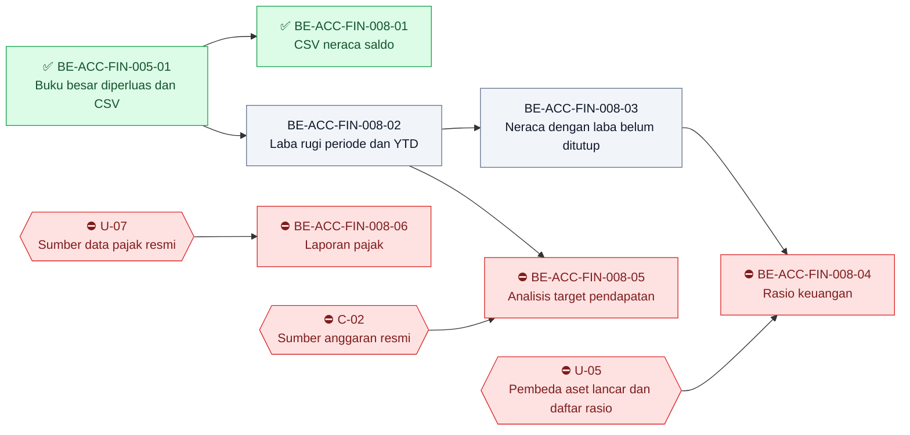

# Roadmap Delivery Backend — Accounting Finishing (ACC-FIN-005 + ACC-FIN-008 sebagian)

## Metadata

```yaml
blueprint_id: ACC-BP-001
blueprint_revision: 18
blueprint_status: approved              # amendment finishing disetujui Rizki 24 Nov 2026 - GATE-DESAIN-1124
roadmap_revision: 1
roadmap_status: APPROVED                # GATE-DESAIN-1124; roadmap disusun atas perintah Rizki 24 Nov 2026
approved_by: [Rizki]
approved_at: 2026-11-24
source_backend: 1f353c45                # rizkiG
source_frontend: 22894248               # RizkiV2
decision_revision: 19                   # 00-interview-decisions.md, ACC-DEC-141 sampai ACC-DEC-155
contracts: [ACC-API-0.17, ACC-VALIDATION-0.12, ACC-PERMISSION-0.8, ACC-TEST bagian 4]
design_inputs: [02-backend-architecture.md bagian 25, 04-prd-to-mvp.md bagian 30, erd/data-dictionary.md bagian 20, flowcharts/06-laporan-keuangan.md]
requirement_source: MASTER PRD ACC-FIN-PRD-001 (24 Nov 2026) - referensi sementara karena konektor ClickUp tidak tersedia (U-01)
clickup_refs: [z8m132yv7x Transaksi, z8m132yv84 Laporan Keuangan]
scope_waves: [FIN-0, FIN-1]
excluded_scope: [ACC-FIN-008 rasio keuangan, ACC-FIN-008 target pendapatan, ACC-FIN-008 laporan pajak]
task_namespace: BE-ACC-FIN-<nomor kebutuhan PRD>-<urut>
acceptance_policy: automated test bukan acceptance criterion (ACC-DEC-081); unit test tidak ditulis (kesepakatan kerja Rizki)
migration: tidak ada
```

**Namespace task.** `BE-ACC-FIN-005-01` dibaca "task backend pertama untuk kebutuhan PRD ACC-FIN-005".
Nomor kebutuhan dipertahankan supaya setiap task langsung tertelusur ke PRD dan ClickUp, dan nomor
urut memberi ruang bagi satu kebutuhan yang dipecah menjadi beberapa task. Namespace ini tidak
bertabrakan dengan roadmap yang ada: `BE-ACC-001`..`015` (MVP) dan `BE-ACC-P2-001`..`035` (Phase 2).

**Arti tanda status pada dokumen ini.**

| Tanda | Artinya |
| :---: | --- |
| ✅ | Selesai. Acceptance criteria dan DoD **terbukti**, buktinya ada pada laporan task |
| 🟡 | Sebagian. Source-nya sudah ada, tetapi acceptance criteria belum terbukti penuh. **Belum selesai** |
| ⛔ | Terblokir. Prasyaratnya belum terpenuhi, dan task **tidak boleh dimulai** |
| tanpa tanda | Belum dikerjakan |

## Grafik Urutan Dependency



| Gelombang | Boleh mulai setelah | Task |
| ---: | --- | --- |
| 1 | — | `BE-ACC-FIN-005-01` — gelombang pengiriman `FIN-0` |
| 2 | `BE-ACC-FIN-005-01` | `BE-ACC-FIN-008-01` (`FIN-0`), `BE-ACC-FIN-008-02` (`FIN-1`) — boleh paralel |
| 3 | `BE-ACC-FIN-008-02` | `BE-ACC-FIN-008-03` (`FIN-1`) |
| — | ⛔ menunggu `U-05` dan `BE-ACC-FIN-008-03` | `BE-ACC-FIN-008-04` |
| — | ⛔ menunggu `C-02` dan `BE-ACC-FIN-008-02` | `BE-ACC-FIN-008-05` |
| — | ⛔ menunggu `U-07` | `BE-ACC-FIN-008-06` |

Jumlah panah: 8. Jumlah entri kolom `Dependency` pada ringkasan task: 8.

**Gelombang eksekusi dan gelombang pengiriman berbeda arti.** Gelombang eksekusi (1, 2, 3) adalah
urutan teknis menurut prasyarat. Gelombang pengiriman (`FIN-0`, `FIN-1`) adalah paket yang diuji
bersama dari layar, sesuai PRD bagian 30.7. `BE-ACC-FIN-008-02` boleh dikerjakan bersamaan dengan
`008-01`, tetapi diserahkan dalam paket `FIN-1`.

## Baca ini lebih dahulu

### Batas wewenang roadmap ini

| Boleh | Tidak boleh |
|---|---|
| Menambah method, DTO, enum, dan berkas `partial` di `GeneralLedger/` | Menambah tabel, kolom, migration, atau menjalankan `dotnet ef` |
| Menambah action pada `GeneralLedgerController` | Menambah controller baru (modul akses kedua di Akses Role) |
| Memakai `LoggerService` yang ada | Menambah baris di `Program.cs` |
| Membaca tabel milik modul lain (`MstCostCenter`) | Menulis ke database dalam bentuk apa pun |

### Catatan yang mengikat setiap task backend

1. **QBE preflight dan kesesuaian engineering** diselesaikan pada waktu eksekusi dari `AGENTS.md`
   backend dan dokumen engineering canonical `QuilvianEngineeringSkills`, bukan dari roadmap ini.
2. **Build dijalankan Rizki.** Agent memberi perintah `dotnet build -p:RunAnalyzers=false` beserta yang
   harus diperhatikan; agent tidak menjalankannya.
3. **Nol baris komentar** pada kode baru (`//`, `///`, `/* */`). Komentar lama yang ikut dipindah ke
   berkas `partial` dibiarkan apa adanya.
4. **Hanya jurnal `Posted`.** Setiap query baru berangkat dari `BarisDisahkan(legalEntityId)`; tidak
   ada query baris jurnal yang ditulis ulang dari nol.
5. **Nominal tidak pernah masuk log** (`BE-ACC-P2-033`, `ACC-DEC-155`).
6. **Uji tanpa SQL tulis.** Data uji dibuat lewat layar atau API Jurnal yang ada.

### Batas cakupan ACC-FIN-008

ACC-FIN-008 pada PRD memuat enam laporan. Roadmap ini merencanakan **tiga**: neraca saldo (sudah ada,
ditambah CSV), laba rugi, dan neraca. Sesudah `FIN-0` dan `FIN-1` selesai, ACC-FIN-008 berstatus
**sebagian** — tiga laporan sisanya tercatat sebagai task ⛔ `008-04`..`06` di bawah, masing-masing
dengan blocker-nya. ACC-FIN-008 **tidak boleh** ditandai selesai sebelum ketiganya diputuskan:
dikerjakan, atau dikeluarkan dari lingkup lewat keputusan Rizki.

## Ringkasan task

| Task ID | Outcome | Requirement / decision | Kontrak | Reuse | Cakupan | Dependency | Acceptance criteria | Verifikasi | Risiko / pemilik | DoD |
| --- | --- | --- | --- | --- | --- | --- | --- | --- | --- | --- |
| ✅ `BE-ACC-FIN-005-01` | Buku besar dapat disaring unit biaya, membawa asal jurnal, punya ringkasan saldo, dan dapat diunduh CSV | `FR-FIN-001`..`005`; `ACC-DEC-141`, `147`, `148`, `149`, `155` | `ACC-API-0.17` (`movements`, `movements/summary`, `movements/export`); `VAL-GL-01`..`03`, `06` | `BarisDisahkan`, `GetMovementsAsync`, `LoggerService` | Lihat kartu | — | AC-1..AC-8 kartu | Swagger + layar, `F10`, `F12`, `F13`, `F15`, `F16`, `F19` | Pemecahan `partial` menggeser `GetMovementsAsync` — regresi buku besar; Rizki | Kartu |
| ✅ `BE-ACC-FIN-008-01` | Neraca saldo dapat diunduh CSV | `FR-FIN-030`; `ACC-DEC-149`, `153`, `155` | `ACC-API-0.17` (`trial-balance/export`) | `GetTrialBalanceAsync`, `AccLedgerCsv` | Lihat kartu | `BE-ACC-FIN-005-01` | AC-1..AC-5 | `F18`, `F16`, `F20` | Rendah; Rizki | Kartu |
| `BE-ACC-FIN-008-02` | Laba rugi periode dan YTD dengan pembanding, tanpa jurnal `JT`, dapat disaring unit biaya, tercatat saat dibuka, dapat diunduh | `FR-FIN-010`..`015`; `ACC-DEC-142`, `144`..`147`, `149`, `150`, `155` | `ACC-API-0.17` (`income-statement`, `/export`); `VAL-GL-01`, `04`, `05`, `08` | `BarisDisahkan`, `AccJournalTypeService.CariMenurutKodeAsync`, `AccLedgerCsv` | Lihat kartu | `BE-ACC-FIN-005-01` | AC-1..AC-10 | `F1`..`F3`, `F6`, `F7`, `F8`, `F9`, `F11`, `F16`, `F17` | Rumus pengecualian `JT` dan hierarki; Rizki | Kartu |
| `BE-ACC-FIN-008-03` | Neraca per akhir periode dengan pembanding, dua baris laba belum ditutup, status seimbang, tercatat saat dibuka, dapat diunduh | `FR-FIN-012`, `014`, `015`, `020`..`022`; `ACC-DEC-143`..`146`, `149`, `150`, `154`, `155` | `ACC-API-0.17` (`balance-sheet`, `/export`); `VAL-GL-04`, `05`, `07`..`09` | Penyusun hierarki dan rentang periode dari `008-02` | Lihat kartu | `BE-ACC-FIN-008-02` | AC-1..AC-9 | `F4`, `F5`, `F8`, `F9`, `F14`, `F16`, `F17` | Rumus laba tahun berjalan; Rizki | Kartu |
| ⛔ `BE-ACC-FIN-008-04` | Rasio keuangan | ACC-FIN-008 (PRD) | Belum dirancang | — | Belum dirancang | `U-05`, `BE-ACC-FIN-008-03` | — | — | Pemilik proses akuntansi | — |
| ⛔ `BE-ACC-FIN-008-05` | Analisis target pendapatan | ACC-FIN-008 (PRD) | Belum dirancang | — | Belum dirancang | `C-02`, `BE-ACC-FIN-008-02` | — | — | Rizki + owner Pengadaan | — |
| ⛔ `BE-ACC-FIN-008-06` | Laporan pajak | ACC-FIN-008 (PRD) | Belum dirancang | — | Belum dirancang | `U-07` | — | — | Rizki + Yasmin + owner Payroll + PIC Pajak | — |

---

## ✅ `BE-ACC-FIN-005-01` — Buku besar diperluas dan CSV

**Status:** ✅ SELESAI (development), 25 November 2026. QBE Strict `PASS`; build `PASS` (Rizki, DLL 09:01:06 WIB, 25 November 2026). AC-1..AC-7 `RUNTIME VERIFIED` (API 12/12, layar 14/14, 24 November 2026; uji ulang sesudah penguatan 25 November 2026: B7 dan layar U1–U10 10/10). AC-8 `SOURCE VERIFIED` tujuh butir + runtime `WAIVED` atas keputusan Rizki (`ACC-DEC-156`); `F19` ditunda ke UAT/verifikasi kinerja. UAT belum dijalankan — milik tim UAT. Bukti: [laporan BE-ACC-FIN-005-01](../task/report/backend/BE-ACC-FIN-005-01.md) bagian 5, 6, 8, 9.

**Gelombang pengiriman:** `FIN-0`. **Pasangan frontend:** `FE-ACC-FIN-005-01`.

| Field | Isi |
|---|---|
| Requirement | ACC-FIN-005 (PRD; ClickUp `z8m132yv7x` subtask Download Excel (CSV), Detail General Ledger, General Ledger Report, Overview Ledger); `FR-FIN-001`..`005` |
| Decision | `ACC-DEC-141`, `147` butir 1 dan 4, `148`, `149`, `155` butir 2–4 |
| Kontrak | `ACC-API-0.17` grup General Ledger: `GET /movements` (diperluas), `GET /movements/summary`, `GET /movements/export`; `VAL-GL-01`, `02`, `03`, `06`; `ACC-PERMISSION-0.8` |
| Desain | `02-backend-architecture.md` bagian 25.3–25.5, 25.7 |

**Implementasi yang sudah ada.** `AccGeneralLedgerService.GetMovementsAsync` sudah menyaring badan
hukum, akun, dan rentang tanggal; menghitung saldo pembuka sebelum rentang; dan menjaga saldo berjalan
tetap benar lintas halaman. `BarisDisahkan` sudah menjamin hanya jurnal `Posted`. Endpoint
`GET /movements` sudah dikonsumsi `use-general-ledger.jsx`.

**Cakupan.**
1. Jadikan `AccGeneralLedgerService` `partial`; pindahkan `GetMovementsAsync` ke
   `AccGeneralLedgerService.Movement.cs`.
2. Tambah `CostCenterId` pada `LedgerMovementQuery`; validasi `VAL-GL-01`; terapkan penyaring
   sebelum saldo pembuka dihitung.
3. Tambah sebelas field pada `LedgerMovementResponse`; isi asal jurnal sekali per halaman menurut
   urutan bagian 25.5.
4. Tambah `LedgerMovementSummaryResponse` dan `GetMovementSummaryAsync`.
5. Tambah `AccLedgerCsv` (statis) dan `BuildMovementCsvAsync` di `AccGeneralLedgerService.Export.cs`.
6. Tambah enum `LedgerSourceKind`.
7. Tambah dua action pada `GeneralLedgerController`: `movements/summary`, `movements/export`; unduhan
   dicatat `GeneralLedger.Export`.

**Berkas dan service terdampak.**

| Berkas | Status |
|---|---|
| `GeneralLedger/Services/AccGeneralLedgerService.cs` | Diperbarui — `partial`, `GetMovementsAsync` dipindah |
| `GeneralLedger/Services/AccGeneralLedgerService.Movement.cs` | Baru |
| `GeneralLedger/Services/AccGeneralLedgerService.Export.cs` | Baru |
| `GeneralLedger/Services/AccLedgerCsv.cs` | Baru |
| `GeneralLedger/DTOs/GeneralLedgerDtos.cs` | Diperbarui |
| `GeneralLedger/Enums/LedgerSourceKind.cs` | Baru |
| `GeneralLedger/Controllers/GeneralLedgerController.cs` | Diperbarui — dua action |

**Kontrak API.**

| Method | Path | Hak | Request | Response |
|---|---|---|---|---|
| `GET` | `/api/v1/corporate/accounting/general-ledger/movements` | `GeneralLedger : Read` | `LedgerMovementQuery` + `CostCenterId?` | `ApiResponse<PagedResult<LedgerMovementResponse>>` + 11 field |
| `GET` | `.../general-ledger/movements/summary` | `GeneralLedger : Read` | `LegalEntityId`, `AccountId`, `DateFrom?`, `DateTo?`, `CostCenterId?` | `ApiResponse<LedgerMovementSummaryResponse>` |
| `GET` | `.../general-ledger/movements/export` | `GeneralLedger : Read` | sama dengan `summary` | `text/csv` |

**Aturan bisnis.**

| Aturan | Contoh |
|---|---|
| Saringan unit biaya diterapkan sebelum saldo pembuka, sehingga ketiga saldo adalah bagian unit itu | Beban Obat: Radiologi Rp 4.000.000 + Farmasi Rp 9.000.000; saring Radiologi → saldo akhir Rp 4.000.000 |
| Asal jurnal ditentukan berurutan: Koreksi → Tutup Tahun → Kejadian → Jurnal Berulang → Manual | Jurnal JB pembalik jurnal kejadian → `Koreksi · JU/2026/11/00031`, bukan Kejadian |
| Unit biaya nonaktif tetap diterima sebagai saringan | Unit yang dinonaktifkan Oktober tetap dapat dipakai menelusuri baris September |
| CSV memuat seluruh baris; lebih dari 50.000 baris ditolak `422` | 640 baris pada 26 halaman → satu berkas 642 baris data (saldo awal, 640 mutasi, saldo akhir) |
| Teks berawalan `=`, `+`, `-`, `@` di CSV diberi awalan `'` | Keterangan `=SUM(A1)` ditulis `'=SUM(A1)` |
| Pembacaan mutasi dan ringkasan **tidak** dicatat; unduhan dicatat tanpa nominal | — |

**Acceptance criteria.**

| # | Kriteria |
|---|---|
| AC-1 | Tanpa `CostCenterId`, isi dan urutan baris serta `RunningBalance` sama persis dengan sebelum perubahan untuk akun dan rentang yang sama |
| AC-2 | Dengan `CostCenterId`, hanya baris unit itu yang tampil, dan `RunningBalance` baris pertama halaman 1 = saldo pembuka unit + mutasi baris itu |
| AC-3 | Setiap baris membawa `JournalId`, `JournalTypeCode`, `SourceKind`, `SourceLabel`; tepat satu dari `AccountingEventId`, `RecurringTemplateId`, `ReversalOfJournalId` terisi sesuai `SourceKind`, atau ketiganya kosong untuk Manual dan Tutup Tahun |
| AC-4 | `summary` mengembalikan `ClosingBalance = OpeningBalance + TotalDebit − TotalCredit` dan sama dengan `RunningBalance` baris terakhir halaman terakhir |
| AC-5 | `export` mengembalikan berkas CSV sesuai bagian 25.7 (BOM, `;`, desimal koma, kepala laporan, saldo awal dan akhir) dengan nama `buku-besar_{kode akun}_{yyyyMMdd}-{yyyyMMdd}.csv` |
| AC-6 | Unduhan menghasilkan satu baris log `GeneralLedger.Export` berisi jenis laporan, saringan, jumlah baris — tanpa nominal |
| AC-7 | `CostCenterId` badan hukum lain → `400` "Unit biaya tidak ditemukan pada badan hukum ini." |
| AC-8 | Lebih dari 50.000 baris → `422` dengan jumlah barisnya disebut |

**Skenario negatif.**

| Skenario | Hasil |
|---|---|
| `CostCenterId` acak yang tidak ada | `400` |
| `DateTo` sebelum `DateFrom` pada `summary` dan `export` | `400`, pesan lama |
| Pengguna tanpa `GeneralLedger : Read` memanggil ketiga endpoint | `403` |
| Jurnal Draft dan Disetujui di akun yang sama | Tidak muncul di daftar, ringkasan, maupun CSV |
| Keterangan jurnal memuat `;` dan `"` | CSV tetap satu kolom per field; tanda kutip digandakan |

**Skenario regresi.**

| Skenario | Hasil |
|---|---|
| Layar Buku Besar yang ada (sebelum `FE-ACC-FIN-005-01`) dibuka | Tampil seperti sebelumnya; field baru diabaikan |
| `GET /trial-balance` dan `GET /account-balance/{id}` | Tidak berubah, termasuk log neraca saldo yang ada |
| Halaman 2 dan 3 akun yang sama | Saldo berjalan bersambung seperti sebelumnya |

**Skenario UAT.** `F10`, `F12`, `F13`, `F15`, `F16`, `F19` (`testing/acceptance-test-matrix.md` bagian 4).

**Bukti implementasi yang dikumpulkan.**
- Diff berkas di atas; bukti nol perubahan di `Program.cs`, `Migrations/`, dan konfigurasi EF.
- QBE preflight lulus.
- Keluaran `dotnet build -p:RunAnalyzers=false` dari Rizki: 0 galat.
- JSON respons Swagger untuk: tanpa saringan, dengan unit biaya, jurnal hasil kejadian, jurnal koreksi.
- Berkas CSV hasil unduhan dan tangkapan Excel komputer rumah sakit (`F20`).
- Kutipan log unduhan tanpa nominal.
- Laporan `task/report/backend/BE-ACC-FIN-005-01.md` dengan status Implementation, Developer
  Verification, dan UAT dipisah.

**DoD.** AC-1..AC-8 terbukti; laporan ditulis; roadmap dan traceability diperbarui.

---

## ✅ `BE-ACC-FIN-008-01` — CSV neraca saldo

**Status:** ✅ SELESAI (development), 25 November 2026. AC-1..AC-5 `RUNTIME VERIFIED` (uji API 8/8, uji layar bersama `FE-ACC-FIN-008-01` 11/11); build `PASS` (Rizki, DLL 09:01:06 WIB); QBE Strict 2 berkas `PASS`. Batas `ACC-DEC-157` `SOURCE VERIFIED` (runtime tidak dapat dicapai di data dev). UAT belum dijalankan — milik tim UAT. Bukti: [laporan BE-ACC-FIN-008-01](../task/report/backend/BE-ACC-FIN-008-01.md).

**Gelombang pengiriman:** `FIN-0`. **Pasangan frontend:** `FE-ACC-FIN-008-01`.

| Field | Isi |
|---|---|
| Requirement | ACC-FIN-008 bagian Trial Balance (PRD; ClickUp `z8m132yv84`); `FR-FIN-030` |
| Decision | `ACC-DEC-149`, `153`, `155` butir 3–4 |
| Kontrak | `ACC-API-0.17` `GET /general-ledger/trial-balance/export`; `ACC-PERMISSION-0.8` |
| Desain | `02-backend-architecture.md` bagian 25.7 |

**Implementasi yang sudah ada.** `GetTrialBalanceAsync` dan `GET /trial-balance` beserta lognya.
`AccLedgerCsv` dan pola unduhan dari `BE-ACC-FIN-005-01`.

**Cakupan.** `BuildTrialBalanceCsvAsync` di `AccGeneralLedgerService.Export.cs` yang memanggil
`GetTrialBalanceAsync` lalu menyusun CSV; satu action `trial-balance/export`.

**Berkas terdampak.** `AccGeneralLedgerService.Export.cs`, `GeneralLedgerController.cs`.

**Kontrak API.** `GET /api/v1/corporate/accounting/general-ledger/trial-balance/export?LegalEntityId=&PeriodCode=`
→ `text/csv`, nama `neraca-saldo_{kode periode}.csv`; `404` bila periode tidak ada.

**Aturan bisnis.** Isi CSV sama persis dengan respons `GET /trial-balance`: kolom kode akun, nama akun,
saldo awal, debit, kredit, saldo akhir; satu baris total; satu baris status seimbang. **Contoh:** 112
akun → 112 baris akun + 1 baris total + 1 baris status.

**Acceptance criteria.**

| # | Kriteria |
|---|---|
| AC-1 | Berkas berisi baris akun yang sama dan berurutan sama dengan `GET /trial-balance` periode yang sama |
| AC-2 | Total debit dan total kredit di berkas sama dengan respons JSON |
| AC-3 | Bentuk berkas mengikuti bagian 25.7 |
| AC-4 | Satu baris log `GeneralLedger.Export` tanpa nominal; log `GeneralLedger.TrialBalance` yang ada tidak ikut tertulis dua kali oleh unduhan |
| AC-5 | Periode tidak ada → `404`, JSON, bukan berkas |

**Skenario negatif.** Tanpa hak → `403`; `PeriodCode` kosong → `404` (perilaku `GetTrialBalanceAsync` yang ada).

**Skenario regresi.** `GET /trial-balance` dan layar Neraca Saldo tidak berubah.

**Skenario UAT.** `F18`, `F16`, `F20`.

**Bukti.** Diff; build Rizki; berkas CSV dan tangkapan Excel; kutipan log; laporan
`task/report/backend/BE-ACC-FIN-008-01.md`.

**DoD.** AC-1..AC-5 terbukti; laporan; roadmap dan traceability diperbarui.

---

## `BE-ACC-FIN-008-02` — Laba rugi periode dan YTD

**Gelombang pengiriman:** `FIN-1`. **Pasangan frontend:** `FE-ACC-FIN-008-02`.

| Field | Isi |
|---|---|
| Requirement | ACC-FIN-008 bagian Income Statement (PRD; ClickUp `z8m132yv84`); `FR-FIN-010`..`015` |
| Decision | `ACC-DEC-142`, `144`, `145`, `146`, `147` butir 2 dan 4, `149`, `150`, `155` |
| Kontrak | `ACC-API-0.17` `GET /general-ledger/income-statement`, `/income-statement/export`; `VAL-GL-01`, `04`, `05`, `08`; `ACC-PERMISSION-0.8` |
| Desain | `02-backend-architecture.md` bagian 25.6, 25.7 |

**Implementasi yang sudah ada.** `BarisDisahkan`; `AccJournalTypeService.CariMenurutKodeAsync`; pola
log neraca saldo; `AccLedgerCsv`.

**Cakupan.**
1. `FinancialStatementDtos.cs`: `IncomeStatementQuery`, `IncomeStatementResponse`,
   `FinancialStatementSectionResponse`, `FinancialStatementRowResponse`,
   `FinancialStatementAmountsResponse`.
2. Enum `FinancialStatementRowKind`.
3. `AccGeneralLedgerService.FinancialStatement.cs`: penentu rentang periode (`AwalTB`, pembanding),
   penyaring pengecualian `JT`, penjumlah per akun, penyusun hierarki — dibuat dapat dipakai ulang
   `008-03` — dan `GetIncomeStatementAsync`.
4. `BuildIncomeStatementCsvAsync`.
5. Dua action; pembacaan dicatat `FinancialStatement.IncomeStatement`, unduhan `GeneralLedger.Export`.

**Berkas terdampak.** `FinancialStatementDtos.cs` (baru), `FinancialStatementRowKind.cs` (baru),
`AccGeneralLedgerService.FinancialStatement.cs` (baru), `AccGeneralLedgerService.Export.cs`,
`GeneralLedgerController.cs`.

**Kontrak API.**

| Method | Path | Request | Response |
|---|---|---|---|
| `GET` | `.../general-ledger/income-statement` | `LegalEntityId`, `PeriodCode`, `CostCenterId?`, `IncludeZeroAccounts` | `ApiResponse<IncomeStatementResponse>` |
| `GET` | `.../general-ledger/income-statement/export` | sama | `text/csv`, `laba-rugi_{kode periode}[_{kode unit}].csv` |

**Aturan bisnis.**

| Aturan | Contoh |
|---|---|
| Kolom: periode, pembanding periode yang sama tahun lalu, YTD, YTD tahun lalu, dan selisih masing-masing | November 2026 lawan November 2025; Januari–November 2026 lawan Januari–November 2025 |
| Jurnal `JT` dan pembaliknya dikecualikan | Tahun 2026 ditutup `JT` 31 Desember: laba Januari–Desember tetap Rp 200.000.000 |
| Pendapatan = kredit − debit; Beban = debit − kredit; akun kontra negatif | Potongan Pendapatan saldo debit Rp 5.000.000 → −5.000.000 |
| Pembanding tidak ada → `null` dan alasan, bukan `0` | Tahun buku pertama 2026 |
| Akun nol di semua kolom disembunyikan kecuali `IncludeZeroAccounts` | — |
| Saringan unit biaya mengisi `CostCenterNotice` | — |
| Induk berjenis lain → anak naik ke leluhur sejenis terdekat atau akar kelompok | Cadangan `C-05` |

**Acceptance criteria.**

| # | Kriteria |
|---|---|
| AC-1 | Respons memuat tepat dua bagian, Pendapatan lalu Beban, dan `NetIncome` = total Pendapatan − total Beban di setiap kolom |
| AC-2 | YTD periode terakhir tahun buku = saldo akun Pendapatan dan Beban di neraca saldo periode itu dikurangi pengaruh jurnal `JT` (`F6`) |
| AC-3 | Jurnal `JT` dan pembaliknya tidak mengubah angka mana pun (`F2`, `F3`) |
| AC-4 | Tahun buku tanpa pendahulu → `ComparisonAvailable = false`, kolom pembanding `null`, alasan terisi (`F7`) |
| AC-5 | Akun kontra negatif dan mengurangi subtotal induknya (`F8`) |
| AC-6 | `IncludeZeroAccounts = false` menyembunyikan akun nol di semua kolom dan induk yang semua anaknya tersembunyi; `true` menampilkan semuanya (`F9`) |
| AC-7 | Dengan `CostCenterId`, hanya baris unit itu yang dihitung dan `CostCenterNotice` terisi (`F11`) |
| AC-8 | Hanya jurnal `Posted` (`F1`) |
| AC-9 | Pembacaan menghasilkan satu log `FinancialStatement.IncomeStatement`; unduhan satu log `GeneralLedger.Export`; keduanya tanpa nominal (`F17`) |
| AC-10 | CSV memuat seluruh baris yang tampil termasuk subtotal, total, dan laba bersih, dengan angka sama dengan JSON |

**Skenario negatif.**

| Skenario | Hasil |
|---|---|
| `PeriodCode` `2026/11` | `400` `VAL-GL-04` |
| Periode tahun yang belum dibuat | `404` |
| Unit biaya badan hukum lain | `400` |
| Tanpa hak | `403` pada keduanya |
| Jenis jurnal `JT` tidak ada di master | Tidak ada yang dikecualikan; laporan tetap jalan |

**Skenario regresi.** Buku besar, neraca saldo, dan pratinjau tutup tahun tidak berubah angka maupun
lognya.

**Skenario UAT.** `F1`, `F2`, `F3`, `F6`, `F7`, `F8`, `F9`, `F11`, `F16`, `F17`.

**Bukti.** Diff; build Rizki; JSON laba rugi untuk tahun buku uji (sebelum dan sesudah `JT`, dengan dan
tanpa unit biaya); tangkapan pencocokan `F6` dengan neraca saldo; berkas CSV; kutipan log; laporan
`task/report/backend/BE-ACC-FIN-008-02.md`.

**DoD.** AC-1..AC-10 terbukti; laporan; roadmap dan traceability diperbarui.

---

## `BE-ACC-FIN-008-03` — Neraca dengan laba belum ditutup

**Gelombang pengiriman:** `FIN-1`. **Pasangan frontend:** `FE-ACC-FIN-008-03`.

| Field | Isi |
|---|---|
| Requirement | ACC-FIN-008 bagian Balance Sheet (PRD; ClickUp `z8m132yv84`); `FR-FIN-012`, `014`, `015`, `020`..`022` |
| Decision | `ACC-DEC-143`, `144`, `145`, `146`, `147` butir 3, `149`, `150`, `154`, `155` |
| Kontrak | `ACC-API-0.17` `GET /general-ledger/balance-sheet`, `/balance-sheet/export`; `VAL-GL-04`, `05`, `07`, `08`, `09` |
| Desain | `02-backend-architecture.md` bagian 25.6, 25.7 |

**Implementasi yang sudah ada.** Penentu rentang periode, penjumlah per akun, dan penyusun hierarki dari
`BE-ACC-FIN-008-02`; `AccLedgerCsv`.

**Cakupan.** `BalanceSheetQuery`, `BalanceSheetResponse`; `GetBalanceSheetAsync` (saldo per akun sampai
tanggal, dua baris laba hitungan, daftar tahun belum ditutup, status seimbang); `BuildBalanceSheetCsvAsync`;
dua action dengan log `FinancialStatement.BalanceSheet` dan `GeneralLedger.Export`.

**Berkas terdampak.** `FinancialStatementDtos.cs`, `AccGeneralLedgerService.FinancialStatement.cs`,
`AccGeneralLedgerService.Export.cs`, `GeneralLedgerController.cs`.

**Kontrak API.**

| Method | Path | Request | Response |
|---|---|---|---|
| `GET` | `.../general-ledger/balance-sheet` | `LegalEntityId`, `PeriodCode`, `IncludeZeroAccounts` | `ApiResponse<BalanceSheetResponse>` |
| `GET` | `.../general-ledger/balance-sheet/export` | sama | `text/csv`, `neraca_{kode periode}.csv` |

**Aturan bisnis.**

| Aturan | Contoh |
|---|---|
| Saldo per `EndDate` periode, pembanding per `EndDate` terakhir tahun buku lalu; semua jurnal `Posted` termasuk `JT` | 30 November 2026 lawan 31 Desember 2025 |
| Laba Tahun Berjalan = Σ(kredit − debit) Pendapatan dan Beban sejak awal tahun buku sampai tanggal | Januari–Maret 2027: Rp 45.000.000 |
| Laba Tahun Lalu Belum Ditutup = Σ(kredit − debit) Pendapatan dan Beban sebelum awal tahun buku; tampil hanya bila ≠ 0, dengan daftar tahunnya | 2026 belum ditutup: Rp 200.000.000, `UnclosedFiscalYears = [2026]` |
| `CostCenterId` diabaikan | — |
| Tidak seimbang tetap `200` dengan `IsBalanced = false` dan `Difference` | Selisih Rp 100 |

**Acceptance criteria.**

| # | Kriteria |
|---|---|
| AC-1 | Tepat tiga bagian: Aset, Liabilitas, Ekuitas; baris laba ber-`RowKind = 3` di Ekuitas |
| AC-2 | Data sehat → `IsBalanced = true` di kedua kolom (`F4`) |
| AC-3 | Tahun lalu belum ditutup → baris dan `UnclosedFiscalYears` terisi (`F4`) |
| AC-4 | Sesudah `JT` tahun itu disahkan → baris tahun lalu hilang, Laba Ditahan naik sebesar nilai itu, total ekuitas tetap (`F5`) |
| AC-5 | Akun kontra negatif (`F8`); akun nol mengikuti `IncludeZeroAccounts` (`F9`) |
| AC-6 | Pembanding tidak ada → `null` dan alasan |
| AC-7 | `CostCenterId` yang dikirim tidak mengubah angka |
| AC-8 | Log pembacaan dan unduhan tanpa nominal, termasuk `Difference` (`F17`) |
| AC-9 | CSV memuat seluruh baris, total liabilitas dan ekuitas, dan status seimbang |

**Skenario negatif.** Bentuk periode salah → `400`; periode tidak ada → `404`; tanpa hak → `403`.

**Skenario regresi.** Laba rugi (`008-02`) tidak berubah angka sesudah penyusun hierarki dipakai bersama;
buku besar dan neraca saldo tidak berubah.

**Skenario UAT.** `F4`, `F5`, `F8`, `F9`, `F14` (sisi data), `F16`, `F17`.

**Bukti.** Diff; build Rizki; JSON neraca untuk tahun uji sebelum dan sesudah `JT`; berkas CSV; kutipan
log; laporan `task/report/backend/BE-ACC-FIN-008-03.md`.

**DoD.** AC-1..AC-9 terbukti; laporan; roadmap dan traceability diperbarui.

---

## Sisa cakupan ACC-FIN-008 — task ⛔ belum dirancang

Ketiga task berikut dicatat supaya ACC-FIN-008 tidak terbaca selesai. Masing-masing **belum punya
desain maupun kontrak**; sesudah blocker-nya dicabut, ketiganya kembali lewat `grill-me` →
`design-business-module` sebelum dapat dibangun.

| Task | Isi menurut PRD | Blocker | Yang harus terjadi | Pekerjaan yang tetap berjalan |
|---|---|---|---|---|
| ⛔ `BE-ACC-FIN-008-04` Rasio keuangan | Rasio likuiditas, profitabilitas, solvabilitas, dan rasio lain keputusan owner | `U-05` — COA tidak membedakan aset/liabilitas lancar dan tidak lancar; daftar rasio belum ditetapkan. Bergantung juga pada `008-03` (neraca) | Pemilik proses akuntansi menetapkan pembeda lancar dan daftar rasio | Seluruh `FIN-0` dan `FIN-1` |
| ⛔ `BE-ACC-FIN-008-05` Analisis target pendapatan | Realisasi pendapatan lawan target resmi | `C-02` — sumber anggaran resmi (`PrcBudget` Pengadaan atau anggaran Accounting) belum diputuskan. Bergantung juga pada `008-02` (laba rugi) | Rizki + owner Pengadaan memutuskan `C-02` | Seluruh `FIN-0` dan `FIN-1` |
| ⛔ `BE-ACC-FIN-008-06` Laporan pajak | Laporan dari data transaksi pajak yang sah, tanpa mesin pajak duplikat | `U-07` — sumber data pajak resmi dan jenis pajak yang dilaporkan | Rizki + Yasmin + owner Payroll + PIC Pajak RS | Seluruh `FIN-0` dan `FIN-1` |

## Keputusan terbuka yang tidak memblokir

| ID | Isi | Perlakuan pada roadmap ini |
|---|---|---|
| `C-05` | Jenis akun anak berbeda dari induk | Tidak memblokir. `008-02` dan `008-03` memakai aturan cadangan `ACC-DEC-146` butir 5 |
| `U-01` | Isi ClickUp `z8m132yv7x`, `z8m132yv84` belum diverifikasi | Tidak memblokir. PRD menjadi rujukan sementara; bila ClickUp berbeda, roadmap diamandemen |
| `U-05` | Pembeda aset lancar | Hanya memblokir `008-04` |

## Coverage gap yang diketahui

| Requirement | Gap | Alasan |
|---|---|---|
| ACC-FIN-008 rasio, target, pajak | Belum ada task terancang | Blocker `U-05`, `C-02`, `U-07` |
| `F20` (Excel komputer rumah sakit) | Hanya dapat dibuktikan di perangkat rumah sakit | Bentuk CSV `PROPOSED` (`evidence/19` butir 14b) |
| Automated test | Tidak ada | `ACC-DEC-081` dan kesepakatan kerja Rizki |
