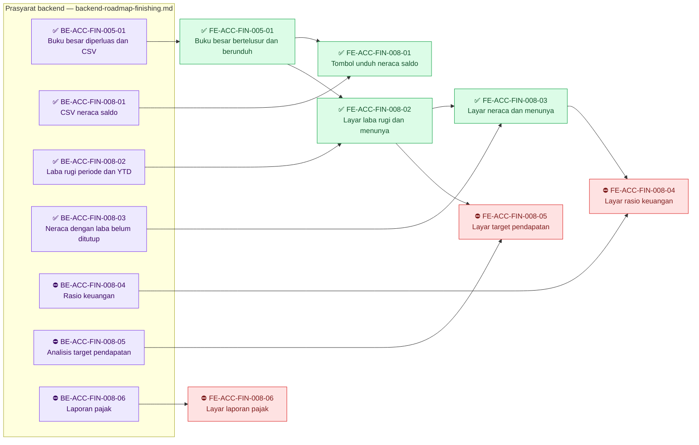

# Roadmap Delivery Frontend — Accounting Finishing (ACC-FIN-005 + ACC-FIN-008 sebagian)

## Metadata

```yaml
blueprint_id: ACC-BP-001
blueprint_revision: 18
blueprint_status: approved              # GATE-DESAIN-1124, 24 Nov 2026
roadmap_revision: 1
roadmap_status: APPROVED                # GATE-DESAIN-1124
approved_by: [Rizki]
approved_at: 2026-11-24
source_backend: 1f353c45                # rizkiG
source_frontend: 22894248               # RizkiV2
decision_revision: 19                   # ACC-DEC-141 sampai ACC-DEC-155
contracts: [ACC-API-0.17, ACC-VALIDATION-0.12, ACC-PERMISSION-0.8, ACC-TEST bagian 4]
design_inputs: [03-frontend-architecture.md bagian 15, 04-prd-to-mvp.md bagian 30, flowcharts/06-laporan-keuangan.md]
backend_roadmap: backend-roadmap-finishing.md
clickup_refs: [z8m132yv7x Transaksi, z8m132yv84 Laporan Keuangan]
scope_waves: [FIN-0, FIN-1]
task_namespace: FE-ACC-FIN-<nomor kebutuhan PRD>-<urut>
branch: RizkiV2
```

**Pasangan backend.** Setiap task frontend berpasangan dengan task backend bernomor sama, dan task
backend itu menjadi prasyaratnya. Uji dilakukan sekali dari layar sesudah keduanya selesai
(kesepakatan kerja Rizki).

**Arti tanda status pada dokumen ini.**

| Tanda | Artinya |
| :---: | --- |
| ✅ | Selesai. Acceptance criteria dan DoD **terbukti**, buktinya ada pada laporan task |
| 🟡 | Sebagian. Source-nya sudah ada, tetapi acceptance criteria belum terbukti penuh. **Belum selesai** |
| ⛔ | Terblokir. Prasyaratnya belum terpenuhi, dan task **tidak boleh dimulai** |
| tanpa tanda | Belum dikerjakan |

## Grafik Urutan Dependency



| Gelombang | Boleh mulai setelah | Task |
| ---: | --- | --- |
| 1 | `BE-ACC-FIN-005-01` (backend) | `FE-ACC-FIN-005-01` — `FIN-0` |
| 2 | `FE-ACC-FIN-005-01`; backend `008-01` / `008-02` | `FE-ACC-FIN-008-01` (`FIN-0`), `FE-ACC-FIN-008-02` (`FIN-1`) — boleh paralel bila backend masing-masing selesai |
| 3 | `FE-ACC-FIN-008-02`; backend `008-03` | `FE-ACC-FIN-008-03` (`FIN-1`) |
| — | ⛔ menunggu `BE-ACC-FIN-008-04` (`U-05`) dan `FE-ACC-FIN-008-03` | `FE-ACC-FIN-008-04` |
| — | ⛔ menunggu `BE-ACC-FIN-008-05` (`C-02`) dan `FE-ACC-FIN-008-02` | `FE-ACC-FIN-008-05` |
| — | ⛔ menunggu `BE-ACC-FIN-008-06` (`U-07`) | `FE-ACC-FIN-008-06` |

Jumlah panah: 12. Jumlah entri kolom `Dependency` pada ringkasan task: 12. Node backend di
subgraph adalah cermin baca-saja; tandanya disalin dari `backend-roadmap-finishing.md`.

## Baca ini lebih dahulu

### Catatan yang mengikat setiap task frontend

1. Implementasi lewat skill `build-module-frontend`, satu task per pemanggilan.
2. **Agent tidak menyalakan server frontend** (`next dev`, `next start`). Rizki yang menjalankan; uji
   layar memakai server yang dinyalakan Rizki.
3. Verifikasi agent: `npm run lint` pada berkas tersentuh. Unit test tidak ditulis.
4. **Pakai ulang** komponen yang ada (`Hero`, `AccountingHeroLegalEntity`, `DataFilter`, `FilterSelect`,
   `FilterDatePicker`, `DataTable`, `StatusBadge`, `BaseButton`, `AccessDeniedGate`); jangan membuat
   tandingan.
5. **`globals.css` tidak disentuh.** Gaya baru di module CSS per layar; cetak memakai `@media print`
   di module CSS seperti `detail-invoice-billing-view.module.css`.
6. Nol baris komentar pada kode baru.
7. Angka tidak pernah dihitung ulang di peramban; total, subtotal, dan urutan dibaca dari respons.

## Ringkasan task

| Task ID | Outcome | Requirement / decision | Kontrak | Reuse | Cakupan | Dependency | Acceptance criteria | Verifikasi | Risiko / pemilik | DoD |
| --- | --- | --- | --- | --- | --- | --- | --- | --- | --- | --- |
| ✅ `FE-ACC-FIN-005-01` | Buku besar bersaring unit biaya, berringkasan, bertautan ke jurnal dan kejadian, dapat diunduh, dan menerima saringan dari tautan laporan | `FR-FIN-001`..`005`; `ACC-DEC-147`, `148`, `149` | `ACC-API-0.17` movements, summary, export | `general-ledger-view.jsx`, `use-general-ledger.jsx`, token rute privat | Kartu | `BE-ACC-FIN-005-01` | AC-1..AC-8 | Layar `F10`, `F13`, `F14`, `F15`, `F19` | Saringan dari alamat; Rizki | Kartu |
| ✅ `FE-ACC-FIN-008-01` | Neraca saldo dapat diunduh CSV | `FR-FIN-030`; `ACC-DEC-153` | `trial-balance/export` | `trial-balance-view.jsx`, pengunduh dari `005-01` | Kartu | `BE-ACC-FIN-008-01`, `FE-ACC-FIN-005-01` | AC-1..AC-4 | `F18` | Rendah; Rizki | Kartu |
| ✅ `FE-ACC-FIN-008-02` | Layar laba rugi bertingkat dengan pembanding, YTD, saringan unit biaya, telusur, unduh, cetak, dan butir menu | `FR-FIN-010`..`015`, `040`; `ACC-DEC-142`..`147`, `149`, `152` | `income-statement`, `/export` | Pola `trial-balance-view.jsx`; pengunduh dan tautan buku besar dari `005-01` | Kartu | `BE-ACC-FIN-008-02`, `FE-ACC-FIN-005-01` | AC-1..AC-11 | `F2`, `F6`, `F7`, `F8`, `F9`, `F11`, `F14`, `F16` | Tabel enam kolom angka; Rizki | Kartu |
| ✅ `FE-ACC-FIN-008-03` | Layar neraca bertingkat dengan baris laba, peringatan, status seimbang, telusur, unduh, cetak, dan butir menu | `FR-FIN-012`, `014`, `020`..`022`, `040`; `ACC-DEC-143`..`146`, `149`, `152`, `154` | `balance-sheet`, `/export` | Komponen tabel laporan dari `008-02` | Kartu | `BE-ACC-FIN-008-03`, `FE-ACC-FIN-008-02` | AC-1..AC-9 | `F4`, `F5`, `F8`, `F14`, `F16` | Rendah; Rizki | Kartu |
| ⛔ `FE-ACC-FIN-008-04` | Layar rasio keuangan | ACC-FIN-008 (PRD) | Belum dirancang | — | — | `BE-ACC-FIN-008-04`, `FE-ACC-FIN-008-03` | — | — | `U-05` | — |
| ⛔ `FE-ACC-FIN-008-05` | Layar target pendapatan | ACC-FIN-008 (PRD) | Belum dirancang | — | — | `BE-ACC-FIN-008-05`, `FE-ACC-FIN-008-02` | — | — | `C-02` | — |
| ⛔ `FE-ACC-FIN-008-06` | Layar laporan pajak | ACC-FIN-008 (PRD) | Belum dirancang | — | — | `BE-ACC-FIN-008-06` | — | — | `U-07` | — |

---

## ✅ `FE-ACC-FIN-005-01` — Buku besar bertelusur dan berunduh

**Status:** ✅ SELESAI (development), 24 November 2026. AC-1..AC-8 terbukti: uji layar Playwright agent terhadap `next dev` Rizki 14/14, ESLint 7 berkas 0/0, `UI GATE` REUSE 7 NEW 0. Cacat keadaan memuat (reducer pembatalan) ditemukan dan diperbaiki dalam task ini. `npm run build` `NOT RUN` (dijalankan Rizki). UAT belum dijalankan — milik tim UAT. Delta lingkup: `general-ledger/page.jsx` dibungkus `Suspense`. Bukti: [laporan FE-ACC-FIN-005-01](../task/report/frontend/FE-ACC-FIN-005-01.md).

**Gelombang pengiriman:** `FIN-0`. **Prasyarat:** `BE-ACC-FIN-005-01`.

| Field | Isi |
|---|---|
| Requirement | ACC-FIN-005 (ClickUp `z8m132yv7x`); `FR-FIN-001`..`005` |
| Decision | `ACC-DEC-147` butir 1, `148`, `149` |
| Kontrak | `GET /general-ledger/movements` (+ `CostCenterId`, 11 field), `/movements/summary`, `/movements/export` |
| Desain | `03-frontend-architecture.md` bagian 15.4, 15.9 |

**Implementasi yang sudah ada.** Layar `/corporate/accounting/general-ledger`
(`general-ledger-client.jsx`, `general-ledger-view.jsx`, `use-general-ledger.jsx`) dengan saringan akun,
tanggal, dan ukuran halaman; thunk `getLedgerMovements` di `accounting-general-ledger-slice.jsx`;
`registerPrivateRouteToken` dengan konfigurasi jurnal (`accounting` / `journal`) dan kotak masuk
(`accounting` / `accounting-event`); pola unduhan blob di `use-supplier-payable-movements.jsx`.

**Cakupan.**
1. Saringan Unit Biaya opsional, memakai sumber pilihan unit biaya yang sudah dipakai Form Jurnal.
2. Strip ringkasan dari `movements/summary` dan catatan bagian unit saat unit dipilih.
3. Kolom Asal dan Unit; nomor jurnal bertautan ke Rincian Jurnal; Asal kejadian bertautan ke Rincian
   Kejadian — keduanya lewat token rute privat.
4. Tombol Unduh CSV; pengunduh blob dijadikan utilitas bersama yang dipakai `008-01`..`03`.
5. Pembacaan saringan awal dari alamat (`account`, `from`, `to`, `costCenter`) untuk masuk dari laporan.

**Berkas terdampak.** `general-ledger-view.jsx`, `use-general-ledger.jsx`,
`accounting-general-ledger-slice.jsx`, konstanta `general-ledger`, satu utilitas pengunduh di
`src/utils/corporate/accounting/` (baru), module CSS buku besar bila perlu.

**Skema tampilan.**

```text
+- Buku Besar ------------------------------------------------- FE-L1 -+
| [Hero: judul, deskripsi, badan hukum]                                |
+----------------------------------------------------------------------+
| [Akun v] [Unit Biaya v] [Tgl Awal] [Tgl Akhir] [25 baris]            |
|                                     [Atur ulang] [Unduh CSV]         |
+----------------------------------------------------------------------+
| Saldo Awal | Total Debit | Total Kredit | Saldo Akhir                |
| ! Saldo ini hanya bagian unit Radiologi.            (bila unit dipilih)
+----------------------------------------------------------------------+
| Tanggal | No. Jurnal > | Asal (> bila kejadian) | Unit | Keterangan  |
|         | Debit | Kredit | Saldo Berjalan                            |
+----------------------------------------------------------------------+
| memuat  -> kerangka baris                                            |
| belum   -> "Pilih akun untuk melihat mutasinya."                     |
| kosong  -> "Tidak ada mutasi pada rentang ini."       [Atur ulang]   |
| gagal   -> "Buku besar gagal dimuat."                 [Coba lagi]    |
| tautan  -> "Saringan dari tautan tidak dapat dibaca. Pilih akun      |
|             kembali."                                                |
+- Halaman 1 dari n ------------------------ [< Sebelumnya] [Berikutnya >]
```

Tabel wilayah: `03-frontend-architecture.md` bagian 15.4.

**Aturan bisnis yang terlihat di layar.** Ringkasan dan tabel sama-sama memakai saringan yang sama;
mengganti saringan membatalkan hasil lama. Tombol Unduh mati selama unduhan berjalan. `422` dari backend
ditampilkan apa adanya.

**Acceptance criteria.**

| # | Kriteria |
|---|---|
| AC-1 | Memilih unit biaya menyaring tabel dan ringkasan, dan catatan bagian unit tampil |
| AC-2 | Ringkasan menampilkan saldo awal, debit, kredit, saldo akhir dari `summary`; gagalnya ringkasan tidak menahan tabel |
| AC-3 | Nomor jurnal membuka Rincian Jurnal yang benar; alamatnya memakai token, bukan Guid |
| AC-4 | Asal kejadian membuka Rincian Kejadian; asal lain tampil sebagai teks |
| AC-5 | Unduh CSV menghasilkan berkas bernama dari `Content-Disposition`; tombol mati selama proses |
| AC-6 | Membuka alamat `?account=...&from=...&to=...` dari laporan mengisi saringan dan memuat data; token tak terbaca memberi pesan yang ditetapkan |
| AC-7 | Keadaan memuat, belum pilih akun, kosong, dan gagal tampil sesuai skema |
| AC-8 | `npm run lint` nol galat pada berkas tersentuh |

**Skenario negatif.** Unduhan `422` → pesan backend tampil, tidak ada berkas; pengguna tanpa hak →
`AccessDeniedGate`; tautan Asal dibuka pengguna tanpa `AccountingEvent : Read` → layar tujuan menolak.

**Skenario regresi.** Tanpa unit biaya, isi tabel dan saldo berjalan sama dengan sebelum perubahan;
paginasi dan ukuran halaman tetap bekerja; pemilih badan hukum di hero tetap bekerja.

**Skenario UAT.** `F10`, `F13`, `F14` (dari sisi buku besar), `F15`, `F19`.

**Bukti implementasi.** Keluaran `npm run lint`; tangkapan layar: tanpa saringan, dengan unit biaya,
klik nomor jurnal, klik asal kejadian, unduhan; berkas CSV; laporan
`task/report/frontend/FE-ACC-FIN-005-01.md` dengan status dipisah.

**DoD.** AC-1..AC-8 terbukti; laporan; roadmap dan traceability diperbarui.

---

## ✅ `FE-ACC-FIN-008-01` — Tombol unduh neraca saldo

**Status:** ✅ SELESAI (development), 25 November 2026. AC-1..AC-4 terbukti: uji layar Playwright agent terhadap `next dev` Rizki 11/11 (masuk lewat klik menu), ESLint 4 berkas 0/0, `UI GATE` REUSE 3 NEW 0. Cacat keadaan kosong palsu saat daftar periode dimuat (reducer `getAccountingPeriodList`) ditemukan dan diperbaiki dalam task ini — **delta lingkup:** `accounting-period-slice.jsx`. `npm run build` `NOT RUN` (dijalankan Rizki). UAT belum dijalankan — milik tim UAT. Bukti: [laporan FE-ACC-FIN-008-01](../task/report/frontend/FE-ACC-FIN-008-01.md).

**Gelombang pengiriman:** `FIN-0`. **Prasyarat:** `BE-ACC-FIN-008-01`, `FE-ACC-FIN-005-01`.

| Field | Isi |
|---|---|
| Requirement | ACC-FIN-008 Trial Balance (ClickUp `z8m132yv84`); `FR-FIN-030` |
| Decision | `ACC-DEC-153` |
| Kontrak | `GET /general-ledger/trial-balance/export` |
| Desain | `03-frontend-architecture.md` bagian 15.5 |

**Implementasi yang sudah ada.** Layar Neraca Saldo (`trial-balance-view.jsx`, `use-trial-balance.jsx`);
pengunduh bersama dari `FE-ACC-FIN-005-01`.

**Cakupan.** Satu tombol Unduh CSV di baris saringan, aktif bila periode sudah dipilih.

**Berkas terdampak.** `trial-balance-view.jsx`, `use-trial-balance.jsx`.

**Skema tampilan.**

```text
| [Periode v] [Tgl Awal] [Tgl Akhir]              [Atur ulang] [Unduh CSV] |
```

Selebihnya layar tidak berubah.

**Acceptance criteria.**

| # | Kriteria |
|---|---|
| AC-1 | Tombol mati sebelum periode dipilih |
| AC-2 | Unduhan menghasilkan `neraca-saldo_{kode periode}.csv` |
| AC-3 | Gagal → "Berkas gagal diunduh."; layar tidak berubah |
| AC-4 | Lint nol galat |

**Skenario negatif.** Tanpa hak → `AccessDeniedGate` (layar sudah dijaga).

**Skenario regresi.** Tabel, pemberitahuan, dan saringan Neraca Saldo tidak berubah.

**Skenario UAT.** `F18`.

**Bukti.** Lint; tangkapan tombol dan berkas; laporan `task/report/frontend/FE-ACC-FIN-008-01.md`.

**DoD.** AC-1..AC-4 terbukti; laporan; roadmap dan traceability diperbarui.

---

## ✅ `FE-ACC-FIN-008-02` — Layar laba rugi dan menunya

**Status:** ✅ SELESAI (development), 25 November 2026. AC-1..AC-11 terbukti: uji layar Playwright agent terhadap `next dev` Rizki 16/16 (masuk lewat klik menu; cetak lewat emulasi media print), ESLint 11 berkas 0/0, `UI GATE` REUSE 8 COMPOSE 1 NEW 0. Regresi Neraca Saldo 10/11 — V4 gagal karena data uji 2019 menambah baris, bukan regresi kode. Delta lingkup: komponen tabel, util, dan konstanta laporan dipisah untuk `008-03`; saringan akun nol memakai `FilterSelect`, bukan kotak centang. `npm run build` `PASS` (Rizki, `.next/BUILD_ID` 10:24:55 WIB). UAT belum dijalankan — milik tim UAT. Bukti: [laporan FE-ACC-FIN-008-02](../task/report/frontend/FE-ACC-FIN-008-02.md).

**Gelombang pengiriman:** `FIN-1`. **Prasyarat:** `BE-ACC-FIN-008-02`, `FE-ACC-FIN-005-01`.

| Field | Isi |
|---|---|
| Requirement | ACC-FIN-008 Income Statement (ClickUp `z8m132yv84`); `FR-FIN-010`..`015`, `040` |
| Decision | `ACC-DEC-142`..`147`, `149`, `152` |
| Kontrak | `GET /general-ledger/income-statement`, `/income-statement/export` |
| Desain | `03-frontend-architecture.md` bagian 15.2, 15.6, 15.9 |

**Implementasi yang sudah ada.** Pola halaman Neraca Saldo; pemilih periode yang dipakai Neraca Saldo;
pengunduh dan tautan buku besar dari `005-01`; pola `window.print()` laporan AR Finance.

**Cakupan.**
1. Rute `/corporate/accounting/income-statement` (`page.jsx`, `income-statement-client.jsx`).
2. `income-statement-view.jsx` dan `use-income-statement.jsx`; thunk dan potongan state di slice buku
   besar.
3. Komponen tabel laporan bertingkat yang dipakai ulang `008-03` — letak dan bentuknya
   `DEV_DISCRETION`, di dalam folder `general-ledger`.
4. Saringan periode, unit biaya, Tampilkan akun bersaldo nol; Unduh CSV; Cetak.
5. Tautan baris akun ke Buku Besar dengan rentang kolom yang diklik dan unit biaya terpilih.
6. Butir menu **Laba Rugi** sesudah Neraca Saldo di `menu-items.jsx`, dan kartu beranda Accounting.
7. `income-statement-view.module.css` dengan `@media print`.

**Skema tampilan.**

```text
+- Laba Rugi -------------------------------------------------- FE-L3 -+
| [Hero: judul, deskripsi, badan hukum]                                |
+----------------------------------------------------------------------+
| [Periode v] [Unit Biaya v] [ ] Tampilkan akun bersaldo nol           |
|                                          [Unduh CSV] [Cetak]         |
+----------------------------------------------------------------------+
| Total Pendapatan | Total Beban | Laba (Rugi) Bersih      (YTD)       |
| ! Hanya baris jurnal yang mencatat unit biaya ini ...  (bila unit)   |
| i Periode November 2025 belum ada di sistem.    (bila tanpa pembanding)
+----------------------------------------------------------------------+
| Akun                | Nov 26 | Nov 25 | Selisih | Jan-Nov 26 | Jan-Nov 25 | Selisih |
| PENDAPATAN          |                                                |
|   Pendapatan Layanan (subtotal)                                      |
|     Pendapatan Rawat Jalan >                                         |
|     Potongan Pendapatan >      (5.000.000)                           |
| Total Pendapatan                                                     |
| BEBAN ...                                                            |
| Total Beban                                                          |
| LABA (RUGI) BERSIH                                                   |
+----------------------------------------------------------------------+
| belum  -> "Pilih periode untuk menyusun laba rugi."                  |
| kosong -> "Belum ada pendapatan maupun beban yang disahkan pada      |
|            periode ini."                                             |
| gagal  -> "Laba rugi gagal dimuat."                   [Coba lagi]    |
+----------------------------------------------------------------------+
```

Tabel wilayah: `03-frontend-architecture.md` bagian 15.6. Penataan enam kolom angka pada layar sempit
dan bentuk baris yang dapat dibuka-tutup adalah `DEV_DISCRETION`.

**Aturan bisnis yang terlihat di layar.** Nilai negatif dalam kurung dan terbaca "minus" oleh pembaca
layar; kolom pembanding `null` tampil `—`; urutan dan kedalaman baris dari respons; tidak ada
penjumlahan ulang.

**Acceptance criteria.**

| # | Kriteria |
|---|---|
| AC-1 | Butir menu Laba Rugi tampil sesudah Neraca Saldo dan membuka layar ini |
| AC-2 | Memilih periode menampilkan enam kolom angka dan tiga ringkasan YTD |
| AC-3 | Indentasi mengikuti `Depth`; baris induk tampil sebagai subtotal |
| AC-4 | Nilai negatif dalam kurung (`F8`) |
| AC-5 | Pembanding tidak ada → `—` dan catatan alasan (`F7`) |
| AC-6 | Memilih unit biaya menampilkan catatan unit (`F11`) |
| AC-7 | Pilihan akun nol memuat ulang laporan dengan `IncludeZeroAccounts` (`F9`) |
| AC-8 | Klik baris akun membuka Buku Besar akun itu dengan rentang kolom yang diklik |
| AC-9 | Unduh CSV menghasilkan berkas laba rugi; Cetak menghasilkan tampilan tanpa menu, saringan, dan tombol |
| AC-10 | Keadaan belum pilih, kosong, gagal, memuat sesuai skema |
| AC-11 | Lint nol galat |

**Skenario negatif.** Tanpa hak → `AccessDeniedGate`; gagal unduh → "Berkas gagal diunduh."; respons
terlambat untuk periode lama dibuang.

**Skenario regresi.** Menu Accounting lain tetap pada tempatnya; Neraca Saldo dan Buku Besar tidak
berubah perilaku.

**Skenario UAT.** `F2`, `F6`, `F7`, `F8`, `F9`, `F11`, `F14` (dari laba rugi), `F16`.

**Bukti.** Lint; tangkapan sidebar, laporan dengan dan tanpa pembanding, dengan unit biaya, tampilan
cetak; berkas CSV; laporan `task/report/frontend/FE-ACC-FIN-008-02.md`.

**DoD.** AC-1..AC-11 terbukti; laporan; roadmap dan traceability diperbarui.

---

## ✅ `FE-ACC-FIN-008-03` — Layar neraca dan menunya

**Status:** ✅ SELESAI (development), 25 November 2026. AC-1..AC-9 terbukti: uji layar Playwright agent terhadap `next dev` Rizki 14/14 (masuk lewat klik menu; AC-4 tidak seimbang lewat simulasi `route.fulfill` karena data dev selalu seimbang), ESLint 11 berkas 0/0, kompilasi `next dev` 200, `UI GATE` REUSE 8 COMPOSE 1 NEW 0. Regresi Laba Rugi 15/16 — L12 berubah angka karena data uji 2020, bukan regresi kode. `npm run build` `PASS` (Rizki, `.next/BUILD_ID` 11:11:15 WIB). UAT belum dijalankan — milik tim UAT. Bukti: [laporan FE-ACC-FIN-008-03](../task/report/frontend/FE-ACC-FIN-008-03.md).

**Gelombang pengiriman:** `FIN-1`. **Prasyarat:** `BE-ACC-FIN-008-03`, `FE-ACC-FIN-008-02`.

| Field | Isi |
|---|---|
| Requirement | ACC-FIN-008 Balance Sheet (ClickUp `z8m132yv84`); `FR-FIN-012`, `014`, `020`..`022`, `040` |
| Decision | `ACC-DEC-143`..`146`, `149`, `152`, `154` |
| Kontrak | `GET /general-ledger/balance-sheet`, `/balance-sheet/export` |
| Desain | `03-frontend-architecture.md` bagian 15.2, 15.7, 15.9 |

**Implementasi yang sudah ada.** Komponen tabel laporan, pengunduh, dan tautan buku besar dari `008-02`
dan `005-01`.

**Cakupan.** Rute `/corporate/accounting/balance-sheet`; `balance-sheet-view.jsx`,
`use-balance-sheet.jsx`; thunk dan state; peringatan tahun belum ditutup dan tidak seimbang; status
seimbang memakai `StatusBadge`; baris laba hitungan tanpa tautan; Unduh CSV; Cetak; butir menu **Neraca**
sesudah Laba Rugi dan kartu beranda; `balance-sheet-view.module.css`.

**Skema tampilan.**

```text
+- Neraca ----------------------------------------------------- FE-L4 -+
| [Hero: judul, deskripsi, badan hukum]                                |
+----------------------------------------------------------------------+
| [Periode v] [ ] Tampilkan akun bersaldo nol      [Unduh CSV] [Cetak] |
+----------------------------------------------------------------------+
| Total Aset | Total Liabilitas | Total Ekuitas | [Seimbang]           |
| ! Tahun buku 2026 belum ditutup.          (bila UnclosedFiscalYears) |
| ! Neraca tidak seimbang, selisih Rp 100. Periksa Neraca Saldo.       |
+----------------------------------------------------------------------+
| Akun                         | 30 Nov 2026 | 31 Des 2025 | Selisih   |
| ASET ...                                                             |
| Total Aset                                                           |
| LIABILITAS ...                                                       |
| EKUITAS                                                              |
|   Modal >, Laba Ditahan >                                            |
|   Laba (Rugi) Tahun Lalu Belum Ditutup   (baris hitungan)            |
|   Laba (Rugi) Tahun Berjalan              (baris hitungan)           |
| Total Ekuitas                                                        |
| TOTAL LIABILITAS DAN EKUITAS                                         |
+----------------------------------------------------------------------+
| belum / kosong / gagal: pola sama dengan Laba Rugi                   |
+----------------------------------------------------------------------+
```

Tabel wilayah: `03-frontend-architecture.md` bagian 15.7.

**Acceptance criteria.**

| # | Kriteria |
|---|---|
| AC-1 | Butir menu Neraca tampil sesudah Laba Rugi dan membuka layar ini |
| AC-2 | Tiga bagian, total liabilitas dan ekuitas, status seimbang tampil |
| AC-3 | Peringatan tahun belum ditutup menyebut setiap tahun (`F4`) dan hilang sesudah `JT` (`F5`) |
| AC-4 | Neraca tidak seimbang tetap tampil dengan selisihnya (`ACC-DEC-154`) |
| AC-5 | Baris laba hitungan tampil berbeda dan tidak bertautan |
| AC-6 | Klik baris akun membuka Buku Besar sampai tanggal kolom (`F14`) |
| AC-7 | Unduh CSV dan Cetak seperti `008-02` |
| AC-8 | Keadaan belum pilih, kosong, gagal, memuat sesuai skema |
| AC-9 | Lint nol galat |

**Skenario negatif.** Tanpa hak → `AccessDeniedGate`; gagal unduh → pesan.

**Skenario regresi.** Laba Rugi tetap benar sesudah komponen tabelnya dipakai bersama.

**Skenario UAT.** `F4`, `F5`, `F8`, `F14`, `F16`.

**Bukti.** Lint; tangkapan neraca sebelum dan sesudah `JT`, sidebar, tampilan cetak; berkas CSV;
laporan `task/report/frontend/FE-ACC-FIN-008-03.md`.

**DoD.** AC-1..AC-9 terbukti; laporan; roadmap dan traceability diperbarui.

---

## Sisa cakupan ACC-FIN-008 — task ⛔ belum dirancang

| Task | Blocker | Catatan |
|---|---|---|
| ⛔ `FE-ACC-FIN-008-04` Layar rasio keuangan | `BE-ACC-FIN-008-04` (`U-05`); `FE-ACC-FIN-008-03` | Bentuk layar dirancang sesudah daftar rasio ditetapkan |
| ⛔ `FE-ACC-FIN-008-05` Layar target pendapatan | `BE-ACC-FIN-008-05` (`C-02`); `FE-ACC-FIN-008-02` | Bergantung sumber anggaran |
| ⛔ `FE-ACC-FIN-008-06` Layar laporan pajak | `BE-ACC-FIN-008-06` (`U-07`) | Bergantung sumber data pajak |

## Keputusan terbuka yang tidak memblokir

`C-05` (aturan cadangan hierarki dibaca apa adanya dari respons) dan `U-01` (ClickUp) — keduanya tidak
memblokir task di atas.
