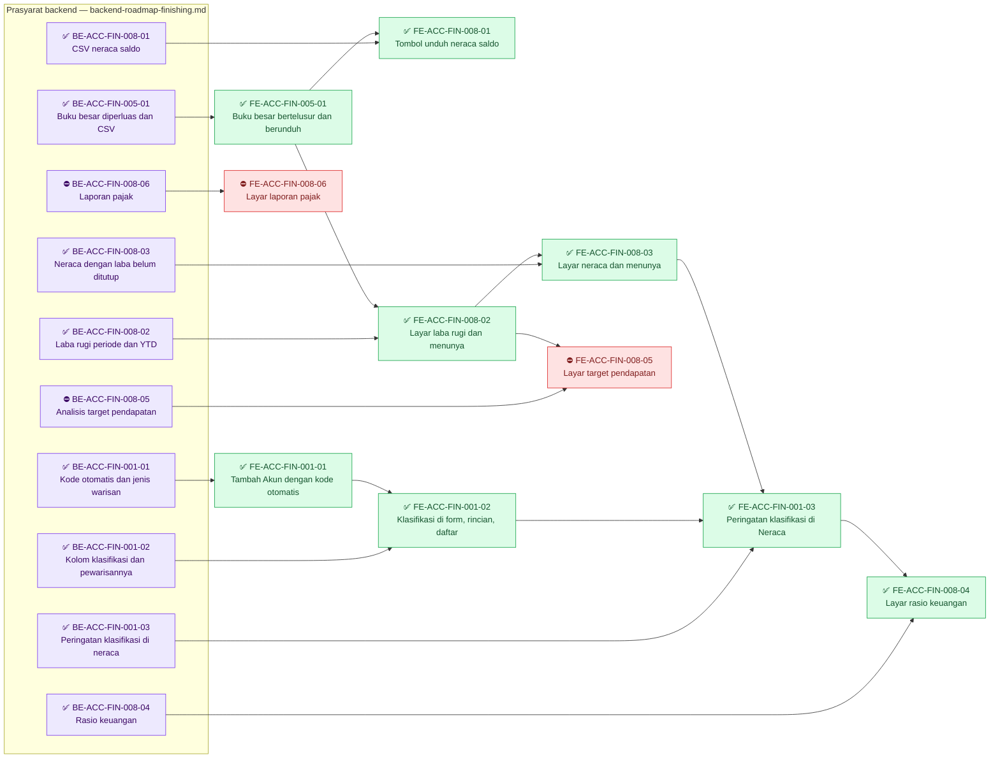

# Roadmap Delivery Frontend — Accounting Finishing (ACC-FIN-005, ACC-FIN-008 sebagian, ACC-FIN-001 Master COA)

## Metadata

```yaml
blueprint_id: ACC-BP-001
blueprint_revision: 20
blueprint_status: approved              # FIN-0/FIN-1: GATE-DESAIN-1124; ACC-FIN-001: GATE-DESAIN-1125 (25 Nov 2026); 008-04 rasio: GATE-DESAIN-1126 (26 Nov 2026)
roadmap_revision: 3                     # 1 = 24 Nov 2026 (FIN-0, FIN-1); 2 = 25 Nov 2026 (+ FIN-2..FIN-4 Master COA); 3 = 26 Nov 2026 (008-04 rasio dirancang, FIN-5)
roadmap_status: APPROVED                # revisi 3 atas persetujuan Rizki 26 Nov 2026 ("SAYA SETUJU"); revisi 2 sesudah GATE-DESAIN-1125
approved_by: [Rizki]
approved_at: 2026-11-26
source_backend: 26229ec7                # rizkiG + BE-ACC-FIN-001-03 belum di-commit
source_frontend: 64ba2c07e              # RizkiV2 + FE-ACC-FIN-001-03 belum di-commit; revisi 2 pada a2ddb52d2
decision_revision: 21                   # ACC-DEC-141..184
contracts: [ACC-API-0.17, ACC-API-0.18, ACC-API-0.19, ACC-VALIDATION-0.12, ACC-VALIDATION-0.13, ACC-VALIDATION-0.14, ACC-PERMISSION-0.8, ACC-PERMISSION-0.9, ACC-PERMISSION-0.10, ACC-TEST bagian 4, 5, dan 6]
design_inputs: [03-frontend-architecture.md bagian 15, 16, dan 17, 04-prd-to-mvp.md bagian 30, 31, dan 32, flowcharts/06-laporan-keuangan.md, flowcharts/07-master-coa.md, flowcharts/08-rasio-keuangan.md]
backend_roadmap: backend-roadmap-finishing.md
clickup_refs: [z8m132yv7x Transaksi, z8m132yv84 Laporan Keuangan]
scope_waves: [FIN-0, FIN-1, FIN-2, FIN-3, FIN-4, FIN-5]
task_namespace: FE-ACC-FIN-<nomor kebutuhan PRD>-<urut>
branch: RizkiV2
```

**Pasangan backend.** Setiap task frontend berpasangan dengan task backend bernomor sama, dan task
backend itu menjadi prasyaratnya. Uji dilakukan sekali dari layar sesudah keduanya selesai
(kesepakatan kerja Rizki).

**Arti tanda status pada dokumen ini.**

| Tanda | Artinya |
| :---: | --- |
| ✅ | Selesai. Acceptance criteria dan DoD **terbukti**, buktinya ada pada laporan task |
| 🟡 | Sebagian. Source-nya sudah ada, tetapi acceptance criteria belum terbukti penuh. **Belum selesai** |
| ⛔ | Terblokir. Prasyaratnya belum terpenuhi, dan task **tidak boleh dimulai** |
| tanpa tanda | Belum dikerjakan |

## Grafik Urutan Dependency



| Gelombang | Boleh mulai setelah | Task |
| ---: | --- | --- |
| 1 | Backend pasangannya | ✅ `FE-ACC-FIN-005-01` (`FIN-0`); `FE-ACC-FIN-001-01` (`FIN-2`, sesudah `BE-ACC-FIN-001-01`) |
| 2 | `FE-ACC-FIN-005-01` / `FE-ACC-FIN-001-01`; backend pasangannya | ✅ `FE-ACC-FIN-008-01` (`FIN-0`), ✅ `FE-ACC-FIN-008-02` (`FIN-1`); `FE-ACC-FIN-001-02` (`FIN-3`, sesudah `BE-ACC-FIN-001-02`) |
| 3 | `FE-ACC-FIN-008-02`; backend `008-03` | ✅ `FE-ACC-FIN-008-03` (`FIN-1`) |
| 4 | `FE-ACC-FIN-001-02`, `FE-ACC-FIN-008-03`; backend `001-03` | ✅ `FE-ACC-FIN-001-03` (`FIN-4`) |
| 5 | `FE-ACC-FIN-001-03`; backend `008-04` | ✅ `FE-ACC-FIN-008-04` (`FIN-5`) |
| — | ⛔ menunggu `BE-ACC-FIN-008-05` dan `FE-ACC-FIN-008-02` | `FE-ACC-FIN-008-05` |
| — | ⛔ menunggu `BE-ACC-FIN-008-06` | `FE-ACC-FIN-008-06` |

Jumlah panah: 18. Jumlah entri kolom `Dependency` pada ringkasan task: 18. Node backend di
subgraph adalah cermin baca-saja; tandanya disalin dari `backend-roadmap-finishing.md`.

**Perubahan revisi 2.** + `FE-ACC-FIN-001-01`..`03` beserta tiga cermin backend.

**Perubahan revisi 3 (26 November 2026).** `FE-ACC-FIN-008-04` dirancang (`GATE-DESAIN-1126`) dan tidak
lagi terblokir. Prasyarat frontend-nya diganti dari `FE-ACC-FIN-008-03` menjadi `FE-ACC-FIN-001-03`:
layar rasio memakai ulang pola peringatan klasifikasi dan tautan Bagan Akun tersaring dari task itu,
yang sendiri sudah menunggu `008-03`. Jumlah panah tetap 18.

## Baca ini lebih dahulu

### Catatan yang mengikat setiap task frontend

1. Implementasi lewat skill `build-module-frontend`, satu task per pemanggilan.
2. **Agent tidak menyalakan server frontend** (`next dev`, `next start`). Rizki yang menjalankan; uji
   layar memakai server yang dinyalakan Rizki.
3. Verifikasi agent: `npm run lint` pada berkas tersentuh. Unit test tidak ditulis. ESLint tidak
   menangkap galat sintaks tertentu; rute yang tersentuh dibuka di server Rizki.
4. **Pakai ulang** komponen yang ada (`Hero`, `AccountingHeroLegalEntity`, `DataFilter`, `FilterSelect`,
   `FilterDatePicker`, `DataTable`, `StatusBadge`, `BaseButton`, `AccessDeniedGate`, `InformationAlert`,
   `BaseDetailView`, form master data lewat `BaseEditorView`); jangan membuat tandingan.
5. **`globals.css` tidak disentuh.** Gaya baru di module CSS per layar; cetak memakai `@media print`
   di module CSS seperti `detail-invoice-billing-view.module.css`.
6. Nol baris komentar pada kode baru.
7. Angka tidak pernah dihitung ulang di peramban; total, subtotal, urutan, kode akun final, dan
   klasifikasi efektif dibaca dari respons.
8. **Halaman rincian master data** hanya beraksi Kembali, Perbarui, Hapus (`AGENTS.md`).
9. Thunk baru memakai pola `requestId` supaya respons basi tidak menimpa keadaan.

## Ringkasan task

| Task ID | Outcome | Requirement / decision | Kontrak | Reuse | Cakupan | Dependency | Acceptance criteria | Verifikasi | Risiko / pemilik | DoD |
| --- | --- | --- | --- | --- | --- | --- | --- | --- | --- | --- |
| ✅ `FE-ACC-FIN-005-01` | Buku besar bersaring unit biaya, berringkasan, bertautan ke jurnal dan kejadian, dapat diunduh, dan menerima saringan dari tautan laporan | `FR-FIN-001`..`005`; `ACC-DEC-147`, `148`, `149` | `ACC-API-0.17` movements, summary, export | `general-ledger-view.jsx`, `use-general-ledger.jsx`, token rute privat | Kartu | `BE-ACC-FIN-005-01` | AC-1..AC-8 | Layar `F10`, `F13`, `F14`, `F15`, `F19` | Saringan dari alamat; Rizki | Kartu |
| ✅ `FE-ACC-FIN-008-01` | Neraca saldo dapat diunduh CSV | `FR-FIN-030`; `ACC-DEC-153` | `trial-balance/export` | `trial-balance-view.jsx`, pengunduh dari `005-01` | Kartu | `BE-ACC-FIN-008-01`, `FE-ACC-FIN-005-01` | AC-1..AC-4 | `F18` | Rendah; Rizki | Kartu |
| ✅ `FE-ACC-FIN-008-02` | Layar laba rugi bertingkat dengan pembanding, YTD, saringan unit biaya, telusur, unduh, cetak, dan butir menu | `FR-FIN-010`..`015`, `040`; `ACC-DEC-142`..`147`, `149`, `152` | `income-statement`, `/export` | Pola `trial-balance-view.jsx`; pengunduh dan tautan buku besar dari `005-01` | Kartu | `BE-ACC-FIN-008-02`, `FE-ACC-FIN-005-01` | AC-1..AC-11 | `F2`, `F6`, `F7`, `F8`, `F9`, `F11`, `F14`, `F16` | Tabel enam kolom angka; Rizki | Kartu |
| ✅ `FE-ACC-FIN-008-03` | Layar neraca bertingkat dengan baris laba, peringatan, status seimbang, telusur, unduh, cetak, dan butir menu | `FR-FIN-012`, `014`, `020`..`022`, `040`; `ACC-DEC-143`..`146`, `149`, `152`, `154` | `balance-sheet`, `/export` | Komponen tabel laporan dari `008-02` | Kartu | `BE-ACC-FIN-008-03`, `FE-ACC-FIN-008-02` | AC-1..AC-9 | `F4`, `F5`, `F8`, `F14`, `F16` | Rendah; Rizki | Kartu |
| ✅ `FE-ACC-FIN-001-01` | Tambah Akun menampilkan kode otomatis, mengunci jenis warisan, mengusulkan saldo normal, dan memberi tahu kode final | `FR-FIN-050`..`053`; `ACC-DEC-162`..`164`, `166`, `172` | `ACC-API-0.18` `next-code`, `POST` | `use-chart-of-account-editor.jsx`, `chart-of-account-form-view.jsx`, `buildPayload`, `validateForm` | Kartu | `BE-ACC-FIN-001-01` | AC-1..AC-8 | Layar `F25`, `F29`, `F31`, `F33` | Pratinjau basi dan kirim ganda; Rizki | Kartu |
| ✅ `FE-ACC-FIN-001-02` | Klasifikasi dapat diisi di Tambah/Perbarui Akun, terbaca beserta asalnya di Rincian, tampil dan dapat disaring di Daftar | `FR-FIN-054`..`056`; `ACC-DEC-167`..`169`, `173` | `ACC-API-0.18` `GET /`, `/{id}`, `/tree`, `POST`, `PUT` | Editor dan detail COA, `FilterSelect`, konfigurasi daftar COA | Kartu | `BE-ACC-FIN-001-02`, `FE-ACC-FIN-001-01` | AC-1..AC-9 | Layar `F34`..`F37` | Aturan tampil isian; pembacaan alamat; Rizki | Kartu |
| ✅ `FE-ACC-FIN-001-03` | Neraca memberi peringatan klasifikasi belum lengkap bertaut ke Daftar COA tersaring | `FR-FIN-057`; `ACC-DEC-168` | `ACC-API-0.18` `GET /balance-sheet` | `balance-sheet-view.jsx`, `use-balance-sheet.jsx`, `InformationAlert` | Kartu | `BE-ACC-FIN-001-03`, `FE-ACC-FIN-001-02`, `FE-ACC-FIN-008-03` | AC-1..AC-6 | Layar `F38` | Menyentuh layar FIN-1; Rizki | Kartu |
| ✅ `FE-ACC-FIN-008-04` | Layar Rasio Keuangan di menu sesudah Neraca: delapan rasio kini dan pembanding dengan rumus, pembilang ÷ penyebut, status dan alasan; peringatan klasifikasi bertaut ke Bagan Akun; unduh CSV dan cetak | `FR-FIN-059`, `061`..`065`; `ACC-DEC-174`..`184` | `ACC-API-0.19` `financial-ratios`, `/export` | `balance-sheet-view.jsx`, `use-balance-sheet.jsx`, pola peringatan `FE-ACC-FIN-001-03`, `formatStatementAmount`, `accounting-download-utils`, menu Neraca | Kartu | `BE-ACC-FIN-008-04`, `FE-ACC-FIN-001-03` | AC-1..AC-8 | Layar `F44`, `F47`..`F50` | Tampilan delapan baris dua kolom tetap terbaca saat cetak; Rizki | Kartu |
| ⛔ `FE-ACC-FIN-008-05` | Layar target pendapatan | ACC-FIN-008 (PRD); `ACC-DEC-159` | Belum dirancang | — | — | `BE-ACC-FIN-008-05`, `FE-ACC-FIN-008-02` | — | — | ACC-FIN-013 | — |
| ⛔ `FE-ACC-FIN-008-06` | Layar laporan pajak | ACC-FIN-008 (PRD); `ACC-DEC-160` | Belum dirancang | — | — | `BE-ACC-FIN-008-06` | — | — | `OQ-160-1` | — |

---

## ✅ `FE-ACC-FIN-005-01` — Buku besar bertelusur dan berunduh

**Status:** ✅ SELESAI (development), 24 November 2026. AC-1..AC-8 terbukti: uji layar Playwright agent terhadap `next dev` Rizki 14/14, ESLint 7 berkas 0/0, `UI GATE` REUSE 7 NEW 0. Cacat keadaan memuat (reducer pembatalan) ditemukan dan diperbaiki dalam task ini. `npm run build` `NOT RUN` (dijalankan Rizki). UAT belum dijalankan — milik tim UAT. Delta lingkup: `general-ledger/page.jsx` dibungkus `Suspense`. Bukti: [laporan FE-ACC-FIN-005-01](../task/report/frontend/FE-ACC-FIN-005-01.md).

**Gelombang pengiriman:** `FIN-0`. **Prasyarat:** `BE-ACC-FIN-005-01`.

| Field | Isi |
|---|---|
| Requirement | ACC-FIN-005 (ClickUp `z8m132yv7x`); `FR-FIN-001`..`005` |
| Decision | `ACC-DEC-147` butir 1, `148`, `149` |
| Kontrak | `GET /general-ledger/movements` (+ `CostCenterId`, 11 field), `/movements/summary`, `/movements/export` |
| Desain | `03-frontend-architecture.md` bagian 15.4, 15.9 |

**Implementasi yang sudah ada.** Layar `/corporate/accounting/general-ledger`
(`general-ledger-client.jsx`, `general-ledger-view.jsx`, `use-general-ledger.jsx`) dengan saringan akun,
tanggal, dan ukuran halaman; thunk `getLedgerMovements` di `accounting-general-ledger-slice.jsx`;
`registerPrivateRouteToken` dengan konfigurasi jurnal (`accounting` / `journal`) dan kotak masuk
(`accounting` / `accounting-event`); pola unduhan blob di `use-supplier-payable-movements.jsx`.

**Cakupan.**
1. Saringan Unit Biaya opsional, memakai sumber pilihan unit biaya yang sudah dipakai Form Jurnal.
2. Strip ringkasan dari `movements/summary` dan catatan bagian unit saat unit dipilih.
3. Kolom Asal dan Unit; nomor jurnal bertautan ke Rincian Jurnal; Asal kejadian bertautan ke Rincian
   Kejadian — keduanya lewat token rute privat.
4. Tombol Unduh CSV; pengunduh blob dijadikan utilitas bersama yang dipakai `008-01`..`03`.
5. Pembacaan saringan awal dari alamat (`account`, `from`, `to`, `costCenter`) untuk masuk dari laporan.

**Berkas terdampak.** `general-ledger-view.jsx`, `use-general-ledger.jsx`,
`accounting-general-ledger-slice.jsx`, konstanta `general-ledger`, satu utilitas pengunduh di
`src/utils/corporate/accounting/` (baru), module CSS buku besar bila perlu.

**Skema tampilan.**

```text
+- Buku Besar ------------------------------------------------- FE-L1 -+
| [Hero: judul, deskripsi, badan hukum]                                |
+----------------------------------------------------------------------+
| [Akun v] [Unit Biaya v] [Tgl Awal] [Tgl Akhir] [25 baris]            |
|                                     [Atur ulang] [Unduh CSV]         |
+----------------------------------------------------------------------+
| Saldo Awal | Total Debit | Total Kredit | Saldo Akhir                |
| ! Saldo ini hanya bagian unit Radiologi.            (bila unit dipilih)
+----------------------------------------------------------------------+
| Tanggal | No. Jurnal > | Asal (> bila kejadian) | Unit | Keterangan  |
|         | Debit | Kredit | Saldo Berjalan                            |
+----------------------------------------------------------------------+
| memuat  -> kerangka baris                                            |
| belum   -> "Pilih akun untuk melihat mutasinya."                     |
| kosong  -> "Tidak ada mutasi pada rentang ini."       [Atur ulang]   |
| gagal   -> "Buku besar gagal dimuat."                 [Coba lagi]    |
| tautan  -> "Saringan dari tautan tidak dapat dibaca. Pilih akun      |
|             kembali."                                                |
+- Halaman 1 dari n ------------------------ [< Sebelumnya] [Berikutnya >]
```

Tabel wilayah: `03-frontend-architecture.md` bagian 15.4.

**Aturan bisnis yang terlihat di layar.** Ringkasan dan tabel sama-sama memakai saringan yang sama;
mengganti saringan membatalkan hasil lama. Tombol Unduh mati selama unduhan berjalan. `422` dari backend
ditampilkan apa adanya.

**Acceptance criteria.**

| # | Kriteria |
|---|---|
| AC-1 | Memilih unit biaya menyaring tabel dan ringkasan, dan catatan bagian unit tampil |
| AC-2 | Ringkasan menampilkan saldo awal, debit, kredit, saldo akhir dari `summary`; gagalnya ringkasan tidak menahan tabel |
| AC-3 | Nomor jurnal membuka Rincian Jurnal yang benar; alamatnya memakai token, bukan Guid |
| AC-4 | Asal kejadian membuka Rincian Kejadian; asal lain tampil sebagai teks |
| AC-5 | Unduh CSV menghasilkan berkas bernama dari `Content-Disposition`; tombol mati selama proses |
| AC-6 | Membuka alamat `?account=...&from=...&to=...` dari laporan mengisi saringan dan memuat data; token tak terbaca memberi pesan yang ditetapkan |
| AC-7 | Keadaan memuat, belum pilih akun, kosong, dan gagal tampil sesuai skema |
| AC-8 | `npm run lint` nol galat pada berkas tersentuh |

**Skenario negatif.** Unduhan `422` → pesan backend tampil, tidak ada berkas; pengguna tanpa hak →
`AccessDeniedGate`; tautan Asal dibuka pengguna tanpa `AccountingEvent : Read` → layar tujuan menolak.

**Skenario regresi.** Tanpa unit biaya, isi tabel dan saldo berjalan sama dengan sebelum perubahan;
paginasi dan ukuran halaman tetap bekerja; pemilih badan hukum di hero tetap bekerja.

**Skenario UAT.** `F10`, `F13`, `F14` (dari sisi buku besar), `F15`, `F19`.

**Bukti implementasi.** Keluaran `npm run lint`; tangkapan layar: tanpa saringan, dengan unit biaya,
klik nomor jurnal, klik asal kejadian, unduhan; berkas CSV; laporan
`task/report/frontend/FE-ACC-FIN-005-01.md` dengan status dipisah.

**DoD.** AC-1..AC-8 terbukti; laporan; roadmap dan traceability diperbarui.

---

## ✅ `FE-ACC-FIN-008-01` — Tombol unduh neraca saldo

**Status:** ✅ SELESAI (development), 25 November 2026. AC-1..AC-4 terbukti: uji layar Playwright agent terhadap `next dev` Rizki 11/11 (masuk lewat klik menu), ESLint 4 berkas 0/0, `UI GATE` REUSE 3 NEW 0. Cacat keadaan kosong palsu saat daftar periode dimuat (reducer `getAccountingPeriodList`) ditemukan dan diperbaiki dalam task ini — **delta lingkup:** `accounting-period-slice.jsx`. `npm run build` `NOT RUN` (dijalankan Rizki). UAT belum dijalankan — milik tim UAT. Bukti: [laporan FE-ACC-FIN-008-01](../task/report/frontend/FE-ACC-FIN-008-01.md).

**Gelombang pengiriman:** `FIN-0`. **Prasyarat:** `BE-ACC-FIN-008-01`, `FE-ACC-FIN-005-01`.

| Field | Isi |
|---|---|
| Requirement | ACC-FIN-008 Trial Balance (ClickUp `z8m132yv84`); `FR-FIN-030` |
| Decision | `ACC-DEC-153` |
| Kontrak | `GET /general-ledger/trial-balance/export` |
| Desain | `03-frontend-architecture.md` bagian 15.5 |

**Implementasi yang sudah ada.** Layar Neraca Saldo (`trial-balance-view.jsx`, `use-trial-balance.jsx`);
pengunduh bersama dari `FE-ACC-FIN-005-01`.

**Cakupan.** Satu tombol Unduh CSV di baris saringan, aktif bila periode sudah dipilih.

**Berkas terdampak.** `trial-balance-view.jsx`, `use-trial-balance.jsx`.

**Skema tampilan.**

```text
| [Periode v] [Tgl Awal] [Tgl Akhir]              [Atur ulang] [Unduh CSV] |
```

Selebihnya layar tidak berubah.

**Acceptance criteria.**

| # | Kriteria |
|---|---|
| AC-1 | Tombol mati sebelum periode dipilih |
| AC-2 | Unduhan menghasilkan `neraca-saldo_{kode periode}.csv` |
| AC-3 | Gagal → "Berkas gagal diunduh."; layar tidak berubah |
| AC-4 | Lint nol galat |

**Skenario negatif.** Tanpa hak → `AccessDeniedGate` (layar sudah dijaga).

**Skenario regresi.** Tabel, pemberitahuan, dan saringan Neraca Saldo tidak berubah.

**Skenario UAT.** `F18`.

**Bukti.** Lint; tangkapan tombol dan berkas; laporan `task/report/frontend/FE-ACC-FIN-008-01.md`.

**DoD.** AC-1..AC-4 terbukti; laporan; roadmap dan traceability diperbarui.

---

## ✅ `FE-ACC-FIN-008-02` — Layar laba rugi dan menunya

**Status:** ✅ SELESAI (development), 25 November 2026. AC-1..AC-11 terbukti: uji layar Playwright agent terhadap `next dev` Rizki 16/16 (masuk lewat klik menu; cetak lewat emulasi media print), ESLint 11 berkas 0/0, `UI GATE` REUSE 8 COMPOSE 1 NEW 0. Regresi Neraca Saldo 10/11 — V4 gagal karena data uji 2019 menambah baris, bukan regresi kode. Delta lingkup: komponen tabel, util, dan konstanta laporan dipisah untuk `008-03`; saringan akun nol memakai `FilterSelect`, bukan kotak centang. `npm run build` `PASS` (Rizki, `.next/BUILD_ID` 10:24:55 WIB). UAT belum dijalankan — milik tim UAT. Bukti: [laporan FE-ACC-FIN-008-02](../task/report/frontend/FE-ACC-FIN-008-02.md).

**Gelombang pengiriman:** `FIN-1`. **Prasyarat:** `BE-ACC-FIN-008-02`, `FE-ACC-FIN-005-01`.

| Field | Isi |
|---|---|
| Requirement | ACC-FIN-008 Income Statement (ClickUp `z8m132yv84`); `FR-FIN-010`..`015`, `040` |
| Decision | `ACC-DEC-142`..`147`, `149`, `152` |
| Kontrak | `GET /general-ledger/income-statement`, `/income-statement/export` |
| Desain | `03-frontend-architecture.md` bagian 15.2, 15.6, 15.9 |

**Implementasi yang sudah ada.** Pola halaman Neraca Saldo; pemilih periode yang dipakai Neraca Saldo;
pengunduh dan tautan buku besar dari `005-01`; pola `window.print()` laporan AR Finance.

**Cakupan.**
1. Rute `/corporate/accounting/income-statement` (`page.jsx`, `income-statement-client.jsx`).
2. `income-statement-view.jsx` dan `use-income-statement.jsx`; thunk dan potongan state di slice buku
   besar.
3. Komponen tabel laporan bertingkat yang dipakai ulang `008-03` — letak dan bentuknya
   `DEV_DISCRETION`, di dalam folder `general-ledger`.
4. Saringan periode, unit biaya, Tampilkan akun bersaldo nol; Unduh CSV; Cetak.
5. Tautan baris akun ke Buku Besar dengan rentang kolom yang diklik dan unit biaya terpilih.
6. Butir menu **Laba Rugi** sesudah Neraca Saldo di `menu-items.jsx`, dan kartu beranda Accounting.
7. `income-statement-view.module.css` dengan `@media print`.

**Skema tampilan.**

```text
+- Laba Rugi -------------------------------------------------- FE-L3 -+
| [Hero: judul, deskripsi, badan hukum]                                |
+----------------------------------------------------------------------+
| [Periode v] [Unit Biaya v] [ ] Tampilkan akun bersaldo nol           |
|                                          [Unduh CSV] [Cetak]         |
+----------------------------------------------------------------------+
| Total Pendapatan | Total Beban | Laba (Rugi) Bersih      (YTD)       |
| ! Hanya baris jurnal yang mencatat unit biaya ini ...  (bila unit)   |
| i Periode November 2025 belum ada di sistem.    (bila tanpa pembanding)
+----------------------------------------------------------------------+
| Akun                | Nov 26 | Nov 25 | Selisih | Jan-Nov 26 | Jan-Nov 25 | Selisih |
| PENDAPATAN          |                                                |
|   Pendapatan Layanan (subtotal)                                      |
|     Pendapatan Rawat Jalan >                                         |
|     Potongan Pendapatan >      (5.000.000)                           |
| Total Pendapatan                                                     |
| BEBAN ...                                                            |
| Total Beban                                                          |
| LABA (RUGI) BERSIH                                                   |
+----------------------------------------------------------------------+
| belum  -> "Pilih periode untuk menyusun laba rugi."                  |
| kosong -> "Belum ada pendapatan maupun beban yang disahkan pada      |
|            periode ini."                                             |
| gagal  -> "Laba rugi gagal dimuat."                   [Coba lagi]    |
+----------------------------------------------------------------------+
```

Tabel wilayah: `03-frontend-architecture.md` bagian 15.6. Penataan enam kolom angka pada layar sempit
dan bentuk baris yang dapat dibuka-tutup adalah `DEV_DISCRETION`.

**Aturan bisnis yang terlihat di layar.** Nilai negatif dalam kurung dan terbaca "minus" oleh pembaca
layar; kolom pembanding `null` tampil `—`; urutan dan kedalaman baris dari respons; tidak ada
penjumlahan ulang.

**Acceptance criteria.**

| # | Kriteria |
|---|---|
| AC-1 | Butir menu Laba Rugi tampil sesudah Neraca Saldo dan membuka layar ini |
| AC-2 | Memilih periode menampilkan enam kolom angka dan tiga ringkasan YTD |
| AC-3 | Indentasi mengikuti `Depth`; baris induk tampil sebagai subtotal |
| AC-4 | Nilai negatif dalam kurung (`F8`) |
| AC-5 | Pembanding tidak ada → `—` dan catatan alasan (`F7`) |
| AC-6 | Memilih unit biaya menampilkan catatan unit (`F11`) |
| AC-7 | Pilihan akun nol memuat ulang laporan dengan `IncludeZeroAccounts` (`F9`) |
| AC-8 | Klik baris akun membuka Buku Besar akun itu dengan rentang kolom yang diklik |
| AC-9 | Unduh CSV menghasilkan berkas laba rugi; Cetak menghasilkan tampilan tanpa menu, saringan, dan tombol |
| AC-10 | Keadaan belum pilih, kosong, gagal, memuat sesuai skema |
| AC-11 | Lint nol galat |

**Skenario negatif.** Tanpa hak → `AccessDeniedGate`; gagal unduh → "Berkas gagal diunduh."; respons
terlambat untuk periode lama dibuang.

**Skenario regresi.** Menu Accounting lain tetap pada tempatnya; Neraca Saldo dan Buku Besar tidak
berubah perilaku.

**Skenario UAT.** `F2`, `F6`, `F7`, `F8`, `F9`, `F11`, `F14` (dari laba rugi), `F16`.

**Bukti.** Lint; tangkapan sidebar, laporan dengan dan tanpa pembanding, dengan unit biaya, tampilan
cetak; berkas CSV; laporan `task/report/frontend/FE-ACC-FIN-008-02.md`.

**DoD.** AC-1..AC-11 terbukti; laporan; roadmap dan traceability diperbarui.

---

## ✅ `FE-ACC-FIN-008-03` — Layar neraca dan menunya

**Status:** ✅ SELESAI (development), 25 November 2026. AC-1..AC-9 terbukti: uji layar Playwright agent terhadap `next dev` Rizki 14/14 (masuk lewat klik menu; AC-4 tidak seimbang lewat simulasi `route.fulfill` karena data dev selalu seimbang), ESLint 11 berkas 0/0, kompilasi `next dev` 200, `UI GATE` REUSE 8 COMPOSE 1 NEW 0. Regresi Laba Rugi 15/16 — L12 berubah angka karena data uji 2020, bukan regresi kode. `npm run build` `PASS` (Rizki, `.next/BUILD_ID` 11:11:15 WIB). UAT belum dijalankan — milik tim UAT. Bukti: [laporan FE-ACC-FIN-008-03](../task/report/frontend/FE-ACC-FIN-008-03.md).

**Gelombang pengiriman:** `FIN-1`. **Prasyarat:** `BE-ACC-FIN-008-03`, `FE-ACC-FIN-008-02`.

| Field | Isi |
|---|---|
| Requirement | ACC-FIN-008 Balance Sheet (ClickUp `z8m132yv84`); `FR-FIN-012`, `014`, `020`..`022`, `040` |
| Decision | `ACC-DEC-143`..`146`, `149`, `152`, `154` |
| Kontrak | `GET /general-ledger/balance-sheet`, `/balance-sheet/export` |
| Desain | `03-frontend-architecture.md` bagian 15.2, 15.7, 15.9 |

**Implementasi yang sudah ada.** Komponen tabel laporan, pengunduh, dan tautan buku besar dari `008-02`
dan `005-01`.

**Cakupan.** Rute `/corporate/accounting/balance-sheet`; `balance-sheet-view.jsx`,
`use-balance-sheet.jsx`; thunk dan state; peringatan tahun belum ditutup dan tidak seimbang; status
seimbang memakai `StatusBadge`; baris laba hitungan tanpa tautan; Unduh CSV; Cetak; butir menu **Neraca**
sesudah Laba Rugi dan kartu beranda; `balance-sheet-view.module.css`.

**Skema tampilan.**

```text
+- Neraca ----------------------------------------------------- FE-L4 -+
| [Hero: judul, deskripsi, badan hukum]                                |
+----------------------------------------------------------------------+
| [Periode v] [ ] Tampilkan akun bersaldo nol      [Unduh CSV] [Cetak] |
+----------------------------------------------------------------------+
| Total Aset | Total Liabilitas | Total Ekuitas | [Seimbang]           |
| ! Tahun buku 2026 belum ditutup.          (bila UnclosedFiscalYears) |
| ! Neraca tidak seimbang, selisih Rp 100. Periksa Neraca Saldo.       |
+----------------------------------------------------------------------+
| Akun                         | 30 Nov 2026 | 31 Des 2025 | Selisih   |
| ASET ...                                                             |
| Total Aset                                                           |
| LIABILITAS ...                                                       |
| EKUITAS                                                              |
|   Modal >, Laba Ditahan >                                            |
|   Laba (Rugi) Tahun Lalu Belum Ditutup   (baris hitungan)            |
|   Laba (Rugi) Tahun Berjalan              (baris hitungan)           |
| Total Ekuitas                                                        |
| TOTAL LIABILITAS DAN EKUITAS                                         |
+----------------------------------------------------------------------+
| belum / kosong / gagal: pola sama dengan Laba Rugi                   |
+----------------------------------------------------------------------+
```

Tabel wilayah: `03-frontend-architecture.md` bagian 15.7.

**Acceptance criteria.**

| # | Kriteria |
|---|---|
| AC-1 | Butir menu Neraca tampil sesudah Laba Rugi dan membuka layar ini |
| AC-2 | Tiga bagian, total liabilitas dan ekuitas, status seimbang tampil |
| AC-3 | Peringatan tahun belum ditutup menyebut setiap tahun (`F4`) dan hilang sesudah `JT` (`F5`) |
| AC-4 | Neraca tidak seimbang tetap tampil dengan selisihnya (`ACC-DEC-154`) |
| AC-5 | Baris laba hitungan tampil berbeda dan tidak bertautan |
| AC-6 | Klik baris akun membuka Buku Besar sampai tanggal kolom (`F14`) |
| AC-7 | Unduh CSV dan Cetak seperti `008-02` |
| AC-8 | Keadaan belum pilih, kosong, gagal, memuat sesuai skema |
| AC-9 | Lint nol galat |

**Skenario negatif.** Tanpa hak → `AccessDeniedGate`; gagal unduh → pesan.

**Skenario regresi.** Laba Rugi tetap benar sesudah komponen tabelnya dipakai bersama.

**Skenario UAT.** `F4`, `F5`, `F8`, `F14`, `F16`.

**Bukti.** Lint; tangkapan neraca sebelum dan sesudah `JT`, sidebar, tampilan cetak; berkas CSV;
laporan `task/report/frontend/FE-ACC-FIN-008-03.md`.

**DoD.** AC-1..AC-9 terbukti; laporan; roadmap dan traceability diperbarui.

---

## ✅ `FE-ACC-FIN-001-01` — Tambah Akun dengan kode otomatis

**Status:** ✅ SELESAI (development), 25 November 2026. AC-1..AC-8 terbukti: uji layar Playwright agent terhadap `next dev` Rizki 6/6 + uji balapan 1/1; ESLint 4 berkas 0 galat (3 peringatan lama tidak disentuh); `UI GATE` REUSE 5 COMPOSE 1 NEW 0. `npm run build` `PASS` (Rizki, BUILD_ID 15:39:57 WIB). Delta lingkup: keterangan isian di hook, bukan berkas konstanta. UAT belum dijalankan — milik tim UAT. Bukti: [laporan FE-ACC-FIN-001-01](../task/report/frontend/FE-ACC-FIN-001-01.md). **Gelombang pengiriman:** `FIN-2`. **Prasyarat:** `BE-ACC-FIN-001-01`.

| Field | Isi |
|---|---|
| Requirement | ACC-FIN-001 (task analis COA); `FR-FIN-050`..`053` |
| Decision | `ACC-DEC-162`, `163`, `164`, `166`, `172` |
| Kontrak | `ACC-API-0.18` `GET /chart-of-accounts/next-code`, `POST /chart-of-accounts` |
| Desain | `03-frontend-architecture.md` bagian 16.4, 16.10 |

**Implementasi yang sudah ada.** Layar `/corporate/accounting/chart-of-accounts/create` lewat
`chart-of-account-form-view.jsx` dan `use-chart-of-account-editor.jsx`: pilihan induk dari `GET /tree`
(hanya akun aktif, tidak menerima transaksi, tingkat < 5), tingkat terkunci = induk + 1, badan hukum
mengikuti pilihan bersama, `validateForm` dan `buildPayload` di `chart-of-account-utils.jsx`, thunk
`createChartOfAccount` di `accounting-chart-of-account-slice.jsx`.

**Cakupan.**
1. Thunk `getChartOfAccountNextCode` dengan pola `requestId`.
2. Hook editor (mode tambah): panggil pratinjau saat badan hukum, induk, atau jenis (tanpa induk)
   berganti; respons basi dibuang.
3. Kode Akun pada mode tambah menjadi teks pratinjau, bukan isian. Mode perbarui **tidak berubah**.
4. Jenis Akun terkunci dan terisi jenis induk bila induk dipilih; aktif hanya tanpa induk.
5. Saldo Normal diisi `SuggestedNormalBalance` saat induk berganti, kecuali petugas sudah mengubahnya.
6. `validateForm` (tambah): Kode Akun tidak wajib; Jenis Akun wajib hanya tanpa induk.
   `buildPayload` (tambah): tanpa `accountCode`; `accountType` hanya tanpa induk.
7. Simpan mati selama pratinjau memuat, pratinjau gagal, atau simpan berjalan.
8. Toast sukses memakai kode dari respons; bila berbeda dari pratinjau → "Akun tersimpan dengan kode
   1-1006 karena 1-1005 baru saja dipakai."

**Berkas terdampak.** `use-chart-of-account-editor.jsx`, `chart-of-account-constants.jsx` (keterangan
isian), `chart-of-account-utils.jsx`, `accounting-chart-of-account-slice.jsx`; `chart-of-account-form-view.jsx`
hanya bila tampilan teks pratinjau membutuhkannya.

**Skema.** `03-frontend-architecture.md` bagian 16.4 (tanpa dua isian klasifikasi — itu `001-02`).

**Acceptance criteria.**

| # | Kriteria |
|---|---|
| AC-1 | Memilih induk 1-1000 menampilkan "1-1005" beserta keterangan kode otomatis; menyimpan menghasilkan akun berkode dari respons (`F25`) |
| AC-2 | Jenis Akun terkunci "Aset" bila induk 1-1000 dipilih; tanpa induk, Jenis Akun dapat dipilih dan pratinjau mengikuti jenisnya (`F31`) |
| AC-3 | Saldo Normal terisi Debit dari induk; pilihan petugas tidak ditimpa saat pratinjau dimuat ulang |
| AC-4 | Pratinjau gagal (mis. akar Aset kedua, induk bertransaksi) menampilkan pesan backend apa adanya dan Simpan mati (`F29`) |
| AC-5 | Mengganti induk dengan cepat tidak meninggalkan kode induk sebelumnya di layar |
| AC-6 | Klik Simpan berulang tidak mengirim dua permintaan |
| AC-7 | Perbarui Akun tetap menampilkan Kode Akun sebagai isian yang dapat diubah selama belum `Posted` (`F33`, regresi) |
| AC-8 | `npm run lint` nol galat pada berkas tersentuh |

**Skenario negatif.** Tanpa hak `ChartOfAccount : Create` → layar tambah tidak dapat dibuka (lama);
`POST` `409` `VAL-COA-15` → toast pesan backend, form tetap terisi untuk simpan ulang.

**Skenario regresi.** Daftar COA, Rincian Akun, dan Perbarui Akun tidak berubah perilaku.

**Skenario UAT.** `F25`, `F29`, `F31`, `F33`.

**Bukti.** Lint; tangkapan form dengan pratinjau, jenis terkunci, pesan galat pratinjau, toast kode final;
laporan `task/report/frontend/FE-ACC-FIN-001-01.md`.

**DoD.** AC-1..AC-8 terbukti; laporan; roadmap dan traceability diperbarui.

---

## ✅ `FE-ACC-FIN-001-02` — Klasifikasi di form, rincian, dan daftar

**Status:** ✅ SELESAI (development), 26 November 2026. AC-1..AC-9 terbukti: uji layar Playwright agent terhadap `next dev` Rizki 11/11 (putaran ketiga; putaran 1–2 gagal karena pemilih dan asersi skrip, dicatat di laporan) + uji rincian terarah 1/1; ESLint 0 galat (5 peringatan lama); `UI GATE` REUSE 7 NEW 0. `npm run build` `NOT RUN` (dijalankan Rizki). Delta: saringan tidak dimatikan saat badan hukum kosong, parameternya tidak dikirim. UAT belum dijalankan — milik tim UAT. Bukti: [laporan FE-ACC-FIN-001-02](../task/report/frontend/FE-ACC-FIN-001-02.md). **Gelombang pengiriman:** `FIN-3`. **Prasyarat:** `BE-ACC-FIN-001-02`,
`FE-ACC-FIN-001-01` (hook editor yang sama).

| Field | Isi |
|---|---|
| Requirement | `FR-FIN-054`, `055`, `056` |
| Decision | `ACC-DEC-167`, `168`, `169`, `173` |
| Kontrak | `ACC-API-0.18` `GET /chart-of-accounts` (`UnclassifiedOnly`, field klasifikasi), `/{id}`, `/tree`, `POST`/`PUT` (`classification`) |
| Desain | `03-frontend-architecture.md` bagian 16.4–16.7, 16.10 |

**Implementasi yang sudah ada.** Editor dari `001-01`; `use-chart-of-account-detail.jsx` + `detailFields`
konfigurasi COA; `use-chart-of-account.jsx` dengan `filterFields`, `listColumns`, tampilan pohon
`AccountTreeBranch` di `chart-of-account-view.jsx`.

**Cakupan.**
1. Konstanta pilihan Klasifikasi (Lancar, Tidak Lancar) dan Sub-klasifikasi (lima nilai) beserta label;
   pilihan pertama "Ikut induk: {nilai efektif induk}".
2. Form Tambah dan Perbarui: dua isian dengan aturan tampil dan aktif bagian 16.4; label warisan dari
   pratinjau (tambah) atau rincian induk (perbarui).
3. `buildPayload`: tambah → `classification` hanya bila salah satu isian bukan "Ikut induk"; perbarui →
   `classification` **selalu** dikirim utuh.
4. Rincian: dua baris bagian 16.6; aksi tetap Kembali dan Perbarui.
5. Daftar: kolom Klasifikasi; `FilterSelect` Klasifikasi (Semua / Belum lengkap → `unclassifiedOnly=true`),
   mati bila badan hukum belum terpilih; nilai awal dari `?klasifikasi=belum-lengkap` (bungkus `Suspense`
   pada `page.jsx` bila perlu, pola `general-ledger/page.jsx`).
6. Pohon: penanda "belum lengkap" pada simpul ber-`classificationGap`.

**Berkas terdampak.** `use-chart-of-account-editor.jsx`, `use-chart-of-account-detail.jsx`,
`use-chart-of-account.jsx`, `chart-of-account-constants.jsx`, `chart-of-account-utils.jsx`,
`chart-of-account-view.jsx`, `chart-of-account-view.module.css` (penanda pohon),
`src/app/corporate/accounting/chart-of-accounts/page.jsx` (bila `Suspense` dibutuhkan).

**Acceptance criteria.**

| # | Kriteria |
|---|---|
| AC-1 | Sesudah 1-1000 diisi Lancar + Kas lewat Perbarui, Rincian 1-1004 menampilkan "Lancar (ikut 1-1000)" dan "Kas dan Setara Kas (ikut 1-1000)" (`F34`) |
| AC-2 | Isian klasifikasi tidak tampil untuk Ekuitas, Pendapatan, Beban; sub-klasifikasi tidak tampil untuk Liabilitas dan mati untuk Aset yang efektif Tidak Lancar |
| AC-3 | Pesan `409` `VAL-COA-11` tampil apa adanya, menyebut kode turunan (`F36`) |
| AC-4 | 1-1003 diisi Tidak Lancar → rincian menampilkan sub-klasifikasi "Tidak berlaku" (`F37`) |
| AC-5 | Memilih "Ikut induk" lalu menyimpan mengosongkan nilai milik akun |
| AC-6 | Membuka `?klasifikasi=belum-lengkap` menampilkan daftar tersaring; kosong → "Seluruh akun sudah terklasifikasi." |
| AC-7 | Kolom Klasifikasi dan penanda pohon cocok dengan `classificationGap` respons |
| AC-8 | Rincian tetap hanya beraksi Kembali dan Perbarui |
| AC-9 | `npm run lint` nol galat pada berkas tersentuh |

**Skenario negatif.** Tanpa `ChartOfAccount : Update` → Perbarui tidak dapat dibuka (lama); saringan
Belum lengkap tanpa badan hukum → mati.

**Skenario regresi.** Tambah Akun `001-01` tetap benar; form tanpa menyentuh klasifikasi tidak
mengubahnya; saringan lama daftar COA tetap jalan.

**Skenario UAT.** `F34`..`F37`.

**Bukti.** Lint; tangkapan form, rincian, daftar tersaring, pohon; laporan
`task/report/frontend/FE-ACC-FIN-001-02.md`.

**DoD.** AC-1..AC-9 terbukti; laporan; roadmap dan traceability diperbarui.

---

## ✅ `FE-ACC-FIN-001-03` — Peringatan klasifikasi di Neraca

**Status:** ✅ SELESAI (development), 26 November 2026. AC-1..AC-6 terbukti: uji layar Playwright 9/9 terhadap `next dev` Rizki (V7 lima-plus-sisa dan V8 jumlah nol lewat simulasi `route.fulfill`), ESLint 0 galat 0 peringatan pada 3 berkas. `npm run build` `NOT RUN` (milik Rizki). Klasifikasi 1-1000 diisi sementara atas izin Rizki lalu dikosongkan kembali. UAT `F38` milik tim UAT. Bukti: [laporan FE-ACC-FIN-001-03](../task/report/frontend/FE-ACC-FIN-001-03.md). **Gelombang pengiriman:** `FIN-4`. **Prasyarat:** `BE-ACC-FIN-001-03`,
`FE-ACC-FIN-001-02` (tujuan tautan), `FE-ACC-FIN-008-03` (layar neraca).

| Field | Isi |
|---|---|
| Requirement | `FR-FIN-057` |
| Decision | `ACC-DEC-168`, `173` butir 5–6 |
| Kontrak | `ACC-API-0.18` `GET /general-ledger/balance-sheet` (`UnclassifiedAccountCount`, `ClassificationGaps`) |
| Desain | `03-frontend-architecture.md` bagian 16.8 |

**Implementasi yang sudah ada.** `balance-sheet-view.jsx` dengan `InformationAlert` untuk tahun belum
ditutup dan neraca tidak seimbang; `use-balance-sheet.jsx`; CSS cetak neraca.

**Cakupan.** Satu `InformationAlert` sesudah peringatan yang ada: jumlah akun, paling banyak lima kode +
nama, sisanya "dan {n} akun lain", tautan **Lengkapi di Bagan Akun** ke
`/corporate/accounting/chart-of-accounts?klasifikasi=belum-lengkap`. Disembunyikan di tampilan cetak.

**Berkas terdampak.** `balance-sheet-view.jsx`, `use-balance-sheet.jsx`, konstanta neraca (bunyi
peringatan), `balance-sheet-view.module.css` hanya bila aturan cetak membutuhkannya.

**Acceptance criteria.**

| # | Kriteria |
|---|---|
| AC-1 | Neraca 2026-09 sebelum klasifikasi menampilkan peringatan dengan jumlah dan kode akun bersaldo yang belum lengkap (`F38`) |
| AC-2 | Sesudah `F34`, peringatan berkurang; tidak tampil bila jumlahnya 0 |
| AC-3 | Tautan membuka Daftar COA tersaring Belum lengkap |
| AC-4 | Tabel, ringkasan, status seimbang, dan CSV tidak berubah |
| AC-5 | Tampilan cetak tidak memuat peringatan ini |
| AC-6 | `npm run lint` nol galat pada berkas tersentuh |

**Skenario regresi.** Peringatan tahun belum ditutup dan tidak seimbang tetap tampil seperti sebelumnya;
Laba Rugi tidak berubah.

**Skenario UAT.** `F38`.

**Bukti.** Lint; tangkapan neraca sebelum dan sesudah klasifikasi, tampilan cetak; laporan
`task/report/frontend/FE-ACC-FIN-001-03.md`.

**DoD.** AC-1..AC-6 terbukti; laporan; roadmap dan traceability diperbarui.

---

## ✅ `FE-ACC-FIN-008-04` — Layar Rasio Keuangan

**Status:** ✅ SELESAI (development), 26 November 2026. AC-1..AC-8 terbukti: uji layar Playwright 8/8 terhadap `next dev` Rizki (putaran ketiga; dua putaran awal gagal karena kompilasi rute pertama dan pemeriksa skrip, bukan layar), V6 lewat simulasi `route.fulfill`; ESLint 0/0. `npm run build` `NOT RUN` (milik Rizki). UAT milik tim UAT. Bukti: [laporan FE-ACC-FIN-008-04](../task/report/frontend/FE-ACC-FIN-008-04.md). **Gelombang pengiriman:** `FIN-5`. **Prasyarat:** `BE-ACC-FIN-008-04`,
`FE-ACC-FIN-001-03` (pola peringatan klasifikasi dan tautan Bagan Akun tersaring).

| Field | Isi |
|---|---|
| Requirement | `FR-FIN-059`, `061`..`065` |
| Decision | `ACC-DEC-174`..`184` (`GATE-DESAIN-1126`) |
| Kontrak | `ACC-API-0.19` `GET /general-ledger/financial-ratios`, `/financial-ratios/export` |
| Desain | `03-frontend-architecture.md` bagian 17 (skema `FE-L5`) |

**Implementasi yang sudah ada.** `balance-sheet-view.jsx` + `use-balance-sheet.jsx` (periode, muat ulang,
unduhan blob, cetak, `requestId`), peringatan klasifikasi + `openClassificationGaps` dari `FE-ACC-FIN-001-03`,
`CLASSIFICATION_FILTER_QUERY`, `formatStatementAmount`, `accounting-download-utils`, aturan cetak
`balance-sheet-view.module.css`, butir menu Neraca di `menu-items.jsx`.

**Cakupan.**
1. Rute `src/app/corporate/accounting/financial-ratios/` (`page.jsx` + klien, pola `balance-sheet`).
2. Thunk `getFinancialRatios` + potongan state di `accounting-general-ledger-slice.jsx` (pola `requestId`).
3. Hook `use-financial-ratio.jsx`, konstanta `financial-ratio-constants.jsx`, view `financial-ratio-view.jsx`
   sesuai skema `FE-L5`: tabel delapan baris; per kolom hasil `1,25x`/`12,50%` dari `Value`+`Unit`, atau
   `StatusBadge` + `Reason`; pembilang ÷ penyebut rupiah; `Note`; peringatan klasifikasi (kolom kini) +
   Lengkapi di Bagan Akun; info pembanding; keterangan kaki tanpa ambang.
4. Unduh CSV, Cetak (filter, tombol, peringatan klasifikasi tidak tercetak), Muat Ulang.
5. Butir menu **Rasio Keuangan** tepat sesudah Neraca; kartu beranda Akuntansi bila pola Neraca ada.

**Berkas terdampak.** Lihat `03-frontend-architecture.md` bagian 17.7.

**Acceptance criteria.**

| # | Kriteria |
|---|---|
| AC-1 | Butir menu Rasio Keuangan tepat sesudah Neraca membuka layar; belum pilih periode → keadaan kosong, Unduh/Cetak mati (`F49`) |
| AC-2 | 2026-09: delapan baris urutan tetap; Debt to Asset `0,00%` dan Debt to Equity `0,00x` beserta pembilang ÷ penyebut rupiah yang sama dengan layar Neraca (`F45`, `F49`) |
| AC-3 | Rasio berstatus selain Dihitung tampil sebagai lencana + alasan, **tidak pernah** angka; layar tidak menghitung atau membulatkan ulang (`F44`, `F47`) |
| AC-4 | Peringatan klasifikasi menyebut akun penyebab dan tautannya membuka Bagan Akun tersaring Belum lengkap (`F44`, `F49`) |
| AC-5 | Pembanding tidak ada → info alasan; kolom pembanding seluruhnya lencana Tidak dapat dihitung (`F47`) |
| AC-6 | Tidak sah dan catatan ekuitas negatif tampil benar (simulasi `route.fulfill`) (`F48`) |
| AC-7 | Unduh CSV menyimpan `rasio-keuangan_{periode}.csv`; tampilan cetak tanpa filter, tombol, dan peringatan klasifikasi (`F50`) |
| AC-8 | `npm run lint` nol galat pada berkas tersentuh |

**Skenario regresi.** Layar Neraca dan Laba Rugi tidak berubah; menu Akuntansi lain tetap urutannya.

**Bukti.** Lint; uji layar Playwright terhadap server Rizki (tangkapan sebelum/sesudah, cetak, simulasi);
laporan `task/report/frontend/FE-ACC-FIN-008-04.md`.

**DoD.** AC-1..AC-8 terbukti; laporan; roadmap dan traceability diperbarui.

---

## Sisa cakupan ACC-FIN-008 — task ⛔ belum dirancang

| Task | Blocker | Catatan |
|---|---|---|
| ⛔ `FE-ACC-FIN-008-05` Layar target pendapatan | `BE-ACC-FIN-008-05` (ACC-FIN-013); `FE-ACC-FIN-008-02` | Bergantung fondasi anggaran Accounting |
| ⛔ `FE-ACC-FIN-008-06` Layar laporan pajak | `BE-ACC-FIN-008-06` (`OQ-160-1`) | Cakupan A dapat dirancang lebih dulu sesudah akun pajak dikonfirmasi |

## Keputusan terbuka yang tidak memblokir

`OQ-173-1` (neraca terkelompok) dan `U-01` (ClickUp) — keduanya tidak memblokir task di atas. `C-05`
tertutup oleh `ACC-DEC-166`; layar laporan tetap membaca susunan apa adanya dari respons.
