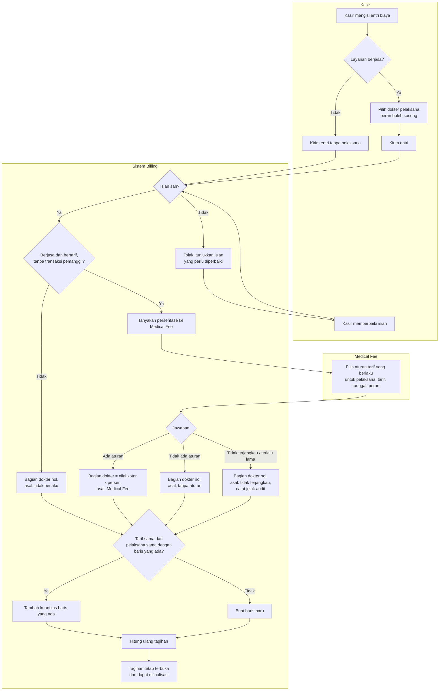

# Jasa Medis pada Item Tagihan — Entri Kasir Berjasa dan Bagian Dokter dari Medical Fee

> Revisi blueprint `2.4`, status **draft**. Trace: `BKC-DEC-168`..`178`, `BKC-DES-093`..`103`.
> Cakupan: entri kasir dari katalog tarif dan entri biaya lain-lain. Sumber klinis tidak termasuk (`BKC-OQ-148`).

## Alur

`Q` dan `R` hanya berlaku untuk entri dari katalog tarif. Entri biaya lain-lain selalu membuat baris baru.

## Tabel langkah

| Langkah | Pelaku | Masukan | Keluaran | Bila gagal |
| --- | --- | --- | --- | --- |
| Mengisi entri | Kasir | Tarif atau jenis biaya, kuantitas | Draf entri | — |
| Menandai berjasa dan memilih pelaksana | Kasir | Dokter dari daftar dokter aktif, peran opsional | Draf entri berpelaksana | Dokter tidak ada di daftar: hubungi admin HR; entri tidak boleh ditandai berjasa atas nama orang lain |
| Memeriksa isian | Sistem Billing | Draf entri | Diterima atau ditolak | Kasir memperbaiki sesuai pesan, lalu mengirim lagi |
| Menanyakan persentase | Sistem Billing → Medical Fee | Pelaksana, tarif, tanggal layanan, peran | Persen dan aturan, atau "tidak ada aturan" | Medical Fee tidak menjawab: baris **tetap** tersimpan dengan bagian dokter nol. Kasir tidak perlu berbuat apa-apa; nilainya pulih bila entri diperbarui kemudian |
| Menghitung bagian dokter | Sistem Billing | Nilai kotor, persen | Nilai bagian dokter, tidak melebihi nilai kotor | — |
| Menggabung atau membuat baris | Sistem Billing | Baris yang ada | Satu baris per tarif per pelaksana | — |
| Menghitung ulang tagihan | Sistem Billing | Tagihan | Versi perhitungan baru | Perhitungan gagal: entri dibatalkan seluruhnya dan kasir mengulang (perilaku adendum §23) |
| Menentukan jasa per periode | Medical Fee | Baris berjasa dan pelaksananya | Hasil jasa per penerima | Layanan tanpa aturan muncul di daftar "belum dapat dihitung" Medical Fee |

## Jalur pengecualian yang paling sering ditemui

| Kejadian | Yang dilihat kasir | Yang terjadi di belakang |
| --- | --- | --- |
| Lupa memilih dokter pada entri berjasa | Pesan meminta memilih pelaksana | Tidak ada baris tercatat |
| Dokter sudah tidak aktif | Pesan pelaksana tidak aktif | Tidak ada baris tercatat |
| Dokter diisi pada entri yang tidak berjasa | Pesan meminta menandai berjasa atau mengosongkan pelaksana | Tidak ada baris tercatat |
| Medical Fee belum dipasang atau sedang gangguan | Entri berhasil seperti biasa | Bagian dokter nol, tercatat "tidak terjangkau" |
| Tarif sama untuk dua dokter berbeda | Dua baris terpisah pada tagihan | Jasa masing-masing dokter tetap terlihat |
| Entri biaya lain-lain berjasa (tanpa tarif) | Entri berhasil | Bagian dokter nol; Medical Fee tetap menerima pelaksananya (`BKC-OQ-150`) |
