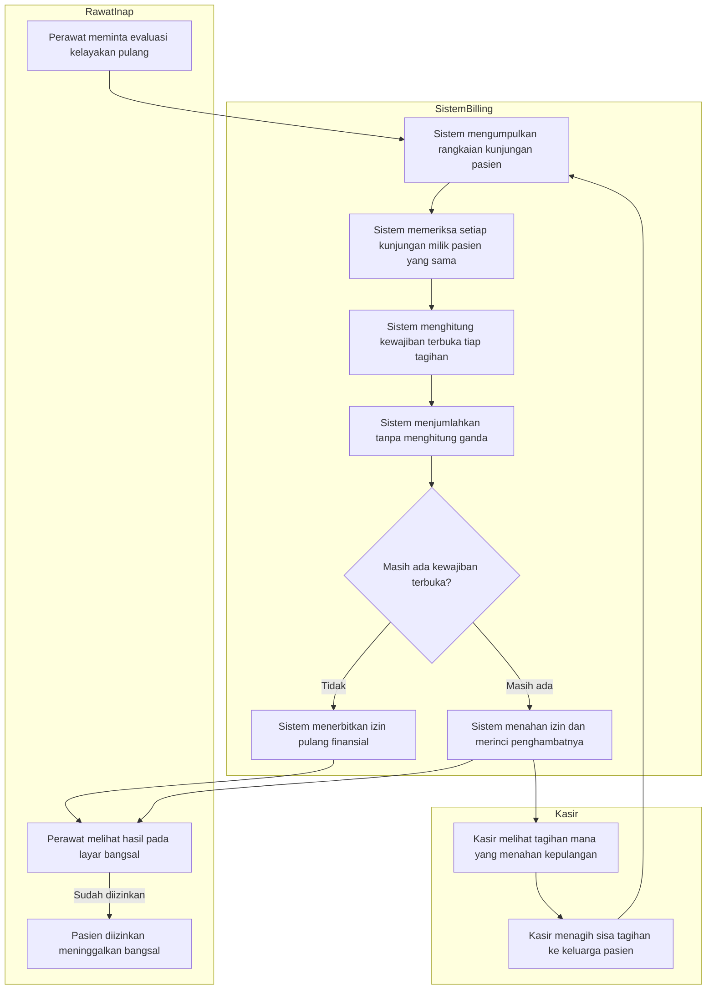
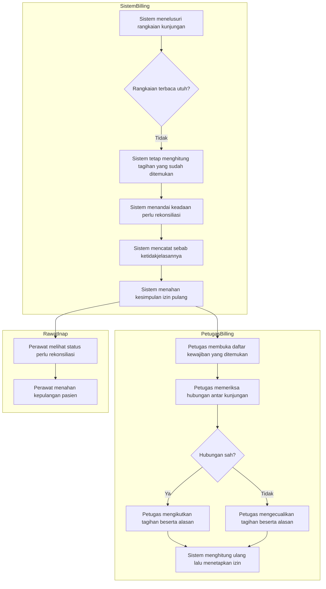
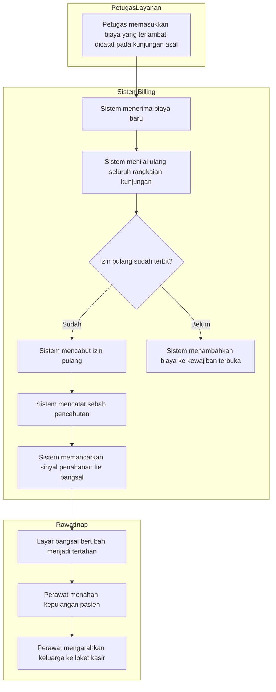
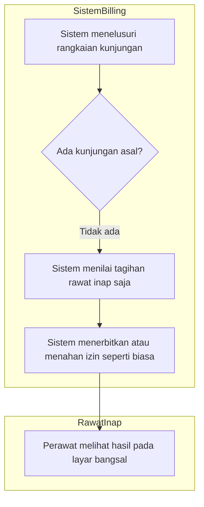

# Alur Kelayakan Pulang Lintas Kunjungan

Masukan `BKC-DEC-144`, `BKC-AC-094`, dan keputusan arsitektur `BKC-DES-063`–`BKC-DES-069`.
Status **draft**, 14 Oktober 2026.

Dokumen ini memetakan urutan kerja ketika pasien rawat inap akan dipulangkan, dan sistem memeriksa
bukan hanya tagihan rawat inapnya, tetapi juga tagihan kunjungan asal yang merujuk admisi itu.

## Mengapa Alur Ini Ada

Pasien sering masuk lewat Rawat Jalan atau IGD lebih dulu sebelum dirawat inap. Setiap kunjungan
punya tagihan sendiri. Sebelum alur ini ada, kelayakan pulang hanya memeriksa tagihan rawat inap,
sehingga pasien bisa resmi pulang walau tagihan IGD-nya masih bersisa — dan piutang itu baru
ditemukan jauh setelahnya.

Alur ini memeriksa **seluruh rangkaian kunjungan yang benar-benar terhubung**, dengan dua pengaman
penting:

1. Kunjungan lama yang **tidak** berkaitan dengan admisi ini tidak boleh menahan kepulangan.
2. Satu kewajiban tidak boleh dihitung dua kali, termasuk yang sudah dibayar, dialihkan menjadi
   kredit, atau ditanggung penjamin.

Bila hubungan antar kunjungan ternyata tidak jelas, sistem **tidak** menebak. Ia menyerahkannya ke
petugas Billing atau Kasir untuk diperiksa.

## Istilah

| Istilah | Artinya di dokumen ini |
| --- | --- |
| Rangkaian kunjungan | Kunjungan rawat inap beserta kunjungan asal yang merujuknya, berlapis sampai ujung |
| Kunjungan asal | Kunjungan yang menghasilkan rujukan ke kunjungan berikutnya, misalnya IGD yang merujuk ke rawat inap |
| Kewajiban terbuka | Sisa tagihan yang masih menjadi tanggungan pasien, sesudah pembayaran, kredit, keringanan, dan tanggungan penjamin diperhitungkan |
| Perlu rekonsiliasi | Keadaan ketika hubungan antar kunjungan tidak lengkap atau ambigu, sehingga sistem belum dapat menyimpulkan |

---

## 1. Alur Pokok — Pemeriksaan Kelayakan Berjalan Normal

### Tabel Langkah Alur Pokok

| Langkah | Pelaku | Masukan | Keluaran | Bila gagal / bermasalah |
| --- | --- | --- | --- | --- |
| 1. Minta evaluasi | Perawat bangsal atau sistem | Identitas kunjungan rawat inap | Permintaan penilaian kelayakan | Perawat menghubungi kasir bila status tidak bergerak |
| 2. Kumpulkan rangkaian kunjungan | Sistem Billing | Kunjungan rawat inap | Daftar kunjungan yang terhubung | Bila rangkaian tidak dapat dibaca utuh, lanjut ke jalur pengecualian 1 |
| 3. Periksa kepemilikan | Sistem Billing | Daftar kunjungan | Kunjungan milik pasien yang sama saja | Kunjungan milik pasien lain dikeluarkan dan ditandai untuk diperiksa petugas |
| 4. Hitung kewajiban tiap tagihan | Sistem Billing | Tagihan tiap kunjungan | Sisa tagihan pasien per tagihan | Tagihan yang tidak ditemukan ditandai untuk diperiksa petugas |
| 5. Jumlahkan tanpa hitung ganda | Sistem Billing | Sisa tiap tagihan | Total kewajiban terbuka | Kewajiban yang sudah dibayar atau dialihkan tidak dihitung lagi karena sudah ternetralkan di tagihannya masing-masing |
| 6. Terbitkan atau tahan izin | Sistem Billing | Total kewajiban | Izin pulang finansial, atau penahanan beserta rincian penghambat | — |
| 7. Tagih sisa | Kasir | Rincian penghambat | Pembayaran dari keluarga pasien | Keluarga pasien dapat melunasi beberapa tagihan sekaligus lewat pelunasan gabungan |
| 8. Izinkan pasien pulang | Perawat bangsal | Izin pulang finansial | Pasien diserahterimakan | Pasien tidak boleh meninggalkan bangsal selama izin belum terbit |

### Contoh Berangka

Pasien Ibu **Sari Mandasari** (nama samaran):

| Tingkat | Kunjungan | Tanggal | Sisa tagihan pasien |
| ---: | --- | --- | ---: |
| 0 | Rawat Inap | 9 Oktober 2026 | Rp 3.500.000 |
| 1 | IGD | 9 Oktober 2026 | Rp 0 — sudah lunas |
| 2 | Rawat Jalan | 2 Oktober 2026 | Rp 250.000 |

Total kewajiban terbuka = Rp 3.500.000 + Rp 0 + Rp 250.000 = **Rp 3.750.000**. Izin pulang
**ditahan**, dan kasir melihat dua tagihan yang menahannya.

Perhatikan tagihan IGD tetap ditampilkan walau nilainya nol, supaya kasir melihat seluruh rangkaian
dan dapat menjelaskannya ke keluarga pasien. Nilainya nol karena pembayarannya sudah diperhitungkan
pada tagihan itu sendiri — bukan karena diabaikan.

---

## 2. Jalur Pengecualian 1 — Hubungan Antar Kunjungan Tidak Jelas

Alur ini terjadi ketika rangkaian kunjungan tidak dapat ditelusuri utuh: rujukannya berputar,
rangkaiannya lebih panjang dari batas aman, atau ada kunjungan yang ternyata milik pasien lain.

### Tabel Langkah Rekonsiliasi

| Langkah | Pelaku | Masukan | Keluaran | Yang dilakukan petugas bila terjadi |
| --- | --- | --- | --- | --- |
| 1. Deteksi ketidakjelasan | Sistem Billing | Rangkaian kunjungan | Penandaan perlu rekonsiliasi beserta sebabnya | — |
| 2. Tetap hitung yang ditemukan | Sistem Billing | Tagihan yang berhasil dibaca | Angka kewajiban sementara | Sistem **tidak** menyimpulkan lunas, dan **tidak** membuat tagihan baru |
| 3. Tahan kesimpulan | Sistem Billing | Penandaan perlu rekonsiliasi | Izin pulang belum terbit | Perawat menahan kepulangan sampai status berubah |
| 4. Periksa hubungan | Petugas Billing atau Kasir | Daftar kewajiban yang ditemukan | Penilaian apakah tiap kunjungan memang terkait | Petugas memeriksa berkas pendaftaran dan rujukan pasien |
| 5. Putuskan beserta alasan | Petugas berwenang | Hasil pemeriksaan | Keputusan mengikutkan atau mengecualikan tiap tagihan | Alasan wajib diisi; keputusan tanpa alasan ditolak sistem |
| 6. Hitung ulang | Sistem Billing | Keputusan petugas | Izin pulang terbit atau tetap tertahan | Bila masih bersisa, kasir menagih sisanya seperti alur pokok |

### Sebab yang paling sering dijumpai

| Sebab | Penjelasan bagi petugas |
| --- | --- |
| Rujukan berputar | Dua kunjungan saling menunjuk sebagai asal, biasanya karena salah input saat pendaftaran |
| Rangkaian terlalu panjang | Penelusuran berhenti pada batas aman; masih ada kunjungan yang belum diperiksa |
| Kunjungan milik pasien lain | Kolom rujukan terisi keliru sehingga menunjuk kunjungan pasien yang berbeda |
| Tagihan kunjungan asal tidak ditemukan | Kunjungan tercatat tetapi tagihannya belum pernah dibuka |
| Lebih dari satu admisi aktif | Satu kunjungan asal tampak merujuk lebih dari satu admisi rawat inap yang masih berjalan, padahal aturannya hanya boleh satu |

---

## 3. Jalur Pengecualian 2 — Tagihan Susulan pada Kunjungan Lain

Alur ini terjadi ketika pasien sudah mendapat izin pulang, lalu tagihan susulan masuk — bukan pada
tagihan rawat inapnya, melainkan pada tagihan kunjungan asal.

### Tabel Langkah Tagihan Susulan Lintas Kunjungan

| Langkah | Pelaku | Masukan | Keluaran | Yang dilakukan petugas bila terjadi |
| --- | --- | --- | --- | --- |
| 1. Masukkan biaya susulan | Petugas farmasi, laboratorium, atau ruangan | Layanan yang terlambat dicatat | Biaya baru pada tagihan kunjungan asal | Petugas wajib memberi catatan alasan keterlambatan |
| 2. Nilai ulang rangkaian | Sistem Billing | Biaya baru | Kewajiban terbuka dihitung ulang atas seluruh rangkaian | — |
| 3. Cabut izin pulang | Sistem Billing | Kewajiban bertambah | Izin pulang dicabut beserta sebabnya | Notifikasi dikirim ke bangsal seketika |
| 4. Tahan kepulangan | Perawat bangsal | Penanda tertahan | Pasien tertahan di bangsal | Perawat menjelaskan secara santun bahwa ada biaya susulan dari unit lain |
| 5. Lunasi selisih | Kasir dan keluarga pasien | Rincian biaya baru | Pembayaran tambahan | Boleh dibayar sendiri, boleh digabung dengan tagihan lain yang masih terbuka |

> Catatan penting: biaya susulan pada **kunjungan asal** kini dapat menahan kepulangan pasien rawat
> inap. Sebelum alur ini ada, hal itu tidak terjadi. Perubahan perilaku ini **wajib** disampaikan ke
> bangsal sebelum fitur diaktifkan, supaya perawat tidak menganggapnya kekeliruan sistem.

---

## 4. Jalur Pengecualian 3 — Pasien Tanpa Kunjungan Asal

Alur ini terjadi pada pasien yang langsung dirawat inap tanpa melalui Rawat Jalan maupun IGD.

### Tabel Langkah Pasien Tanpa Kunjungan Asal

| Langkah | Pelaku | Masukan | Keluaran | Catatan |
| --- | --- | --- | --- | --- |
| 1. Telusuri rangkaian | Sistem Billing | Kunjungan rawat inap | Nol kunjungan asal ditemukan | Keadaan **normal**, bukan anomali, dan **tidak** menandai perlu rekonsiliasi |
| 2. Nilai tagihan rawat inap | Sistem Billing | Satu tagihan | Kewajiban terbuka | Hasilnya **identik** dengan perilaku sebelum alur ini ada |
| 3. Terbitkan atau tahan izin | Sistem Billing | Kewajiban terbuka | Izin pulang finansial | Tidak ada perbedaan yang dirasakan perawat maupun kasir |

Jalur ini digambarkan secara khusus karena inilah mayoritas pasien rawat inap. Penambahan penelusuran
rangkaian kunjungan **tidak boleh** mengubah apa pun bagi mereka — itu yang dijaga uji regresi.
