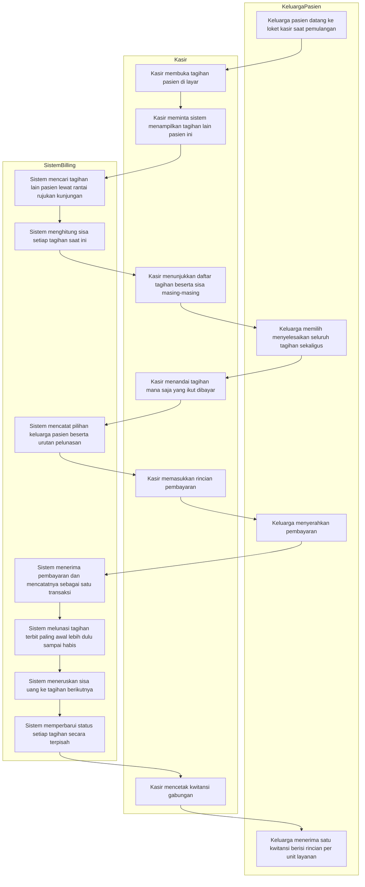
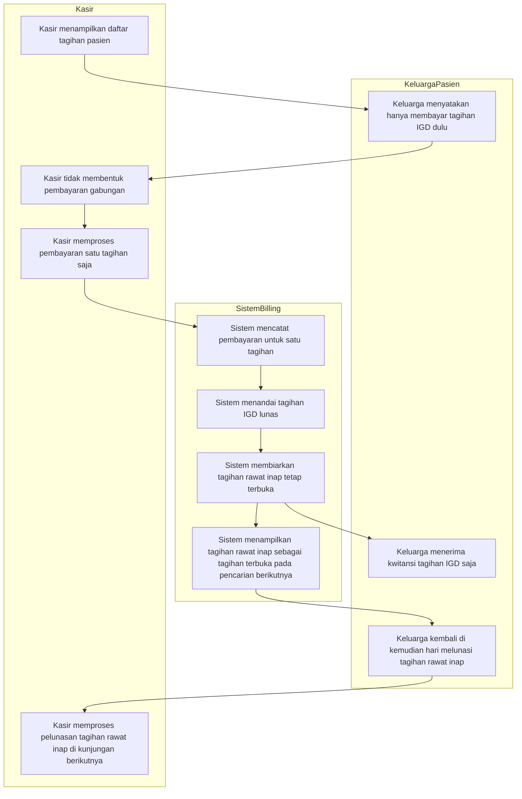
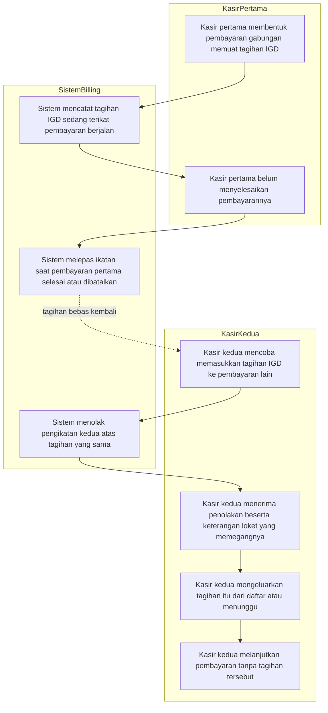
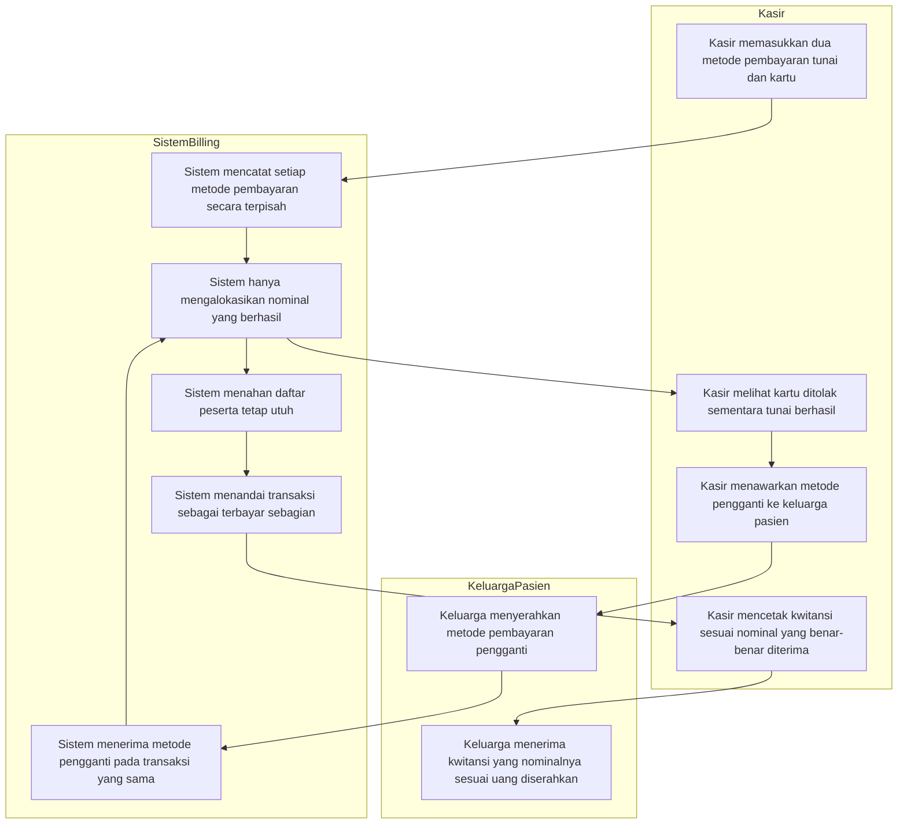
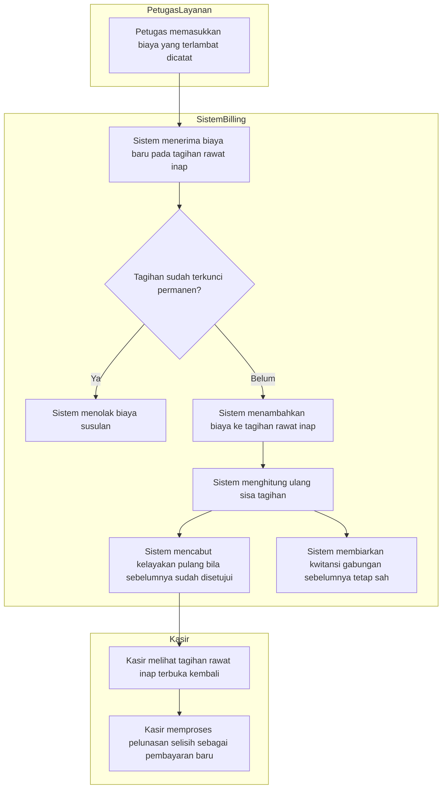

# Alur Pelunasan Gabungan Lintas Kunjungan

Masukan `BKC-DEC-118`, `BKC-AC-086`, dan keputusan arsitektur `BKC-DES-057`–`BKC-DES-062`.
Status **draft**, 13 Oktober 2026.

Dokumen ini memetakan urutan kerja petugas kasir ketika satu pasien memiliki tagihan dari
lebih dari satu kunjungan — misalnya tagihan IGD dan tagihan rawat inap — dan keluarga pasien
ingin menyelesaikannya dalam satu kali pembayaran.

## Mengapa Alur Ini Ada

Pasien yang masuk lewat IGD lalu dirawat inap tercatat sebagai **dua kunjungan terpisah** di
sistem, sehingga tagihannya pun dua. Tanpa alur ini, keluarga pasien harus bertransaksi dua kali
di loket kasir saat pemulangan.

Yang **tidak** dilakukan alur ini: menggabungkan kedua tagihan menjadi satu tagihan. Tagihan
tetap dua, karena rumah sakit wajib dapat melaporkan pendapatan unit IGD secara terpisah dari
unit rawat inap. Yang digabungkan hanya **transaksi pembayarannya**.

Alur ini juga bukan kewajiban. Keluarga pasien tetap boleh membayar tagihan IGD lebih dulu dan
melunasi tagihan rawat inap di kemudian hari, atau menggabungkan sebagian tagihan saja.

## Istilah

| Istilah | Artinya di dokumen ini |
| --- | --- |
| Tagihan jangkar | Tagihan yang pertama kali dibuka kasir di layar, menjadi titik awal pencarian tagihan lain |
| Tagihan kandidat | Tagihan lain milik pasien yang sama yang masih punya sisa dan boleh diikutkan |
| Pembayaran gabungan | Satu kali transaksi pembayaran yang menyelesaikan beberapa tagihan sekaligus |
| Urutan pelunasan | Urutan tagihan mana yang dilunasi lebih dulu bila uang tidak cukup menutup semuanya |

---

## 1. Alur Pokok — Keluarga Pasien Memilih Membayar Gabungan

### Tabel Langkah Alur Pokok

| Langkah | Pelaku | Masukan | Keluaran | Bila gagal / bermasalah |
| --- | --- | --- | --- | --- |
| 1. Buka tagihan pasien | Kasir | Identitas pasien atau nomor kunjungan | Tagihan jangkar tampil di layar | Kasir mencari ulang memakai nomor rekam medis bila nomor kunjungan tidak ditemukan |
| 2. Tampilkan tagihan lain | Kasir | Tagihan jangkar | Daftar tagihan kandidat beserta sisa masing-masing | Bila daftar kosong, kasir melanjutkan sebagai pembayaran satu tagihan biasa |
| 3. Tawarkan pilihan ke keluarga | Kasir | Daftar tagihan kandidat | Keputusan keluarga pasien: gabung semua, gabung sebagian, atau pisah | Keluarga berhak menolak penggabungan; kasir melanjutkan jalur pembayaran satu tagihan |
| 4. Tandai tagihan yang ikut | Kasir | Pilihan keluarga pasien | Daftar peserta pembayaran tercatat beserta urutan pelunasannya | Tagihan yang sedang diproses kasir lain ditolak ikut; kasir menunggu atau mengeluarkannya dari daftar |
| 5. Masukkan pembayaran | Kasir | Uang tunai, kartu, atau pemindahan saldo deposit | Rincian pembayaran tercatat | Metode pembayaran yang gagal diulang atau diganti tanpa membatalkan pilihan peserta |
| 6. Lunasi berurutan | Sistem Billing | Pembayaran yang berhasil | Setiap tagihan berkurang sisanya sesuai urutan | Bila uang kurang, tagihan terakhir dalam urutan tetap bersisa dan itu keadaan sah |
| 7. Perbarui status tagihan | Sistem Billing | Hasil pelunasan | Status tiap tagihan diperbarui sendiri-sendiri | Tagihan yang belum lunas tetap terbuka dan muncul lagi di pencarian berikutnya |
| 8. Cetak kwitansi | Kasir | Hasil transaksi | Satu kwitansi memuat rincian beban per unit layanan | Kwitansi dapat dicetak ulang dari riwayat pembayaran tanpa membuat transaksi baru |

### Contoh Berangka

Pasien Ibu **Sari Mandasari** (nama samaran) memiliki dua tagihan:

| Tagihan | Unit layanan | Tanggal terbit | Sisa tagihan pasien |
| --- | --- | --- | --- |
| Tagihan pertama | IGD | 9 Oktober 2026 | Rp 1.500.000 |
| Tagihan kedua | Rawat Inap | 9 Oktober 2026 (sore) | Rp 8.000.000 |

Total sisa Rp 9.500.000. Keluarga membayar **Rp 6.000.000** dan memilih menggabungkan keduanya.

Karena urutan pelunasan adalah tagihan terbit paling awal lebih dulu:

1. Tagihan IGD dilunasi lebih dulu: Rp 1.500.000 terpakai, tagihan IGD **lunas**, sisa uang
   Rp 6.000.000 − Rp 1.500.000 = Rp 4.500.000.
2. Sisa Rp 4.500.000 dialokasikan ke tagihan rawat inap: Rp 8.000.000 − Rp 4.500.000 =
   **Rp 3.500.000 masih bersisa**.

Hasil akhir: satu kwitansi senilai Rp 6.000.000 yang merinci Rp 1.500.000 untuk unit IGD dan
Rp 4.500.000 untuk unit rawat inap. Tagihan IGD berstatus lunas, tagihan rawat inap masih
terbuka dengan sisa Rp 3.500.000.

---

## 2. Jalur Pengecualian 1 — Keluarga Pasien Memilih Membayar Terpisah

Alur ini terjadi ketika keluarga pasien ingin membayar tagihan IGD lebih dulu, misalnya karena
penjamin tagihan rawat inap belum menerbitkan surat jaminan.

### Tabel Langkah Pembayaran Terpisah

| Langkah | Pelaku | Masukan | Keluaran | Catatan penting |
| --- | --- | --- | --- | --- |
| 1. Pilih bayar terpisah | Keluarga pasien | Daftar tagihan | Keputusan membayar satu tagihan saja | Ini **hak** keluarga pasien, bukan pengecualian teknis |
| 2. Proses satu tagihan | Kasir | Tagihan IGD | Pembayaran satu tagihan | Memakai jalur pembayaran yang sudah berjalan, tanpa pembentukan grup |
| 3. Biarkan tagihan lain terbuka | Sistem Billing | Hasil pembayaran | Tagihan rawat inap tetap terbuka | Tidak ada penalti, tidak ada penguncian |
| 4. Lunasi di kemudian hari | Kasir | Tagihan rawat inap | Pelunasan terpisah | Boleh digabung dengan tagihan lain yang muncul kemudian, boleh juga sendiri |

---

## 3. Jalur Pengecualian 2 — Tagihan Sedang Diproses Kasir Lain

Alur ini terjadi ketika dua petugas kasir hampir bersamaan mencoba memproses tagihan yang sama,
misalnya satu kasir di loket rawat inap dan satu kasir di loket IGD.

### Tabel Langkah Bentrokan Antar Loket

| Langkah | Pelaku | Masukan | Keluaran | Yang dilakukan petugas bila terjadi |
| --- | --- | --- | --- | --- |
| 1. Ikat tagihan | Sistem Billing | Pembentukan pembayaran gabungan | Tagihan tercatat sedang diproses | — |
| 2. Tolak ikatan kedua | Sistem Billing | Permintaan kasir kedua | Penolakan beserta keterangan loket pemegangnya | Kasir kedua menghubungi loket yang disebut untuk memastikan |
| 3. Keluarkan atau tunggu | Kasir kedua | Penolakan | Daftar peserta disesuaikan | Kasir kedua tetap dapat melanjutkan untuk tagihan lain yang bebas |
| 4. Lepas ikatan | Sistem Billing | Pembayaran pertama selesai atau dibatalkan | Tagihan bebas kembali | Bila kasir pertama meninggalkan transaksi menggantung, supervisor kasir membatalkannya |

---

## 4. Jalur Pengecualian 3 — Pembayaran Gagal di Tengah Transaksi Gabungan

Alur ini terjadi ketika sebagian metode pembayaran berhasil dan sebagian gagal, misalnya kartu
debit ditolak bank sementara uang tunai sudah diterima.

### Tabel Langkah Pembayaran Gagal Sebagian

| Langkah | Pelaku | Masukan | Keluaran | Yang dilakukan petugas bila terjadi |
| --- | --- | --- | --- | --- |
| 1. Catat tiap metode | Sistem Billing | Beberapa metode pembayaran | Setiap metode punya catatan sendiri | — |
| 2. Alokasikan yang berhasil saja | Sistem Billing | Metode yang berhasil | Tagihan berkurang sesuai uang yang benar-benar diterima | Uang tunai yang sudah diterima **tidak** dikembalikan hanya karena kartu gagal |
| 3. Tahan daftar peserta | Sistem Billing | Transaksi berjalan | Pilihan keluarga pasien tidak hilang | Kasir tidak perlu memilih ulang tagihan dari awal |
| 4. Terima metode pengganti | Kasir | Metode pembayaran baru | Alokasi berlanjut pada transaksi yang sama | Bila keluarga tidak punya pengganti, transaksi ditutup sebagai terbayar sebagian |
| 5. Cetak kwitansi | Kasir | Nominal yang berhasil | Kwitansi sesuai uang diterima | Kwitansi **MUST** mencerminkan uang nyata, bukan nominal yang diminta |

---

## 5. Jalur Pengecualian 4 — Tagihan Susulan Tiba Setelah Pembayaran Gabungan

Alur ini terjadi ketika petugas farmasi atau ruangan memasukkan biaya yang terlambat dicatat,
sesudah keluarga pasien menyelesaikan pembayaran gabungan.

### Tabel Langkah Tagihan Susulan

| Langkah | Pelaku | Masukan | Keluaran | Yang dilakukan petugas bila terjadi |
| --- | --- | --- | --- | --- |
| 1. Masukkan biaya susulan | Petugas farmasi atau ruangan | Layanan yang terlambat dicatat | Biaya baru masuk ke tagihan kunjungan terkait | Petugas wajib memberi catatan alasan keterlambatan |
| 2. Periksa penguncian | Sistem Billing | Status tagihan | Diterima atau ditolak | Bila ditolak, dibutuhkan pembukaan kunci oleh supervisor kasir |
| 3. Hitung ulang sisa | Sistem Billing | Biaya baru | Sisa tagihan bertambah | Kwitansi gabungan yang sudah tercetak **tetap sah** dan tidak dibatalkan |
| 4. Cabut kelayakan pulang | Sistem Billing | Sisa tagihan bertambah | Kelayakan pemulangan dicabut | Bangsal menahan kepulangan dan mengarahkan keluarga ke loket kasir |
| 5. Lunasi selisih | Kasir | Sisa tagihan baru | Pembayaran baru, terpisah dari yang sebelumnya | Boleh dibayar sendiri, boleh digabung dengan tagihan lain yang masih terbuka |

> Catatan hubungan dengan kelayakan pemulangan: apakah sisa tagihan pada kunjungan **IGD** juga
> menahan kelayakan pemulangan rawat inap masih menjadi pertanyaan terbuka `BKC-OQ-109` dan
> belum digambarkan di sini.
