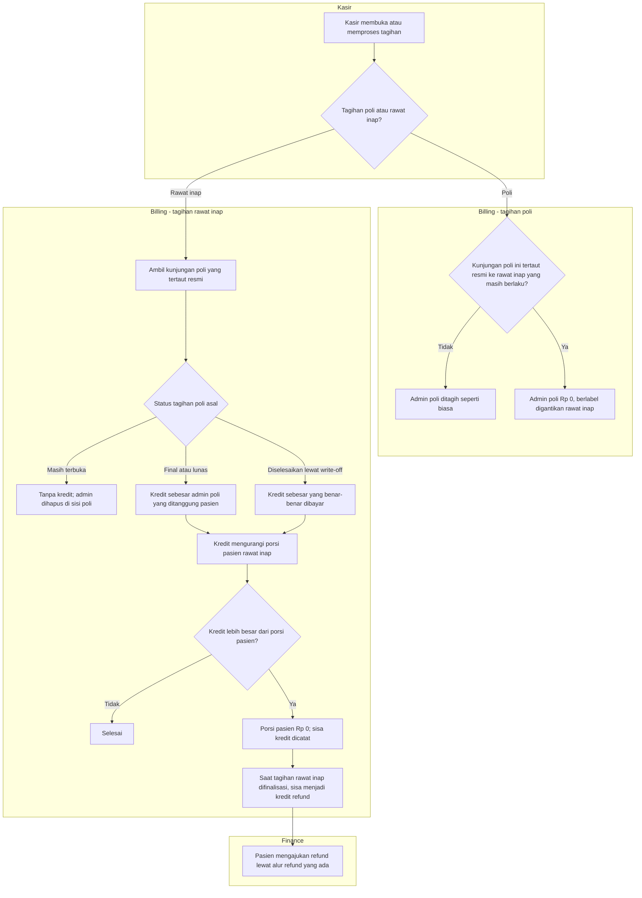

# Alur — Penggantian Biaya Admin Rawat Jalan oleh Rawat Inap

> Revisi blueprint `2.3`, status **draft**. Masukan: `BKC-DEC-119`, `BKC-DEC-161`, `BKC-DES-083`–`BKC-DES-087`, arahan A1.

Aturannya satu: pasien yang **resmi** beralih dari poli ke rawat inap hanya menanggung **satu** biaya admin, yaitu admin
rawat inap (`BKC-DEC-119`). Sistem menjalankannya sendiri setiap kali tagihan dihitung, termasuk saat kasir sekadar
membuka Menu Pembayaran. Tidak ada petugas yang menekan tombol "ganti admin", dan menghitung tagihan tidak pernah
mengubah data lain.

Yang menentukan hasilnya adalah status tagihan poli **saat itu**:
- Masih terbuka: admin poli dihapus dari tagihan poli.
- Sudah final atau lunas: admin poli dikembalikan sebagai kredit di tagihan rawat inap.

| Langkah | Pelaku | Masukan | Keluaran | Bila gagal / pengecualian |
|---|---|---|---|---|
| Buka atau proses tagihan | Kasir | Tagihan poli atau rawat inap | Angka tagihan terbaru | Data berubah di tengah jalan → pesan "Data telah berubah", kasir memuat ulang (perilaku yang sudah ada) |
| Periksa tautan resmi | Billing (otomatis) | Tautan transfer atau rujukan operasi | Tertaut atau tidak | Kunjungan poli **tanpa** tautan tidak pernah digantikan, sedekat apa pun tanggalnya. Bila pasien sebenarnya ditransfer tetapi tidak tercatat resmi, itu gap proses admisi (`BKC-DEC-161`, `BKC-OQ-136`); kasir melapor ke Registrasi, **tidak** mengoreksi di Billing |
| Admin poli digantikan | Billing (otomatis) | Tagihan poli masih terbuka dan tertaut | Admin poli Rp 0 | Rawat inapnya kemudian dibatalkan → admin poli kembali ditagih pada perhitungan berikutnya |
| Kredit di rawat inap | Billing (otomatis) | Tagihan poli final, lunas, atau di-*write-off* | Porsi pasien rawat inap berkurang | Admin poli ternyata sudah Rp 0 di tagihan poli → kredit Rp 0, tidak dobel |
| Sisa kredit | Billing (otomatis, saat finalisasi) | Kredit melebihi porsi pasien | Satu kredit refund | Tagihan rawat inap difinalisasi ulang dengan sisa berbeda → kredit lama tidak diubah; Finance meninjau catatan audit |
| Refund sisa kredit | Pasien, lalu Finance | Kredit refund | Uang kembali ke pasien | Alur refund yang sudah ada berlaku |

**Contoh.** Ibu Sari Mandasari (nama samaran) membayar admin poli Rp 150.000, lalu ditransfer resmi ke rawat inap.
Porsinya di tagihan rawat inap Rp 3.650.000 menjadi Rp 3.500.000. Bila rawat inapnya ditanggung penuh BPJS, porsinya
tetap Rp 0, dan Rp 150.000 itu menjadi kredit refund saat tagihan rawat inap difinalisasi.
