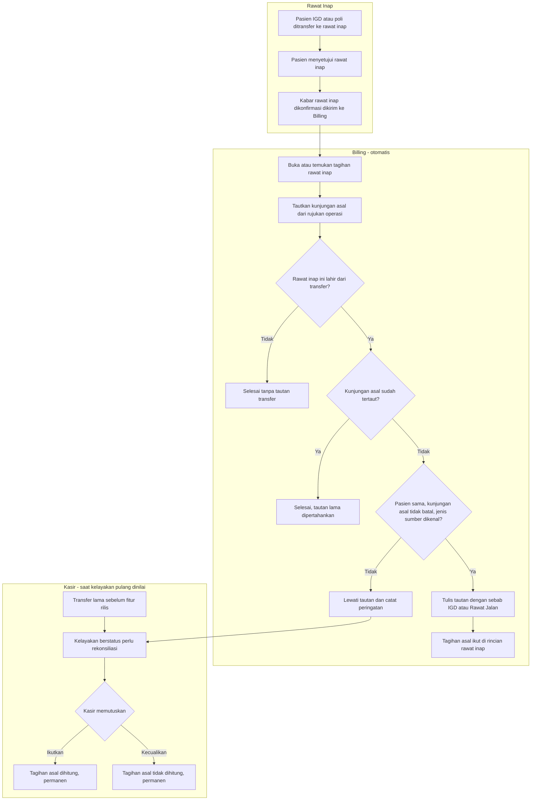

# Alur — Tautan Kunjungan Asal Jalur Transfer

> Revisi blueprint `2.2`, status **draft**. Masukan: `BKC-DEC-155`, `BKC-DES-077`–`BKC-DES-080`.

Alur ini berjalan otomatis, tanpa petugas, setiap kali Billing menerima kabar bahwa seorang pasien
resmi dirawat inap. Petugas baru terlibat di ujung, bila tautannya tidak dapat dibuat.

| Langkah | Pelaku | Masukan | Keluaran | Bila gagal |
|---|---|---|---|---|
| Buka tagihan rawat inap | Billing (otomatis) | Kabar rawat inap dikonfirmasi | Tagihan rawat inap terbuka | Kunjungan tidak dikenal → kabar ditolak dan masuk antrean gagal milik Rawat Inap (perilaku yang sudah ada) |
| Tautkan rujukan operasi | Billing (otomatis) | Rujukan operasi yang selesai | Tautan sebab operasi | Tidak berubah dari perilaku yang sudah ada |
| Tulis tautan transfer | Billing (otomatis) | Asal transfer pada kunjungan rawat inap | Satu tautan sebab IGD atau Rawat Jalan | Pasien berbeda, kunjungan asal batal, atau jenis sumber tak dikenal → tautan dilewati, peringatan dicatat, tagihan rawat inap tetap terbuka |
| Nilai kelayakan pulang | Billing (otomatis, `MVP-37`) | Rantai kunjungan | Status kelayakan | Asal transfer tanpa tautan → perlu rekonsiliasi; kasir membuka layar rekonsiliasi |
| Putuskan rekonsiliasi | Kasir atau Supervisor Kasir | Kejanggalan asal transfer belum tertaut | Keputusan permanen | Keputusan tidak dapat dibalik; kasir **MUST** membaca konfirmasi sebelum menekan |
