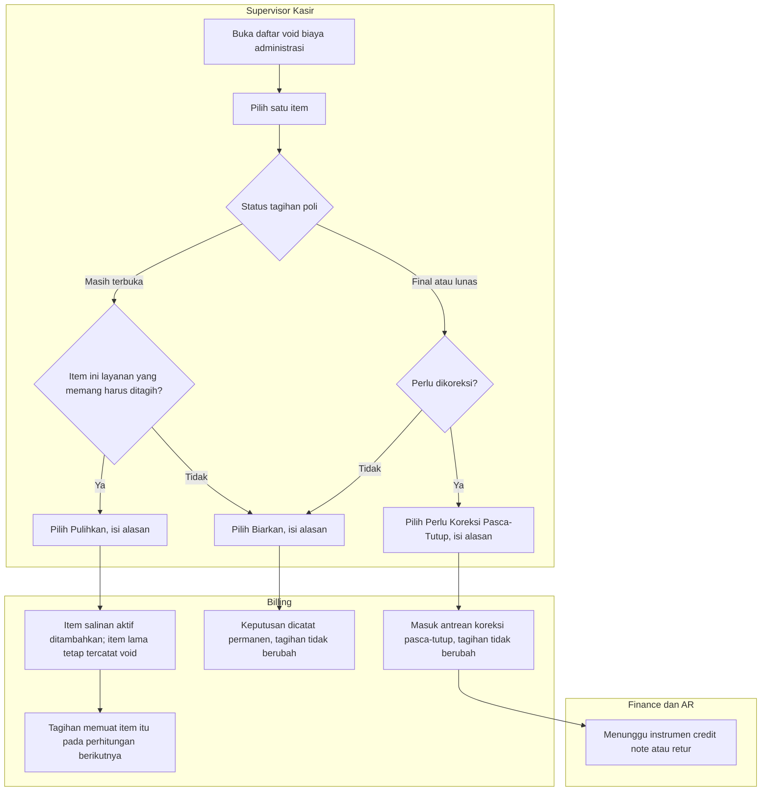

# Alur — Tinjauan Void Biaya Administrasi yang Keliru

> Revisi blueprint `2.3`, status **draft**. Masukan: `BKC-DEC-158`, `BKC-DEC-162`, `BKC-DES-089`, arahan A2 dan A3.

Sebelum perbaikan, sistem mem-void item tagihan poli yang namanya mengandung kata "Administrasi", padahal biaya admin
poli yang sebenarnya bukan item. Yang ter-void justru layanan lain, misalnya "Administrasi Rekam Medis". Kadang void itu
terjadi hanya karena kasir membuka halaman pembayaran. Alur ini dipakai Supervisor Kasir untuk memeriksa void lama itu
satu per satu. Setiap keputusan bersifat final, tidak memerlukan persetujuan orang lain, dan item lama tidak pernah
diubah.

| Langkah | Pelaku | Masukan | Keluaran | Bila gagal / pengecualian |
|---|---|---|---|---|
| Buka daftar | Supervisor Kasir | — | Item yang di-void oleh cacat lama, beserta status tagihannya | Daftar kosong → "Tidak ada item yang perlu ditinjau." Gagal muat → coba lagi; data tidak berubah |
| Pulihkan | Supervisor Kasir | Item pada tagihan yang masih terbuka, alasan minimal 10 karakter | Item salinan aktif | Sudah ada item aktif untuk layanan yang sama → ditolak, pilih Biarkan. Tagihan berubah sejak dibuka → muat ulang |
| Biarkan | Supervisor Kasir | Item apa pun, alasan | Keputusan tercatat | — |
| Perlu Koreksi Pasca-Tutup | Supervisor Kasir | Item pada tagihan final atau lunas, alasan | Antrean bagi Finance/AR | Tagihan yang sudah tutup **tidak** diubah (A2). Instrumen koreksinya belum ada (`BKC-OQ-139`), jadi antrean ini menunggu |
| Keputusan kedua | Siapa pun | Item yang sudah diputuskan | Ditolak | Keputusan final; tidak ada jalur ubah |

**Contoh.** Tagihan poli Pak Budi (nama samaran) yang masih terbuka kehilangan item "Administrasi Rekam Medis Rp 25.000".
Supervisor memilih Pulihkan dengan alasan "Layanan rekam medis, bukan biaya admin". Item salinan Rp 25.000 kembali ke
tagihan, sedangkan item lama tetap tercatat sebagai void sebagai bukti kejadian.
