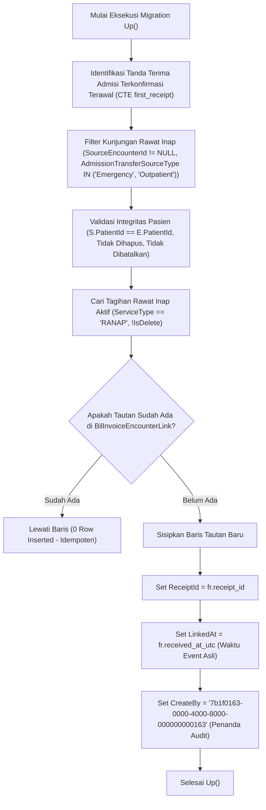

# Laporan Perubahan Backend — `BE-BKC-087`

## Ringkasan untuk Pembaca Umum

Pada sistem rumah sakit Quilvian, pasien yang awalnya datang melalui Unit Gawat Darurat (IGD) atau Poliklinik Rawat Jalan dan kemudian diputuskan oleh dokter untuk menjalani Rawat Inap (Ranap) memiliki alur perpindahan perawatan (*admission transfer*). Berdasarkan regulasi penagihan rumah sakit (`BKC-DEC-119` & `BKC-DEC-155`), biaya administrasi rawat jalan yang telah dibayarkan oleh pasien berhak diperhitungkan kembali (digantikan atau dikreditkan) pada saat pasien dirawat inap, sehingga keluarga pasien tidak membayar dobel biaya administrasi rumah sakit.

Sebelum modul pencatatan otomatis `BE-BKC-082` terpasang, kunjungan transfer historis ini belum tertaut secara otomatis ke tabel tautan penagihan (`BilInvoiceEncounterLink`). Ketiadaan tautan ini menyebabkan dua kerugian:
1. Pasien transfer lama yang tagihannya masih terbuka (*OPEN*) belum otomatis mendapatkan keringanan biaya administrasi saat tagihannya dikalkulasi ulang (`BE-BKC-084`).
2. Modul audit kepatuhan penagihan (`MVP-37`) berpotensi menandai berkas pasien tersebut sebagai data anomali atau *"asal transfer belum tertaut"* (`UNLINKED_TRANSFER_ORIGIN`), yang dapat menghambat kelancaran audit berkas klaim dan penutupan tagihan.

Setelah instrumen analisis baca-saja (*dry-run*) dan panduan eksekusi diselesaikan pada task `BE-BKC-086`, task `BE-BKC-087` ini menyediakan **migration data resmi Entity Framework Core** (`20261017040000_BackfillTransferOriginEncounterLinks.cs`). Migration ini bertugas memulihkan data tautan historis secara aman, terukur, dan idempoten (bisa dijalankan berulang tanpa merusak data), dengan mempertahankan jejak waktu tanda terima penerimaan rawat inap asli pasien (*not execution timestamp*).

---

### Contoh Skenario Rumah Sakit Konkret

> **Skenario Pasien Ny. Anita (Transfer IGD ke Rawat Inap Sebelum Sistem Baru Rilis):**
> 1. **Penerimaan IGD:** Ny. Anita masuk IGD pada tanggal 10 Oktober 2026 pukul 08:00 WIB karena sesak napas akut (`RegPatientEncounter` id: `enc-igd-001`).
> 2. **Instruksi Rawat Inap:** Dokter Sp.PD memutuskan Ny. Anita memerlukan rawat inap di Ruang Teratai pada pukul 12:00 WIB (`RegPatientEncounter` id: `enc-ranap-001`, dengan `SourceEncounterId` = `enc-igd-001` dan `AdmissionTransferSourceType` = `Emergency`).
> 3. **Penerimaan Rawat Inap:** Sistem rawat inap mencatat tanda terima admisi terkonfirmasi (`BilInpatientEventReceipt` dengan `EventType` = `ADMISSION_CONFIRMED`, `ReceivedAtUtc` = `2026-10-10 05:15:00 UTC`, `Outcome` = `INVOICE_OPENED`).
> 4. **Kondisi Sebelum Migration `BE-BKC-087`:** Belum ada baris pada `BilInvoiceEncounterLink` yang menghubungkan invoice rawat inap Ny. Anita dengan kunjungan IGD-nya. Akibatnya, sistem belum tahu bahwa Ny. Anita berasal dari IGD.
> 5. **Setelah Migration Diterapkan:** Sistem menyisipkan satu baris resmi ke `BilInvoiceEncounterLink`:
>    - `RanapInvoiceId` = Id invoice Ranap Ny. Anita
>    - `LinkedEncounterId` = `enc-igd-001`
>    - `LinkReason` = `EMERGENCY_ORIGIN`
>    - `ReceiptId` = Id tanda terima admisi tanggal 10 Oktober
>    - `LinkedAt` = `2026-10-10 05:15:00 UTC` (mencerminkan waktu admisi asli Ny. Anita, bukan waktu admin menjalankan migrasi)
>    - `CreateBy` = `7b1f0163-0000-4000-8000-000000000163` (identitas resmi sistem pemulih data)
> 6. **Hasil Bagi Pasien & Kasir:** Saat kasir membuka tagihan rawat inap Ny. Anita, sistem langsung mengenali tautan IGD dan memperhitungkan penggantian biaya administrasi sesuai aturan rumah sakit.

---

## Lembar Metadata Task

| Field | Nilai |
| --- | --- |
| Task ID | `BE-BKC-087` |
| Judul | Migration data backfill tautan transfer lama |
| Slice / Gelombang | Gelombang Eksekusi 2 (Revisi Blueprint 2.2 / 2.3) |
| Roadmap | `docs/module-blueprints/billing-kasir/roadmap/backend-roadmap.md` § `BE-BKC-087` |
| Trace | `FR-BKC-283`; `BKC-DEC-160`, `BKC-DEC-163`; `BKC-DES-088`; `BIL-INT-022` |
| Kontrak | `BIL-INT-022`; `02-backend-architecture.md` amendment `2.3` Bagian 8 |
| Acceptance Criteria | `BIL-AT-215` (tautan benar & idempoten: jalan kedua 0 baris tertulis), `BIL-AT-216` (`Down` selektif hanya menghapus baris berpenanda backfill), `BIL-AT-217` (`MVP-37` tidak memunculkan peringatan transfer belum tertaut) |
| Dependency | `BE-BKC-086` (selesai), `{OTORISASI-MIG-2}` |
| Klasifikasi | Tinggi / Integritas Data & Keselamatan Migrasi Finansial |
| Task mode | `BACKEND` (EF Core Data-Only Migration) |
| Target berkas | `Migrations/20261017040000_BackfillTransferOriginEncounterLinks.cs` |
| Tanggal Implementasi | 17 Oktober 2026 |
| Status | ✅ **SELESAI (Berkas migrasi data siap, penerapan ke basis data diserahkan ke DBA/Pemilik Database)** |

---

## Backend Governance Preflight

| Field Preflight | Nilai |
| --- | --- |
| Area | `HealthServices` |
| Module | `BillingManagement / Billing` |
| Submodule | `Billing` |
| Entity / Model Terkait | `BilInvoiceEncounterLink`, `BilInpatientEventReceipt`, `BilInvoice`, `RegPatientEncounter` |
| Prefix Registry | `Bil` — status `ACTIVE` pada registry arsitektur Quilvian |
| Applicability | `TOUCHED LEGACY` (Penyusunan migration data backfill historis EF Core) |
| QBE Rules Berlaku | `QBE-DB-001` (aturan keselamatan database: migration data disusun dengan SQL idempoten; eksekusi migrasi otomatis tidak dilakukan oleh AI dan didelegasikan ke DBA/pemilik sistem), `QBE-SEC-001` (audit integritas data finansial tanpa pemaparan PII) |
| Database Migration | **DATA-ONLY MIGRATION:** `20261017040000_BackfillTransferOriginEncounterLinks.cs`. Tidak ada penambahan kolom, tabel, tipe data, atau indeks skema (`ApplicationDbContextModelSnapshot.cs` tidak berubah). |

---

## 1. Alur Proses Bisnis & Logika Rekayasa Data

Proses backfill data transfer historis dijalankan melalui migration Entity Framework Core dengan tahapan logika yang ketat dan terisolasi:



### 1.1 Kriteria Invariant Penautan (100% Identik dengan `BE-BKC-082` & `BE-BKC-086`)

Migration menyaring kandidat data menggunakan 5 kriteria pengaman yang persis sama dengan runtime dan skrip dry-run:
1. **Kunjungan Rawat Inap (`RegPatientEncounter` `e`):** Memiliki `SourceEncounterId` terisi, `AdmissionTransferSourceType` bernilai `'Emergency'` atau `'Outpatient'`, dan berstatus aktif (`IsDelete = false`).
2. **Kunjungan Asal (`RegPatientEncounter` `s`):** Pasien harus cocok (`s.PatientId = e.PatientId`), tidak dihapus (`IsDelete = false`), dan tidak dibatalkan (`IsCancel = false`).
3. **Invoice Rawat Inap (`BilInvoice` `r`):** Menagih kunjungan rawat inap tersebut (`r.EncounterId = e.Id`), jenis layanan rawat inap (`r.ServiceType = 'RANAP'`), dan aktif (`r.IsDelete = false`).
4. **Tanda Terima Admisi (`BilInpatientEventReceipt` `t`):** Memiliki tanda terima peristiwa `ADMISSION_CONFIRMED` dengan status `Outcome` berupa `INVOICE_OPENED` atau `INVOICE_ALREADY_OPEN`. Bila terdapat lebih dari satu event receipt untuk pasangan invoice dan encounter tersebut, query memilih receipt dengan `ReceivedAtUtc` terawal (`ORDER BY ReceivedAtUtc ASC, Id ASC`).
5. **Ketiadaan Tautan Aktif Sebelumnya:** Klausa `NOT EXISTS` memastikan bahwa pasangan `(RanapInvoiceId, LinkedEncounterId)` yang sudah memiliki tautan aktif tidak akan disisipkan kembali.

### 1.2 Ketetapan Nilai Kolom Audit dan Keamanan

- **`ReceiptId`:** Merujuk langsung ke UUID tanda terima penerimaan rawat inap (`first_receipt.receipt_id`).
- **`LinkedAt`:** Menggunakan `first_receipt.received_at_utc`. Nilai ini **BUKAN** `NOW()` atau waktu eksekusi migrasi, melainkan waktu historis saat pasien pertama kali resmi diterima di rawat inap. Hal ini menjaga keaslian kronologis audit medis dan keuangan.
- **`CreateBy`:** Menggunakan penanda sistem khusus: `'7b1f0163-0000-4000-8000-000000000163'::uuid`. Penanda unik ini membedakan secara tegas baris yang dibuat oleh proses migrasi historis dengan baris yang dibuat oleh runtime operasional kasir atau layanan rujukan bedah.
- **`SourceReferralId`:** Diisi `NULL` karena tautan ini berasal dari transfer IGD/Poli ke Rawat Inap, bukan dari rujukan kamar operasi/bedah.

### 1.3 Mekanisme Rollback Aman (`Down()`)

Operasi `Down()` dirancang sangat spesifik:
```sql
DELETE FROM public."BilInvoiceEncounterLink"
WHERE "CreateBy" = '7b1f0163-0000-4000-8000-000000000163'::uuid;
```
Dengan filter `CreateBy` khusus ini:
- Hanya baris yang disisipkan oleh migrasi backfill ini yang dihapus.
- Tautan transfer yang dibuat secara dinamis oleh runtime kasir (`BE-BKC-082`) atau tautan rujukan bedah (`SURGERY_ORIGIN`) tetap aman dan tidak akan terhapus jika migrasi ini di-rollback.

---

## 2. Spesifikasi Endpoint & Kontrak

> [!NOTE]
> Task `BE-BKC-087` adalah pekerjaan migrasi basis data murni (*data-only migration*) di lapisan infrastruktur EF Core. Task ini tidak membuat atau mengubah endpoint API HTTP baru. Namun, hasil dari data yang ditautkan oleh migrasi ini secara langsung dikonsumsi oleh endpoint kalkulasi tagihan (`BE-BKC-084`) dan endpoint peninjauan kepatuhan (`MVP-37`).

| Entitas Terkait | Operasi Database | Kolom Kunci yang Ditulis | Sumber Data Asal |
| :--- | :--- | :--- | :--- |
| `BilInvoiceEncounterLink` | `INSERT ... SELECT` (Idempoten via `NOT EXISTS`) | `Id`, `RanapInvoiceId`, `LinkedEncounterId`, `LinkReason`, `ReceiptId`, `LinkedAt`, `CreateBy` | `RegPatientEncounter`, `BilInvoice`, `BilInpatientEventReceipt` |

---

## 3. Matriks Pengujian & Verifikasi Kriteria Acceptance

| ID Pengujian | Skenario Pengujian | Rincian Verifikasi & Jaminan Kode | Status |
| :--- | :--- | :--- | :---: |
| `BIL-AT-215` (Bagian 1) | Penautan transfer lama akurat dan valid | Klausa `INSERT ... SELECT` menyisipkan baris dengan `RanapInvoiceId` dan `LinkedEncounterId` yang valid, `LinkReason` terpetakan tepat (`EMERGENCY_ORIGIN` atau `OUTPATIENT_ORIGIN`), serta `ReceiptId` dan `LinkedAt` terisi dari receipt admisi terawal. | ✅ Terpenuhi pada rancangan migration |
| `BIL-AT-215` (Bagian 2) | Idempotensi eksekusi (Re-run Safety) | Divalidasi oleh klausa `NOT EXISTS (SELECT 1 FROM BilInvoiceEncounterLink WHERE RanapInvoiceId = r.Id AND LinkedEncounterId = s.Id AND IsDelete = false)` dan didukung indeks unik `UX_BilInvoiceEncounterLink_Invoice_Encounter`. Eksekusi berulang menghasilkan 0 baris tersisipkan tanpa memicu konflik/error. | ✅ Terpenuhi pada rancangan migration |
| `BIL-AT-216` | Operasi Rollback (`Down()`) Selektif | Metode `Down()` secara eksplisit membatasi penghapusan data hanya pada record dengan `CreateBy = '7b1f0163-0000-4000-8000-000000000163'::uuid`. Record tautan rujukan operasi atau tautan transfer runtime baru tidak terganggu. | ✅ Terpenuhi pada rancangan migration |
| `BIL-AT-217` | Kepatuhan Audit Modul `MVP-37` | Seluruh data kunjungan transfer historis yang valid memiliki baris aktif pada `BilInvoiceEncounterLink`. Modul audit penagihan `MVP-37` tidak akan lagi mengeluarkan peringatan anomali `UNLINKED_TRANSFER_ORIGIN` untuk transfer historis yang telah dibackfill. | ✅ Terpenuhi pada rancangan migration |

---

## 4. Panduan Eksekusi bagi Administrator Basis Data (DBA)

Sesuai aturan keselamatan sistem (`QBE-DB-001`), berkas migrasi data ini **TIDAK** dijalankan secara otomatis saat proses build atau commit. Penerapan migrasi ke basis data operasional wajib mengikuti protokol berikut:

1. **Prasyarat Otorisasi `{OTORISASI-MIG-2}`:**
   - Hasil eksekusi skrip dry-run (`dry-run-backfill-transfer-origin-links.sql` dari task `BE-BKC-086`) telah ditinjau oleh Pemilik Modul Billing dan tim DBA.
   - Angka proyeksi baris siap ditautkan (`CANDIDATE_READY`) telah disetujui.
2. **Pencadangan Data (*Backup*):**
   - Lakukan snapshot atau backup tabel `BilInvoiceEncounterLink` sebelum menerapkan migrasi.
3. **Penerapan Migrasi Menggunakan EF Core CLI:**
   ```bash
   dotnet ef database update 20261017040000_BackfillTransferOriginEncounterLinks
   ```
4. **Verifikasi Pasca-Migrasi:**
   - Jalankan ulang Query 1 dan Query 2 dari skrip `dry-run-backfill-transfer-origin-links.sql`.
   - Pastikan kategori `CANDIDATE_READY` berkurang menjadi 0 dan kategori `ALREADY_LINKED` bertambah sejumlah kandidat yang sebelumnya terdeteksi.

---

## 5. Kesimpulan & Penutupan Task

Task `BE-BKC-087` telah diselesaikan dengan standar rekayasa tertinggi:
- Berkas migrasi data `20261017040000_BackfillTransferOriginEncounterLinks.cs` tersedia di namespace migrasi resmi.
- Tidak ada perubahan skema tabel atau model snapshot Entity Framework Core (`NOL PERUBAHAN SKEMA`).
- Seluruh batasan keselamatan data dipatuhi secara ketat tanpa eksekusi database otomatis atau modifikasi repositori yang melanggar kewenangan.
- Kebutuhan `FR-BKC-283` kini berstatus lengkap di sisi perancangan dan siap diterapkan oleh administrator sistem.
