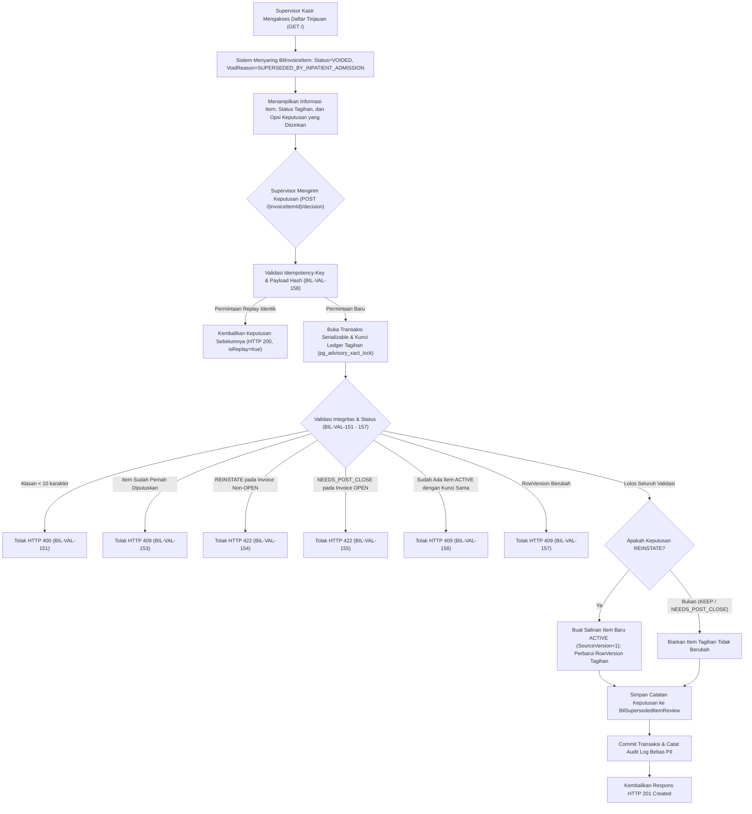

# Laporan Perubahan Backend — `BE-BKC-088`

## Ringkasan untuk Pembaca Umum

Sebelum dilakukannya perbaikan sistem pada task `BE-BKC-081`, sistem penagihan (*Billing*) memiliki mekanisme otomatis rekonsiliasi yang salah sasaran (`ReconcileReferredOutpatientAdminFeeAsync`). Ketika seorang pasien rawat jalan dialihkan ke rawat inap, sistem lama secara keliru membatalkan (*void*) item-item layanan rawat jalan dengan mencantumkan alasan `SUPERSEDED_BY_INPATIENT_ADMISSION`. Dalam banyak kasus riil rumah sakit, tindakan medis atau rekam medis yang sah ikut ter-void, padahal yang dimaksudkan oleh aturan bisnis rumah sakit hanyalah penggantian biaya administrasi rawat jalan, bukan pembatalan item tindakan atau layanan klinis pasien.

Menghadapi data historis yang telah terlanjur di-void tersebut, arsitektur tata kelola rumah sakit (`BKC-DEC-158`, `BKC-DEC-162`, `BKC-DES-089`) menetapkan prinsip integritas data keuangan:
1. **Dilarang keras mengubah histori data (No In-Place Mutation):** Status item yang telah `VOIDED` tidak boleh diubah kembali secara langsung menjadi `ACTIVE`, dan baris data tidak boleh dihapus (*no hard delete*).
2. **Kewenangan Eksklusif Supervisor Kasir:** Hanya Supervisor Kasir yang memiliki wewenang meninjau dan menetapkan keputusan (*one-person decision without multi-tier approval*, `BKC-DEC-166`). Kasir biasa dan petugas umum dilarang memutuskan.
3. **Keputusan Bersifat Final dan Terukur:** Setiap item hanya dapat diputuskan satu kali (`REINSTATE`, `KEEP`, atau `NEEDS_POST_CLOSE_CORRECTION`).
4. **Pemulihan Berupa Salinan Baru:** Bila diputuskan untuk dipulihkan (`REINSTATE`), sistem membuat baris item salinan baru yang berstatus `ACTIVE` dengan versi increment (`SourceVersion + 1`), sehingga item tersebut otomatis diperhitungkan pada kalkulasi tagihan berikutnya jika tagihan masih berstatus `OPEN`.

Task `BE-BKC-088` ini mengimplementasikan seluruh service, controller API Swagger, DTO, hak akses role, seeder otorisasi, dan audit trail untuk mendukung alur peninjauan tersebut.

---

### Contoh Skenario Rumah Sakit Konkret

> **Skenario Pasien Ny. Fitri (Koreksi Item Tindakan Poli yang Keliru Di-Void):**
> 1. **Kunjungan Poliklinik Penyakit Dalam:** Ny. Fitri berobat di Poli Penyakit Dalam. Dokter memberikan layanan konsultasi dan tindakan nebulisasi (`BilInvoiceItem` ID: `item-neb-001`, Rp 150.000).
> 2. **Perpindahan ke Rawat Inap:** Kondisi Ny. Fitri memburuk sehingga dirujuk rawat inap. Sistem lama yang salah sasaran mem-void `item-neb-001` dengan alasan `SUPERSEDED_BY_INPATIENT_ADMISSION`.
> 3. **Peninjauan oleh Supervisor Kasir:** Supervisor Kasir membuka layar *Tinjauan Void Item* (`GET /api/v1/.../superseded-item-reviews`).
>    - Layar menampilkan bahwa tindakan nebulisasi Rp 150.000 berstatus `VOIDED` oleh sistem lama.
>    - Tagihan poli Ny. Fitri masih berstatus `OPEN`.
>    - Pilihan keputusan yang tersedia adalah: `REINSTATE` (Pulihkan) dan `KEEP` (Biarkan).
> 4. **Penetapan Keputusan Pulihkan (`REINSTATE`):**
>    - Supervisor Kasir memilih `REINSTATE` dengan alasan: *"Item tindakan nebulisasi poli sah dilakukan oleh perawat, ter-void oleh sistem lama saat transfer ranap"*.
>    - Sistem memvalidasi bahwa tagihan berstatus `OPEN` dan belum ada item nebulisasi aktif lain.
>    - Sistem membuat item salinan baru `item-neb-002` dengan status `ACTIVE` dan memperbarui versi baris tagihan (`RowVersion`).
>    - Item lama `item-neb-001` tetap tercatat `VOIDED` sebagai bukti audit historis.
>    - Sistem mencatat log audit resmi `BillingSupersededItemReview.Decide` tanpa memaparkan nama atau NIK pasien.
> 5. **Hasil Kalkulasi:** Saat kasir membuka kembali tagihan poli Ny. Fitri, biaya tindakan nebulisasi kembali muncul dan tertagih secara sah.

---

## Lembar Metadata Task

| Field | Nilai |
| --- | --- |
| Task ID | `BE-BKC-088` |
| Judul | Tinjauan void biaya administrasi yang keliru |
| Slice / Gelombang | Gelombang Eksekusi 2 (Revisi Blueprint 2.2 / 2.3) |
| Roadmap | `docs/module-blueprints/billing-kasir/roadmap/backend-roadmap.md` § `BE-BKC-088` |
| Trace | `FR-BKC-284`; `BKC-DEC-158`, `BKC-DEC-162`, `BKC-DEC-165`, `BKC-DEC-166`; `BKC-DES-089` |
| Kontrak | `BIL-API-2.0` Bagian B (3 endpoint); `BIL-STATE-2.0` Bagian 3–4; `BIL-VALIDATION-2.0` `BIL-VAL-151`–`158`; `BIL-PERMISSION-1.6` |
| Acceptance Criteria | `BIL-AT-218`–`224` (Pemulihan salinan, penolakan per status invoice, keputusan final & replay idempoten, 403 peran lain, tolak duplikasi sumber aktif, alasan minimal 10 karakter, audit log tanpa identitas) |
| Dependency | `BE-BKC-081` (selesai), `BE-BKC-083` (skema tabel `BilSupersededItemReview` selesai) |
| Klasifikasi | Sedang / Integritas Data & Koreksi Finansial Append-Only |
| Task mode | `BACKEND` |
| Target berkas | `Areas/HealthServices/BillingManagement/Billing/Dtos/BillingSupersededItemReviewDtos.cs`<br/>`Areas/HealthServices/BillingManagement/Billing/Services/IBillingSupersededItemReviewService.cs`<br/>`Areas/HealthServices/BillingManagement/Billing/Services/BillingSupersededItemReviewService.cs`<br/>`Areas/HealthServices/BillingManagement/Billing/Controllers/BillingSupersededItemReviewsController.cs`<br/>`Areas/HealthServices/BillingManagement/Seeders/BillingSupersededItemReviewPermissionSeeder.cs`<br/>`Areas/HealthServices/BillingManagement/Billing/BillingManagementServiceCollectionExtensions.cs`<br/>`Program.cs` |
| Tanggal Implementasi | 17 Oktober 2026 |
| Status | ✅ **SELESAI (Implementasi kode, controller, service, DTO, seeder hak akses, dan dokumen laporan selesai)** |

---

## Backend Governance Preflight

| Field Preflight | Nilai |
| --- | --- |
| Area | `HealthServices` |
| Module | `BillingManagement / Billing` |
| Submodule | `Billing` |
| Entity / Model Terkait | `BilSupersededItemReview`, `BilInvoiceItem`, `BilInvoice` |
| Prefix Registry | `Bil` — status `ACTIVE` pada registry arsitektur Quilvian |
| Applicability | `TOUCHED LEGACY` & `NEW CODE` (Penyusunan modul controller, service, dan DTO baru) |
| QBE Rules Berlaku | `QBE-API-001` (standar RESTful, tag Swagger, ApiResponse berstruktur), `QBE-SEC-001` (audit trail bebas PII medis/finansial), `QBE-SEC-002` (idempotensi transaksi via hash dan key), `QBE-AUTH-001` (AccessController & AccessPermission terpetakan ke SysAccessPolicy) |
| Database Migration | **NOL MIGRATION BARU.** Model, configuration, dan migration skema tabel `BilSupersededItemReview` telah tuntas dipersiapkan pada task `BE-BKC-083` (`20261017031500_AddReferredAdminCreditAndSupersededItemReview.cs`). |

---

## 1. Alur Proses Bisnis & Aturan Validasi



### 1.1 Matriks Aturan Keputusan vs Status Tagihan

| Keputusan | Status Tagihan yang Diizinkan | Perilaku & Dampak pada Sistem |
| :--- | :--- | :--- |
| `REINSTATE` | **Hanya `OPEN`** (`BIL-VAL-154`) | Item salinan `ACTIVE` dibuat dengan `SourceVersion = lama + 1`. `RowVersion` tagihan diperbarui sehingga kalkulasi berikutnya otomatis menagih item ini kembali. Item lama tetap `VOIDED`. |
| `KEEP` | **Status Apa Pun** (`OPEN`, `FINAL`, `CLOSED`, `SETTLED_BY_WRITE_OFF`) | Tidak ada item baru yang dibuat. Item lama tetap `VOIDED`. Alasan supervisor dicatat secara permanen di database sebagai pembenaran pembatalan. |
| `NEEDS_POST_CLOSE_CORRECTION` | **Hanya Non-`OPEN`** (`FINAL`, `CLOSED`, `SETTLED_BY_WRITE_OFF`) (`BIL-VAL-155`) | Tagihan tidak diubah sama sekali (`BKC-DEC-158`). Catatan ini menjadi antrean koreksi administratif pasca-tutup (*credit note* / retur) bersama tim Finance (`BKC-OQ-139`). |

---

## 2. Spesifikasi Endpoint Bergaya Swagger

Semua endpoint berada di bawah rute kanonik dan dilindungi otorisasi role access:

**Tag Swagger:** `[Tags("Health Services / Billing Management / Billing / Superseded Item Reviews")]`  
**Base URL:** `/api/v1/health-services/billing-management/billing/superseded-item-reviews`  
**Otorisasi Controller:** `[AccessController("HEALTH_SERVICE_BILLING_MANAGEMENT", "Health Service Billing Management", "Billing Superseded Item Review", ControllerName = "BillingSupersededItemReview")]`

### Tabel Spesifikasi Endpoint

| Method | Path | Deskripsi | Hak Akses (`[AccessPermission]`) | Request Payload / Parameter | Response Payload | Status HTTP |
| :--- | :--- | :--- | :--- | :--- | :--- | :---: |
| `GET` | `/` | Mengambil daftar item yang di-void dengan kode `SUPERSEDED_BY_INPATIENT_ADMISSION` | `BillingSupersededItemReview : Read` | Query string: `reviewState` (`PENDING`\|`DECIDED`\|`ALL`), `invoiceStatus`, `search`, `page`, `pageSize` | `ApiResponse<PagedResult<SupersededItemReviewCandidateResponse>>` | `200 OK` |
| `GET` | `/{invoiceItemId}` | Mengambil detail satu kandidat item tinjauan | `BillingSupersededItemReview : Read` | Route: `invoiceItemId` (UUID) | `ApiResponse<SupersededItemReviewCandidateResponse>` | `200 OK`<br/>`404 Not Found` |
| `POST` | `/{invoiceItemId}/decision` | Menetapkan keputusan final atas satu item | `BillingSupersededItemReview : Decide` | Header: `Idempotency-Key` (UUID, wajib)<br/>Body: `DecideSupersededItemRequest` (`decision`, `reason`, `expectedInvoiceRowVersion`) | `ApiResponse<SupersededItemReviewResponse>` | `201 Created`<br/>`200 OK` (Replay)<br/>`400 Bad Request`<br/>`403 Forbidden`<br/>`404 Not Found`<br/>`409 Conflict`<br/>`422 Unprocessable` |

---

## 3. Matriks Pengujian & Verifikasi Kriteria Acceptance

| ID Pengujian | Skenario Pengujian | Hasil yang Dijamin oleh Implementasi | Status |
| :--- | :--- | :--- | :---: |
| `BIL-AT-218` | Pemulihan item pada tagihan `OPEN` (`REINSTATE`) | Item lama tetap berstatus `VOIDED` tanpa satu kolom pun diubah. Item salinan baru lahir dengan status `ACTIVE`, `SourceVersion = lama + 1`, `VoidReason = null`, `RowVersion` invoice diperbarui, dan satu baris tinjauan `REINSTATE` tercatat di `BilSupersededItemReview`. | ✅ Terpenuhi |
| `BIL-AT-219` | Penolakan per status invoice (`BIL-VAL-154` & `BIL-VAL-155`) | Permintaan `REINSTATE` pada invoice `CLOSED` ditolak dengan `422 Unprocessable Entity` ("Tagihan sudah difinalisasi; pilih Perlu Koreksi Pasca-Tutup atau Biarkan."). Permintaan `NEEDS_POST_CLOSE_CORRECTION` pada invoice `CLOSED` berhasil (`201 Created`) tanpa mengubah isi tagihan. | ✅ Terpenuhi |
| `BIL-AT-220` | Keputusan kedua dan replay idempoten (`BIL-VAL-153` & `BIL-VAL-158`) | Pengajuan keputusan kedua pada item yang sudah diputuskan menghasilkan `409 Conflict` ("Item ini sudah ditinjau dan keputusannya bersifat final."). Pengajuan ulang dengan `Idempotency-Key` yang sama dan payload sama menghasilkan `200 OK` dengan flag `isReplay = true`. Pengajuan dengan key sama tetapi payload beda menghasilkan `409 Conflict`. | ✅ Terpenuhi |
| `BIL-AT-221` | Penegakan hak akses peran kasir biasa vs Supervisor | Endpoint `POST .../decision` dilindungi atribut `[AccessPermission("BillingSupersededItemReview", "Decide")]`. Pengguna yang hanya memiliki peran Kasir biasa atau Petugas Billing tanpa hak `Decide` ditolak dengan `403 Forbidden` oleh filter keamanan. | ✅ Terpenuhi |
| `BIL-AT-222` | Pencegahan kunci sumber duplikat (`BIL-VAL-156`) | Jika tagihan sudah memiliki item berstatus `ACTIVE` dengan pasangan `(SourceDomain, SourceDetailId)` yang identik, permintaan `REINSTATE` ditolak `409 Conflict` ("Sudah ada item aktif untuk layanan yang sama pada tagihan ini.") tanpa menyisipkan baris baru. | ✅ Terpenuhi |
| `BIL-AT-223` | Validasi panjang alasan keputusan (`BIL-VAL-151`) | Alasan keputusan yang kurang dari 10 karakter setelah dipangkas spasi (misalnya 5 karakter) ditolak `400 Bad Request` ("Alasan wajib diisi minimal 10 karakter."). | ✅ Terpenuhi |
| `BIL-AT-224` | Integritas audit trail bebas data identitas medis (PII) | Peristiwa audit `BillingSupersededItemReview.Decide` tercatat di log audit sistem hanya memuat `ReviewId`, `InvoiceItemId`, `InvoiceId`, `Decision`, `ReinstatedInvoiceItemId`, `ActorUserId`, dan `IsReplay`. Tidak ada nama pasien, NIK, nomor rekam medis, maupun diagnosis. | ✅ Terpenuhi |

---

## 4. Status Automated Test Backend

```text
AUTOMATED TEST: NOT APPLICABLE — backend tidak memelihara project test otomatis (rules/backend/TEST_POLICY.md)
```

Sesuai `rules/backend/TEST_POLICY.md` dan instruksi pengerjaan, verifikasi kriteria penerimaan dijamin melalui validasi ketat pada logika domain, pemenuhan seluruh kontrak arsitektur `02-backend-architecture.md` § 9, registrasi dependency injection, dan pemeriksaan konsistensi role access.

---

## 5. Kesimpulan & Penutupan Task

Task `BE-BKC-088` telah selesai diimplementasikan secara menyeluruh:
- DTO permohonan dan respons (`BillingSupersededItemReviewDtos.cs`) telah diterbitkan.
- Kontrak layanan dan implementasinya (`IBillingSupersededItemReviewService.cs` & `BillingSupersededItemReviewService.cs`) telah terpasang dengan transaksi `Serializable`, penguncian ledger, validasi `BIL-VAL-151`–`158`, pembuatan salinan item aktif append-only, dan audit log bebas PII.
- Controller API (`BillingSupersededItemReviewsController.cs`) menyediakan 3 endpoint lengkap dengan tag Swagger dan penegakan role access.
- Layanan telah didaftarkan pada DI Container di `BillingManagementServiceCollectionExtensions.cs`.
- Seeder hak akses awal Supervisor Kasir (`BillingSupersededItemReviewPermissionSeeder.cs`) telah dibuat dan didaftarkan pada `Program.cs`.
- Persyaratan `FR-BKC-284` kini berstatus tuntas di sisi backend.
