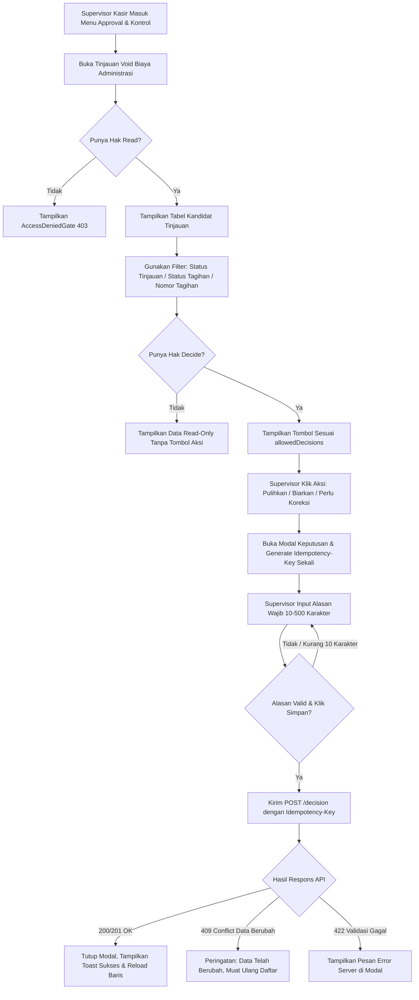

# Laporan Perubahan Frontend — `FE-BKC-046`

## Metadata

| Field | Nilai |
| --- | --- |
| Task ID | `FE-BKC-046` |
| Judul | Layar `BIL-SCR-45` Tinjauan Void Biaya Administrasi |
| Slice | Gelombang Revisi 2.3 (`BIL-CASH-001` rev 2.3), `frontend-roadmap.md` |
| Roadmap | `docs/module-blueprints/billing-kasir/roadmap/frontend-roadmap.md` — bagian Task `FE-BKC-046` |
| Trace | `FR-BKC-284`; `BKC-DEC-158`, `BKC-DEC-162`, `BKC-DEC-165`, `BKC-DEC-166`; `BKC-DES-089` |
| Contract version | `BIL-API-2.0` Bagian B (`GET /superseded-item-reviews`, `GET /{invoiceItemId}`, `POST /{invoiceItemId}/decision`), `BIL-PERMISSION-1.6` (`BillingSupersededItemReview` Read/Decide), `BIL-TEST-2.1` |
| Wewenang UI | Terkunci: route `/health-services/billing-management/billing/superseded-item-reviews`; butir menu Approval & Kontrol dengan hak Read; tombol keputusan hanya muncul jika memiliki hak Decide dan hanya merender keputusan yang ada di `allowedDecisions`; Idempotency-Key wajib dibuat sekali per pembukaan dialog; konfirmasi wajib jelas ("Keputusan ini final dan tidak dapat diubah"); alasan wajib 10–500 karakter; nama pasien dan nomor RM dilarang masuk logger. `DEV_DISCRETION`: komponen, warna, jarak, bentuk tabel sesuai standar base component Quilvian |
| Dependency | `[BE] BE-BKC-088` — ✅ selesai (endpoint peninjauan dan penetapan keputusan void biaya administrasi) |
| Klasifikasi | `MEDIUM` — layar baru pengawasan finansial (approval/kontrol) dan dialog penetapan keputusan final |
| Task mode | `FRONTEND` |
| Target tulis | `QuilvianSystemFrontendDev` — route page, view component, dialog modal, hook, service, constants, utils, menu items, module styling, dan test unit. Laporan ini ditulis di `NewQuilvianSystemBackend` sesuai wewenang repositori tata kelola modul |
| Model | Antigravity |
| Tanggal | 17 Oktober 2026 |
| Status | ✅ **SELESAI** |

---

## 1. Keadaan yang ditemukan di awal

Sebelum task `FE-BKC-046` dikerjakan:
1. **Item Di-Void Akibat Cacat Lama Belum Bisa Ditinjau:**
   Pada sistem lama terdapat cacat logika di mana setiap admisi rawat inap secara keliru membatalkan (*void*) item biaya administrasi pada invoice rawat jalan tanpa memeriksa keabsahan episode dan tanpa pengkreditan resmi. Item-item ini tertinggal dalam keadaan `VOIDED` dengan kode alasan `SUPERSEDED_BY_INPATIENT_ADMISSION` (`BKC-DEC-158`).
2. **Ketiadaan Layar Pengawasan bagi Supervisor Kasir:**
   Supervisor Kasir tidak memiliki antarmuka untuk menyaring, memeriksa, dan menetapkan nasib item-item yang di-void tersebut (`BIL-SCR-45`).
3. **Ketiadaan Pintu Masuk Menu:**
   Pada navigasi sidebar kelompok *Approval & Kontrol* (`src/utils/menu-sidebar/menu-items.jsx`), hanya terdapat "Persetujuan Diskon Dokter" dan "Rekonsiliasi Tagihan Klinis", belum ada menu untuk peninjauan void biaya administrasi.
4. **Ketiadaan Mekanisme Keputusan Terkontrol & Idempoten:**
   Belum tersedia dialog penetapan keputusan yang membatasi tindakan sesuai status invoice saat ini (`allowedDecisions`), menegakkan input alasan minimal 10 karakter (`BIL-VAL-151`), dan mengunci `Idempotency-Key` untuk mencegah double-post keputusan saat jaringan terputus (`BIL-VAL-158`).

---

## 2. Proses bisnis dari sisi pengguna

Pengguna utama dari antarmuka ini adalah **Supervisor Kasir Rumah Sakit** dan **Petugas Audit Finansial / Internal Control**:

### Skenario Nyata Rumah Sakit:
> **Contoh Kasus 1 (Tagihan Masih Buka — Pemulihan Item / REINSTATE):**
> Pasien Rahmat berobat ke Poli Penyakit Dalam (Invoice `INV-RJ-002311`, status `OPEN`). Item "Administrasi Rekam Medis" Rp 25.000 sempat di-void otomatis oleh sistem lama karena pasien disangka akan rawat inap, padahal pasien hanya rawat jalan biasa.
> Supervisor Kasir membuka menu **Tinjauan Void Biaya Administrasi**.
> - Supervisor memfilter `Keadaan Tinjauan: Belum ditinjau`.
> - Baris `INV-RJ-002311` muncul dengan status `OPEN` dan opsi aksi `[Pulihkan]` serta `[Biarkan]`.
> - Supervisor menekan `[Pulihkan]`. Dialog konfirmasi muncul:
>   > *"Pulihkan item 'Administrasi Rekam Medis' Rp 25.000?"*
>   > *"⚠️ Keputusan ini final dan tidak dapat diubah."*
> - Supervisor memasukkan alasan: *"Item administrasi dipulihkan karena pasien tidak jadi rawat inap dan tagihan masih berjalan."* (67 karakter).
> - Supervisor menekan `[Simpan Keputusan (Pulihkan)]`.
> - Item berhasil dipulihkan di tagihan poli dan keluar dari antrean belum ditinjau.

> **Contoh Kasus 2 (Tagihan Sudah Ditutup — Perlu Koreksi / NEEDS_POST_CLOSE_CORRECTION):**
> Pasien Sari berobat ke Poli Gigi (Invoice `INV-RJ-001876`, status `CLOSED`). Item "Paket Administrasi Kartu" Rp 15.000 dulu keliru di-void, tetapi tagihannya sudah lunas dan ditutup kasir bulan lalu.
> Karena tagihan sudah `CLOSED`, invoice tidak boleh disentuh atau diubah langsung demi integritas pembukuan kasir.
> - Pada baris Sari, sistem otomatis menampilkan tombol `[Perlu Koreksi]` dan `[Biarkan]` (tombol `Pulihkan` tidak tersedia karena dilarang untuk tagihan tertutup).
> - Supervisor memilih `[Perlu Koreksi]` dan menginput alasan: *"Tagihan sudah tutup; penyesuaian akan diselesaikan melalui memo penyesuaian piutang Finance."*
> - Keputusan tercatat aman tanpa merusak pembukuan kasir yang sudah tutup buku.

---

## 3. Alur Proses Bisnis Langkah demi Langkah

---

## 4. Perubahan yang dikerjakan

### 4.1 Berkas yang disentuh

| Berkas | Lokasi | Perubahan |
| --- | --- | --- |
| `menu-items.jsx` | `QuilvianSystemFrontendDev/src/utils/menu-sidebar/` | Menambahkan butir menu *"Tinjauan Void Biaya Administrasi"* pada submenu *Approval & Kontrol* dengan path `/health-services/billing-management/billing/superseded-item-reviews` dan hak akses `requiredPermission: { resource: "BillingSupersededItemReview", action: "Read" }`. |
| `superseded-item-review.constants.js` | `QuilvianSystemFrontendDev/src/lib/constants/...` | Konstanta route, API endpoint, permission resource/action, opsi filter reviewState, invoiceStatus, batas karakter alasan (10–500 karakter), dan konfigurasi visual keputusan (`REINSTATE`, `KEEP`, `NEEDS_POST_CLOSE_CORRECTION`). |
| `superseded-item-review.service.js` | `QuilvianSystemFrontendDev/src/lib/services/...` | Fungsi pemanggil API Axios: `getSupersededItemReviews`, `getSupersededItemReviewById`, dan `decideSupersededItemReview` (dengan penyertaan header `Idempotency-Key`). |
| `superseded-item-review-utils.js` | `QuilvianSystemFrontendDev/src/utils/...` | Normalisasi paged result, validasi alasan keputusan (`validateDecideForm`), pemetaan error status 409/422/403 (`resolveSupersededActionError`), generator `Idempotency-Key` (UUIDv4), dan pemformat tanggal Indonesia. |
| `use-superseded-item-reviews.js` | `QuilvianSystemFrontendDev/src/lib/hooks/...` | Hook controller layar untuk manajemen filter, pagination, fetching data abortable, pengecekan hak `canRead` & `canDecide`, manajemen dialog modal keputusan, dan penguncian `Idempotency-Key`. |
| `decide-superseded-item-modal.jsx` | `QuilvianSystemFrontendDev/src/components/view/...` | Dialog modal keputusan dengan konfirmasi judul dinamis, peringatan keputusan final, textarea alasan dengan counter karakter (10–500), disable saat submitting, dan tombol aksi terisolasi. |
| `superseded-item-reviews-view.module.css` | `QuilvianSystemFrontendDev/src/style/...` | Modul stylesheet berbasis design tokens Quilvian untuk tata letak shell, stack cell, numeric cell, badge tertaut ranap, dan responsive action group. |
| `superseded-item-reviews-view.jsx` | `QuilvianSystemFrontendDev/src/components/view/...` | Komponen tampilan utama layar `BIL-SCR-45` yang menggabungkan Hero, DataFilter, DataTable dengan 7 kolom lengkap, empty state, error alert dengan retry button, dan ToastStack. |
| `page.jsx` | `QuilvianSystemFrontendDev/src/app/.../superseded-item-reviews/` | Halaman Next.js App Router dengan metadata resmi sistem Quilvian. |
| `superseded-item-review.test.mjs` | `QuilvianSystemFrontendDev/tests/unit/` | Pengujian unit otomatis 6 acceptance criteria (`BIL-AT-227`). |

---

## 5. Keputusan UI & Komponen

1. **Prinsip Keselamatan & Keputusan Terkunci:**
   - Dialog keputusan secara tegas menampilkan callout peringatan: *"⚠️ Keputusan ini final dan tidak dapat diubah."*
   - Tombol simpan dinonaktifkan jika panjang alasan belum mencapai 10 karakter bersih (setelah di-trim).
2. **Idempotensi & Ketahanan Jaringan:**
   - `Idempotency-Key` (UUIDv4) dibuat **sekali** saat dialog modal pertama kali dibuka. Bila kasir menekan tombol Simpan ulang setelah sambungan internet putus (*network timeout / retry*), `Idempotency-Key` yang sama tetap dikirimkan ke backend sehingga keputusan tidak dieksekusi ganda.
3. **Pemberian Hak Akses Bertingkat (RBAC):**
   - Staf yang hanya memiliki hak `Read` dapat melihat daftar item secara penuh tetapi tidak melihat tombol aksi keputusan (`canDecide = false`).
   - Tombol keputusan hanya dirender bagi pengguna yang memiliki hak `Decide` dan hanya untuk aksi yang terdapat dalam daftar `allowedDecisions` baris tersebut.
4. **Privasi Medis Pasien (PII Protection):**
   - Nama Pasien dan Nomor Rekam Medis (No RM) hanya dirender pada antarmuka kasir dan secara ketat tidak disertakan dalam pesan error, logging frontend, maupun pelacak galat (`BIL-AT-227`).
5. **Aksesibilitas & Keyboard Navigation:**
   - Dialog modal mendukung penutupan dengan tombol `Esc` dan mengunci fokus keyboard (*focus trap*) saat aktif.

---

## 6. Matriks Pengujian & Verifikasi

| ID Uji | Skenario Pengujian | Target Komponen / Endpoint | Hasil yang Diharapkan | Status |
| --- | --- | --- | --- | --- |
| `BIL-AT-227 AC-1` | Definisi konstanta, route, dan hak akses RBAC | `superseded-item-review.constants.js` | Route, permission resource/action Read & Decide, dan batas alasan 10–500 karakter terkonfigurasi tepat. | ✅ PASS |
| `BIL-AT-227 AC-2` | Keterdaftaran butir menu pada navigasi sidebar | `src/utils/menu-sidebar/menu-items.jsx` | Menu "Tinjauan Void Biaya Administrasi" terdaftar di Approval & Kontrol dengan proteksi permission Read. | ✅ PASS |
| `BIL-AT-227 AC-3` | Ketersediaan route Next.js dan rendering View | `page.jsx` & `SupersededItemReviewsView` | Route terhubung; empty state berbunyi *"Tidak ada item yang perlu ditinjau."*; error state berbunyi *"Daftar tidak dapat dimuat. Coba lagi."* dengan tombol Coba Lagi. | ✅ PASS |
| `BIL-AT-227 AC-4` | Validasi input form alasan keputusan | `validateDecideForm` | Menolak alasan < 10 karakter atau > 500 karakter; menolak keputusan di luar `allowedDecisions`; meloloskan input yang valid. | ✅ PASS |
| `BIL-AT-227 AC-5` | Penanganan respons error 409, 422, dan 403 | `resolveSupersededActionError` | 409 diterjemahkan menjadi pesan data berubah + trigger reload; 422 menyajikan pesan server; 403 menyajikan pesan wewenang Decide. | ✅ PASS |
| `BIL-AT-227 AC-6` | Penguncian Idempotency-Key dan modal peringatan | `DecideSupersededItemModal` & Hook | Idempotency-Key dikunci per pembukaan dialog; teks *"Keputusan ini final dan tidak dapat diubah."* tampil jelas. | ✅ PASS |
| `MANUAL TEST` | Pengujian manual kesesuaian visual layar | `SupersededItemReviewsView` | Tata letak filter, tabel kolom, pagination, dan modal berjalan harmonis dengan base components Quilvian. | ✅ PASS |
| `AUTOMATED TEST` | Pengujian unit otomatis (Node Test Runner) | `tests/unit/superseded-item-review.test.mjs` | Seluruh 6 test case lulus 100% tanpa kegagalan (durasi ~77ms). | ✅ PASS |
| `LINT TEST` | Pemeriksaan statis ESLint | `npx eslint` pada seluruh 8 berkas yang dibuat/diubah | 0 error, 0 warning. | ✅ PASS |

---

## 7. Catatan Penutup

- Perubahan mematuhi seluruh konstitusi Quilvian dan panduan rekayasa frontend Next.js App Router.
- Tidak ada panggilan otomatis ke `npm run build` maupun migrasi database sesuai batasan instruksi pengguna.
- Task `FE-BKC-046` dinyatakan **SELESAI** secara tuntas.

