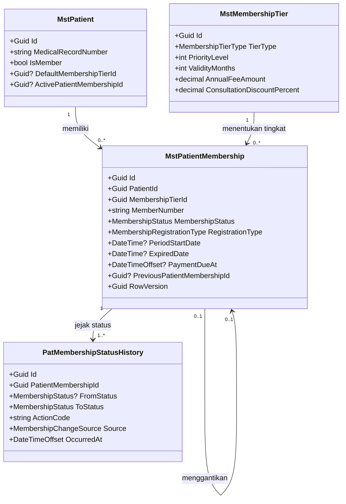
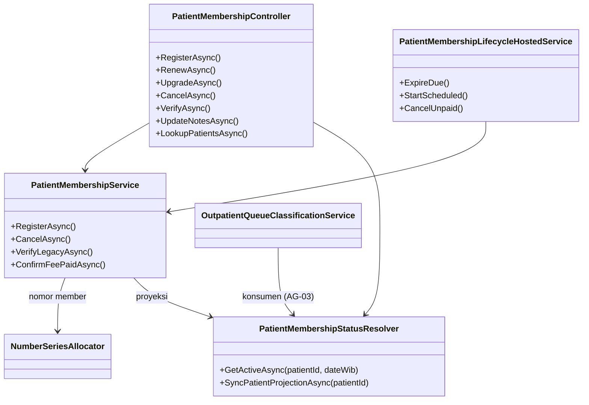

# CRM Membership — Arsitektur Backend

| Field | Nilai |
|---|---|
| Blueprint ID | `crm-membership` |
| Revision | `1` |
| Status | `approved` (Yoga Aji Pratama, 2026-10-13, `CRM-DEC-030`) |
| Owner | Yoga Aji Pratama (product/domain) |
| Masukan | `00-interview-decisions.md` (`CRM-DEC-001` s.d. `CRM-DEC-028`), `01-existing-capability-map.md` revision 1 + impact scan, `02-requirement-completeness-assessment.md` revisi 1a, `03-domain-architecture.md` revision 1 (`DOMAIN_ARCHITECTURE_PARTIAL`) |
| Backend SHA desain | `1aecf642` |
| Applicability | `TOUCHED LEGACY` untuk `MstPatientMembership`, `MstMembershipTier`, `PatientMembershipController`, `MstPatient`. `NEW CODE` untuk service, history, dan hosted service baru |
| Slice | S1a, S1b, S3, S4 (kontrak manfaat), S5. S2 (iuran) hanya titik sambung, menunggu `DEC-CRM-001` |

## 1. Bounded Context dan Ownership

| Context | Aggregate root | Batas transaksi | Rollback |
|---|---|---|---|
| `BC-MBR` Patient Membership | `MstPatientMembership` (diperluas) | Satu perintah bisnis = satu transaksi database, di bawah kunci per pasien (`pg_advisory_xact_lock` atas `PatientId`, mengikuti pola `OutpatientQueueNumberAllocator`). Dalam satu transaksi: ubah status satu atau dua membership, tulis riwayat, perbarui proyeksi di `MstPatient` | Bila salah satu langkah gagal, seluruhnya batal. Nomor member yang sudah dialokasikan boleh hangus (perilaku `NumberSeriesAllocator`, `DEC-PLT-008`) |

Invariant yang dijaga service: `INV-01` s.d. `INV-11` (`03-domain-architecture.md` bagian E).
Tiga invariant per pasien (`INV-01` s.d. `INV-03`) juga dijaga index unik bersyarat di database,
sehingga dua petugas yang menyimpan bersamaan tidak akan lolos keduanya.

## 2. Tabel Kepemilikan Data

| Kelompok data | Modul pemilik | Dipakai modul ini | Dibuat ulang di modul ini |
|---|---|:---:|---|
| Pasien dan No. RM | Patient Management (`MstPatient`) | Ya | Tidak |
| Tingkat membership, persen diskon, nominal iuran | Administrator / Master Data (`MstMembershipTier`) | Ya | Tidak, diperluas satu kolom iuran |
| Membership per pasien | Patient Management (`MstPatientMembership`) | Ya, **pemilik** | Tidak, diperluas (`CRM-DEC-017`) |
| Riwayat status membership | Patient Management | Ya, **pemilik** | Ya, baru (`PatMembershipStatusHistory`) karena belum ada jejak status sama sekali |
| Proyeksi status member di pasien (`IsMember`, `DefaultMembershipTierId`, `ActivePatientMembershipId`) | Patient Management | Ya, ditulis modul ini | Tidak |
| Kunjungan dan snapshot tingkat | Registration (`RegPatientEncounter`, `RegQueue`) | Ya, dibaca dan diusulkan diperluas (`AG-01`) | Tidak |
| Klasifikasi antrean RJ | Registration (`OutpatientQueueClassificationService`) | Ya, diselaraskan sebagai konsumen (`AG-03`) | Tidak |
| Tagihan, diskon terapan, pelunasan, refund | Billing (`BilInvoice`, `BilDiscountApplication`) | Ya, lewat kontrak | Tidak. Penerapan diskon dan tagihan iuran adalah amendment billing |
| Nomor seri | Platform Number Series (`NumNumberSeries`) | Ya | Tidak |
| Izin akses | Platform Authorization (`SysAccessPolicies`) | Ya | Tidak |

## 3. Class Diagram

### 3.1 Data membership



### 3.2 Service, controller, dan konsumen



## 4. Penjelasan Setiap Class

### 4.1 `MstPatientMembership`

| Aspek | Penjelasan |
|---|---|
| **Status** | `Diperbarui` |
| **Lokasi file** | `Areas/HealthServices/PatientManagement/MasterData/Models/MstPatientMembership.cs` |
| Kategori | Transaksi berbentuk master (nama `Mst*` adalah warisan, lihat bagian 5 utang teknis) |
| Tanggung jawab utama | Menyimpan satu periode membership berbayar milik satu pasien, dari pendaftaran sampai berakhir. Upgrade dan perpanjangan membuat baris baru, tidak menimpa baris lama |
| Field penting | `PatientId`, `MembershipTierId`, `MemberNumber`, `MembershipStatus`, `RegistrationType`, `JoinDate` (tanggal daftar), `PeriodStartDate`, `ExpiredDate` (tanggal akhir periode, inklusif), `PaymentDueAt`, `FeeAmountSnapshot`, `PreviousPatientMembershipId`, `CancellationCategory`, `CancellationReason`, `FeeChargeReferenceId`, `RowVersion` |
| Relasi | Milik `MstPatient`. Menunjuk `MstMembershipTier`. Menunjuk membership yang digantikan. Punya banyak `PatMembershipStatusHistory` |
| Pemakaian dalam alur | Dibuat petugas CRM saat mendaftarkan, memperpanjang, atau upgrade. Statusnya diubah oleh pelunasan iuran, proses terjadwal, dan pembatalan |
| Catatan desain | Kolom `IsActive` dan `IsPrimary` dipertahankan sebagai **proyeksi kompatibilitas** (diisi `true` hanya saat status Aktif), karena dibaca kode lama seperti `KioskPatientLookupService`. Kolom `PointBalance`, `TotalSpendAmount`, `IsAutoCreated`, `IsCreatedFrom*`, `LastUpgradeDate`, `LastDowngradeDate`, dan `UpgradeDowngradeReason` dibiarkan tanpa aturan baru dan tidak tampil di formulir. Pasien, tingkat, dan periode tidak boleh diubah setelah Aktif/Terjadwal (`INV-04`) |
| Ekuivalen model lama | Model yang sama |

### 4.2 `MstMembershipTier`

| Aspek | Penjelasan |
|---|---|
| **Status** | `Diperbarui` |
| **Lokasi file** | `Areas/Administrator/MasterData/Models/MstMembershipTier.cs` |
| Kategori | Master |
| Tanggung jawab utama | Definisi tingkat: persen diskon per kelompok, masa berlaku, pengaturan antrean, dan **nominal iuran** (baru) |
| Field penting | `TierType`, `PriorityLevel` (urutan untuk upgrade, `AG-04`), `ValidityMonths`, `AnnualFeeAmount` (baru), enam `*DiscountPercent`, `PriorityQueue`, `QueueAudience` |
| Pemakaian dalam alur | Dipilih saat pendaftaran. Nominal iurannya disalin ke `FeeAmountSnapshot` agar perubahan harga tidak mengubah pendaftaran yang sudah ada |
| Catatan desain | Hanya `TierType` Silver/Gold/Platinum/Executive yang boleh dipilih untuk pendaftaran (`CRM-DEC-006`). Tingkat dengan `AnnualFeeAmount = 0` ditolak saat pendaftaran |
| Ekuivalen model lama | — |

### 4.3 `PatMembershipStatusHistory`

| Aspek | Penjelasan |
|---|---|
| **Status** | `Baru` |
| **Lokasi file** | `Areas/HealthServices/PatientManagement/Membership/Models/PatMembershipStatusHistory.cs` |
| Kategori | Transaksi (jejak audit bisnis) |
| Tanggung jawab utama | Mencatat setiap perpindahan status dan setiap perubahan catatan: dari status apa ke apa, oleh siapa (petugas, sistem, atau billing), kapan, karena apa, dan rujukan tagihan/refund bila ada |
| Field penting | `PatientMembershipId`, `FromStatus`, `ToStatus`, `ActionCode`, `Source`, `ActorUserId`, `OccurredAt`, `Reason`, `ReferenceId`, `OldNotes`, `NewNotes` |
| Pemakaian dalam alur | Ditulis otomatis oleh `PatientMembershipService` dalam transaksi yang sama dengan perubahan status. Tidak pernah diubah atau dihapus |
| Catatan desain | Prasyarat: folder `Areas/HealthServices/PatientManagement/Membership/` belum terdaftar. Baris registry wajib ditambahkan sebelum file model dibuat (`QBE-MOD-003`). Tanpa nomor urut tersimpan: urutan memakai `OccurredAt` lalu `Id` (`QBE-CODE-003`) |
| Ekuivalen model lama | — |

### 4.4 `MstPatient`

| Aspek | Penjelasan |
|---|---|
| **Status** | `Sudah ada` (perilaku diperbarui, kolom tidak berubah) |
| **Lokasi file** | `Areas/HealthServices/PatientManagement/MasterData/Models/MstPatient.cs` |
| Catatan desain | `IsMember`, `DefaultMembershipTierId`, dan `ActivePatientMembershipId` menjadi proyeksi yang **hanya** ditulis `PatientMembershipStatusResolver`. `PatientController` berhenti menerima `IsMember` dari request create/update (`PatientController.cs:546,848`), dan nilai kiriman frontend diabaikan. Default model `IsMember = true` diubah menjadi `false` tanpa migration kolom (hanya nilai bawaan C#) |

### 4.5 `PatientMembershipService`

| Aspek | Penjelasan |
|---|---|
| **Status** | `Baru` |
| **Lokasi file** | `Areas/HealthServices/PatientManagement/Membership/Services/PatientMembershipService.cs` |
| Kategori | Service |
| Tanggung jawab utama | Seluruh perintah yang mengubah membership: daftar baru, perpanjangan, upgrade, batal, verifikasi data lama, ubah catatan, terima kabar iuran lunas, serta tiga pekerjaan terjadwal |
| Dipanggil oleh | `PatientMembershipController`, `PatientMembershipLifecycleHostedService`, dan nanti billing (S2) |
| Membuka transaksi database | **Ya**, satu per perintah, dengan kunci per pasien |
| Catatan desain | Mengalokasikan nomor member lewat `NumberSeriesAllocator` (`QBE-CODE-001`/`002`). Menulis log aplikasi dengan aktor (`QBE-LOG-001`), tanpa data sensitif. Didaftarkan `AddScoped` |

### 4.6 `PatientMembershipStatusResolver`

| Aspek | Penjelasan |
|---|---|
| **Status** | `Baru` |
| **Lokasi file** | `Areas/HealthServices/PatientManagement/Membership/Services/PatientMembershipStatusResolver.cs` |
| Tanggung jawab utama | Satu-satunya aturan "member aktif pada tanggal WIB X" (J1). Juga menulis proyeksi di `MstPatient` |
| Dipanggil oleh | `PatientMembershipService`, `PatientMembershipController` (lookup), `OutpatientQueueClassificationService` (setelah amendment `AG-03`), pendaftaran kunjungan IGD/rawat inap (`AG-01`), billing (S4) |
| Membuka transaksi database | Tidak untuk baca. Penulisan proyeksi ikut transaksi pemanggil |

### 4.7 `PatientMembershipLifecycleHostedService`

| Aspek | Penjelasan |
|---|---|
| **Status** | `Baru` |
| **Lokasi file** | `Areas/HealthServices/PatientManagement/Membership/Services/PatientMembershipLifecycleHostedService.cs` |
| Tanggung jawab utama | Berjalan saat aplikasi mulai dan setiap hari setelah 00.00 WIB. Tugasnya: (1) Aktif yang lewat tanggal akhir menjadi Kedaluwarsa; (2) Terjadwal yang tanggal mulainya tiba menjadi Aktif; (3) Menunggu Pembayaran yang lewat `PaymentDueAt` menjadi Cancelled (tidak dibayar). Aman dijalankan ulang dan mengejar hari yang terlewat |
| Dipanggil oleh | Host aplikasi (`AddHostedService`, didaftarkan di blok yang sama dengan `KioskEncounterClosureHostedService`, `Program.cs:1110`) |
| Membuka transaksi database | Lewat `PatientMembershipService`, satu transaksi per membership agar satu kegagalan tidak menahan yang lain |

### 4.8 `PatientMembershipController`

| Aspek | Penjelasan |
|---|---|
| **Status** | `Diperbarui` |
| **Lokasi file** | `Areas/HealthServices/PatientManagement/MasterData/Controllers/PatientMembershipController.cs` |
| Service yang dipakai | `PatientMembershipService` (semua perintah baru), `PatientMembershipStatusResolver` (lookup). Endpoint baca lama tetap memakai `ApplicationDbContext` langsung (legacy ratchet: tidak ditulis ulang) |
| Atribut akses | `[AccessController]` tetap. Aksi baru: `PatientMembership : Create`, `Update`, `Cancel`, `Verify`, `Read` |
| Endpoint yang diurus | Lihat `contracts/api-contract.md`. Ringkasnya: `POST /` dan `POST /kiosk` dihapus (`CRM-DEC-018`). `PUT`, `PATCH status`, dan `DELETE` lama dipensiunkan dan diganti perintah bisnis |

### 4.9 DTO dan enum

| Nama | Jenis | Status | Lokasi | Isi |
|---|---|---|---|---|
| `RegisterPatientMembershipRequest` | Create | Baru | `.../PatientManagement/MasterData/DTOs/PatientMembershipDtos.cs` | `PatientId`, `MembershipTierId`, `Notes?` |
| `RenewPatientMembershipRequest` | Create | Baru | sama | `Notes?` (tingkat sama dengan yang Aktif) |
| `UpgradePatientMembershipRequest` | Create | Baru | sama | `MembershipTierId`, `Notes?` |
| `CancelPatientMembershipRequest` | Status | Baru | sama | `Category` (`PatientRequest`/`InputError`), `Reason` (wajib, 10–500 karakter), `ExpectedRowVersion` |
| `VerifyLegacyPatientMembershipRequest` | Status | Baru | sama | `Decision` (`Accept`/`Reject`), `PeriodStartDate?`, `PeriodEndDate?`, `Reason`, `ExpectedRowVersion` |
| `UpdatePatientMembershipNotesRequest` | Update | Baru | sama | `Notes`, `ExpectedRowVersion` |
| `PatientMembershipLookupQuery` / `PatientMembershipLookupResponse` | PagedQuery / Response | Baru | sama | `Keyword` (No. RM/NIK/No. Telp), hasil berisi pasien + status member |
| `PatientMembershipStatusHistoryResponse` | Response | Baru | sama | Kolom riwayat dengan nama pelaku |
| `PatientMembershipResponse`, `PatientMembershipDetailResponse` | Response | Diperbarui | sama | Tambah `RegistrationType`, `PeriodStartDate`, `PaymentDueAt`, `FeeAmountSnapshot`, `CancellationCategory`, `RowVersion` |
| `CreatePatientMembershipRequest`, `UpdatePatientMembershipRequest`, `UpdatePatientMembershipStatusRequest`, `DeletePatientMembershipRequest` | — | Dipensiunkan | sama | Dihapus bersama endpoint lamanya |
| `MembershipStatus` | Enum | Diperbarui | `Areas/Administrator/MasterData/Enums/MembershipStatus.cs` | Tambah `PendingPayment = 7`, `Scheduled = 8`, `NeedsVerification = 9`. Nilai lama tidak diubah. Bawaan konfigurasi berubah dari `Active` menjadi `PendingPayment` |
| `MembershipRegistrationType` | Enum | Baru | `Areas/HealthServices/PatientManagement/Membership/Enums/` | `New = 1`, `Renewal = 2`, `Upgrade = 3`, `LegacyImport = 4` |
| `MembershipCancellationCategory` | Enum | Baru | sama | `PatientRequest = 1`, `InputError = 2`, `Unpaid = 3`, `SupersededByUpgrade = 4` |
| `MembershipChangeSource` | Enum | Baru | sama | `Staff = 1`, `System = 2`, `Billing = 3` |

## 5. Arsitektur Folder

```text
Areas/
├── Administrator/MasterData/
│   ├── Models/MstMembershipTier.cs                         # Diperbarui (+AnnualFeeAmount)
│   ├── Enums/MembershipStatus.cs                           # Diperbarui (+3 nilai)
│   ├── DTOs/MembershipTierDtos.cs                          # Diperbarui (+AnnualFeeAmount)
│   └── Controllers/MembershipTierController.cs             # Diperbarui (validasi iuran ≥ 0)
└── HealthServices/
    ├── PatientManagement/
    │   ├── MasterData/
    │   │   ├── Models/MstPatientMembership.cs              # Diperbarui
    │   │   ├── Models/MstPatient.cs                        # Sudah ada (default IsMember=false)
    │   │   ├── DTOs/PatientMembershipDtos.cs               # Diperbarui
    │   │   ├── Controllers/PatientMembershipController.cs  # Diperbarui
    │   │   └── Controllers/PatientController.cs            # Diperbarui (IsMember tidak lagi diterima)
    │   └── Membership/                                     # BARU — wajib didaftarkan di registry dulu
    │       ├── Models/PatMembershipStatusHistory.cs        # Baru
    │       ├── Enums/MembershipRegistrationType.cs         # Baru
    │       ├── Enums/MembershipCancellationCategory.cs     # Baru
    │       ├── Enums/MembershipChangeSource.cs             # Baru
    │       └── Services/
    │           ├── PatientMembershipService.cs             # Baru
    │           ├── PatientMembershipStatusResolver.cs      # Baru
    │           └── PatientMembershipLifecycleHostedService.cs  # Baru
    └── RegistrationManagement/
        ├── Services/OutpatientQueueClassificationService.cs  # Diperbarui (AG-03, amendment rawat-jalan)
        └── Models/RegPatientEncounter.cs                    # Diperbarui (AG-01, perlu persetujuan owner Registration)
Repositories/Configurations/
├── HealthServices/MstPatientMembershipConfiguration.cs     # Diperbarui
├── Global/MstMembershipTierConfiguration.cs                # Diperbarui
└── HealthServices/PatientManagement/Membership/PatMembershipStatusHistoryConfiguration.cs  # Baru
Migrations/<timestamp>_ExtendPatientMembershipLifecycle.cs  # Baru
```

Utang teknis yang **tidak** dirapikan di modul ini:

| Penyimpangan | Keadaan | Penanganan |
|---|---|---|
| `MstPatientMembership` memakai prefix master padahal berisi data transaksi | Nama warisan | Tetap. Rename = `LEGACY MIGRATION` tersendiri (`QBE-NAM-003`) dengan approval arsitek backend |
| `MstMembershipTierConfiguration` di `Repositories/Configurations/Global/`, sedangkan konfigurasi membership pasien di `HealthServices/` | Tidak seragam | Tetap, jangan dipindah diam-diam |
| Endpoint baca lama memakai `ApplicationDbContext` langsung di controller | Legacy | Tidak ditulis ulang. Endpoint baru wajib lewat service (`QBE-SVC-001`) |

## 6. Status Model dan Dampak Migration

| Model | Status | Kolom berubah | Dampak migration |
|---|---|---|---|
| `MstPatientMembership` | Diperbarui | **Tambah:** `RegistrationType` int not null default 1; `PeriodStartDate` date null; `PaymentDueAt` timestamptz null; `ActivatedAt` timestamptz null; `FeeAmountSnapshot` numeric(18,2) not null default 0; `PreviousPatientMembershipId` uuid null FK self Restrict; `CancellationCategory` int null; `CancellationReason` varchar(500) null; `FeeChargeReferenceId` uuid null (tanpa FK sampai `DEC-CRM-001`); `RowVersion` uuid not null. **Ubah makna:** `ExpiredDate` = tanggal akhir periode (inklusif, WIB); `JoinDate` = tanggal daftar. **Ubah bawaan:** `MembershipStatus` default `Active` → `PendingPayment`. **Index:** hapus `IX_..._PatientId_IsPrimary` (unik bersyarat lama); tambah tiga unik bersyarat per status (Aktif, Terjadwal, Menunggu Pembayaran) per `PatientId`; tambah unik bersyarat `FeeChargeReferenceId` (bila terisi); tambah index `(MembershipStatus, ExpiredDate)`, `(MembershipStatus, PeriodStartDate)`, `(MembershipStatus, PaymentDueAt)` untuk proses terjadwal | Tambah kolom nullable/berbawaan: tanpa downtime. Index unik baru bisa gagal bila data lama melanggar, sehingga langkah verifikasi data lama dijalankan dulu (bagian 7) |
| `MstMembershipTier` | Diperbarui | Tambah `AnnualFeeAmount` numeric(18,2) not null default 0 | Tanpa downtime |
| `PatMembershipStatusHistory` | Baru | Seluruh kolom (lihat kamus data) | Tabel baru, tanpa downtime |
| `RegPatientEncounter` | Diperbarui (usulan `AG-01`) | Tambah `PatientMembershipIdSnapshot` uuid null, `MembershipTierIdSnapshot` uuid null | Tanpa downtime. Menunggu persetujuan owner Registration. Migration terpisah |
| `MstPatient` | Sudah ada | Tidak ada perubahan kolom | — |

## 7. Rencana Migration

| Urutan | Nama | Tanpa downtime? | Isi | Langkah mundur |
|---|---|---|---|---|
| 0 | (bukan migration) Registrasi folder `PatientManagement/Membership` | — | Tambah baris registry. Approval pemilik registry | Hapus baris |
| 1 | `ExtendPatientMembershipLifecycle` | Ya | Tambah kolom `MstPatientMembership` dan `MstMembershipTier`, buat `PatMembershipStatusHistory`, ubah default status. **Belum** membuat index unik baru | `Down`: hapus kolom dan tabel baru |
| 2 | Pengisian data lama (dalam migration yang sama, SQL idempoten) | Ya | Setiap membership lama yang tidak dihapus: `RegistrationType = LegacyImport`, `MembershipStatus = NeedsVerification` (`CRM-DEC-021`), `IsActive = false`, `IsPrimary = false`, `RowVersion` baru, satu baris riwayat `LEGACY_FLAGGED` sumber `System`. Proyeksi `MstPatient` dikosongkan untuk pasien terdampak | Kembalikan status dari salinan sementara yang dibuat di langkah ini |
| 3 | `AddPatientMembershipStatusUniqueIndexes` | Ya (index kecil) | Hapus unik `IsPrimary` lama, buat tiga unik bersyarat per status. Aman karena setelah langkah 2 tidak ada baris Aktif, Terjadwal, atau Menunggu Pembayaran | Hapus index baru, pulihkan index lama |
| 4 | `AddEncounterMembershipSnapshot` (`AG-01`) | Ya | Kolom snapshot di `RegPatientEncounter` | Hapus kolom |

Eksekusi database di luar lokal butuh otorisasi terpisah. Jumlah baris lama belum diketahui
(`CRM-CAP-015`).

## 8. Rencana Data Master Awal

| Master | Isi minimum | Sumber nilai |
|---|---|---|
| `MstMembershipTier` | Empat baris aktif: Silver, Gold, Platinum, Executive. `PriorityLevel` naik berurutan (usulan `AG-04`), `ValidityMonths = 12`, `PriorityQueue = true`, `QueueAudience = Member`, `AnnualFeeAmount` dan enam persen diskon **diisi owner** | Owner (`CRM-OQ-001`). Tanpa nominal iuran, pendaftaran ditolak |
| `NumNumberSeries` | Satu deret untuk nomor member (contoh ilustrasi `MBR-2610-000123`) | Format final dari owner (`CRM-GAP-012`) |
| Pengaturan aplikasi | `PatientMembership:RenewalWindowDays = 30`, `PatientMembership:PaymentDueDays = 7`, `PatientMembership:TimeZone = Asia/Jakarta` | `CRM-DEC-014`, `024`. Dapat diubah tanpa ubah kode (perlu restart aplikasi) |
| Role Access | Izin `PatientMembership : Read/Create/Update/Cancel/Verify` untuk departemen-posisi CRM/Marketing | Owner rumah sakit (`CRM-GAP-011`). POST Role Access menimpa seluruh set, jadi baca dulu lalu kirim ulang utuh |

Nilai iuran, diskon, dan jendela waktu **MUST NOT** di-hardcode di controller atau frontend.

## 9. Yang Sengaja Tidak Dibuat

| Yang ditolak | Alasan |
|---|---|
| Modul/tabel `Crm*` terpisah | `CRM-DEC-017`: data tetap di Patient Management |
| Tabel membership kedua untuk "pendaftaran CRM" | Duplikasi `MstPatientMembership` |
| Tabel periode terpisah dari membership | Satu membership = satu periode. Perpanjangan adalah baris membership baru (`03-domain-architecture.md` B) |
| Tabel pemetaan kelompok diskon ke kategori tagihan | `CRM-DEC-027`: pemetaan tetap berdasarkan asal item |
| Wallet / saldo prepaid | `CRM-DEC-009`: ditunda |
| Endpoint aktivasi manual oleh petugas | `CRM-DEC-004`, `019`: aktivasi hanya dari kabar lunas billing |
| Endpoint pembuatan membership dari kiosk | `CRM-DEC-018` |
| Kolom nomor urut riwayat | `QBE-CODE-003`: urutan memakai `OccurredAt` + `Id` |
| Interface `IPatientMembershipService` | Konvensi project: service tanpa interface |

## 10. Titik Sambung S2 (menunggu `DEC-CRM-001`)

| Arah | Bentuk di sisi membership | Status |
|---|---|---|
| Membership → Billing: buat tagihan iuran | `PatientMembershipService` menerbitkan permintaan setelah pendaftaran tersimpan. Wadahnya ditetapkan setelah billing memutuskan | **OPEN DECISION** |
| Billing → Membership: iuran lunas | `PatientMembershipService.ConfirmFeePaidAsync(membershipId, chargeReferenceId, paidAt)`, idempoten berdasarkan `chargeReferenceId` | Method dirancang, pemanggilnya menunggu billing |
| Membership → Billing: batalkan tagihan / minta refund | Permintaan diterbitkan saat batal otomatis, salah input, atau Terjadwal dibatalkan | **OPEN DECISION** |
| Billing → Membership: manfaat sudah terpakai? (`AG-02`) | Dibutuhkan untuk syarat refund salah input | **OPEN DECISION** |
