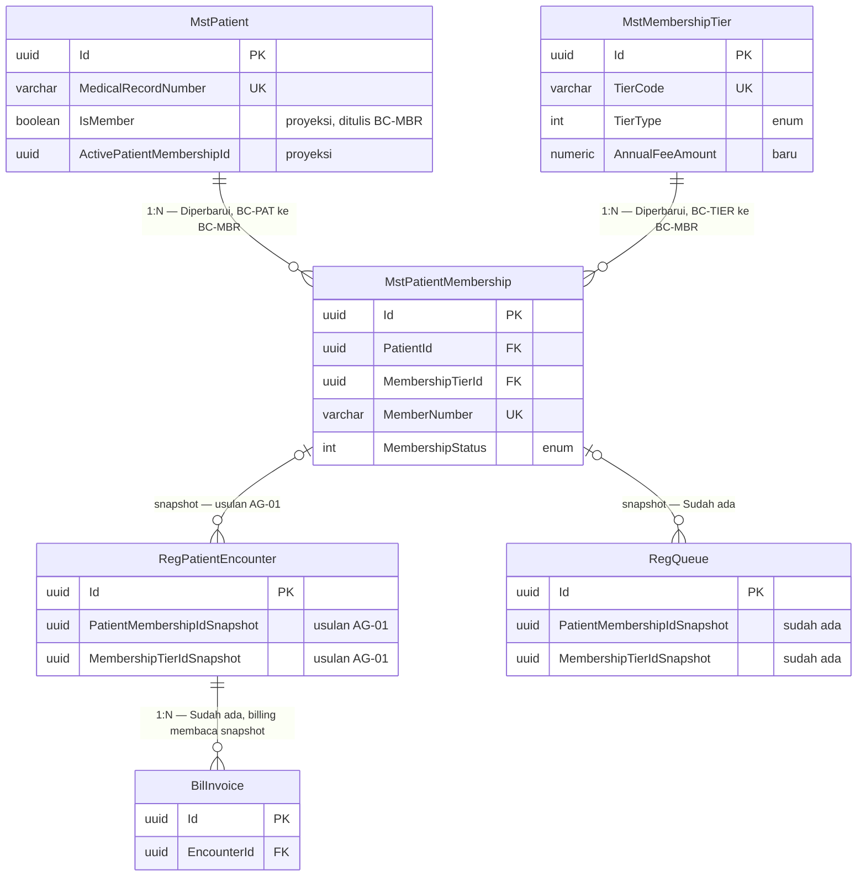

# CRM Membership — ERD Konteks

| Field | Nilai |
|---|---|
| Revision | `1`, status `draft` |
| Masukan | `03-domain-architecture.md` revision 1, `02-backend-architecture.md` revision 1 |
| Backend SHA | `1aecf642` |

Peta ini menunjukkan arah ketergantungan antar context. Panah dari A ke B berarti A
menyimpan rujukan ke data milik B. Detail kolom ada di `patient-membership.md`.

| Context | Entity | Status | Owner |
|---|---|---|---|
| `BC-PAT` | `MstPatient` | Sudah ada (proyeksi status ditulis `BC-MBR`) | Patient Management |
| `BC-TIER` | `MstMembershipTier` | Diperbarui | Administrator / Master Data |
| `BC-MBR` | `MstPatientMembership`, `PatMembershipStatusHistory` | Diperbarui / Baru | Patient Management |
| `BC-REG` | `RegPatientEncounter` | Diperbarui (usulan `AG-01`) | Registration |
| `BC-REG` | `RegQueue` | Sudah ada | Registration |
| `BC-BIL` | `BilInvoice` | Sudah ada. Tagihan iuran menunggu `DEC-CRM-001` | Billing |

Rujukan snapshot dari kunjungan ke membership adalah rujukan historis. Snapshot tidak
berubah walaupun status membership berubah sesudahnya (`CRM-DEC-005`).
