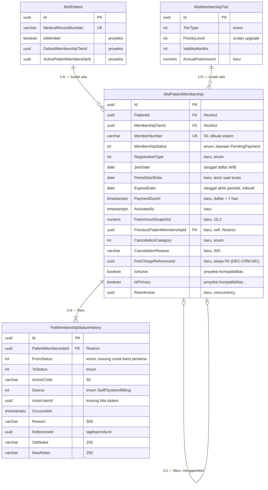

# CRM Membership — ERD Context Patient Membership

| Field | Nilai |
|---|---|
| Revision | `1`, status `draft` |
| Backend SHA | `1aecf642` |

Kolom audit `IdentityModel` tidak digambar.

| Entity | Status | Owner | Catatan |
|---|---|---|---|
| `MstPatientMembership` | Diperbarui | Patient Management | 10 kolom baru, 1 bawaan berubah, index unik bersyarat diganti |
| `PatMembershipStatusHistory` | Baru | Patient Management | Butuh baris registry folder `PatientManagement/Membership` lebih dulu |
| `MstMembershipTier` | Diperbarui | Administrator / Master Data | 1 kolom baru |
| `MstPatient` | Sudah ada | Patient Management | Direferensikan, **MUST NOT** disalin |

## Index unik bersyarat (penjaga `INV-01` s.d. `INV-03`)

| Index | Kolom | Filter | Arti bagi pengguna |
|---|---|---|---|
| `UX_MstPatientMembership_Patient_Active` | `PatientId` | `MembershipStatus = 1 AND IsDelete = false` | Satu pasien tidak bisa punya dua membership Aktif |
| `UX_MstPatientMembership_Patient_Scheduled` | `PatientId` | `MembershipStatus = 8 AND IsDelete = false` | Paling banyak satu perpanjangan Terjadwal |
| `UX_MstPatientMembership_Patient_Pending` | `PatientId` | `MembershipStatus = 7 AND IsDelete = false` | Paling banyak satu pendaftaran Menunggu Pembayaran |

Contoh: petugas A dan petugas B mendaftarkan Gold untuk pasien yang sama pada detik yang sama.
Kunci per pasien membuat salah satunya menunggu. Bila kunci terlewati karena kesalahan, index
`UX_..._Pending` tetap menolak baris kedua, dan petugas B menerima pesan "Pasien ini sudah
punya pendaftaran yang menunggu pembayaran" (kode 409).
