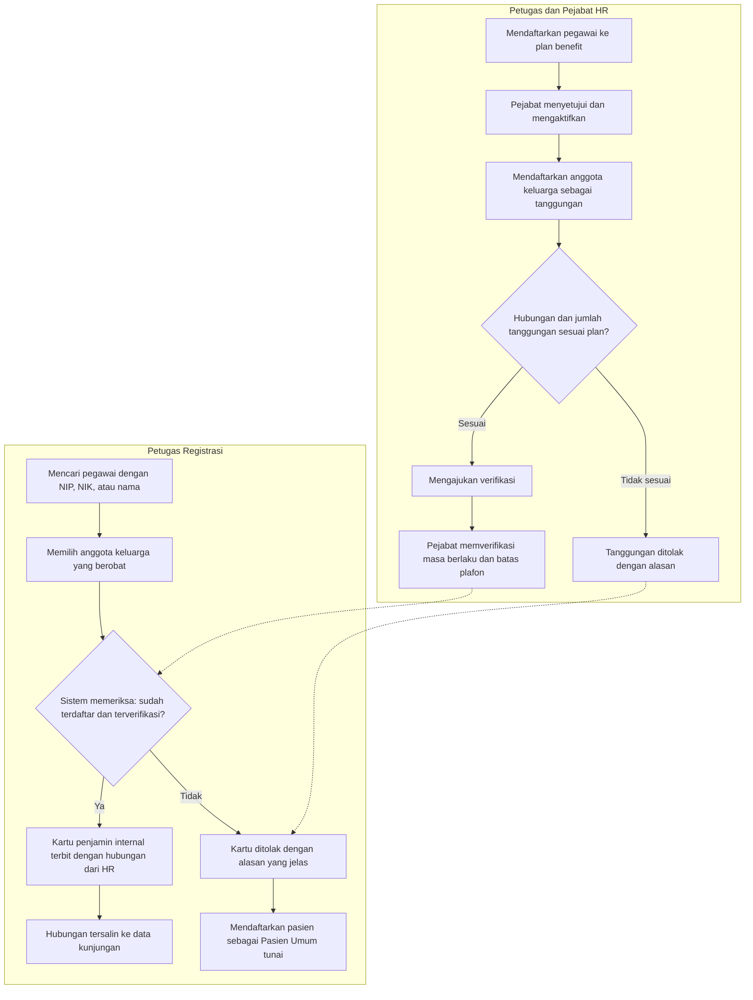
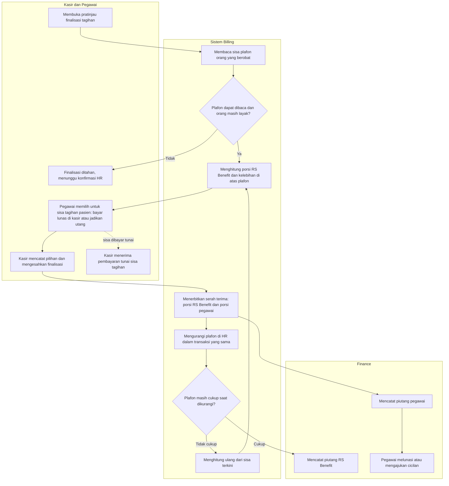
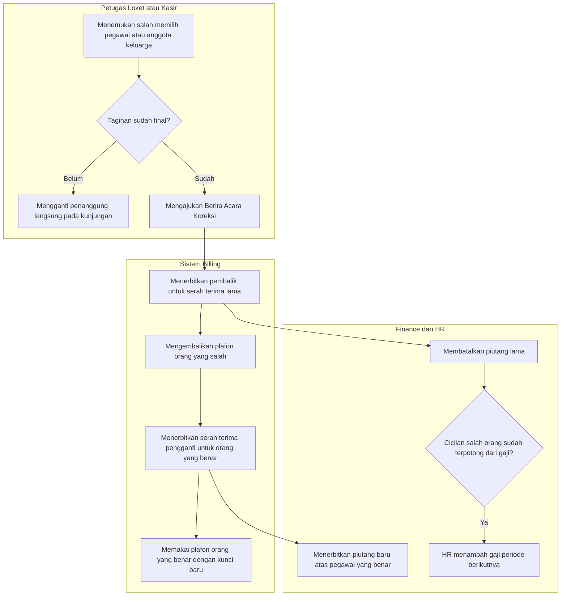

# Alur Proses — Plafon Benefit Pasien Keluarga Pegawai: Mendaftar, Menagih, dan Mengoreksi

| Field | Nilai |
|---|---|
| Slice | `EPIC FIN-04` — celah implementasi `REV-19` |
| Domain Terkait | HR Benefit, Registrasi Pasien, Billing & Kasir, Finance AR |
| Keputusan yang Diturunkan | `FIN-DEC-204` s.d. `FIN-DEC-210` |
| Rujukan Arsitektur | `02-backend-architecture.md` Bagian R; `contracts/integration-contract.md` Bagian R (`FIN-INTEGRATION-1.9`) |
| Status | `draft` — menunggu persetujuan pemilik |
| Catatan Kepatuhan | Diagram **tidak** memuat nama tabel, kolom, endpoint, atau nama class. Pesan penolakan rinci ada di `contracts/validation-matrix.md` bagian `R` |

Melengkapi `01-alur-piutang-manfaat-karyawan-end-to-end.md`: berkas itu menggambar ujung ke ujung; berkas ini
memerinci tiga bagian yang belum tersambung di kode.

---

## 1. Mendaftarkan Keluarga di HR, Lalu Menerbitkan Kartu di Registrasi

| # | Langkah | Pelaku | Masukan | Keluaran | Bila gagal |
|---:|---|---|---|---|---|
| 1 | Mendaftarkan pegawai ke plan benefit | Petugas HR | Pegawai, plan, masa berlaku | Enrollment berstatus `Draft` | Plan tanpa batas plafon ditolak; lengkapi plan |
| 2 | Menyetujui dan mengaktifkan | Pejabat HR (bukan pengaju) | Enrollment `Submitted` | Enrollment `Active`, saldo awal = batas plan | Pengaju yang sama menyetujui: ditolak |
| 3 | Mendaftarkan tanggungan | Petugas HR | Anggota keluarga aktif milik pegawai | Tanggungan `Draft` | Bukan anggota keluarga pegawai itu, hubungan tidak dibolehkan plan, atau melebihi batas jumlah: ditolak |
| 4 | Memverifikasi | Pejabat HR | Tanggungan `Requested`, masa berlaku, batas plafon | Tanggungan `Verified` | Ditolak dengan alasan wajib; mengajukan ulang berarti membuat tanggungan baru |
| 5 | Mencari pegawai dan memilih keluarga | Petugas Registrasi | Minimal 3 karakter kata kunci | Daftar pegawai (NIK tersamar) dan keluarganya | Data HR tidak terbaca: ulangi atau daftarkan sebagai Pasien Umum |
| 6 | Memeriksa kelayakan | Sistem | Pegawai, anggota keluarga, tanggal layanan | Layak atau tidak beserta alasan | Tidak layak: kartu ditolak, jalur Pasien Umum tunai |
| 7 | Menerbitkan kartu | Petugas Registrasi | Hasil kelayakan `OK` | Kartu tertaut ke pegawai dan keluarga; hubungan diisi sistem | — |

**Contoh.** Sari (anak Budi, nama samaran) sudah terverifikasi: kartu terbit, hubungan "anak". Pak Andi (paman) tidak
terdaftar: tidak bisa dipilih, jadi petugas mendaftarkannya sebagai Pasien Umum tunai.

---

## 2. Finalisasi Tagihan: Membagi Porsi dan Pilihan Pegawai

| # | Langkah | Pelaku | Masukan | Keluaran | Bila gagal |
|---:|---|---|---|---|---|
| 1 | Membaca sisa plafon | Sistem Billing | Pegawai dan anggota keluarga, tanggal layanan | Sisa plafon orang itu | Tidak terbaca atau tidak layak: finalisasi **ditahan**, hubungi HR; tidak ada tebakan "semua ditanggung RS" atau "semua ditanggung pegawai" |
| 2 | Menghitung dua porsi | Sistem Billing | Porsi yang ditanggung penjamin menurut aturan, sisa plafon | Porsi RS Benefit dan kelebihan di atas plafon | Ada penjamin kedua: ditolak, belum didukung |
| 3 | Memilih untuk sisa tagihan pasien | Pegawai (dicatat kasir) | Sisa tagihan pasien (co-pay, item di luar cakupan) | Nominal yang dijadikan utang, 0 sampai seluruhnya | Melebihi sisa tagihan: ditolak |
| 4 | Menerbitkan serah terima | Sistem Billing | Hasil langkah 2 dan 3 | Satu sampai dua baris, tidak pernah bernilai nol | — |
| 5 | Mengurangi plafon | Sistem Billing | Porsi RS Benefit | Saldo HR berkurang tepat sebesar porsi itu | Tidak cukup karena finalisasi lain: hitung ulang sekali; bila masih gagal, finalisasi dibatalkan seluruhnya |
| 6 | Mencatat piutang | Finance | Serah terima | Piutang RS Benefit dan piutang pegawai | Tanpa pemilik manfaat yang valid: ditolak |

**Contoh.** Tagihan Rp 5.000.000; aturan penjamin RS Benefit menanggung 80% (Rp 4.000.000); sisa plafon Rp 3.000.000;
sisa tagihan pasien Rp 1.000.000. Porsi RS Benefit Rp 3.000.000, kelebihan di atas plafon Rp 1.000.000. Bila pegawai memilih
membayar sisa Rp 1.000.000 tunai: piutang pegawai Rp 1.000.000. Bila pegawai menjadikannya utang: piutang pegawai Rp 2.000.000.

---

## 3. Koreksi Salah Orang dan Pengembalian Plafon

| # | Langkah | Pelaku | Masukan | Keluaran | Bila gagal |
|---:|---|---|---|---|---|
| 1 | Menandai kesalahan | Petugas loket atau kasir | Kunjungan dan orang yang benar | Berita Acara Koreksi (bila sudah final) | Tanpa alasan: ditolak |
| 2 | Membalik serah terima lama | Sistem Billing | Berita Acara | Pembalik; plafon orang yang salah **pulih penuh** | Sudah pernah dikembalikan: tidak berubah, aman diulang |
| 3 | Menerbitkan pengganti | Sistem Billing | Orang yang benar | Serah terima baru dengan kunci baru; plafon orang yang benar berkurang | Orang yang benar tidak layak atau plafon kurang: koreksi ditahan |
| 4 | Membatalkan dan menerbitkan piutang | Finance | Pembalik dan pengganti | Piutang lama `CANCELLED`, piutang baru terbit | Tidak pernah mengubah nama debitur secara manual |
| 5 | Mengembalikan potongan gaji | HR | Peristiwa pembalikan angsuran | Penyesuaian penambah gaji pada slip berikutnya | Finance tidak mengeluarkan kas manual |

**Contoh.** Tagihan Rp 2.000.000 salah dibebankan ke pegawai A (plafon terpakai Rp 2.000.000). Setelah koreksi, plafon A kembali
Rp 2.000.000 dan plafon pegawai B yang benar berkurang Rp 2.000.000. Bila Rp 500.000 sudah terpotong dari gaji A, slip gaji A bulan
depan bertambah Rp 500.000.
