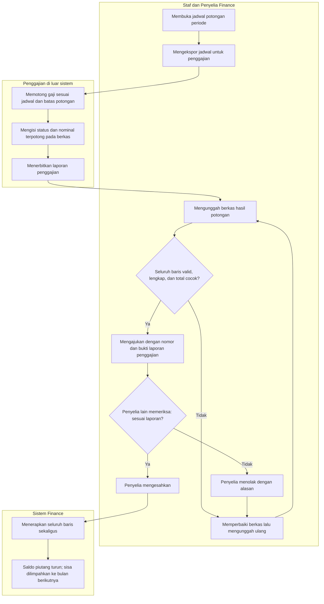
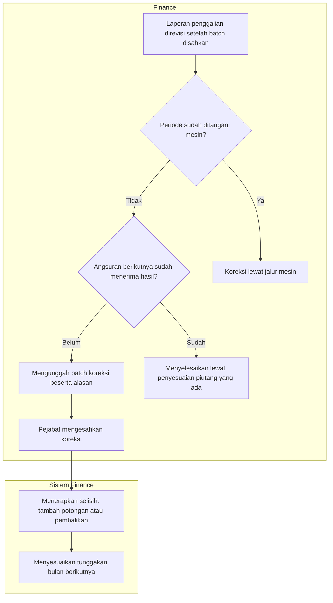

# Alur Proses — Jembatan Manual Potong Gaji Sampai Mesin Payroll Aktif

| Field | Nilai |
|---|---|
| Keputusan | `FIN-DEC-215`, `FIN-DEC-219` s.d. `FIN-DEC-222` |
| Rujukan | `02-backend-architecture.md` Bagian S; `contracts/integration-contract.md` Bagian S (`FIN-INTEGRATION-1.10`) |
| Status | `draft` — menunggu persetujuan pemilik |
| Catatan Kepatuhan | Diagram tidak memuat nama tabel, kolom, endpoint, atau class |

## 1. Alur bulanan

| # | Langkah | Pelaku | Masukan | Keluaran | Bila gagal |
|---:|---|---|---|---|---|
| 1 | Ekspor jadwal | Staf Finance | Periode | Berkas jadwal berisi nominal terutang termasuk tunggakan | Tidak ada angsuran terjadwal: tidak ada yang perlu dipotong |
| 2 | Potong gaji | Penggajian | Berkas jadwal | Status dan nominal terpotong per baris; laporan penggajian | Gaji tidak cukup: tulis sebagian atau gagal |
| 3 | Unggah hasil | Staf Finance | Berkas hasil, total laporan | Batch dengan hasil validasi per baris | Baris tidak cocok, tidak lengkap, atau total berbeda: perbaiki lalu unggah ulang |
| 4 | Ajukan | Staf Finance | Nomor dan lampiran laporan | Batch menunggu pengesahan | Tanpa bukti: tidak dapat diajukan |
| 5 | Sahkan | Penyelia (bukan pengaju) | Batch | Saldo angsuran dan piutang berubah sekaligus | Satu baris gagal diterapkan: tidak ada yang berubah; tolak lalu perbaiki |

**Contoh.** September: Budi terutang Rp 3.000.000, terpotong Rp 1.500.000; sisa Rp 1.500.000 muncul pada jadwal Oktober.

## 2. Koreksi dan peralihan

| # | Langkah | Pelaku | Masukan | Keluaran | Bila gagal |
|---:|---|---|---|---|---|
| 1 | Menilai koreksi | Staf Finance | Laporan revisi | Keputusan jalur | Periode milik mesin: jalur manual ditolak |
| 2 | Batch koreksi | Staf Finance | Baris yang salah dengan nominal benar, alasan | Selisih per baris | Angsuran berikutnya sudah diproses: pakai penyesuaian piutang |
| 3 | Pengesahan | Pejabat Finance (bukan pengaju) | Batch koreksi | Saldo dan tunggakan disesuaikan | Ditolak dengan alasan |

**Contoh.** Tercatat Rp 1.500.000, yang benar Rp 1.200.000: piutang naik Rp 300.000 dan tunggakan Oktober menjadi Rp 1.800.000.

**Peralihan.** Saat mesin siap untuk Januari 2027, pejabat menetapkan peralihan `2027-01`. Sejak itu, unggah manual untuk Januari
dan seterusnya ditolak, sedangkan Desember 2026 ke belakang tetap bisa dikoreksi lewat jalur ini.
