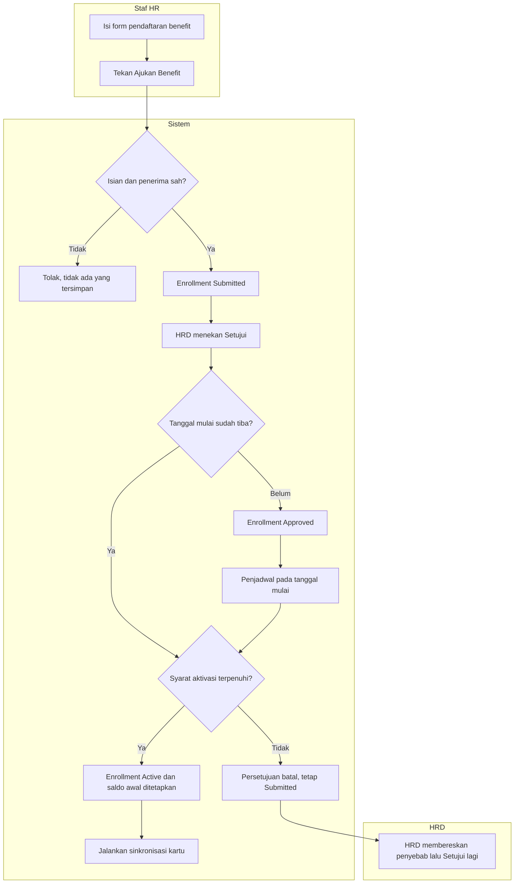
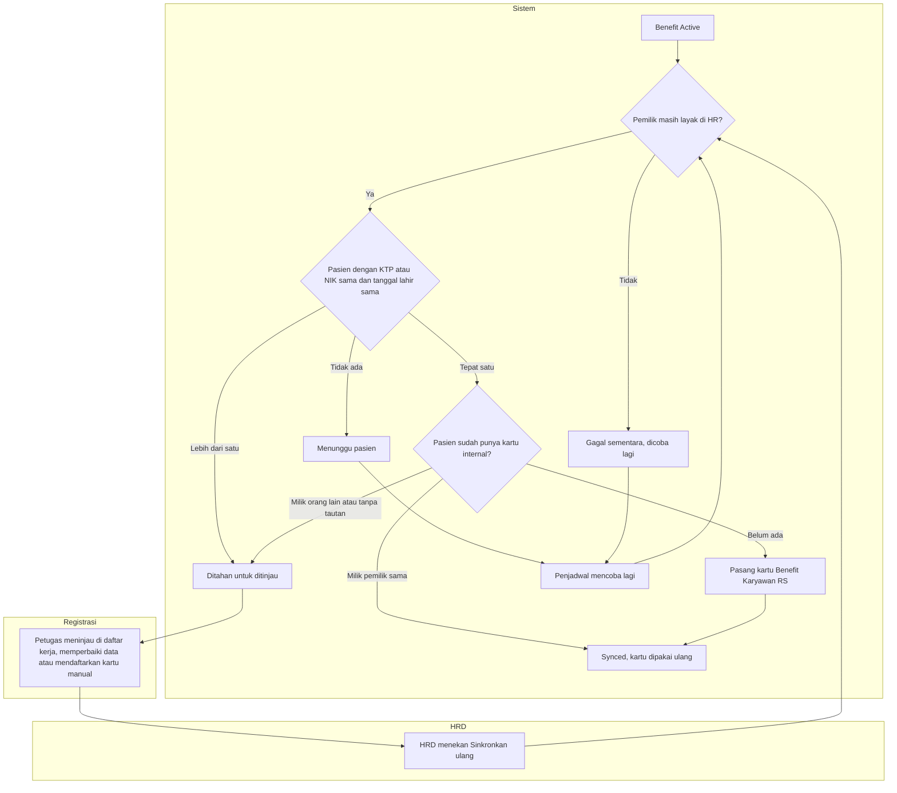
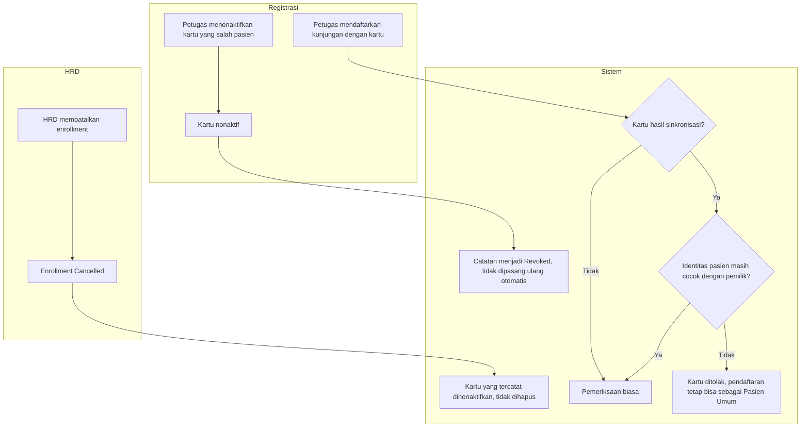

# Alur Benefit RS — Pengajuan, Persetujuan, dan Sinkronisasi Penjamin Pasien

```yaml
last_changed_in: Revisi 22 (3 November 2026)
status: approved   # 2026-11-03, pemilik (pengguna sesi)
input_revision: 00-interview-decisions.md FIN-DEC-231..257; 02-backend-architecture.md bagian V
```

Nama status pada diagram sama dengan `contracts/state-transition-matrix.md` bagian V.

## 1. Pengajuan dan persetujuan



| Langkah | Pelaku | Masukan | Keluaran | Bila gagal |
|---|---|---|---|---|
| Ajukan Benefit | Staf HR | Penerima dari HR, program, tanggal | Enrollment Diajukan | Petugas membetulkan isian yang ditandai; tidak ada Draft tertinggal |
| Setujui | HRD | Enrollment Diajukan | Aktif (tanggal tiba) atau Disetujui (tanggal depan) | Bila syarat aktivasi gagal, HRD membaca pesan penyebab, misalnya membatalkan benefit lama yang beririsan, lalu menyetujui lagi |
| Aktivasi terjadwal | Sistem | Enrollment Disetujui yang tanggalnya tiba | Aktif | Bila gagal, tetap Disetujui dan dicoba lagi; HRD dapat menekan Aktifkan manual |

## 2. Sinkronisasi kartu penjamin pasien



| Langkah | Pelaku | Masukan | Keluaran | Bila gagal |
|---|---|---|---|---|
| Cari pasien | Sistem | Identitas pemilik dari HR | Tepat satu pasien, nol, atau lebih | Nol: menunggu, tidak membuat pasien. Lebih dari satu: ditahan |
| Periksa kartu yang ada | Sistem | Pasien terpilih | Pakai ulang, pasang baru, atau ditahan | Kartu milik orang lain tidak pernah diubah |
| Tinjau kasus ditahan | Petugas Registrasi | Daftar kerja | Data pasien dibetulkan atau kartu manual didaftarkan | Bila tetap ragu, biarkan ditahan; pasien tetap bisa berobat sebagai Pasien Umum |
| Sinkronkan ulang | HRD | Enrollment Aktif | Hasil sinkronisasi baru | Pesan alasan tampil di detail enrollment |

## 3. Pembatalan, pencabutan, dan kunjungan



| Langkah | Pelaku | Masukan | Keluaran | Bila gagal |
|---|---|---|---|---|
| Batal | HRD | Alasan | Enrollment Dibatalkan, kartu nonaktif | Bila penonaktifan tertunda, penjadwal mengulang; kartu tetap tidak bisa dipakai karena HR menolak |
| Cabut kartu | Petugas Registrasi | Kartu yang salah pasien | Kartu nonaktif, catatan Revoked | HRD memasang kembali hanya setelah data benar |
| Daftar kunjungan | Petugas Registrasi atau kasir | Kartu pasien | Kunjungan memakai benefit, atau kartu ditolak | Petugas memilih Pasien Umum atau penjamin lain; layanan darurat tidak tertunda |
