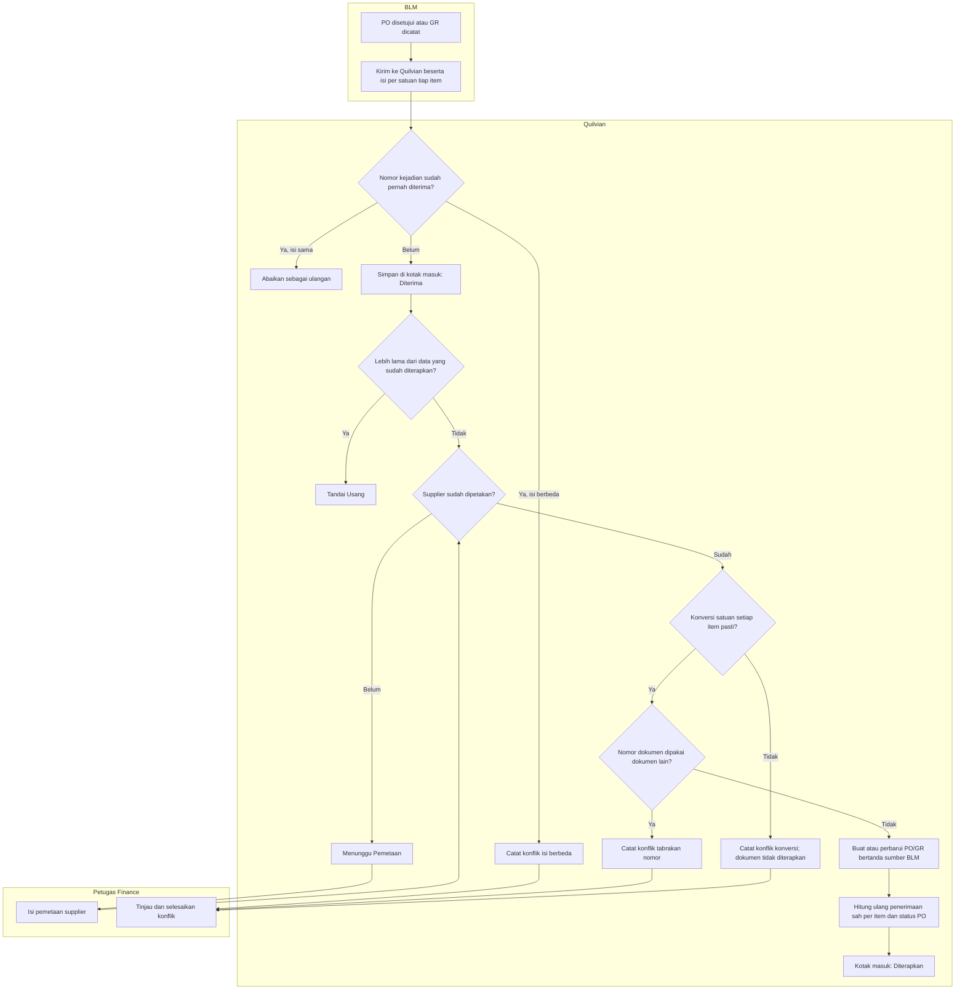
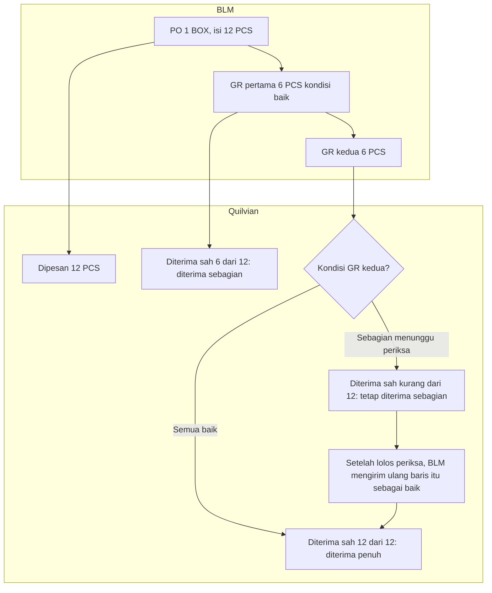
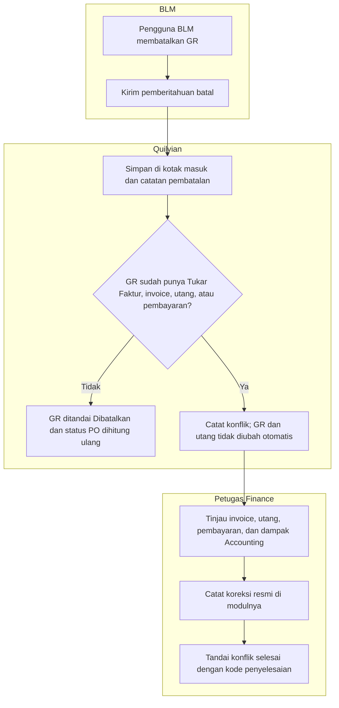

# Alur Penampungan PO/GR dari BLM

```yaml
last_changed_in: Revisi 23 putaran 2 (9 November 2026)
status: approved   # 2026-11-09, pemilik (pengguna sesi), termasuk FIN-DES-141
input_revision: 00-interview-decisions.md FIN-DEC-261..278; 02-backend-architecture.md bagian W
```

Alur ini menggambarkan **arti** tabel penampung dan aturan penerimaan Revisi 23. Pengolah kiriman belum dibangun.
Nama status sama dengan `contracts/state-transition-matrix.md` bagian W.

## 1. Kiriman PO atau GR dari BLM



| Langkah | Pelaku | Masukan | Keluaran | Bila gagal |
|---|---|---|---|---|
| Kirim | BLM | PO atau GR beserta item, satuan, dan isi per satuan | Kiriman bernomor kejadian | BLM mengirim ulang dengan nomor kejadian sama |
| Simpan | Sistem | Kiriman | Kotak masuk "Diterima" | Tidak tersimpan → BLM tidak menerima tanda terima dan mengulang |
| Periksa pemetaan | Sistem | Supplier BLM | Lanjut atau "Menunggu Pemetaan" | Petugas memetakan supplier; kiriman dicoba lagi |
| Periksa konversi | Sistem | Isi per satuan dan satuan dasar tiap item | Lanjut atau konflik | Konflik konversi; BLM mengirim kiriman baru yang lengkap. PO tidak pernah dianggap diterima penuh dari data yang tidak pasti |
| Terapkan dan hitung | Sistem | Kiriman lengkap | PO/GR bersumber BLM; status PO dari jumlah sah per item | Tabrakan nomor → konflik |

## 2. Penerimaan bertahap dengan satuan berbeda



| Langkah | Pelaku | Masukan | Keluaran | Bila gagal |
|---|---|---|---|---|
| PO diterapkan | Sistem | 1 BOX, isi 12 | Dipesan 12 dalam satuan dasar | Isi per satuan tidak ada → konflik konversi |
| GR pertama | Sistem | 6 PCS baik | Sah 6, sisa 6, diterima sebagian | — |
| GR kedua | Sistem | 6 PCS | Penuh bila semua baik; sebagian bila ada yang rusak atau menunggu periksa | Barang rusak diselesaikan lewat penggantian, retur, atau koreksi PO |

## 3. GR dibatalkan di BLM setelah utang diakui



| Langkah | Pelaku | Masukan | Keluaran | Bila gagal |
|---|---|---|---|---|
| Batal di BLM | Pengguna BLM | GR | Pemberitahuan batal | Seharusnya dicegah di BLM bila ada turunan AP (`FIN-OQ-141`) |
| Periksa turunan | Sistem | GR | Dibatalkan atau konflik | — |
| Tinjau dan selesaikan | Finance | Konflik | Koreksi dan konflik selesai | Konflik tetap terbuka sampai diselesaikan |
