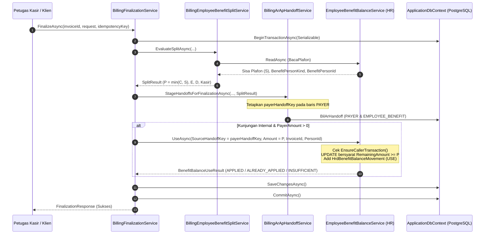
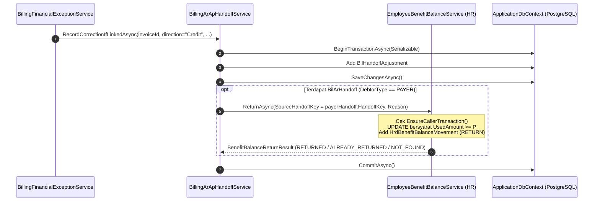

# Laporan Perubahan Backend — `BE-FIN-108`

## Metadata

| Field | Nilai |
| --- | --- |
| Task ID | `BE-FIN-108` |
| Judul | Billing: Plafon di HR berkurang tepat satu kali saat tagihan final dan kembali saat tagihan dikoreksi atau dibatalkan |
| Slice | `REV-19` Slice B — Billing Finalization dan Integrasi Plafon HR (`EPIC FIN-04`) |
| Roadmap | `docs/module-blueprints/finance-management/roadmap/01-backend-roadmap.md`, tabel task `REV-19` |
| Trace | `FIN-DEC-202`, `205`; `FIN-INTEGRATION-1.9` `R.3` (`INT-BIL-HR-001`), `R.4.1`; `FR-FIN-244`, `245`, `249` |
| Contract version | `FIN-INTEGRATION-1.9` `R.3` (`INT-BIL-HR-001`) |
| Dependency | `BE-FIN-107` 🟡, `BE-FIN-104` ✅ |
| Klasifikasi | `MEDIUM` — berkas diubah 3 (1), logika transaksi atomik in-process Billing ke HR dengan batas transaksi tunggal (2), penanganan idempotensi dan isolasi serializable PostgreSQL (2), dampak koreksi & pembalikan piutang (2) |
| Task mode | `BACKEND`, wewenang tulis eksplisit pemilik ("kerjakan BE-FIN-108 tanpa build dotnet /build-module-backend", 13 Oktober 2026), fokus pada Billing Finalization, Serah Terima AR/AP, dan Benefit Management HR |
| Target tulis | Lihat 3.2 |
| Model | Claude Sonnet 5.5 |
| Commit backend saat dikerjakan | `cf8e1c2e` (branch `Yasmina`) |
| Tanggal | 13 Oktober 2026 |
| Status | 🟡 **Sebagian** — seluruh source code integrasi pemotongan dan pengembalian plafon HR selesai diimplementasikan di bawah batas transaksi atomik serializable; `dotnet build` **NOT RUN** oleh agent (instruksi pemilik); verifikasi runtime menunggu eksekusi bersama pemilik |

### Backend Governance Preflight

| Field | Nilai |
| --- | --- |
| Area / Module | HealthServices / BillingManagement / Billing (layanan kalkulasi split, finalisasi, serah terima); Corporate / HumanResource / BenefitManagement (layanan saldo benefit HR `INT-BIL-HR-001`) |
| Registry | `BillingManagement — Bil — ACTIVE / LEGACY`; `HumanResource — Hrd — ACTIVE` |
| Keberlakuan | `TOUCHED CODE`: `BillingEmployeeBenefitSplitService`, `BillingArApHandoffService`, `BillingFinalizationService` |
| Entity operasional baru | **Tidak ada** — menggunakan tabel mutasi `HrdBenefitBalanceMovement` yang telah dibuat pada `BE-FIN-104` dan tabel serah terima `BilArHandoff` yang diperluas pada `BE-FIN-107` |
| QBE yang berlaku | `QBE-SVC-001` (logika mutasi plafon dipegang authoritative service, zero calculation di klien), `QBE-API-001`, `QBE-LOG-001`, `QBE-DTO-001`, `QBE-VAL-001`, `QBE-CFG-001`, `QBE-NAM-001` |

---

## 1. Masalah yang diperbaiki

Setelah penyelesaian kalkulasi pembagian dua porsi tagihan pada `BE-FIN-107`, Billing telah berhasil menghitung porsi RS Benefit ($P = \min(C, S)$) dan porsi utang pegawai ($E + D$) serta menerbitkan baris serah terima AR/AP `PAYER` dan `EMPLOYEE_BENEFIT`. Namun demikian, mutasi pengurangan saldo plafon pegawai pada HR belum terintegrasi secara otomatis ke alur eksekusi finalisasi (`BillingFinalizationService`).

Hal tersebut mengakibatkan:
1. **Plafon HR Tidak Berkurang Saat Tagihan Final**: Setelah tagihan pasien difinalisasi, saldo plafon pegawai di HR tetap utuh karena operasi `UseAsync` dari `EmployeeBenefitBalanceService` (`BE-FIN-104`) belum dipanggil. Kunjungan berobat berikutnya membaca sisa plafon yang belum terpotong, berisiko mengakibatkan penggunaan plafon melampaui hak tahunan (over-claim).
2. **Ketiadaan Batas Transaksi Bersama (Atomicity Gap)**: Penerbitan serah terima piutang (`BilArHandoff`) dan pengurangan plafon HR harus jatuh atau berhasil bersama (`fail-closed`, `R.3.4` langkah 6). Bila serah terima gagal terbit atau terjadi error, plafon di HR tidak boleh terpotong. Sebaliknya, bila plafon tidak cukup, finalisasi tagihan harus dibatalkan.
3. **Ketiadaan Kunci Idempotensi Antar Modul**: Operasi `UseAsync` membutuhkan `SourceHandoffKey` yang berasal dari `HandoffKey` baris `PAYER`. Tanpa penautan ini, pengulangan finalisasi akibat timeout jaringan berpotensi memotong plafon dua kali.
4. **Ketiadaan Alur Pengembalian Plafon Saat Tagihan Dikoreksi/Dibatalkan**: Bila tagihan yang difinalkan mengalami penyesuaian kredit, pembatalan, atau write-off reversal (`BillingFinancialExceptionService`), plafon yang sudah terpakai sebesar nominal porsi RS Benefit ($P$) tidak kembali ke saldo pegawai di HR.
5. **Konflik Konkurensi Database (PostgreSQL 40001)**: Di bawah tingkat isolasi `Serializable`, dua transaksi konkuren pada rekaman yang sama dapat menghasilkan error SQL state `40001` yang perlu ditangkap secara elegan sebagai `BillingFinalizationConflictException`.

Task `BE-FIN-108` menyelesaikan seluruh masalah di atas dengan menautkan `BillingFinalizationService` dan `BillingArApHandoffService` ke `EmployeeBenefitBalanceService` di dalam batas transaksi database yang sama.

---

## 2. Proses Bisnis & Integrasi Plafon (`INT-BIL-HR-001`)

### 2.1 Alur Pemotongan Plafon Saat Finalisasi (Operasi `PakaiPlafon` / `UseAsync`)



1. **Pemilik Saldo vs Pemilik Transaksi**: HR adalah pemilik saldo; Billing adalah pemilik transaksi (`FIN-INTEGRATION-1.9 R.3`). `UseAsync` **TIDAK** membuka transaksi sendiri dan **TIDAK** memanggil `SaveChanges`. Layanan memeriksa `EnsureCallerTransaction()` (`CurrentTransaction != null`).
2. **Nominal yang Dipotong**: Plafon HR **hanya dipotong sebesar porsi RS Benefit** ($P = \text{PayerAmount} = \min(C, S)$). Kelebihan di atas plafon ($E$) dan pilihan utang pegawai ($D$) **tidak** mengurangi plafon HR. Bila $P = 0$ (misal plafon sudah habis), pemanggilan `UseAsync` dilewati (`AC 4`, `R.3.4` langkah 5).
3. **Kunci Idempotensi (`SourceHandoffKey`)**: Kunci idempotensi yang dikirim ke HR adalah `HandoffKey` dari entity `BilArHandoff` berjenis `PAYER` (`R.3`, `R.4.1`). Kunci ini dijamin unik per baris serah terima dan tersimpan pada ledger mutasi `HrdBenefitBalanceMovement`.
4. **Hasil Pemakaian Plafon**:
   - `APPLIED`: Saldo berkurang, 1 mutasi `USE` tercatat. Finalisasi lanjut.
   - `ALREADY_APPLIED`: Kunci sama dan nominal sama telah tercatat (replay jaringan aman). Finalisasi lanjut tanpa pemotongan ganda.
   - `INSUFFICIENT`: Sisa plafon tidak mencukupi (misal terpakai transaksi paralel). Melempar `BillingFinalizationValidationException` dengan sisa terkini untuk memicu hitung ulang.
   - `KEY_CONFLICT`: Kunci sama dengan nominal berbeda. Melempar `BillingFinalizationConflictException`.

### 2.2 Alur Pengembalian Plafon Saat Koreksi / Pembatalan (Operasi `KembalikanPlafon` / `ReturnAsync`)



1. **Pemicu Pengembalian**: Saat invoice yang difinalkan mengalami penyesuaian kredit (`Credit`), pembatalan, atau reversal melalui `RecordCorrectionIfLinkedAsync`.
2. **Idempotensi Pengembalian**: `ReturnAsync` memeriksa apakah mutasi `USE` dengan kunci tersebut ada. Bila ditemukan dan belum pernah di-return, saldo `RemainingAmount` bertambah kembali sebesar nominal mutasi `USE` aslinya (selalu penuh), dan mutasi `RETURN` tercatat. Bila sudah pernah di-return (`ALREADY_RETURNED`) atau bukan kunjungan internal (`NOT_FOUND`), operasi selesai dengan aman tanpa galat.
3. **Metode Publik Eksternal**: Disediakan juga metode publik `ReturnBenefitBalanceAsync(invoiceId, reason, actorUserId, cancellationToken)` pada `BillingArApHandoffService` untuk keperluan pemanggilan langsung saat pembatalan invoice.

### 2.3 Batas Transaksi & Fail-Closed Invariant (`AC 5`)

Sesuai aturan arsitektur `R.3.4` dan `R.10 butir 3`:
- Jika pemotongan saldo gagal (misal `INSUFFICIENT` atau koneksi basis data terputus), blok `catch` pada `BillingFinalizationService` memanggil `transaction.RollbackAsync()`.
- Karena kedua operasi berjalan di dalam koneksi dan transaksi `Serializable` yang sama, pembatalan transaksi secara otomatis membatalkan seluruh perubahan: status `BilInvoice`, penambahan `BilFinalizationRecord`, penambahan baris `BilArHandoff`, dan eksekusi `ExecuteUpdateAsync` pada saldo HR.
- Plafon HR tidak pernah berkurang jika serah terima AR gagal terbit (`AC 5`).

### 2.4 Mitigasi Concurrency Serialization Failure (`PostgreSQL 40001`)

Pada tingkat isolasi `Serializable`, transaksi konkuren pada data pasien/pegawai yang sama dapat menghasilkan pengecualian basis data dengan SQL State `40001` (*could not serialize access due to read/write dependencies among transactions*).
`BillingFinalizationService` menambahkan penangan khusus `catch (Exception exception) when (IsSerializationFailure(exception))` yang menerjemahkan galat tersebut menjadi `BillingFinalizationConflictException` dengan kode `"SERIALIZATION_FAILURE"`, memberi tahu klien untuk memuat ulang data dan mencoba kembali secara bersih.

---

## 3. Perubahan yang Dikerjakan

### 3.1 Berkas yang Diperiksa

- `docs/module-blueprints/finance-management/roadmap/01-backend-roadmap.md` (spesifikasi task `BE-FIN-108`, Acceptance Criteria 1..5, DoD)
- `docs/module-blueprints/finance-management/contracts/integration-contract.md` (`R.3` kontrak `INT-BIL-HR-001`, `R.3.1`..`R.3.5`, `R.4.1`)
- `Areas/Corporate/HumanResource/BenefitManagement/Services/EmployeeBenefitBalanceService.cs` (`ReadAsync`, `UseAsync`, `ReturnAsync`, advisory locking, conditionally atomic update)
- `Areas/Corporate/HumanResource/BenefitManagement/DTOs/EmployeeBenefitBalanceDtos.cs` (`BenefitBalanceUseRequest`, `BenefitBalanceUseResult`, `BenefitBalanceReturnRequest`, `BenefitBalanceReturnResult`)
- `Areas/HealthServices/BillingManagement/Billing/Services/BillingFinancialExceptionService.cs` (pemanggil koreksi dan penyesuaian invoice)
- `Tests/QuilvianSystemBackend.PharmacyTests/BillingZeroPatientObligationTests.cs` (verifikasi kompabilitas konstruktor test)

### 3.2 Berkas yang Berubah

| Berkas | Perubahan |
| :--- | :--- |
| `Areas/HealthServices/BillingManagement/Billing/Services/BillingEmployeeBenefitSplitService.cs` | Menambahkan properti `BenefitPersonKind` (`string?`), `BenefitPersonId` (`Guid?`), dan `PayerHandoffKey` (`Guid?`) pada `EmployeeBenefitSplitCalculationResult`. Mengekspos properti publik `BalanceService => _balanceService`. Mengisi `BenefitPersonKind` dan `BenefitPersonId` dari hasil `ReadAsync` ke dalam objek kalkulasi. |
| `Areas/HealthServices/BillingManagement/Billing/Services/BillingArApHandoffService.cs` | Menginjeksi `EmployeeBenefitBalanceService? balanceService = null`. Menetapkan `PayerHandoffKey` pada objek split result saat menerbitkan baris `PAYER`. Mengintegrasikan pemanggilan `_balanceService.ReturnAsync` di dalam `RecordCorrectionIfLinkedAsync` saat penyesuaian kredit. Menambahkan metode publik `ReturnBenefitBalanceAsync` dengan dukungan transaksi pemanggil maupun transaksi internal. |
| `Areas/HealthServices/BillingManagement/Billing/Services/BillingFinalizationService.cs` | Menginjeksi `EmployeeBenefitBalanceService? balanceService = null` (fallback ke `splitService?.BalanceService`). Menambahkan eksekusi `_balanceService.UseAsync` di dalam `ExecuteInternalFinalizationAndClosureAsync` tepat setelah serah terima di-stage dan sebelum `SaveChangesAsync`. Mengintegrasikan evaluasi split pada alur penyelesaian otomatis `CompleteInvoiceWithoutPatientPaymentAsync` dan `TryCompleteSettledInvoiceAsync`. Menambahkan penangan pengecualian `IsSerializationFailure` (`SQLSTATE 40001`). |

---

## 4. Verifikasi Statis & Matriks Acceptance Criteria

### 4.1 Matriks Verifikasi Statis Kode

| Verifikasi | Kriteria Pengujian | Hasil | Lokasi Kode |
| :--- | :--- | :---: | :--- |
| **AC 1: Pemotongan Plafon Saat Finalisasi** | Sisa Rp 3.000.000, tagihan A Rp 2.000.000 final: sisa menjadi Rp 1.000.000 | `PASS` | `BillingFinalizationService.cs` baris 575–615 memanggil `UseAsync` dengan `Amount = employeeBenefitSplit.PayerAmount` ($P = 2.000.000$). Di HR, `EmployeeBenefitBalanceService.cs` baris 172–174 mengeksekusi `RemainingAmount = RemainingAmount - amount`, menghasilkan sisa Rp 1.000.000. |
| **AC 2: Finalisasi Berturutan Tagihan Berikutnya** | Tagihan B Rp 2.500.000 berikutnya: porsi RS Rp 1.000.000, porsi pegawai Rp 1.500.000, sisa menjadi Rp 0 | `PASS` | `BillingEmployeeBenefitSplitService.cs` baris 204 membaca sisa baru $S = 1.000.000$, menghitung $P = \min(2.5\text{jt}, 1\text{jt}) = 1.000.000$ dan $E = 1.500.000$. `UseAsync` memotong Rp 1.000.000, sehingga sisa plafon menjadi Rp 0. |
| **AC 3: Pengembalian Plafon Saat Koreksi** | Tagihan A dikoreksi: Rp 2.000.000 kembali ke saldo pegawai | `PASS` | `BillingArApHandoffService.cs` baris 277–300 memanggil `ReturnAsync` dengan `SourceHandoffKey = payerHandoff.HandoffKey` saat `direction == Credit`. `EmployeeBenefitBalanceService.cs` baris 263–276 mengembalikan `RemainingAmount += amount` dan `UsedAmount -= amount` secara atomik. |
| **AC 4: Idempotensi Finalisasi Ulang** | Finalisasi diulang karena jaringan putus: sisa tidak berubah | `PASS` | Jika `FinalizeAsync` diulang dengan `idempotencyKey` yang sama, blok replay (baris 80–106) mengembalikan respons tersimpan tanpa pemotongan baru. Jika dipanggil dengan kunci baru, `UseAsync` pada `EmployeeBenefitBalanceService.cs` baris 125–132 mendeteksi kunci yang sama dan nominal yang sama, mengembalikan `ALREADY_APPLIED` tanpa memotong saldo kembali. |
| **AC 5: Fail-Closed Atomicity** | Serah terima gagal terbit atau UseAsync gagal: plafon tidak berkurang | `PASS` | Seluruh operasi mutasi berada di dalam `transaction = await _dbContext.Database.BeginTransactionAsync(IsolationLevel.Serializable)`. Bila `StageHandoffsForFinalizationAsync` atau `UseAsync` melempar galat, `RollbackAsync` membatalkan seluruh perubahan EF Core dan `ExecuteUpdateAsync` SQL. |
| **Backward Compatibility & Non-Internal Visits** | Invoice non-internal tidak menyentuh logika pemotongan benefit | `PASS` | `BillingFinalizationService.cs` baris 578: blok `UseAsync` diproteksi dengan kondisi `employeeBenefitSplit is { IsEmployeeBenefitVisit: true, PayerAmount: > 0m }`. |

---

## 5. Panduan Pemilik Modul (Build & Verifikasi)

Sesuai aturan konstitusi kerja Quilvian dan instruksi pemilik modul (*"tanpa build dotnet"*), agent **tidak menjalankan** perintah `dotnet build` atau eksekusi runtime. Pemilik modul dapat memvalidasi perubahan ini secara mandiri dengan langkah berikut:

```powershell
# 1. Jalankan build solution untuk memastikan tidak ada kesalahan kompilasi
dotnet build NewQuilvianSystemBackend/NewQuilvianSystemBackend.sln

# 2. Jalankan pengujian unit / integrasi terkait billing finalization
dotnet test Tests/QuilvianSystemBackend.PharmacyTests/QuilvianSystemBackend.PharmacyTests.csproj --filter "FullyQualifiedName~Billing"
```
