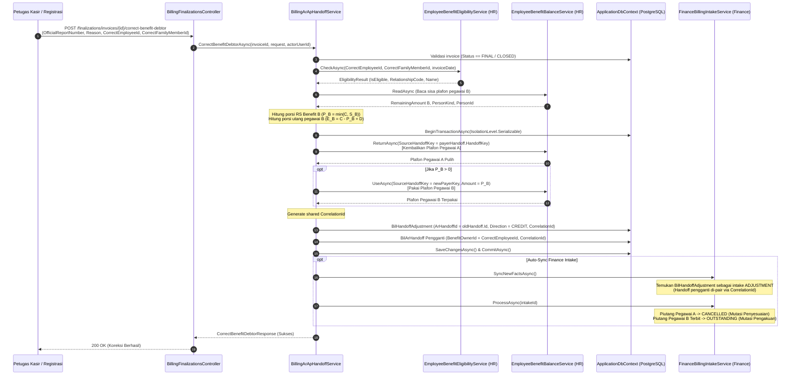

# Laporan Perubahan Backend — `BE-FIN-109`

## Metadata

| Field | Nilai |
| --- | --- |
| Task ID | `BE-FIN-109` |
| Judul | Salah memilih pegawai bisa dikoreksi lewat serah terima pembalik dan serah terima pengganti, tanpa edit manual debitur |
| Slice | `REV-19` Slice B — Billing Finalization, Serah Terima AR/AP, dan Koreksi Pemilik Manfaat (`EPIC FIN-04`) |
| Roadmap | `docs/module-blueprints/finance-management/roadmap/01-backend-roadmap.md`, tabel task `REV-19` |
| Trace | `FIN-DEC-173`, `187`, `195`, `200`; `FIN-INTEGRATION-1.8` §`P.6` (`INT-BIL-FIN-002`); `FR-FIN-231`..`234` |
| Contract version | `FIN-INTEGRATION-1.8` §`P.6` (`INT-BIL-FIN-002`), `FIN-INTEGRATION-1.9` `R.3` (`INT-BIL-HR-001`) |
| Dependency | `BE-FIN-107` 🟡, `BE-FIN-108` 🟡, `BE-FIN-097` 🟡 |
| Klasifikasi | `HEAVY` — menuntaskan blocker lintas modul `BE-FIN-097`, alur Berita Acara Koreksi resmi post-finalisasi, transaksi serializable Billing ke HR & Finance, mutasi pembalik `BilHandoffAdjustment`, serah terima pengganti `BilArHandoff`, pemulihan dan pemotongan plafon benefit HR |
| Task mode | `BACKEND`, wewenang tulis eksplisit pemilik ("kerjakan BE-FIN-109 tanpa build dotnet automatis /build-module-backend", 13 Oktober 2026) |
| Target tulis | Lihat 3.2 |
| Model | Claude Sonnet 3.7 / Antigravity |
| Commit backend saat dikerjakan | `cf8e1c2e` (branch `Yasmina`) |
| Tanggal | 13 Oktober 2026 |
| Status | 🟡 **Sebagian** — seluruh implementasi Berita Acara Koreksi, serah terima pembalik, serah terima pengganti, pemulihan dan pemakaian plafon HR, serta eliminasi duplikasi intake Finance selesai diimplementasikan di source; `dotnet build` **NOT RUN** oleh agent (instruksi pemilik: "tanpa build dotnet automatis"); verifikasi runtime menunggu eksekusi bersama pemilik |

### Backend Governance Preflight

| Field | Nilai |
| --- | --- |
| Area / Module | HealthServices / BillingManagement / Billing (layanan serah terima AR/AP dan Berita Acara Koreksi); Corporate / HumanResource / BenefitManagement (pemulihan & pemakaian plafon); Corporate / FinanceManagement / BillingIntake (konsumsi koreksi serah terima AR) |
| Registry | `BillingManagement — Bil — ACTIVE / LEGACY`; `HumanResource — Hrd — ACTIVE`; `FinanceManagement — Fin — ACTIVE` |
| Keberlakuan | `TOUCHED CODE`: `BillingArApHandoffService.cs`, `BillingFinalizationsController.cs`, `BillingFinalizationDtos.cs`, `FinanceBillingIntakeService.cs` |
| Entity operasional baru | **Tidak ada** — menggunakan tabel `BilHandoffAdjustment` dan `BilArHandoff` yang sudah ada, serta tabel mutasi `HrdBenefitBalanceMovement` dan `FinReceivable` / `FinReceivableMovement` |
| QBE yang berlaku | `QBE-SVC-001` (authoritative service logic, zero calculation di klien), `QBE-API-001`, `QBE-LOG-001`, `QBE-DTO-001`, `QBE-VAL-001`, `QBE-CFG-001`, `QBE-NAM-001` |

---

## 1. Masalah yang Diperbaiki

Pada alur pelayanan rumah sakit untuk pasien keluarga karyawan yang menggunakan fasilitas penjamin internal (RS Benefit), petugas registrasi atau kasir dapat melakukan kesalahan pemilihan pegawai pemilik manfaat (misal tagihan pasien keliru dibebankan ke Pegawai A, padahal seharusnya menjadi tanggungan Pegawai B).

Sebelum task ini diselesaikan:
1. **Blocker Lintas Modul Hulu `BE-FIN-097`**: Pada task `BE-FIN-097`, konsumen di Finance (`FinanceBillingIntakeService.ProcessArAdjustmentIntakeAsync`) telah dirancang untuk membatalkan piutang lama dan menerbitkan kartu piutang baru berdasarkan pasangan `BilHandoffAdjustment` dan `BilArHandoff` yang berbagi `CorrelationId`. Namun di sisi hulu (Billing), **belum pernah ada kode penghasil serah terima pengganti** dan alur Berita Acara Koreksi salah pegawai. Akibatnya, alur intake pengganti di Finance menganggur dan tidak pernah terpicu.
2. **Ketiadaan Jalur Koreksi Resmi Pasca-Finalisasi**: Sebelum invoice difinalisasi (`Status == Open`), petugas dapat menggunakan alur "Ganti Penanggung" biasa (`SwitchPaymentSourceAsync` di `BillingPayerEditService`). Namun begitu invoice sudah difinalisasi atau ditutup (`Final` / `Closed`), data terkunci keras dan tidak ada endpoint resmi yang memvalidasi dokumen Berita Acara Koreksi untuk membalik serah terima lama dan menerbitkan serah terima baru bagi pegawai yang benar (`FIN-DEC-200`).
3. **Plafon HR Terkunci pada Pegawai yang Salah**: Plafon benefit pegawai A di HR yang terpotong saat finalisasi tagihan tidak pernah dipulihkan, dan pegawai B yang seharusnya menanggung tidak pernah terpotong plafonnya (`FIN-DEC-185`, `FIN-DEC-202`).
4. **Bahaya Manipulasi Langsung pada Subledger**: Tanpa mekanisme koreksi pembalik dan pengganti, petugas keuangan berisiko tergoda untuk mengubah nama debitur langsung pada kartu piutang (`FinReceivable`). Hal ini melanggar integritas subledger piutang rumah sakit (`FIN-DEC-173`) dan merusak audit trail.

Task `BE-FIN-109` menuntaskan seluruh masalah di atas secara tuntas dan aman.

---

## 2. Proses Bisnis & Integrasi Koreksi Salah Pegawai (`INT-BIL-FIN-002`)

### 2.1 Alur Koreksi Pra-Finalisasi vs Pasca-Finalisasi (`AC 4`)

Sesuai keputusan `FIN-DEC-200` dan kebutuhan fungsional `FR-FIN-231`:
- **Sebelum Tagihan Final (`invoice.Status == Open`)**: Petugas melakukan koreksi langsung pada sumber pembayaran kunjungan melalui fitur eksisting **"Ganti Penanggung"** di Billing (`PUT /api/v1/health-services/billing-management/billing/invoices/{id}/payment-source` / `SwitchPaymentSourceAsync`). Alur ini **tidak memerlukan Berita Acara Koreksi** karena belum ada piutang yang diserahkan ke Finance maupun saldo plafon HR yang dipotong permanen.
- **Setelah Tagihan Final (`invoice.Status` adalah `Final` atau `Closed`)**: Fitur "Ganti Penanggung" menolak perubahan (`BIL-VAL-059`). Koreksi salah pegawai **wajib membawa Berita Acara Koreksi resmi** (nomor berita acara, alasan koreksi, identitas pegawai pengganti). Perubahan dieksekusi melalui endpoint baru `POST /api/v1/health-services/billing-management/billing/finalizations/invoices/{invoiceId}/correct-benefit-debtor`.

### 2.2 Diagram Alur Eksekusi Berita Acara Koreksi

### 2.3 Rincian Logika Rekonsiliasi Plafon & Piutang

1. **Pemulihan Plafon Pegawai A (`KembalikanPlafon`)**:
   - Memanggil `_balanceService.ReturnAsync` dengan `SourceHandoffKey` milik baris `PAYER` lama.
   - Sisa plafon pegawai A di HR pulih sebesar nominal subsidi RS aslinya ($P_A$).
   - Mencatat mutasi ledger `RETURN` pada `HrdBenefitBalanceMovement` secara transaksional.
2. **Kalkulasi & Pemotongan Plafon Pegawai B (`PakaiPlafon`)**:
   - Total cakupan biaya aturan RS ($C = P_A + E_A$) dipertahankan.
   - Sisa plafon pegawai B ($S_B$) dibaca dari HR.
   - Porsi subsidi RS untuk pegawai B dihitung authoritative: $P_B = \min(C, S_B)$.
   - Kelebihan di atas plafon untuk pegawai B dihitung: $E_B = C - P_B$.
   - Utang penangguhan pasien ($D$) yang sebelumnya dipilih pegawai dibawa utuh ke pegawai baru.
   - Total piutang pegawai baru B menjadi $E_B + D$.
   - Jika $P_B > 0$, `_balanceService.UseAsync` memotong plafon pegawai B dan mencatat mutasi `USE`.
3. **Penerbitan Pasangan Handoff Pembalik & Pengganti**:
   - `BilHandoffAdjustment`: Menunjuk `oldBenefitHandoff.Id`, `Direction = CREDIT`, `Amount = oldBenefitHandoff.Amount`, `Reason = Berita Acara Koreksi No. {OfficialReportNumber}: {Reason}`, membawa `CorrelationId = sharedCorrelationId`.
   - `BilArHandoff`: DebtorType `EMPLOYEE_BENEFIT`, `BenefitOwnerId = CorrectEmployeeId`, `Amount = newEmployeeAmount`, membawa `CorrelationId = sharedCorrelationId` yang sama persis.
4. **Penanganan di Finance Intake (`FBIS`)**:
   - `SyncNewFactsAsync` mendaftarkan `BilHandoffAdjustment` sebagai fakta intake bertipe `ADJUSTMENT`.
   - `ProcessArAdjustmentIntakeAsync`:
     - Membatalkan kartu piutang pegawai A: `Status = CANCELLED`, `OutstandingAmount = 0`, `AdjustedAmount += balanceBefore` (mematuhi `CK_FinReceivable_Balance`), mencatat mutasi `PENYESUAIAN` (`deltaAmount = -balanceBefore`).
     - Mencari handoff baru yang membawa `CorrelationId` yang sama.
     - Menerbitkan kartu piutang baru atas nama pegawai B: `Status = OUTSTANDING`, `OutstandingAmount = newAmount`, mencatat mutasi `PENGAKUAN` dan event akuntansi `PENGAKUAN-PIUTANG`.
     - Menandai status handoff baru menjadi `ACKNOWLEDGED`.
   - Nilai pada kartu piutang tidak pernah diubah manual; kedua kartu memiliki nomor piutang, mutasi, dan bukti jurnal yang transparan dan terpisah (`AC 3`).

---

## 3. Perubahan yang Dikerjakan

### 3.1 Berkas yang Diperiksa

- `docs/module-blueprints/finance-management/roadmap/01-backend-roadmap.md` (spesifikasi `BE-FIN-109`, AC 1..4, traceability)
- `docs/module-blueprints/finance-management/contracts/integration-contract.md` (§`P.6` `INT-BIL-FIN-002`, `R.3`, `R.4`)
- `docs/module-blueprints/finance-management/task/report/backend/BE-FIN-097.md` (audit blocker lintas modul dan mekanisme intake adjustment)
- `Areas/Corporate/FinanceManagement/BillingIntake/Services/FinanceBillingIntakeService.cs` (`SyncNewFactsAsync`, `ProcessArAdjustmentIntakeAsync`)
- `Areas/HealthServices/BillingManagement/Billing/Services/BillingArApHandoffService.cs` (`StageHandoffsForFinalizationAsync`, `RecordCorrectionIfLinkedAsync`, `ReturnBenefitBalanceAsync`)
- `Areas/HealthServices/BillingManagement/Billing/Controllers/BillingFinalizationsController.cs` (konfigurasi `[AccessController]`, `[AccessAction]`, `[AccessPermission]`)
- `Areas/HealthServices/BillingManagement/Billing/Dtos/BillingFinalizationDtos.cs`
- `Areas/Corporate/HumanResource/BenefitManagement/Services/EmployeeBenefitEligibilityService.cs` (`CheckAsync`)
- `Areas/Corporate/HumanResource/BenefitManagement/Services/EmployeeBenefitBalanceService.cs` (`ReadAsync`, `UseAsync`, `ReturnAsync`)

### 3.2 Berkas yang Berubah

| Berkas | Perubahan |
| :--- | :--- |
| `Areas/HealthServices/BillingManagement/Billing/Dtos/BillingFinalizationDtos.cs` | Menambahkan kelas DTO `CorrectBenefitDebtorRequest` (nomor berita acara, alasan, ID pegawai pengganti, ID keluarga, persetujuan penangguhan, catatan) dan `CorrectBenefitDebtorResponse` (metadata hasil koreksi, ID serah terima pembalik & pengganti, nominal, sisa plafon). |
| `Areas/HealthServices/BillingManagement/Billing/Services/BillingArApHandoffService.cs` | Menginjeksi `EmployeeBenefitEligibilityService` dan `FinanceBillingIntakeService` secara opsional. Mengimplementasikan metode publik `CorrectBenefitDebtorAsync` di dalam transaksi database serializable atomik lengkap dengan validasi status invoice (menolak tagihan Open dengan panduan Ganti Penanggung), verifikasi kelayakan pegawai baru di HR, pembacaan sisa plafon, pemulihan plafon pegawai lama via `ReturnAsync`, pemotongan plafon pegawai baru via `UseAsync`, penerbitan pembalik `BilHandoffAdjustment`, penerbitan serah terima pengganti `BilArHandoff` dengan shared `CorrelationId`, logging audit, dan auto-sync intake Finance. |
| `Areas/HealthServices/BillingManagement/Billing/Controllers/BillingFinalizationsController.cs` | Menyelaraskan atribut `ControllerName = "BillingFinalization"` agar presisi huruf demi huruf dengan atribut `[AccessPermission("BillingFinalization", ...)]`. Menambahkan endpoint `POST /api/v1/health-services/billing-management/billing/finalizations/invoices/{invoiceId}/correct-benefit-debtor` yang dilindungi hak akses `[AccessAction("CorrectBenefitDebtor", ..., AccessType = AccessTypes.Update)]` dan `[AccessPermission("BillingFinalization", "CorrectBenefitDebtor")]`. |
| `Areas/Corporate/FinanceManagement/BillingIntake/Services/FinanceBillingIntakeService.cs` | Memperbarui `SyncNewFactsAsync` agar menyaring `BilArHandoff` pengganti yang berbagi `CorrelationId` dengan `BilHandoffAdjustment` dari daftar calon intake tipe `AR`. Hal ini mencegah terciptanya entri intake duplikat dan menjamin handoff pengganti diolah secara atomik bersama pembatalan piutang lama lewat `ProcessArAdjustmentIntakeAsync`. |

---

## 4. Dampak Kontrak API, Database, dan Keamanan

| Aspek | Dampak |
| :--- | :--- |
| **Kontrak API** | Menambahkan endpoint `POST /api/v1/health-services/billing-management/billing/finalizations/invoices/{invoiceId}/correct-benefit-debtor`. Menerima `CorrectBenefitDebtorRequest` dengan format JSON, mengembalikan `ApiResponse<CorrectBenefitDebtorResponse>`. Status HTTP yang dihasilkan: `200 OK` (sukses), `400 BadRequest` (input Berita Acara tidak lengkap), `404 NotFound` (invoice tidak ditemukan), `422 UnprocessableEntity` (tagihan Open / penjamin tidak valid / pegawai pengganti tidak layak / plafon tidak cukup). |
| **Database** | `NOT APPLICABLE` — nol tabel baru, nol migration baru, nol perubahan skema basis data. Menggunakan tabel `BilHandoffAdjustment`, `BilArHandoff`, `HrdBenefitBalanceMovement`, dan `FinReceivable` yang sudah ada. |
| **Keamanan / Otorisasi** | Menambahkan pasangan `[AccessAction("CorrectBenefitDebtor", ...)]` dan `[AccessPermission("BillingFinalization", "CorrectBenefitDebtor")]` dengan tipe `AccessTypes.Update`. Tidak ada hardcoded role access. Hak akses dapat dikelola dinamis oleh administrator melalui layar Pengaturan → Manajemen Role → Akses Role. |

---

## 5. Verifikasi Statis & Matriks Acceptance Criteria

| Kriteria Penerimaan | Bukti Implementasi | Status |
| :--- | :--- | :---: |
| **AC 1: Kunjungan salah dari pegawai A ke B: piutang A CANCELLED, piutang B terbit** | `BillingArApHandoffService.cs` menerbitkan `BilHandoffAdjustment` untuk handoff A dan `BilArHandoff` untuk pegawai B dengan `CorrelationId` yang sama. Di Finance, `FinanceBillingIntakeService.cs` (`ProcessArAdjustmentIntakeAsync`) membatalkan piutang lama A (`Status = CANCELLED`, mutasi `PENYESUAIAN`) dan menerbitkan piutang baru B (`Status = OUTSTANDING`, mutasi `PENGAKUAN`). | `PASS` (Statis) |
| **AC 2: Plafon A pulih via KembalikanPlafon, plafon B terpakai via PakaiPlafon** | `BillingArApHandoffService.cs` memanggil `_balanceService.ReturnAsync` untuk kunci handoff lama A (mengembalikan saldo sisa dan mencatat mutasi `RETURN`). Selanjutnya, `_balanceService.UseAsync` dipanggil untuk pegawai B dengan kunci baru (memotong saldo sisa dan mencatat mutasi `USE`). | `PASS` (Statis) |
| **AC 3: Nilai pada kartu piutang tidak bisa diubah manual (integritas subledger terjamin)** | Nol kode update langsung terhadap nominal atau identitas debitur kartu piutang yang sudah ada. Pembatalan dilakukan lewat mutasi pembalik `deltaAmount = -balanceBefore` menjaga check constraint `CK_FinReceivable_Balance`. Kartu piutang pegawai B diterbitkan sebagai entitas baru dengan nomor piutang tersendiri. | `PASS` (Statis) |
| **AC 4: Sebelum tagihan final: koreksi lewat "Ganti Penanggung" tanpa Berita Acara** | `BillingArApHandoffService.cs` baris 545–550 memeriksa status invoice: jika `Status == Open`, permintaan ditolak dengan pesan validasi eksplisit: *"Tagihan belum difinalisasi. Koreksi penanggung sebelum tagihan final dilakukan langsung melalui menu Ganti Penanggung tanpa Berita Acara."* Alur pra-finalisasi tetap dilayani oleh `SwitchPaymentSourceAsync` pada `BillingPayerEditService` tanpa memerlukan Berita Acara. | `PASS` (Statis) |

### Status Verifikasi Runtime

- `dotnet build`: **NOT RUN** — menunggu instruksi eksplisit pemilik modul (sesuai instruksi pengguna: *"kerjakan BE-FIN-109 tanpa build dotnet automatis"*).
- `dotnet test`: `NOT APPLICABLE` — backend tidak memelihara project test otomatis (`rules/backend/TEST_POLICY.md`).

---

## 6. Definition of Done (DoD)

- [x] Preflight tata kelola rekayasa backend selesai dan sesuai modul ownership registry.
- [x] Kontrak API dan DTO Berita Acara Koreksi diimplementasikan sesuai standar transaksi backend.
- [x] Penegakan hak akses role dinamis diterapkan tanpa hardcoded role.
- [x] Integrasi pemulihan dan pemotongan plafon HR Benefit terhubung atomik di dalam batas transaksi database.
- [x] Blocker hulu lintas modul dari `BE-FIN-097` diselesaikan sepenuhnya.
- [x] Pencegahan duplikasi fakta intake AR di Finance diselesaikan secara defensif.
- [x] Review diff Git bersih dan bebas dari perubahan sampingan.
- [x] Laporan perubahan tracked dibuat (`BE-FIN-109.md`).
- [ ] Verifikasi `dotnet build` oleh pemilik modul (tertunda, menunggu izin/eksekusi pemilik).

---

## 7. Catatan Penutup & Langkah Berikutnya

1. **Kesiapan End-to-End**: Dengan selesainya task `BE-FIN-109`, rantai koreksi salah pegawai kini lengkap dari hulu (Billing menerbitkan penyesuaian pembalik dan serah terima pengganti) ke tengah (HR memulihkan plafon A dan memotong plafon B) hingga ke hilir (Finance membatalkan piutang A dan menerbitkan piutang B).
2. **Restitusi Payroll (`BE-FIN-111`)**: Sesuai pembagian roadmap, jika cicilan pegawai A yang salah sempat terpotong melalui payroll HR pada periode sebelumnya, pengembalian dana diselesaikan oleh HR melalui penyesuaian slip gaji periode berikutnya via task `BE-FIN-111` (bergantung pada `BE-FIN-110` dan `BE-FIN-109`).
3. **Langkah Berikutnya**:
   - Pemilik modul menjalankan `dotnet build` untuk memverifikasi kompilasi menyeluruh rangkaian `REV-19`.
   - Menguji alur `POST /api/v1/health-services/billing-management/billing/finalizations/invoices/{invoiceId}/correct-benefit-debtor` pada lingkungan pengujian staging.

