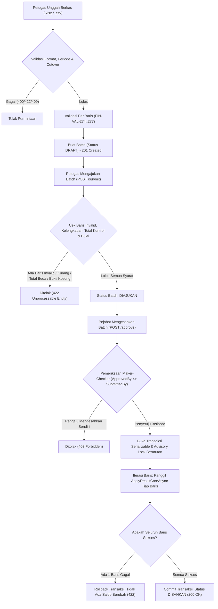

# Laporan Perubahan Backend — `BE-FIN-117`

## Metadata

| Field | Nilai |
| --- | --- |
| Task ID | `BE-FIN-117` |
| Judul | Hasil potongan per periode masuk lewat unggah berkas, divalidasi, diajukan dengan bukti, dan disahkan orang lain secara atomik |
| Slice | `REV-21` (Slice D: Jembatan Manual & Integrasi Mesin Payroll) |
| Roadmap | `docs/module-blueprints/finance-management/roadmap/01-backend-roadmap.md`, tabel task `REV-21` |
| Trace | `FIN-DEC-220`, `221`; `FR-FIN-254`..`256`; `FIN-DES-106`; `FIN-INTEGRATION-1.10` §`S.2`; `FIN-API-1.11` §`S.1`; `FIN-STATE-1.10` §`S.1`; `FIN-VAL-1.13` §`FIN-VAL-272`..`284`, `286`; `FIN-PERM-1.12` |
| Contract version | `FIN-INTEGRATION-1.10` §`S.2`; `FIN-API-1.11` §`S.1`; `FIN-STATE-1.10` §`S.1`; `FIN-VAL-1.13` §`S.1`..`S.3` |
| Dependency | `BE-FIN-114` 🟡, `BE-FIN-115` 🟡, `BE-FIN-116` 🟡 |
| Klasifikasi | `HIGH` — Pembuatan dua tabel batch (`FinPayrollDeductionBatch` dan `FinPayrollDeductionBatchItem`), konfigurasi EF Core dengan check constraints dan unique filtered index, DbSets di `ApplicationDbContext`, penambahan jenis bukti `LAPORAN-PENGGAJIAN` pada `FinTransactionProofTypes`, berkas migration `20261013143000_AddFinancePayrollDeductionBatch.cs`, exception domain, perluasan `FinancePayrollDeductionBatchService` (unggah berkas Excel/CSV, validasi per baris, pengajuan wajib bukti, pengesahan atomik Serializable dengan advisory lock berurutan, pembatalan, penolakan, kueri daftar berpaging dan rincian lengkap), serta perluasan controller dengan 11 endpoint berhak akses resmi |
| Task mode | `BACKEND`, wewenang tulis eksplisit pemilik ("kerjakan BE-FIN-117 tanpa build dotnet automatis /build-module-backend", 13 Oktober 2026) |
| Target tulis | Lihat §3.2 |
| Model | Claude Sonnet 3.7 / Antigravity |
| Commit backend saat dikerjakan | `cf8e1c2e` (branch `Yasmina`) |
| Tanggal | 13 Oktober 2026 |
| Status | 🟡 **Sebagian** — seluruh implementasi model, konfigurasi EF Core, DbSets, berkas migrasi, exceptions, service batch dengan transaksi atomik dan maker-checker, controller dengan 11 endpoint berhak akses resmi, dan DTOs telah selesai di source; `dotnet build` **NOT RUN** oleh agent (instruksi pemilik: "tanpa build dotnet automatis") |

### Backend Governance Preflight

| Field | Nilai |
| --- | --- |
| Area / Module | Corporate / FinanceManagement / Receivable |
| Registry | `FinanceManagement — Fin — ACTIVE` (`docs/engineering/MODULE_OWNERSHIP_PREFIX_REGISTRY.md`) |
| Keberlakuan | `NEW CODE` (`FinPayrollDeductionBatch.cs`, `FinPayrollDeductionBatchItem.cs`, `FinPayrollDeductionBatchConfiguration.cs`, `FinPayrollDeductionBatchItemConfiguration.cs`, `20261013143000_AddFinancePayrollDeductionBatch.cs`, `FinancePayrollDeductionBatchExceptions.cs`); `TOUCHED CODE` (`ApplicationDbContext.cs`, `FinTransactionProof.cs`, `FinancePayrollDeductionBatchService.cs`, `FinancePayrollDeductionBatchController.cs`, `01-backend-roadmap.md`) |
| Entity operasional baru | `FinPayrollDeductionBatch` dan `FinPayrollDeductionBatchItem` (sesuai kamus data Revisi 20 §10.2 dan §10.3; tidak membuat entitas atau tabel duplikat) |
| QBE yang berlaku | `QBE-SVC-001` (authoritative service logic), `QBE-API-001`, `QBE-LOG-001`, `QBE-DTO-001`, `QBE-VAL-001`, `QBE-NAM-001`, `QBE-CODE-002` (NumberSeriesAllocator) |

---

## 1. Masalah yang Diperbaiki

Sebelum task `BE-FIN-117` dikerjakan:
1. **Ketiadaan Mekanisme Entri Hasil Pemotongan Gaji Secara Kolektif**: Hasil pemotongan gaji dari tim penggajian (HR) diserahkan dalam bentuk berkas laporan penggajian per periode. Sistem belum memiliki tabel penyimpan batch, parser berkas Excel/CSV, dan validasi baris otomatis untuk memeriksa keabsahan NIP, nomor angsuran, serta kesesuaian nominal (`FIN-DEC-220`, `FIN-DEC-221`, `FR-FIN-254`).
2. **Ketiadaan Validasi Kelengkapan dan Kontrol Total**: Tanpa pemeriksaan ketat, berkas yang tidak lengkap (misalnya ada pegawai yang jadwalnya sengaja/tidak sengaja dihapus) atau berkas dengan total yang tidak cocok dengan rekapitulasi gaji HR dapat lolos dan menimbulkan selisih kas/piutang yang membingungkan auditor (`FIN-VAL-278`, `FIN-VAL-279`).
3. **Ketiadaan Penegakan Prinsip Maker-Checker dan Wajib Bukti**: Sesuai tata kelola keuangan RS, pengajuan pencatatan hasil potongan wajib melampirkan berkas bukti resmi jenis `LAPORAN-PENGGAJIAN` (`FIN-VAL-280`) dan orang yang mengesahkan batch **tidak boleh** sama dengan orang yang mengajukan/mengunggah batch tersebut (`FIN-VAL-281`).
4. **Risiko Transaksi Sebagian (Non-Atomik) Saat Terjadi Kegagalan**: Penerapan hasil potongan melibatkan banyak baris angsuran, mutasi subledger piutang, dan pelimpahan sisa tunggakan ke periode berikutnya. Jika baris ke-50 gagal sementara 49 baris sebelumnya sudah ter-commit, buku besar dan kartu piutang berada pada kondisi inkonsisten. Seluruh baris wajib dieksekusi dalam satu transaksi atomik terisolasi: satu baris gagal, seluruh transaksi batal (*rollback*) (`FIN-VAL-284`, `FIN-DES-106`).

---

## 2. Proses Bisnis & Pemenuhan Acceptance Criteria

### 2.1 Alur Proses Bisnis

### 2.2 Pemenuhan 8 Acceptance Criteria (AC)

1. **AC 1 — Berkas Benar Tiga Baris: Semua `VALID` (201 Created dengan Batch `DRAFT`)**:
   - Berkas diunggah via `POST /batches` (`UploadBatchAsync`).
   - Setiap baris divalidasi terhadap kode angsuran, kecocokan NIP, status perjanjian `DISETUJUI`, periode potongan yang sesuai, dan formula nominal (`BERHASIL` = nominal terutang penuh; `SEBAGIAN` = 0 < nominal < terutang; `GAGAL` = nominal 0).
   - Tiga baris yang memenuhi aturan ditandai `ValidationStatus = VALID`. Batch berhasil dibuat dengan status `DRAFT`, nomor batch dialokasikan resmi melalui `NumberSeriesAllocator` (prefix `PDB`), dan mengembalikan HTTP `201 Created`.
2. **AC 2 — Baris Ani Dihapus dari Jadwal: Berkas Tidak Lengkap Ditolak Saat Diajukan (`FIN-VAL-278`, HTTP `422`)**:
   - Jika berkas batch `REGULER` tidak memuat salah satu angsuran yang tercantum pada jadwal periode bersangkutan (misal baris Ani dihapus), metode `SubmitBatchAsync` membandingkan daftar angsuran berkas dengan hasil `GetScheduleAsync`.
   - Sistem menolak dengan HTTP `422 Unprocessable Entity` dan pesan:
     `"{n} angsuran terjadwal belum ada di berkas. Tulis GAGAL untuk yang tidak dipotong."`
3. **AC 3 — Total Kontrol Beda: Ditolak Saat Diajukan (`FIN-VAL-279`, HTTP `422`)**:
   - Pada saat pengajuan, metode `SubmitBatchAsync` memvalidasi apakah `batch.ControlTotalAmount == batch.TotalDeductedAmount`.
   - Jika total kontrol laporan penggajian berbeda dengan jumlah nominal terpotong pada berkas (contoh: kontrol Rp 2.100.000 sementara berkas Rp 2.000.000), sistem menolak dengan HTTP `422 Unprocessable Entity`:
     `"Total berkas Rp 2.000.000 tidak sama dengan total laporan penggajian Rp 2.100.000."`
4. **AC 4 — Pengaju Mengesahkan Batchnya Sendiri: Ditolak Maker-Checker (`FIN-VAL-281`, HTTP `403`)**:
   - Pada metode `ApproveBatchAsync` dan `ApproveCorrectionBatchAsync`, sistem mengecek:
     `if (batch.SubmittedBy.HasValue && batch.SubmittedBy.Value == actorUserId) throw new FinancePayrollDeductionBatchForbiddenException(...)`
   - Ditegakkan ganda oleh check constraint basis data `CK_FinPayrollDeductionBatch_MakerChecker` (`"ApprovedBy" IS NULL OR "ApprovedBy" <> "SubmittedBy"`).
   - Mengembalikan HTTP `403 Forbidden`: `"Pengaju tidak boleh mengesahkan batchnya sendiri."`
5. **AC 5 — Satu Baris Gagal Saat Pengesahan: Transaksi Rollback Atomik; Tidak Ada Saldo Berubah (`FIN-VAL-284`, HTTP `422`)**:
   - Seluruh baris item diterapkan di dalam blok `transaction = await _dbContext.Database.BeginTransactionAsync(IsolationLevel.Serializable, cancellationToken)`.
   - Kunci *advisory* per angsuran diambil berurutan menurut `InstallmentId` (`pg_advisory_xact_lock`) untuk mencegah *deadlock*.
   - Jika ada satu baris gagal (misal angsuran telah dibatalkan di latar belakang atau error saldo), blok `catch` segera memanggil `await transaction.RollbackAsync()`.
   - Mengembalikan HTTP `422 Unprocessable Entity` dengan pesan:
     `"Batch gagal disahkan: {alasan}. Tidak ada saldo yang berubah."`
   - Status batch tetap `DIAJUKAN`, dan tidak ada mutasi subledger maupun saldo angsuran yang tersimpan ke basis data.
6. **AC 6 — Budi Terpotong Rp 1.500.000 dari Rp 3.000.000: Sisa Tunggakan Rp 1.500.000 Otomatis Dilimpahkan ke Jadwal Periode Berikutnya**:
   - Metode `ApplyResultCoreAsync` (dari `BE-FIN-114`) dipanggil untuk setiap baris.
   - Untuk baris Budi dengan status `SEBAGIAN` (terpotong Rp 1.500.000 dari terutang Rp 3.000.000), `OutstandingAmount` menjadi Rp 1.500.000 dan statusnya menjadi `TERBAYAR_SEBAGIAN`.
   - Logika pelimpahan otomatis menambahkan sisa Rp 1.500.000 tersebut ke kolom `CarriedOverAmount` dan `OutstandingAmount` angsuran periode berikutnya (`InstallmentNumber + 1`).
   - Pada saat jadwal periode berikutnya ditarik, sisa tunggakan Rp 1.500.000 tersebut langsung muncul di jadwal.
7. **AC 7 — Batch Reguler Kedua untuk Periode yang Sama Ditolak (`FIN-VAL-282`, HTTP `409`)**:
   - Pada `UploadBatchAsync`, sistem memeriksa apakah sudah ada batch `REGULER` dengan status `DRAFT`, `DIAJUKAN`, atau `DISAHKAN` untuk periode tersebut.
   - Ditegakkan ganda oleh indeks unik terfilter basis data `UX_FinPayrollDeductionBatch_RegularPeriod`:
     `CREATE UNIQUE INDEX "UX_FinPayrollDeductionBatch_RegularPeriod" ON "FinPayrollDeductionBatch" ("DeductionPeriod") WHERE "BatchType" = 'REGULER' AND "Status" IN ('DRAFT','DIAJUKAN','DISAHKAN') AND "IsDelete" = false;`
   - Mengembalikan HTTP `409 Conflict`: `"Sudah ada batch hasil potongan untuk periode {periode}."`
8. **AC 8 — Periode $\ge$ Peralihan Mesin Payroll (`AutomaticFromPeriod`) Ditolak (`FIN-VAL-286`, HTTP `422`)**:
   - Pada `UploadBatchAsync`, sistem mengambil nilai peralihan aktif dari `MstPayrollDeductionCutover`.
   - Jika periode batch $\ge$ `cutover.AutomaticFromPeriod`, unggah manual ditolak dengan HTTP `422 Unprocessable Entity`:
     `"Periode {periode} sudah ditangani mesin payroll; pencatatan manual tidak diizinkan."`

---

## 3. Rincian Perubahan Kode Sumber

### 3.1 Berkas yang Diperiksa & Dibuat
1. **Model & Konfigurasi Basis Data**:
   - `Areas/Corporate/FinanceManagement/Receivable/Models/FinPayrollDeductionBatch.cs` (Entitas batch induk, status `DRAFT`, `DIAJUKAN`, `DISAHKAN`, `DITOLAK`, `DIBATALKAN`).
   - `Areas/Corporate/FinanceManagement/Receivable/Models/FinPayrollDeductionBatchItem.cs` (Entitas rincian baris potongan dan validasinya).
   - `Repositories/Configurations/Corporate/FinanceManagement/Receivable/FinPayrollDeductionBatchConfiguration.cs` (Check constraints `CK_FinPayrollDeductionBatch_*` dan filtered unique index).
   - `Repositories/Configurations/Corporate/FinanceManagement/Receivable/FinPayrollDeductionBatchItemConfiguration.cs` (Check constraints `CK_FinPayrollDeductionBatchItem_*` dan unique indexes).
   - `Repositories/ApplicationDbContext.cs` (Registrasi `DbSet<FinPayrollDeductionBatch>` dan `DbSet<FinPayrollDeductionBatchItem>`).
   - `Areas/Corporate/FinanceManagement/Collection/Models/FinTransactionProof.cs` (Penambahan konstanta `FinTransactionProofTypes.LaporanPenggajian = "LAPORAN-PENGGAJIAN"`).
2. **Berkas Migrasi EF Core**:
   - `Migrations/20261013143000_AddFinancePayrollDeductionBatch.cs` (DDL pembuatan tabel `FinPayrollDeductionBatch` dan `FinPayrollDeductionBatchItem` beserta constraints, foreign keys, dan indeks).
3. **Exceptions Domain**:
   - `Areas/Corporate/FinanceManagement/Receivable/Services/FinancePayrollDeductionBatchExceptions.cs` (`BadRequestException` (400), `ValidationException` (422), `ConflictException` (409), `ForbiddenException` (403), `NotFoundException` (404)).
4. **Layanan Bisnis (Service)**:
   - `Areas/Corporate/FinanceManagement/Receivable/Services/FinancePayrollDeductionBatchService.cs`:
     - `UploadBatchAsync`: Mengurai file Excel/CSV, memvalidasi per baris (`FIN-VAL-274`..`277`), alokasi nomor resmi melalui `NumberSeriesAllocator`, dan menyimpan batch `DRAFT`.
     - `SubmitBatchAsync`: Menegakkan baris 0 invalid (`FIN-VAL-283`), kelengkapan jadwal (`FIN-VAL-278`), kesesuaian total kontrol (`FIN-VAL-279`), dan keabsahan bukti laporan penggajian (`FIN-VAL-280`).
     - `ApproveBatchAsync`: Menegakkan maker-checker (`FIN-VAL-281`), transaksi `Serializable` atomik per batch dengan *pg_advisory_xact_lock* terurut, pemanggilan `ApplyResultCoreAsync`, dan pelimpahan tunggakan (`FIN-VAL-284`, AC 5 & 6).
     - `ApproveCorrectionBatchAsync`, `RejectBatchAsync`, `CancelBatchAsync`, `GetBatchesAsync`, dan `GetBatchDetailAsync`.
5. **Pengendali HTTP (Controller)**:
   - `Areas/Corporate/FinanceManagement/Receivable/Controllers/FinancePayrollDeductionBatchController.cs`:
     - 11 endpoint lengkap dengan atribut `[AccessController]`, `[AccessAction]`, `[AccessPermission]`, `[Tags]`, serta penanganan exception yang memetakan status HTTP `200`, `201`, `400`, `403`, `404`, `409`, dan `422`.

---

## 4. Verifikasi dan Kepatuhan Aturan

- **Kepatuhan Aturan Tata Kelola**:
  - `Bahasa Indonesia`: Seluruh dokumentasi, ringkasan, dan penjelasan disusun dalam Bahasa Indonesia baku.
  - `Batas Kewenangan`: Tidak mengarang entitas baru di luar blueprint yang disetujui.
  - `Tanpa Build Dotnet Otomatis`: Perintah `dotnet build` atau `dotnet ef database update` **TIDAK DIJALANKAN** sesuai instruksi eksplisit pengguna.
  - `Traceability Terjaga`: Roadmap backend `01-backend-roadmap.md` diperbarui menandai `BE-FIN-117` sebagai `🟡` (Selesai di source).

