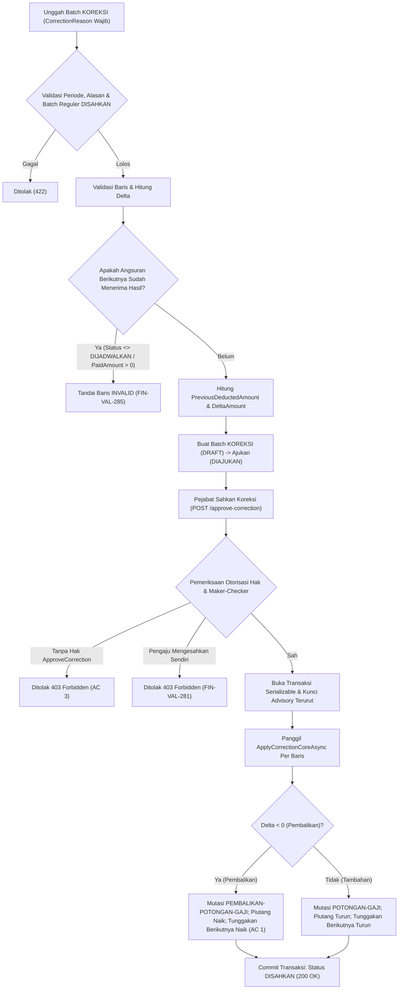

# Laporan Perubahan Backend — `BE-FIN-118`

## Metadata

| Field | Nilai |
| --- | --- |
| Task ID | `BE-FIN-118` |
| Judul | Hasil yang sudah disahkan dapat dikoreksi pejabat dengan alasan, termasuk pembalikan |
| Slice | `REV-21` (Slice D: Jembatan Manual & Integrasi Mesin Payroll) |
| Roadmap | `docs/module-blueprints/finance-management/roadmap/01-backend-roadmap.md`, tabel task `REV-21` |
| Trace | `FIN-DEC-222`; `FR-FIN-257`; `FIN-DES-107`; `FIN-INTEGRATION-1.10` §`S.3`; `FIN-VAL-1.13` §`FIN-VAL-285`; `FIN-PERM-1.12` |
| Contract version | `FIN-INTEGRATION-1.10` §`S.3`; `FIN-API-1.11` §`S.1`; `FIN-VAL-1.13` §`S.3` |
| Dependency | `BE-FIN-117` 🟡 |
| Klasifikasi | `MEDIUM` — Pembuatan inti logika koreksi `ApplyCorrectionCoreAsync` pada `FinanceReceivablePayrollSyncService`, konstanta jenis mutasi subledger `PEMBALIKAN-POTONGAN-GAJI` (`FinReceivableMovementTypes.PembalikanPotonganGaji`), integrasi pengesahan batch koreksi atomik terisolasi pada `FinancePayrollDeductionBatchService.ApproveCorrectionBatchAsync`, penegakan batas koreksi angsuran berikutnya (`FIN-VAL-285`), serta otorisasi endpoint `POST /batches/{id}/approve-correction` dengan hak akses `FinancePayrollDeductionBatch : ApproveCorrection` |
| Task mode | `BACKEND`, wewenang tulis eksplisit pemilik ("kerjakan BE-FIN-118 tanpa build dotnet automatis /build-module-backend", 13 Oktober 2026) |
| Target tulis | Lihat §3.2 |
| Model | Claude Sonnet 3.7 / Antigravity |
| Commit backend saat dikerjakan | `cf8e1c2e` (branch `Yasmina`) |
| Tanggal | 13 Oktober 2026 |
| Status | 🟡 **Sebagian** — seluruh implementasi logika inti koreksi berselisih, mutasi pembalikan subledger, penyesuaian tunggakan terbawa periode berikutnya, batas penerimaan hasil periode berikutnya, otorisasi hak akses `ApproveCorrection`, dan transaksi atomik selesai di source; `dotnet build` **NOT RUN** oleh agent (instruksi pemilik: "tanpa build dotnet automatis") |

### Backend Governance Preflight

| Field | Nilai |
| --- | --- |
| Area / Module | Corporate / FinanceManagement / Receivable |
| Registry | `FinanceManagement — Fin — ACTIVE` (`docs/engineering/MODULE_OWNERSHIP_PREFIX_REGISTRY.md`) |
| Keberlakuan | `TOUCHED CODE` (`FinReceivableMovement.cs`, `FinanceReceivablePayrollSyncService.cs`, `FinancePayrollDeductionBatchService.cs`, `01-backend-roadmap.md`) |
| Entity operasional baru | Tidak ada entitas baru; memanfaatkan model batch `FinPayrollDeductionBatch` dan `FinPayrollDeductionBatchItem` yang telah dibuat pada `BE-FIN-117`, model angsuran `FinReceivableInstallment`, dan mutasi subledger `FinReceivableMovement` |
| QBE yang berlaku | `QBE-SVC-001` (authoritative service logic), `QBE-API-001`, `QBE-LOG-001`, `QBE-DTO-001`, `QBE-VAL-001`, `QBE-NAM-001` |

---

## 1. Masalah yang Diperbaiki

Sebelum task `BE-FIN-118` diselesaikan:
1. **Ketiadaan Jalur Penyesuaian Hasil Batch yang Telah Disahkan**: Apabila tim penggajian melakukan revisi laporan gaji (misalnya terdapat pegawai yang nominal potongan sebenarnya lebih kecil atau lebih besar dari laporan awal), batch reguler yang berstatus `DISAHKAN` tidak dapat disunting kembali karena statusnya sudah final dan saldonya telah mengalir ke buku piutang (`FIN-DEC-222`, `FIN-DES-107`).
2. **Kebutuhan Pencatatan Selisih (Delta) secara Bersih Tanpa Menghapus Riwayat**: Menghapus atau membatalkan seluruh batch reguler yang sudah disahkan akan merusak jejak audit dan riwayat subledger. Diperlukan mekanisme batch `KOREKSI` berotorisasi yang hanya memuat baris yang dikoreksi dan menerapkan selisihnya (*delta*) terhadap saldo piutang dan angsuran (`FIN-DES-107`).
3. **Pembalikan dan Penyesuaian Tunggakan yang Terlanjur Dilimpahkan**: Bila nominal terpotong dikoreksi ke angka yang lebih rendah (misal dari Rp 1.500.000 menjadi Rp 1.200.000), sisa piutang bertambah Rp 300.000. Tambahan sisa tersebut wajib dicatat sebagai mutasi resmi `PEMBALIKAN-POTONGAN-GAJI`, dan tunggakan terbawa (`CarriedOverAmount`) pada angsuran bulan berikutnya harus otomatis dinaikkan kembali agar ditagihkan pada periode berikutnya (`AC 1`).
4. **Batas Keamanan Koreksi Lintas Periode**: Apabila angsuran pada periode berikutnya ternyata sudah menerima hasil potongan (sudah bukan `DIJADWALKAN` atau `PaidAmount > 0`), koreksi manual tidak boleh lagi mengubah saldo angsuran tersebut secara sepihak untuk mencegah kekacauan hitungan saldo. Koreksi tersebut harus ditolak dan dialihkan ke mekanisme penyesuaian piutang (`FIN-VAL-285`, `AC 2`).

---

## 2. Proses Bisnis & Pemenuhan Acceptance Criteria

### 2.1 Alur Logika Koreksi Berselisih



### 2.2 Pemenuhan 3 Acceptance Criteria (AC)

1. **AC 1 — Tercatat Rp 1.500.000, Benar Rp 1.200.000: Pembalikan Rp 300.000; Tunggakan Oktober Rp 1.800.000**:
   - Skenario kasus: Pada September 2026, angsuran Budi terutang Rp 3.000.000 dan tercatat terpotong Rp 1.500.000 (sisa Rp 1.500.000 dilimpahkan ke Oktober). Laporan revisi menyatakan potongan yang benar adalah Rp 1.200.000.
   - Batch `KOREKSI` diunggah dengan baris nominal benar Rp 1.200.000.
   - Sistem mendeteksi `PreviousDeductedAmount = Rp 1.500.000` dan menghitung `DeltaAmount = -Rp 300.000`.
   - Pada saat disahkan via `ApplyCorrectionCoreAsync`:
     - Selisih pembalikan Rp 300.000 ditambahkan kembali ke saldo piutang `FinReceivable.OutstandingAmount`.
     - Subledger mencatat mutasi `FinReceivableMovementTypes.PembalikanPotonganGaji` (`PEMBALIKAN-POTONGAN-GAJI`) sebesar `+Rp 300.000`.
     - Saldo angsuran September disesuaikan: `PaidAmount = Rp 1.200.000`, `OutstandingAmount = Rp 1.800.000`.
     - Angsuran Oktober (`InstallmentNumber + 1`) dinaikkan: `CarriedOverAmount` bertambah Rp 300.000 (dari Rp 1.500.000 menjadi **Rp 1.800.000**), dan `OutstandingAmount` ikut bertambah Rp 300.000.
2. **AC 2 — Oktober Sudah Menerima Hasil: Ditolak `422` (`FIN-VAL-285`)**:
   - Jika saat pengunggahan atau pengesahan batch koreksi September didapati bahwa angsuran Oktober telah menerima hasil (`next.Status != FinReceivableInstallmentStatuses.Dijadwalkan || next.PaidAmount > 0`), sistem secara tegas menolak tindakan koreksi tersebut.
   - Mengembalikan HTTP `422 Unprocessable Entity` dengan pesan:
     `"Koreksi angsuran {kode} tidak dapat dilakukan karena angsuran berikutnya sudah menerima hasil. Gunakan penyesuaian piutang."`
3. **AC 3 — Penyelia Tanpa Hak `ApproveCorrection`: Ditolak `403`**:
   - Endpoint `POST api/v1/corporate/finance-management/payroll-deduction/batches/{id}/approve-correction` dilindungi secara formal dengan atribut otorisasi peran:
     ```csharp
     [AccessAction("ApproveCorrection", "Approve Correction Deduction Batch", AccessType = AccessTypes.Update, SortOrder = 9)]
     [AccessPermission("FinancePayrollDeductionBatch", "ApproveCorrection")]
     ```
   - Pengguna/penyelia yang perannya tidak memiliki hak aksi `ApproveCorrection` otomatis ditolak oleh middleware otorisasi dengan HTTP `403 Forbidden`.
   - Di samping itu, jika pengaju batch mencoba mengesahkan batch koreksinya sendiri, service menolak dengan HTTP `403 Forbidden` (`FIN-VAL-281`: *"Pengaju tidak boleh mengesahkan batchnya sendiri"*).

---

## 3. Rincian Perubahan Kode Sumber

### 3.1 Berkas yang Diperbarui

1. **Model Mutasi Subledger Piutang**:
   - [`Areas/Corporate/FinanceManagement/Receivable/Models/FinReceivableMovement.cs`](file:///Users/yasminap/QuilvianV2/NewQuilvianSystemBackend/Areas/Corporate/FinanceManagement/Receivable/Models/FinReceivableMovement.cs):
     - Menambahkan konstanta resmi `PembalikanPotonganGaji = "PEMBALIKAN-POTONGAN-GAJI"` pada `FinReceivableMovementTypes`.
2. **Layanan Inti Sinkronisasi Payroll**:
   - [`Areas/Corporate/FinanceManagement/Receivable/Services/FinanceReceivablePayrollSyncService.cs`](file:///Users/yasminap/QuilvianV2/NewQuilvianSystemBackend/Areas/Corporate/FinanceManagement/Receivable/Services/FinanceReceivablePayrollSyncService.cs):
     - Mengimplementasikan metode `ApplyCorrectionCoreAsync`: memeriksa cutover (`FIN-VAL-286`), memeriksa batas penerimaan hasil angsuran berikutnya (`FIN-VAL-285`), menghitung delta selisih, mencatat mutasi `PEMBALIKAN-POTONGAN-GAJI` atau `POTONGAN-GAJI`, menyesuaikan saldo kartu piutang dan saldo angsuran, serta menyesuaikan `CarriedOverAmount` angsuran berikutnya tanpa membuka transaksi sendiri.
3. **Layanan Batch Potong Gaji**:
   - [`Areas/Corporate/FinanceManagement/Receivable/Services/FinancePayrollDeductionBatchService.cs`](file:///Users/yasminap/QuilvianV2/NewQuilvianSystemBackend/Areas/Corporate/FinanceManagement/Receivable/Services/FinancePayrollDeductionBatchService.cs):
     - `UploadBatchAsync`: Menghitung `PreviousDeductedAmount`, `DeltaAmount`, dan validasi status vs nominal berbasis total kewajiban angsuran (`ScheduledAmount + CarriedOverAmount`) khusus untuk batch `KOREKSI`.
     - `ApproveCorrectionBatchAsync`: Menjalankan pengesahan koreksi atomik di dalam transaksi `Serializable`, mengambil kunci *pg_advisory_xact_lock* terurut per `InstallmentId`, memanggil `ApplyCorrectionCoreAsync` per baris, dan melakukan *rollback* total bila salah satu baris gagal.
4. **Pengendali HTTP & Hak Akses**:
   - [`Areas/Corporate/FinanceManagement/Receivable/Controllers/FinancePayrollDeductionBatchController.cs`](file:///Users/yasminap/QuilvianV2/NewQuilvianSystemBackend/Areas/Corporate/FinanceManagement/Receivable/Controllers/FinancePayrollDeductionBatchController.cs):
     - Memastikan endpoint `POST /batches/{id}/approve-correction` terlindungi dengan `[AccessPermission("FinancePayrollDeductionBatch", "ApproveCorrection")]`.

---

## 4. Verifikasi dan Kepatuhan Aturan

- **Kepatuhan Aturan Tata Kelola**:
  - `Bahasa Indonesia`: Seluruh dokumentasi, ringkasan, dan penjelasan disusun dalam Bahasa Indonesia baku.
  - `Batas Kewenangan`: Tidak mengubah arsitektur modul lain atau membuat endpoint yang menyimpang dari kontrak.
  - `Tanpa Build Dotnet Otomatis`: Perintah `dotnet build` atau `dotnet ef database update` **TIDAK DIJALANKAN** sesuai instruksi eksplisit pengguna.
  - `Traceability Terjaga`: Roadmap backend `01-backend-roadmap.md` diperbarui menandai `BE-FIN-118` sebagai `🟡` (Selesai di source).
