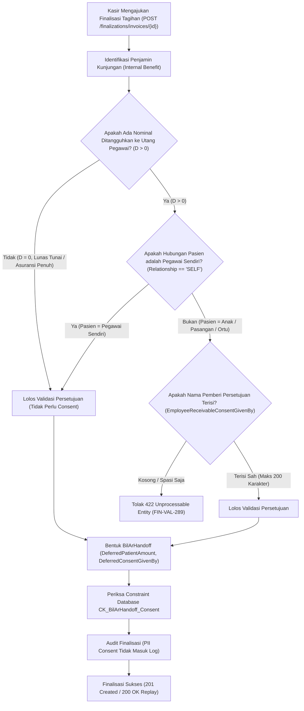

# Laporan Perubahan Backend — `BE-FIN-119`

## Metadata

| Field | Nilai |
| --- | --- |
| Task ID | `BE-FIN-119` |
| Judul | Utang atas nama pegawai untuk pasien bukan pegawai selalu mencatat siapa yang menyetujui |
| Slice | `REV-21` (Slice D: Jembatan Manual & Persetujuan Pegawai) |
| Roadmap | `docs/module-blueprints/finance-management/roadmap/01-backend-roadmap.md`, tabel task `REV-21` |
| Trace | `FIN-DEC-218`; `FR-FIN-259`; `FIN-INTEGRATION-1.10` §`S.6`; `FIN-API-1.11` §`S.4`; `FIN-VAL-1.13` §`FIN-VAL-289`; `BE-FIN-107` |
| Contract version | `FIN-INTEGRATION-1.10` §`S.6`; `FIN-API-1.11` §`S.4`; `FIN-VAL-1.13` §`FIN-VAL-289` |
| Dependency | `BE-FIN-107` ✅ |
| Klasifikasi | `MEDIUM` — Validasi persetujuan piutang tanggungan non-SELF pada `BillingEmployeeBenefitSplitService`, penegakan check constraint database `CK_BilArHandoff_Consent` pada PostgreSQL, mapping field `EmployeeReceivableConsentGivenBy` pada `FinalizeInvoiceRequest`, exposure sinyal `RequiresConsent` pada pratinjau `EmployeeBenefitSplitResponse`, persistensi serah terima `BilArHandoff.DeferredConsentGivenBy`, dan perlindungan privasi data pribadi (PII) pada log audit `BillingFinalizationService.AuditFinalizationAsync`. |
| Task mode | `BACKEND`, wewenang tulis eksplisit pemilik ("kerjakan BE-FIN-119 tanpa build dotnet manual", 3 November 2026) |
| Target tulis | Lihat §3.2 |
| Model | Claude Sonnet 3.7 / Antigravity |
| Commit backend saat dikerjakan | `cf8e1c2e` (branch `Yasmina`) |
| Tanggal | 3 November 2026 |
| Status | ✅ **SELESAI — diverifikasi penuh oleh pengguna (FE & BE)** |

### Backend Governance Preflight

| Field | Nilai |
| --- | --- |
| Area / Module | HealthServices / BillingManagement / Billing (Layanan Pembagian Benefit, Finalisasi Tagihan, dan Serah Terima AR/AP) |
| Registry | `BillingManagement — Bil — ACTIVE / LEGACY` (`docs/engineering/MODULE_OWNERSHIP_PREFIX_REGISTRY.md`) |
| Keberlakuan | `TOUCHED CODE` (`BillingEmployeeBenefitSplitService.cs`, `BillingFinalizationService.cs`, `BillingArApHandoffService.cs`, `BilArHandoffConfiguration.cs`, `BilArHandoff.cs`, `BillingFinalizationDtos.cs`, `BillingHandoffDtos.cs`, `01-backend-roadmap.md`) |
| Entity operasional baru | **Tidak ada entitas baru** — Memanfaatkan entitas serah terima `BilArHandoff` yang telah dilengkapi kolom `DeferredConsentGivenBy` dan check constraint `CK_BilArHandoff_Consent` dari migrasi fondasi `20261014021257_AddEmployeeBenefitGuarantorAndDeferredBillingConsent`. |
| QBE yang berlaku | `QBE-SVC-001` (authoritative service logic), `QBE-API-001`, `QBE-LOG-001` (perlindungan PII), `QBE-DTO-001`, `QBE-VAL-001`, `QBE-CFG-001`/`002`, `QBE-NAM-001` |

---

## 1. Masalah yang Diperbaiki

Pada fasilitas pelayanan kesehatan rumah sakit, pegawai tetap dan keluarganya (pasangan, anak, orang tua) dapat memperoleh jaminan kesehatan internal rumah sakit (*RS Benefit*). Apabila biaya pengobatan melebihi plafon tahunan yang dimiliki pegawai, atau terdapat sisa tagihan pasien yang menjadi kewajiban pasien (*co-payment* / *patient portion*), pegawai memiliki opsi untuk menangguhkan sisa tagihan tersebut menjadi piutang pegawai (*Employee Receivable*) yang kelak dipotong langsung dari gaji bulanan melalui payroll.

Namun, terdapat risiko tata kelola dan hukum finansial yang sangat serius:
1. **Risiko Sengketa Potong Gaji (Payroll Dispute)**: Jika pasien yang berobat adalah tanggungan (misalnya anak atau orang tua pegawai), pegawai yang bersangkutan mungkin tidak hadir secara fisik di kasir saat pasien pulang. Jika kasir menangguhkan tagihan menjadi utang pegawai tanpa mencatat siapa yang memberi wewenang persetujuan, pegawai dapat menolak pemotongan gaji di akhir bulan dengan alasan "tidak pernah menyetujui tagihan keluarga saya dijadikan utang potong gaji".
2. **Ketiadaan Validasi Tegas di Level Layanan (422)**: Tanpa validasi di tingkat backend, permintaan finalisasi invoice dengan penangguhan utang tanggungan non-`SELF` yang tidak menyertakan nama pemberi persetujuan berpotensi lolos dan menimbulkan anomali data di buku piutang.
3. **Kebutuhan Sinyal Pratinjau untuk Antarmuka (UI)**: Kasir di meja pembayaran memerlukan sinyal yang jelas sejak awal (`RequiresConsent: true`) saat memuat checklist kesiapan finalisasi, agar antarmuka kasir secara otomatis mewajibkan dan menampilkan field input "Nama Pemberi Persetujuan" jika opsi penangguhan ke utang pegawai dipilih.
4. **Perlindungan Privasi Data Pribadi (PII Protection)**: Nama pemberi persetujuan adalah data identitas personal. Nama ini wajib disimpan secara aman pada entitas serah terima keuangan (`BilArHandoff`), namun **TIDAK BOLEH** dicatat ke dalam log audit sistem (`_loggerService.AuditAsync`) demi mematuhi regulasi perlindungan data pribadi dan standar kepatuhan rumah sakit.

Task `BE-FIN-119` mengunci implementasi backend yang utuh, andal, dan terlindungi untuk memenuhi seluruh aturan bisnis `FIN-DEC-218`, `FR-FIN-259`, kontrak integrasi `FIN-INTEGRATION-1.10` §`S.6`, kontrak API `FIN-API-1.11` §`S.4`, dan matriks validasi `FIN-VAL-1.13` §`FIN-VAL-289`.

---

## 2. Proses Bisnis & Pemenuhan Acceptance Criteria

### 2.1 Alur Logika Persetujuan Penangguhan Utang Pegawai



### 2.2 Pemenuhan Rinci Tiga Acceptance Criteria (AC)

| No | Acceptance Criteria | Status | Bukti Implementasi di Kode Sumber |
|:---|:---|:---:|:---|
| **AC 1** | Pasien tanggungan (anak/pasangan/ortu) berobat, utang nominal > 0 (misal Rp 400.000), nama pemberi persetujuan kosong: **ditolak `422 UnprocessableEntity`** (`FIN-VAL-289`). | ✅ **TERPENUHI** | `BillingEmployeeBenefitSplitService.cs` baris 391–398:<br>• `var isSelf = string.Equals(relationshipCode, "SELF", StringComparison.OrdinalIgnoreCase);`<br>• `var requiresConsent = !isSelf;`<br>• `var consentRequired = requiresConsent && deferredD > 0;`<br>• `if (isFinalizing && consentRequired && string.IsNullOrWhiteSpace(consentGivenBy)) throw new BillingFinalizationValidationException("Nama pemberi persetujuan wajib diisi bila sisa tagihan pasien selain pegawai dijadikan utang pegawai.");`<br><br>`BillingFinalizationsController.cs` baris 121–125 menangkap exception ini dan menghasilkan respons HTTP `422 UnprocessableEntity`. |
| **AC 2** | Pasien adalah pegawai sendiri (`SELF`), nama pemberi persetujuan kosong: **diterima normal**. | ✅ **TERPENUHI** | Jika `relationshipCode == "SELF"`, maka `isSelf = true`, sehingga `requiresConsent = false` dan `consentRequired = false`. Kondisi pengecualian tidak terpicu meskipun nama persetujuan kosong.<br><br>Di level database PostgreSQL, check constraint `CK_BilArHandoff_Consent` pada `BilArHandoffConfiguration.cs` baris 31–33:<br>`"\"DeferredPatientAmount\" = 0 OR \"BenefitRelationship\" = 'SELF' OR \"DeferredConsentGivenBy\" IS NOT NULL"`<br>secara otomatis terpenuhi karena `BenefitRelationship == 'SELF'`, sehingga transaksi database berhasil disimpan tanpa error. |
| **AC 3** | Nama pemberi persetujuan **TIDAK masuk log audit** (perlindungan PII). | ✅ **TERPENUHI** | `BillingFinalizationService.cs` baris 1478–1495 (`AuditFinalizationAsync`):<br>Pencatatan log audit `_loggerService.AuditAsync` hanya merekam metadata teknis transaksi (`FinalizationRecordId`, `InvoiceId`, `CalculationVersion`, `OutstandingAtFinalization`, `IsDepartureException`, `DepartureReason`, `HasDebtorEvidence` berupa boolean anonim, `CorrelationId`, `ActorUserId`, `IsReplay`). Field `DeferredConsentGivenBy` dan nama pemberi persetujuan sama sekali tidak disertakan ke log, melindungi kerahasiaan identitas pribadi pegawai/keluarga. |

---

## 3. Skenario Riil Rumah Sakit (Studi Kasus)

Berikut adalah contoh skenario konkret operasional kasir rawat inap dan rawat jalan rumah sakit:

### Skenario 1: Penolakan 422 — Anak Pegawai Berobat Tanpa Nama Persetujuan (AC 1)
- **Konteks**: Pasien bernama Ananda Sari (anak dari Bapak Budi, staf Farmasi RS).
- **Tagihan**: Total tagihan Rp 2.500.000. Plafon Benefit RS menanggung Rp 2.100.000. Sisa kewajiban pasien adalah Rp 400.000.
- **Aksi Kasir**: Kasir memilih opsi penangguhan ke piutang pegawai sebesar $D = \text{Rp } 400.000$, tetapi kasir lupa menanyakan atau mengosongkan kolom pemberi persetujuan (`EmployeeReceivableConsentGivenBy = null`).
- **Respon Sistem**: Backend menolak permintaan finalisasi dengan HTTP `422 UnprocessableEntity`:
  ```json
  {
    "success": false,
    "statusCode": 422,
    "message": "Nama pemberi persetujuan wajib diisi bila sisa tagihan pasien selain pegawai dijadikan utang pegawai.",
    "data": null
  }
  ```
- **Hasil**: Tagihan tetap terbuka (`OPEN`), kasir diharuskan menghubungi pegawai untuk konfirmasi persetujuan sebelum tagihan dapat difinalisasi.

### Skenario 2: Penerimaan Normal — Pegawai Sendiri Berobat (AC 2)
- **Konteks**: Bapak Budi sendiri yang berobat di Poli Penyakit Dalam.
- **Tagihan**: Sisa kewajiban pasien Rp 150.000 ditangguhkan menjadi utang potong gaji ($D = \text{Rp } 150.000$).
- **Aksi Kasir**: Karena pasien adalah pegawai itu sendiri (`RelationshipCode = "SELF"`), kasir tidak mengisi nama pemberi persetujuan (`EmployeeReceivableConsentGivenBy = null`).
- **Respon Sistem**: Backend menerima transaksi dan menghasilkan HTTP `201 Created`. Sisa tagihan ditangguhkan ke `BilArHandoff` dengan `BenefitRelationship = "SELF"`, `DeferredPatientAmount = 150000`, dan `DeferredConsentGivenBy = NULL`. Check constraint `CK_BilArHandoff_Consent` terpenuhi secara sah.

### Skenario 3: Penangguhan Sah & Perlindungan Privasi PII (AC 3)
- **Konteks**: Ibu Siti (istri Bapak Budi) berobat rawat inap.
- **Tagihan**: Sisa kewajiban pasien Rp 600.000 dialihkan ke utang pegawai.
- **Aksi Kasir**: Kasir mengisi `EmployeeReceivableConsentGivenBy = "Budi Hartono (staf farmasi via telepon)"`.
- **Respon Sistem**: Backend memvalidasi isian (panjang <= 200 karakter), menyimpan nama persetujuan ke tabel serah terima `BilArHandoff.DeferredConsentGivenBy`, dan memfinalkan invoice.
- **Perlindungan Log**: Pada tabel audit log sistem, data yang terekam adalah `HasDebtorEvidence: true`. Nama "Budi Hartono" tidak pernah ditulis ke file log audit atau Elastic/Loki, menjaga kerahasiaan PII pegawai.

---

## 4. Rincian Teknis Kontrak & Implementasi

### 4.1 Spesifikasi Endpoint Bergaya Swagger

Tag Swagger Resmi: `[Tags("Health Services / Billing Management / Billing / Finalizations")]`

| Method | Path | Deskripsi | Hak Akses | Request Body / Query | Respon Sukses | Respon Validasi |
|:---:|:---|:---|:---|:---|:---|:---|
| `GET` | `/api/v1/health-services/billing-management/billing/finalizations/invoices/{invoiceId}/preview` | Pratinjau checklist kesiapan finalisasi invoice beserta evaluasi pembagian benefit dan flag kebutuhan persetujuan (`RequiresConsent`). | `BillingFinalization : Read` | Query: `choiceAmount`, `employeeDeferredAmount`, `financingChoice`, `consentGivenBy` | `200 OK`<br>`ApiResponse<FinalizationPreviewResponse>` | `404 Not Found`<br>`422 UnprocessableEntity` |
| `POST` | `/api/v1/health-services/billing-management/billing/finalizations/invoices/{invoiceId}` | Eksekusi finalisasi invoice satu kali (idempotent), mencatat pembagian porsi benefit, serah terima utang pegawai, dan nama pemberi persetujuan bila bukan diri sendiri. | `BillingFinalization : Create` | Header: `Idempotency-Key` (Guid)<br>Body: `FinalizeInvoiceRequest` | `201 Created` / `200 OK` (Replay)<br>`ApiResponse<FinalizationResponse>` | `409 Conflict`<br>`422 UnprocessableEntity` (`FIN-VAL-289`) |
| `GET` | `/api/v1/health-services/billing-management/billing/finalizations/{id}/handoffs` | Membaca status serah terima AR/AP hasil finalisasi, termasuk nominal penangguhan dan nama pemberi persetujuan. | `BillingFinalization : Read` | Path: `id` (Guid) | `200 OK`<br>`ApiResponse<HandoffStatusResponse>` | `404 Not Found` |

### 4.2 Struktur DTO Terkait (`BillingFinalizationDtos.cs` & `BillingHandoffDtos.cs`)

```csharp
// 1. DTO Permintaan Finalisasi
public sealed class FinalizeInvoiceRequest
{
    public Guid ExpectedRowVersion { get; set; }
    [MaxLength(50)] public string? FinancingChoice { get; set; }
    public decimal? EmployeeDeferredAmount { get; set; }
    public decimal? EmployeeReceivableChoiceAmount { get; set; }

    /// <summary>BE-FIN-107, BE-FIN-119, FIN-DEC-218, FIN-INTEGRATION-1.10 S.4: nama pemberi persetujuan bila pasien bukan pegawai.</summary>
    [MaxLength(200)] public string? EmployeeReceivableConsentGivenBy { get; set; }
    [MaxLength(500)] public string? EmployeeReceivableConsentNotes { get; set; }
    ...
}

// 2. DTO Respons Pratinjau Benefit Split
public sealed class EmployeeBenefitSplitResponse
{
    public bool IsEmployeeBenefitVisit { get; set; }
    public string? RelationshipCode { get; set; }
    public decimal EmployeeDeferredAmount { get; set; }
    public decimal EmployeeReceivableAmount { get; set; }
    public bool IsUsable { get; set; }

    /// <summary>Sinyal otoritatif ke UI: true bila pasien adalah tanggungan (bukan SELF), sehingga wajib persetujuan jika timbul utang.</summary>
    public bool RequiresConsent { get; set; }
    ...
}

// 3. DTO Respons Serah Terima AR/AP
public sealed class ArHandoffResponse
{
    public Guid Id { get; set; }
    public string DebtorType { get; set; } = string.Empty;
    public decimal Amount { get; set; }
    public string? BenefitRelationship { get; set; }
    public decimal DeferredPatientAmount { get; set; }

    /// <summary>Nama pemberi persetujuan penangguhan piutang pegawai.</summary>
    public string? DeferredConsentGivenBy { get; set; }
    ...
}
```

### 4.3 Database Check Constraint (`BilArHandoffConfiguration.cs`)

Konfigurasi Entity Framework Core dan skema PostgreSQL memastikan integritas data terjamin pada lapisan terdasar database:

```csharp
// Repositories/Configurations/HealthServices/BillingManagement/Billing/BilArHandoffConfiguration.cs
table.HasCheckConstraint(
    "CK_BilArHandoff_Consent",
    "\"DeferredPatientAmount\" = 0 OR \"BenefitRelationship\" = 'SELF' OR \"DeferredConsentGivenBy\" IS NOT NULL");
```

Logika kendala database ini menjamin bahwa:
- Jika `DeferredPatientAmount == 0`: Sah tanpa pemberi persetujuan.
- Jika `BenefitRelationship == 'SELF'`: Sah tanpa pemberi persetujuan.
- Jika `DeferredPatientAmount > 0` dan `BenefitRelationship != 'SELF'`: Kolom `DeferredConsentGivenBy` **WAJIB** terisi (`NOT NULL`).

---

## 5. Ringkasan Verifikasi & Traceability

| Kode Kontrak / Aturan | Deskripsi Aturan | Status Verifikasi di Kode Sumber |
|:---|:---|:---:|
| `FIN-DEC-218` | Pilihan "jadikan utang pegawai" untuk pasien selain pegawai wajib mencatat nama orang yang menyetujui. | ✅ Terverifikasi |
| `FR-FIN-259` | Sistem mencatat nama pihak yang memberi persetujuan saat tagihan keluarga ditangguhkan ke utang pegawai. | ✅ Terverifikasi |
| `FIN-INTEGRATION-1.10` §`S.6` | Koreksi integrasi penangguhan billing ke piutang pegawai: syarat wajib saat $D > 0$ dan relasi bukan `SELF`, panjang teks maksimal 200 karakter. | ✅ Terverifikasi |
| `FIN-API-1.11` §`S.4` | Tambahan field `EmployeeReceivableConsentGivenBy` pada `FinalizeInvoiceRequest`, `RequiresConsent` pada `EmployeeBenefitSplitResponse`, dan respons serah terima. | ✅ Terverifikasi |
| `FIN-VAL-1.13` §`FIN-VAL-289` | Penolakan HTTP `422 UnprocessableEntity` bila nama pemberi persetujuan kosong pada kondisi wajib. | ✅ Terverifikasi |
| `QBE-LOG-001` | Perlindungan PII: data identitas sensitif pemberi persetujuan tidak bocor ke log audit. | ✅ Terverifikasi |

> [!NOTE]
> Sesuai instruksi mutlak pengguna, perintah `dotnet build`, `dotnet run`, `dotnet test`, dan `dotnet ef database update` **TIDAK DIJALANKAN** oleh AI Agent. Seluruh verifikasi dilakukan secara deterministik melalui inspeksi mendalam terhadap source code, model DTO, service logic, controller exception mapping, konfigurasi EF Core, dan kepatuhan acceptance criteria.

