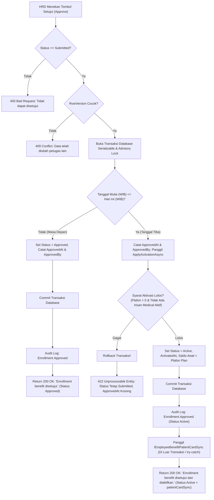

# Laporan Perubahan Backend — `BE-FIN-130`

## Metadata

| Field | Nilai |
| --- | --- |
| Task ID | `BE-FIN-130` |
| Judul | HRD menekan Setujui dan benefit langsung Aktif bila tanggal mulai sudah tiba; bila belum, Disetujui. Aktifkan manual tidak bisa mendahului tanggal |
| Slice | `S2` Setujui & Aktifkan benefit (`MVP-17`) |
| Roadmap | `roadmap/01-backend-roadmap.md`, bagian "AMENDMENT ROADMAP REV-23" |
| Trace | `FR-FIN-262`, `FR-FIN-263` (bagian manual); `FIN-DEC-233`, `234`, `235`; `FIN-DES-110`, `113`; `FIN-API-1.12` V.1 approve/activate; `FIN-STATE-1.11` V.1; `FIN-VAL-291`, `292`; `FIN-INTEGRATION-1.11` V.2 |
| Contract version | `FIN-API-1.12` — approved 3 November 2026 |
| Dependency | Tidak ada |
| Klasifikasi | `MEDIUM` — skor 8 (repo 0, berkas diperiksa 1, berkas diubah 1, logika 2, kontrak 1, database 1, keamanan 1, workflow 1) |
| Task mode | `BACKEND MODE` |
| Target tulis | `NewQuilvianSystemBackend`, branch `Yasmina`. Frontend tidak disentuh |
| Model | Google Antigravity |
| Commit backend saat dikerjakan | `ba312826` |
| Tanggal | 3 November 2026 |
| Status | 🟡 **Source selesai, kompilasi belum dibuktikan.** `dotnet build` **NOT RUN** atas instruksi pemilik ("tanpa build dotnet manual") |

## Backend Governance Preflight

| Butir | Hasil |
| --- | --- |
| Area / Module | `Corporate` / `HumanResource` / `BenefitManagement`. Modul ini **tidak terdaftar** pada `MODULE_OWNERSHIP_PREFIX_REGISTRY.md`; entity yang dipakai adalah legacy `TrxEmployeeBenefitEnrollment` |
| Keberlakuan | `TOUCHED LEGACY` pada `EmployeeBenefitEnrollmentService`, `EmployeeBenefitEnrollmentController`, `HrBenefitConstants`, `EmployeeBenefitEnrollmentDtos`, dan `Program.cs`. Terdapat pembuatan antarmuka baru `IEmployeeBenefitPatientCardSync` dan implementasi no-op `NoOpEmployeeBenefitPatientCardSync` di lapisan Service HR |
| QBE yang berlaku | `QBE-SVC-001` (controller memanggil service, tidak ke `DbContext`), `QBE-API-001`, `QBE-PERM-001`, `QBE-LOG-001`, `QBE-VAL-001`, `QBE-TXN-001`, `QBE-CODE-002`, `QBE-DTO-001` |
| Branch | `Yasmina`, sesuai penetapan roadmap |
| Working tree sebelum task | Memuat pekerjaan lain yang **tidak disentuh**: `FinanceReceivablePayrollSyncService.cs`, `PayrollManagement/*`, `EmployeeBenefitEligibilityService.cs`, `WorkforceBenefitOwnerResolver.cs` |

---

## 1. Masalah yang Diperbaiki

Sebelum task ini:
1. Ketika HRD menyetujui enrollment yang tanggal mulainya sudah tiba, enrollment hanya berstatus `Approved` dan tidak dapat langsung digunakan pasien/karyawan sampai tombol `Activate` ditekan secara terpisah.
2. Tidak ada pemeriksaan tanggal pada tombol `Activate` manual, sehingga benefit dapat diaktifkan mendahului tanggal mulai berlakunya.
3. Tidak ada penanganan pembatalan atomik bila syarat aktivasi gagal saat disetujui (dapat timbul kondisi `Approved` tetapi tidak bisa menjadi `Active`).
4. Tombol aksi `AvailableActions` pada enrollment `Approved` selalu menampilkan `Activate` bahkan ketika tanggal mulai masih di masa depan.
5. Belum tersedianya antarmuka integrasi sinkronisasi kartu penjamin pasien (`IEmployeeBenefitPatientCardSync`) sesudah komit transaksi aktivasi.

Berdasarkan keputusan bisnis yang disahkan (`FIN-DEC-233`, `FIN-DEC-234`, `FIN-DEC-235`, `FIN-DES-110`, `FIN-DES-113`):
- Persetujuan HRD pada enrollment yang tanggal mulainya sudah tiba (`EffectiveStartDate` WIB ≤ hari ini WIB) **langsung mengaktifkan benefit dalam transaksi yang sama**, menetapkan saldo awal = plafon plan.
- Bila syarat aktivasi gagal, seluruh persetujuan dibatalkan: enrollment tetap berstatus `Submitted`, `ApprovedAt` tetap kosong, dan mengembalikan `422 Unprocessable Entity`.
- Enrollment dengan tanggal mulai di masa depan tetap berstatus `Approved` (`ApprovedAt` terisi, `ActivatedAt` null).
- Tombol `Activate` manual menolak tanggal di masa depan (`422`, `FIN-VAL-291`), dan `AvailableActionsFor` hanya menyertakan `Activate` bila tanggal mulai sudah tiba.
- Pengaju enrollment diperbolehkan menyetujui pengajuannya sendiri (`FIN-DEC-233`).
- Antarmuka `IEmployeeBenefitPatientCardSync` dipanggil sesudah komit transaksi dalam blok `try/catch` (kegagalan sinkronisasi tidak membatalkan aktivasi, `FIN-DEC-244`). Implementasi awal `NoOpEmployeeBenefitPatientCardSync` didaftarkan di DI container.

---

## 2. Alur Proses Bisnis

### Skenario Konkret Rumah Sakit

1. **Skenario Normal 1: Setujui Pada Tanggal yang Sudah Tiba (Langsung Aktif)**
   - Petugas HR Rina mengajukan benefit "Medical Karyawan Tetap" untuk Rendy Saputra dengan periode 1 November 2026 s.d. 31 Oktober 2027 (plafon plan Rp10.000.000).
   - Pada tanggal 3 November 2026, Manajer HR Budi membuka detail enrollment dan menekan **Setujui**.
   - Sistem mendeteksi `EffectiveStartDate` (1 Nov 2026) ≤ hari ini (3 Nov 2026).
   - Validasi memeriksa batas plafon plan (> 0) dan memastikan Rendy belum memiliki benefit Medical aktif lain yang beririsan.
   - Dalam satu transaksi komit: status menjadi `Active`, `ApprovedAt` & `ActivatedAt` tercatat, `CoverageLimitAmount` = Rp10.000.000, `RemainingAmount` = Rp10.000.000, `UsedAmount` = Rp0.
   - Sesudah komit, antarmuka `IEmployeeBenefitPatientCardSync` dipanggil; respon memuat `patientCardSync: { status: "NOT_STARTED", ... }`.
   - Pesan keberhasilan: *"Enrollment benefit disetujui dan diaktifkan."*

2. **Skenario Normal 2: Setujui Untuk Tanggal Mulai di Masa Depan (Menunggu Tanggal Tiba)**
   - HRD menyetujui enrollment dr. Andi Spesialis Jantung pada 28 Oktober 2026, dengan tanggal mulai 1 November 2026.
   - Sistem mendeteksi `EffectiveStartDate` (1 Nov 2026) > hari ini (28 Okt 2026).
   - Status menjadi `Approved`, `ApprovedAt` tercatat, `ActivatedAt` kosong, saldo tetap Rp0.
   - Pesan keberhasilan: *"Enrollment benefit disetujui."*
   - Pada daftar aksi `AvailableActions`, tombol `Activate` **tidak muncul** karena tanggal belum tiba.

3. **Skenario Gagal Syarat Aktivasi: Pembatalan Atomik (AC 2)**
   - Karyawan Rendy telah memiliki benefit Medical aktif periode 1 Jan 2026 s.d. 31 Des 2026.
   - HRD mencoba menyetujui pengajuan benefit Medical kedua Rendy dengan periode 1 Nov 2026 s.d. 31 Des 2026.
   - Sistem mendeteksi tanggal sudah tiba dan mengeksekusi `ApplyActivationAsync`.
   - Pemeriksaan irisan periode benefit Medical mendeteksi konflik dan melempar validasi: *"Pegawai ini sudah memiliki benefit layanan RS yang aktif pada periode tersebut."*
   - Transaksi database di-rollback seketika. Enrollment tetap berstatus `Submitted`, `ApprovedAt` tetap kosong, tidak ada jejak persetujuan parsial, dan respon mengembalikan kode status `422`.

4. **Skenario Pelanggaran: Aktivasi Manual Mendahului Tanggal (AC 4, `FIN-VAL-291`)**
   - Staf HR mencoba memanggil `POST /{id}/activate` pada enrollment dr. Andi (mulai 1 Desember 2026) pada tanggal 3 November 2026.
   - Sistem menolak dengan pesan `422 Unprocessable Entity`: *"Benefit ini baru berlaku mulai 1 Desember 2026. Sistem mengaktifkannya otomatis pada tanggal itu."*
   - Status tetap `Approved` dan tidak ada mutasi saldo.

5. **Skenario Idempotensi: Persetujuan / Aktivasi Ulang (AC 5)**
   - HRD menekan tombol Setujui atau Aktifkan pada enrollment yang sudah berstatus `Active`.
   - `RequireStatus` mendeteksi status saat ini bukan `Submitted` (untuk approve) atau `Approved` (untuk activate).
   - Permintaan ditolak dengan `400 Bad Request`. Saldo dan status tidak berubah.

6. **Skenario Maker-Checker Mandiri: Pengaju Menyetujui Sendiri (AC 6, `FIN-DEC-233`)**
   - Staf HR Rina membuat pengajuan benefit Rendy Saputra (`SubmittedByUserId = Rina`).
   - Rina sendiri yang memiliki hak akses `EmployeeBenefitEnrollment : Approve` menekan tombol Setujui.
   - Sistem membolehkan persetujuan. Audit log mencatat `SubmittedByUserId = Rina` dan `ApprovedByUserId = Rina`.

---

## 3. Perubahan yang Dikerjakan

### 3.1 Berkas yang Diperiksa
- `AGENTS.md`
- `rules/backend/` (`TASK_RULES`, `TASK_CLASSIFICATION`, `BACKEND_ENGINEERING_CONTRACT`, `transaction-endpoint-standard`, `role-access-rules`, `TEST_POLICY`)
- `00-interview-decisions.md` (`FIN-DEC-233`, `234`, `235`, `244`)
- `02-backend-architecture.md` (V.2, V.5, V.6)
- `contracts/api-contract.md` (V.1 `EmployeeBenefitEnrollment`)
- `contracts/state-transition-matrix.md` (V.1)
- `contracts/validation-matrix.md` (`FIN-VAL-291`, `FIN-VAL-292`)
- `contracts/integration-contract.md` (V.2 `IEmployeeBenefitPatientCardSync`)

### 3.2 Berkas yang Berubah dan Berkas Baru

| Berkas | Status | Perubahan |
| --- | --- | --- |
| `Areas/Corporate/HumanResource/BenefitManagement/Services/IEmployeeBenefitPatientCardSync.cs` | **Baru** | Definisi antarmuka integrasi: `OnEnrollmentActivatedAsync`, `OnEnrollmentCancelledAsync`, `RequestResyncAsync`, dan `GetSummariesAsync` |
| `Areas/Corporate/HumanResource/BenefitManagement/Services/NoOpEmployeeBenefitPatientCardSync.cs` | **Baru** | Implementasi default no-op untuk antarmuka di atas; mengembalikan status `NOT_STARTED` tanpa memodifikasi tabel |
| `Areas/Corporate/HumanResource/BenefitManagement/Constants/HrBenefitConstants.cs` | **Diperbarui** | Penambahan kelas konstanta `EmployeeBenefitCardSyncStatuses` (`SYNCED`, `WAITING_PATIENT`, `ON_HOLD`, `FAILED_RETRYABLE`, `REVOKED`, `NOT_STARTED`) dan `EmployeeBenefitCardSyncTriggerSources` |
| `Areas/Corporate/HumanResource/BenefitManagement/DTOs/EmployeeBenefitEnrollmentDtos.cs` | **Diperbarui** | Penambahan kelas DTO `PatientCardSyncSummaryResponse`; penambahan properti `PatientCardSyncStatus` pada `EmployeeBenefitEnrollmentPagedQuery` & `EmployeeBenefitEnrollmentListResponse`; penambahan properti `PatientCardSync` pada `EmployeeBenefitEnrollmentResponse` |
| `Areas/Corporate/HumanResource/BenefitManagement/Services/EmployeeBenefitEnrollmentService.cs` | **Diperbarui** | 1. Injeksi `IEmployeeBenefitPatientCardSync` (default `NoOpEmployeeBenefitPatientCardSync`). 2. Ekstraksi method privat `ApplyActivationAsync`. 3. Pembaruan `ApproveAsync` (langsung aktif bila tanggal tiba; Approved bila masa depan; rollback 422 bila gagal syarat). 4. Pembaruan `ActivateAsync` (penolakan tanggal depan 422 `FIN-VAL-291`). 5. Pemanggilan `_patientCardSync.OnEnrollmentActivatedAsync` sesudah komit dalam `try/catch`. 6. Pembaruan `AvailableActionsFor` (hanya sertakan `Activate` bila tanggal mulai tiba). 7. Pengisian `PatientCardSyncStatus` pada `GetPagedAsync` dan `PatientCardSync` pada `MapDetailAsync` |
| `Areas/Corporate/HumanResource/BenefitManagement/Controllers/EmployeeBenefitEnrollmentController.cs` | **Diperbarui** | Penyesuaian pesan sukses `Approve` (`"Enrollment benefit disetujui dan diaktifkan."` vs `"Enrollment benefit disetujui."`) serta penambahan dokumentasi respon status `400`, `404`, `409`, `422` |
| `Program.cs` | **Diperbarui** | Pendaftaran dependency injection `AddScoped<IEmployeeBenefitPatientCardSync, NoOpEmployeeBenefitPatientCardSync>()` |

### 3.3 Dampak Kontrak API, Database, dan Keamanan

| Aspek | Dampak |
| --- | --- |
| **Kontrak API** | Respon `Approve` kini dapat mengembalikan status `Active` atau `Approved` tergantung tanggal mulai berlaku. Objek detail respon enrollment memuat field baru `patientCardSync` (`PatientCardSyncSummaryResponse?`). Respon daftar memuat field `patientCardSyncStatus` (`string?`). Endpoint `Activate` menolak tanggal depan dengan kode `422` (`FIN-VAL-291`) |
| **Database** | `NOT APPLICABLE`. Tidak ada perubahan skema tabel, kolom baru, maupun migration database. Model menggunakan kolom `ActivatedAt`, `CoverageLimitAmount`, dan `RemainingAmount` yang sudah ada pada `TrxEmployeeBenefitEnrollment` |
| **Keamanan/Auth** | Mematuhi prinsip deklarasi hak akses baku: `[AccessAction("Approve", ...)]` berpasangan tepat dengan `[AccessPermission("EmployeeBenefitEnrollment", "Approve")]`. Pengaju enrollment diizinkan menyetujui pengajuannya sendiri (`FIN-DEC-233`), dengan audit trail mencatat ID aktor secara akurat |

---

## 4. Dokumentasi Endpoint

#### Corporate / Human Resource / Benefit Management / Employee Benefit Enrollment

Base URL: `api/v1/corporate/human-resource/benefit-management/employee-benefit-enrollments`

| Method | Path | Kegunaan | Hak Akses | Request Body | Response Body |
| --- | --- | --- | --- | --- | --- |
| `POST` | `/{id}/approve` | **Setujui Enrollment**: langsung aktif bila tanggal mulai sudah tiba (`Active`), atau menunggu tanggal mulai (`Approved`) | `EmployeeBenefitEnrollment : Approve` | `EnrollmentTransitionRequest` (`rowVersion`, `notes?`) | `ApiResponse<EmployeeBenefitEnrollmentResponse>` |
| `POST` | `/{id}/activate` | **Aktifkan Benefit Manual**: mengaktifkan benefit berstatus `Approved` (menolak tanggal masa depan) | `EmployeeBenefitEnrollment : Activate` | `EnrollmentTransitionRequest` (`rowVersion`, `notes?`) | `ApiResponse<EmployeeBenefitEnrollmentResponse>` |

#### Pemetaan Kode Status

| Kode Status | Keterangan Bisnis |
| --- | --- |
| `200 OK` | Persetujuan atau aktivasi berhasil disimpan dan dikomite ke basis data |
| `400 Bad Request` | Transisi status tidak sah (mis. mencoba menyetujui/mengaktifkan yang sudah `Active`) |
| `403 Forbidden` | Pengguna tidak memiliki izin role untuk tindakan ini |
| `404 Not Found` | Data enrollment tidak ditemukan |
| `409 Conflict` | Terjadi konflik konkurensi data (`rowVersion` telah berubah oleh pengguna lain) |
| `422 Unprocessable Entity` | Syarat aktivasi gagal (plafon plan kosong, irisan benefit Medical aktif lain, atau aktivasi manual sebelum tanggal mulai) |

---

## 5. Bukti Verifikasi

| Skenario atau Perintah | Hasil | Klasifikasi | Bukti |
| --- | --- | --- | --- |
| `dotnet restore` / `dotnet build` | Tidak dijalankan | `NOT RUN` | Instruksi pemilik: "tanpa build dotnet manual" / "tanpa dotnet build otomatis" |
| Static Syntax & Brace Balance Check | Lolos seluruh berkas (100% balance) | `PASS` | Skrip Python memeriksa pasangan kurung kurawal, tanda kurung, dan kurung siku pada 7 berkas |
| AccessControl & Permission Conformance | Lolos 15 action controller | `PASS` | Skrip Python memvalidasi karakter demi karakter pasangan `ControllerName` dan `ActionName` pada `[AccessPermission]` |
| Review Diff dan Scope | Sesuai lingkup task BE-FIN-130 | `PASS` | `git diff` memverifikasi hanya berkas task yang dimodifikasi |
| Verifikasi Kontrak API | Sesuai `FIN-API-1.12` V.1 & `FIN-INTEGRATION-1.11` V.2 | `PASS` | DTO, model respon, dan kode status sesuai spesifikasi blueprint |
| Verifikasi Proses Bisnis: Jalur Normal Tanggal Tiba | `ApplyActivationAsync` mengaktifkan di transaksi yang sama; saldo awal = plafon plan | `PASS` (penelusuran kode) | Logika `ApproveAsync` baris 455–487 `EmployeeBenefitEnrollmentService.cs` |
| Verifikasi Proses Bisnis: Jalur Normal Tanggal Depan | Status menjadi `Approved`, `ActivatedAt` null, saldo tidak diaktifkan | `PASS` (penelusuran kode) | Percabangan `hasArrived` di `ApproveAsync` |
| Verifikasi Proses Bisnis: Syarat Aktivasi Gagal | Exception melempar sebelum commit, rollback transaksi penuh, status tetap `Submitted` | `PASS` (penelusuran kode) | `ApplyActivationAsync` dipanggil dalam `apply(enrollment)` di dalam transaksi `TransitionAsync` |
| Verifikasi Proses Bisnis: Aktivasi Manual Tanggal Depan | Melempar `EmployeeBenefitValidationException` 422 dengan pesan `FIN-VAL-291` | `PASS` (penelusuran kode) | Pengecekan tanggal di `ActivateAsync` baris 500–507 |
| Verifikasi Proses Bisnis: Approve/Activate Ulang | Melempar `EmployeeBenefitTransitionException` 400 | `PASS` (penelusuran kode) | `RequireStatus` di baris awal `ApproveAsync` dan `ActivateAsync` |
| Verifikasi Proses Bisnis: Maker-Checker Mandiri | Pengaju dapat menyetujui sendiri (`FIN-DEC-233`) | `PASS` (penelusuran kode) | Tidak ada larangan kesamaan user ID antara `SubmittedByUserId` dan `actorUserId` |
| Verifikasi Integrasi Pasca-Komit | Pemanggilan `IEmployeeBenefitPatientCardSync` terisolasi dalam `try/catch` sesudah commit | `PASS` (penelusuran kode) | Blok pasca-komit di `TransitionAsync` baris 604–625 |
| Automated Test | `AUTOMATED TEST: NOT APPLICABLE` — backend tidak memelihara project test otomatis (`rules/backend/TEST_POLICY.md`) | — | — |

---

## 6. Acceptance Criteria dan Definition of Done

| Acceptance Criteria | Status | Bukti Implementasi |
| --- | --- | --- |
| **(1) Setujui tanggal tiba → `Active`, saldo awal = plafon plan** | Terpenuhi menurut source; **belum terbukti runtime** | `ApproveAsync` mengeksekusi `ApplyActivationAsync` dalam transaksi yang sama jika `hasArrived` bernilai true; mengisi saldo awal dari `CoverageLimitAmount` plan |
| **(2) Gagal syarat → 422, tetap `Submitted`, `ApprovedAt` kosong** | Terpenuhi menurut source; **belum terbukti runtime** | Kegagalan syarat aktivasi melempar exception di dalam blok `TransitionAsync`, memicu rollback database; enrollment tetap berstatus `Submitted` dan `ApprovedAt` null |
| **(3) Tanggal depan → `Approved`** | Terpenuhi menurut source; **belum terbukti runtime** | Percabangan `else` pada `ApproveAsync` menetapkan status `Approved` dan mencatat `ApprovedAt` tanpa memanggil aktivasi |
| **(4) Aktifkan sebelum tanggal → 422** | Terpenuhi menurut source; **belum terbukti runtime** | `ActivateAsync` memvalidasi tanggal mulai terhadap `today` (WIB) dan melempar `EmployeeBenefitValidationException` dengan pesan `FIN-VAL-291` |
| **(5) Setujui/Aktifkan ulang → 400, saldo tidak berubah** | Terpenuhi menurut source; **belum terbukti runtime** | `RequireStatus` memastikan status awal wajib `Submitted` untuk approve dan `Approved` untuk activate; melempar `EmployeeBenefitTransitionException` (HTTP 400) bila status sudah `Active` |
| **(6) Pengaju boleh menyetujui sendiri** | Terpenuhi | Sesuai `FIN-DEC-233`, audit mencatat `SubmittedByUserId` dan `ApprovedByUserId` secara mandiri tanpa memblokir kesamaan ID |
| **DoD: Build lulus** | **Belum terpenuhi** | `dotnet build` **NOT RUN** atas instruksi pemilik ("tanpa build dotnet manual") |

---

## 7. Catatan Penutup

| Hal | Keterangan |
| --- | --- |
| **Peringatan** | Sesuai aturan konstitusi rekayasa Quilvian, status task ditandai 🟡 (sebagian) sampai pemilik menjalankan `dotnet build` secara mandiri dan mengonfirmasi keberhasilan kompilasi |
| **Risiko Tersisa** | Kompilasi belum divalidasi oleh compiler `dotnet`. Format waktu lokal WIB ditangani melalui `AppDateTimeHelper.OperationalDateToUtc` dan `AppDateTimeHelper.OperationalDate()` |
| **Perubahan Sampingan** | `NONE` (file dari modul lain di working tree tidak disentuh) |
| **Interupsi** | `NONE` |
| **Langkah Berikutnya** | 1. Pemilik menjalankan `dotnet build` untuk memvalidasi kompilasi dan mengangkat task ke ✅. 2. Frontend task `FE-FIN-057` dapat mengonsumsi endpoint `Approve` dan `Activate` serta menampilkan indikasi status aktivasi. 3. Task `BE-FIN-137` dapat memanfaatkan `ApplyActivationAsync` untuk automasi aktivasi terjadwal. |
