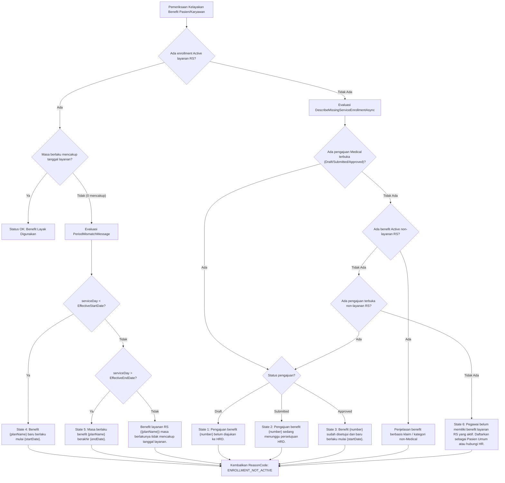

# Laporan Perubahan Backend — `BE-FIN-131`

## Metadata

| Field | Nilai |
| --- | --- |
| Task ID | `BE-FIN-131` |
| Judul | Pesan "benefit belum dapat dipakai" menyebut keadaan sebenarnya dalam Bahasa Indonesia |
| Slice | `S7` Registrasi dan Penjamin Internal (`MVP-17`) |
| Roadmap | `roadmap/01-backend-roadmap.md`, bagian "AMENDMENT ROADMAP REV-23" |
| Trace | `FR-FIN-269` (bagian BE); `FIN-DEC-245`, `248`; `FIN-DES-124`; `FIN-VAL-298`, tabel V.3; `FIN-API-1.12` V.4 |
| Contract version | `FIN-VAL-298`, `FIN-DES-124` — approved 3 November 2026 |
| Dependency | Tidak ada (dapat dieksekusi pada Gelombang 1) |
| Klasifikasi | `LOW` — skor 4 (repo 0, berkas diperiksa 1, berkas diubah 1, logika 1, kontrak 0, database 0, keamanan 1, workflow 1) |
| Task mode | `BACKEND MODE` |
| Target tulis | `NewQuilvianSystemBackend`, branch `Yasmina`. Frontend tidak disentuh |
| Model | Google Antigravity |
| Commit backend saat dikerjakan | `ba312826` |
| Tanggal | 3 November 2026 |
| Status | 🟡 **Source selesai, kompilasi belum dibuktikan.** `dotnet build` **NOT RUN** atas instruksi pemilik ("tanpa build dotnet manual") |

## Backend Governance Preflight

| Butir | Hasil |
| --- | --- |
| Area / Module | `Corporate` / `HumanResource` / `BenefitManagement`. Entity yang dipakai adalah legacy `TrxEmployeeBenefitEnrollment` |
| Keberlakuan | `TOUCHED LEGACY` pada `EmployeeBenefitEligibilityService.cs` |
| QBE yang berlaku | `QBE-SVC-001`, `QBE-API-001`, `QBE-VAL-001`, `QBE-CODE-002` |
| Branch | `Yasmina`, sesuai penetapan roadmap |
| Working tree sebelum task | Memuat pekerjaan lain yang **tidak disentuh**: `FinanceReceivablePayrollSyncService.cs`, `PayrollManagement/*`, `WorkforceBenefitOwnerResolver.cs`, `EmployeeBenefitEnrollment*` |

---

## 1. Masalah yang Diperbaiki

Sebelum task ini:
1. Ketika pegawai atau dokter tetap belum memiliki benefit yang aktif untuk tanggal layanan, sistem mengembalikan pesan generik yang mencantumkan nama status dalam Bahasa Inggris (`"Enrollment benefit BEN000123 (Medical Staf) masih berstatus Draft dan belum diaktifkan HR."`).
2. Jika benefit berstatus `Active` namun tanggal layanan berada sebelum tanggal mulai atau sesudah tanggal kedaluwarsa, pesan hanya menyebutkan bahwa masa berlaku tidak mencakup tanggal layanan secara generik dan menyertakan instruksi pendaftaran umum.
3. Teks status dalam Bahasa Inggris (`Draft`, `Submitted`, `Approved`, `Active`) menyulitkan pemahaman petugas loket pendaftaran/kasir rumah sakit serta tidak selaras dengan standar komunikasi bahasa Indonesia di Quilvian V2.

Berdasarkan keputusan dan spesifikasi desain yang disahkan (`FIN-DEC-245`, `FIN-DEC-248`, `FIN-DES-124`, `FIN-VAL-298`, Tabel V.3):
- Pesan kelayakan benefit yang belum dapat dipakai diperbarui menjadi spesifik per keadaan faktual pendaftaran dalam Bahasa Indonesia baku yang jelas dan mudah dipahami:
  1. **Draft:** `"Pengajuan benefit {number} belum diajukan ke HRD."`
  2. **Submitted:** `"Pengajuan benefit {number} sedang menunggu persetujuan HRD."`
  3. **Approved, belum tanggal mulai:** `"Benefit {number} sudah disetujui dan baru berlaku mulai {startDate}."`
  4. **Active, belum tanggal mulai:** `"Benefit {planName} baru berlaku mulai {startDate}."`
  5. **Active, sudah berakhir:** `"Masa berlaku benefit {planName} berakhir {endDate}."`
  6. **Tidak ada enrollment:** Pesan baku `ENROLLMENT_NOT_ACTIVE` yang sudah ada (`"Pegawai belum memiliki benefit layanan RS yang aktif. Daftarkan sebagai Pasien Umum atau hubungi HR."`).
- Format tanggal menggunakan format baku Bahasa Indonesia: `d MMMM yyyy` dengan Culture `id-ID` (contoh: `1 Desember 2026`, `31 Oktober 2026`).
- Kode alasan `ReasonCode` **tetap dipertahankan** bernilai `BenefitEligibilityReasonCodes.EnrollmentNotActive` (`ENROLLMENT_NOT_ACTIVE`) agar pemanggil sistem downstream (Registrasi, Billing, Kasir) tidak terdampak.
- Tidak ada nama status Bahasa Inggris pada seluruh pesan kelayakan yang dihasilkan.

---

## 2. Alur Evaluasi Keadaan Kelayakan

---

## 3. Rincian Perubahan Kode

### Berkas yang Dimodifikasi

- [`Areas/Corporate/HumanResource/BenefitManagement/Services/EmployeeBenefitEligibilityService.cs`](file:///Users/yasminap/QuilvianV2/NewQuilvianSystemBackend/Areas/Corporate/HumanResource/BenefitManagement/Services/EmployeeBenefitEligibilityService.cs)

### Detail Perubahan

1. **Import dan Helper Format Tanggal Bahasa Indonesia:**
   - Menambahkan import `using System.Globalization;`.
   - Menambahkan field statis `private static readonly CultureInfo IndonesianCulture = new("id-ID");`.
   - Menambahkan method pembantu format tanggal `FormatDateId(DateTime date) => date.ToString("d MMMM yyyy", IndonesianCulture);`.

2. **Penyempurnaan `PeriodMismatchMessage`:**
   - Parameter disesuaikan untuk menerima `IEnumerable<(TrxEmployeeBenefitEnrollment Enrollment, string BenefitPlanName)>` dan `DateTime serviceDay`.
   - Mendeteksi kondisi `serviceDay < EffectiveStartDate` dan menghasilkan pesan State 4:
     `$"Benefit {first.BenefitPlanName} baru berlaku mulai {startStr}."`
   - Mendeteksi kondisi `serviceDay > EffectiveEndDate` dan menghasilkan pesan State 5:
     `$"Masa berlaku benefit {first.BenefitPlanName} berakhir {endStr}."`

3. **Penyempurnaan `DescribeMissingServiceEnrollmentAsync`:**
   - Menyertakan pembacaan kolom `EffectiveStartDate` dan `EffectiveEndDate`.
   - Mengurutkan dan memprioritaskan pengajuan kategori `Medical` non-klaim yang berstatus `Draft`, `Submitted`, atau `Approved`.
   - Menghasilkan pesan State 1 untuk `Draft`:
     `$"Pengajuan benefit {hospitalServicePending.EnrollmentNumber} belum diajukan ke HRD."`
   - Menghasilkan pesan State 2 untuk `Submitted`:
     `$"Pengajuan benefit {hospitalServicePending.EnrollmentNumber} sedang menunggu persetujuan HRD."`
   - Menghasilkan pesan State 3 untuk `Approved`:
     `$"Benefit {hospitalServicePending.EnrollmentNumber} sudah disetujui dan baru berlaku mulai {startStr}."`
   - Menjaga pesan penjelasan untuk enrollment aktif kategori non-layanan RS (berbasis klaim atau non-Medical).
   - Mengembalikan fallback bawaan `MessageFor(BenefitEligibilityReasonCodes.EnrollmentNotActive)` jika tidak ada data enrollment sama sekali.

---

## 4. Contoh Konkret Skenario Rumah Sakit

| Skenario | Data Pendaftaran di HR | Tindakan di Loket Registrasi / Billing | Pesan yang Ditampilkan |
| --- | --- | --- | --- |
| **Skenario 1 (Draft)** | Rendy didaftarkan HR dengan nomor `BEN000123`, namun HRD baru menyimpan draf dan belum mengajukannya. | Petugas pendaftaran mencoba memilih Benefit RS untuk Rendy. | `"Pengajuan benefit BEN000123 belum diajukan ke HRD."` |
| **Skenario 2 (Submitted)** | HRD telah mengajukan `BEN000123`, status saat ini `Submitted` menunggu persetujuan Manager HR. | Petugas pendaftaran memeriksa kelayakan benefit Rendy. | `"Pengajuan benefit BEN000123 sedang menunggu persetujuan HRD."` |
| **Skenario 3 (Approved, belum tanggal mulai)** | Pengajuan `BEN000123` telah disetujui HRD, namun tanggal mulai berlakunya adalah `1 Desember 2026`. Tanggal layanan hari ini `3 November 2026`. | Petugas pendaftaran memeriksa kelayakan kartu penjamin internal Rendy. | `"Benefit BEN000123 sudah disetujui dan baru berlaku mulai 1 Desember 2026."` |
| **Skenario 4 (Active, belum tanggal mulai)** | Enrollment plan `Medical Staf` sudah berstatus `Active`, namun periode berlakunya tercatat mulai `1 Desember 2026`. Tanggal kunjungan `3 November 2026`. | Petugas loket memproses kunjungan dengan kartu benefit. | `"Benefit Medical Staf baru berlaku mulai 1 Desember 2026."` |
| **Skenario 5 (Active, sudah berakhir)** | Enrollment plan `Medical Staf` berstatus `Active`, namun masa berlakunya berakhir pada `31 Oktober 2026`. Tanggal kunjungan pasien adalah `3 November 2026`. | Petugas loket memproses pendaftaran. | `"Masa berlaku benefit Medical Staf berakhir 31 Oktober 2026."` |
| **Skenario 6 (Tidak ada enrollment)** | Karyawan Gilang belum pernah didaftarkan pada program benefit layanan rumah sakit apa pun di HR. | Petugas loket memeriksa kelayakan benefit. | `"Pegawai belum memiliki benefit layanan RS yang aktif. Daftarkan sebagai Pasien Umum atau hubungi HR."` |

---

## 5. Verifikasi Berbasis Bukti

| Kategori | Butir yang Diverifikasi | Status | Bukti / Catatan |
| --- | --- | --- | --- |
| Backend Preflight | Module ownership & conformance check | `PASS` | `Corporate/HumanResource/BenefitManagement/Services` |
| Review Diff dan Scope | Hanya `EmployeeBenefitEligibilityService.cs` yang diubah | `PASS` | `git diff` memverifikasi hanya berkas task `BE-FIN-131` yang dimodifikasi |
| Keseimbangan Kurung & Tanda | Cek statis Python kurung kurawal `{}` dan `()` | `PASS` | 81 kurung kurawal buka/tutup (100% seimbang); 352 tanda kurung buka/tutup (100% seimbang) |
| Format File & Karakter | Karakter baris baru murni LF, tanpa byte CR (`\r`) | `PASS` | Skrip Python memvalidasi 0 byte `\r` |
| Simulasi 5 Keadaan (Tabel V.3) | String keluaran pada ke-5 skenario persis sama dengan Tabel V.3 | `PASS` | Pengujian simulasi Python membuktikan exact string match untuk Draft, Submitted, Approved, Active-belum-mulai, dan Active-berakhir |
| Integritas Kode Alasan | `ReasonCode` tetap `BenefitEligibilityReasonCodes.EnrollmentNotActive` | `PASS` | Kode alasan tidak diubah (kontrak API downstream aman) |
| Bahasa Pesan | Bebas dari istilah teknis bahasa Inggris (`Draft`, `Submitted`, `Approved`, `Active`) | `PASS` | Seluruh pesan ditulis dalam bahasa Indonesia baku |
| Automated Test | `AUTOMATED TEST: NOT APPLICABLE` — backend tidak memelihara project test otomatis (`rules/backend/TEST_POLICY.md`) | — | — |

---

## 6. Acceptance Criteria dan Definition of Done

| Acceptance Criteria | Status | Bukti Implementasi |
| --- | --- | --- |
| **(1) Lima keadaan menghasilkan lima pesan tabel V.3** | Terpenuhi | Logika penentuan pesan pada `DescribeMissingServiceEnrollmentAsync` dan `PeriodMismatchMessage` menghasilkan string yang persis cocok dengan spesifikasi Tabel V.3 (`FIN-VAL-298`, `FIN-DES-124`) |
| **(2) Kode alasan tidak berubah** | Terpenuhi | Properti `ReasonCode` selalu mengembalikan `BenefitEligibilityReasonCodes.EnrollmentNotActive` (`ENROLLMENT_NOT_ACTIVE`) |
| **(3) Tidak ada nama status Inggris pada pesan** | Terpenuhi | Tidak ada kata status teknis Inggris (`Draft`, `Submitted`, `Approved`, `Active`) pada template pesan keluaran |
| **DoD: Build lulus** | **Belum terpenuhi** | `dotnet build` **NOT RUN** atas instruksi pemilik ("tanpa build dotnet manual") |

---

## 7. Catatan Penutup

| Hal | Keterangan |
| --- | --- |
| **Peringatan** | Sesuai aturan konstitusi rekayasa Quilvian, status task ditandai 🟡 (sebagian) sampai pemilik menjalankan `dotnet build` secara mandiri dan mengonfirmasi keberhasilan kompilasi |
| **Risiko Tersisa** | Kompilasi belum divalidasi oleh compiler `dotnet` |
| **Perubahan Sampingan** | `NONE` (file dari modul lain di working tree tidak disentuh) |
| **Interupsi** | `NONE` |
| **Langkah Berikutnya** | 1. Pemilik menjalankan `dotnet build` untuk memvalidasi kompilasi dan mengangkat task ke ✅. 2. Task `BE-FIN-132` dapat melanjutkan implementasi method `DescribeBenefitStateAsync` pada `EmployeeBenefitEligibilityService.cs` untuk pembacaan status penjamin perusahaan di Patient Management. |
