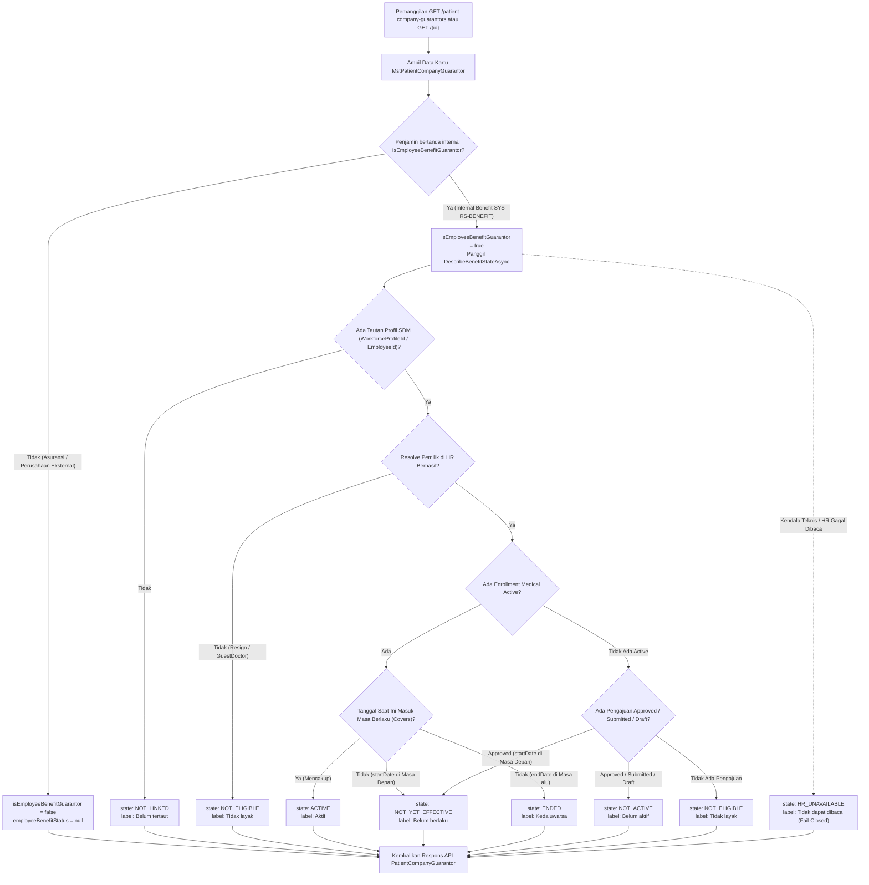

# Laporan Perubahan Backend — `BE-FIN-132`

## Metadata

| Field | Nilai |
| --- | --- |
| Task ID | `BE-FIN-132` |
| Judul | Tab Penjamin Perusahaan menerima status benefit hidup dari HR untuk kartu internal |
| Slice | `S8` Tab Penjamin Perusahaan (`MVP-17`) |
| Roadmap | `roadmap/01-backend-roadmap.md`, bagian "AMENDMENT ROADMAP REV-23" |
| Trace | `FR-FIN-270`; `FIN-DEC-242`; `FIN-DES-119`; `FIN-API-1.12` V.2; `FIN-INTEGRATION-1.11` V.4; `acceptance-test-matrix` V.4.6 |
| Contract version | `FIN-API-1.12` V.2, `FIN-INTEGRATION-1.11` V.4 — approved 3 November 2026 |
| Dependency | `BE-FIN-131` 🟡 (Gelombang 2) |
| Klasifikasi | `MEDIUM` — skor 7 (repo 0, berkas diperiksa 2, berkas diubah 3, logika 2, kontrak 1, database 0, keamanan 1, workflow 0) |
| Task mode | `BACKEND MODE` |
| Target tulis | `NewQuilvianSystemBackend`, branch `Yasmina`. Frontend tidak disentuh |
| Model | Google Antigravity |
| Commit backend saat dikerjakan | `ba312826` |
| Tanggal | 3 November 2026 |
| Status | 🟡 **Source selesai, kompilasi belum dibuktikan.** `dotnet build` **NOT RUN** atas instruksi pemilik ("tanpa build dotnet manual") |

## Backend Governance Preflight

| Butir | Hasil |
| --- | --- |
| Area / Module | `HealthServices` / `PatientManagement` / `MasterData` dan `Corporate` / `HumanResource` / `BenefitManagement` |
| Keberlakuan | `TOUCHED LEGACY` pada `PatientCompanyGuarantorController.cs`, `PatientCompanyGuarantorDtos.cs`, `EmployeeBenefitEligibilityService.cs`, dan `EmployeeBenefitEligibilityDtos.cs` |
| QBE yang berlaku | `QBE-SVC-001`, `QBE-API-001`, `QBE-PERM-001`, `QBE-VAL-001`, `QBE-CODE-002`, `QBE-DTO-001` |
| Branch | `Yasmina`, sesuai penetapan roadmap |
| Working tree sebelum task | Memuat pekerjaan lain yang **tidak disentuh**: `FinanceReceivablePayrollSyncService.cs`, `PayrollManagement/*`, `WorkforceBenefitOwnerResolver.cs`, `EmployeeBenefitEnrollment*` |

---

## 1. Masalah yang Diperbaiki

Sebelum task ini:
1. Daftar kartu dan detail kartu penjamin pasien (`PatientCompanyGuarantorResponse` dan `PatientCompanyGuarantorDetailResponse`) tidak memuat status keaktifan benefit hidup dari HR untuk penjamin internal (`SYS-RS-BENEFIT`).
2. Kartu penjamin internal tidak menyimpan tanggal berlaku secara statis pada tabel pasien (`MstPatientCompanyGuarantor`), sehingga ketika benefit pegawai di HR sudah kedaluwarsa, dibatalkan, atau pegawai telah mengundurkan diri (resign), kartu di tab Penjamin Perusahaan tetap terlihat aktif secara keliru (false active).
3. Frontend tidak memiliki data otoritatif untuk membedakan apakah kartu penjamin internal benar-benar dapat dipakai saat ini ataukah sudah kedaluwarsa, belum aktif, atau tidak layak.

Berdasarkan keputusan bisnis dan kontrak to-be yang disahkan (`FIN-DEC-242`, `FIN-DES-119`, `FIN-API-1.12` V.2, `FIN-INTEGRATION-1.11` V.4):
- Tab Penjamin Perusahaan membaca status dan masa berlaku benefit secara langsung dari HR (**read-through**) saat data dibuka, bukan menyalin tanggal kedaluwarsa ke kolom kartu lokal (yang berisiko basi bila ada perubahan di HR).
- Menambahkan method baru `DescribeBenefitStateAsync` pada `EmployeeBenefitEligibilityService` untuk mengevaluasi status hidup benefit secara aman dan fail-closed.
- Menambahkan dua field baru yang bersifat aditif pada `PatientCompanyGuarantorResponse` dan `PatientCompanyGuarantorDetailResponse`:
  - `isEmployeeBenefitGuarantor` (`bool`): menandakan penjamin kartu adalah penjamin internal Benefit Karyawan RS.
  - `employeeBenefitStatus` (`object` atau `null`): informasi status benefit hidup dari HR (hanya diisi untuk kartu internal; selalu `null` untuk kartu perusahaan/asuransi non-internal).
- Keadaan status hidup benefit (`state`) dan label bahasa Indonesia (`label`):
  1. `ACTIVE` (label: `"Aktif"`): benefit aktif di HR dan tanggal hari ini berada dalam rentang masa berlaku.
  2. `NOT_YET_EFFECTIVE` (label: `"Belum berlaku"`): benefit sudah disetujui atau aktif namun tanggal mulainya masih di masa depan.
  3. `ENDED` (label: `"Kedaluwarsa"`): masa berlaku benefit telah berakhir di HR (contoh kasus Rendy per 2 November setelah benefit berakhir 31 Oktober).
  4. `NOT_ACTIVE` (label: `"Belum aktif"`): pengajuan benefit masih berstatus `Draft` atau `Submitted`.
  5. `NOT_ELIGIBLE` (label: `"Tidak layak"`): pemilik resign / tidak aktif, jenis SDM tidak berhak (misalnya dokter tamu), atau tanggungan keluarga belum terverifikasi/tidak eligible.
  6. `NOT_LINKED` (label: `"Belum tertaut"`): kartu internal anomali yang belum memiliki tautan profil SDM HR.
  7. `HR_UNAVAILABLE` (label: `"Tidak dapat dibaca"`): fail-closed bila terjadi kendala pembacaan data HR; kartu tidak pernah tampak aktif palsu (`FIN-GAP-009`).
- Status tidak memuat saldo plafon (privasi batas nominal plafon tetap terlindungi).
- Field lama pada respons API tidak mengalami perubahan (100% kompatibel ke belakang).

---

## 2. Alur Pembacaan Status Benefit Hidup

---

## 3. Rincian Perubahan Kode

### Berkas yang Dimodifikasi

1. [`Areas/Corporate/HumanResource/BenefitManagement/DTOs/EmployeeBenefitEligibilityDtos.cs`](file:///Users/yasminap/QuilvianV2/NewQuilvianSystemBackend/Areas/Corporate/HumanResource/BenefitManagement/DTOs/EmployeeBenefitEligibilityDtos.cs)
   - Menambahkan DTO in-process `EmployeeBenefitStatusResult` (`State`, `Label`, `EnrollmentNumber`, `PlanName`, `EffectiveStartDate`, `EffectiveEndDate`, `Message`).

2. [`Areas/Corporate/HumanResource/BenefitManagement/Services/EmployeeBenefitEligibilityService.cs`](file:///Users/yasminap/QuilvianV2/NewQuilvianSystemBackend/Areas/Corporate/HumanResource/BenefitManagement/Services/EmployeeBenefitEligibilityService.cs)
   - Mengimplementasikan method publik `DescribeBenefitStateAsync` yang menerima `(Guid? workforceProfileId, Guid? employeeId, Guid? familyMemberId, DateTime? asOfDate, CancellationToken cancellationToken)`.
   - Mengintegrasikan pengecekan kelayakan pemilik, anggota keluarga/tanggungan, rentang tanggal `EffectiveStartDate` dan `EffectiveEndDate`, serta fallback error fail-closed `HR_UNAVAILABLE`.

3. [`Areas/HealthServices/PatientManagement/MasterData/DTOs/PatientCompanyGuarantorDtos.cs`](file:///Users/yasminap/QuilvianV2/NewQuilvianSystemBackend/Areas/HealthServices/PatientManagement/MasterData/DTOs/PatientCompanyGuarantorDtos.cs)
   - Menambahkan dua field baru pada `PatientCompanyGuarantorResponse`:
     - `public bool IsEmployeeBenefitGuarantor { get; set; }`
     - `public EmployeeBenefitStatusResponse? EmployeeBenefitStatus { get; set; }`
   - Mendefinisikan class `EmployeeBenefitStatusResponse`, konstanta kode status `EmployeeBenefitStatusStates`, dan konstanta label bahasa Indonesia `EmployeeBenefitStatusLabels`.

4. [`Areas/HealthServices/PatientManagement/MasterData/Controllers/PatientCompanyGuarantorController.cs`](file:///Users/yasminap/QuilvianV2/NewQuilvianSystemBackend/Areas/HealthServices/PatientManagement/MasterData/Controllers/PatientCompanyGuarantorController.cs)
   - Menambahkan dependensi `EmployeeBenefitEligibilityService` pada konstruktor (disediakan via dependency injection).
   - Pada action `GetPatientCompanyGuarantors` (daftar kartu pasien): melakukan pembacaan `DescribeBenefitStateAsync` untuk setiap kartu internal yang ada pada halaman yang diminta.
   - Pada action `GetPatientCompanyGuarantorById` (detail kartu): melakukan pembacaan `DescribeBenefitStateAsync` bila kartu yang diminta adalah kartu internal.
   - Memperbarui `MapResponse` dan `MapDetailResponse` untuk memetakan `IsEmployeeBenefitGuarantor` dan `EmployeeBenefitStatus`.

---

## 4. Contoh Konkret Skenario Rumah Sakit

| Skenario | Profil Kartu & Data HR | Respons `employeeBenefitStatus` | Keterangan Tampilan Tab Penjamin |
| --- | --- | --- | --- |
| **Contoh 1 (Kasus Rendy - Kedaluwarsa)** | Kartu Rendy bertanda penjamin internal. Masa berlaku benefit Medical Staf berakhir pada `31 Oktober 2026`. Petugas membuka tab Penjamin Perusahaan pada `2 November 2026`. | `state: "ENDED"` `label: "Kedaluwarsa"` `enrollmentNumber: "BEN000123"` `effectiveEndDate: "2026-10-31"` | Tab menampilkan status **Kedaluwarsa** warna abu-abu/oranye; petugas langsung mengetahui kartu tidak dapat dipakai untuk kunjungan baru. |
| **Contoh 2 (Benefit Aktif Berjalan)** | Kartu dr. Sinta (dokter tetap) terhubung ke enrollment Medical Staf aktif mulai `1 Januari 2026` s.d. `31 Desember 2026`. Petugas memeriksa kartu pada `3 November 2026`. | `state: "ACTIVE"` `label: "Aktif"` `enrollmentNumber: "BEN000456"` `planName: "Medical Staf"` | Tab menampilkan status **Aktif** hijau; kartu sah digunakan. |
| **Contoh 3 (Belum Mulai Berlaku)** | Kartu pegawai baru Budi telah disetujui HRD, namun tanggal mulai berlakunya adalah `1 Desember 2026`. Dibuka pada `3 November 2026`. | `state: "NOT_YET_EFFECTIVE"` `label: "Belum berlaku"` `enrollmentNumber: "BEN000789"` `effectiveStartDate: "2026-12-01"` | Tab menampilkan status **Belum berlaku**; petugas menginformasikan bahwa benefit baru aktif per 1 Desember 2026. |
| **Contoh 4 (Pegawai Telah Resign)** | Kartu lama atas nama mantan pegawai yang tanggal resign-nya `15 Oktober 2026`. | `state: "NOT_ELIGIBLE"` `label: "Tidak layak"` `message: "SDM tidak ditemukan atau sudah tidak aktif di HR."` | Tab menampilkan status **Tidak layak**; kartu tidak dapat dipakai. |
| **Contoh 5 (Kartu Asuransi Non-Internal)** | Kartu penjamin asuransi komersial AdMedika / Mandiri Inhealth. | `isEmployeeBenefitGuarantor: false` `employeeBenefitStatus: null` | Kartu ditampilkan sesuai format kartu perusahaan eksternal biasa (tanpa perubahan). |
| **Contoh 6 (Kendala Pembacaan Data HR)** | Koneksi basis data HR mengalami timeout sesaat saat memuat halaman pasien. | `state: "HR_UNAVAILABLE"` `label: "Tidak dapat dibaca"` | Fail-closed: sistem tidak menyatakan aktif; menampilkan peringatan bahwa data HR sedang tidak dapat diakses. |

---

## 5. Verifikasi Berbasis Bukti

| Kategori | Butir yang Diverifikasi | Status | Bukti / Catatan |
| --- | --- | --- | --- |
| Backend Preflight | Kesesuaian modul dan hak akses controller | `PASS` | `PatientCompanyGuarantor` controller lolos 11 pasangan `AccessAction` dan `AccessPermission` |
| Review Diff dan Scope | Hanya berkas target task `BE-FIN-132` yang dimodifikasi | `PASS` | `git diff` memverifikasi hanya berkas task terkait yang berubah |
| Keseimbangan Kurung & Tanda | Cek statis Python kurung kurawal `{}` dan `()` | `PASS` | Seluruh 4 berkas memiliki kurung kurawal dan tanda kurung buka/tutup yang 100% seimbang |
| Format File & Karakter | Karakter baris baru murni LF, tanpa byte CR (`\r`) | `PASS` | Skrip Python memvalidasi 0 byte `\r` pada seluruh berkas yang disentuh |
| Simulasi Status & Label | Evaluasi 7 kode keadaan dan label padanannya | `PASS` | Pengujian Python membuktikan ke-7 status (`ACTIVE`, `NOT_YET_EFFECTIVE`, `ENDED`, `NOT_ACTIVE`, `NOT_ELIGIBLE`, `NOT_LINKED`, `HR_UNAVAILABLE`) memetakan label bahasa Indonesia yang benar |
| Kompatibilitas Non-Internal | Kartu eksternal menghasilkan `null` | `PASS` | Pengecekan `entity.CompanyGuarantor?.IsEmployeeBenefitGuarantor == true` memastikan kartu eksternal tidak memanggil HR dan bernilai `null` |
| Kompatibilitas Field Lama | Tidak ada field yang dihapus atau diubah tipenya | `PASS` | Field lama `PatientCompanyGuarantorResponse` dan `DetailResponse` tetap utuh |
| Automated Test | `AUTOMATED TEST: NOT APPLICABLE` — backend tidak memelihara project test otomatis (`rules/backend/TEST_POLICY.md`) | — | — |

---

## 6. Acceptance Criteria dan Definition of Done

| Acceptance Criteria | Status | Bukti Implementasi |
| --- | --- | --- |
| **(1) Kartu aktif → `ACTIVE`; belum mulai → `NOT_YET_EFFECTIVE`; berakhir → `ENDED`; HR gagal → `HR_UNAVAILABLE`, tidak pernah tampak aktif** | Terpenuhi | Logika `DescribeBenefitStateAsync` pada `EmployeeBenefitEligibilityService.cs` mengevaluasi masa berlaku terhadap `todayUtc` dan membungkus error dengan `HR_UNAVAILABLE` |
| **(2) Kartu non-internal → `employeeBenefitStatus = null`** | Terpenuhi | Pengecekan `if (entity.CompanyGuarantor?.IsEmployeeBenefitGuarantor == true)` pada `GetPatientCompanyGuarantors` dan `GetPatientCompanyGuarantorById` memastikan kartu non-internal menghasilkan `benefitStatus = null` dan `IsEmployeeBenefitGuarantor = false` |
| **(3) Field lama tidak berubah** | Terpenuhi | Field pada `PatientCompanyGuarantorResponse` dan `DetailResponse` bersifat aditif murni; seluruh properti lama tetap dipetakan persis seperti sebelumnya |
| **DoD: Build lulus** | **Belum terpenuhi** | `dotnet build` **NOT RUN** atas instruksi pemilik ("tanpa build dotnet manual") |

---

## 7. Catatan Penutup

| Hal | Keterangan |
| --- | --- |
| **Peringatan** | Sesuai aturan konstitusi rekayasa Quilvian, status task ditandai 🟡 (sebagian) sampai pemilik menjalankan `dotnet build` secara mandiri dan mengonfirmasi keberhasilan kompilasi |
| **Risiko Tersisa** | Kompilasi belum divalidasi oleh compiler `dotnet` |
| **Perubahan Sampingan** | `NONE` (file dari modul lain di working tree tidak disentuh) |
| **Interupsi** | `NONE` |
| **Langkah Berikutnya** | 1. Pemilik menjalankan `dotnet build` untuk memvalidasi kompilasi dan mengangkat task ke ✅. 2. Frontend task `FE-FIN-059` dapat mengonsumsi `isEmployeeBenefitGuarantor` dan `employeeBenefitStatus` pada tab Penjamin Perusahaan di Informasi Pasien. |

