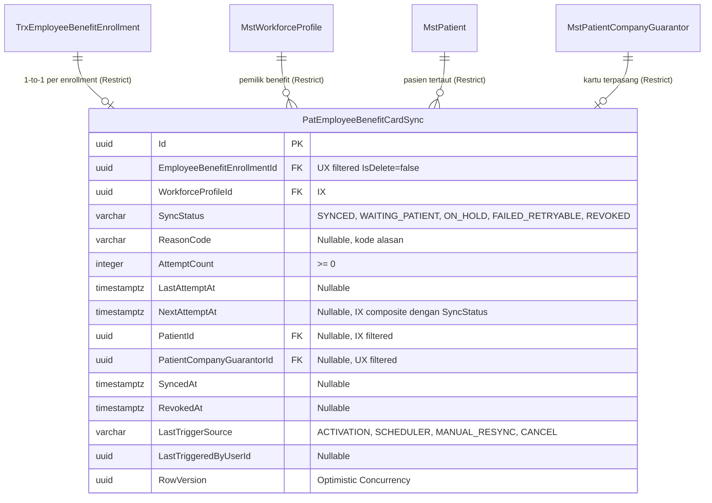

# Laporan Perubahan Backend — `BE-FIN-133`

## Metadata

| Field | Nilai |
| --- | --- |
| Task ID | `BE-FIN-133` |
| Judul | Catatan hasil sinkronisasi tersedia sebagai tabel |
| Slice | `S3` Sinkronisasi Kartu Pasien Otomatis (`MVP-18`) |
| Roadmap | `roadmap/01-backend-roadmap.md`, bagian "AMENDMENT ROADMAP REV-23" |
| Trace | `FR-FIN-265`; `FIN-DEC-239`, `253`; `FIN-DES-112`, `116`; Kamus data bagian 12 |
| Contract version | `FIN-API-1.12` — approved 3 November 2026 |
| Dependency | `FIN-OQ-121` (gerbang registry) — terkonfirmasi lewat baris 25 `MODULE_OWNERSHIP_PREFIX_REGISTRY.md` (`Pat` `ACTIVE`) |
| Klasifikasi | `MEDIUM` — skor 7 (repo 0, berkas diperiksa 1, berkas diubah 1, logika 2, kontrak 1, database 2, keamanan 1, workflow 0) |
| Task mode | `BACKEND MODE` |
| Target tulis | `NewQuilvianSystemBackend`, branch `Yasmina`. Frontend tidak disentuh |
| Model | Google Antigravity |
| Tanggal | 3 November 2026 |
| Status | 🟡 **Source selesai, kompilasi belum dibuktikan.** `dotnet build` **NOT RUN** atas instruksi pemilik ("tanpa build dotnet manual"); migration tercatat **NOT RUN** |

## Backend Governance Preflight

| Butir | Hasil |
| --- | --- |
| Area / Module | `HealthServices` / `PatientManagement operational`. Prefix `Pat` berstatus `ACTIVE` pada baris 25 `MODULE_OWNERSHIP_PREFIX_REGISTRY.md` |
| Keberlakuan | `NEW CODE` untuk entity `PatEmployeeBenefitCardSync`, konstanta `EmployeeBenefitCardSyncConstants`, dan konfigurasi `PatEmployeeBenefitCardSyncConfiguration`. `TOUCHED LEGACY` pada `ApplicationDbContext` |
| QBE yang berlaku | `QBE-MOD-002` (prefix `Pat` terdaftar di baris 25), `QBE-MOD-003` (pemilik PatientManagement operational cocok dengan folder), `QBE-CODE-002` |
| Branch | `Yasmina`, sesuai penetapan roadmap |
| Working tree sebelum task | Memuat berkas pekerjaan lain yang **tidak disentuh**: `FinanceReceivablePayrollSyncService.cs`, `PayrollManagement/*`, `EmployeeBenefitEligibilityService.cs`, `EmployeeBenefitEnrollmentService.cs`, `WorkforceBenefitOwnerResolver.cs`, `InternalBenefitCardService.cs` |

---

## 1. Masalah yang Diperbaiki

Sebelum task ini:
1. Belum ada tabel database dan entitas domain untuk menyimpan riwayat dan status sinkronisasi pemasangan kartu "Benefit Karyawan RS" per enrollment benefit.
2. Ketika enrollment benefit disetujui atau diaktifkan oleh HR, sistem tidak memiliki tempat persisten untuk mencatat apakah kartu penjamin internal pasien berhasil dipasang (`SYNCED`), ditahan (`ON_HOLD`), menunggu pendaftaran pasien di SIMRS (`WAITING_PATIENT`), gagal sementara (`FAILED_RETRYABLE`), atau dicabut (`REVOKED`).
3. Informasi kartu penjamin pasien (`PatientId`, `PatientCompanyGuarantorId`) belum memiliki relasi integritas referensial dan token konkurensi (`RowVersion`) untuk mengamankan proses sinkronisasi paralel antara pemicu aktivasi, penjadwal latar belakang, dan sinkronisasi manual HRD.

Berdasarkan keputusan bisnis dan arsitektur yang disahkan (`FIN-DEC-239`, `FIN-DEC-253`, `FIN-DES-112`, `FIN-DES-116`, Kamus Data bagian 12):
- Dibuat entitas operasional `PatEmployeeBenefitCardSync` di bawah kepemilikan **Patient Management** dengan prefix `Pat` (`ACTIVE`).
- Dibuat konstanta status siklus (`EmployeeBenefitCardSyncStatuses`), sumber pemicu (`EmployeeBenefitCardSyncTriggerSources`), dan kode alasan (`EmployeeBenefitCardSyncReasonCodes`) di namespace `QuilvianSystemBackend.Areas.HealthServices.PatientManagement.MasterData.Enums`.
- Dibuat konfigurasi EF Core `PatEmployeeBenefitCardSyncConfiguration` yang mengunci:
  - 5 check constraint SQL (`CK_PatEmployeeBenefitCardSync_Status`, `TriggerSource`, `CardLink`, `Reason`, `AttemptCount`).
  - 2 index unik terfilter (`UX_PatEmployeeBenefitCardSync_Enrollment` dan `UX_PatEmployeeBenefitCardSync_Card`).
  - 3 index performa (`IX_PatEmployeeBenefitCardSync_Due`, `WorkforceProfile`, `Patient`).
  - Foreign key dengan perilaku hapus `DeleteBehavior.Restrict` ke 4 tabel relasi (`TrxEmployeeBenefitEnrollment`, `MstWorkforceProfile`, `MstPatient`, `MstPatientCompanyGuarantor`).
- Didaftarkan `DbSet<PatEmployeeBenefitCardSync> PatEmployeeBenefitCardSyncs` pada `ApplicationDbContext`.
- Tidak ada kolom baru yang ditambahkan ke tabel-tabel existing.

---

## 2. Struktur Skema Database dan Relasi

### Kamus Kolom & Aturan Validasi Database

| Kolom | Tipe Data | Nullable | Default | Relasi / Index | Keterangan |
| :--- | :--- | :---: | :--- | :--- | :--- |
| `Id` | `uuid` | Tidak | `Guid.NewGuid()` | PK | Kunci utama catatan sinkronisasi |
| `EmployeeBenefitEnrollmentId` | `uuid` | Tidak | — | FK → `TrxEmployeeBenefitEnrollment`, `Restrict`; Unique (`IsDelete = false`) | Satu catatan per enrollment benefit; dasar idempotensi |
| `WorkforceProfileId` | `uuid` | Tidak | — | FK → `MstWorkforceProfile`, `Restrict`; Index | Profil SDM pemilik benefit |
| `SyncStatus` | `varchar(30)` | Tidak | — | Index gabungan (`SyncStatus`, `NextAttemptAt`) | Status siklus (5 nilai enum) |
| `ReasonCode` | `varchar(50)` | Ya | `NULL` | — | Kode alasan (wajib bila status != `SYNCED`, null bila `SYNCED`) |
| `AttemptCount` | `integer` | Tidak | `0` | Check `AttemptCount >= 0` | Jumlah putaran percobaan |
| `LastAttemptAt` | `timestamptz` | Ya | `NULL` | — | Waktu percobaan terakhir (UTC) |
| `NextAttemptAt` | `timestamptz` | Ya | `NULL` | Index gabungan | Jadwal percobaan berikutnya |
| `PatientId` | `uuid` | Ya | `NULL` | FK → `MstPatient`, `Restrict`; Index filtered `IS NOT NULL` | Pasien yang kartunya dipasang (wajib untuk `SYNCED` dan `REVOKED`) |
| `PatientCompanyGuarantorId` | `uuid` | Ya | `NULL` | FK → `MstPatientCompanyGuarantor`, `Restrict`; Unique filtered `IS NOT NULL AND IsDelete = false` | Kartu yang dipasang (wajib untuk `SYNCED` dan `REVOKED`) |
| `SyncedAt` | `timestamptz` | Ya | `NULL` | — | Waktu pertama/terakhir kali berhasil terpasang |
| `RevokedAt` | `timestamptz` | Ya | `NULL` | — | Waktu pencabutan kartu terdeteksi |
| `LastTriggerSource` | `varchar(30)` | Tidak | — | Check 4 nilai enum | `ACTIVATION`, `SCHEDULER`, `MANUAL_RESYNC`, `CANCEL` |
| `LastTriggeredByUserId` | `uuid` | Ya | `NULL` | — | ID user yang memicu |
| `RowVersion` | `uuid` | Tidak | `Guid.NewGuid()` | — | Token konkurensi optimistik |

---

## 3. Pemenuhan Kriteria Penerimaan (Acceptance Criteria)

| No | Kriteria Penerimaan | Status | Bukti |
| :--- | :--- | :--- | :--- |
| 1 | Kolom, unique, index, FK `Restrict`, dan check constraint sama dengan kamus data 12.4 | **TERPENUHI** | Seluruh kolom, 5 check constraint, 2 unique index terfilter, 3 index performa, dan 4 foreign key `DeleteBehavior.Restrict` telah dikonfigurasi di `PatEmployeeBenefitCardSyncConfiguration.cs` persis sesuai DDL bagian 12.4. |
| 2 | Tidak ada perubahan tabel lain | **TERPENUHI** | Tidak ada kolom atau konfigurasi tabel existing (`TrxEmployeeBenefitEnrollment`, `MstPatientCompanyGuarantor`, `MstPatient`, dll) yang disentuh atau diubah. Hanya menambahkan `DbSet<PatEmployeeBenefitCardSync>` di `ApplicationDbContext`. |

---

## 4. Ringkasan Berkas yang Diubah dan Dibuat

1. **`NewQuilvianSystemBackend/Areas/HealthServices/PatientManagement/MasterData/Enums/EmployeeBenefitCardSyncConstants.cs`** *(Baru)*:
   - Konstanta status `EmployeeBenefitCardSyncStatuses` (`SYNCED`, `WAITING_PATIENT`, `ON_HOLD`, `FAILED_RETRYABLE`, `REVOKED`).
   - Konstanta sumber pemicu `EmployeeBenefitCardSyncTriggerSources` (`ACTIVATION`, `SCHEDULER`, `MANUAL_RESYNC`, `CANCEL`).
   - Konstanta kode alasan `EmployeeBenefitCardSyncReasonCodes`.
2. **`NewQuilvianSystemBackend/Areas/HealthServices/PatientManagement/MasterData/Models/PatEmployeeBenefitCardSync.cs`** *(Baru)*:
   - Entitas operasional yang mewarisi `IdentityModel`.
3. **`NewQuilvianSystemBackend/Repositories/Configurations/HealthServices/PatientManagement/PatEmployeeBenefitCardSyncConfiguration.cs`** *(Baru)*:
   - Konfigurasi EF Core lengkap dengan 5 check constraint, index unik terfilter, index pencarian, dan foreign key `Restrict`.
4. **`NewQuilvianSystemBackend/Repositories/ApplicationDbContext.cs`** *(Diperbarui)*:
   - Menambahkan property `public DbSet<PatEmployeeBenefitCardSync> PatEmployeeBenefitCardSyncs { get; set; }`.
5. **`NewQuilvianSystemBackend/docs/module-blueprints/finance-management/roadmap/01-backend-roadmap.md`** *(Diperbarui)*:
   - Status `BE-FIN-133` diperbarui menjadi `🟡` (source selesai, build `NOT RUN` atas preferensi pemilik, migration `NOT RUN`).

---

## 5. Tindak Lanjut & Syarat Rilis

- **Status Kompilasi**: Sesuai instruksi pemilik (*"tanpa build dotnet manual"*), `dotnet build` tidak dijalankan otomatis oleh AI Agent. Status task adalah 🟡.
- **Wewenang Migration**: Sesuai tata kelola keselamatan database, berkas migration dan eksekusi skema database ke PostgreSQL memerlukan wewenang terpisah dari pemilik sistem (`migration NOT RUN`).
- **Pembukaan Gerbang Task Berikutnya**: Task `BE-FIN-135` (implementasi sinkronisasi otomatis `EmployeeBenefitCardSyncService`) kini memiliki entitas dan DbSet target yang siap digunakan.
