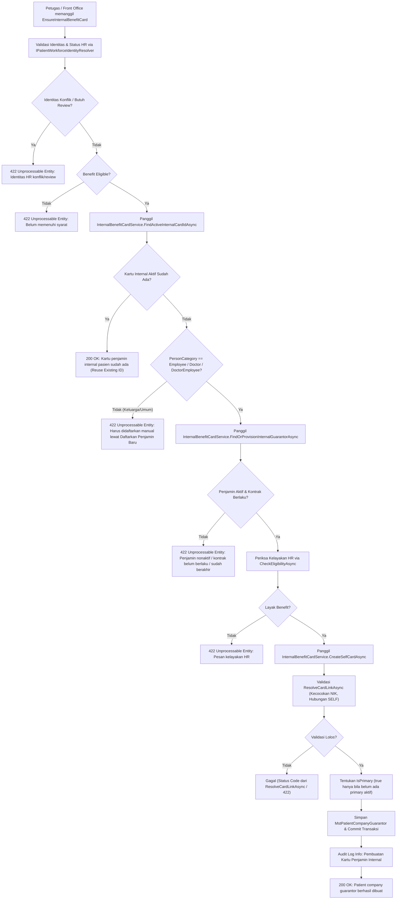

# Laporan Perubahan Backend — `BE-FIN-134`

## Metadata

| Field | Nilai |
| --- | --- |
| Task ID | `BE-FIN-134` |
| Judul | Logika kartu internal dapat dipakai lebih dari satu pemanggil tanpa disalin |
| Slice | `S3` Sinkronisasi Kartu Pasien Otomatis (`MVP-17`) |
| Roadmap | `roadmap/01-backend-roadmap.md`, bagian "AMENDMENT ROADMAP REV-23" |
| Trace | `FR-FIN-265`; `FIN-DEC-236`, `237`, `244`, `250`, `251`; `FIN-DES-114`; `FIN-API-1.12` V.2 (`internal-benefit-card` tidak berubah) |
| Contract version | `FIN-API-1.12` — approved 3 November 2026 |
| Dependency | Tidak ada (Gelombang 1) |
| Klasifikasi | `MEDIUM` — skor 7 (repo 0, berkas diperiksa 1, berkas diubah 1, logika 2, kontrak 1, database 0, keamanan 1, workflow 1) |
| Task mode | `BACKEND MODE` |
| Target tulis | `NewQuilvianSystemBackend`, branch `Yasmina`. Frontend tidak disentuh |
| Model | Google Antigravity |
| Tanggal | 3 November 2026 |
| Status | 🟡 **Source selesai, kompilasi belum dibuktikan.** `dotnet build` **NOT RUN** atas instruksi pemilik ("tanpa build dotnet manual") |

## Backend Governance Preflight

| Butir | Hasil |
| --- | --- |
| Area / Module | `HealthServices` / `PatientManagement` / `MasterData`. Entity yang dipakai adalah `MstPatientCompanyGuarantor` dan `MstCompanyGuarantor` |
| Keberlakuan | `TOUCHED LEGACY` pada `PatientCompanyGuarantorController` dan `Program.cs`. Terdapat pembuatan service baru `InternalBenefitCardService` di lapisan Master Data Patient Management |
| QBE yang berlaku | `QBE-SVC-001` (controller memanggil service untuk kartu internal), `QBE-API-001`, `QBE-LOG-001`, `QBE-VAL-001`, `QBE-TXN-001`, `QBE-CODE-002` |
| Branch | `Yasmina`, sesuai penetapan roadmap |
| Working tree sebelum task | Memuat berkas pekerjaan lain yang **tidak disentuh**: `FinanceReceivablePayrollSyncService.cs`, `PayrollManagement/*`, `EmployeeBenefitEligibilityService.cs`, `EmployeeBenefitEnrollmentService.cs`, `WorkforceBenefitOwnerResolver.cs` |

---

## 1. Masalah yang Diperbaiki

Sebelum task ini:
1. Logika untuk mencari penjamin internal sistem (`FindInternalBenefitCompanyAsync`), membuat otomatis penjamin internal sistem bila belum ada (`ProvisionInternalBenefitCompanyAsync`), dan mengecek keberadaan kartu penjamin internal aktif pasien terkunci di dalam method privat `PatientCompanyGuarantorController`.
2. Pembuatan kartu benefit karyawan jenis `SELF` hanya dapat dipanggil melalui controller HTTP `CreatePatientCompanyGuarantor`, sehingga layanan latar belakang (sinkronisasi kartu pasien `EmployeeBenefitCardSyncService` pada `BE-FIN-135`) tidak dapat memanggilnya tanpa menduplikasi kode atau mensimulasikan panggilan HTTP.
3. Duplikasi kode berisiko menimbulkan perbedaan perilaku (divergensi aturan bisnis) antara penerbitan kartu saat pendaftaran loket registrasi dan pemasangan kartu otomatis saat benefit disetujui HR.

Berdasarkan keputusan desain yang disahkan (`FIN-DES-114`):
- Logika penjamin internal diekstraksi ke layanan tersendiri: `InternalBenefitCardService` di namespace `QuilvianSystemBackend.Areas.HealthServices.PatientManagement.MasterData.Services`.
- Layanan menyediakan:
  - `FindInternalBenefitCompanyAsync`: mencari penjamin bertanda `IsEmployeeBenefitGuarantor = true` yang belum dihapus.
  - `ProvisionInternalBenefitCompanyAsync`: membuat otomatis penjamin sistem `SYS-RS-BENEFIT` ("Benefit Karyawan RS") jika belum ada.
  - `FindOrProvisionInternalGuarantorAsync`: membungkus pencarian dan pembuatan otomatis bila belum ada.
  - `FindActiveInternalCardIdAsync`: mencari kartu penjamin internal aktif milik pasien untuk dipakai ulang oleh endpoint `EnsureInternalBenefitCard`.
  - `FindActiveInternalCardsAsync`: mengambil seluruh kartu internal aktif pasien untuk evaluasi status sinkronisasi (`BE-FIN-135`).
  - `CreateSelfCardAsync`: membuat kartu internal jenis `SELF` melalui validasi `ResolveCardLinkAsync` yang sama, menjaga kepatuhan `IsPrimary` (hanya `true` bila pasien belum punya kartu primer aktif), dan mencatat audit log.
- `PatientCompanyGuarantorController.EnsureInternalBenefitCard` didelegasikan ke `InternalBenefitCardService`, dengan kontrak, status code (200, 404, 422), dan pesan respons yang 100% identik.
- Sesuai kriteria penerimaan (AC 2), akses `DbContext` langsung lainnya di `PatientCompanyGuarantorController` (seperti `CreatePatientCompanyGuarantor`, `UpdatePatientCompanyGuarantor`, paging/summary query) sengaja tidak dirapikan pada task ini.

---

## 2. Alur Proses Bisnis



### Skenario Konkret Rumah Sakit

1. **Skenario Normal 1: Penerbitan Kartu Internal Pegawai Sendiri (SELF)**
   - Karyawan Rendy Saputra (NIK `3201000100010001`) didaftarkan di loket pendaftaran RS MMC.
   - Sistem memanggil endpoint `POST /api/v1/health-services/patient-management/master-data/patient-company-guarantors/internal-benefit-card` dengan `patientId`.
   - `InternalBenefitCardService.FindActiveInternalCardIdAsync` mendeteksi Rendy belum memiliki kartu penjamin internal aktif.
   - `InternalBenefitCardService.FindOrProvisionInternalGuarantorAsync` menemukan penjamin "Benefit Karyawan RS" (`SYS-RS-BENEFIT`).
   - `InternalBenefitCardService.CreateSelfCardAsync` memvalidasi NIK pasien terhadap NIK karyawan di HR melalui `ResolveCardLinkAsync`.
   - Kartu penjamin internal dibuat dan disimpan dengan `BenefitRelationship = "SELF"`, `IsEligible = true`, dan `IsPrimary = true` (karena Rendy belum memiliki kartu primer aktif).
   - Respon membalas HTTP 200 OK dengan pesan: *"Patient company guarantor berhasil dibuat."*

2. **Skenario Normal 2: Pemakaian Ulang Kartu yang Sudah Ada (Idempoten / Tidak Ganda)**
   - Rendy kembali berobat di poli spesialis pada minggu berikutnya.
   - Loket pendaftaran memicu kembali pemeriksaan kartu penjamin internal.
   - `InternalBenefitCardService.FindActiveInternalCardIdAsync` menemukan kartu aktif yang telah dibuat sebelumnya.
   - Sistem langsung mengembalikan data kartu tersebut tanpa membuat record baru di database.
   - Respon membalas HTTP 200 OK dengan pesan: *"Kartu penjamin internal pasien sudah ada."*

3. **Skenario Penolakan 1: Anggota Keluarga Mencoba Menggunakan Endpoint Otomatis**
   - Pasien adalah anak dari Rendy (kategori identitas `EMPLOYEE_FAMILY`).
   - Endpoint `EnsureInternalBenefitCard` memeriksa `PersonCategory` dan menolak pembuatan otomatis.
   - Respon membalas HTTP 422 Unprocessable Entity: *"Kartu penjamin internal anggota keluarga harus didaftarkan manual lewat Daftarkan Penjamin Baru."*

4. **Skenario Penolakan 2: Kontrak Penjamin Internal Berakhir atau Nonaktif**
   - Admin master data menonaktifkan penjamin internal atau masa berlaku kontraknya telah lewat.
   - Sistem memvalidasi tanggal kontrak terhadap tanggal operasional RS.
   - Respon membalas HTTP 422 Unprocessable Entity: *"Kontrak penjamin internal 'Benefit Karyawan RS' sudah berakhir pada ... Admin perlu memperbarui tanggal kontraknya di Master Data Penjamin Perusahaan."*

---

## 3. Spesifikasi Endpoint Bergaya Swagger

### Tag: `[Tags("Health Services / Patient Management / Master Data / Patient Company Guarantor")]`

| Method | Path | Deskripsi | Auth / Permission | Request Body | Response Body |
| :--- | :--- | :--- | :--- | :--- | :--- |
| `POST` | `/api/v1/health-services/patient-management/master-data/patient-company-guarantors/internal-benefit-card` | Menyiapkan atau menerbitkan kartu penjamin internal pasien dari status benefit karyawan HR secara idempoten | `[Authorize]`, `[AccessPermission("PatientCompanyGuarantor", "CreateInternalBenefitCard")]` | `EnsureInternalBenefitCardRequest` (`PatientId: Guid`) | `ApiResponse<PatientCompanyGuarantorCreateResponse>` |

#### Contoh Payload Request

```json
{
  "patientId": "3fa85f64-5717-4562-b3fc-2c963f66afa6"
}
```

#### Contoh Payload Response Sukses (200 OK)

```json
{
  "code": 200,
  "status": "OK",
  "message": "Patient company guarantor berhasil dibuat.",
  "data": {
    "id": "e0b7b123-9584-4861-8931-1e9a2635bcde",
    "patientId": "3fa85f64-5717-4562-b3fc-2c963f66afa6",
    "patientName": "Rendy Saputra",
    "companyGuarantorId": "11111111-2222-3333-4444-555555555555",
    "companyGuarantorName": "Benefit Karyawan RS",
    "employeeNumber": "EMP-2026-0012",
    "cardImagePath": null,
    "isPrimary": true,
    "isEligible": true,
    "isActive": true
  }
}
```

#### Contoh Payload Response Kartu Sudah Ada (200 OK)

```json
{
  "code": 200,
  "status": "OK",
  "message": "Kartu penjamin internal pasien sudah ada.",
  "data": {
    "id": "e0b7b123-9584-4861-8931-1e9a2635bcde",
    "patientId": "3fa85f64-5717-4562-b3fc-2c963f66afa6",
    "patientName": "Rendy Saputra",
    "companyGuarantorId": "11111111-2222-3333-4444-555555555555",
    "companyGuarantorName": "Benefit Karyawan RS",
    "employeeNumber": "EMP-2026-0012",
    "cardImagePath": null,
    "isPrimary": true,
    "isEligible": true,
    "isActive": true
  }
}
```

---

## 4. Evaluasi Kriteria Penerimaan (Acceptance Criteria)

| No | Kriteria Penerimaan | Status | Bukti Kode & Analisis |
| :--- | :--- | :--- | :--- |
| 1 | `POST /internal-benefit-card` menghasilkan respons dan pesan yang sama untuk kasus: kartu sudah ada, keluarga, penjamin nonaktif, kontrak lewat, tidak layak, berhasil | **TERPENUHI** | - **Kartu sudah ada**: membalas 200 OK dengan pesan `"Kartu penjamin internal pasien sudah ada."`<br/>- **Keluarga**: membalas 422 Unprocessable Entity dengan pesan `"Kartu penjamin internal anggota keluarga harus didaftarkan manual lewat Daftarkan Penjamin Baru."`<br/>- **Penjamin nonaktif**: membalas 422 Unprocessable Entity dengan pesan `"Penjamin internal ... tidak aktif..."`<br/>- **Kontrak lewat**: membalas 422 Unprocessable Entity dengan format tanggal spesifik.<br/>- **Tidak layak**: membalas 422 Unprocessable Entity dengan pesan kelayakan dari HR.<br/>- **Berhasil**: membalas 200 OK dengan pesan `"Patient company guarantor berhasil dibuat."` |
| 2 | Akses `DbContext` langsung lain di controller tidak dirapikan | **TERPENUHI** | Seluruh aksi lain di `PatientCompanyGuarantorController` (`CreatePatientCompanyGuarantor`, `UpdatePatientCompanyGuarantor`, `DeletePatientCompanyGuarantor`, paging filter/sort) tidak diubah dan tetap mempertahankan akses `_dbContext` langsungnya sebagai utang teknis yang disengaja. |

---

## 5. Ringkasan Berkas yang Diubah dan Dibuat

1. **`NewQuilvianSystemBackend/Areas/HealthServices/PatientManagement/MasterData/Services/InternalBenefitCardService.cs`** *(Baru)*:
   - Dibuat untuk merumahkan logika penjamin internal sistem, pencarian kartu aktif, dan pembuatan kartu `SELF`.
   - Mengimplementasikan `FindInternalBenefitCompanyAsync`, `ProvisionInternalBenefitCompanyAsync`, `FindOrProvisionInternalGuarantorAsync`, `FindActiveInternalCardIdAsync`, `FindActiveInternalCardsAsync`, dan `CreateSelfCardAsync`.
2. **`NewQuilvianSystemBackend/Areas/HealthServices/PatientManagement/MasterData/Controllers/PatientCompanyGuarantorController.cs`** *(Diperbarui)*:
   - Menginjeksikan `InternalBenefitCardService`.
   - Mengganti pemanggilan method privat dan inline query di `EnsureInternalBenefitCard` dengan delegasi ke `_internalBenefitCardService`.
   - Menghapus method privat duplikat `FindInternalBenefitCompanyAsync`, `ProvisionInternalBenefitCompanyAsync`, dan record `InternalBenefitCompanyRow`.
3. **`NewQuilvianSystemBackend/Program.cs`** *(Diperbarui)*:
   - Mendaftarkan `InternalBenefitCardService` ke DI container: `builder.Services.AddScoped<QuilvianSystemBackend.Areas.HealthServices.PatientManagement.MasterData.Services.InternalBenefitCardService>();`.
4. **`NewQuilvianSystemBackend/docs/module-blueprints/finance-management/roadmap/01-backend-roadmap.md`** *(Diperbarui)*:
   - Status `BE-FIN-134` diperbarui menjadi `🟡` (source selesai, build `NOT RUN` atas preferensi pemilik).

---

## 6. Tindak Lanjut & Syarat Rilis

- **Build Kompilasi**: Sesuai preferensi pemilik ("tanpa build dotnet manual"), `dotnet build` tidak dijalankan otomatis oleh AI Agent. Status saat ini adalah 🟡. Kompilasi dapat dibuktikan oleh pemilik sistem melalui build CI/CD atau perintah manual `dotnet build`.
- **Kesiapan Task Berikutnya**: Task `BE-FIN-135` (pemasangan kartu otomatis oleh sinkronisasi `EmployeeBenefitCardSyncService`) kini dapat memanggil `InternalBenefitCardService.FindActiveInternalCardsAsync` dan `InternalBenefitCardService.CreateSelfCardAsync` secara langsung tanpa menduplikasi aturan bisnis.
