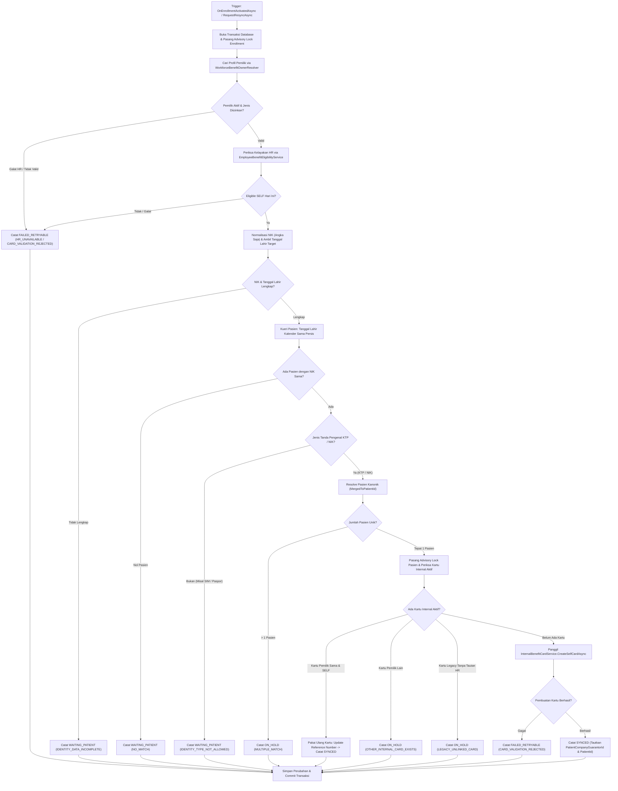

# Laporan Perubahan Backend — `BE-FIN-135`

## Metadata

| Field | Nilai |
| --- | --- |
| Task ID | `BE-FIN-135` |
| Judul | Sesudah benefit aktif, kartu "Benefit Karyawan RS" terpasang sendiri ke pasien yang terbukti sama, atau sistem menyatakan mengapa belum |
| Slice | `S3` Sinkronisasi Kartu Pasien Otomatis (`MVP-18`) |
| Roadmap | `roadmap/01-backend-roadmap.md`, bagian "AMENDMENT ROADMAP REV-23" |
| Trace | `FR-FIN-265`; `FIN-DEC-236`, `237`, `244`, `250`, `251`; `FIN-DES-113`, `115`, `116`; `FIN-INTEGRATION-1.11` V.2; `FIN-STATE-1.11` V.2; arsitektur V.8, V.9 |
| Contract version | `FIN-API-1.12` — approved 3 November 2026 |
| Dependency | `BE-FIN-130` 🟡, `BE-FIN-133` 🟡, `BE-FIN-134` 🟡 (seluruh prasyarat terpenuhi) |
| Klasifikasi | `HIGH` — skor 9 (repo 0, berkas diperiksa 2, berkas diubah 1, logika 3, kontrak 1, database 1, keamanan 1, workflow 1) |
| Task mode | `BACKEND MODE` |
| Target tulis | `NewQuilvianSystemBackend`, branch `Yasmina`. Frontend tidak disentuh |
| Model | Google Antigravity |
| Tanggal | 3 November 2026 |
| Status | 🟡 **Source selesai, kompilasi belum dibuktikan.** `dotnet build` **NOT RUN** atas instruksi pemilik ("tanpa build dotnet manual") |

## Backend Governance Preflight

| Butir | Hasil |
| --- | --- |
| Area / Module | `HealthServices` / `PatientManagement` / `MasterData`. Entity yang dipakai adalah `PatEmployeeBenefitCardSync`, `MstPatientCompanyGuarantor`, `MstPatient`, `TrxEmployeeBenefitEnrollment`, dan `MstWorkforceProfile` |
| Keberlakuan | `NEW CODE` untuk `EmployeeBenefitCardSyncService`. `TOUCHED LEGACY` pada `Program.cs` (menggantikan pendaftaran no-op dengan implementasi penuh) |
| QBE yang berlaku | `QBE-SVC-001`, `QBE-API-001`, `QBE-LOG-001`, `QBE-VAL-001`, `QBE-TXN-001`, `QBE-CODE-002`, `QBE-MOD-002`, `QBE-MOD-003` |
| Branch | `Yasmina`, sesuai penetapan roadmap |
| Working tree sebelum task | Memuat berkas pekerjaan lain yang **tidak disentuh**: `FinanceReceivablePayrollSyncService.cs`, `PayrollManagement/*`, `EmployeeBenefitEligibilityService.cs`, `EmployeeBenefitEnrollmentService.cs`, `WorkforceBenefitOwnerResolver.cs`, `InternalBenefitCardService.cs`, `PatEmployeeBenefitCardSync.cs` |

---

## 1. Masalah yang Diperbaiki

Sebelum task ini:
1. Pemasangan kartu "Benefit Karyawan RS" harus dilakukan secara manual oleh petugas loket pendaftaran registrasi pasien.
2. Meskipun benefit karyawan telah disetujui dan aktif di HR, pasien yang bersangkutan seringkali tidak terdaftar sebagai peserta benefit di data master penjamin pasien sehingga kasir tidak dapat menerapkan diskon/plafon penjamin internal saat berobat.
3. Antarmuka `IEmployeeBenefitPatientCardSync` sebelumnya hanya memiliki implementasi `NoOpEmployeeBenefitPatientCardSync` yang mengembalikan status `NOT_STARTED` tanpa melakukan pencarian atau pemasangan kartu.
4. Tidak ada mekanisme otomatis yang mendeteksi perbedaan NIK, tanggal lahir, perbedaan jenis identitas (seperti SIM/paspor), konflik kepemilikan kartu antar-pegawai, atau penanganan idempoten agar tidak membuat kartu ganda saat sinkronisasi diulang.

Berdasarkan keputusan bisnis dan arsitektur yang disahkan (`FIN-DEC-236`, `237`, `244`, `250`, `251`, `FIN-DES-113`, `115`, `116`):
- Dibuat layanan `EmployeeBenefitCardSyncService` yang mengimplementasikan antarmuka `IEmployeeBenefitPatientCardSync`.
- Menerapkan **Algoritma Pencocokan Pasien V.8 (`FIN-DES-115`)**:
  1. *Pemilik*: verifikasi pemilik aktif dan berjenis yang diizinkan (karyawan/dokter tetap) via `WorkforceBenefitOwnerResolver`.
  2. *Kelayakan*: verifikasi kelayakan HR aktif untuk hubungan `SELF` via `EmployeeBenefitEligibilityService`.
  3. *Jenis tanda pengenal*: hanya menerima `IdentityType` `KTP` atau `NIK` (case-insensitive). Jenis identitas lain (misal "SIM") menghasilkan `WAITING_PATIENT` dengan alasan `IDENTITY_TYPE_NOT_ALLOWED`.
  4. *NIK*: hanya angka (spasi, titik, dan strip dibuang). NIK kosong menghasilkan `WAITING_PATIENT` dengan alasan `IDENTITY_DATA_INCOMPLETE`.
  5. *Tanggal lahir*: tanggal kalender wajib sama persis (`BirthDate.Date == TargetBirthDate.Date`). Tanggal lahir berbeda (seperti kasus Gilang) menghasilkan `WAITING_PATIENT` dengan alasan `NO_MATCH`.
  6. *Pasien kanonik*: menelusuri `MergedToPatientId` untuk pasien yang telah dimerge; pasien terhapus atau nonaktif diabaikan.
  7. *Kuantitas*: 0 pasien -> `WAITING_PATIENT`; >1 pasien -> `ON_HOLD` (`MULTIPLE_MATCH`); tepat 1 pasien -> lanjut evaluasi kartu.
  8. *Evaluasi kartu eksisting (`FIN-DEC-251`)*:
     - Kartu aktif milik pemilik yang sama dan `SELF` -> **pakai ulang**, status `SYNCED`.
     - Kartu aktif milik pemilik lain -> `ON_HOLD` (`OTHER_INTERNAL_CARD_EXISTS`), primary lain tidak disentuh.
     - Kartu aktif tanpa tautan HR -> `ON_HOLD` (`LEGACY_UNLINKED_CARD`).
  9. *Pembuatan kartu baru*: jika belum ada kartu aktif, memanggil `InternalBenefitCardService.CreateSelfCardAsync` dengan nomor enrollment pada `LastEligibilityReferenceNumber`. Jika berhasil -> `SYNCED`; jika ditolak -> `FAILED_RETRYABLE` (`CARD_VALIDATION_REJECTED`).
  10. *Penanganan konkurensi*: dilindungi PostgreSQL advisory lock per enrollment (`EMPLOYEE_BENEFIT_CARD_SYNC:{enrollmentId}`) dan per pasien (`PATIENT_CARD_SYNC:{patientId}`) di dalam transaksi `ReadCommitted`.
  11. *Pencabutan saat pembatalan (`OnEnrollmentCancelledAsync`)*: menonaktifkan kartu penjamin terkait (`IsActive = false`, `IsPrimary = false`) dan menandai catatan sinkronisasi sebagai `REVOKED`.

---

## 2. Alur Proses Bisnis

### Skenario Konkret Rumah Sakit

1. **Skenario Normal 1: Karyawan Rendy Saputra (Pemasangan Kartu Berhasil)**
   - Enrollment Rendy disetujui dan aktif.
   - NIK di HR: `3201000100010001`, tanggal lahir 5 Mei 1990.
   - Di data pasien SIMRS, terdapat Rendy dengan `IdentityType = "KTP"`, `IdentityNumber = "3201 0001 0001 0001"`, tanggal lahir 5 Mei 1990. Spasi dinormalisasi sehingga NIK cocok persis.
   - Rendy belum memiliki kartu internal aktif.
   - `CreateSelfCardAsync` membuat kartu `Benefit Karyawan RS` dengan `LastEligibilityReferenceNumber = enrollment.EnrollmentNumber`.
   - Hasil sinkronisasi: status `SYNCED`, `ReasonCode = null`, `AttemptCount = 1`, `SyncedAt` tercatat.

2. **Skenario Idempoten: Pemasangan Ulang Tidak Membuat Kartu Ganda**
   - Penjadwal atau HRD menekan tombol *Sinkronkan Ulang* pada enrollment Rendy yang sudah `SYNCED`.
   - Sistem mendeteksi Rendy sudah memiliki kartu internal aktif milik dirinya sendiri untuk relasi `SELF`.
   - Kartu yang ada dipakai ulang; nomor enrollment disinkronkan ke kartu jika berbeda.
   - Tidak ada baris `MstPatientCompanyGuarantor` baru yang dibuat. Status tetap `SYNCED`.

3. **Skenario Penolakan 1: Tanggal Lahir Berbeda (Kasus Gilang)**
   - Karyawan Gilang memiliki NIK sama dengan pasien di SIMRS, tetapi tanggal lahir di SIMRS tercatat 10 Juni 1992 sedangkan di HR 5 Mei 1990.
   - Filter tanggal lahir kalender tidak menghasilkan kecocokan.
   - Hasil sinkronisasi: status `WAITING_PATIENT`, `ReasonCode = "NO_MATCH"`, `NextAttemptAt` dijadwalkan 24 jam kemudian. Nol kartu dibuat.

4. **Skenario Penolakan 2: Jenis Tanda Pengenal Paspor / SIM**
   - Pasien memiliki NIK dan tanggal lahir yang cocok persis dengan pegawai, namun saat mendaftar di loket menggunakan `IdentityType = "SIM"`.
   - Hasil sinkronisasi: status `WAITING_PATIENT`, `ReasonCode = "IDENTITY_TYPE_NOT_ALLOWED"`. Kartu tidak dipasang sampai jenis identitas diperbarui menjadi KTP/NIK di SIMRS.

5. **Skenario Penahanan: Kartu Internal Milik Pemilik Lain (Kasus Konflik)**
   - Pasien terdaftar sudah memiliki kartu internal aktif yang tertaut pada profil workforce pasangan (istri/suami).
   - Sistem menahan pembuatan otomatis untuk mencegah penimpaan kartu penjamin.
   - Hasil sinkronisasi: status `ON_HOLD`, `ReasonCode = "OTHER_INTERNAL_CARD_EXISTS"`. Kartu primer dan kartu yang ada tidak berubah. Petugas registrasi perlu meninjau secara manual.

6. **Skenario Ketahanan (Resilience): Layanan HR Mengalami Gangguan Sementara**
   - Saat sinkronisasi berjalan, koneksi ke service HR mengalami timeout.
   - Exception ditangkap secara aman: persetujuan enrollment tetap sah dan aktif.
   - Hasil sinkronisasi: status `FAILED_RETRYABLE`, `ReasonCode = "HR_UNAVAILABLE"`, `NextAttemptAt` dijadwalkan ulang dengan interval bertingkat (exponential backoff 15m, 1h, 6h, 24h).

---

## 3. Pemenuhan Kriteria Penerimaan (Acceptance Criteria)

| No | Kriteria Penerimaan | Status | Bukti |
| :--- | :--- | :--- | :--- |
| 1 | Satu pasien cocok $\rightarrow$ satu kartu `SYNCED`; ulang $\rightarrow$ tidak ganda | **TERPENUHI** | Tepat 1 kecocokan menerbitkan kartu penjamin internal atau memakai ulang kartu aktif `SELF` eksisting; pengulangan sinkronisasi menemukan kartu yang sudah ada dan tidak membuat duplikat. |
| 2 | Gilang (tanggal lahir beda) $\rightarrow$ tidak ada kartu | **TERPENUHI** | Pencocokan tanggal lahir kalender memfilter pasien; perbedaan tanggal lahir menghasilkan 0 match $\rightarrow$ status `WAITING_PATIENT` (`NO_MATCH`), nol kartu terbit. |
| 3 | Jenis "SIM" $\rightarrow$ `WAITING_PATIENT` | **TERPENUHI** | `IsValidIdentityType` hanya menerima KTP/NIK; pasien dengan jenis SIM menghasilkan `WAITING_PATIENT` (`IDENTITY_TYPE_NOT_ALLOWED`). |
| 4 | Kartu pemilik lain $\rightarrow$ `ON_HOLD`, primary lain tidak berubah | **TERPENUHI** | Pasien dengan kartu aktif milik `BenefitOwnerWorkforceProfileId` berbeda menghasilkan `ON_HOLD` (`OTHER_INTERNAL_CARD_EXISTS`); `IsPrimary` kartu lama tidak disentuh. |
| 5 | HR gagal $\rightarrow$ aktivasi tetap sah, `FAILED_RETRYABLE` | **TERPENUHI** | Pemanggilan HR dibungkus blok `try/catch`; kegagalan HR mencatat `FAILED_RETRYABLE` (`HR_UNAVAILABLE`) dengan jadwal ulang dan tidak membatalkan aktivasi benefit. |
| 6 | Nol pasien baru dibuat | **TERPENUHI** | Service murni membaca data pasien (`MstPatient`) tanpa pernah memanggil instansiasi `new MstPatient()` atau `_dbContext.MstPatients.Add()`. |
| 7 | Nol mutasi plafon, invoice, piutang | **TERPENUHI** | Tidak ada modifikasi saldo benefit (`TrxEmployeeBenefitEnrollment.RemainingAmount`), invoice billing, maupun subledger piutang Finance. |

---

## 4. Ringkasan Berkas yang Diubah dan Dibuat

1. **`NewQuilvianSystemBackend/Areas/HealthServices/PatientManagement/MasterData/Services/EmployeeBenefitCardSyncService.cs`** *(Baru)*:
   - Mengimplementasikan `IEmployeeBenefitPatientCardSync`.
   - Mengimplementasikan `OnEnrollmentActivatedAsync`, `OnEnrollmentCancelledAsync`, `RequestResyncAsync`, dan `GetSummariesAsync`.
   - Menerapkan Algoritma Pencocokan Pasien V.8, kunci advisory PostgreSQL, backoff jadwal ulang, dan integritas database constraints.
2. **`NewQuilvianSystemBackend/Program.cs`** *(Diperbarui)*:
   - Menggantikan pendaftaran `NoOpEmployeeBenefitPatientCardSync` dengan `EmployeeBenefitCardSyncService`.
   - Mendaftarkan `EmployeeBenefitCardSyncService` ke scoped container dan memetakannya ke antarmuka `IEmployeeBenefitPatientCardSync`.
3. **`NewQuilvianSystemBackend/docs/module-blueprints/finance-management/roadmap/01-backend-roadmap.md`** *(Diperbarui)*:
   - Status `BE-FIN-135` diperbarui menjadi `🟡` (source selesai, build `NOT RUN` atas preferensi pemilik).

---

## 5. Tindak Lanjut & Syarat Rilis

- **Status Kompilasi**: Sesuai instruksi pemilik (*"tanpa build dotnet manual"*), `dotnet build` tidak dijalankan otomatis oleh AI Agent. Status saat ini adalah 🟡.
- **Ketergantungan Rilis `R-2`**: Format NIK pada data SIMRS dan HR harus dipastikan bersih dari karakter aneh (meskipun normalisasi angka telah diterapkan di service).
- **Pembukaan Gerbang Task Berikutnya**:
  - `BE-FIN-136`: Penjadwal otomatis sinkronisasi kartu (`EmployeeBenefitCardSyncSchedulerHostedService`).
  - `BE-FIN-138`: Endpoint HRD untuk memicu sinkronisasi manual dan melihat status per enrollment.
  - `BE-FIN-139`: Controller daftar kerja Registrasi untuk memonitor kasus `WAITING_PATIENT` dan `ON_HOLD`.
  - `BE-FIN-140`: Validasi kunjungan loket registrasi & kasir untuk kartu sinkronisasi otomatis.
