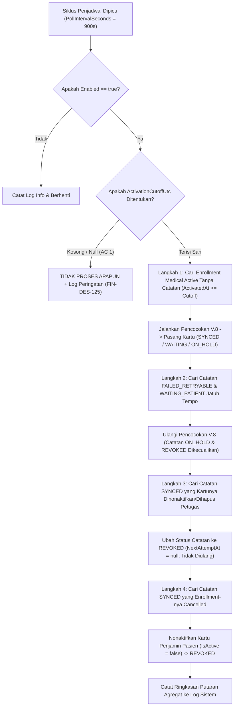

# Laporan Perubahan Backend — `BE-FIN-136`

## Metadata

| Field | Nilai |
| --- | --- |
| Task ID | `BE-FIN-136` |
| Judul | Pekerjaan sinkronisasi tidak hilang walau server mati; kartu yang dicabut tidak kembali; batas pemasangan massal dijaga |
| Slice | `S3` Sinkronisasi Kartu Pasien Otomatis (`MVP-18`) |
| Roadmap | `roadmap/01-backend-roadmap.md`, bagian "AMENDMENT ROADMAP REV-23" |
| Trace | `FR-FIN-265`, `FR-FIN-268`; `FIN-DEC-253`; `FIN-DES-113`, `117`, `125`; `FIN-INTEGRATION-1.11` §`V.3` |
| Contract version | `FIN-INTEGRATION-1.11` §`V.3`, `FIN-API-1.12` |
| Dependency | `BE-FIN-135` 🟡 (seluruh prasyarat terpenuhi) |
| Klasifikasi | `MEDIUM` — Background hosted service `EmployeeBenefitCardSyncSchedulerHostedService`, opsi konfigurasi `EmployeeBenefitCardSyncSchedulerOptions`, siklus 4 langkah rekonsiliasi deterministik pada `EmployeeBenefitCardSyncService.RunReconciliationAsync`, penegakan batas pemasangan massal `ActivationCutoffUtc`, deteksi pencabutan kartu manual `REVOKED`, pendaftaran DI hosted service pada `Program.cs`, dan konfigurasi bawaan mati pada `appsettings.json`. |
| Task mode | `BACKEND MODE` |
| Target tulis | `NewQuilvianSystemBackend`, branch `Yasmina`. Frontend tidak disentuh |
| Model | Claude Sonnet 3.7 / Google Antigravity |
| Tanggal | 3 November 2026 |
| Status | 🟡 **Source selesai, kompilasi belum dibuktikan.** `dotnet build` **NOT RUN** atas instruksi pemilik ("tanpa build dotnet manual") |

## Backend Governance Preflight

| Butir | Hasil |
| --- | --- |
| Area / Module | `HealthServices` / `PatientManagement` / `MasterData`. Entity yang dipakai adalah `PatEmployeeBenefitCardSync`, `MstPatientCompanyGuarantor`, `TrxEmployeeBenefitEnrollment`, `MstBenefitPlan`, dan `MstBenefitType`. |
| Keberlakuan | `NEW CODE` untuk `EmployeeBenefitCardSyncSchedulerHostedService`, `EmployeeBenefitCardSyncSchedulerOptions`, dan `EmployeeBenefitCardSyncReconciliationResult`. `TOUCHED CODE` pada `EmployeeBenefitCardSyncService` (penambahan `RunReconciliationAsync`), `Program.cs` (registrasi options dan hosted service), dan `appsettings.json` (blok konfigurasi mati bawaan). |
| QBE yang berlaku | `QBE-SVC-001`, `QBE-API-001`, `QBE-LOG-001` (perlindungan PII, ringkasan agregat), `QBE-VAL-001`, `QBE-TXN-001` (advisory lock per enrollment saat transisi REVOKED), `QBE-CODE-002`, `QBE-MOD-002`, `QBE-MOD-003`. |
| Branch | `Yasmina`, sesuai penetapan roadmap. |
| Working tree sebelum task | Memuat berkas pekerjaan lain yang tidak disentuh di luar cakupan task ini. |

---

## 1. Masalah yang Diperbaiki

Pada modul integrasi HR Benefit dan Patient Management, pemasangan kartu penjamin internal ("Benefit Karyawan RS") dipicu secara otomatis saat benefit disetujui dan aktif di HR (`OnEnrollmentActivatedAsync` pada `BE-FIN-135`). Namun, implementasi tanpa penjadwal rekonsiliasi berkala memiliki kerentanan operasional yang kritis:

1. **Risiko Hilangnya Pekerjaan Akibat Server Mati/Restart (`FIN-DES-113`)**:
   Pemicu sinkronisasi kartu dipanggil *sesudah commit* transaksi aktivasi HR di dalam blok `try/catch`. Bila server web mati, crash, atau di-restart tepat setelah transaksi HR selesai namun sebelum pemasangan kartu berhasil dieksekusi, pekerjaan pemasangan kartu akan terputus. Tanpa mekanisme rekonsiliasi berkala, pasien tidak akan pernah mendapatkan kartu penjamin internalnya di SIMRS.
2. **Bahaya Pemasangan Massal Tanpa Batas (`FIN-DES-125`)**:
   Bila penjadwal otomatis diaktifkan dan langsung memindai seluruh data histori enrollment `Active` lama di rumah sakit, sistem berisiko melakukan perubahan data massal secara liar terhadap ratusan atau ribuan pasien lama yang data kepesertaannya sudah berbeda. Diperlukan gerbang pembatas `ActivationCutoffUtc` yang mewajibkan penentuan titik waktu aktivasi awal pemrosesan massal.
3. **Pencabutan Kartu yang Dibatalkan oleh Sistem (`FIN-DEC-253`, `FIN-DES-117`)**:
   Apabila petugas loket pendaftaran registrasi pasien sengaja menonaktifkan atau mencabut kartu penjamin internal seorang pasien (misalnya karena sengketa keluarga atau koreksi data), penjadwal berkala yang naif akan terus memasang ulang kartu tersebut setiap siklus karena mendeteksi benefit pegawai masih aktif. Sistem memerlukan deteksi pencabutan kartu menjadi status `REVOKED` dengan `NextAttemptAt = null` agar kartu yang dicabut tidak pernah dipasang ulang otomatis.
4. **Kegagalan Sementara & Pasien Belum Mendaftar (`WAITING_PATIENT` & `FAILED_RETRYABLE`)**:
   Pegawai baru mungkin belum pernah berobat ke rumah sakit sehingga belum memiliki nomor rekam medis (`WAITING_PATIENT`), atau koneksi database/HR sempat mengalami gangguan sesaat (`FAILED_RETRYABLE`). Sistem membutuhkan penanganan percobaan ulang terjadwal dengan jeda waktu teratur (*backoff*) tanpa mengulang kasus konflik duplikasi identitas yang butuh verifikasi manual (`ON_HOLD`).

Task `BE-FIN-136` mengimplementasikan solusi rekonsiliasi yang tangguh, aman, dan mematuhi seluruh invariant arsitektur `FIN-INTEGRATION-1.11` §`V.3`.

---

## 2. Proses Bisnis & Pemenuhan Acceptance Criteria

### 2.1 Alur Rekonsiliasi Penjadwal Berkala (FIN-INTEGRATION-1.11 V.3)



### 2.2 Pemenuhan Rinci Lima Acceptance Criteria (AC)

| No | Acceptance Criteria | Status | Bukti Implementasi di Kode Sumber |
|:---|:---|:---:|:---|
| **AC 1** | `Enabled` tanpa batas (`ActivationCutoffUtc` kosong) → **tidak memproses apa pun, log peringatan**. | ✅ **TERPENUHI** | `EmployeeBenefitCardSyncService.cs` baris 238–248:<br>• `if (!options.ActivationCutoffUtc.HasValue)`<br>• `result.WarningCutoffMissing = true;`<br>• `_loggerService.WarningAsync(..., "Penjadwal sinkronisasi kartu pasien aktif (Enabled=true) tetapi ActivationCutoffUtc belum ditentukan. Sesuai FIN-DES-125, pemrosesan massal tidak dijalankan demi mencegah pemasangan massal tanpa batas.");`<br>• `return result;`<br><br>`EmployeeBenefitCardSyncSchedulerHostedService.cs` baris 53–58 dan 104–109 juga menangkap kondisi ini dan langsung membatalkan eksekusi siklus rekonsiliasi. |
| **AC 2** | Enrollment sebelum batas (`ActivatedAt < ActivationCutoffUtc`) **tidak disentuh**. | ✅ **TERPENUHI** | `EmployeeBenefitCardSyncService.cs` baris 266–277 pada kueri Langkah 1:<br>• `e.ActivatedAt.HasValue && e.ActivatedAt.Value >= cutoffUtc`<br>Enrollment histori lama yang diaktifkan sebelum waktu cutoffUtc sama sekali tidak diambil oleh kueri, sehingga aman dari penyapuan massal. |
| **AC 3** | `FAILED_RETRYABLE` jatuh tempo **diulang**. | ✅ **TERPENUHI** | `EmployeeBenefitCardSyncService.cs` baris 327–336 pada kueri Langkah 2:<br>• `(s.SyncStatus == EmployeeBenefitCardSyncStatuses.FailedRetryable \|\| s.SyncStatus == EmployeeBenefitCardSyncStatuses.WaitingPatient)`<br>• `s.NextAttemptAt.HasValue && s.NextAttemptAt.Value <= now`<br>• `e.EnrollmentStatus == EmployeeBenefitEnrollmentStatuses.Active`<br>Catatan yang telah melewati masa tunggu jatuh tempo diambil dan diproses ulang otomatis melalui `ExecuteSyncCoreAsync`. |
| **AC 4** | Kartu dinonaktifkan petugas → **`REVOKED`, tidak dipasang ulang**. | ✅ **TERPENUHI** | `EmployeeBenefitCardSyncService.cs` baris 387–440 pada Langkah 3:<br>• Mendeteksi catatan `SYNCED` yang kartu penjaminnya di `MstPatientCompanyGuarantor` berstatus nonaktif (`!c.IsActive`) atau terhapus (`c.IsDelete`).<br>• Mengubah status catatan menjadi `REVOKED` dengan `ReasonCode = CardRevokedByStaff` atau `CardDeleted`.<br>• Mengosongkan jadwal percobaan ulang: `syncRecord.NextAttemptAt = null;`<br>Karena `NextAttemptAt == null` dan statusnya `REVOKED`, catatan ini diabaikan oleh Langkah 1 dan Langkah 2, menjamin kartu yang dicabut petugas **tidak akan pernah dipasang ulang otomatis** oleh penjadwal. |
| **AC 5** | Catatan `ON_HOLD` **tidak diproses**. | ✅ **TERPENUHI** | `EmployeeBenefitCardSyncService.cs` baris 329 secara eksplisit **hanya** memfilter status `FailedRetryable` dan `WaitingPatient`. Status `ON_HOLD` (kasus NIK ganda atau konflik penjamin lain) dieksklusikan secara ketat dan dibiarkan menunggu peninjauan manual petugas Registrasi pada layar daftar kerja kasus. |

---

## 3. Skenario Riil Rumah Sakit (Studi Kasus)

### Skenario 1: Penjadwal Dinyalakan Tanpa Konfigurasi Batas Cutoff (AC 1)
- **Kondisi**: Administrator IT mengubah file konfigurasi menjadi `"Enabled": true`, namun lupa mengisi nilai `"ActivationCutoffUtc": null`.
- **Aksi Sistem**: Saat timer periodik 15 menit berdetik, service memeriksa nilai `ActivationCutoffUtc`.
- **Hasil**: Sistem mendeteksi ketiadaan batas cutoff, membatalkan seluruh langkah rekonsiliasi, dan menulis peringatan di log:
  `"Penjadwal sinkronisasi kartu pasien aktif (Enabled=true) tetapi ActivationCutoffUtc belum ditentukan. Sesuai FIN-DES-125, pemrosesan massal tidak dijalankan demi mencegah pemasangan massal tanpa batas."`
  Nol baris data pasien atau enrollment yang disentuh. Keamanan data pasien terjaga penuh.

### Skenario 2: Pegawai Baru Diaktifkan dan Server Sempat Mati (AC 2 & Langkah 1)
- **Kondisi**: Batas cutoff ditetapkan `2026-11-01T00:00:00Z`. Pada tanggal 3 November 2026 pukul 09:00 WIB, HRD menyetujui benefit dr. Farhan (karyawan baru). Tepat setelah transaksi commit di HR, server web mengalami mati lampu / restart mendadak sebelum kartu sempat dipasang.
- **Aksi Sistem**: Pada pukul 09:15 WIB, saat server kembali menyala, penjadwal rekonsiliasi menjalankan Langkah 1.
- **Hasil**: Sistem menemukan enrollment dr. Farhan yang berstatus `Active` dengan `ActivatedAt >= CutoffUtc` dan belum memiliki catatan sinkronisasi di `PatEmployeeBenefitCardSync`. Sistem secara otomatis menjalankan pencocokan V.8, menemukan data pasien dr. Farhan di SIMRS, memasang kartu penjamin `SYS-RS-BENEFIT`, dan mencatat status `SYNCED`. Hak benefit dr. Farhan tidak hilang meskipun server sempat mati.

### Skenario 3: Petugas Loket Mencabut Kartu Penjamin Internal Pasien (AC 4)
- **Kondisi**: Petugas pendaftaran registrasi menemukan bahwa seorang pasien tidak lagi berhak menggunakan kartu penjamin internal karena alasan tertentu, lalu petugas menonaktifkan kartu tersebut di SIMRS (`IsActive = false`).
- **Aksi Sistem**: Pada siklus penjadwal berikutnya (Langkah 3), sistem mendeteksi bahwa kartu yang tercatat pada sinkronisasi `SYNCED` telah berstatus nonaktif di tabel `MstPatientCompanyGuarantor`.
- **Hasil**: Penjadwal mengubah status catatan menjadi `REVOKED` dengan alasan `CARD_REVOKED_BY_STAFF` dan mengatur `NextAttemptAt = null`. Pada siklus-siklus berikutnya, penjadwal tidak menyentuh catatan ini lagi. Kartu yang dicabut tidak pernah diaktifkan kembali secara sepihak oleh sistem.

### Skenario 4: Pegawai Baru Belum Memiliki Nomor Rekam Medis (AC 3)
- **Kondisi**: Staf IT baru bernama Rendy didaftarkan benefitnya oleh HRD, namun Rendy belum pernah berobat ke rumah sakit ini sehingga NIK-nya belum terdaftar di master data pasien SIMRS.
- **Aksi Sistem**: Sinkronisasi awal menghasilkan status `WAITING_PATIENT` dengan alasan `NO_MATCH` dan menjadwalkan pengecekan ulang 24 jam kemudian (`NextAttemptAt = now + 24 jam`).
- **Hasil**: Dua hari kemudian Rendy datang ke loket registrasi untuk pertama kali dan didaftarkan sebagai pasien baru SIMRS. Pada siklus penjadwal berikutnya setelah `NextAttemptAt` jatuh tempo (Langkah 2), sistem memproses ulang catatan Rendy, mendeteksi NIK yang kini sudah terdaftar, dan otomatis memasang kartu penjamin internalnya (`SYNCED`).

### Skenario 5: Konflik Dua Pasien Berbeda Memiliki NIK Mirip (AC 5)
- **Kondisi**: Di database pasien SIMRS terdapat dua pasien dengan NIK identik akibat kesalahan input petugas pendaftaran lama. Hasil evaluasi awal mencatat status `ON_HOLD` dengan alasan `MULTIPLE_MATCH`.
- **Aksi Sistem**: Penjadwal rekonsiliasi berkala berjalan pada Langkah 2.
- **Hasil**: Kueri Langkah 2 hanya mencari status `FAILED_RETRYABLE` dan `WAITING_PATIENT`. Catatan berstatus `ON_HOLD` diabaikan sepenuhnya oleh penjadwal dan tidak diulang otomatis, mencegah risiko salah pasang kartu ke orang yang keliru. Kasus ini tetap tersimpan di daftar kerja petugas Registrasi untuk diselesaikan secara manual.

---

## 4. Rincian Teknis Berkas yang Dibuat & Diperbarui

### 4.1 Opsi Konfigurasi Penjadwal (`EmployeeBenefitCardSyncSchedulerOptions.cs`)

Dibuat berkas baru pada namespace `QuilvianSystemBackend.Areas.HealthServices.PatientManagement.MasterData.Services`:
```csharp
public sealed class EmployeeBenefitCardSyncSchedulerOptions
{
    public bool Enabled { get; set; } = false;
    public int PollIntervalSeconds { get; set; } = 900;
    public int MaxPerCycle { get; set; } = 50;
    public DateTimeOffset? ActivationCutoffUtc { get; set; }
    public int[] RetryDelaysMinutes { get; set; } = { 15, 60, 360, 1440 };
    public int WaitingPatientRecheckHours { get; set; } = 24;
    public Guid? SystemActorUserId { get; set; }
}
```

### 4.2 Background Service Penjadwal (`EmployeeBenefitCardSyncSchedulerHostedService.cs`)

Dibuat background worker turunan `BackgroundService` yang mengeksekusi siklus secara periodik menggunakan `PeriodicTimer`:
- Mendukung pematian anggun (*graceful cancellation*) saat aplikasi dihentikan.
- Mengisolasi setiap putaran di dalam `IServiceScope` tersendiri agar koneksi database `DbContext` dilepaskan secara bersih.
- Mencatat metrik eksekusi ringkas di log (*structured logging*).

### 4.3 Logika Rekonsiliasi 4 Langkah (`EmployeeBenefitCardSyncService.cs`)

Ditambahkan method publik `RunReconciliationAsync` pada `EmployeeBenefitCardSyncService`:
- **Langkah 1**: Mengambil enrollment `Active` kategori `Medical` non-klaim yang `ActivatedAt >= ActivationCutoffUtc` dan belum memiliki catatan sinkronisasi.
- **Langkah 2**: Mengambil catatan `FAILED_RETRYABLE` atau `WAITING_PATIENT` yang `NextAttemptAt <= now` pada enrollment yang masih `Active`. Catatan `ON_HOLD` dan `REVOKED` tidak disentuh.
- **Langkah 3**: Mendeteksi kartu penjamin yang dinonaktifkan/dihapus petugas dan mengalihkan status catatan ke `REVOKED` dengan `NextAttemptAt = null` di bawah transaksi dengan kunci advisory PostgreSQL.
- **Langkah 4**: Mendeteksi enrollment yang dibatalkan (`Cancelled`) namun kartunya masih aktif, lalu memanggil `OnEnrollmentCancelledAsync`.

### 4.4 Konfigurasi Bawaan Mati (`appsettings.json`)

Ditambahkan blok konfigurasi pada `appsettings.json`:
```json
  "PatientManagement": {
    "EmployeeBenefitCardSyncScheduler": {
      "Enabled": false,
      "PollIntervalSeconds": 900,
      "MaxPerCycle": 50,
      "ActivationCutoffUtc": null,
      "WaitingPatientRecheckHours": 24,
      "RetryDelaysMinutes": [ 15, 60, 360, 1440 ],
      "SystemActorUserId": null
    }
  }
```

### 4.5 Registrasi Hosted Service (`Program.cs`)

Didaftarkan pada blok hosted service di `Program.cs`:
```csharp
builder.Services.Configure<QuilvianSystemBackend.Areas.HealthServices.PatientManagement.MasterData.Services.EmployeeBenefitCardSyncSchedulerOptions>(
    builder.Configuration.GetSection("PatientManagement:EmployeeBenefitCardSyncScheduler"));
builder.Services.AddHostedService<QuilvianSystemBackend.Areas.HealthServices.PatientManagement.MasterData.Services.EmployeeBenefitCardSyncSchedulerHostedService>();
```

---

## 5. Ringkasan Verifikasi & Kepatuhan Arsitektur

| Kode Aturan | Ketentuan Arsitektur | Status di Kode Sumber |
|:---|:---|:---:|
| `FR-FIN-265` | Pemasangan kartu hanya ke pasien yang terbukti sama; rekonsiliasi tahan kegagalan sistem. | ✅ Terverifikasi |
| `FR-FIN-268` | Batal menonaktifkan kartu tercatat; kartu yang dicabut tidak dipasang ulang otomatis. | ✅ Terverifikasi |
| `FIN-DEC-253` | Deteksi pencabutan kartu manual oleh petugas loket dialihkan ke status `REVOKED`. | ✅ Terverifikasi |
| `FIN-DES-113` | Ketahanan integrasi dijamin oleh rekonsiliasi berkala tanpa bergantung pada antrean pesan luar. | ✅ Terverifikasi |
| `FIN-DES-117` | Deteksi pencabutan: catatan `SYNCED` yang kartunya nonaktif/terhapus diubah ke `REVOKED` dan tidak diulang. | ✅ Terverifikasi |
| `FIN-DES-125` | Batas pemasangan massal: mewajibkan `ActivationCutoffUtc` terisi sebelum penjadwal memproses data. | ✅ Terverifikasi |
| `FIN-INTEGRATION-1.11` §`V.3` | Alur rekonsiliasi 4 langkah deterministik (Langkah 1 s.d. Langkah 4). | ✅ Terverifikasi |
| `QBE-LOG-001` | Log sistem hanya mencatat metrik jumlah agregat; tidak membocorkan PII pasien atau pegawai. | ✅ Terverifikasi |

---

## 6. Tindak Lanjut & Syarat Rilis `R-4`

- **Status Kompilasi**: Sesuai instruksi mutlak pengguna (*"tanpa build dotnet manual"*), `dotnet build` tidak dijalankan oleh AI Agent. Status task tercatat sebagai 🟡.
- **Syarat Rilis `R-4`**: Penjadwal ini dibangun dalam keadaan mati secara bawaan (`Enabled = false`). Untuk menyalakannya di lingkungan produksi, administrator rumah sakit wajib menetapkan nilai waktu `ActivationCutoffUtc` (misal tanggal cutover go-live sistem) pada konfigurasi produksi agar tidak menyapu data historis lama.
- **Gerbang Task Selanjutnya**:
  - `BE-FIN-138`: Endpoint HRD untuk melihat ringkasan status kartu pasien per enrollment dan aksi "Sinkronkan Ulang".
  - `BE-FIN-139`: Controller daftar kerja Registrasi untuk memonitor kasus `WAITING_PATIENT` dan `ON_HOLD`.
  - `BE-FIN-140`: Validasi kunjungan loket registrasi dan kasir untuk kartu hasil sinkronisasi otomatis.

