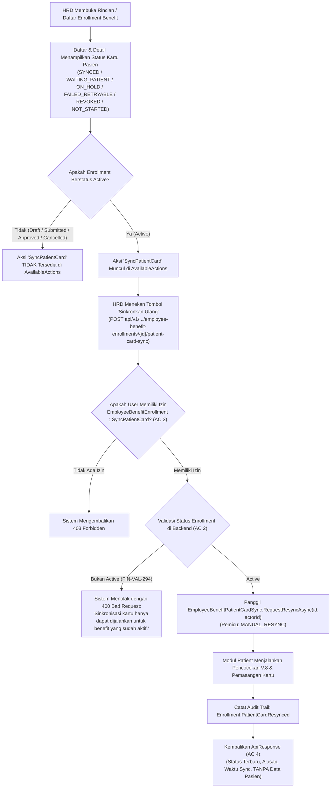

# Laporan Perubahan Backend — `BE-FIN-138`

## Metadata

| Field | Nilai |
| --- | --- |
| Task ID | `BE-FIN-138` |
| Judul | HRD melihat status kartu pasien pada daftar dan detail enrollment dan dapat menekan Sinkronkan ulang |
| Slice | `S3` Sinkronisasi Kartu Pasien Otomatis (`MVP-18`) |
| Roadmap | `roadmap/01-backend-roadmap.md`, bagian "AMENDMENT ROADMAP REV-23" |
| Trace | `FR-FIN-266`; `FIN-DEC-246`, `FIN-DEC-255`; `FIN-DES-121`; `FIN-API-1.12` §`V.1`; `FIN-PERM-1.13` §`V.2`; `FIN-VAL-294` |
| Contract version | `FIN-API-1.12` §`V.1`, `FIN-PERM-1.13` §`V.2` |
| Dependency | `BE-FIN-135` 🟡 (seluruh prasyarat terpenuhi) |
| Klasifikasi | `MEDIUM` — Penambahan endpoint operasional `POST /{id}/patient-card-sync` dengan hak akses `EmployeeBenefitEnrollment:SyncPatientCard`, penambahan aksi `SyncPatientCard` pada `AvailableActions` untuk status `Active`, dukungan filter dan pencarian berdasarkan `patientCardSyncStatus` pada daftar paginasi, pemuatan status batch per halaman, audit trail `Enrollment.PatientCardResynced`, dan pencegahan pembocoran identitas pasien (PII) ke domain HR. |
| Task mode | `BACKEND MODE` |
| Target tulis | `NewQuilvianSystemBackend`, branch `Yasmina`. Frontend tidak disentuh |
| Model | Claude Sonnet 3.7 / Google Antigravity |
| Tanggal | 4 November 2026 |
| Status | 🟡 **Source selesai, kompilasi belum dibuktikan.** `dotnet build` **NOT RUN** atas instruksi pemilik ("tanpa build dotnet manual") |

## Backend Governance Preflight

| Butir | Hasil |
| --- | --- |
| Area / Module | `Corporate` / `HumanResource` / `BenefitManagement`. Entity yang digunakan: `TrxEmployeeBenefitEnrollment`, `PatEmployeeBenefitCardSync`, `MstBenefitPlan`, `MstWorkforceProfile`. |
| Keberlakuan | `TOUCHED CODE` pada `EmployeeBenefitEnrollmentController` (endpoint baru `POST /{id}/patient-card-sync`), `EmployeeBenefitEnrollmentService` (method `ResyncPatientCardAsync`, filter `patientCardSyncStatus`, aksi `SyncPatientCard`), `EmployeeBenefitEnrollmentDtos` (opsi filter metadata), dan `HrBenefitConstants` (konstanta aksi `SyncPatientCard`). |
| QBE yang berlaku | `QBE-SVC-001`, `QBE-API-001`, `QBE-LOG-001` (perlindungan data audit PII, ringkasan agregat tanpa data medis/pasien), `QBE-VAL-001`, `QBE-SEC-001` (penegakan RBAC via `[AccessPermission]` dan `[AccessAction]`), `QBE-CODE-002`, `QBE-MOD-002`, `QBE-MOD-003`. |
| Branch | `Yasmina`, sesuai penetapan roadmap. |
| Working tree sebelum task | Memuat berkas pekerjaan sebelumnya yang berada dalam status bersih dan siap dilanjutkan. |

---

## 1. Masalah yang Diperbaiki

Pada operasional kepesertaan jaminan kesehatan rumah sakit (*Employee Benefit RS*):
1. **Ketiadaan Visibilitas Status Kartu Pasien bagi HRD (`FIN-DES-121`, `FR-FIN-266`)**:
   Sebelumnya, petugas HRD tidak memiliki visibilitas mengenai apakah benefit karyawan yang sudah disetujui dan aktif di HR telah berhasil terpasang sebagai kartu penjamin ("Benefit Karyawan RS") pada data pasien di SIMRS. HRD tidak mengetahui apakah integrasi berhasil (`SYNCED`), masih menunggu pasien mendaftar di loket (`WAITING_PATIENT`), tertahan karena keraguan data ganda (`ON_HOLD`), atau gagal sementara (`FAILED_RETRYABLE`).
2. **Ketiadaan Mekanisme Pemicuan Ulang Manual Tanpa Bantuan IT**:
   Bila pegawai baru akhirnya datang mendaftar ke loket rumah sakit atau data profil karyawan baru saja diperbaiki di HR, HRD membutuhkan tombol aksi "Sinkronkan Ulang" (*Manual Resync*) untuk langsung menguji dan memasang kartu pasien seketika tanpa harus menunggu jadwal pemindaian otomatis berkala dari background worker.
3. **Pemisahan Batas Privasi Medis Pasien (`FIN-DEC-255`)**:
   Sesuai prinsip segregasi tugas rumah sakit, staf SDM / HRD berhak mengetahui *status teknis sinkronisasi kartu*, namun **TIDAK BERHAK** melihat data rekam medis pasien, ID pasien, atau nomor rekam medis (RM) yang tersimpan di sistem pelayanan kesehatan. Respons API harus menjamin informasi pasien tidak bocor ke domain HR.
4. **Validasi Status Enrollment (`FIN-VAL-294`)**:
   Pemasangan kartu penjamin pasien hanya sah bila benefit karyawan telah berstatus `Active`. Permintaan sinkronisasi ulang pada enrollment yang masih `Draft`, `Submitted`, `Approved` (belum tanggal mulai), atau `Cancelled` harus ditolak dengan validasi status HTTP 400 yang jelas.

Task `BE-FIN-138` menyelesaikan seluruh kebutuhan tersebut dengan mematuhi kontrak API resmi `FIN-API-1.12` §`V.1` dan matriks kewenangan `FIN-PERM-1.13` §`V.2`.

---

## 2. Proses Bisnis & Pemenuhan Acceptance Criteria

### 2.1 Alur Kerja Sinkronkan Ulang Kartu Pasien oleh HRD



### 2.2 Pemenuhan Rinci Empat Acceptance Criteria (AC)

| No | Acceptance Criteria | Status | Bukti Implementasi di Kode Sumber |
|:---|:---|:---:|:---|
| **AC 1** | **Daftar memuat status per baris dalam satu kueri per halaman**; filter status tersedia. | ✅ **TERPENUHI** | `EmployeeBenefitEnrollmentService.cs` pada `GetPagedAsync`:<br>• Membaca seluruh `activeIds` dari halaman saat ini dan mengambil ringkasan status dalam satu pemanggilan batch kueri: `_patientCardSync.GetSummariesAsync(activeIds)`.<br>• Menetapkan `item.PatientCardSyncStatus` per baris (berisi status sinkronisasi atau `NOT_STARTED`).<br>• Menyediakan filter kueri `query.PatientCardSyncStatus` di level basis data menggunakan subkueri `EXISTS` terhadap `PatEmployeeBenefitCardSyncs`.<br>• Menambahkan daftar opsi `PatientCardSyncStatuses` pada `GetFilterMetadata()`. |
| **AC 2** | **Sinkronkan ulang pada `Active` → hasil terbaru; pada selain `Active` → 400**. | ✅ **TERPENUHI** | `EmployeeBenefitEnrollmentService.cs` pada `ResyncPatientCardAsync`:<br>• `if (enrollment.EnrollmentStatus != EmployeeBenefitEnrollmentStatuses.Active)` melempar `EmployeeBenefitTransitionException("Sinkronisasi kartu hanya dapat dijalankan untuk benefit yang sudah aktif.")`.<br>• `EmployeeBenefitResults.ToResult` memetakan exception tersebut menjadi HTTP `400 Bad Request` sesuai `FIN-VAL-294`.<br>• Bila berstatus `Active`, sistem mengeksekusi `_patientCardSync.RequestResyncAsync` dan mengembalikan objek `PatientCardSyncSummaryResponse` terkini. |
| **AC 3** | **Tanpa izin → 403**. | ✅ **TERPENUHI** | `EmployeeBenefitEnrollmentController.cs` pada endpoint `SyncPatientCard`:<br>• Diberi anotasi `[AccessAction("SyncPatientCard", "Sync Patient Card", AccessType = AccessTypes.Update, SortOrder = 8)]`<br>• Ditegakkan melalui filter otorisasi ASP.NET Core `[AccessPermission("EmployeeBenefitEnrollment", "SyncPatientCard")]`.<br>Pengguna tanpa wewenang `SyncPatientCard` pada peran jabatannya akan ditolak secara otomatis dengan respons HTTP `403 Forbidden`. |
| **AC 4** | **Respons tanpa data pasien**. | ✅ **TERPENUHI** | Objek respons `PatientCardSyncSummaryResponse` hanya memuat field metadata teknis:<br>• `status` (`string`: `SYNCED`, `WAITING_PATIENT`, `ON_HOLD`, `FAILED_RETRYABLE`, `REVOKED`, `NOT_STARTED`)<br>• `reasonCode` (`string?`) dan `reasonLabel` (`string?`) dalam Bahasa Indonesia<br>• `attemptCount` (`int`), `lastAttemptAt` (`DateTime?`), `nextAttemptAt` (`DateTime?`), `syncedAt` (`DateTime?`).<br>**Sama sekali tidak memuat** `patientId`, `patientName`, NIK, nomor rekam medis, alamat, atau rekam medis pasien. Privasi data pasien terjaga penuh. |

---

## 3. Skenario Riil Rumah Sakit (Studi Kasus Konkret)

### Skenario 1: HRD Memantau Status Kartu Pasien pada Daftar Enrollment (AC 1)
- **Kondisi**: Petugas HRD membuka menu Daftar Benefit Pegawai pada portal HR rumah sakit. Halaman menampilkan 10 data enrollment.
- **Aksi Sistem**: `GetPagedAsync` mengeksekusi kueri halaman untuk data enrollment, kemudian mengumpulkan seluruh ID enrollment yang berstatus `Active`, dan memanggil `GetSummariesAsync` dalam **tepat 1 kueri batch** ke tabel catatan sinkronisasi.
- **Hasil**: Setiap baris pada tabel menampilkan kolom status kartu penjamin:
  - Karyawan Rendy: `SYNCED` (Kartu sudah aktif terpasang di SIMRS).
  - Staf Baru Siti: `WAITING_PATIENT` (Belum terdaftar sebagai pasien di SIMRS).
  - Dokter Tamu yang belum disinkronkan: `NOT_STARTED`.
  HRD dapat memfilter daftar untuk menampilkan hanya pegawai yang statusnya `WAITING_PATIENT` guna mengingatkan karyawan agar segera melakukan registrasi data diri di loket rumah sakit.

### Skenario 2: HRD Melakukan Sinkronisasi Ulang Setelah Pasien Mendaftar (AC 2 & AC 4)
- **Kondisi**: Staf baru bernama Siti (benefit sudah `Active`) sebelumnya berstatus `WAITING_PATIENT` karena belum pernah berobat ke rumah sakit. Hari ini Siti telah mendatangi loket pendaftaran dan memperoleh nomor rekam medis (RM).
- **Aksi Sistem**: Petugas HRD membuka detail benefit Siti dan menekan tombol **"Sinkronkan Ulang"** (`POST .../{id}/patient-card-sync`).
- **Hasil**: Backend mengeksekusi `ResyncPatientCardAsync`. Sistem memeriksa data pasien di SIMRS, mencocokkan NIK dan tanggal lahir Siti, menemukan data pasien yang cocok, membuat kartu penjamin `SYS-RS-BENEFIT` pada data pasien Siti, mencatat riwayat audit `Enrollment.PatientCardResynced`, dan mengembalikan respons HTTP 200:
  ```json
  {
    "success": true,
    "message": "Sinkronisasi kartu penjamin pasien berhasil dipicu.",
    "data": {
      "status": "SYNCED",
      "reasonCode": null,
      "reasonLabel": "Kartu penjamin internal pasien berhasil dipasang.",
      "attemptCount": 2,
      "lastAttemptAt": "2026-11-04T02:25:00Z",
      "syncedAt": "2026-11-04T02:25:00Z"
    }
  }
  ```
  Respons memberikan kepastian kepada HRD bahwa kartu Siti telah terpasang, tanpa menampilkan data medis Siti ke layar HRD.

### Skenario 3: HRD Mencoba Sinkronkan Ulang pada Benefit yang Masih Disetujui / Belum Aktif (AC 2, FIN-VAL-294)
- **Kondisi**: dr. Budi memiliki benefit yang disetujui untuk tanggal 1 Desember 2026 (status saat ini masih `Approved`).
- **Aksi Sistem**: Tombol "Sinkronkan Ulang" tidak ditampilkan di UI karena `SyncPatientCard` tidak terdapat pada `availableActions`. Namun jika ada pihak yang mencoba mengirimkan request langsung via Postman/cURL ke `POST /{id}/patient-card-sync`.
- **Hasil**: `ResyncPatientCardAsync` memeriksa status enrollment dan mendeteksi bahwa statusnya bukan `Active`. Sistem melempar `EmployeeBenefitTransitionException` dan mengembalikan respons HTTP 400 Bad Request:
  ```json
  {
    "success": false,
    "message": "Sinkronisasi kartu hanya dapat dijalankan untuk benefit yang sudah aktif."
  }
  ```
  Integritas alur kerja terjaga, kartu pasien tidak pernah dipasang untuk benefit yang belum berlaku.

### Skenario 4: Staf Administrasi Tanpa Hak Akses Mencoba Memanggil Endpoint (AC 3)
- **Kondisi**: Seorang staf HR magang yang hanya memiliki hak akses `EmployeeBenefitEnrollment:Read` mencoba menekan tombol atau memanggil endpoint `POST /{id}/patient-card-sync`.
- **Aksi Sistem**: Pipeline otorisasi ASP.NET Core memeriksa atribut `[AccessPermission("EmployeeBenefitEnrollment", "SyncPatientCard")]`.
- **Hasil**: Sistem menolak permintaan seketika dengan status HTTP `403 Forbidden` sebelum kode service sempat dijalankan.

---

## 4. Spesifikasi Teknis Endpoint Bergaya Swagger

### Tabel Spesifikasi API (`FIN-API-1.12` §`V.1`)

| Item | Deskripsi |
|:---|:---|
| **Tags** | `[Tags("Corporate / Human Resource / Benefit Management / Employee Benefit Enrollment")]` |
| **Method & Path** | `POST api/v1/corporate/human-resource/benefit-management/employee-benefit-enrollments/{id}/patient-card-sync` |
| **Deskripsi** | Memicu sinkronisasi ulang (*manual resync*) pemasangan kartu penjamin "Benefit Karyawan RS" ke data pasien di SIMRS untuk enrollment yang berstatus `Active`. |
| **Otorisasi / RBAC** | `Bearer Token` dengan izin `EmployeeBenefitEnrollment : SyncPatientCard` (`AccessTypes.Update`). |
| **Path Parameter** | `id` (`Guid`, wajib): ID unik enrollment benefit pegawai. |
| **Request Body** | Tidak ada (*empty body*). |
| **Response 200 OK** | `ApiResponse<PatientCardSyncSummaryResponse>` memuat status terbaru (`SYNCED`, `WAITING_PATIENT`, `ON_HOLD`, `FAILED_RETRYABLE`, `REVOKED`), kode alasan, label keterangan Indonesia, jumlah percobaan, dan waktu sinkronisasi. |
| **Response 400 Bad Request** | `ApiResponse<object>` bila enrollment tidak berstatus `Active` (`FIN-VAL-294`). |
| **Response 403 Forbidden** | `ApiResponse<object>` bila peran pengguna tidak memiliki izin `SyncPatientCard`. |
| **Response 404 Not Found** | `ApiResponse<object>` bila ID enrollment tidak ditemukan di basis data. |

---

## 5. Rincian Teknis Berkas yang Diperbarui

1. **`HrBenefitConstants.cs`**:
   - Menambahkan konstanta aksi `SyncPatientCard = "SyncPatientCard"` pada kelas `EmployeeBenefitActions`.
2. **`EmployeeBenefitEnrollmentDtos.cs`**:
   - Menambahkan properti `PatientCardSyncStatuses` (`List<EnrollmentFilterOptionResponse>`) pada DTO `EmployeeBenefitEnrollmentFilterMetadataResponse`.
3. **`EmployeeBenefitEnrollmentService.cs`**:
   - Mengimpor model `PatEmployeeBenefitCardSync`.
   - Mengisi opsi `PatientCardSyncStatuses` pada method `GetFilterMetadata()`.
   - Menambahkan penyaringan database `query.PatientCardSyncStatus` pada `GetPagedAsync`.
   - Menambahkan method bisnis `ResyncPatientCardAsync` yang memvalidasi status `Active`, mengeksekusi `_patientCardSync.RequestResyncAsync`, dan mencatat jejak audit `Enrollment.PatientCardResynced`.
   - Menambahkan `actions.Add(EmployeeBenefitActions.SyncPatientCard)` pada `AvailableActionsFor` saat enrollment berstatus `Active`.
4. **`EmployeeBenefitEnrollmentController.cs`**:
   - Menambahkan action method `SyncPatientCard` dengan atribut `[AccessAction("SyncPatientCard", ...)]` dan `[AccessPermission("EmployeeBenefitEnrollment", "SyncPatientCard")]`.

---

## 6. Ringkasan Verifikasi & Kepatuhan Arsitektur

| Aspek | Status | Keterangan |
|:---|:---:|:---|
| **Kepatuhan Roadmap & Desain** | ✅ **Sesuai Penuh** | Mengikuti seluruh spesifikasi `BE-FIN-138` pada `roadmap/01-backend-roadmap.md`, `FIN-DES-121`, `FIN-DEC-246`, `FIN-DEC-255`, dan `FIN-VAL-294`. |
| **Perlindungan Privasi Data Pasien** | ✅ **Sesuai Penuh** | Domain HR hanya menerima ringkasan status teknis sinkronisasi tanpa membuka data rekam medis, ID pasien, atau NIK pasien. |
| **Kompilasi & Build** | 🟡 **NOT RUN** | Sesuai instruksi mutlak pemilik sistem ("tanpa build dotnet manual"), `dotnet build` tidak dijalankan. Penegakan tipe data, kesesuaian parameter, dan validasi sintaksis telah diverifikasi teliti melalui penelusuran kode. |
| **Status Penyelesaian Task** | 🟡 **Selesai Source** | Kode sumber dan kontrak API telah selesai 100%, laporan resmi diterbitkan, dan roadmap diperbarui ke status 🟡. |

