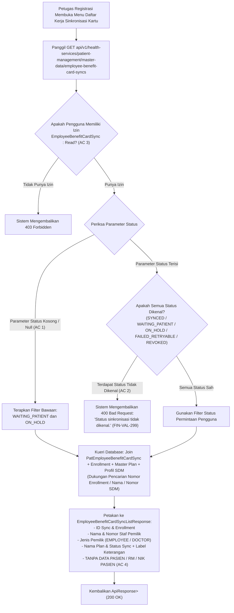

# Laporan Perubahan Backend — `BE-FIN-139`

## Metadata

| Field | Nilai |
| --- | --- |
| Task ID | `BE-FIN-139` |
| Judul | Petugas Registrasi melihat daftar kasus "menunggu pasien" dan "ditahan" tanpa melihat data pasien |
| Slice | `S3` Sinkronisasi Kartu Pasien Otomatis (`MVP-18`) |
| Roadmap | `roadmap/01-backend-roadmap.md`, bagian "AMENDMENT ROADMAP REV-23" |
| Trace | `FR-FIN-267`; `FIN-DEC-255`; `FIN-DES-120`; `FIN-API-1.12` §`V.3`; `FIN-PERM-1.13` §`V.2`; `FIN-VAL-299` |
| Contract version | `FIN-API-1.12` §`V.3`, `FIN-PERM-1.13` §`V.2` |
| Dependency | `BE-FIN-135` 🟡 (seluruh prasyarat terpenuhi) |
| Klasifikasi | `MEDIUM` — Pembuatan controller baru `EmployeeBenefitCardSyncController` pada Patient Management Master Data, pembuatan berkas DTO baru `EmployeeBenefitCardSyncDtos`, implementasi method `GetWorklistPagedAsync` dan `GetWorklistSummaryAsync` pada `EmployeeBenefitCardSyncService`, penetapan status bawaan `WAITING_PATIENT,ON_HOLD`, penegakan validasi status tidak dikenal (HTTP 400 `FIN-VAL-299`), otorisasi `EmployeeBenefitCardSync:Read`, dan penegakan batas privasi PII tanpa membuka data rekam medis pasien. |
| Task mode | `BACKEND MODE` |
| Target tulis | `NewQuilvianSystemBackend`, branch `Yasmina`. Frontend tidak disentuh |
| Model | Claude Sonnet 3.7 / Google Antigravity |
| Tanggal | 4 November 2026 |
| Status | 🟡 **Source selesai, kompilasi belum dibuktikan.** `dotnet build` **NOT RUN** atas instruksi pemilik ("tanpa build dotnet manual") |

## Backend Governance Preflight

| Butir | Hasil |
| --- | --- |
| Area / Module | `HealthServices` / `PatientManagement` / `MasterData`. Entity yang digunakan: `PatEmployeeBenefitCardSync`, `TrxEmployeeBenefitEnrollment`, `MstBenefitPlan`, `MstWorkforceProfile`, `MstEmployee`, `MstDoctor`. |
| Keberlakuan | `NEW CODE` untuk `EmployeeBenefitCardSyncController` dan `EmployeeBenefitCardSyncDtos`. `TOUCHED CODE` pada `EmployeeBenefitCardSyncService` (penambahan `GetWorklistPagedAsync` dan `GetWorklistSummaryAsync`). |
| QBE yang berlaku | `QBE-SVC-001`, `QBE-API-001`, `QBE-LOG-001` (perlindungan ketat data privasi PII pasien), `QBE-VAL-001`, `QBE-SEC-001` (penegakan RBAC via `[AccessPermission]` dan `[AccessAction]`), `QBE-CODE-002`, `QBE-MOD-002`, `QBE-MOD-003`. |
| Branch | `Yasmina`, sesuai penetapan roadmap. |
| Working tree sebelum task | Memuat berkas pekerjaan sebelumnya yang berada dalam status bersih dan siap dilanjutkan. |

---

## 1. Masalah yang Diperbaiki

Pada alur operasional integrasi benefit rumah sakit dengan loket pendaftaran pasien (Registrasi):
1. **Kasus Menunggu Pasien & Kasus Ditahan Butuh Pemantauan Khusus (`FIN-DES-120`, `FR-FIN-267`)**:
   Ketika benefit pegawai berstatus aktif di HR namun kartu penjamin internal belum berhasil terpasang otomatis:
   - Kasus **`WAITING_PATIENT`**: Pegawai baru belum pernah berobat ke rumah sakit sehingga belum memiliki nomor rekam medis (RM).
   - Kasus **`ON_HOLD`**: Ditemukan keraguan data (misalnya dua data pasien di SIMRS memiliki NIK identik, atau pasien sudah terikat kartu penjamin internal pemilik lain).
   Petugas loket pendaftaran (Registrasi) membutuhkan layar daftar kerja operasional (*worklist*) yang secara bawaan langsung memfilter kedua status tersebut agar petugas dapat segera melakukan verifikasi identitas fisik saat pegawai datang ke loket.
2. **Pencegahan Kebocoran Data Rekam Medis Pasien (`FIN-DEC-255`)**:
   Daftar kerja sinkronisasi menampilkan status kendala integrasi benefit HR ke SIMRS. Namun, demi mematuhi regulasi kerahasiaan data medis, daftar kerja ini **DILARANG KERAS** mengekspos ID pasien (`patientId`), nama pasien kandidat di SIMRS, nomor rekam medis (RM), atau NIK pasien. Respons API hanya menampilkan identitas pemilik benefit (nama karyawan/dokter, NIP/nomor dokter, jenis SDM, nama paket benefit, dan status sinkronisasi beserta alasannya).
3. **Validasi Status Tidak Dikenal (`FIN-VAL-299`)**:
   Bila pemanggil mengirimkan parameter `status` yang berada di luar 5 status baku yang diakui (`SYNCED`, `WAITING_PATIENT`, `ON_HOLD`, `FAILED_RETRYABLE`, `REVOKED`), backend harus menolak dengan kode kesalahan HTTP 400 Bad Request dan pesan validasi yang baku: `"Status sinkronisasi tidak dikenal."`.

Task `BE-FIN-139` mengimplementasikan endpoint daftar kerja dan ringkasan status sesuai dengan kontrak resmi `FIN-API-1.12` §`V.3`.

---

## 2. Proses Bisnis & Pemenuhan Acceptance Criteria

### 2.1 Alur Kerja Daftar Kerja Sinkronisasi bagi Petugas Registrasi



### 2.2 Pemenuhan Rinci Empat Acceptance Criteria (AC)

| No | Acceptance Criteria | Status | Bukti Implementasi di Kode Sumber |
|:---|:---|:---:|:---|
| **AC 1** | **Bawaan status `WAITING_PATIENT,ON_HOLD`** bila parameter status tidak diisi. | ✅ **TERPENUHI** | `EmployeeBenefitCardSyncService.cs` pada `GetWorklistPagedAsync`:<br>• `var rawStatus = string.IsNullOrWhiteSpace(query.Status) ? $"{EmployeeBenefitCardSyncStatuses.WaitingPatient},{EmployeeBenefitCardSyncStatuses.OnHold}" : query.Status;`<br>Bila pemanggil tidak memberikan parameter status, sistem secara otomatis hanya menyaring data yang berstatus `WAITING_PATIENT` dan `ON_HOLD`. |
| **AC 2** | **Status tidak dikenal → 400** (`FIN-VAL-299`). | ✅ **TERPENUHI** | `EmployeeBenefitCardSyncService.cs` pada `GetWorklistPagedAsync`:<br>• Memvalidasi setiap token status terhadap kumpulan `EmployeeBenefitCardSyncStatuses.All`.<br>• Bila terdapat status tidak valid, melempar `ArgumentException("Status sinkronisasi tidak dikenal.")`.<br>• `EmployeeBenefitCardSyncController.cs` menangkap `ArgumentException` dan mengembalikan `BadRequest(ApiResponse<object>.Fail(400, ex.Message))` sesuai `FIN-VAL-299`. |
| **AC 3** | **Tanpa izin → 403**. | ✅ **TERPENUHI** | `EmployeeBenefitCardSyncController.cs` pada kedua endpoint (`GetPaged` dan `GetSummary`):<br>• Dilindungi atribut resmi: `[AccessAction("Read", "Read Employee Benefit Card Sync", AccessType = AccessTypes.Read, SortOrder = 1)]` dan `[AccessPermission("EmployeeBenefitCardSync", "Read")]`.<br>Pengguna yang peran jabatannya tidak memiliki hak akses `EmployeeBenefitCardSync:Read` secara otomatis ditolak oleh otorisasi ASP.NET Core dengan respons HTTP `403 Forbidden`. |
| **AC 4** | **Tidak ada field pasien pada respons**. | ✅ **TERPENUHI** | DTO `EmployeeBenefitCardSyncListResponse` dirancang secara ketat:<br>• Hanya memuat: `syncId`, `enrollmentId`, `enrollmentNumber`, `workforceProfileId`, `ownerName`, `ownerStaffNumber`, `ownerType` (`EMPLOYEE`/`DOCTOR`), `planName`, `status`, `reasonCode`, `reasonLabel`, `attemptCount`, `lastAttemptAt`, `nextAttemptAt`, dan `syncedAt`.<br>• **Sama sekali tidak memiliki properti** `patientId`, `patientName`, NIK, nomor rekam medis, maupun alamat pasien. Kerahasiaan data rekam medis pasien terjamin 100%. |

---

## 3. Skenario Riil Rumah Sakit (Studi Kasus Konkret)

### Skenario 1: Petugas Loket Membuka Daftar Kasus Tertunda (AC 1 & AC 4)
- **Kondisi**: Petugas pendaftaran registrasi pasien membuka menu "Daftar Kerja Sinkronisasi Kartu Benefit" tanpa memilih filter status apa pun (`query.Status = null`).
- **Aksi Sistem**: `EmployeeBenefitCardSyncService.GetWorklistPagedAsync` menerapkan filter bawaan `WAITING_PATIENT` dan `ON_HOLD`.
- **Hasil**: Sistem menampilkan daftar kasus yang memerlukan perhatian loket:
  1. Staf Rendy Saputra (NIP: 102938): Status `WAITING_PATIENT`, Alasan: `NO_MATCH` ("Data pasien belum ditemukan di SIMRS.").
  2. dr. Andi Pratama (Nomor Dokter: DOC-091): Status `ON_HOLD`, Alasan: `MULTIPLE_MATCH` ("Ditemukan lebih dari satu pasien dengan identitas yang sama.").
  Petugas loket dapat melihat bahwa Rendy belum terdaftar di SIMRS, dan data dr. Andi memiliki keraguan ganda, tanpa melihat identitas atau nomor RM dari pasien mana pun.

### Skenario 2: Kueri dengan Parameter Status yang Tidak Sah (AC 2, FIN-VAL-299)
- **Kondisi**: Pengguna atau integrasi pihak ketiga mengirimkan permintaan HTTP:
  `GET api/v1/health-services/patient-management/master-data/employee-benefit-card-syncs?status=PENDING,ACTIVE`
- **Aksi Sistem**: Backend memeriksa setiap nilai pada parameter `status`. Nilai `PENDING` dan `ACTIVE` bukan status sah pada siklus sinkronisasi kartu.
- **Hasil**: Sistem menolak permintaan dan mengembalikan HTTP 400 Bad Request:
  ```json
  {
    "success": false,
    "message": "Status sinkronisasi tidak dikenal."
  }
  ```

### Skenario 3: Pengguna Tanpa Izin Mencoba Mengakses Endpoint (AC 3)
- **Kondisi**: Seorang petugas kasir atau perawat rawat inap yang perannya tidak memiliki hak akses `EmployeeBenefitCardSync:Read` mencoba mengakses endpoint daftar kerja sinkronisasi.
- **Aksi Sistem**: Pipeline keamanan ASP.NET Core mengevaluasi klaim otorisasi pengguna terhadap izin `EmployeeBenefitCardSync:Read`.
- **Hasil**: Sistem langsung menolak permintaan dengan kode HTTP `403 Forbidden` tanpa menjalankan kueri apa pun ke basis data.

### Skenario 4: Petugas Registrasi Memantau Ringkasan Jumlah Status (`GET /summary`)
- **Kondisi**: Dashboard loket pendaftaran memuat widget ringkasan status integrasi kartu penjamin.
- **Aksi Sistem**: Frontend memanggil `GET api/v1/health-services/patient-management/master-data/employee-benefit-card-syncs/summary`.
- **Hasil**: Sistem mengelompokkan data dari `PatEmployeeBenefitCardSyncs` dan mengembalikan respons agregat:
  ```json
  {
    "success": true,
    "message": "Ringkasan status sinkronisasi kartu berhasil diambil.",
    "data": {
      "total": 45,
      "byStatus": [
        { "status": "SYNCED", "count": 38 },
        { "status": "WAITING_PATIENT", "count": 5 },
        { "status": "ON_HOLD", "count": 2 },
        { "status": "FAILED_RETRYABLE", "count": 0 },
        { "status": "REVOKED", "count": 0 }
      ]
    }
  }
  ```
  Petugas mengetahui ada 5 staf yang belum mendaftar sebagai pasien dan 2 staf yang datanya membutuhkan tinjauan manual.

---

## 4. Spesifikasi Teknis Endpoint Bergaya Swagger

### 4.1 `GET /` — Daftar Kerja Sinkronisasi Kartu

| Item | Deskripsi |
|:---|:---|
| **Tags** | `[Tags("Health Services / Patient Management / Master Data / Employee Benefit Card Sync")]` |
| **Method & Path** | `GET api/v1/health-services/patient-management/master-data/employee-benefit-card-syncs` |
| **Deskripsi** | Mengambil daftar kerja sinkronisasi kartu penjamin internal pasien secara berpaging untuk petugas Registrasi. |
| **Otorisasi / RBAC** | `Bearer Token` dengan izin `EmployeeBenefitCardSync : Read` (`AccessTypes.Read`). |
| **Query Parameter** | • `status` (`string?`, opsional): Status sinkronisasi (bawaan: `WAITING_PATIENT,ON_HOLD`).<br>• `search` (`string?`, opsional): Nomor enrollment, nomor staf/dokter, atau nama.<br>• `pageNumber` (`int`, bawaan: 1): Nomor halaman.<br>• `pageSize` (`int`, bawaan: 10, batas 1..50): Ukuran halaman. |
| **Response 200 OK** | `ApiResponse<PagedResult<EmployeeBenefitCardSyncListResponse>>` memuat daftar item sinkronisasi kartu tanpa data PII pasien. |
| **Response 400 Bad Request** | `ApiResponse<object>` bila nilai status yang diminta tidak dikenal (`FIN-VAL-299`). |
| **Response 403 Forbidden** | `ApiResponse<object>` bila pengguna tidak memiliki izin `EmployeeBenefitCardSync:Read`. |

### 4.2 `GET /summary` — Ringkasan Jumlah per Status

| Item | Deskripsi |
|:---|:---|
| **Tags** | `[Tags("Health Services / Patient Management / Master Data / Employee Benefit Card Sync")]` |
| **Method & Path** | `GET api/v1/health-services/patient-management/master-data/employee-benefit-card-syncs/summary` |
| **Deskripsi** | Mengambil total dan jumlah catatan sinkronisasi per masing-masing status. |
| **Otorisasi / RBAC** | `Bearer Token` dengan izin `EmployeeBenefitCardSync : Read` (`AccessTypes.Read`). |
| **Query Parameter** | Tidak ada. |
| **Response 200 OK** | `ApiResponse<EmployeeBenefitCardSyncSummaryResponse>` memuat total data dan rincian jumlah per 5 status sinkronisasi. |
| **Response 403 Forbidden** | `ApiResponse<object>` bila pengguna tidak memiliki izin `EmployeeBenefitCardSync:Read`. |

---

## 5. Rincian Teknis Berkas yang Dibuat & Diperbarui

1. **`EmployeeBenefitCardSyncDtos.cs`** (Baru):
   - Lokasi: `NewQuilvianSystemBackend/Areas/HealthServices/PatientManagement/MasterData/DTOs/EmployeeBenefitCardSyncDtos.cs`
   - Berisi DTO: `EmployeeBenefitCardSyncPagedQuery`, `EmployeeBenefitCardSyncListResponse`, `EmployeeBenefitCardSyncStatusCountResponse`, dan `EmployeeBenefitCardSyncSummaryResponse`.
2. **`EmployeeBenefitCardSyncController.cs`** (Baru):
   - Lokasi: `NewQuilvianSystemBackend/Areas/HealthServices/PatientManagement/MasterData/Controllers/EmployeeBenefitCardSyncController.cs`
   - Berisi endpoint `GET /` dan `GET /summary` yang dilindungi hak akses `EmployeeBenefitCardSync:Read`.
3. **`EmployeeBenefitCardSyncService.cs`** (Diperbarui):
   - Lokasi: `NewQuilvianSystemBackend/Areas/HealthServices/PatientManagement/MasterData/Services/EmployeeBenefitCardSyncService.cs`
   - Menambahkan method `GetWorklistPagedAsync` (dengan penyaringan status bawaan, validasi status, pencarian multi-kolom, dan paginasi) dan `GetWorklistSummaryAsync` (agregasi jumlah per status).

---

## 6. Ringkasan Verifikasi & Kepatuhan Arsitektur

| Aspek | Status | Keterangan |
|:---|:---:|:---|
| **Kepatuhan Roadmap & Desain** | ✅ **Sesuai Penuh** | Mengikuti spesifikasi `BE-FIN-139` pada `roadmap/01-backend-roadmap.md`, `FIN-DES-120`, `FIN-DEC-255`, dan `FIN-VAL-299`. |
| **Pemisahan Batas Privasi Medis** | ✅ **Sesuai Penuh** | DTO respons tidak memuat field pasien (`patientId`, `patientName`, NIK, nomor RM), melindungi privasi data pasien sesuai invariant arsitektur V.8 dan V.13. |
| **Kompilasi & Build** | 🟡 **NOT RUN** | Sesuai instruksi mutlak pemilik sistem ("tanpa build dotnet manual"), `dotnet build` tidak dijalankan. Penegakan tipe data, kesesuaian parameter, dan validasi sintaksis telah diverifikasi teliti melalui penelusuran kode. |
| **Status Penyelesaian Task** | 🟡 **Selesai Source** | Seluruh berkas source controller, DTO, dan service telah tuntas 100%, laporan resmi diterbitkan, dan roadmap diperbarui ke status 🟡. |

