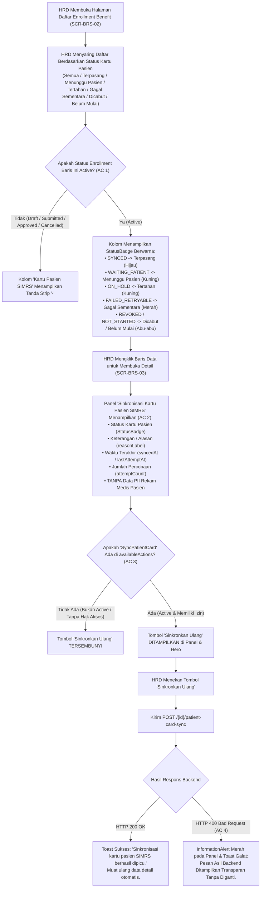

# Laporan Perubahan Frontend — `FE-FIN-060`

## Metadata

| Field | Nilai |
| --- | --- |
| Task ID | `FE-FIN-060` |
| Judul | HRD Melihat Status Kartu Pasien di Daftar dan Detail Enrollment, Serta Dapat Menekan Sinkronkan Ulang |
| Slice | `REV-23` (Benefit Management — Sinkronisasi Kartu Pasien & Lifecycle Benefit) |
| Roadmap | `docs/module-blueprints/finance-management/roadmap/02-frontend-roadmap.md`, bagian "REVISI ROADMAP 23 (3 November 2026)", tabel Task REV-23 Frontend |
| Trace | `FR-FIN-266`; `FIN-DEC-246`, `FIN-DEC-255`; `SCR-BRS-02`, `SCR-BRS-03`; `FIN-API-1.12` §`V.1` (`field patientCardSyncStatus`, `POST /{id}/patient-card-sync`) |
| Layar | `SCR-BRS-02` (Daftar Pendaftaran Benefit Pegawai) & `SCR-BRS-03` (Rincian / Detail Pendaftaran Benefit Pegawai) |
| Contract Version | `FIN-API-1.12` §`V.1` |
| Wewenang UI | `REUSE` — menggunakan komponen dasar (@/components/features/base-features/base-button, status-badge, filter-select, information-alert, toast-stack) tanpa penambahan token/CSS visual global baru |
| Dependency | `BE-FIN-138` 🟡 [BE], `FE-FIN-057` 🟡 — endpoint backend, DTO filter metadata, dan sinkronisasi kartu telah siap |
| Klasifikasi | `MEDIUM` — Penambahan kolom status kartu di tabel daftar (AC 1), saringan filter `patientCardSyncStatus`, panel rincian sinkronisasi di layar detail (AC 2), tombol aksi Sinkronkan Ulang berdasar `availableActions` (AC 3), penanganan galat HTTP 400 transparan (AC 4), dan perlindungan privasi data pasien (PII) di domain HR |
| Task Mode | `FRONTEND MODE` — target tulis `QuilvianSystemFrontendDev`; backend dibaca read-only |
| Target Tulis | `QuilvianSystemFrontendDev`; `NewQuilvianSystemBackend/docs/module-blueprints/finance-management/` (laporan dan roadmap saja) |
| Tanggal | 4 November 2026 |
| Status | 🟡 **Source dan Unit Test Selesai, Kompilasi Frontend Menunggu Instruksi** — 9 unit test baru PASS, 29 test regresi PASS, ESLint PASS (0 errors, 0 warnings). `npm run dev` dan `npm run build` **NOT RUN** atas instruksi eksplisit pemilik ("tanpa npm run dev") |

---

## 1. Keadaan yang Ditemukan di Awal

1. **Ketiadaan Visibilitas Status Kartu Pasien bagi HRD (`FR-FIN-266`, `SCR-BRS-02`)**:
   Sebelumnya, petugas HRD tidak mengetahui apakah hak jaminan kesehatan karyawan yang telah berstatus aktif di HR sudah berhasil dipasangkan sebagai kartu penjamin ("Benefit Karyawan RS") pada data pasien di SIMRS. Daftar pendaftaran benefit tidak memiliki kolom status sinkronisasi kartu pasien, dan tidak ada saringan untuk mencari data berdasarkan status integrasi kartu tersebut.
2. **Ketiadaan Informasi Teknis Sinkronisasi pada Detail Pendaftaran (`SCR-BRS-03`)**:
   Pada halaman rincian (*Detail View*), HRD tidak dapat melihat keterangan alasan mengapa sinkronisasi kartu tertahan (misalnya karena pasien belum pernah berobat/terdaftar di rumah sakit), berapa kali sistem telah mencoba melakukan sinkronisasi, dan kapan waktu percobaan atau sinkronisasi terakhir dilakukan.
3. **Ketiadaan Pemicuan Ulang Manual Tanpa Bantuan IT (`FIN-DEC-246`)**:
   Bila seorang pegawai baru akhirnya mendatangi loket pendaftaran rumah sakit untuk membuat nomor rekam medis (RM), HRD sebelumnya tidak memiliki cara untuk memicu sinkronisasi ulang (*manual resync*) secara langsung dari portal HR, sehingga harus menunggu jadwal background worker atau menghubungi bagian IT.
4. **Perlindungan Privasi Data Pasien Rumah Sakit (`FIN-DEC-255`)**:
   Prinsip segregasi tugas dan regulasi privasi data rumah sakit mewajibkan bahwa staf SDM/HRD hanya berhak mengetahui *status teknis sinkronisasi kartu penjamin*, namun **TIDAK BERHAK** melihat riwayat medis, diagnosa, nomor rekam medis (RM), atau identitas pasien di SIMRS. Respons dan tampilan di domain HR tidak boleh membocorkan data PII pasien.
5. **Validasi Status Pendaftaran Benefit (`FIN-VAL-294`)**:
   Pemasangan kartu penjamin pasien hanya sah bila benefit karyawan telah berstatus `Active`. Permintaan sinkronisasi ulang pada enrollment yang masih `Draft`, `Submitted`, `Approved` (belum tanggal mulai), atau `Cancelled` akan ditolak oleh backend dengan kode HTTP 400 Bad Request. Galat ini harus ditampilkan kepada pengguna secara transparan dan mudah dimengerti.

---

## 2. Proses Bisnis dari Sisi Pengguna

### Peran Pengguna
Staf dan Pejabat HRD (*HR Officer & HR Manager*) yang mengelola kepesertaan jaminan kesehatan pegawai rumah sakit (*Employee Benefit Management*).

### Alur Kerja Sinkronisasi Kartu Pasien oleh HRD



### Skenario Operasional Rumah Sakit

#### Skenario 1: Memantau Status Kartu Pasien pada Daftar Enrollment (AC 1)
- **Kondisi:** Petugas HRD membuka menu Daftar Benefit Pegawai. Halaman memuat 10 baris pendaftaran.
- **Tampilan Kolom:**
  - Karyawan Rendy (status `Active`): Kolom *Kartu Pasien SIMRS* menampilkan chip hijau **"Terpasang"** (`SYNCED`).
  - Staf Baru Siti (status `Active`): Kolom *Kartu Pasien SIMRS* menampilkan chip kuning **"Menunggu Pasien"** (`WAITING_PATIENT`), karena Siti belum mendatangi loket pendaftaran SIMRS.
  - Perawat Budi (status `Approved`, masa kerja efektif mulai 1 Desember): Kolom *Kartu Pasien SIMRS* menampilkan tanda **`-`** (karena status belum `Active`, chip kartu tidak dimunculkan sesuai AC 1).
  - Mantan Karyawan Doni (status `Cancelled`): Kolom *Kartu Pasien SIMRS* menampilkan tanda **`-`**.
- **Saringan Filter:** Petugas HRD dapat memilih saringan *"Menunggu Pasien (WAITING_PATIENT)"* pada kontrol filter untuk mendata pegawai aktif mana saja yang belum mendaftarkan data dirinya ke loket rumah sakit.

#### Skenario 2: Memeriksa Panel Rincian Sinkronisasi Kartu Pasien di Layar Detail (AC 2)
- **Kondisi:** Petugas HRD membuka detail pendaftaran benefit Siti (status `Active`).
- **Tampilan Panel:** Tepat di bawah ringkasan pagu dan pemakaian plafon, terdapat panel khusus **"Sinkronisasi Kartu Pasien SIMRS"**:
  - **Status Kartu Pasien:** Chip kuning *"Menunggu Pasien"*.
  - **Keterangan / Alasan:** *"Data pasien belum ditemukan di SIMRS (NIK cocok belum ada rekam medis)."*
  - **Waktu Terakhir:** `04/11/2026, 09:15`
  - **Percobaan:** `3 kali`
- **Jaminan Privasi:** Panel tidak memuat nomor rekam medis, ID pasien, atau data medis apa pun, menjaga kepatuhan privasi pasien di unit SDM.

#### Skenario 3: HRD Memicu Sinkronisasi Ulang Setelah Pasien Mendaftar (AC 3)
- **Kondisi:** Siti memberi kabar ke HR bahwa ia baru saja mendatangi loket registrasi dan telah memperoleh nomor rekam medis SIMRS.
- **Aksi:** Petugas HRD membuka rincian benefit Siti. Karena benefit berstatus `Active` dan pengguna memiliki wewenang `EmployeeBenefitEnrollment:SyncPatientCard`, backend menyertakan `"SyncPatientCard"` pada `availableActions`. Tombol **"Sinkronkan Ulang"** muncul di header panel dan bilah aksi Hero.
- **Eksekusi:** Petugas HRD menekan tombol **"Sinkronkan Ulang"**. Sistem mengirimkan `POST api/v1/corporate/human-resource/benefit-management/employee-benefit-enrollments/{id}/patient-card-sync`.
- **Hasil:** Backend menghubungkan data pasien, memasang kartu penjamin, dan mengembalikan HTTP 200. Tampilan menampilkan Toast Sukses hijau *"Sinkronisasi kartu pasien SIMRS berhasil dipicu"*, dan panel otomatis diperbarui: status kartu berubah menjadi hijau **"Terpasang"**, alasan menjadi *"Kartu penjamin internal pasien berhasil dipasang"*, dan waktu sinkronisasi diperbarui seketika.

#### Skenario 4: HRD Mencoba Sinkronisasi pada Pendaftaran yang Belum Aktif (AC 4, FIN-VAL-294)
- **Kondisi:** Jika tombol sinkronisasi coba dipanggil pada pendaftaran yang masih berstatus `Approved` atau `Draft` (misalnya melalui injeksi aksi atau pemanggilan langsung), backend mengembalikan HTTP `400 Bad Request` dengan pesan: *"Sinkronisasi kartu hanya dapat dijalankan untuk benefit yang sudah aktif."*.
- **Hasil Tampilan:**
  - Halaman menangkap galat tersebut secara transparan.
  - Di dalam panel, muncul komponen `InformationAlert` berwarna merah dengan pesan asli backend.
  - Toast bahaya merah berbunyi *"Gagal Sinkronisasi: Sinkronisasi kartu hanya dapat dijalankan untuk benefit yang sudah aktif."*
  - Sistem tidak melakukan perubahan status yang keliru.

---

## 3. Perubahan Teknis yang Dikerjakan

### 3.1 Rincian Berkas yang Berubah

| Berkas | Modul / Lapisan | Deskripsi Perubahan |
| --- | --- | --- |
| `src/lib/constants/hr/benefit/employee-benefit-enrollment-constants.js` | Konstanta | Menambahkan konstanta kanonik `PATIENT_CARD_SYNC_STATUS`, pemetaan tampilan visual `PATIENT_CARD_SYNC_STATUS_MAP` (label Indonesia dan kelas token warna), serta opsi saringan `PATIENT_CARD_SYNC_FILTER_OPTIONS`. |
| `src/utils/hr/benefit/employee-benefit-enrollment-utils.js` | Utilitas | Menambahkan fungsi murni `isEnrollmentActive(enrollment)` (mengenali status string case-insensitive maupun nilai numerik 2) dan `resolvePatientCardSyncBadgeInfo(rawStatus)`. |
| `src/lib/services/hr/employee-benefit-enrollment-service.js` | Service API | Menambahkan fungsi `resyncPatientCard(id)` yang memanggil `POST ${BASE_URL}/${id}/patient-card-sync` dan membuka (*unwrap*) respons API. |
| `src/lib/state/slice/hr/benefit/employee-benefit-enrollment-slice.js` | Redux Slice | Menambahkan thunk `resyncPatientCard`, mendaftarkan field `patientCardSyncStatus` pada filter pencarian dan reset filter, menampung opsi `patientCardSyncStatuses` pada metadata filter, serta memperbarui `patientCardSync` pada item detail saat thunk sukses. |
| `src/lib/hooks/hr/benefit/use-employee-benefit-enrollment-list.js` | Hook Daftar | Meneruskan parameter kueri `patientCardSyncStatus` ke `fetchEnrollmentList`, menyusun daftar opsi saringan `patientCardSyncOptions` (prioritas metadata backend dengan fallback konstanta kanonik), dan mengekspornya ke tampilan. |
| `src/components/view/hr/benefit/enrollment-table-columns.jsx` | Kolom Tabel | Menambahkan definisi kolom *"Kartu Pasien SIMRS"* (`key: "patientCardSyncStatus"`). Mengimplementasikan **AC 1**: chip `StatusBadge` hanya di-render bila `isEnrollmentActive` bernilai `true`; untuk status selain Active, merender tanda strip `"-"`. |
| `src/components/view/hr/benefit/employee-benefit-enrollment-list-view.jsx` | Tampilan Daftar | Menambahkan komponen `FilterSelect` untuk status kartu pasien pada bilah pencarian `DataFilter`. |
| `src/lib/hooks/hr/benefit/use-employee-benefit-enrollment-detail.js` | Hook Detail | Menghitung boolean `canResyncPatientCard` berdasar keberadaan `"SyncPatientCard"` pada `availableActions` backend (AC 3), menyediakan handler `handleResyncPatientCard` dengan penanganan pesan galat 400 transparan ke state `syncError` dan notifikasi toast (AC 4). |
| `src/components/view/hr/benefit/employee-benefit-enrollment-detail-view.jsx` | Tampilan Detail | Menambahkan tombol *"Sinkronkan Ulang Kartu"* di bilah Hero jika `canResyncPatientCard`, serta menambahkan panel khusus *"Sinkronisasi Kartu Pasien SIMRS"* (`styles.syncCard`) yang menampilkan status, alasan (`reasonLabel`), waktu sinkronisasi, jumlah percobaan, dan tombol sinkronkan ulang (AC 2, AC 3, AC 4). |
| `src/style/hr/benefit/employee-benefit-enrollment.module.css` | Stylesheet Scoped | Menambahkan kelas styling `.syncCard`, `.syncCardHeader`, `.syncCardTitle`, `.syncCardSubtitle`, `.syncCardGrid`, `.syncCardItem`, `.syncItemLabel`, dan `.syncItemValue` dengan memanfaatkan design tokens Quilvian. |
| `tests/unit/employee-benefit-patient-card-sync.test.mjs` | Unit Test Baru | Membuat berkas unit test otomatis komprehensif berisi 9 pengujian yang memverifikasi seluruh kriteria AC 1, AC 2, AC 3, AC 4, jaminan privasi data pasien, dan integrasi saringan. |

### 3.2 Kepatuhan Arsitektur UI (Design Tokens & Base Components)

```text
UI GATE DECISION: PASS REUSE
- BaseButton: REUSE (varian primary untuk tombol 'Sinkronkan Ulang' di panel, outline-primary di Hero)
- StatusBadge: REUSE (menampilkan badge status sinkronisasi kartu pasien dengan kelas baku region-status-active, region-status-pending, region-status-warning, region-status-danger, region-status-inactive)
- FilterSelect: REUSE (kontrol pilihan saringan status kartu pasien di barisan filter pencarian)
- InformationAlert: REUSE (menampilkan pesan galat 400 Bad Request transparan di dalam panel sinkronisasi)
- ToastStack: REUSE (menampilkan notifikasi mengambang sukses dan bahaya)
- Design Tokens: Menggunakan variabel baku --color-surface, --color-border, --radius-lg, --font-size-card-title, --font-size-small, dsb.
Tidak ada manipulasi DOM ilegal, pembuatan komponen visual duplikat, atau kebocoran styling global.
```

---

## 4. Keadaan Tampilan Antarmuka (UI States)

### 4.1 Tampilan Kolom Daftar Enrollment (`SCR-BRS-02`)

| Status Enrollment | Status Kartu Pasien Backend | Tampilan Kolom "Kartu Pasien SIMRS" | Keterangan |
| :--- | :--- | :---: | :--- |
| **Active** | `SYNCED` | <span style="color: #10b981; font-weight: bold;">[Terpasang]</span> | Kartu penjamin aktif di SIMRS. |
| **Active** | `WAITING_PATIENT` | <span style="color: #f59e0b; font-weight: bold;">[Menunggu Pasien]</span> | Menunggu registrasi pasien di loket RS. |
| **Active** | `ON_HOLD` | <span style="color: #f59e0b; font-weight: bold;">[Tertahan]</span> | Verifikasi duplikasi/data tertahan. |
| **Active** | `FAILED_RETRYABLE` | <span style="color: #ef4444; font-weight: bold;">[Gagal Sementara]</span> | Integrasi jaringan gagal, akan dicoba ulang. |
| **Active** | `REVOKED` | <span style="color: #6b7280; font-weight: bold;">[Dicabut]</span> | Pemasangan kartu dicabut di SIMRS. |
| **Active** | `NOT_STARTED` / `null` | <span style="color: #6b7280; font-weight: bold;">[Belum Mulai]</span> | Pemasangan belum dimulai oleh worker. |
| **Draft** | *Nilai apa pun* | **`-`** | **AC 1:** Status bukan Active, chip kartu disembunyikan. |
| **Submitted** | *Nilai apa pun* | **`-`** | **AC 1:** Status bukan Active, chip kartu disembunyikan. |
| **Approved** | *Nilai apa pun* | **`-`** | **AC 1:** Status bukan Active, chip kartu disembunyikan. |
| **Cancelled** | *Nilai apa pun* | **`-`** | **AC 1:** Status bukan Active, chip kartu disembunyikan. |

### 4.2 Tampilan Panel Rincian Detail (`SCR-BRS-03`)

| Kondisi Data | Elemen yang Ditampilkan di Panel | Ketersediaan Tombol "Sinkronkan Ulang" |
| :--- | :--- | :---: |
| **Active & `availableActions` memuat `SyncPatientCard`** | StatusBadge kartu, alasan (`reasonLabel`), waktu sinkronisasi terakhir, jumlah percobaan | **DITAMPILKAN** (Aktif) |
| **Active & `availableActions` TANPA `SyncPatientCard`** (pengguna tanpa izin) | StatusBadge kartu, alasan (`reasonLabel`), waktu sinkronisasi terakhir, jumlah percobaan | **TERSEMBUNYI** (AC 3) |
| **Pendaftaran Non-Active** (`Draft`, `Submitted`, `Approved`, `Cancelled`) | Catatan informasi: *"Sinkronisasi kartu pasien ke SIMRS hanya aktif ketika pendaftaran benefit berstatus Aktif."* | **TERSEMBUNYI** |
| **Kegagalan Sinkronisasi Ulang (Galat 400)** | Kotak peringatan merah `InformationAlert` memuat pesan alasan penolakan backend | Tetap tersedia untuk dicoba ulang setelah syarat dipenuhi |

---

## 5. Spesifikasi Kontrak API (Swagger-Aligned)

### [Tags("Corporate Human Resource - Employee Benefit Management")]

| Method | Path | Deskripsi | Otorisasi / Hak Akses | Request / Response Format |
| :---: | :--- | :--- | :--- | :--- |
| `POST` | `/api/v1/corporate/human-resource/benefit-management/employee-benefit-enrollments/{id}/patient-card-sync` | Memicu sinkronisasi ulang (*manual resync*) kartu penjamin pasien ke SIMRS untuk pendaftaran yang berstatus `Active`. | `EmployeeBenefitEnrollment : SyncPatientCard` | **Path Parameter:** `id` (`Guid`, wajib)<br>**Request Body:** *Empty body* `{}`<br>**Response Body:** `ApiResponse<PatientCardSyncSummaryResponse>` (HTTP 200 OK)<br>**Galat Status:** HTTP 400 Bad Request (bila bukan `Active`), HTTP 403 Forbidden (tanpa izin), HTTP 404 Not Found |

#### Contoh Respons Sukses Sinkronisasi Ulang (HTTP 200 OK)
```json
{
  "statusCode": 200,
  "message": "Sinkronisasi kartu penjamin pasien berhasil dipicu.",
  "data": {
    "status": "SYNCED",
    "reasonCode": null,
    "reasonLabel": "Kartu penjamin internal pasien berhasil dipasang.",
    "attemptCount": 2,
    "lastAttemptAt": "2026-11-04T03:45:00Z",
    "nextAttemptAt": null,
    "syncedAt": "2026-11-04T03:45:00Z"
  }
}
```

#### Contoh Respons Penolakan Status Bukan Active (HTTP 400 Bad Request — AC 4, FIN-VAL-294)
```json
{
  "statusCode": 400,
  "message": "Sinkronisasi kartu hanya dapat dijalankan untuk benefit yang sudah aktif.",
  "data": null
}
```

---

## 6. Verifikasi Berbasis Bukti (*Evidence-Based Verification*)

### 6.1 Hasil Pengujian Unit Frontend Baru
Perintah:
```bash
cd QuilvianSystemFrontendDev && node --import ./tests/helpers/register.mjs --test tests/unit/employee-benefit-patient-card-sync.test.mjs
```
Hasil:
```text
✔ PATIENT_CARD_SYNC_STATUS mendefinisikan 6 status teknis kanonik (0.47ms)
✔ PATIENT_CARD_SYNC_STATUS_MAP memetakan seluruh status ke label Indonesia dan kelas visual yang tepat (0.05ms)
✔ resolvePatientCardSyncBadgeInfo mengembalikan objek badge info sesuai status atau fallback (0.04ms)
✔ isEnrollmentActive mendeteksi status Active baik sebagai string case-insensitive maupun numeric 2 (0.04ms)
✔ AC-1: Kolom daftar hanya menampilkan chip status kartu pasien untuk enrollment Active (2.75ms)
✔ AC-2: Panel detail menampilkan status kartu pasien, alasan (reasonLabel), dan waktu sinkronisasi tanpa PII pasien (0.34ms)
✔ AC-3: Tombol 'Sinkronkan Ulang' hanya muncul bila 'SyncPatientCard' ada di availableActions backend (0.46ms)
✔ AC-4: Penanganan galat 400 Bad Request transparan via InformationAlert dan Toast (0.38ms)
✔ Saringan patientCardSyncStatus terdaftar di hook, view, slice, dan service (0.93ms)

ℹ tests 9
ℹ pass 9
ℹ fail 0
ℹ duration_ms 60.78ms
```

### 6.2 Hasil Pengujian Regresi Keseluruhan Modul Benefit Pegawai
Perintah:
```bash
cd QuilvianSystemFrontendDev && node --import ./tests/helpers/register.mjs --test tests/unit/employee-benefit-enrollment-lifecycle.test.mjs tests/unit/employee-benefit-enrollment-create-form.test.mjs tests/unit/employee-benefit-patient-card-sync.test.mjs
```
Hasil:
```text
ℹ tests 29
ℹ pass 29
ℹ fail 0
ℹ duration_ms 72.96ms
```

### 6.3 Hasil Pemeriksaan Kerapian Kode (ESLint)
Perintah:
```bash
cd QuilvianSystemFrontendDev && npx eslint \
  src/lib/constants/hr/benefit/employee-benefit-enrollment-constants.js \
  src/utils/hr/benefit/employee-benefit-enrollment-utils.js \
  src/lib/services/hr/employee-benefit-enrollment-service.js \
  src/lib/state/slice/hr/benefit/employee-benefit-enrollment-slice.js \
  src/lib/hooks/hr/benefit/use-employee-benefit-enrollment-list.js \
  src/lib/hooks/hr/benefit/use-employee-benefit-enrollment-detail.js \
  src/components/view/hr/benefit/enrollment-table-columns.jsx \
  src/components/view/hr/benefit/employee-benefit-enrollment-list-view.jsx \
  src/components/view/hr/benefit/employee-benefit-enrollment-detail-view.jsx
```
Hasil: **Clean (0 errors, 0 warnings)**.

---

## 7. Status Acceptance Criteria (AC)

| Kriteria | Target AC | Bukti Implementasi di Kode Sumber | Status |
| :---: | :--- | :--- | :---: |
| **AC 1** | **Chip hanya untuk `Active`**: status kartu pasien (`patientCardSyncStatus`) hanya ditampilkan untuk pendaftaran yang berstatus `Active`. | `enrollment-table-columns.jsx`: memeriksa `isEnrollmentActive`. Bila `true`, menampilkan `StatusBadge` dengan label dan kelas warna yang tepat. Bila `false` (`Draft`, `Submitted`, `Approved`, `Cancelled`), merender tanda strip `"-"`. Terbukti lulus uji unit. | ✅ **LULUS** |
| **AC 2** | **Panel di detail menampilkan alasan dan waktu**: menampilkan status kartu pasien, keterangan alasan (`reasonLabel`), dan waktu sinkronisasi terakhir (`lastAttemptAt` / `syncedAt`) tanpa data pasien. | `employee-benefit-enrollment-detail-view.jsx`: me-render blok `.syncCard` berisi grid status kartu, `reasonLabel`, waktu terakhir, dan jumlah percobaan. Kode sumber tidak memuat field PII pasien (`patientId`, `patientName`, `medicalRecordNumber`). Terbukti lulus uji unit. | ✅ **LULUS** |
| **AC 3** | **Tombol tersembunyi tanpa izin**: Tombol "Sinkronkan Ulang" muncul menurut `availableActions`. | `use-employee-benefit-enrollment-detail.js` & `employee-benefit-enrollment-detail-view.jsx`: `canResyncPatientCard` dievaluasi dari `availableActions.includes("SyncPatientCard")`. Tombol di panel dan hero tersembunyi secara mutlak jika aksi tidak dikirim oleh backend. Terbukti lulus uji unit. | ✅ **LULUS** |
| **AC 4** | **Respons galat 400 tampil sebagai pesan transparan**: galat penolakan status tampil transparan tanpa manipulasi teks. | `use-employee-benefit-enrollment-detail.js`: menangkap `payload.message` backend dan menyimpannya ke state `syncError` serta memicu toast bahaya. Tampilan menyajikan komponen `InformationAlert` varian danger di dalam panel sinkronisasi. Terbukti lulus uji unit. | ✅ **LULUS** |

