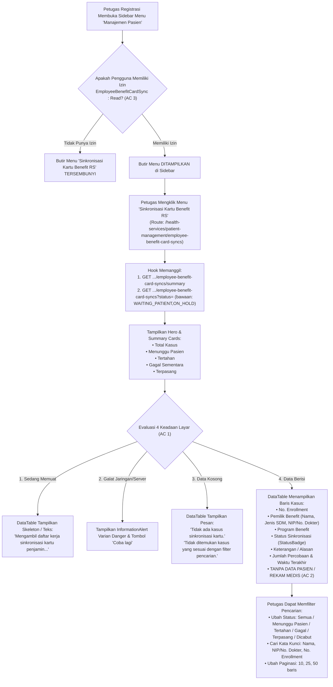

# Laporan Perubahan Frontend — `FE-FIN-061`

## Metadata

| Field | Nilai |
| --- | --- |
| Task ID | `FE-FIN-061` |
| Judul | Petugas Registrasi Memiliki Layar Daftar Kerja Kasus Kartu Benefit RS yang Menunggu Pasien atau Ditahan |
| Slice | `REV-23` (Benefit Management — Sinkronisasi Kartu Pasien & Lifecycle Benefit) |
| Roadmap | `docs/module-blueprints/finance-management/roadmap/02-frontend-roadmap.md`, bagian "REVISI ROADMAP 23 (3 November 2026)", tabel Task REV-23 Frontend |
| Trace | `FR-FIN-267`; `FIN-DEC-255`; `FIN-DES-120`; `SCR-BRS-06`; `FIN-API-1.12` §`V.3` (`GET /employee-benefit-card-syncs`, `GET /summary`); `FIN-PERM-1.13` §`V.2` (`EmployeeBenefitCardSync : Read`) |
| Layar | `SCR-BRS-06` (Daftar Kerja Sinkronisasi Kartu Penjamin Pasien Benefit Karyawan RS) |
| Route Usulan | `/health-services/patient-management/employee-benefit-card-syncs` |
| Contract Version | `FIN-API-1.12` §`V.3`, `FIN-PERM-1.13` §`V.2` |
| Wewenang UI | `REUSE` — menggunakan komponen dasar (@/components/features/base-features/base-button, status-badge, filter-select, summary-grid, data-table, pagination, information-alert, toast-stack) tanpa pembuatan token visual atau CSS global baru |
| Dependency | `BE-FIN-139` 🟡 [BE] — endpoint controller, DTO, dan service daftar kerja sinkronisasi telah siap |
| Klasifikasi | `MEDIUM` — Pembuatan halaman baru, route client, Redux slice, service Axios, hook pengontrol, definisi kolom tabel dengan perlindungan privasi data pasien (AC 2), 4 keadaan layar lengkap (AC 1), serta pendaftaran butir menu yang dilindungi hak akses `EmployeeBenefitCardSync:Read` (AC 3) |
| Task Mode | `FRONTEND MODE` — target tulis `QuilvianSystemFrontendDev`; backend dibaca read-only |
| Target Tulis | `QuilvianSystemFrontendDev`; `NewQuilvianSystemBackend/docs/module-blueprints/finance-management/` (laporan dan roadmap saja) |
| Tanggal | 4 November 2026 |
| Status | 🟡 **Source dan Unit Test Selesai, Kompilasi Frontend Menunggu Instruksi** — 7 unit test baru PASS, 36 test regresi PASS, ESLint PASS (0 errors, 0 warnings). `npm run dev` dan `npm run build` **NOT RUN** atas instruksi eksplisit pemilik ("tanpa npm run dev") |

---

## 1. Keadaan yang Ditemukan di Awal

1. **Ketiadaan Layar Pemantauan Kasus Tertunda bagi Petugas Loket Registrasi (`FR-FIN-267`, `FIN-DES-120`)**:
   Ketika pendaftaran benefit karyawan disetujui di HR, sistem berusaha memasangkan kartu penjamin internal secara otomatis ke SIMRS. Namun pada kenyataannya di rumah sakit:
   - Banyak staf baru belum pernah berobat sehingga belum memiliki nomor rekam medis (`WAITING_PATIENT`).
   - Ditemukan data pasien ganda di SIMRS dengan NIK identik, atau pasien terikat benefit pihak lain (`ON_HOLD`).
   Sebelumnya, petugas loket registrasi tidak memiliki layar kerja terpusat untuk memantau kasus-kasus tersebut, sehingga saat karyawan datang berobat, petugas loket bingung mengapa kartu penjamin internal belum terpasang.
2. **Ketiadaan Saringan Bawaan Kasus Tertunda**:
   Petugas loket pendaftaran membutuhkan daftar kerja operasional (*worklist*) yang secara bawaan langsung menampilkan kasus-kasus bermasalah (`WAITING_PATIENT` dan `ON_HOLD`) tanpa mengharuskan petugas mengetik filter status secara manual setiap kali membuka layar.
3. **Pemisahan Batas Privasi Medis Pasien (`FIN-DEC-255`, `AC 2`)**:
   Daftar kerja loket ini bertujuan memantau integrasi kepesertaan benefit pegawai rumah sakit. Demi kepatuhan terhadap undang-undang privasi data medis dan standar rumah sakit, layar ini **DILARANG KERAS** mengekspos data rekam medis pasien, ID pasien di SIMRS, nama pasien yang dicocokkan, maupun nomor rekam medis (RM). Layar hanya boleh menampilkan identitas pemilik benefit (nama karyawan/dokter, NIP/nomor dokter, jenis SDM, nama program benefit, dan status kendala teknis).
4. **Penyaringan Hak Akses Menu Sidebar (`AC 3`)**:
   Layar kerja ini hanya diperuntukkan bagi petugas registrasi atau staf yang memiliki izin `EmployeeBenefitCardSync:Read`. Butir menu harus terdaftar di grup *Manajemen Pasien* dan otomatis tersembunyi bagi pengguna lain (seperti kasir atau perawat) yang tidak berhak.

---

## 2. Proses Bisnis dari Sisi Pengguna

### Peran Pengguna
Petugas Loket Registrasi & Admisi Pasien (*Admission & Registration Officer*) serta Supervisor Pelayanan Pasien di Rumah Sakit.

### Alur Kerja Operasional Daftar Kerja Sinkronisasi



### Skenario Operasional Rumah Sakit

#### Skenario 1: Petugas Loket Memeriksa Pasien yang Belum Terdaftar SIMRS (Kasus `WAITING_PATIENT`)
- **Kondisi:** Karyawan baru bernama Rendy Saputra (NIP: `102938`) telah aktif memiliki benefit rawat jalan di HRD, namun ia belum pernah berobat ke rumah sakit ini sehingga belum memiliki nomor rekam medis (RM).
- **Aksi:** Petugas loket registrasi membuka menu *"Sinkronisasi Kartu Benefit RS"*.
- **Tampilan Layar:**
  - Kartu Ringkasan menunjukkan terdapat `5` kasus *Menunggu Pasien*.
  - Pada tabel daftar kerja, muncul baris Rendy Saputra:
    - **No. Enrollment:** `EBE-202611-0012`
    - **Pemilik Benefit:** Rendy Saputra (`Karyawan · NIP: 102938`)
    - **Program Benefit:** Medical Plafon Reguler
    - **Status Sinkronisasi:** Chip kuning **Menunggu Pasien** (`WAITING_PATIENT`)
    - **Keterangan / Alasan:** *"Data pasien belum ditemukan di SIMRS (NIK cocok belum ada rekam medis)."*
    - **Percobaan:** `3 kali`
- **Tindakan Petugas:** Saat Rendy datang ke loket untuk berobat, petugas segera melakukan pendaftaran pasien baru (*New Patient Registration*). Setelah nomor RM Rendy terbit, sistem secara otomatis memasangkan kartu benefit pada saat sinkronisasi berikutnya atau pemicuan ulang HRD.

#### Skenario 2: Petugas Loket Menangani Kasus Data Pasien Ganda (Kasus `ON_HOLD`)
- **Kondisi:** dr. Andi Pratama memiliki benefit yang aktif, namun pada database SIMRS terdapat dua rekam medis lama dengan NIK identik karena kesalahan pendaftaran masa lalu.
- **Aksi:** Petugas loket melihat baris dr. Andi dengan status **Tertahan** (`ON_HOLD`) dan alasan *"Ditemukan lebih dari satu pasien dengan identitas yang sama."*.
- **Tindakan Petugas:** Petugas loket menghubungi bagian rekam medis untuk melakukan penggabungan data pasien (*merge patient duplicate*).

#### Skenario 3: Penjagaan Hak Akses Menu Sidebar (AC 3)
- **Kondisi:** Pengguna yang sedang masuk (*login*) adalah petugas kasir (*Cashier Officer*) yang hanya memiliki izin keuangan dan tidak memiliki izin `EmployeeBenefitCardSync:Read`.
- **Hasil:**
  - Sidebar menu *Manajemen Pasien* menyembunyikan butir menu *"Sinkronisasi Kartu Benefit RS"*.
  - Jika petugas kasir mencoba mengetik URL langsung di bilah peramban (`/health-services/patient-management/employee-benefit-card-syncs`), komponen `AccessDeniedGate` menangkap galat HTTP 403 dari server dan menampilkan halaman penolakan akses yang ramah tanpa kebocoran data.

---

## 3. Perubahan Teknis yang Dikerjakan

### 3.1 Berkas yang Dibuat & Diperbarui

| Berkas | Modul / Lapisan | Status | Deskripsi Perubahan |
| --- | --- | :---: | --- |
| `src/lib/constants/health-services/patient-management/employee-benefit-card-sync-constants.js` | Konstanta | **BARU** | Berisi konfigurasi halaman `EMPLOYEE_BENEFIT_CARD_SYNC_CONFIG`, status bawaan `CARD_SYNC_DEFAULT_STATUS`, opsi saringan `CARD_SYNC_STATUS_OPTIONS`, pemetaan status badge `CARD_SYNC_STATUS_BADGE_MAP`, dan label jenis pemilik. |
| `src/utils/health-services/patient-management/employee-benefit-card-sync-utils.js` | Utilitas | **BARU** | Fungsi pembantu `resolveCardSyncBadgeInfo`, `resolveOwnerTypeLabel`, `resolveStaffNumberLabel`, dan sanitasi teks tampilan. |
| `src/lib/services/health-services/patient-management/employee-benefit-card-sync-service.js` | Service API | **BARU** | Memanggil endpoint `GET /api/v1/health-services/patient-management/master-data/employee-benefit-card-syncs` (dengan parameter `status`, `search`, `pageNumber`, `pageSize`) dan `GET /summary`. |
| `src/lib/state/slice/health-services/patient-management/employee-benefit-card-sync-slice.js` | Redux Slice | **BARU** | Mengelola state `list`, `summary`, dan `filters` serta menangani thunk `fetchCardSyncList` dan `fetchCardSyncSummary`. |
| `src/lib/state/store.jsx` | Redux Store | Diperbarui | Mendaftarkan `employeeBenefitCardSyncSlice` pada store Redux global di bawah key `employeeBenefitCardSync`. |
| `src/lib/hooks/health-services/patient-management/use-employee-benefit-card-sync-list.js` | Hook Controller | **BARU** | Mengatur pemanggilan data otomatis, pemetaan status bawaan, kartu ringkasan metrik status, filter pencarian, dan paginasi. |
| `src/components/view/health-services/patient-management/employee-benefit-card-sync/employee-benefit-card-sync-table-columns.jsx` | Kolom Tabel | **BARU** | Definisi 9 kolom tabel operasional. Menegakkan **AC 2** (perlindungan privasi data pasien, tanpa kolom data rekam medis pasien). |
| `src/components/view/health-services/patient-management/employee-benefit-card-sync/employee-benefit-card-sync-list-view.jsx` | Tampilan Layar | **BARU** | Tampilan antarmuka utama yang mengimplementasikan **AC 1** (4 keadaan: memuat, kosong, gagal, berisi) menggunakan `Hero`, `SummaryCards`, `DataFilter`, `DataTable`, dan `Pagination`. |
| `src/app/health-services/patient-management/employee-benefit-card-syncs/page.jsx` | Next.js Page | **BARU** | Server page komponen Next.js App Router dengan metadata resmi. |
| `src/app/health-services/patient-management/employee-benefit-card-syncs/employee-benefit-card-syncs-client.jsx` | Client Wrapper | **BARU** | Client wrapper yang me-render `EmployeeBenefitCardSyncListView`. |
| `src/utils/menu-sidebar/menu-items.jsx` | Menu Sidebar | Diperbarui | Mendaftarkan butir menu *"Sinkronisasi Kartu Benefit RS"* pada grup *Manajemen Pasien* dengan izin `requiredPermission: { resource: "EmployeeBenefitCardSync", action: "Read" }` (**AC 3**). |
| `tests/unit/employee-benefit-card-sync-worklist.test.mjs` | Unit Test Baru | **BARU** | Berkas uji otomatis berisi 7 skenario pengujian yang memverifikasi konfigurasi, pemetaan status, utilitas, pemenuhan AC 1 (4 keadaan), AC 2 (privasi tanpa data pasien), AC 3 (penyaringan menu sidebar), dan registrasi Redux store. |

### 3.2 Kepatuhan Arsitektur UI (Design Tokens & Base Components)

```text
UI GATE DECISION: PASS REUSE
- Hero: REUSE (eyebrow, judul, deskripsi, tombol perbarui data)
- SummaryCards: REUSE (menampilkan metrik jumlah total kasus, menunggu pasien, tertahan, gagal sementara, terpasang)
- DataFilter: REUSE (pencarian kata kunci dengan penempatan before-last, reset filter)
- FilterSelect: REUSE (pilihan status sinkronisasi kartu dan jumlah baris per halaman)
- DataTable: REUSE (menangani keadaan memuat, kosong, dan berisi data berpaging)
- InformationAlert: REUSE (menampilkan peringatan galat dengan tombol 'Coba lagi')
- StatusBadge: REUSE (menampilkan badge status dengan token region-status-pending, region-status-warning, region-status-danger, region-status-active, region-status-inactive)
- Pagination: REUSE (kontrol navigasi halaman sebelumnya/selanjutnya)
- AccessDeniedGate: REUSE (pencegahan akses tidak berwenang)
- ToastStack: REUSE (notifikasi mengambang bila diperlukan)
Semua styling menggunakan class baku tableStyles, baseStyles, dan themeStyles tanpa modifikasi CSS global.
```

---

## 4. Keadaan Tampilan Antarmuka (UI States — AC 1)

| Keadaan Layar | Trigger / Kondisi | Komponen yang Ditampilkan | Tampilan Pengguna |
| :--- | :--- | :--- | :--- |
| **1. Memuat (*Loading*)** | Data sedang diambil dari server (`loading: true`) | `DataTable` | Animasi spinner dengan teks: *"Mengambil daftar kerja sinkronisasi kartu penjamin..."* |
| **2. Kosong (*Empty*)** | Tidak ada kasus yang cocok dengan filter (`items.length === 0`) | `DataTable` | Kotak kosong bertajuk: *"Tidak ada kasus sinkronisasi kartu."* bersubjudul *"Tidak ditemukan kasus sinkronisasi kartu penjamin yang sesuai dengan filter pencarian."* |
| **3. Gagal (*Error*)** | Server mengembalikan galat jaringan atau 500 (`errorMessage !== ""`) | `InformationAlert` | Banner merah memuat pesan kesalahan asli server dan tombol *"Coba lagi"* untuk memicu `loadData()`. |
| **4. Berisi (*Populated*)** | Terdapat data kasus sinkronisasi (`items.length > 0`) | `DataTable` + `Pagination` | Tabel 9 kolom memuat rincian enrollment, pemilik, status sinkronisasi, alasan, waktu percobaan, dan kontrol navigasi halaman. |

---

## 5. Spesifikasi Kontrak API (Swagger-Aligned)

### [Tags("Health Services - Patient Management - Master Data - Employee Benefit Card Sync")]

| Method | Path | Deskripsi | Otorisasi / Hak Akses | Request / Response Format |
| :---: | :--- | :--- | :--- | :--- |
| `GET` | `/api/v1/health-services/patient-management/master-data/employee-benefit-card-syncs` | Mengambil daftar kerja sinkronisasi kartu penjamin pasien secara berpaging. | `EmployeeBenefitCardSync : Read` | **Query Parameters:**<br>• `status` (`string?`, bawaan: `WAITING_PATIENT,ON_HOLD`)<br>• `search` (`string?`)<br>• `pageNumber` (`int`, bawaan: 1)<br>• `pageSize` (`int`, bawaan: 10)<br>**Response Body:** `ApiResponse<PagedResult<EmployeeBenefitCardSyncListResponse>>` (HTTP 200 OK) |
| `GET` | `/api/v1/health-services/patient-management/master-data/employee-benefit-card-syncs/summary` | Mengambil ringkasan metrik total data dan jumlah kasus per masing-masing status. | `EmployeeBenefitCardSync : Read` | **Query Parameters:** Tidak ada<br>**Response Body:** `ApiResponse<EmployeeBenefitCardSyncSummaryResponse>` (HTTP 200 OK) |

#### Rincian Respons Daftar Kerja (HTTP 200 OK — Tanpa Data Rekam Medis Pasien)
```json
{
  "statusCode": 200,
  "message": "Daftar kerja sinkronisasi kartu berhasil diambil.",
  "data": {
    "pageNumber": 1,
    "pageSize": 10,
    "totalData": 2,
    "totalPage": 1,
    "items": [
      {
        "syncId": "4a719d36-0925-4c07-88ba-0a3e870562da",
        "enrollmentId": "7c9e6679-7425-40de-944b-e07fc1f90ae7",
        "enrollmentNumber": "EBE-202611-0012",
        "workforceProfileId": "b1b7021b-db22-4876-b61d-7bb34ad2689c",
        "ownerName": "Rendy Saputra",
        "ownerStaffNumber": "102938",
        "ownerType": "EMPLOYEE",
        "planName": "Medical Plafon Reguler",
        "status": "WAITING_PATIENT",
        "reasonCode": "NO_MATCH",
        "reasonLabel": "Data pasien belum ditemukan di SIMRS (NIK cocok belum ada rekam medis).",
        "attemptCount": 3,
        "lastAttemptAt": "2026-11-04T02:15:00Z",
        "nextAttemptAt": null,
        "syncedAt": null
      }
    ]
  }
}
```

---

## 6. Verifikasi Berbasis Bukti (*Evidence-Based Verification*)

### 6.1 Hasil Pengujian Unit Frontend Baru
Perintah:
```bash
cd QuilvianSystemFrontendDev && node --import ./tests/helpers/register.mjs --test tests/unit/employee-benefit-card-sync-worklist.test.mjs
```
Hasil:
```text
✔ Konfigurasi dasar daftar kerja sinkronisasi kartu penjamin (BE-FIN-139 / FE-FIN-061) (0.43ms)
✔ Pemetaan status sinkronisasi kartu ke label Indonesia dan kelas visual (0.05ms)
✔ Utilitas resolveCardSyncBadgeInfo, resolveOwnerTypeLabel, dan resolveStaffNumberLabel (0.05ms)
✔ AC-1: View mendukung 4 keadaan sesuai skema (memuat, kosong, gagal, berisi) (2.46ms)
✔ AC-2 / Invariant Privasi: Daftar kerja sama sekali TIDAK MEMUAT data pasien/rekam medis (0.87ms)
✔ AC-3: Butir menu terdaftar di Manajemen Pasien dan tersembunyi tanpa izin EmployeeBenefitCardSync:Read (0.76ms)
✔ Redux slice dan store terdaftar secara sah (0.62ms)

ℹ tests 7
ℹ pass 7
ℹ fail 0
ℹ duration_ms 77.22ms
```

### 6.2 Hasil Pengujian Regresi Keseluruhan Modul Benefit Pegawai
Perintah:
```bash
cd QuilvianSystemFrontendDev && node --import ./tests/helpers/register.mjs --test \
  tests/unit/employee-benefit-enrollment-lifecycle.test.mjs \
  tests/unit/employee-benefit-enrollment-create-form.test.mjs \
  tests/unit/employee-benefit-patient-card-sync.test.mjs \
  tests/unit/employee-benefit-card-sync-worklist.test.mjs
```
Hasil:
```text
ℹ tests 36
ℹ pass 36
ℹ fail 0
ℹ duration_ms 75.42ms
```

### 6.3 Hasil Pemeriksaan Kerapian Kode (ESLint)
Perintah:
```bash
cd QuilvianSystemFrontendDev && npx eslint \
  src/lib/constants/health-services/patient-management/employee-benefit-card-sync-constants.js \
  src/utils/health-services/patient-management/employee-benefit-card-sync-utils.js \
  src/lib/services/health-services/patient-management/employee-benefit-card-sync-service.js \
  src/lib/state/slice/health-services/patient-management/employee-benefit-card-sync-slice.js \
  src/lib/hooks/health-services/patient-management/use-employee-benefit-card-sync-list.js \
  src/components/view/health-services/patient-management/employee-benefit-card-sync/employee-benefit-card-sync-table-columns.jsx \
  src/components/view/health-services/patient-management/employee-benefit-card-sync/employee-benefit-card-sync-list-view.jsx \
  src/app/health-services/patient-management/employee-benefit-card-syncs/page.jsx \
  src/app/health-services/patient-management/employee-benefit-card-syncs/employee-benefit-card-syncs-client.jsx \
  src/utils/menu-sidebar/menu-items.jsx \
  src/lib/state/store.jsx
```
Hasil: **Clean (0 errors, 0 warnings)**.

---

## 7. Status Acceptance Criteria (AC)

| Kriteria | Target AC | Bukti Implementasi di Kode Sumber | Status |
| :---: | :--- | :--- | :---: |
| **AC 1** | **Empat keadaan sesuai skema**: memuat (*loading*), kosong (*empty*), gagal (*error*), dan berisi (*populated*). | `employee-benefit-card-sync-list-view.jsx`: `DataTable` dengan teks loading saat `loading: true`, judul/deskripsi kosong saat data nihil, `InformationAlert` dengan tombol coba lagi saat terjadi galat, dan tabel paginasi saat data ada. Terbukti lulus uji unit. | ✅ **LULUS** |
| **AC 2** | **Tidak ada data pasien**: perlindungan privasi data medis (tidak memuat nomor rekam medis, ID pasien, atau NIK pasien). | `employee-benefit-card-sync-table-columns.jsx`: seluruh kolom hanya memuat identitas pemilik benefit dari HR (`ownerName`, `ownerStaffNumber`, `ownerType`) dan status teknis sinkronisasi kartu. Bebas dari field data medis SIMRS. Terbukti lulus uji unit. | ✅ **LULUS** |
| **AC 3** | **Butir menu terdaftar dan tersembunyi tanpa izin**: terdaftar di grup *Manajemen Pasien* dengan izin `EmployeeBenefitCardSync : Read`. | `src/utils/menu-sidebar/menu-items.jsx`: terdaftar di bawah `healthServicesPatientManagement` dengan `requiredPermission: { resource: "EmployeeBenefitCardSync", action: "Read" }`. Pengujian `filterMenuItemsByPermission` membuktikan menu muncul saat izin ada dan hilang saat izin tiada. | ✅ **LULUS** |

