# Human Resource — Arsitektur Backend Target

| Field | Value |
| --- | --- |
| Blueprint ID | `HRD-BP-001` |
| Dokumen | `02-backend-architecture.md` |
| Revision | `4` — 3 November 2026: bagian 17 menambah arsitektur `S-D2` Rekrutmen dan Hiring (`HRD-DEC-073` s.d. `HRD-DEC-080`). Revision `3` tetap utuh pada bagian 16 |
| Status | `draft` — **belum** `approved`. Approval adalah tindakan manusia, bukan keluaran skill |
| Owner desain | Technical owner (`HRD-DEC-015`) |
| `approved_by` / `approved_at` | **Hanya bagian 16** (`S-D1` Perencanaan Tenaga Kerja): `approved` oleh Pengguna — pemilik teknis dan produk (`HRD-DEC-015`) — pada 2026-11-03. Bagian lain dokumen ini **belum** disetujui, sehingga status dokumen tetap `draft` |
| Backend baseline canonical | `origin/QuilvianIntegrationBackend` (`HRD-DEC-021`) |
| Backend SHA saat dokumen ini ditulis | `e0ee42c752a5f92c5b1663ff88bef07a5859f79f` (branch kerja `AndryZain`) |
| Backend SHA yang diaudit (historis) | `ecdc135444f0110482c9702212bcea30043983c8` |
| Backend SHA baseline terverifikasi | `16b8b71f4cd61e083213cf90722f4d768d339739` |
| Frontend SHA | `fff76a1b394d4b247c70a04f106c8ec098c9696e` (branch `AgentCodexFrontend`) |
| `input_revision` — decision log | `00-interview-decisions.md` revision `16` (Amendment Pass Workforce Core & Employee 360, `HRD-DEC-046` s.d. `HRD-DEC-057`) |
| `input_hash` — decision log | `26da64e129b0c34a17b67b0a41f47986b1aedae92a600077d936b0741eb574ee` |
| `input_revision` — capability map | `01-existing-capability-map.md` revision `1.1` |
| `input_hash` — capability map | `f66edd1514d28ce338130d9aaebfd40ee5678a0037667a3b07fdfbd1326cc510` |
| `input_revision` — roadmap | `roadmap/00-slice-roadmap.md` revision `3` |
| `input_hash` — roadmap | `913fa949dbfe38c2fcce249d1416c983777f76c4587ec796f7a6ac8ca047bb5d` |
| Kesiapan arsitektur domain | `DOMAIN_ARCHITECTURE_NOT_RUN` — `hospital-domain-architect` **tidak** dijalankan untuk slice yang dirancang di sini. Seluruh slice dalam cakupan bersifat administratif ketenagakerjaan dan tidak melintasi kewenangan klinis. Slice yang **memang** melintasi batas klinis (`S-C1`, `S-C6`) sengaja **tidak** dirancang dan tetap `BLOCKED` |
| Kompatibilitas | Tidak ada perubahan yang memutus kontrak berjalan. Seluruh perubahan bersifat penambahan (`EXTEND`) atau perbaikan berbukti (`REPAIR`) |

---

## 0. Cara membaca dokumen ini, dan apa yang dokumen ini **bukan**

Dokumen ini menjawab satu pertanyaan: **bentuk backend seperti apa yang ingin dicapai modul
Human Resource, dan sejauh apa bentuk itu berbeda dari yang ada hari ini.**

| Dokumen ini | Bukan dokumen ini |
| --- | --- |
| Menetapkan batas konteks, kepemilikan data, dan bentuk class target | Memberi wewenang menulis satu baris source pun |
| Menyebut kolom yang berubah satu per satu agar migration dapat direncanakan | Membuat migration, apalagi menjalankannya |
| Menyatakan mana yang `Sudah ada`, `Diperbarui`, dan `Baru` | Menyatakan modul siap rilis |
| Menurunkan seluruh isinya dari keputusan yang sudah dikunci dan bukti source | Mengarang kebijakan ketenagakerjaan atau kewenangan klinis |

Tiga penanda dipakai konsisten, sama seperti pada berkas `flows/`:

| Penanda | Artinya |
| --- | --- |
| `[EXISTING]` | Terbukti ada di source pada baseline saat ini |
| `[DECISION]` | Berasal dari `HRD-DEC-xxx` berstatus `approved` |
| `[OPEN]` | Belum ada keputusan pihak berwenang. **Tidak boleh** dijadikan dasar implementasi |

### 0.1 Larangan yang berlaku sepanjang dokumen

1. **Tidak ada satu baris source aplikasi, migration, entity, controller, service, konfigurasi
   Entity Framework, maupun database yang boleh disentuh dari alur blueprint ini.** Wewenang
   implementasi diberikan terpisah per task lewat `/plan-module-delivery` lalu
   `/build-module-backend`.
2. **Tidak ada rename massal.** `HRD-DEC-019` hanya mengizinkan ratchet `Trx*` → `Hrd*` saat
   entity itu benar-benar *materially touched* oleh sebuah task.
3. **`Wfp*` dan `Mst*` tidak diubah.** `Wfp` adalah prefix yang sah untuk keluarga workforce,
   bukan legacy yang akan dihapus.
4. **Tidak ada route lama yang dimatikan.** `HRD-DEC-016` menuntut alias tetap hidup.
5. **Tidak ada keputusan skema yang merusak data.** `HRD-Q-05` — isi tabel 67 entity tanpa API —
   masih terbuka.

---

## 1. Batas cakupan dokumen ini

### 1.1 Yang dirancang di sini

| Slice | Kelompok kemampuan | Kesiapan |
| --- | --- | --- |
| `S0-A` | Pendaftaran prefix `Wfp` dan `Hrd` pada registry | `READY FOR DESIGN` |
| `S0-B` | Route canonical kebab-case beserta compatibility alias | `READY FOR DESIGN` |
| `S-A1` | Workforce Core & Employee 360: enam daftar lintas-pegawai, Dokumen Peristiwa Kepegawaian (SK Mutasi/Promosi/Rotasi/Demosi/Penugasan Sementara), Employee 360, verifikasi perubahan data & pengajuan atas nama, dan batch data awal penempatan (`HRD-DEC-046` s.d. `HRD-DEC-057`) | `READY FOR DESIGN` |
| `S-A2` s.d. `S-A6` | Layanan mandiri pegawai: cuti, lembur, ubah jadwal/tukar shift, koreksi kehadiran, perubahan data, pengunduran diri, kehadiran | `READY FOR DESIGN` |
| `S-A7` | Kotak masuk persetujuan terpadu beserta mesin SLA dan eskalasi | `READY FOR DESIGN` |
| `S-B1` | Administrasi kehadiran, termasuk koreksi atas nama pegawai | `READY FOR DESIGN` |
| `S-B2` | Administrasi cuti dan saldo | `READY FOR DESIGN` |
| `S-B3` | Administrasi lembur | `READY FOR DESIGN` |
| `S-B4` | Penjadwalan kerja, termasuk roster dan shift harian | `READY FOR DESIGN` |
| `S-B5` | Payroll sisi HR — **`PARTIAL`**, hanya sampai batas `HRD-DEC-009` | `PARTIAL` |
| `S-C2` | Kompetensi dan pelatihan | `READY FOR DESIGN` |
| `S-C3` | Manajemen kinerja | `READY FOR DESIGN` |
| `S-C4` | Lifecycle dan offboarding | `READY FOR DESIGN` |
| `S-C5` | Hubungan karyawan dan kedisiplinan | `READY FOR DESIGN` |
| `S-E` | Ratchet penamaan `Trx` saat entity disentuh — aturan lintas-slice | `READY FOR DESIGN` |
| `S-D1` | Perencanaan tenaga kerja: standar kebutuhan tenaga, formasi berversi, rencana tahunan dan addendum, potret gap, permintaan headcount beserta pemenuhan dan pembatalannya (`HRD-DEC-058` s.d. `HRD-DEC-072`). **Dirancang pada bagian 16** | `READY FOR DESIGN` sejak 3 November 2026 |

### 1.2 Yang **tidak** dirancang di sini, beserta alasannya

Kelompok kemampuan berikut **sengaja tidak diberi arsitektur target**. Sejak revision `3`, `S-D1` keluar dari daftar ini dan dirancang pada bagian 16. Tidak ada class,
tidak ada endpoint, tidak ada relasi, dan tidak ada rencana migration untuk keenamnya di dokumen
ini. Merancangnya berarti mengarang kewenangan yang belum diberikan siapa pun.

| Slice | Kelompok kemampuan | Pemblokir | Pemilik keputusan |
| --- | --- | --- | --- |
| `S-C1` | Kredensial, lisensi, kewenangan klinis, SPK/RKK, OPPE, FPPE | `HRD-DEP-005`, `HRD-DEP-007`, `HRD-Q-08` | Komite Medik, setelah `requirement-completeness-gate` dan `hospital-domain-architect` |
| `S-C6` | Kesehatan dan keselamatan kerja staf | `HRD-DEP-007`, `HRD-DEC-010` masih `draft` | K3RS |
| ~~`S-D1`~~ | ~~Perencanaan tenaga kerja~~ | **Dirancang pada bagian 16** — `HRD-Q-05` ditutup untuk `S-D1` lewat `HRD-DEC-059` | — |
| ~~`S-D2`~~ | ~~Rekrutmen dan hiring~~ | **Dirancang pada bagian 17** — `HRD-Q-05` ditutup untuk `S-D2` lewat `HRD-DEC-074` | — |
| `S-D3` | Benefit | `HRD-Q-05` | Pemilik database |
| `S-D4` | Layanan HR dan tiket kepegawaian | `HRD-Q-05` | Pemilik database |
| `S-D5` | Perjalanan dinas dan reimbursement | `DEFERRED` — prioritas terendah, tetap tunduk `HRD-Q-05` | Pemilik produk |

**Catatan penting yang mudah salah baca.** `CredentialingManagement` (5 controller, 46 endpoint)
dan `OccupationalHealthManagement` (1 controller, 9 endpoint) **memang punya source yang berjalan
hari ini**. Keberadaannya dicatat apa adanya pada tabel kepemilikan data bagian 3, karena modul
ini menyentuhnya sebagai tetangga. Yang dilarang adalah **merancang bentuk targetnya** — bukan
berpura-pura source-nya tidak ada.

### 1.3 Batas payroll — sampai mana yang boleh dirancang

`[DECISION]` `HRD-DEC-009`: tanggung jawab HR atas payroll **berhenti setelah `execute` serah
terima**.

| Boleh dirancang di sini | Tidak boleh dirancang di sini |
| --- | --- |
| Pengumpulan masukan dari kehadiran, cuti, dan lembur | Bentuk data yang diterima Finance (`HRD-Q-10`) |
| Rekonsiliasi selisih antar masukan | Perilaku bila Finance menolak satu batch (`HRD-Q-11`) |
| Perhitungan komponen gaji sisi HR | Pembayaran, posting akuntansi, pajak, pelaporan |
| Kunci periode dan idempotensi serah terima | Apakah Finance menarik atau HR mengirim |
| `rollback` dan `repair` sisi HR | Alur koreksi di sisi Finance |

---

## 2. Bounded context dan kepemilikan

### 2.1 Tujuh bounded context modul HR

Batas di bawah **tidak** diturunkan dari nama folder. Ia diturunkan dari **invariant apa yang
harus dijaga bersama-sama dalam satu transaksi**. Dua data berada di satu konteks bila mengubah
salah satunya tanpa yang lain akan meninggalkan sistem dalam keadaan yang salah.

| ID | Bounded context | Aggregate root | Invariant utama yang dijaga |
| --- | --- | --- | --- |
| `BC-HR-01` | Master dan Referensi HR | Setiap entity `Mst*` berdiri sendiri | Kode master unik dan tidak dapat dipakai ulang; master yang sedang dirujuk transaksi berjalan tidak boleh dinonaktifkan diam-diam |
| `BC-HR-02` | Profil dan Administrasi Workforce | `MstWorkforceProfile` dan `HrdPersonnelActionOrder` | Satu orang = satu profil workforce (`HRD-DEC-051`); penempatan berlaku-efektif adalah satu-satunya sumber kebenaran (`HRD-DEC-047`); tepat satu penempatan utama per jenis per tanggal (`HRD-DEC-049`); mutasi/promosi/rotasi/demosi/penugasan sementara dijalankan sebagai satu dokumen peristiwa (SK) yang disetujui utuh pola T8 dengan scan SK wajib (`HRD-DEC-048`, `HRD-DEC-056`) dan hanya dapat dibatalkan sebelum tanggal berlaku (`HRD-DEC-057`); berlaku surut hanya pada periode kehadiran terbuka (`HRD-DEC-050`); data sensitif dilarang diedit langsung (`HRD-DEC-052`); atasan hanya melihat profil kerja bawahan langsung pada Employee 360 (`HRD-DEC-053`); data awal penempatan lewat batch yang disetujui sekali (`HRD-DEC-054`); enam layar Administrasi Kepegawaian memantau dan memulai aksi tanpa edit inline (`HRD-DEC-055`) |
| `BC-HR-03` | Penjadwalan Kerja | `WfpWorkScheduleAssignment` dan `TrxRosterPeriod` | Satu pegawai tidak boleh punya dua jadwal efektif yang bertabrakan pada tanggal yang sama; jadwal pada periode kehadiran tertutup tidak dapat diubah |
| `BC-HR-04` | Kehadiran | `HrdAttendancePeriod` sebagai penjaga periode; `HrdAttendanceDaily` sebagai satuan kerja harian | Rekaman mentah tidak pernah ditulis ulang; periode tidak dapat ditutup selama masih ada pengecualian pemblokir; hasil olahan selalu dapat dihitung ulang dari rekaman mentah |
| `BC-HR-05` | Cuti dan Saldo | `WfpLeaveBalance` sebagai buku besar; `WfpLeaveRequest` sebagai transaksi | Saldo tidak pernah berubah tanpa satu baris buku besar; jumlah baris buku besar selalu sama dengan saldo berjalan |
| `BC-HR-06` | Lembur | `TrxOvertimePeriod` sebagai penjaga periode; `WfpOvertimeRequest` sebagai transaksi | Lembur tidak dapat diserahkan ke payroll sebelum realisasinya terverifikasi; satu pegawai tidak boleh punya dua permohonan lembur yang rentang waktunya bertumpuk |
| `BC-HR-07` | Persetujuan Bersama | `TrxWorkflowInstance` | Satu instance melayani tepat satu transaksi bisnis; keputusan hanya sah dari penyetuju yang ditugaskan; instance tidak pernah memiliki aturan bisnis milik domain |

Dua konteks tambahan berada **di dalam** modul tetapi statusnya tipis, dan justru itu yang
menjadi pekerjaan `EXTEND` terbesar:

| ID | Bounded context | Aggregate root | Keadaan hari ini |
| --- | --- | --- | --- |
| `BC-HR-08` | Lifecycle Kepegawaian | `TrxResignationRequest` (matang); `TrxEmployeeOnboarding` (belum berperilaku) | 21 model, 1 controller, 7 endpoint `[EXISTING]` |
| `BC-HR-09` | Pengembangan Orang | `WfpPerformanceReview`, `WfpTrainingRecord`, `WfpCompetencyAssessment`, `WfpDisciplinaryAction` | Empat controller pencatatan; tidak ada lifecycle penuh `[EXISTING]` |
| `BC-HR-10` | Payroll sisi HR | `TrxPayrollRun` — **belum punya controller sama sekali** | Tiga jalur serah terima domain berjalan; kalkulasi run-level `MISSING` `[EXISTING]` |

### 2.2 Batas transaksi database dan rollback

Aturan yang mengikat setiap service pada modul ini. Ini bukan pilihan gaya; melanggarnya
menghasilkan saldo cuti atau kehadiran yang tidak dapat direkonsiliasi.

| Operasi | Batas transaksi | Bila gagal di tengah |
| --- | --- | --- |
| Menjalankan cuti (`LeaveExecutionProcessorService.ExecuteAsync`) | Satu transaksi memuat perubahan status eksekusi, baris buku besar saldo, dan baris integrasi kehadiran | Seluruhnya dibatalkan; `ExecutionStatus` tetap pada nilai sebelumnya, tidak ada baris buku besar yang tersisa `[EXISTING]` |
| Menerapkan tukar shift (`ShiftSwapService.ApplyAsync`) | Satu transaksi memuat penukaran dua baris `TrxShiftAssignment` **dan** perubahan `RequestStatus = Applied` | Seluruhnya dibatalkan; tidak mungkin ada keadaan "shift sudah tertukar tetapi permohonan belum `Applied`" `[EXISTING]` — dibuktikan `PHASE 2B.1` |
| Menutup periode kehadiran (`AttendancePeriodService.CloseAsync`) | Satu transaksi; pemeriksaan pengecualian pemblokir dan koreksi aktif dijalankan **sebelum** status berubah | Periode tetap `Open`/`Reopened`; petugas melihat daftar penghalang `[EXISTING]` |
| Serah terima kehadiran ke payroll (`AttendancePayrollHandoffService.Execute`) | Satu transaksi memuat pembuatan `TrxPayrollAttendanceInput` dan penguncian `HrdAttendanceDaily.IsLocked` | Seluruhnya dibatalkan; tidak ada hari yang terkunci tanpa snapshot pasangannya `[EXISTING]` |
| Pemrosesan kehadiran harian | Satu transaksi **per pegawai per hari**, bukan per periode | Hari lain tidak terpengaruh; ini yang membuat pemrosesan ulang satu hari aman `[EXISTING]` |
| Menyetujui satu langkah workflow | Satu transaksi memuat perubahan `TrxWorkflowApproverAssignment`, `TrxWorkflowStepInstance`, `TrxWorkflowInstance`, dan `TrxApprovalAction` | Seluruhnya dibatalkan; kotak masuk tidak pernah menampilkan tugas yang setengah diputuskan `[EXISTING]` |

**Aturan yang paling sering dilanggar dan paling mahal:** perubahan saldo cuti **wajib** berada
di dalam transaksi yang sama dengan perubahan status yang memicunya. Menulis saldo lebih dulu
lalu status menyusul akan menghasilkan pegawai yang saldonya terpotong untuk cuti yang tidak
pernah berjalan.

**Contoh nyata supaya batasnya terbaca.** Seorang perawat mengajukan cuti 3 hari. Saat cuti
mulai berjalan, sistem menulis tiga hal sekaligus: `TrxLeaveExecution.ExecutionStatus` menjadi
`Active`, satu baris `TrxLeaveBalanceTransaction` bertipe `Deduction` sebesar 3 hari, dan
`WfpLeaveBalance.UsedDays` bertambah 3. Bila penulisan baris ketiga gagal karena kunci baris,
ketiganya dibatalkan. Yang **tidak boleh terjadi**: eksekusi menjadi `Active` sementara saldo
belum terpotong, karena rekonsiliasi berikutnya akan melaporkan selisih yang tidak punya sebab.

### 2.3 Concurrency — dua petugas mengubah data yang sama

| Data | Risiko | Penjagaan target |
| --- | --- | --- |
| `WfpLeaveBalance` | Dua permohonan cuti disetujui hampir bersamaan, keduanya memakai sisa saldo yang sama | Reservasi saldo saat pengajuan (`LeaveRequestReservationService`) sudah ada `[EXISTING]`. Target menambahkan penguncian baris saldo di dalam transaksi potong |
| `HrdAttendancePeriod` | Dua petugas menutup periode yang sama | Guard `IsEditableStatus` membaca status di dalam transaksi `[EXISTING]` |
| `TrxShiftAssignment` | Dua tukar shift menyentuh baris penugasan yang sama | Guard `RequestStatus != PendingTarget` dan `IsAcceptedByTarget != true` `[EXISTING]`. Target menambahkan pemeriksaan bahwa baris penugasan belum berubah sejak pratinjau |
| `TrxWorkflowApproverAssignment` | Dua penyetuju menekan Setujui bersamaan pada langkah `Any` | Gate `assignment.AssignedApproverUserId == actorContext.UserId` dan status assignment `[EXISTING]` |
| `TrxPayrollRun` | Serah terima dijalankan dua kali | Idempotensi terbukti: kehadiran memakai `ResultStatus.Idempotent`, lembur memakai `IdempotencyKey`, cuti memeriksa baris yang sudah ada `[EXISTING]` |

---

## 3. Tabel kepemilikan data

Ini pertahanan paling langsung terhadap duplikasi entity. Setiap kelompok data yang disentuh
modul HR wajib punya barisnya di sini, beserta jawaban tegas: **dibuat ulang atau tidak.**

| Kelompok data | Modul pemilik | Dipakai modul ini | Dibuat ulang di modul ini |
| --- | :---: | :---: | --- |
| Profil workforce, pegawai, dokter, pengguna eksternal | Human Resource | Ya | Tidak. Pemilik memang HR |
| Organisasi, unit organisasi, jabatan, kelas jabatan, pusat biaya | Human Resource | Ya | Tidak |
| Jenis cuti, kebijakan cuti, kebijakan lembur, tarif lembur | Human Resource | Ya | Tidak |
| Shift, pola shift, kalender kerja, jadwal kerja | Human Resource | Ya | Tidak |
| Definisi workflow, langkah workflow, matriks persetujuan | Human Resource | Ya | Tidak |
| Rekaman kehadiran mentah dan hasil olahan harian | Human Resource | Ya | Tidak |
| Saldo cuti dan buku besar saldo | Human Resource | Ya | Tidak |
| Permohonan lembur, realisasi, verifikasi | Human Resource | Ya | Tidak |
| Akun aplikasi, role, permission, pencabutan akses | Administrator / Identity | Ya | **Tidak.** HR hanya mengirim permintaan buat dan cabut akses; HR **MUST NOT** membuat tabel akun sendiri. Bentuk kontraknya `[OPEN]` — `HRD-DEP-003` |
| Pembayaran gaji, jurnal akuntansi, pajak, pelaporan | Finance | Tidak | **Tidak.** `HRD-DEC-009` menghentikan tanggung jawab HR setelah `execute` |
| Jadwal praktik dokter untuk pendaftaran pasien | Health Services | Tidak | **Tidak.** `HRD-DEC-006` memisahkan jadwal kerja dari jadwal praktik. HR **MUST NOT** menjadi sumber kebenaran jadwal praktik |
| Data klinis pasien, tindakan, volume layanan | Health Services | Tidak | **Tidak.** Sumber angka OPPE ada di sana, tetapi OPPE sendiri `BLOCKED` |
| Penyimpanan berkas fisik (ijazah, STR, sertifikat, bukti koreksi) | Shared platform | Ya | **Tidak.** HR hanya menyimpan metadata dan rujukan path. Kontraknya `[OPEN]` — `HRD-DEP-006` |
| Kredensial, lisensi, kewenangan klinis, SPK/RKK | Human Resource + Komite Medik | Ya, sebagai data yang sudah ada | **Tidak dan tidak dirancang.** `S-C1` `BLOCKED` |
| Rekam kesehatan kerja staf | K3RS | Ya, sebagai data yang sudah ada | **Tidak dan tidak dirancang.** `S-C6` `BLOCKED` |
| Perencanaan tenaga kerja | Human Resource — `S-D1` | Ya | **Ya, entity baru.** Rinciannya pada tabel kepemilikan `S-D1` bagian 16.2 |
| Rekrutmen, benefit, tiket HR | Human Resource | Belum | **Tidak pada pass ini.** `S-D2` s.d. `S-D4` `BLOCKED` oleh `HRD-Q-05` |

**Aturan yang mengikat tabel ini:** tidak boleh ada dua modul yang menjadi sumber kebenaran untuk
fakta yang sama. Bila sebuah task kelak merasa perlu membuat entity yang menduplikasi baris mana
pun di atas, task itu **berhenti** dan pertanyaannya dibawa ke pemilik data yang tercatat, bukan
diselesaikan dengan membuat salinan.

---

## 4. Class diagram per bounded context

Aturan yang berlaku untuk seluruh diagram: **satu diagram harus muat dibaca dalam satu layar.**
Karena itu diagram dipecah per konteks, bukan digambar sekaligus untuk 337 model. Hanya field
yang penting bagi pembaca yang ditampilkan — kunci, status, dan field yang dipakai aturan bisnis.
Field lengkap ada di [`data/data-dictionary.md`](./data/data-dictionary.md).

### 4.1 `BC-HR-02` — Profil dan Administrasi Workforce

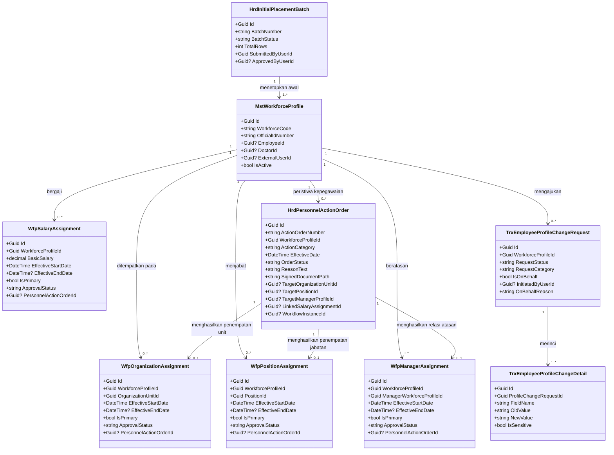

### 4.2 `BC-HR-04` — Kehadiran

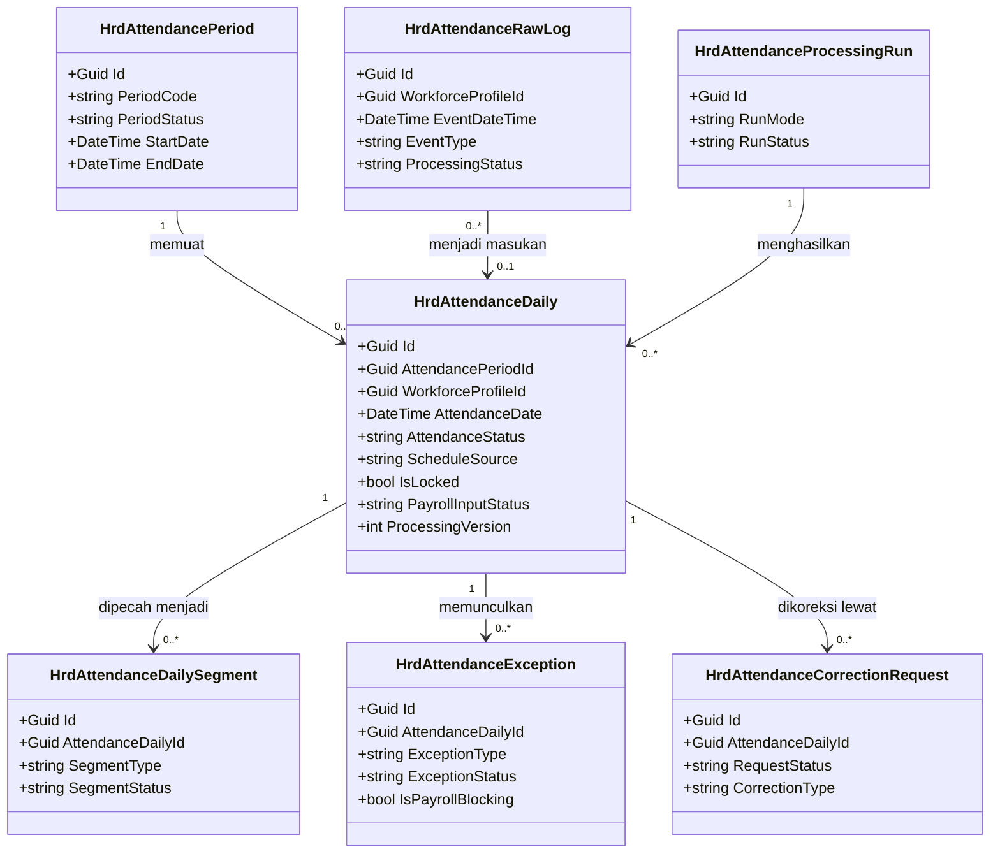

### 4.3 `BC-HR-05` — Cuti dan Saldo


### 4.4 `BC-HR-06` — Lembur

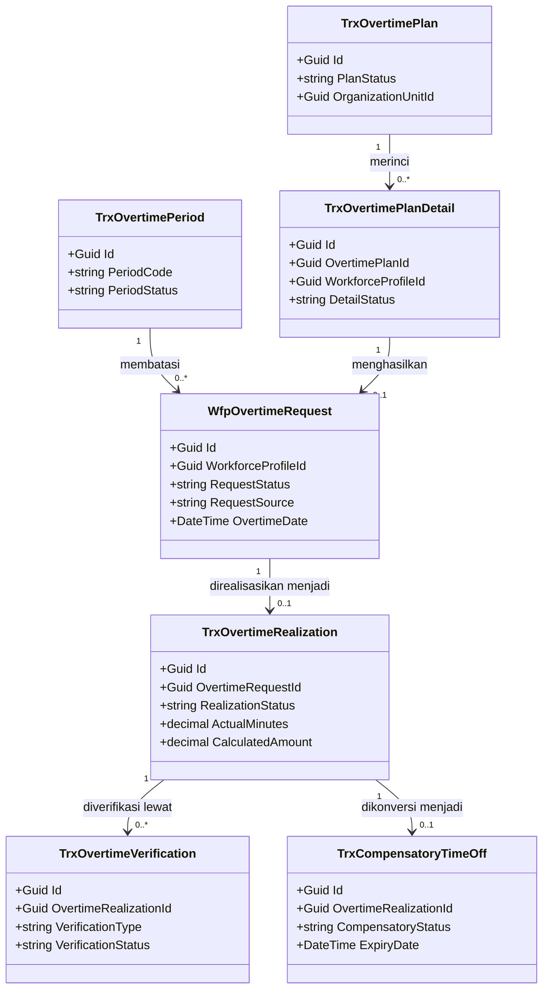

### 4.5 `BC-HR-03` — Penjadwalan Kerja

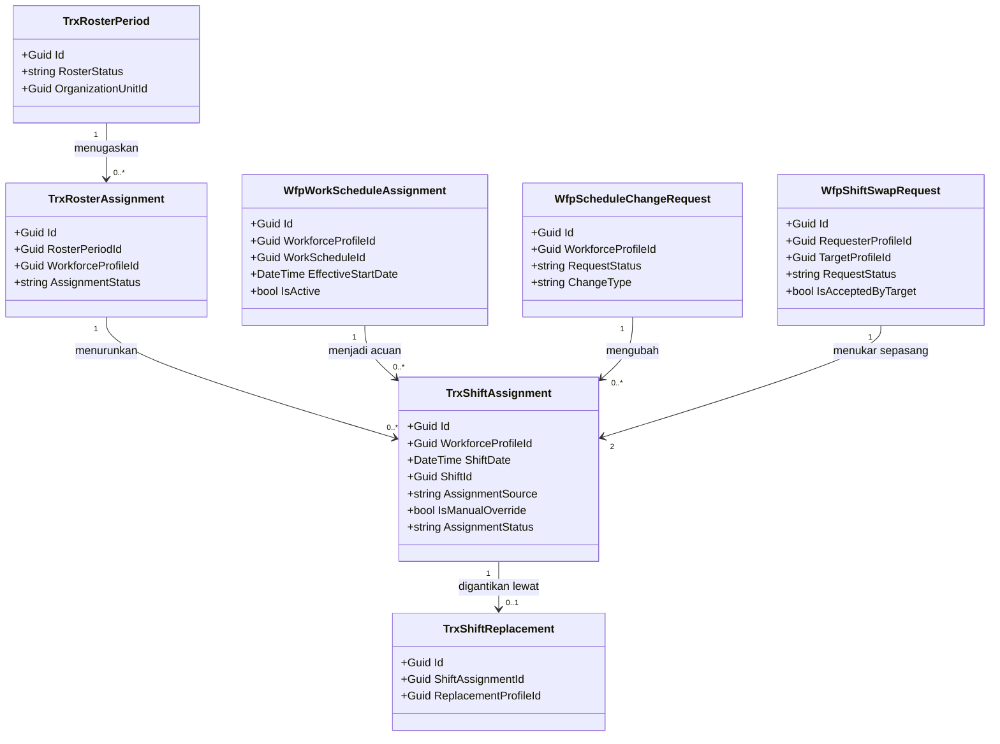

### 4.6 `BC-HR-07` — Persetujuan Bersama

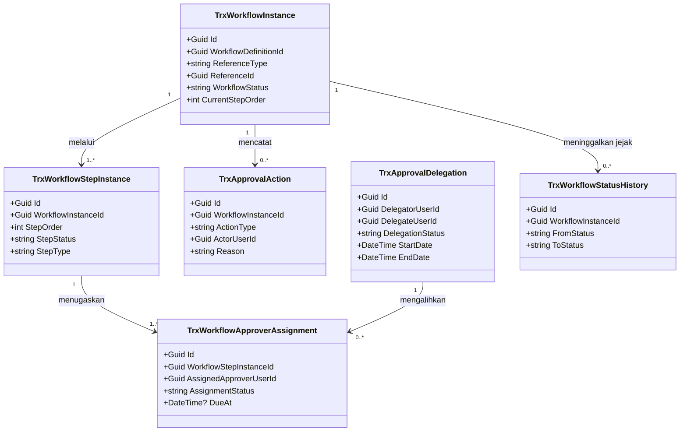

### 4.7 `BC-HR-08` dan `BC-HR-09` — Lifecycle dan Pengembangan Orang


---

## 5. Penjelasan setiap class

Setiap class yang muncul pada diagram di atas dijelaskan di sini. Dua baris pertama — **Status**
dan **Lokasi file** — adalah yang paling dibutuhkan implementer dan paling sering terlupa.

Kolom **Status** memakai tiga nilai saja: `Baru`, `Diperbarui`, `Sudah ada`.

### 5.1 `MstWorkforceProfile`

| Aspek | Penjelasan |
| --- | --- |
| **Status** | `Sudah ada` (dengan penguatan invariant) |
| **Lokasi file** | `Areas/Corporate/HumanResource/MasterData/Workforce/Models/MstWorkforceProfile.cs` |
| Kategori | Master |
| Tanggung jawab utama | Menjadi identitas tunggal seseorang di mata modul HR (`HRD-DEC-046`, `HRD-DEC-051`). Baik pegawai tetap, dokter, maupun pengguna eksternal, semuanya memiliki tepat satu baris profil. Kunci identitas orang adalah nomor identitas resmi (NIK untuk WNI, nomor paspor untuk WNA). Satu profil dapat membawa multi-peran (misal: Dokter mitra sekaligus Pegawai struktural kepala instalasi). Seluruh berkas kepegawaian, penempatan, kehadiran, cuti, lembur, dan payroll menunjuk ke baris ini |
| Field penting | `WorkforceCode`, `OfficialIdNumber`, `EmployeeId`, `DoctorId`, `ExternalUserId`, `WorkforceTypeId`, `IsActive`, `PrimaryDepartmentId`, `PrimaryPositionId` |
| Navigation property dan relasi | Punya banyak `WfpOrganizationAssignment`, `WfpPositionAssignment`, `WfpManagerAssignment`, `WfpSalaryAssignment`, `HrdPersonnelActionOrder`, dan seluruh entity berkas `Wfp*` lainnya |
| Pemakaian dalam alur bisnis | Dibuat saat orang pertama kali terdaftar. Form master data Pegawai/Dokter/Pengguna Eksternal hanya mengisi penempatan awal saat pembuatan pertama (`MASTER_FORM_SETS_INITIAL_ONLY`). Sesudahnya, form master data dilarang mengubah unit atau jabatan (`NO_PLACEMENT_CHANGE_FROM_MASTER_FORM`). Kolom `PrimaryDepartmentId` dan `PrimaryPositionId` adalah cerminan sistem dari penempatan utama yang berlaku hari ini (`ASSIGNMENT_IS_SOURCE_OF_TRUTH`) |
| Catatan desain | Dilarang membuat entity profil/pegawai baru untuk keperluan kehadiran, cuti, atau lembur. Pencegahan profil yatim (`NO_ORPHAN_PROFILE`) wajib ditegakkan |
| Ekuivalen model lama | — |

### 5.2 `WfpOrganizationAssignment`

| Aspek | Penjelasan |
| --- | --- |
| **Status** | `Diperbarui` |
| **Lokasi file** | `Areas/Corporate/HumanResource/WorkforceCore/Models/WfpOrganizationAssignment.cs` |
| Kategori | Transaksi penempatan |
| Tanggung jawab utama | Menjadi satu-satunya sumber kebenaran penempatan unit organisasi pegawai per tanggal efektif (`HRD-DEC-047`). Menjaga invariant bahwa pada satu tanggal seorang pegawai aktif wajib memiliki tepat satu penempatan unit utama (`EXACTLY_ONE_PRIMARY_PER_DATE`, `NO_PRIMARY_GAP_WHILE_ACTIVE`). Penempatan rangkap/Plt diperbolehkan asal bertanda bukan-utama (`SECONDARY_ALLOWED`) |
| Field penting | `WorkforceProfileId`, `OrganizationUnitId`, `EffectiveStartDate`, `EffectiveEndDate`, `IsPrimary`, `ApprovalStatus`, `PersonnelActionOrderId`, `WorkflowInstanceId` |
| Navigation property dan relasi | Menunjuk ke `MstWorkforceProfile`, `MstOrganizationUnit`, opsional `HrdPersonnelActionOrder` dan `TrxWorkflowInstance` |
| Pemakaian dalam alur bisnis | Dihasilkan dari Dokumen Peristiwa SK (`HRD-DEC-048`), perubahan berdiri sendiri (`HRD-DEC-036`), atau Batch Data Awal (`HRD-DEC-054`). Saat penempatan utama baru berlaku, penempatan utama lama otomatis ditutup per sehari sebelum tanggal mulai baru (`NEW_PRIMARY_CLOSES_OLD`) |
| Catatan desain | Wajib memuat kolom persetujuan (`HRD-DEC-031`). Tidak boleh diedit atau dihapus secara langsung dari tabel lintas-pegawai (`HRD-DEC-055`) |

### 5.3 `WfpPositionAssignment`

| Aspek | Penjelasan |
| --- | --- |
| **Status** | `Diperbarui` |
| **Lokasi file** | `Areas/Corporate/HumanResource/WorkforceCore/Models/WfpPositionAssignment.cs` |
| Kategori | Transaksi penempatan |
| Tanggung jawab utama | Menjadi sumber kebenaran jabatan pegawai per tanggal efektif (`HRD-DEC-047`). Tepat satu jabatan utama per tanggal (`HRD-DEC-049`). Menolak catatan kembar persis pada tanggal beririsan (`NO_EXACT_DUPLICATE`) |
| Field penting | `WorkforceProfileId`, `PositionId`, `EffectiveStartDate`, `EffectiveEndDate`, `IsPrimary`, `ApprovalStatus`, `PersonnelActionOrderId`, `WorkflowInstanceId` |
| Navigation property dan relasi | Menunjuk ke `MstWorkforceProfile`, `MstPosition`, opsional `HrdPersonnelActionOrder` |
| Pemakaian dalam alur bisnis | Dihasilkan dari promosi/demosi/rotasi pada Dokumen Peristiwa SK atau perubahan jabatan tersendiri |
| Catatan desain | Berlaku surut hanya sampai periode kehadiran yang masih terbuka (`HRD-DEC-050`) |

### 5.4 `WfpManagerAssignment`

| Aspek | Penjelasan |
| --- | --- |
| **Status** | `Diperbarui` |
| **Lokasi file** | `Areas/Corporate/HumanResource/WorkforceCore/Models/WfpManagerAssignment.cs` |
| Kategori | Transaksi penempatan |
| Tanggung jawab utama | Menjadi sumber kebenaran relasi atasan langsung pegawai per tanggal efektif (`HRD-DEC-047`). Menentukan rute persetujuan bawahan (`RequesterManager`) dan hak lihat Employee 360 (`HRD-DEC-053`). Hanya atasan utama yang menerima rute persetujuan bawaan (`ONLY_PRIMARY_MANAGER_ROUTES_APPROVAL`) |
| Field penting | `WorkforceProfileId`, `ManagerWorkforceProfileId`, `EffectiveStartDate`, `EffectiveEndDate`, `IsPrimary`, `ApprovalStatus`, `PersonnelActionOrderId` |
| Navigation property dan relasi | Menunjuk ke `MstWorkforceProfile` (pegawai) dan `MstWorkforceProfile` (atasan) |
| Pemakaian dalam alur bisnis | Mengatur rantai komando operasional unit. Penugasan Plt tidak otomatis mengalihkan rute persetujuan bawaan tanpa delegasi alur resmi |

### 5.5 `WfpSalaryAssignment`

| Aspek | Penjelasan |
| --- | --- |
| **Status** | `Diperbarui` |
| **Lokasi file** | `Areas/Corporate/HumanResource/WorkforceCore/Models/WfpSalaryAssignment.cs` |
| Kategori | Transaksi remunerasi |
| Tanggung jawab utama | Menyimpan penetapan gaji pokok dan golongan/struktur gaji per tanggal efektif (`HRD-DEC-031`). Nominal gaji bersifat rahasia/sensitif (`HRD-DEC-033`, `HRD-DEC-037`) |
| Field penting | `WorkforceProfileId`, `BasicSalary` (Sensitif), `SalaryGradeId`, `SalaryStructureId`, `EffectiveStartDate`, `EffectiveEndDate`, `IsPrimary`, `ApprovalStatus`, `PersonnelActionOrderId` |
| Navigation property dan relasi | Menunjuk ke `MstWorkforceProfile`, `MstSalaryGrade`, `MstSalaryStructure` |
| Pemakaian dalam alur bisnis | Dihubungkan ke Dokumen SK bila timbul dari peristiwa kepegawaian, namun alur approval penetapannya tetap terpisah (`SALARY_STAYS_SEPARATE`) |
| Catatan kewenangan | Nominal gaji disembunyikan dari daftar lintas-pegawai dan Employee 360 atasan. Hanya pengguna dengan butir sensitif `ViewAmount` yang dapat melihatnya |

### 5.6 `HrdPersonnelActionOrder`

| Aspek | Penjelasan |
| --- | --- |
| **Status** | `Baru` |
| **Lokasi file** | `Areas/Corporate/HumanResource/WorkforceCore/Models/HrdPersonnelActionOrder.cs` |
| Kategori | Transaksi operasional (Dokumen Peristiwa / SK Kepegawaian) |
| Tanggung jawab utama | Mengelola satu peristiwa kepegawaian (Mutasi, Promosi, Rotasi, Demosi, Penugasan Sementara) sebagai satu kesatuan dokumen utuh (`HRD-DEC-048`). Memuat perubahan unit, jabatan, dan atasan dengan pasangan "dari" dan "ke". Disetujui atau ditolak secara utuh (`ALL_OR_NOTHING`). Menjaga rantai approval pola T8 (`HRD-DEC-056`) dengan syarat wajib unggah scan SK resmi bertandatangan (`SIGNED_SK_ATTACHMENT_REQUIRED`) sebelum diajukan |
| Field penting | `ActionOrderNumber`, `WorkforceProfileId`, `ActionCategory`, `EffectiveDate`, `OrderStatus`, `ReasonText`, `SignedDocumentPath`, `SignedDocumentFileName`, `TargetOrganizationUnitId`, `TargetPositionId`, `TargetManagerProfileId`, `LinkedSalaryAssignmentId`, `WorkflowInstanceId` |
| Navigation property dan relasi | Menunjuk `MstWorkforceProfile`, unit tujuan, jabatan tujuan, atasan tujuan, dan `TrxWorkflowInstance` |
| Pemakaian dalam alur bisnis | Dibuat HR Admin (`Draft`), diunggah scan SK, diajukan (`Submitted`), disetujui HR Manager (`Scheduled` atau langsung `Applied` jika retroaktif ke periode terbuka), lalu pada tanggal berlaku sistem menutup penempatan lama dan membuka penempatan baru serta mencatat satu baris riwayat kepegawaian. Pembatalan hanya diizinkan sebelum tanggal berlaku (`HRD-DEC-057`) |
| Catatan desain | Menggantikan pemisahan 5 tabel transaksi lama (`TrxEmployeeTransfer`, dll.) menjadi satu aggregate root yang padu sesuai konvensi canonical `Hrd*` (`HRD-DEC-019`) |

### 5.7 `TrxEmployeeProfileChangeRequest`

| Aspek | Penjelasan |
| --- | --- |
| **Status** | `Diperbarui` |
| **Lokasi file** | `Areas/Corporate/HumanResource/WorkforceCore/Models/TrxEmployeeProfileChangeRequest.cs` |
| Kategori | Transaksi administrasi |
| Tanggung jawab utama | Menampung permohonan perubahan data pribadi pegawai baik diajukan mandiri maupun atas nama pegawai oleh HR (`HRD-DEC-052`). Data sensitif (rekening bank, NIK, NPWP, tanggungan) dilarang diubah langsung (`SENSITIVE_NO_DIRECT_EDIT`), wajib lewat permohonan berbukti |
| Field penting | `WorkforceProfileId`, `RequestStatus`, `RequestCategory`, `IsOnBehalf`, `InitiatedByUserId`, `OnBehalfReason`, `OnBehalfNotifiedAt`, `EvidenceFilePath`, `SubmittedAt`, `AppliedAt` |
| Navigation property dan relasi | Punya banyak `TrxEmployeeProfileChangeDetail` dan `TrxEmployeeProfileChangeVerification` |
| Pemakaian dalam alur bisnis | Diajukan pegawai atau HR atas nama pegawai. Diverifikasi oleh petugas HR yang berbeda dari pembuat (`VERIFIER_MUST_DIFFER_FROM_CREATOR`). Setelah disetujui, diterapkan ke berkas profil pegawai (`Applied`) |
| Kelas QBE bila disentuh | `TOUCHED LEGACY` — prefix `Trx` diratchet bertahap per `HRD-DEC-019` saat disentuh task |

### 5.8 `HrdInitialPlacementBatch` dan `HrdInitialPlacementBatchRow`

| Aspek | Penjelasan |
| --- | --- |
| **Status** | `Baru` |
| **Lokasi file** | `Areas/Corporate/HumanResource/WorkforceCore/Models/HrdInitialPlacementBatch.cs` |
| Kategori | Batch administrasi data awal |
| Tanggung jawab utama | Menampung proses migrasi/input data awal penempatan kepegawaian bagi 55 pegawai existing yang belum memiliki jabatan, atasan, dan gaji (`HRD-DEC-054`). Batch divalidasi sistem terhadap invariant penempatan tunggal (`HRD-DEC-049`), disetujui sekali oleh HR Manager, dan setiap pegawai hanya boleh masuk batch satu kali seumur hidup (`ONCE_PER_EMPLOYEE`) |
| Field penting | `BatchNumber`, `BatchStatus`, `TotalRows`, `ValidatedRows`, `FailedRows`, `SubmittedByUserId`, `ApprovedByUserId`, `ApprovedAt` |
| Pemakaian dalam alur bisnis | HR Admin mengunduh template, mengisi data, mengunggah dan memvalidasi batch, lalu mengajukan approval. Setelah disetujui, sistem menerbitkan penempatan awal dan menandai jejak audit sebagai data awal baseline |

### 5.9 Controller dan Service Workforce Core

| Komponen | Status | Lokasi | Tanggung Jawab |
| --- | --- | --- | --- |
| `WorkforceCoreCrossEmployeeController` | `Diperbarui` | `Areas/Corporate/HumanResource/WorkforceCore/Controllers/` | Menyediakan 5 endpoint daftar pantau lintas-pegawai (organisasi, jabatan, atasan, riwayat, gaji tanpa nominal) beserta saringan dan pencarian (`HRD-DEC-012`, `HRD-DEC-055`) |
| `HrdPersonnelActionOrderController` | `Baru` | `Areas/Corporate/HumanResource/WorkforceCore/Controllers/` | Menangani siklus hidup Dokumen Peristiwa SK: pembuatan draft, unggah scan SK, pengajuan, approval/reject, pengajuan batal, dan eksekusi penempatan (`HRD-DEC-048`, `HRD-DEC-056`, `HRD-DEC-057`) |
| `Employee360Controller` | `Baru` | `Areas/Corporate/HumanResource/WorkforceCore/Controllers/` | Menyajikan profil komprehensif pegawai 360 dengan filter otorisasi ketat: tampilan lengkap untuk HR, tampilan terbatas profil kerja untuk Atasan Langsung bawahan aktif hari ini, dan penolakan 403 untuk bukan bawahan (`HRD-DEC-053`) |
| `EmployeeProfileChangeController` | `Diperbarui` | `Areas/Corporate/HumanResource/WorkforceCore/Controllers/` | Menangani transaksi permohonan perubahan data sisi HR: daftar permohonan, verifikasi, keputusan, apply, download bukti, dan endpoint pembuatan pengajuan atas nama pegawai (`HRD-DEC-052`, `HRD-DEC-093`) |
| `EmployeeProfileChangeSelfServiceController` | `Diperbarui` | `Areas/SelfServices/HumanResource/Controllers/` | Menangani portal Layanan Mandiri (ESS) untuk perubahan data profil: profil berjalan (`current-profile`), ringkasan statistik (`summary`), draf, unggah bukti pendukung (`evidence`), unduh bukti, pembatalan, dan submit ke workflow engine (`HRD-DEC-091`..`094`) |
| `InitialPlacementBatchController` | `Baru` | `Areas/Corporate/HumanResource/WorkforceCore/Controllers/` | Menangani unduh template, unggah, validasi baris, pengajuan, dan approval batch data awal penempatan (`HRD-DEC-054`) |

### 5.4 `HrdAttendanceRawLog`

| Aspek | Penjelasan |
| --- | --- |
| **Status** | `Sudah ada` |
| **Lokasi file** | `Areas/Corporate/HumanResource/AttendanceManagement/Models/HrdAttendanceRawLog.cs` |
| Kategori | Transaksi kehadiran |
| Tanggung jawab utama | Menyimpan rekaman mentah dari mesin absensi, aplikasi, atau impor. Ini adalah **fakta**, bukan hasil olahan |
| Field penting | `WorkforceProfileId`, `EventDateTime`, `EventType`, `SourceType`, `ProcessingStatus`, `DeviceId` |
| Navigation property dan relasi | Menjadi masukan bagi `HrdAttendanceDaily` |
| Pemakaian dalam alur bisnis | Masuk setiap kali pegawai menempelkan sidik jari, menekan tombol pada aplikasi, atau saat data diimpor dari mesin |
| Catatan desain | **Invariant yang paling penting di seluruh modul ini: baris di sini tidak pernah ditulis ulang oleh koreksi apa pun.** Koreksi kehadiran memutasi `HrdAttendanceDaily`, bukan rekaman mentah. Dibuktikan pada `PHASE 2A.1`. Setiap desain yang melanggar ini menghilangkan kemampuan menghitung ulang kehadiran dari nol |
| Ekuivalen model lama | `TrxAttendanceRawLog` — sudah diratchet lewat migration `20260819092733_ChangeNameTrxAttendanceToHrdAttendance` |

### 5.5 `HrdAttendanceDaily`

| Aspek | Penjelasan |
| --- | --- |
| **Status** | `Sudah ada` |
| **Lokasi file** | `Areas/Corporate/HumanResource/AttendanceManagement/Models/HrdAttendanceDaily.cs` |
| Kategori | Transaksi kehadiran |
| Tanggung jawab utama | Menyimpan hasil olahan satu hari kerja untuk satu pegawai, setelah jadwal, cuti, lembur, dan koreksi diperhitungkan. Inilah satuan yang dibaca payroll |
| Field penting | `AttendancePeriodId`, `WorkforceProfileId`, `AttendanceDate`, `AttendanceStatus`, `ScheduleSource`, `IsLate`, `LateMinutes`, `IsEarlyLeave`, `EarlyLeaveMinutes`, `IsLocked`, `PayrollInputStatus`, `ProcessingVersion` |
| Navigation property dan relasi | Milik `HrdAttendancePeriod`; punya banyak `HrdAttendanceDailySegment` dan `HrdAttendanceException` |
| Pemakaian dalam alur bisnis | Dihasilkan pemrosesan kehadiran, dilihat pegawai dan HR, dikoreksi lewat permohonan koreksi, lalu dikunci saat diserahkan ke payroll |
| Catatan desain | `ProcessingVersion` naik setiap pemrosesan ulang, sehingga selisih hasil dapat ditelusuri. `IsLocked = true` berarti hari itu sudah masuk snapshot payroll dan **tidak boleh** diubah tanpa `rollback` yang terotorisasi |
| Ekuivalen model lama | `TrxAttendanceDaily` — sudah diratchet |

### 5.6 `HrdAttendancePeriod`

| Aspek | Penjelasan |
| --- | --- |
| **Status** | `Sudah ada` |
| **Lokasi file** | `Areas/Corporate/HumanResource/AttendanceManagement/Models/HrdAttendancePeriod.cs` |
| Kategori | Transaksi kehadiran — penjaga periode |
| Tanggung jawab utama | Menjadi gerbang yang memutuskan kapan data kehadiran satu rentang tanggal boleh berubah dan kapan tidak |
| Field penting | `PeriodCode`, `PeriodStatus`, `StartDate`, `EndDate`, `ClosedAt`, `ClosedByUserId` |
| Navigation property dan relasi | Punya banyak `HrdAttendanceDaily` |
| Pemakaian dalam alur bisnis | Dibuka petugas payroll di awal periode, ditutup setelah seluruh pengecualian selesai, dibuka kembali hanya bila ada temuan |
| Catatan desain | Penutupan **ditolak** bila masih ada `HrdAttendanceException` dengan `IsPayrollBlocking` berstatus `Open`/`UnderReview`, atau masih ada permohonan koreksi aktif `[EXISTING]`. Pembukaan kembali hanya sah dari status `Closed`, dan ditolak bila ada hari yang sudah tertaut payroll `[EXISTING]` |
| Ekuivalen model lama | `TrxAttendancePeriod` — sudah diratchet |

### 5.7 `HrdAttendanceException`

| Aspek | Penjelasan |
| --- | --- |
| **Status** | **`Diperbarui`** |
| **Lokasi file** | `Areas/Corporate/HumanResource/AttendanceManagement/Models/HrdAttendanceException.cs` |
| Kategori | Transaksi kehadiran |
| Tanggung jawab utama | Menandai hal yang tidak wajar pada satu hari kerja — terlambat, pulang cepat, tidak absen masuk, tidak absen pulang, di luar area, dan seterusnya — agar petugas menanganinya sebelum periode ditutup |
| Field penting | `AttendanceDailyId`, `ExceptionType`, `ExceptionStatus`, `ExceptionSeverity`, `IsPayrollBlocking`, `ResolutionNote` |
| Navigation property dan relasi | Milik `HrdAttendanceDaily` |
| Pemakaian dalam alur bisnis | Dibuat otomatis saat pemrosesan; ditinjau HR atau atasan; ditutup lewat koreksi, pengabaian yang tercatat, atau penolakan |
| **Kolom yang berubah** | **Satu nilai baru ditambahkan pada kosakata `ExceptionType`: `OutOfScheduleWork`.** Tidak ada kolom baru pada tabel. Yang berubah adalah himpunan nilai yang sah untuk kolom `ExceptionType` yang sudah ada, ditambah kolom baru `ClassificationDecision` (`string(40)`, boleh kosong) dan `ClassifiedByUserId` (`Guid?`) serta `ClassifiedAt` (`DateTime?`) untuk menyimpan keputusan atasan atas pengecualian jenis ini |
| Catatan desain | `[DECISION]` `HRD-DEC-025`: **`ScheduleMismatch` tidak diperluas maknanya.** Ia tetap berarti *jadwal tidak dapat diselesaikan* (`SCHEDULE_UNRESOLVED`), bukan *kerja di luar jendela jadwal yang valid*. Aktivitas dokter di luar jadwal kerjanya memakai tipe **baru dan terpisah**. Nilai itu **tidak pernah** otomatis menjadi lembur — atasan yang memutuskan klasifikasinya, sejalan `HRD-DEC-013` |
| Ekuivalen model lama | `TrxAttendanceException` — sudah diratchet |

### 5.8 `HrdAttendanceCorrectionRequest`

| Aspek | Penjelasan |
| --- | --- |
| **Status** | **`Diperbarui`** |
| **Lokasi file** | `Areas/Corporate/HumanResource/AttendanceManagement/Models/HrdAttendanceCorrectionRequest.cs` |
| Kategori | Transaksi kehadiran |
| Tanggung jawab utama | Menampung permohonan pegawai untuk memperbaiki hasil olahan kehadirannya, beserta alasan dan buktinya |
| Field penting | `AttendanceDailyId`, `RequestStatus`, `CorrectionType`, `Reason`, `EvidenceFilePath`, `WorkflowInstanceId` |
| Navigation property dan relasi | Milik `HrdAttendanceDaily`; punya banyak `HrdAttendanceCorrectionDetail` dan `HrdAttendanceCorrectionApproval` |
| **Kolom yang berubah** | Empat kolom baru untuk mendukung permohonan atas nama pegawai (`HRD-DEC-028`): `InitiatedByUserId` (`Guid?`), `IsOnBehalf` (`bool`, bawaan `false`), `OnBehalfReason` (`string(500)`, boleh kosong), `OnBehalfNotifiedAt` (`DateTime?`) |
| Catatan desain | `[DECISION]` `HRD-DEC-022`: `Applied` adalah **terminal terhadap sinkronisasi workflow normal**. Endpoint `synchronize` **MUST NOT** menurunkan `Applied` kembali ke `Approved`. Keadaan hari ini melanggar ini dan tercatat sebagai `IMPLEMENTATION DEFECT / REPAIR`, bukan perilaku target. `[DECISION]` `HRD-DEC-028`: HR Admin boleh membuat permohonan atas nama pegawai bila pegawai tidak dapat mengakses layanan mandiri, dengan initiator, alasan, waktu, bukti bila perlu, notifikasi ke pegawai, dan jejak audit **wajib** |
| Ekuivalen model lama | `TrxAttendanceCorrectionRequest` — sudah diratchet |

### 5.9 `WfpLeaveBalance`

| Aspek | Penjelasan |
| --- | --- |
| **Status** | `Sudah ada` |
| **Lokasi file** | `Areas/Corporate/HumanResource/LeaveManagement/Models/WfpLeaveBalance.cs` |
| Kategori | Transaksi cuti — buku besar |
| Tanggung jawab utama | Menyimpan saldo cuti seorang pegawai untuk satu jenis cuti pada satu periode hak. Nilainya **selalu** merupakan hasil penjumlahan seluruh baris buku besar yang menunjuk ke sini |
| Field penting | `WorkforceProfileId`, `LeaveTypeId`, `EntitlementPeriodId`, `EntitledDays`, `UsedDays`, `ReservedDays`, `CarriedForwardDays`, `BalanceStatus` |
| Navigation property dan relasi | Punya banyak `TrxLeaveBalanceTransaction` dan `TrxLeaveAdjustment` |
| Pemakaian dalam alur bisnis | Dibaca saat pegawai mengajukan cuti; dipotong saat cuti mulai berjalan; dikembalikan saat cuti dibatalkan |
| Catatan desain | Satuan yang tersimpan adalah **pecahan hari**, bukan jam maupun menit. Cuti per jam dikonversi satu kali di titik kalkulasi. Saldo **MUST NOT** diubah tanpa satu baris `TrxLeaveBalanceTransaction` pasangannya di dalam transaksi yang sama |
| Ekuivalen model lama | — |

### 5.10 `WfpLeaveRequest`

| Aspek | Penjelasan |
| --- | --- |
| **Status** | `Sudah ada` |
| **Lokasi file** | `Areas/Corporate/HumanResource/LeaveManagement/Models/WfpLeaveRequest.cs` |
| Kategori | Transaksi cuti |
| Tanggung jawab utama | Menampung permohonan cuti seorang pegawai dari pengajuan sampai selesai dijalankan |
| Field penting | `WorkforceProfileId`, `LeaveTypeId`, `LeaveRequestStatus`, `StartDate`, `EndDate`, `IsHourly`, `IsHalfDay`, `RequestedMinutes`, `RequestedDays`, `CurrentApprovalStep`, `WorkflowInstanceId` |
| Navigation property dan relasi | Punya satu `TrxLeaveExecution`, banyak `TrxLeaveRequestAttachment`, `TrxLeaveCancellationRequest`, `TrxLeaveRecall` |
| Pemakaian dalam alur bisnis | Diajukan pegawai, disetujui atasan lewat mesin workflow, dijalankan sistem pada tanggal mulai, diselesaikan pada tanggal akhir |
| Catatan desain | Status domain adalah **`WaitingApproval` tunggal** sepanjang tingkatan persetujuan apa pun. Rantai bertingkat hidup di lapisan `MstWorkflowStep.StepOrder`, **bukan** sebagai status bernama. Komentar granular pada baris 89–92 model ini adalah **template yang disalin**, bukan desain — komentar identik ada pada `TrxExpenseClaim.cs`, entity yang tidak berhubungan. `HRD-Q-44` tertutup |
| Ekuivalen model lama | — |

### 5.11 `TrxLeaveBalanceTransaction`

| Aspek | Penjelasan |
| --- | --- |
| **Status** | `Sudah ada` |
| **Lokasi file** | `Areas/Corporate/HumanResource/LeaveManagement/Models/TrxLeaveBalanceTransaction.cs` |
| Kategori | Transaksi cuti — baris buku besar |
| Tanggung jawab utama | Mencatat setiap pergerakan saldo cuti sebagai satu baris yang tidak dapat diubah, sehingga selisih saldo selalu punya penjelasan |
| Field penting | `LeaveBalanceId`, `TransactionType`, `TransactionDirection`, `Days`, `TransactionStatus`, `ReferenceType`, `ReferenceId` |
| Navigation property dan relasi | Milik `WfpLeaveBalance` |
| Pemakaian dalam alur bisnis | Ditulis setiap kali saldo bertambah atau berkurang: pemberian hak, akrual bulanan, sisa yang dibawa ke periode berikutnya, reservasi, potongan, pengembalian karena pembatalan, penyesuaian manual, kedaluwarsa |
| Catatan desain | Baris yang sudah `Posted` **MUST NOT** diubah. Koreksi dilakukan dengan menulis baris pembalik bertipe `Reversal`, bukan dengan menyunting baris lama. Ini yang membuat buku besar dapat diaudit |
| Ekuivalen model lama | — |
| Kelas QBE bila disentuh | `TOUCHED LEGACY` |

### 5.12 `TrxLeaveExecution`

| Aspek | Penjelasan |
| --- | --- |
| **Status** | **`Diperbarui`** |
| **Lokasi file** | `Areas/Corporate/HumanResource/LeaveManagement/Models/TrxLeaveExecution.cs` |
| Kategori | Transaksi cuti |
| Tanggung jawab utama | Menjalankan cuti yang sudah disetujui: memotong saldo pada tanggal mulai, menandai hari-hari kehadiran sebagai cuti, dan menyelesaikannya pada tanggal akhir |
| Field penting | `LeaveRequestId`, `ExecutionStatus`, `AttendanceIntegrationStatus`, `ExecutedAt`, `CompletedAt` |
| Navigation property dan relasi | Milik `WfpLeaveRequest`; menulis `TrxLeaveAttendanceIntegration` dan `TrxLeaveBalanceTransaction` |
| **Kolom yang berubah** | Empat kolom baru untuk memenuhi `HRD-DEC-023`: `ReversalReason` (`string(500)`, boleh kosong), `ReversedByUserId` (`Guid?`), `ReversedAt` (`DateTime?`), `PayrollLockCheckedAt` (`DateTime?`) |
| Catatan desain | `[DECISION]` `HRD-DEC-023`: cuti `Completed` adalah **business-final untuk operasi normal**, tetapi pembalikan terkendali tetap sah. `Reverse` **wajib** punya permission khusus, alasan wajib, pelaku dan waktu, rekonsiliasi kehadiran, pembalikan saldo, dan guard periode payroll terkunci. **Bila payroll sudah terkunci, histori `Completed` MUST NOT dimutasi langsung** — pakai transaksi penyesuaian terpisah. Keadaan hari ini melanggar keenam syarat itu dan tercatat sebagai `IMPLEMENTATION DEFECT / REPAIR` |
| Ekuivalen model lama | — |
| Kelas QBE bila disentuh | `TOUCHED LEGACY` — menambah kolom adalah *material touch*, sehingga ratchet menjadi `HrdLeaveExecution` berlaku pada task yang sama |

### 5.13 `TrxLeaveRecall`

| Aspek | Penjelasan |
| --- | --- |
| **Status** | **`Diperbarui`** |
| **Lokasi file** | `Areas/Corporate/HumanResource/LeaveManagement/Models/TrxLeaveRecall.cs` |
| Kategori | Transaksi cuti |
| Tanggung jawab utama | Menampung pemanggilan kembali pegawai yang sedang cuti karena kebutuhan pelayanan |
| Field penting | `LeaveRequestId`, `RecallStatus`, `RecallDate`, `ReturnDate`, `Reason` |
| Navigation property dan relasi | Milik `WfpLeaveRequest` |
| **Kolom yang berubah** | Tiga kolom baru untuk `HRD-DEC-024`: `AcknowledgementOverrideReason` (`string(500)`, boleh kosong), `AcknowledgementOverrideByUserId` (`Guid?`), `AcknowledgementOverrideAt` (`DateTime?`) |
| Catatan desain | `[DECISION]` `HRD-DEC-024`: `Acknowledged` **bukan** prasyarat sebelum `Approved`. Urutan target: `WaitingApproval` → `Approved` → notifikasi dikirim → `Acknowledged` → `Applied`. HR Manager boleh melakukan *override* acknowledgement sebelum `Applied` dengan alasan, pelaku, waktu, dan jejak audit wajib. **Pegawai MUST NOT dapat memblokir keputusan organisasi selamanya hanya dengan tidak melakukan acknowledge** |
| Ekuivalen model lama | — |

### 5.14 `WfpOvertimeRequest`

| Aspek | Penjelasan |
| --- | --- |
| **Status** | `Sudah ada` |
| **Lokasi file** | `Areas/Corporate/HumanResource/OvertimeManagement/Models/WfpOvertimeRequest.cs` |
| Kategori | Transaksi lembur |
| Tanggung jawab utama | Menampung permohonan lembur dari pengajuan sampai penyerahan ke payroll |
| Field penting | `WorkforceProfileId`, `RequestStatus`, `RequestSource`, `OvertimeDate`, `PlannedStartAt`, `PlannedEndAt`, `OvertimeCategory`, `WorkflowInstanceId` |
| Navigation property dan relasi | Punya satu `TrxOvertimeRealization`; boleh berasal dari `TrxOvertimePlanDetail` |
| Pemakaian dalam alur bisnis | Diajukan pegawai atau diturunkan dari rencana atasan; disetujui; dikerjakan; direalisasikan; diverifikasi; diserahkan |
| Catatan desain | Lembur berjalan **lima tahap terpisah** — rencana, permohonan, realisasi, verifikasi, serah terima — dan kelimanya **MUST NOT** disatukan. Permohonan yang rentang waktunya bertumpuk ditolak dengan kode `REQUEST_OVERLAP` `[EXISTING]` |
| Ekuivalen model lama | — |

### 5.15 `TrxOvertimeRealization`

| Aspek | Penjelasan |
| --- | --- |
| **Status** | `Sudah ada` |
| **Lokasi file** | `Areas/Corporate/HumanResource/OvertimeManagement/Models/TrxOvertimeRealization.cs` |
| Kategori | Transaksi lembur |
| Tanggung jawab utama | Menyimpan lembur yang **benar-benar dikerjakan**, dihitung dari kehadiran nyata, bukan dari rencana |
| Field penting | `OvertimeRequestId`, `RealizationStatus`, `ActualStartAt`, `ActualEndAt`, `ActualMinutes`, `CalculatedAmount`, `AttendanceMatchStatus` |
| Navigation property dan relasi | Milik `WfpOvertimeRequest`; punya banyak `TrxOvertimeVerification` dan `TrxOvertimeRealizationDetail` |
| Pemakaian dalam alur bisnis | Dihitung setelah lembur selesai dikerjakan, dicocokkan dengan kehadiran, lalu diverifikasi berjenjang |
| Catatan desain | Nominal **selalu** berasal dari backend lewat `OvertimeRateResolverService`; frontend **MUST NOT** menghitung tarif. Penyerahan ke payroll diblokir kecuali `RealizationStatus == Verified` **dan** verifikasi aktif terbaru berstatus `Approved` `[EXISTING]` |
| Ekuivalen model lama | — |
| Kelas QBE bila disentuh | `TOUCHED LEGACY` |

### 5.16 `TrxShiftAssignment`

| Aspek | Penjelasan |
| --- | --- |
| **Status** | **`Diperbarui`** |
| **Lokasi file** | `Areas/Corporate/HumanResource/SchedulingManagement/Models/TrxShiftAssignment.cs` |
| Kategori | Transaksi penjadwalan |
| Tanggung jawab utama | Menyimpan shift yang ditugaskan kepada seorang pegawai pada satu tanggal. Inilah yang dibaca pemroses kehadiran untuk mengetahui jadwal hari itu |
| Field penting | `WorkforceProfileId`, `ShiftDate`, `ShiftId`, `WorkScheduleId`, `ScheduledStartAt`, `ScheduledEndAt`, `PlannedWorkMinutes`, `AssignmentSource`, `IsManualOverride`, `AssignmentStatus`, `IsActive` |
| Navigation property dan relasi | Boleh berasal dari `TrxRosterAssignment`; boleh diubah `WfpScheduleChangeRequest` dan `WfpShiftSwapRequest`; boleh digantikan `TrxShiftReplacement` |
| Pemakaian dalam alur bisnis | Ditulis saat roster diterbitkan atau saat tukar shift diterapkan; dibaca `AttendanceScheduleResolverService` setiap kali kehadiran diproses |
| **Kolom yang berubah** | Tidak ada kolom baru. Yang berubah adalah **statusnya sebagai entity yang memiliki API**: hari ini ia ditulis langsung dari lapisan service tanpa controller. Target `EXTEND` memberinya controller sendiri. Bila `EXTEND` ternyata menuntut kolom, kolom itu **wajib** disebutkan pada revisi dokumen ini lebih dulu, bukan ditambahkan saat implementasi |
| Catatan desain | Tukar shift yang `Applied` **benar-benar** menukar `ShiftDate`, `ShiftId`, `WorkScheduleId`, `ScheduledStartAt/EndAt`, dan `PlannedWorkMinutes` kedua baris, lalu menandai keduanya `AssignmentSource = "ShiftSwap"` dan `IsManualOverride = true` — dan pemroses kehadiran memungutnya `[EXISTING]`, dibuktikan `PHASE 2B.1`. Jangan merancang jalur kedua yang menduplikasi ini |
| Ekuivalen model lama | — |
| Kelas QBE bila disentuh | `TOUCHED LEGACY` — bila `EXTEND` menyentuh entity atau konfigurasi EF-nya, ratchet menjadi `HrdShiftAssignment` berlaku pada task yang sama |

### 5.17 `TrxRosterPeriod`

| Aspek | Penjelasan |
| --- | --- |
| **Status** | `Sudah ada` — **tanpa perilaku** |
| **Lokasi file** | `Areas/Corporate/HumanResource/SchedulingManagement/Models/TrxRosterPeriod.cs` |
| Kategori | Transaksi penjadwalan |
| Tanggung jawab utama | Menjadi wadah satu putaran penyusunan jadwal untuk satu unit pada satu rentang tanggal |
| Field penting | `OrganizationUnitId`, `RosterStatus`, `StartDate`, `EndDate`, `PublishedAt` |
| Navigation property dan relasi | Punya banyak `TrxRosterAssignment`, `TrxRosterPublication`, `TrxRosterApproval` |
| Pemakaian dalam alur bisnis | **Belum dipakai sama sekali.** Kosakata statusnya ada di model (`Draft`, `Validation`, `Submitted`, `Approved`, `Published`, `Locked`, `Closed`, `Cancelled`) tetapi **tidak ada satu pun controller atau service yang mengoperasikannya** `[EXISTING]` |
| Catatan desain | `[DECISION]` `HRD-DEC-026`: untuk rumah sakit 24 jam, roster adalah bagian target, **bukan** `DEFERRED`. Klasifikasi target adalah **`EXTEND` terhadap skema yang sudah ada** — model, konfigurasi EF, dan tabelnya sudah dibuat. **Larangan:** jangan membuat skema baru sebelum model existing diaudit, dan `HRD-Q-05` wajib terjawab lebih dulu bila perubahan destruktif ternyata diperlukan |
| Ekuivalen model lama | — |

### 5.18 `TrxWorkflowInstance`

| Aspek | Penjelasan |
| --- | --- |
| **Status** | **`Diperbarui`** |
| **Lokasi file** | `Areas/Corporate/HumanResource/WorkflowManagement/Models/TrxWorkflowInstance.cs` |
| Kategori | Transaksi persetujuan |
| Tanggung jawab utama | Menjadi mesin persetujuan bersama untuk seluruh jenis transaksi HR: cuti, lembur, koreksi kehadiran, tukar shift, ubah jadwal, perubahan data, pengunduran diri |
| Field penting | `WorkflowDefinitionId`, `ReferenceType`, `ReferenceId`, `WorkflowStatus`, `CurrentStepOrder`, `SubmittedAt`, `CompletedAt` |
| Navigation property dan relasi | Punya banyak `TrxWorkflowStepInstance`, `TrxApprovalAction`, `TrxWorkflowStatusHistory`, `TrxWorkflowComment`, `TrxWorkflowAttachment` |
| Pemakaian dalam alur bisnis | Dibuat saat transaksi diajukan; dimajukan setiap kali penyetuju memutuskan; ditutup saat seluruh langkah selesai |
| **Kolom yang berubah** | Tidak ada kolom baru pada entity ini. Perubahan `EXTEND` untuk `HRD-DEC-030` berada pada `TrxWorkflowApproverAssignment` — lihat 5.19 |
| Catatan desain | `[DECISION]` `HRD-DEC-018`: kotak masuk terpadu **hanya menyatukan pengalaman pengguna**. Workflow, policy, permission, validasi, SLA, dan eskalasi tetap **per jenis transaksi**. Instance ini **MUST NOT** memuat aturan bisnis domain mana pun. Yang boleh diseragamkan hanya bentuk baris ringkasan, cara memfilter, penanda status, dan cara berpindah ke detail |
| Ekuivalen model lama | — |
| Kelas QBE bila disentuh | `TOUCHED LEGACY` |

### 5.19 `TrxWorkflowApproverAssignment`

| Aspek | Penjelasan |
| --- | --- |
| **Status** | **`Diperbarui`** |
| **Lokasi file** | `Areas/Corporate/HumanResource/WorkflowManagement/Models/TrxWorkflowApproverAssignment.cs` |
| Kategori | Transaksi persetujuan |
| Tanggung jawab utama | Menugaskan satu langkah persetujuan kepada satu orang tertentu. Inilah baris yang muncul di kotak masuk seseorang |
| Field penting | `WorkflowStepInstanceId`, `AssignedApproverUserId`, `AssignmentStatus`, `DueAt`, `DecidedAt`, `DelegatedFromUserId` |
| Navigation property dan relasi | Milik `TrxWorkflowStepInstance`; boleh dialihkan `TrxApprovalDelegation` |
| Pemakaian dalam alur bisnis | Dibuat saat langkah menjadi aktif; diputuskan penyetuju; dialihkan bila ada delegasi aktif |
| **Kolom yang berubah** | Empat kolom baru untuk mesin pengingat dan eskalasi (`HRD-DEC-030`): `LastReminderSentAt` (`DateTime?`), `ReminderCount` (`int`, bawaan `0`), `EscalatedAt` (`DateTime?`), `EscalatedToUserId` (`Guid?`) |
| Catatan desain | Gate kewenangan yang **benar-benar berlaku** adalah `assignment.AssignedApproverUserId == actorContext.UserId`, bukan pemeriksaan peran `[EXISTING]`. `[DECISION]` `HRD-DEC-030`: `DueAt`, `ReminderAfterHours`, dan `EscalationAfterHours` **harus benar-benar dieksekusi** oleh pemrosesan terjadwal. `AutoApproveAfterHours` dan `AutoRejectAfterHours` **default mati**, hanya aktif bila definisi workflow transaksi itu secara eksplisit mengizinkan — **dilarang** diberlakukan otomatis ke seluruh transaksi HR |
| Ekuivalen model lama | — |
| Kelas QBE bila disentuh | `TOUCHED LEGACY` — menambah kolom adalah *material touch* |

### 5.20 `WfpPerformanceReview`

| Aspek | Penjelasan |
| --- | --- |
| **Status** | `Sudah ada` |
| **Lokasi file** | `Areas/Corporate/HumanResource/PerformanceManagement/Models/WfpPerformanceReview.cs` |
| Kategori | Transaksi pengembangan orang |
| Tanggung jawab utama | Menyimpan satu penilaian kinerja seorang pegawai untuk satu periode |
| Field penting | `WorkforceProfileId`, `PerformanceCycleId`, `ReviewStatus`, `IsFinalized`, `IsAcknowledged`, `FinalScore`, `OverallScore` |
| Navigation property dan relasi | Punya banyak `WfpPerformanceReviewDetail` |
| Pemakaian dalam alur bisnis | Dibuat saat siklus penilaian berjalan, diisi atasan per KPI, difinalkan, lalu diakui pegawai |
| Catatan desain | `Finalize` **mensyaratkan seluruh detail sudah berskor**, dan `Acknowledge` **mensyaratkan `IsFinalized`** — keduanya benar-benar dijaga kode `[EXISTING]`. Setelah `IsFinalized`, `Update`, `Status`, dan `Delete` ditolak, termasuk pada detailnya. Ini pola yang benar dan **layak ditiru** domain lain |
| Ekuivalen model lama | — |

### 5.21 `WfpDisciplinaryAction`

| Aspek | Penjelasan |
| --- | --- |
| **Status** | `Sudah ada` |
| **Lokasi file** | `Areas/Corporate/HumanResource/EmployeeRelationManagement/Models/WfpDisciplinaryAction.cs` |
| Kategori | Transaksi hubungan karyawan |
| Tanggung jawab utama | Menyimpan tindakan disiplin terhadap seorang pegawai beserta klasifikasi kerahasiaannya |
| Field penting | `WorkforceProfileId`, `ActionStatus`, `DataClassification`, `ViolationTypeId`, `SanctionTypeId`, `EffectiveDate` |
| Navigation property dan relasi | Menunjuk `MstViolationType`, `MstSanctionType`, `MstDisciplinaryActionType` |
| Pemakaian dalam alur bisnis | Dibuat HR, diproses sampai berlaku, diakui pegawai, boleh diajukan banding |
| Catatan desain | **Dua temuan yang tidak boleh disembunyikan.** Pertama, transisinya **lemah**: kode hanya memeriksa keanggotaan himpunan nilai, bukan urutan yang sah — status apa pun dapat berpindah ke status lain. Kedua, **swa-setuju mungkin terjadi**: pembuat tindakan dapat menyetujui tindakannya sendiri. Keduanya dicatat sebagai `[OPEN]` — `HRD-Q-51` dan `HRD-Q-52`, **bukan** diperbaiki diam-diam di dokumen ini. Nilai `DataClassification` `HighlyRestricted` ada, tetapi **tidak ada tingkatan izin khusus** yang menjaganya |
| Ekuivalen model lama | — |

### 5.22 `TrxResignationRequest`

| Aspek | Penjelasan |
| --- | --- |
| **Status** | `Sudah ada` |
| **Lokasi file** | `Areas/Corporate/HumanResource/LifecycleManagement/Models/TrxResignationRequest.cs` |
| Kategori | Transaksi lifecycle |
| Tanggung jawab utama | Menampung pengunduran diri pegawai dari pengajuan sampai serah terima selesai |
| Field penting | `WorkforceProfileId`, `RequestStatus`, `ResignationDate`, `LastWorkingDate`, `Reason`, `WorkflowInstanceId` |
| Navigation property dan relasi | Memicu `WfpOffboardingChecklist` |
| Pemakaian dalam alur bisnis | Satu-satunya alur lifecycle yang benar-benar matang hari ini: 1 dari 21 model yang operasional |
| Catatan desain | Serah terima **idempoten**, dijaga `RequestStatus == Approved` `[EXISTING]`. **Pencabutan akun aplikasi tidak otomatis** — source sendiri memuat peringatan eksplisit soal ini. Kontrak ke Identity `[OPEN]` — `HRD-DEP-003`. Tanggal terakhir bekerja **belum terhubung** ke kehadiran maupun payroll `[OPEN]` — `HRD-Q-50` |
| Ekuivalen model lama | — |
| Kelas QBE bila disentuh | `TOUCHED LEGACY` |

### 5.23 `TrxPayrollRun`

| Aspek | Penjelasan |
| --- | --- |
| **Status** | `Sudah ada` — **tanpa controller sama sekali** |
| **Lokasi file** | `Areas/Corporate/HumanResource/PayrollManagement/Models/TrxPayrollRun.cs` |
| Kategori | Transaksi payroll |
| Tanggung jawab utama | Menjadi wadah satu putaran penggajian untuk satu periode |
| Field penting | `PayrollPeriodId`, `RunStatus`, `IsLocked`, `CalculatedAt`, `SubmittedAt`, `ApprovedAt`, `PostedAt`, `ClosedAt` |
| Navigation property dan relasi | Punya banyak `TrxPayrollRunEmployee`, `TrxPayrollAttendanceInput`, `TrxPayrollOvertimeInput`, `TrxPayrollVariableInput`, `TrxPayrollApproval` |
| Pemakaian dalam alur bisnis | Dibaca ketiga jalur serah terima domain untuk **menolak** penulisan snapshot bila statusnya sudah terminal. Selain itu **tidak ada kode yang memajukan statusnya** `[EXISTING]` |
| Catatan desain | **`Payroll Executed` bukan `Employee Paid`.** Yang sudah berjalan hanyalah pengumpulan snapshot masukan dari tiga domain. Kalkulasi lintas domain menjadi angka gaji: `MISSING`. Persetujuan tingkat run: `MISSING`. Cara run benar-benar dimulai: `[OPEN]` — `HRD-Q-49`. **Bentuk serah terima ke Finance MUST NOT dirancang** sebelum `HRD-Q-10` dan `HRD-Q-11` dijawab |
| Ekuivalen model lama | — |

### 5.24 Service yang menjadi tulang punggung modul

Class diagram di atas menampilkan model. Bagian ini menjelaskan **service**, karena di sinilah
aturan bisnis sebenarnya tinggal. Aturan project: service tidak memakai interface, didaftarkan
`AddScoped<TService>()`, dan di-inject langsung ke constructor controller.

| Service | Status | Lokasi file | Fungsi utama | Dipanggil siapa | Membuka transaksi database |
| --- | --- | --- | --- | --- | :---: |
| `AttendanceProcessingService` | `Sudah ada` | `Areas/Corporate/HumanResource/AttendanceManagement/Services/AttendanceProcessingService.cs` | Mengolah rekaman mentah menjadi kehadiran harian, memanggil resolver jadwal, membangun segmen dan pengecualian | `AttendanceProcessingController`, `AttendanceSchedulerHostedService` | Ya — satu transaksi per pegawai per hari |
| `AttendanceScheduleResolverService` | `Sudah ada` | `.../AttendanceManagement/Services/AttendanceScheduleResolverService.cs` | Menentukan jadwal yang berlaku pada satu tanggal: roster, jadwal tetap, atau hasil tukar shift | `AttendanceProcessingService`, `AttendanceScheduleResolverController` | Tidak — hanya membaca |
| `AttendancePeriodService` | `Sudah ada` | `.../AttendanceManagement/Services/AttendancePeriodService.cs` | Membuka, menutup, membuka kembali, dan membatalkan periode; menegakkan guard penghalang penutupan | `AttendancePeriodController` | Ya |
| `AttendanceCorrectionService` | **`Diperbarui`** | `.../AttendanceManagement/Services/AttendanceCorrectionService.cs` | Mengelola permohonan koreksi beserta bukti; menerapkan koreksi yang disetujui | `AttendanceCorrectionController`, `AttendanceCorrectionSelfServiceController` | Ya |
| `AttendancePayrollHandoffService` | `Sudah ada` | `.../AttendanceManagement/Services/AttendancePayrollHandoffService.cs` | Menyiapkan, menjalankan, memperbaiki, dan membatalkan serah terima kehadiran ke payroll | `AttendancePayrollHandoffController` | Ya |
| `LeaveRequestService` | `Sudah ada` | `.../LeaveManagement/Services/LeaveRequestService.cs` | Membuat, mengubah, mengajukan, dan membatalkan permohonan cuti | `LeaveRequestController` (layanan mandiri) | Ya |
| `LeaveRequestCalculationService` | `Sudah ada` | `.../LeaveManagement/Services/LeaveRequestCalculationService.cs` | Menghitung jumlah hari yang dipotong, termasuk cuti per jam | `LeaveRequestService` | Tidak |
| `LeaveExecutionProcessorService` | **`Diperbarui`** | `.../LeaveManagement/Services/LeaveExecutionProcessorService.cs` | Menjalankan cuti pada tanggal mulai, menyelesaikannya pada tanggal akhir, dan membalikkannya bila perlu | `LeaveExecutionController`, `LeaveExecutionSchedulerHostedService` | Ya |
| `LeaveExecutionBalanceService` | `Sudah ada` | `.../LeaveManagement/Services/LeaveExecutionBalanceService.cs` | Satu-satunya tempat saldo cuti berubah karena eksekusi | `LeaveExecutionProcessorService` | Ikut transaksi pemanggil |
| `WorkflowService` | **`Diperbarui`** | `.../WorkflowManagement/Services/WorkflowService.cs` | Membuat instance, menentukan penyetuju, memajukan langkah, mencatat aksi | Seluruh service domain yang butuh persetujuan | Ya |
| `ApprovalInboxService` | `Sudah ada` | `.../WorkflowManagement/Services/ApprovalInboxService.cs` | Menjawab "apa yang menunggu persetujuan saya", lintas jenis transaksi | `ApprovalInboxController` | Tidak untuk baca; ya untuk keputusan |
| `ApprovalDelegationService` | `Sudah ada` | `.../WorkflowManagement/Services/ApprovalDelegationService.cs` | Mengelola delegasi persetujuan dan memindahkan tugas terbuka | `ApprovalDelegationController` | Ya |
| `ShiftSwapService` | `Sudah ada` | `.../SchedulingManagement/Services/ShiftSwapService.cs` | Mengelola tukar shift dua tahap dan menukar dua baris penugasan shift | `ShiftSwapController`, `ShiftSwapSelfServiceController` | Ya |
| `ScheduleChangeService` | `Sudah ada` | `.../SchedulingManagement/Services/ScheduleChangeService.cs` | Mengelola permohonan ubah jadwal dan menerapkannya | `ScheduleChangeController`, `ScheduleChangeSelfServiceController` | Ya |
| `ResignationRequestService` | `Sudah ada` | `.../LifecycleManagement/Services/ResignationRequestService.cs` | Mengelola pengunduran diri dari draft sampai serah terima | `ResignationController`, `ResignationSelfServiceController` | Ya |
| `EmployeeProfileChangeService` | `Sudah ada` | `.../WorkforceCore/Services/EmployeeProfileChangeService.cs` | Mengelola permohonan perubahan data pribadi beserta verifikasinya | `EmployeeProfileChangeController` dan versi layanan mandirinya | Ya |
| `OvertimePayrollHandoffService` | `Sudah ada` | `.../OvertimeManagement/Services/OvertimePayrollHandoffService.cs` | Menyerahkan realisasi lembur yang terverifikasi ke payroll | `OvertimePayrollHandoffController` | Ya |
| `HumanResourceContextService` | `Sudah ada` | `Shared/HumanResource/Services/HumanResourceContextService.cs` | Menurunkan identitas pegawai, unit, dan atasan dari pengguna yang sedang login | Seluruh controller layanan mandiri | Tidak |
| `WorkflowReminderEscalationService` | **`Baru`** | `.../WorkflowManagement/Services/WorkflowReminderEscalationService.cs` | Membaca `DueAt`, `ReminderAfterHours`, dan `EscalationAfterHours`, lalu benar-benar mengirim pengingat dan menaikkan eskalasi | `WorkflowReminderEscalationHostedService` | Ya |
| `WorkflowReminderEscalationHostedService` | **`Baru`** | `.../WorkflowManagement/Services/WorkflowReminderEscalationHostedService.cs` | Pemrosesan terjadwal yang memanggil service di atas pada interval yang dikonfigurasi | Runtime aplikasi | Tidak langsung |
| `AttendanceCorrectionOnBehalfService` | **`Baru`** | `.../AttendanceManagement/Services/AttendanceCorrectionOnBehalfService.cs` | Membuat permohonan koreksi atas nama pegawai lain oleh HR Admin, menyimpan initiator, alasan, waktu, dan memicu notifikasi | `AttendanceCorrectionController` | Ya |
| `WorkScheduleRetroactiveGuardService` | **`Baru`** | `.../SchedulingManagement/Services/WorkScheduleRetroactiveGuardService.cs` | Mendeteksi apakah perubahan jadwal bersifat berlaku surut atau menyentuh periode terkunci, lalu mengarahkannya ke jalur koreksi terkendali | `WfpWorkScheduleAssignmentController`, `ScheduleChangeService` | Tidak |

**Mengapa keempat service baru itu bukan karangan.** `WorkflowReminderEscalationService` dan
pasangan hosted service-nya lahir langsung dari `HRD-DEC-030`, yang mewajibkan field SLA
benar-benar dieksekusi. `AttendanceCorrectionOnBehalfService` lahir dari `HRD-DEC-028`.
`WorkScheduleRetroactiveGuardService` lahir dari `HRD-DEC-027` bagian kedua. Tidak satu pun
diturunkan dari nama layar, menu, atau task.

### 5.25 Controller yang menjadi permukaan modul

Tabel ini tidak mengulang seluruh 150 controller. Ia mencatat controller yang **berubah** atau
**baru**, karena itulah yang perlu direncanakan. Daftar lengkap permukaan API yang sudah ada
tinggal di [`contracts/api-contract.md`](./contracts/api-contract.md).

| Controller | Status | Lokasi file | Service yang dipakai | Atribut akses | Endpoint yang diurus |
| --- | --- | --- | --- | --- | --- |
| `AttendanceCorrectionController` | **`Diperbarui`** | `Areas/Corporate/HumanResource/AttendanceManagement/Controllers/AttendanceCorrectionController.cs` | `AttendanceCorrectionService`, `AttendanceCorrectionOnBehalfService` | `[Authorize]`, `[AccessController]`, `[AccessAction]`, `[AccessPermission("AttendanceCorrection", "...")]` | Menambah `POST /on-behalf`; memperketat `POST /{id}/workflow/synchronize` agar tidak menurunkan `Applied` |
| `AttendanceExceptionClassificationController` | **`Baru`** | `.../AttendanceManagement/Controllers/AttendanceExceptionClassificationController.cs` | `AttendanceProcessingService` | `[AccessPermission("AttendanceException", "Classify")]` | Menyediakan klasifikasi atasan atas pengecualian `OutOfScheduleWork` (`HRD-DEC-025`) |
| `LeaveExecutionController` | **`Diperbarui`** | `.../LeaveManagement/Controllers/LeaveExecutionController.cs` | `LeaveExecutionProcessorService` | `[AccessPermission("LeaveExecution", "Reverse")]` | `POST /{leaveRequestId}/reverse` diperketat: alasan wajib, guard periode payroll terkunci |
| `LeaveRecallController` | **`Diperbarui`** | `.../LeaveManagement/Controllers/LeaveRecallController.cs` | `LeaveRecallService` | `[AccessPermission("LeaveRecall", "OverrideAcknowledgement")]` | Menambah `POST /{id}/acknowledgement-override` (`HRD-DEC-024`) |
| `RosterPeriodController` | **`Baru`** | `.../SchedulingManagement/Controllers/RosterPeriodController.cs` | `RosterPeriodService` (baru) | `[AccessPermission("RosterPeriod", "...")]` | Siklus roster: susun, validasi, ajukan, setujui, terbitkan, kunci, tutup, batalkan |
| `RosterAssignmentController` | **`Baru`** | `.../SchedulingManagement/Controllers/RosterAssignmentController.cs` | `RosterAssignmentService` (baru) | `[AccessPermission("RosterAssignment", "...")]` | Penugasan pegawai ke roster beserta deteksi bentrok |
| `ShiftAssignmentController` | **`Baru`** | `.../SchedulingManagement/Controllers/ShiftAssignmentController.cs` | `ShiftAssignmentService` (baru) | `[AccessPermission("ShiftAssignment", "...")]` | Penugasan shift harian, sumber yang dibaca pemroses kehadiran |
| `ShiftReplacementController` | **`Baru`** | `.../SchedulingManagement/Controllers/ShiftReplacementController.cs` | `ShiftReplacementService` (baru) | `[AccessPermission("ShiftReplacement", "...")]` | Penggantian shift saat pegawai berhalangan |
| `EmergencyStaffingController` | **`Baru`** | `.../SchedulingManagement/Controllers/EmergencyStaffingController.cs` | `EmergencyStaffingService` (baru) | `[AccessPermission("EmergencyStaffing", "...")]` | Permintaan tenaga darurat |
| `OnCallAssignmentController` | **`Baru`** | `.../SchedulingManagement/Controllers/OnCallAssignmentController.cs` | `OnCallAssignmentService` (baru) | `[AccessPermission("OnCallAssignment", "...")]` | Penugasan siaga aktual, terpisah dari master jenis siaga |
| `WorkforceCoreCrossEmployeeController` | **`Baru`** | `.../WorkforceCore/Controllers/WorkforceCoreCrossEmployeeController.cs` | `WorkforceCoreCrossEmployeeQueryService` (baru) | `[AccessPermission("<Resource>", "ReadAll")]` per sumber daya | Enam daftar lintas-pegawai untuk `HRD-DEC-012` |
| `WfpWorkScheduleAssignmentController` | **`Diperbarui`** | `.../SchedulingManagement/Controllers/WfpWorkScheduleAssignmentController.cs` | `WorkScheduleRetroactiveGuardService` | **Perlu ditambahkan** — lihat catatan di bawah | Menambah guard berlaku surut (`HRD-DEC-027`) |
| Delapan controller master data pada `S0-B` | **`Diperbarui`** | `.../MasterData/**/Controllers/` | tidak berubah | tidak berubah | Menambah **satu route template kebab-case** pada action yang sama. **Dilarang** membuat controller, service, atau validasi kedua |

**Temuan yang harus dicatat, bukan diperbaiki diam-diam.** Audit endpoint pada baseline ini
menemukan dua controller yang **tidak memiliki `[AccessPermission]` pada action-nya**:
`WfpWorkScheduleAssignmentController` (8 endpoint) dan `AttendanceSelfServiceController`
(7 endpoint). Keduanya tetap memiliki `[Authorize]`, sehingga tidak terbuka tanpa autentikasi —
tetapi keduanya **tidak dijaga hak akses per aksi** seperti 148 controller lainnya. Ini dicatat
sebagai temuan untuk task implementasi terpisah, dan menjadi bagian dari
[`contracts/permission-audit-matrix.md`](./contracts/permission-audit-matrix.md) bagian
pengecualian. Dokumen ini **tidak** memperbaikinya.

---

## 6. Arsitektur folder

Pohon di bawah mengikuti [aturan struktur backend](../../../../QuilvianEngineeringSkills/Claude/.claude/skills/design-business-module/references/backend-structure-rules.md)
dan diverifikasi terhadap source, bukan ditebak. Status setiap berkas ditandai.

```text
Areas/Corporate/HumanResource/
├── MasterData/                                   # 65 controller, 618 endpoint — Sudah ada
│   ├── <SubKelompok>/Models/                     #   entity Mst* — Sudah ada, tidak diubah
│   ├── <SubKelompok>/Controllers/                #   delapan di antaranya Diperbarui (alias route S0-B)
│   ├── <SubKelompok>/DTOs/
│   └── EmployeeRelation/                         #   Catatan: empat controller domain ini
│                                                 #   tersimpan di Repositories/Configurations/ —
│                                                 #   utang teknis HRD-TF-004, jangan ditiru
├── WorkforceCore/
│   ├── Models/                                   # Wfp* dan Trx* — Sudah ada
│   ├── Controllers/                              # 14 controller — Sudah ada
│   │   └── WorkforceCoreCrossEmployeeController.cs   # Baru — HRD-DEC-012
│   ├── DTOs/                                     # Diperbarui — DTO daftar lintas-pegawai
│   └── Services/
│       ├── EmployeeProfileChangeService.cs       # Sudah ada
│       └── WorkforceCoreCrossEmployeeQueryService.cs # Baru
├── AttendanceManagement/
│   ├── Constants/AttendanceValueConstants.cs     # Diperbarui — nilai OutOfScheduleWork
│   ├── Models/                                   # seluruhnya Hrd* — sudah diratchet
│   ├── Controllers/                              # 9 controller — dua Diperbarui, satu Baru
│   ├── DTOs/                                     # Diperbarui
│   └── Services/                                 # 23 berkas — dua Diperbarui, satu Baru
├── LeaveManagement/
│   ├── Constants/                                # 5 berkas — Sudah ada
│   ├── Models/                                   # Wfp* dan Trx* — dua Diperbarui
│   ├── Controllers/                              # 12 controller — dua Diperbarui
│   ├── DTOs/
│   └── Services/                                 # 39 berkas — satu Diperbarui
├── OvertimeManagement/
│   ├── Contants/                                 # nama folder salah eja di source —
│   │                                             #   utang teknis, jangan ditiru, jangan
│   │                                             #   dirapikan diam-diam di tengah task lain
│   ├── Models/                                   # Sudah ada
│   ├── Controllers/                              # 9 controller — Sudah ada
│   └── Services/                                 # 31 berkas — Sudah ada
├── SchedulingManagement/
│   ├── Constants/                                # Sudah ada
│   ├── Models/                                   # 11 model — delapan tanpa API hari ini
│   ├── Controllers/                              # 3 Sudah ada + 5 Baru (HRD-DEC-026)
│   ├── DTOs/                                     # Diperbarui
│   └── Services/                                 # 7 Sudah ada + 6 Baru
├── WorkflowManagement/
│   ├── Models/                                   # satu Diperbarui
│   ├── Controllers/                              # 6 controller — Sudah ada
│   └── Services/                                 # 9 Sudah ada + 2 Baru (HRD-DEC-030)
├── LifecycleManagement/
│   ├── Constants/                                # Sudah ada
│   ├── Models/                                   # 21 model — hanya resign yang berperilaku
│   ├── Controllers/ResignationController.cs      # Sudah ada
│   └── Services/                                 # 5 berkas — Sudah ada
├── LearningAndDevelopment/                       # 13 model, 2 controller — Sudah ada
├── PerformanceManagement/                        # 11 model, 2 controller — Sudah ada
├── EmployeeRelationManagement/                   # 8 model, 1 controller — Sudah ada
├── PayrollManagement/                            # 19 model, 6 controller — Sudah ada
│                                                 #   TrxPayrollRun tanpa controller
├── CredentialingManagement/                      # BLOCKED — S-C1, tidak dirancang
├── OccupationalHealthManagement/                 # BLOCKED — S-C6, tidak dirancang
├── WorkforcePlanning/                            # BLOCKED — S-D1, tidak dirancang
├── RecruitmentManagement/                        # BLOCKED — S-D2, tidak dirancang
├── BenefitManagement/                            # BLOCKED — S-D3, tidak dirancang
├── HrServiceManagement/                          # BLOCKED — S-D4, tidak dirancang
├── BusinessTravelManagement/                     # DEFERRED — S-D5
├── ExpenseManagement/                            # DEFERRED — S-D5
└── WorkforceProfileManagement/Controllers/        # 1 controller ringkasan — Sudah ada

Areas/SelfServices/HumanResource/
├── Controllers/                                  # 13 controller — Sudah ada
├── DTOs/                                         # Sudah ada
└── Services/                                     # 4 berkas — Sudah ada

Shared/HumanResource/
└── Services/HumanResourceContextService.cs       # Sudah ada

Repositories/Configurations/Corporate/HumanResource/
├── <Domain>/<Entity>Configuration.cs             # 337 berkas, cocok satu per satu dengan model
│                                                 # Diperbarui: 6 berkas untuk kolom baru
└── MasterData/EmployeeRelation/                  # utang teknis HRD-TF-004:
    ├── Controllers/                              #   source aplikasi tersimpan di folder
    ├── DTOs/                                     #   konfigurasi. Tempat yang benar adalah
    └── Models/                                   #   Areas/Corporate/HumanResource/MasterData/
                                                  #   EmployeeRelation/. Jangan ditiru

Migrations/                                       # 1 migration membuat 279 tabel HR;
                                                  # 3 migration ratchet kehadiran ke Hrd*
```

### 6.1 Utang teknis yang tercatat, dan cara memperlakukannya

| Penyimpangan | Keadaan nyata | Pola standar | Perlakuan |
| --- | --- | --- | --- |
| Source aplikasi di dalam folder konfigurasi | `Repositories/Configurations/Corporate/HumanResource/MasterData/EmployeeRelation/` memuat `Controllers/`, `DTOs/`, dan `Models/` | Seluruhnya di `Areas/<Domain>/<SubDomain>/` | Perapian menjadi **task tersendiri** pada roadmap, digabungkan dengan `S0-B` karena keempat route-nya memang ikut berubah. **Jangan** dirapikan diam-diam di tengah task lain |
| Folder `Contants/` salah eja | `Areas/Corporate/HumanResource/OvertimeManagement/Contants/` | `Constants/` | Dicatat, tidak diperbaiki dari alur blueprint. Perbaikannya menyentuh namespace dan seluruh rujukannya |
| Empat gaya penamaan hidup bersama | `Hrd` 15, `Trx` 178, `Mst` 104, `Wfp` 40 | `Mst` untuk master, `Wfp` untuk keluarga workforce, `Hrd` untuk operasional baru | **Bukan** utang yang harus dilunasi. `HRD-DEC-019` menerimanya sebagai keadaan yang sah; hanya `Trx*` milik HR yang di-ratchet, itu pun hanya saat disentuh |
| Prefix `Wfp` belum terdaftar di registry | 40 entity memakai prefix tanpa baris registry | Setiap prefix punya baris registry | **Prasyarat `S0-A`.** Harus selesai sebelum entity HR baru mana pun dibuat, sesuai `QBE-MOD-002` |
| Dua controller tanpa `[AccessPermission]` per action | `WfpWorkScheduleAssignmentController`, `AttendanceSelfServiceController` | Seluruh action dijaga `[AccessPermission]` | Dicatat sebagai temuan; perbaikannya task tersendiri. Bukan celah autentikasi — keduanya tetap `[Authorize]` |

---

## 7. Status model dan dampak migration

Kolom **Kolom yang berubah** wajib terisi untuk setiap baris berstatus `Diperbarui`. Menulis
"diperbarui" tanpa merinci kolom membuat migration tidak dapat direncanakan.

### 7.1 Model yang berubah

| Model | Status | Schema | Kolom yang berubah | Index | Unique constraint | Perilaku hapus | Dampak migration |
| --- | --- | --- | --- | --- | --- | --- | --- |
| `HrdAttendanceException` | `Diperbarui` | `public` | **Tambah** `ClassificationDecision` `varchar(40)` boleh kosong; `ClassifiedByUserId` `uuid` boleh kosong; `ClassifiedAt` `timestamp` boleh kosong. Kosakata `ExceptionType` bertambah nilai `OutOfScheduleWork` — nilai string, **bukan** perubahan tipe kolom | Tambah index pada `(ExceptionType, ExceptionStatus)` untuk daftar pengecualian yang menunggu klasifikasi | Tidak ada | `Restrict` ke `HrdAttendanceDaily` — tidak berubah | Aditif. Dapat dijalankan tanpa mematikan layanan |
| `HrdAttendanceCorrectionRequest` | `Diperbarui` | `public` | **Tambah** `InitiatedByUserId` `uuid` boleh kosong; `IsOnBehalf` `boolean` wajib bawaan `false`; `OnBehalfReason` `varchar(500)` boleh kosong; `OnBehalfNotifiedAt` `timestamp` boleh kosong | Tambah index pada `(IsOnBehalf, RequestStatus)` | Tidak ada | `Restrict` ke `HrdAttendanceDaily` — tidak berubah | Aditif. Kolom `bool` diberi nilai bawaan, sehingga baris lama tidak perlu diisi ulang |
| `TrxLeaveExecution` | `Diperbarui` | `public` | **Tambah** `ReversalReason` `varchar(500)` boleh kosong; `PayrollLockCheckedAt` `timestamp` boleh kosong. **Koreksi:** `ReversedAt` dan `ReversedByUserId` semula ikut didaftar sebagai penambahan, padahal keduanya **sudah ada** di model dan configuration pada `e0ee42c`. Yang benar-benar baru hanya dua kolom | Tidak ada index baru | Tidak ada | `Restrict` ke `WfpLeaveRequest` — tidak berubah | Aditif |
| `TrxLeaveRecall` | `Diperbarui` | `public` | **Tambah** `AcknowledgementOverrideReason` `varchar(500)` boleh kosong; `AcknowledgementOverrideByUserId` `uuid` boleh kosong; `AcknowledgementOverrideAt` `timestamp` boleh kosong | Tidak ada index baru | Tidak ada | `Restrict` ke `WfpLeaveRequest` — tidak berubah | Aditif |
| `TrxWorkflowApproverAssignment` | `Diperbarui` | `public` | **Tambah** `LastReminderSentAt` `timestamp` boleh kosong; `ReminderCount` `integer` wajib bawaan `0`; `EscalatedAt` `timestamp` boleh kosong; `EscalatedToUserId` `uuid` boleh kosong | Tambah index pada `(AssignmentStatus, DueAt)` — dibaca pemroses pengingat setiap putaran | Tidak ada | `Restrict` ke `TrxWorkflowStepInstance` — tidak berubah | Aditif. Index perlu dibuat *concurrently* pada basis data besar |
| `TrxShiftAssignment` | `Diperbarui` | `public` | **Tidak ada kolom baru pada rancangan ini.** Yang berubah adalah keberadaan API-nya. Bila audit `EXTEND` kelak menemukan kolom yang benar-benar dibutuhkan, kolom itu **wajib** dicatat pada revisi dokumen ini lebih dulu | Tambah index pada `(WorkforceProfileId, ShiftDate, IsActive)` untuk resolusi jadwal | Pertimbangkan unique pada `(WorkforceProfileId, ShiftDate, IsActive)` — **ditahan** sampai audit data membuktikan tidak ada baris ganda hari ini | `Restrict` | Aditif untuk index. Unique constraint **BLOCKED** sampai data diaudit |

**Empat entity berikut ditambahkan `HRD-DEC-031`** — persetujuan wajib beserta pemisahan peran
untuk perubahan penempatan dan remunerasi. Sebelum keputusan itu, keempatnya berstatus
`Sudah ada` dan tidak disentuh.

| Model | Status | Schema | Kolom yang berubah | Index | Unique constraint | Perilaku hapus | Dampak migration |
| --- | --- | --- | --- | --- | --- | --- | --- |
| `WfpSalaryAssignment` | `Diperbarui` | `public` | **Tambah** `WorkflowDefinitionId` `uuid` boleh kosong; `WorkflowInstanceId` `uuid` boleh kosong; `ApprovalStatus` `varchar(30)` wajib bawaan `Draft`; `SubmittedByUserId` `uuid` boleh kosong; `SubmittedAt` `timestamp` boleh kosong; `RejectedByUserId` `uuid` boleh kosong; `RejectedAt` `timestamp` boleh kosong; `RejectionReason` `varchar(500)` boleh kosong. **Kolom `ApprovedByUserId` dan `ApprovedAt` sudah ada** dan tidak ditambahkan | Tambah index pada `(ApprovalStatus, EffectiveStartDate)` | Tidak ada | `Restrict` — tidak berubah | Aditif. `ApprovalStatus` diberi nilai bawaan sehingga baris lama tidak perlu diisi ulang |
| `WfpOrganizationAssignment` | `Diperbarui` | `public` | **Tambah** seluruh kolom persetujuan: `WorkflowDefinitionId`, `WorkflowInstanceId`, `ApprovalStatus` `varchar(30)` wajib bawaan `Draft`, `SubmittedByUserId`, `SubmittedAt`, `ApprovedByUserId`, `ApprovedAt`, `RejectedByUserId`, `RejectedAt`, `RejectionReason` `varchar(500)` | Tambah index pada `(ApprovalStatus, EffectiveStartDate)` | Tidak ada | `Restrict` | Aditif |
| `WfpPositionAssignment` | `Diperbarui` | `public` | **Tambah** kolom persetujuan yang sama dengan `WfpOrganizationAssignment` | Tambah index pada `(ApprovalStatus, EffectiveStartDate)` | Tidak ada | `Restrict` | Aditif |
| `WfpManagerAssignment` | `Diperbarui` | `public` | **Tambah** kolom persetujuan yang sama dengan `WfpOrganizationAssignment`. Kolom `CanApproveRequests` yang sudah ada **tidak** berubah artinya — ia menyatakan apakah atasan boleh menyetujui pengajuan **orang lain**, bukan persetujuan atas penetapan atasan itu sendiri | Tambah index pada `(ApprovalStatus, EffectiveStartDate)` | Tidak ada | `Restrict` | Aditif |

**Empat jenis transaksi, bukan satu** `[DECISION]` `HRD-DEC-036`. Keempat entity di atas memakai
kosakata status dan pola persetujuan awal yang sama, tetapi masing-masing memiliki definisi alur,
siklus versi konfigurasi, dan jejak audit sendiri. Membuat satu definisi bersama **MUST NOT**
dilakukan — perubahan kebijakan pada satu jenis transaksi tidak boleh menyeret ketiga lainnya.

**Peringatan yang mengikat keempat baris di atas.** Menambahkan kolom saja **tidak** memenuhi
`HRD-DEC-031`. Yang membuat keputusan itu berlaku adalah dua penjaga di tingkat aturan bisnis:

1. **Gerbang efektivitas** — penempatan **MUST NOT** berlaku sebelum `ApprovalStatus` bernilai
   disetujui. Hari ini tidak ada satu pun pemeriksaan seperti itu.
2. **Pemisahan peran** — penyetuju **MUST** berbeda dari pembuat. Hari ini endpoint persetujuan
   gaji memakai butir hak akses yang sama dengan buat dan ubah, sehingga swa-setuju mungkin
   terjadi.

Keduanya adalah pekerjaan implementasi yang **wajib** direncanakan bersama penambahan kolomnya,
bukan sesudahnya.

### 7.2 Model yang tidak berubah tetapi mendapat API baru

Kelompok ini adalah inti `HRD-DEC-026`. Skemanya **sudah ada** — model, konfigurasi EF, dan
tabelnya dibuat migration `20260726161839_initializeBigModulHRD2`. Yang belum ada adalah
perilakunya.

| Model | Status | Yang ditambahkan | Dampak migration |
| --- | --- | --- | --- |
| `TrxRosterPeriod` | `Sudah ada` | Controller, service, DTO | **Tidak ada migration.** Hanya API |
| `TrxRosterAssignment` | `Sudah ada` | Controller, service, DTO | Kemungkinan index pada `(RosterPeriodId, WorkforceProfileId)` |
| `TrxRosterPublication` | `Sudah ada` | Service, dipakai controller roster | Tidak ada |
| `TrxRosterApproval` | `Sudah ada` | Service, dipakai controller roster | Tidak ada |
| `TrxShiftReplacement` | `Sudah ada` | Controller, service, DTO | Tidak ada |
| `TrxEmergencyStaffingRequest` | `Sudah ada` | Controller, service, DTO | Tidak ada |
| `TrxOnCallAssignment` | `Sudah ada` | Controller, service, DTO | Kemungkinan index pada `(WorkforceProfileId, OnCallDate)` |

**Larangan yang mengikat kelompok ini** `[DECISION]` `HRD-DEC-026`: jangan membuat skema baru
sebelum model existing diaudit satu per satu, dan `HRD-Q-05` **wajib** terjawab lebih dulu bila
perubahan yang merusak data ternyata diperlukan.

### 7.3 Model yang tidak disentuh sama sekali

| Kelompok | Jumlah | Alasan |
| --- | ---: | --- |
| Seluruh `Mst*` HR | 104 | Master data sudah lengkap dan sudah dipakai frontend. Tidak ada kolom yang berubah pada rancangan ini |
| `Wfp*` selain yang disebut bagian 7.1 | 36 | Tidak disentuh, sehingga tidak berubah kelasnya. `Wfp` **tetap** `Wfp` |
| `CredentialingManagement` | 18 | `S-C1` `BLOCKED` |
| `OccupationalHealthManagement` | 10 | `S-C6` `BLOCKED` |
| Enam domain tanpa controller | 68 | `S-D1` s.d. `S-D5` `BLOCKED`/`DEFERRED` oleh `HRD-Q-05` |

### 7.4 Entity baru — daftar lengkap

| Entity | Prefix | Alasan prefix | Keputusan |
| --- | --- | --- | --- |
| **Tidak ada entity baru pada rancangan ini** | — | — | Seluruh kemampuan target dapat dipenuhi dengan `EXTEND` terhadap 337 model yang sudah ada, ditambah kolom yang dirinci bagian 7.1. `HRD-DEC-031` menambah kolom pada empat entity penempatan dan remunerasi, **tanpa** membuat tabel baru |

Satu kemampuan target **tidak** memiliki entity: **Early Leave Permission** (`HRD-DEC-029`).
Alasannya tegas dan disengaja — lihat bagian 9.

---

## 8. Rencana migration

### 8.1 Peringatan yang berlaku untuk seluruh bagian ini

Migration di bawah adalah **rencana**, bukan perintah kerja. Tidak ada satu pun yang boleh dibuat
maupun dijalankan dari alur blueprint ini. Wewenang membuat migration diberikan terpisah per task
lewat `/plan-module-delivery` lalu `/build-module-backend`, dan wewenang **menjalankannya** di
lingkungan bersama adalah wewenang terpisah lagi.

### 8.2 Urutan yang mengikat

| No | Migration | Isi | Tanpa mematikan layanan | Pengisian data lama | Langkah mundur bila gagal |
| ---: | --- | --- | :---: | --- | --- |
| 1 | `AddOutOfScheduleWorkClassificationToAttendanceException` | Tiga kolom klasifikasi pada `HrdAttendanceException`, ditambah index `(ExceptionType, ExceptionStatus)` | **Ya** | Tidak perlu. Ketiga kolom boleh kosong | `Down` menghapus ketiga kolom dan index. Tidak ada data yang hilang karena kolomnya baru |
| 2 | `AddOnBehalfFieldsToAttendanceCorrectionRequest` | Empat kolom on-behalf, index `(IsOnBehalf, RequestStatus)` | **Ya** | `IsOnBehalf` diisi `false` oleh nilai bawaan | `Down` menghapus keempat kolom dan index |
| 3 | `AddControlledReversalFieldsToLeaveExecution` | Empat kolom pembalikan terkendali | **Ya** | Tidak perlu | `Down` menghapus keempat kolom |
| 4 | `AddAcknowledgementOverrideFieldsToLeaveRecall` | Tiga kolom override acknowledgement | **Ya** | Tidak perlu | `Down` menghapus ketiga kolom |
| 5 | `AddReminderEscalationFieldsToWorkflowApproverAssignment` | Empat kolom pengingat dan eskalasi, index `(AssignmentStatus, DueAt)` | **Ya**, dengan catatan | `ReminderCount` diisi `0` oleh nilai bawaan | `Down` menghapus keempat kolom dan index |
| 6 | `AddSchedulingOperationalIndexes` | Index `(WorkforceProfileId, ShiftDate, IsActive)` pada `TrxShiftAssignment`; `(RosterPeriodId, WorkforceProfileId)` pada `TrxRosterAssignment`; `(WorkforceProfileId, OnCallDate)` pada `TrxOnCallAssignment` | **Ya**, dengan catatan | Tidak perlu | `Down` menghapus ketiga index |
| 7 | `AddPersonnelActionOrderAndAssignmentApprovalFields` | Tabel baru `HrdPersonnelActionOrder`, `HrdInitialPlacementBatch`, `HrdInitialPlacementBatchRow`; penambahan kolom persetujuan (`ApprovalStatus`, `PersonnelActionOrderId`, `SubmittedByUserId`, `ApprovedByUserId`, dll.) pada `WfpOrganizationAssignment`, `WfpPositionAssignment`, `WfpManagerAssignment`, `WfpSalaryAssignment`; penambahan kolom on-behalf (`IsOnBehalf`, `InitiatedByUserId`, `OnBehalfReason`) pada `TrxEmployeeProfileChangeRequest` | **Ya** | Nilai bawaan `ApprovalStatus = 'Approved'` untuk baris penempatan aktif lama; `IsOnBehalf = false` untuk permohonan lama | `Down` menghapus tabel baru dan kolom tambahan |

**Catatan pada nomor 5 dan 6.** Membuat index pada tabel besar mengunci tabel selama pembuatan
bila dijalankan biasa. Pada PostgreSQL, index dibuat `CONCURRENTLY` agar layanan tetap berjalan.
EF Core tidak menghasilkan bentuk itu secara bawaan, sehingga migration-nya perlu ditulis dengan
`migrationBuilder.Sql(...)` yang eksplisit. Ini **wajib** disebutkan pada task-nya, bukan
ditemukan saat produksi melambat.

### 8.3 Migration yang **tidak** dibuat, dan alasannya

| Yang tidak dibuat | Alasan |
| --- | --- |
| Rename massal `Trx*` menjadi `Hrd*` | `HRD-DEC-019` melarangnya. Ratchet hanya berlaku saat entity *materially touched*, dan cakupannya sebesar task yang sedang berjalan |
| Migration yang mengubah atau membuang tabel milik 67 entity tanpa API | `HRD-Q-05` belum terjawab. Audit source membuktikan aplikasi tidak dapat menulis ke sana, **tetapi tidak dapat membuktikan** tidak ada data yang masuk lewat impor manual atau migrasi V1 |
| `DROP` lalu `CREATE` untuk keperluan apa pun | `QBE-DB-002` melarangnya selama rename yang mempertahankan data masih aman |
| Penghapusan tabel `TrxLeaveRequestApproval` | Statusnya `LEGACY_UNUSED` di **lapisan kode**, dan itu **bukan** bukti tabelnya kosong. Penghapusan `BLOCKED` oleh `HRD-Q-05` |
| Unique constraint pada `(WorkforceProfileId, ShiftDate, IsActive)` | Bila data hari ini sudah memuat baris ganda, migration akan gagal di tengah dan layanan berhenti. Perlu audit data lebih dulu |

### 8.4 Ratchet penamaan yang menempel pada migration di atas

`[DECISION]` `HRD-DEC-019` — tiga dari enam migration di atas menyentuh entity `Trx*` milik HR,
sehingga ratchet **berlaku pada task yang sama**:

| Migration | Entity yang tersentuh | Menjadi | Aturan pelaksanaan |
| --- | --- | --- | --- |
| Nomor 3 | `TrxLeaveExecution` | `HrdLeaveExecution` | `QBE-NAM-003` — nama class, berkas, configuration, `DbSet`, dan tabel fisik dinormalkan **bersamaan** |
| Nomor 4 | `TrxLeaveRecall` | `HrdLeaveRecall` | Sama |
| Nomor 5 | `TrxWorkflowApproverAssignment` | `HrdWorkflowApproverAssignment` | Sama |

Sebelum setiap rename, `QBE-DB-001` mewajibkan audit foreign key, index, constraint, dependency,
dan riwayat migration yang menyentuh entity itu. `QBE-DB-002` melarang `DROP` lalu `CREATE`
selama rename yang mempertahankan data masih aman.

`TrxShiftAssignment` pada migration nomor 6 **hanya mendapat index**. Menambah index adalah
*material touch* menurut `HRD-DEC-019` bagian 16.5, sehingga ratchet berlaku juga di sana. Bila
pemilik arsitektur menilai ratchet tiga entity sekaligus terlalu besar untuk satu task, pemecahan
task adalah wewenang `/plan-module-delivery` — **bukan** alasan untuk melewati ratchet.

---

## 9. Yang sengaja tidak dibuat

Bagian ini mencegah orang berikutnya mengusulkan ulang hal yang sudah dipertimbangkan dan
ditolak. Setiap baris menyebut alasannya, bukan sekadar "tidak perlu".

| Yang ditolak | Alasan |
| --- | --- |
| `HrdEmployee` atau entity pegawai versi HR | `MstWorkforceProfile` sudah menjadi identitas tunggal. Membuat entity kedua akan memecah riwayat kehadiran dan payroll seorang pegawai menjadi dua |
| `HrdEarlyLeavePermission` sebagai entity baru pada pass ini | `[DECISION]` `HRD-DEC-029` sudah menetapkan bahwa Early Leave Permission **terpisah** dari Hourly Leave dan **tidak boleh** disatukan entity maupun state machine-nya. Tetapi nilai policy-nya — `deductible`, `non-deductible`, atau dikonversi — masih `[OPEN]` (`HRD-Q-47`). Membuat entity sekarang berarti memilih salah satu policy tanpa wewenang. Entity ini dibuat setelah `HRD-Q-47` dijawab |
| Entity ringkasan untuk kotak masuk terpadu | `ApprovalInboxService` sudah menjawab lintas domain dengan query. Membuat tabel ringkasan menciptakan sumber kebenaran kedua yang pasti melenceng dari yang pertama |
| State machine persetujuan universal yang menggantikan status domain | `[DECISION]` `HRD-DEC-018`. Assignment adalah lapisan **routing dan keputusan**, bukan pengganti status domain. Cuti tetap punya `LeaveRequestStatus`, lembur tetap punya `RequestStatus`, dan keduanya tetap berbeda |
| Salinan `MstPatient` atau entity pasien versi HR | Milik Patient Management. HR tidak memerlukannya sama sekali |
| Edit dan hapus inline pada tabel penempatan lintas-pegawai | Ditolak (`HRD-DEC-047`, `HRD-DEC-055`). Penempatan berlaku-efektif adalah catatan resmi. Perubahan wajib lewat Dokumen Peristiwa SK (`HRD-DEC-048`) atau alur perubahan penempatan berotorisasi (`HRD-DEC-036`) |
| Lima entity terpisah untuk mutasi, promosi, rotasi, demosi, penugasan sementara | Ditolak (`HRD-DEC-048`, `HRD-DEC-019`). Disatukan menjadi aggregate root terpadu `HrdPersonnelActionOrder` yang dapat mengikat perubahan unit, jabatan, dan atasan sekaligus dalam satu SK |
| Persetujuan swa-setuju pada Dokumen Peristiwa SK dan penempatan | Ditolak (`HRD-DEC-031`, `HRD-DEC-056`). Pembuat dokumen dilarang menyetujui dokumennya sendiri; alur wajib dialihkan ke penyetuju lebih tinggi bila personel terbatas |
| Pembatalan Dokumen SK yang sudah berstatus Berlaku | Ditolak (`HRD-DEC-057`). SK yang sudah berlaku historisnya tidak boleh dihapus/dibatalkan; pemulihan keadaan wajib melalui penerbitan Dokumen SK baru |
| Entity jadwal praktik dokter di dalam HR | `[DECISION]` `HRD-DEC-006`. Jadwal praktik milik Health Services dan dipakai untuk pendaftaran pasien. HR **bukan** sumber kebenarannya |
| Tabel akun aplikasi, role, atau permission versi HR | Milik Administrator/Identity. HR hanya mengirim permintaan buat dan cabut akses. Kontraknya `[OPEN]` — `HRD-DEP-003` |
| Tabel penyimpanan berkas fisik versi HR | Milik shared platform. HR menyimpan metadata dan rujukan path saja |
| Controller kedua untuk melayani route lama pada `S0-B` | `[DECISION]` `HRD-DEC-016` — **satu action, satu implementasi**. Alias hanya menambah route template pada action yang sama. Dua implementasi pasti berbeda perilakunya cepat atau lambat |
| Kolom `PlannedWorkMinutes` bawaan pada master untuk menggantikan fallback 480 menit | Fallback 480 menit memang konstanta hardcode dan memang bermasalah, tetapi menggantinya adalah **keputusan kebijakan** — `[OPEN]` `HRD-Q-48`. Memindahkannya ke master tanpa jawaban pemilik produk hanya memindahkan angka karangan dari kode ke basis data |
| Perbaikan swa-setuju pada tindakan disiplin | `[OPEN]` `HRD-Q-51`. Apakah pemisahan peran diperlukan adalah keputusan pemilik proses, bukan pilihan teknis |
| Tingkatan izin khusus untuk data `HighlyRestricted` | `[OPEN]` `HRD-Q-52`. Merancangnya sekarang berarti menetapkan siapa yang boleh membaca kasus kedisiplinan tanpa wewenang |
| Arsitektur untuk kredensial, kewenangan klinis, OPPE, FPPE | `S-C1` `BLOCKED`. Menetapkannya berarti mengarang batas kewenangan praktik dokter |
| Arsitektur untuk kesehatan kerja staf | `S-C6` `BLOCKED`. Menetapkannya berarti mengarang aturan akses data kesehatan pribadi |
| Penurunan ulang **model data** enam domain tanpa controller | `S-D1` s.d. `S-D5` `BLOCKED`/`DEFERRED` oleh `HRD-Q-05`. Istilah "ERD" pada `HRD-DEC-004` bermakna penurunan model data, **bukan** folder `erd/`; folder itu tidak dipakai kontrak keluaran terbaru |

---

## 10. Rencana data master awal

Modul dengan tabel master kosong tidak dapat dipakai sama sekali. Tabel ini menyebut **isi
minimum** setiap master yang dibutuhkan agar slice dalam cakupan dapat berjalan, beserta dari
mana nilainya berasal.

**Aturan yang mengikat:** nilai seperti jumlah hari cuti, tarif lembur, dan toleransi
keterlambatan **MUST** berasal dari master, dan **MUST NOT** di-hardcode di controller maupun
frontend. Angka-angkanya sendiri adalah kebijakan ketenagakerjaan rumah sakit — dokumen ini
menyebut **bentuk dan siapa yang mengisi**, bukan angkanya.

| Master | Isi minimum | Sumber nilai | Status hari ini |
| --- | --- | --- | --- |
| `MstWorkforceType` | Sekurang-kurangnya tiga: pegawai, dokter, pengguna eksternal | Kebijakan kepegawaian rumah sakit | Sudah ada di frontend, isi belum diverifikasi |
| `MstOrganizationUnit` | Seluruh unit kerja yang benar-benar ada, beserta induknya | Struktur organisasi rumah sakit yang berlaku | Sudah ada |
| `MstEmploymentStatus`, `MstEmploymentType`, `MstContractType` | Nilai yang benar-benar dipakai rumah sakit — tetap, kontrak, harian, dan seterusnya | Kebijakan kepegawaian | Sudah ada |
| `MstShift` | Seluruh shift yang benar-benar dijalankan beserta jam mulai dan jam selesai | Pola kerja unit masing-masing | Sudah ada |
| `MstWorkSchedule` | Sekurang-kurangnya satu jadwal bawaan | `DefaultWorkScheduleSeeder` mengisi `SCH-RSMMC-DEFAULT` saat aplikasi start `[EXISTING]` | **Sudah terisi otomatis**, dapat dimatikan lewat `SeedDefaultData:Enabled` |
| `MstWorkCalendar` | Kalender kerja beserta hari libur nasional untuk tahun berjalan | Kalender resmi ditambah kebijakan rumah sakit | Sudah ada, isi per tahun perlu diperbarui |
| `MstLeaveType` | Seluruh jenis cuti yang berlaku beserta penanda `AllowHourly` dan `AllowHalfDay` | Kebijakan ketenagakerjaan — `[OPEN]` `HRD-Q-06` | Struktur sudah ada, **nilai kebijakan belum diputuskan** |
| `MstLeaveEntitlementPolicy` | Hak cuti per jenis pegawai per jenis cuti | `[OPEN]` `HRD-Q-06` | Struktur sudah ada, nilai belum |
| `MstLeaveCarryForwardPolicy` | Aturan sisa cuti yang dibawa ke periode berikutnya beserta masa kedaluwarsanya | `[OPEN]` `HRD-Q-06`, `HRD-Q-31` | Struktur sudah ada, nilai belum |
| `MstLeaveAdjustmentReason` | Alasan penyesuaian saldo yang sah | Kebijakan HR | Sudah ada |
| `MstOvertimePolicy`, `MstOvertimeRate` | Kelayakan lembur dan tarif per jenis hari serta pita waktu | `[OPEN]` `HRD-Q-06` | Struktur sudah ada, nilai belum |
| `MstWorkflowDefinition` | Satu definisi per jenis transaksi: cuti, lembur, koreksi kehadiran, tukar shift, ubah jadwal, perubahan data, pengunduran diri | Kebijakan persetujuan rumah sakit | Struktur sudah ada. **Belum ditemukan seed untuk `LEAVE_REQUEST`** — tanpa isi ini, seluruh alur persetujuan tidak berjalan |
| `MstWorkflowStep` | Langkah per definisi beserta `StepOrder`, `ApproverSourceType`, `ApprovalMode`, `DueAt`, `ReminderAfterHours`, `EscalationAfterHours` | Kebijakan persetujuan rumah sakit | Struktur sudah ada, isi belum terbukti ada |
| `MstApprovalMatrix` | Matriks penyetuju per unit dan per jenis transaksi | Kebijakan persetujuan | Struktur sudah ada |
| `MstRejectionReason`, `MstRequestReason` | Alasan baku penolakan dan pengajuan | Kebijakan HR | Sudah ada |
| `MstPerformanceCycle`, `MstPerformanceTemplate`, `MstPerformanceRatingScale`, `MstKpiCatalog` | Siklus, template, skala, dan katalog KPI yang berlaku | Kebijakan manajemen kinerja | Sudah ada di frontend |
| `MstTrainingCatalog`, `MstTrainingCategory`, `MstMandatoryTrainingRule` | Katalog pelatihan, kategorinya, dan pelatihan wajib per peran beserta intervalnya | `[OPEN]` `HRD-Q-06` untuk intervalnya | Struktur sudah ada |
| `MstViolationType`, `MstSanctionType`, `MstDisciplinaryActionType`, `MstEmployeeRelationCaseType` | Jenis pelanggaran, sanksi, tindakan, dan kasus | Kebijakan kedisiplinan | Sudah ada |
| `MstPayrollPeriod`, `MstPayrollComponent`, `MstPayrollComponentCategory` | Periode gaji dan komponennya | Kebijakan penggajian | Sudah ada |
| `MstTransferReason`, `MstPromotionReason` | Alasan mutasi, rotasi, promosi, dan demosi | Kebijakan kepegawaian RS | Sudah ada di master data |
| `HrdInitialPlacementBatch` (Data Awal) | Penempatan awal unit, jabatan, dan atasan untuk 55 pegawai aktif existing yang belum memiliki relasi lengkap | SK pengangkatan/penempatan terakhir yang sebenarnya (`HRD-DEC-054`) | Rencana batch data awal; disetujui sekali oleh HR Manager |

**Temuan yang paling menentukan kesiapan rilis:** tanpa isi `MstWorkflowDefinition` dan
`MstWorkflowStep` untuk ketujuh jenis transaksi, **tidak satu pun alur persetujuan HR dapat
berjalan** — pegawai dapat mengajukan, tetapi tidak ada yang menerima tugas persetujuannya.
Pengisian master ini menjadi butir Definition of Done pada
[`04-prd-to-mvp.md`](./04-prd-to-mvp.md).

---

## 11. Autentikasi, hak akses, privasi, dan pencatatan

Rincian lengkapnya ada di
[`contracts/permission-audit-matrix.md`](./contracts/permission-audit-matrix.md). Bagian ini
hanya menyatakan bentuk arsitekturnya.

| Aspek | Bentuk yang berlaku |
| --- | --- |
| Autentikasi | `[Authorize]` pada kelas controller. **150 dari 150** controller HR memilikinya; tidak ada `[AllowAnonymous]` di seluruh area HR `[EXISTING]` |
| Hak akses per aksi | `[AccessController]` di kelas; `[AccessAction]` dan `[AccessPermission("Resource", "Action")]` di setiap endpoint. 148 dari 150 controller mengikuti pola ini |
| Kepemilikan layanan mandiri | Diturunkan dari pengguna yang terautentikasi lewat `HumanResourceContextService`, **bukan** dari identifier yang dikirim pemanggil. Ini pagar yang mencegah pegawai membaca data pegawai lain dengan menukar `id` di URL |
| Kewenangan persetujuan | Gate nyata adalah `assignment.AssignedApproverUserId == actorContext.UserId`. Peran seperti `Supervisor` dan `Manager` pada domain lembur **terbukti tidak terhubung** ke pemeriksaan identitas apa pun — hanya nilai default field `[EXISTING]` |
| Data sensitif | Gaji, rekam kesehatan kerja, dan kasus kedisiplinan. Kolom bertanda sensitif pada [`data/data-dictionary.md`](./data/data-dictionary.md) **MUST NOT** masuk payload logger |
| Pencatatan | Konvensi project: `GET` tidak dicatat; selain `GET` dicatat. Payload log hanya `EntityId`, controller, action, dan status |
| Masa simpan rekaman mentah kehadiran | `[OPEN]` — `HRD-Q-25`. Belum ada kebijakan retensi yang diputuskan |

---

## 11.1 Keamanan data gaji — `HRD-DEC-037` s.d. `HRD-DEC-040`

Seluruh butir di bawah adalah **kontrak sasaran**. Tidak satu pun sudah berjalan hari ini.

| Aspek | Sasaran | Keadaan sekarang |
| --- | --- | --- |
| Kewenangan konfigurasi kebijakan gaji | Hanya `HR Manager` | Belum ada pemisahan; master gaji dijaga butir hak akses umum |
| Bentuk konfigurasi | Berversi, bertanggal berlaku, dapat diaudit, riwayat tidak dihapus | `MstSalaryGrade` dan `MstSalaryStructure` **sudah punya** `EffectiveStartDate` dan `EffectiveEndDate`; yang belum ada adalah penjagaan riwayat dan audit perubahannya |
| Kepemilikan slip gaji | Diturunkan backend dari pengguna terautentikasi | **`MISSING`** — belum ada endpoint slip gaji layanan mandiri |
| Otentikasi bertingkat | `SALARY_SENSITIVE_SESSION`, bawaan 5 menit, memakai Identity canonical | **`MISSING`** |
| Audit `GET` sensitif | `SENSITIVE_GET_MUST_BE_AUDITED` | **`MISSING`** — konvensi sekarang tidak mencatat `GET` |
| `Cache-Control: no-store` | Pada seluruh response gaji sensitif | **`MISSING`** |
| Unduhan slip gaji | Endpoint terautentikasi, bukan URL statis | **`MISSING`** |

**Larangan arsitektur yang mengikat:** modul HR **MUST NOT** membuat pemverifikasi kata sandi
sendiri. Verifikasi memakai infrastruktur Identity canonical. Membuat pemverifikasi kedua berarti
membuat permukaan serangan kedua yang tidak ikut dirawat bersama yang pertama.

**Faktor penentu gaji** yang sah ada **empat**: Golongan, Level, Status kerja, dan
**Jenjang Pendidikan**. Istilah "masa studi" ditarik dan diganti "Jenjang Pendidikan" oleh
`HRD-DEC-041`. **Masa kerja BUKAN faktor kebijakan gaji pada MVP saat ini** — `HRD-DEC-045`
menggantikan `HRD-DEC-042`. Rinciannya pada bagian 11.2.

---

## 11.2 Model faktor kebijakan gaji — `HRD-DEC-041` s.d. `HRD-DEC-043`

Seluruhnya **kontrak sasaran**. Tidak ada tabel yang dibuat, dan tidak ada nilai kebijakan yang
ditetapkan.

### 11.2.1 Lima dimensi dan kecocokannya dengan source

| # | Dimensi | Sumber kebenaran | Verifikasi | Pemicu evaluasi | Sensitif | Cakupan source hari ini |
| ---: | --- | --- | --- | --- | :---: | --- |
| 1 | Golongan | `MstSalaryGrade.EmployeeGradeId`, `MstSalaryStructure.EmployeeCategoryId` | Perubahan lewat `T8` | Golongan berubah | Tidak | **`REUSE`** — lengkap |
| 2 | Level | `MstSalaryGrade.GradeLevel` | Sama | Level berubah | Tidak | **`REUSE`** — lengkap |
| 3 | Status kerja | `MstSalaryStructure.EmploymentTypeId`, `EmployeeCategoryId` | Sama | Status kerja berubah | Tidak | **`REUSE`** — lengkap |
| 4 | Jenjang pendidikan | `WfpEducation` yang `IsVerified` dan `IsHighestEducation` | **Wajib diverifikasi HR** | Pendidikan terverifikasi berubah | Tidak | **`REUSE` dengan dua celah** — lihat 11.2.2 |
| — | ~~Masa kerja~~ | — | — | — | — | **Dikeluarkan dari cakupan MVP saat ini** `HRD-DEC-045`. Lihat 11.2.3 |

### 11.2.2 Dimensi jenjang pendidikan — sudah ada, dua celah tercatat

| Yang sudah ada | Bukti |
| --- | --- |
| `WfpEducation.EducationLevel`, `IsHighestEducation` | `WorkforceCore/Models/WfpEducation.cs` |
| `IsVerified`, `VerifiedAt`, `VerifiedByUserId` | Sama, baris 46–48 |
| Bukti dokumen: `CertificateNumber`, `FilePath`, `FileContentType` | Sama, baris 37–43 |
| Endpoint verifikasi `PATCH /{id:guid}/verify` | `WfpEducationController.cs` baris 477 |

| Celah | Akibatnya | Klasifikasi |
| --- | --- | --- |
| Verifikasi dijaga `WorkforceEducation : Update` — butir **yang sama** dengan buat dan ubah | Pihak yang mencatat pendidikan juga dapat memverifikasinya. Invariant "hanya yang terverifikasi" tidak dijaga mesin | **`IMPLEMENTATION_WORK`** — butuh butir `WorkforceEducation : Verify` |
| `EducationLevel` berupa string bebas `varchar(100)` | `S1`, `S-1`, dan `Sarjana` menjadi tiga nilai berbeda yang tidak dapat dicocokkan kebijakan | **`IMPLEMENTATION_WORK`** — butuh kosakata terkendali |

### 11.2.3 Masa kerja — dikeluarkan dari cakupan MVP saat ini

`[DECISION]` `HRD-DEC-045`, menggantikan `HRD-DEC-042` untuk MVP saat ini.

**Masa kerja BUKAN faktor kebijakan gaji pada MVP saat ini.** Pemilik belum menetapkan bahwa masa
kerja — ambang mana pun, berkelanjutan, terakumulasi, maupun masa kerja sebelumnya yang diakui —
menghasilkan penyesuaian gaji.

**Yang MUST NOT ada pada kontrak sasaran MVP saat ini:** pita masa kerja untuk gaji; batas bawah
maupun batas atas masa kerja untuk gaji; penyesuaian gaji yang dipicu masa kerja; perhitungan gaji
berbasis masa kerja; dan pembentukan calon penyesuaian berbasis masa kerja.

Masa kerja **tetap boleh** menjadi informasi kepegawaian bila source memilikinya. Yang dilarang
adalah memakainya untuk **evaluasi kebijakan gaji**.

**Catatan audit yang dipertahankan.** Penelusuran sumber tanggal mulai bekerja tercatat pada
decision log bagian 29.3.1 — `MstWorkforceProfile` tidak punya tanggal dan tidak terhubung ke
`MstEmployee`; `WfpContractHistory` adalah kandidat terkuat secara semantik. Catatan itu
dipertahankan agar penelusuran yang sama tidak perlu diulang bila kebijakan masa kerja kelak
benar-benar ditetapkan. **Tidak satu pun dari kandidat itu dipilih sekarang**, dan `HRD-Q-56`
berstatus `DEFERRED / NOT_APPLICABLE_TO_CURRENT_MVP`.

Kebijakan gaji berbasis masa kerja di masa depan memerlukan **keputusan bisnis baru** dan
**tinjauan kontrak baru**.

### 11.2.4 Kebijakan gaji berversi

| Konsep logis yang dibutuhkan | Kegunaan |
| --- | --- |
| Identitas versi kebijakan | Penetapan gaji menunjuk versi yang menjadi dasarnya |
| Berlaku sejak, berlaku sampai — boleh terbuka | Rentang berlakunya |
| Status siklus hidup | Draf, akan datang, berlaku, digantikan |
| Pembuat, penyetuju atau pengaktif | Jejak tanggung jawab |
| Kriteria per dimensi | Golongan, level, status kerja, jenjang pendidikan |
| Rujukan aturan penyesuaian | Menunjuk bentuknya, **tanpa** nilainya |
| Riwayat versi lama | **Dipertahankan**, tidak ditimpa |

**Preseden yang sudah ada di repository ini.** `MstBenefitEligibilityRule` sudah memakai bentuk
yang hampir persis dibutuhkan: penyaring per dimensi (`EmployeeCategoryId`, `EmploymentTypeId`,
`EmployeeGradeId`, `SalaryGradeId`, dan cakupan organisasi), ditambah `RequireHrVerification` dan
`RequireManagerApproval`.

Preseden itu juga memuat `MinimumServiceMonths`. Kolom itu **tidak dipakai** kebijakan gaji MVP
saat ini — `HRD-DEC-045` mengeluarkan masa kerja dari cakupan. Ia disebut di sini hanya sebagai
bagian dari gambaran preseden, **bukan** sebagai kriteria yang diadopsi.

Yang belum ada padanya: dimensi jenjang pendidikan; identitas versi; dan rujukan aturan
penyesuaian.

**Konsekuensi:** entity kebijakan gaji **SHOULD** mengikuti bentuk `MstBenefitEligibilityRule`,
bukan menciptakan bentuk baru. Keputusan bentuk akhirnya milik revisi arsitektur berikutnya.

### 11.2.5 Larangan yang mengikat

| Larangan | Sebabnya |
| --- | --- |
| Aturan gaji **MUST NOT** ditulis sebagai percabangan di source | Aturan yang tersebar di kode tidak dapat diubah pemilik kebijakan, diberi versi, maupun diaudit |
| Dimensi baru **MUST NOT** ditambah perancang maupun implementer | Hanya lewat keputusan bisnis yang disetujui |
| Nilai kebijakan **MUST NOT** ditulis di blueprint | Ambang, persentase, dan nominal adalah konfigurasi HR Manager |
| Evaluasi kebijakan gaji **MUST NOT** menjadi mesin perhitungan payroll | Perhitungan payroll `POST-MVP` sesuai `HRD-DEC-035` |
| Perubahan faktor **MUST NOT** mengubah gaji efektif secara langsung | Hanya menghasilkan calon penyesuaian yang melewati tinjauan dan persetujuan `T8` |

---

## 12. Strategi test

`HRD-TF-007` mencatat kenyataan yang tidak nyaman: **tidak ada satu pun test untuk HR di kedua
repository**, sementara ada 1.343 endpoint dan 64 kelompok halaman. Rancangan ini tidak dapat
menutup seluruh lubang itu, tetapi dapat menetapkan di mana jaring pengaman pertama dipasang.

| Lapisan | Yang diuji | Prioritas | Alasan |
| --- | --- | --- | --- |
| Unit — service saldo cuti | Setiap perubahan saldo punya baris buku besar pasangannya; jumlah baris buku besar sama dengan saldo berjalan | **Tertinggi** | Saldo yang salah baru ketahuan berbulan-bulan kemudian, dan koreksinya menyentuh gaji |
| Unit — kalkulasi cuti per jam | Pembulatan empat angka di belakang koma; perilaku saat `PlannedWorkMinutes` tidak terselesaikan | Tinggi | Formula sudah terbukti, tetapi fallback 480 menit adalah konstanta yang bisa berubah |
| Unit — resolusi jadwal | Urutan prioritas sumber jadwal: roster terbit, roster terkonfirmasi, jadwal tetap, override manual | Tinggi | Salah urutan membuat kehadiran seluruh unit salah pada satu hari |
| Integrasi — penutupan periode kehadiran | Penutupan ditolak saat masih ada pengecualian pemblokir atau koreksi aktif | Tinggi | Ini guard yang melindungi payroll |
| Integrasi — idempotensi serah terima payroll | Menjalankan `execute` dua kali tidak menghasilkan dua snapshot | Tinggi | Sudah terbukti ada; test menjaganya tetap ada |
| Integrasi — tukar shift | Dua baris penugasan benar-benar tertukar **dan** status menjadi `Applied` dalam satu transaksi | Sedang | Kegagalan sebagian menghasilkan jadwal yang tidak konsisten |
| Integrasi — `Applied` terminal pada koreksi kehadiran | `synchronize` **tidak** menurunkan `Applied` | **Tertinggi** | Ini `IMPLEMENTATION DEFECT` yang sudah diketahui (`HRD-DEC-022`); test-nya ditulis bersamaan dengan perbaikannya |
| Integrasi — pembalikan cuti terkendali | `reverse` ditolak tanpa alasan, dan ditolak saat periode payroll terkunci | **Tertinggi** | Sama, `HRD-DEC-023` |
| Kontrak — bentuk response | Seluruh endpoint membungkus dengan `ApiResponse<T>`; list memakai `PagedResult<T>` | Sedang | Frontend saat ini menormalkan huruf besar-kecil field (`data.userId ?? data.UserId`), pertanda kontrak pernah berubah tanpa terdeteksi |

Repository backend memiliki dua project test, `QuilvianSystemBackend.Tests` dan
`QuilvianSystemBackend.BillingTests`. Test HR ditempatkan di project pertama.

---

## 13. Deployment dan langkah mundur

| Tahap | Isi | Langkah mundur |
| --- | --- | --- |
| 1 | Registry diperbarui: `Wfp` didaftarkan, `Hrd` ditegaskan sebagai prefix operasional canonical (`S0-A`) | Dokumentasi; dapat dikembalikan dengan menghapus barisnya |
| 2 | Alias route kebab-case ditambahkan pada delapan controller master data (`S0-B`) | Menghapus route template tambahan. **Tidak ada** konsumen yang rusak karena nama lama tetap hidup |
| 3 | Migration 1 sampai 6 dijalankan berurutan | Setiap migration punya `Down` yang menghapus kolom dan index yang ditambahkannya |
| 4 | Service dan controller baru diterbitkan | Endpoint baru; tidak ada endpoint lama yang berubah bentuknya |
| 5 | `WorkflowReminderEscalationHostedService` diaktifkan | **Dimatikan lewat konfigurasi**, mengikuti pola `SeedDefaultData:Enabled` yang sudah ada. Ini penting: mesin eskalasi yang salah konfigurasi dapat mengeskalasi ribuan tugas sekaligus |
| 6 | `AutoApproveAfterHours` dan `AutoRejectAfterHours` | **Default mati.** Hanya aktif bila definisi workflow transaksi itu secara eksplisit mengizinkan `[DECISION]` `HRD-DEC-030` |

---

## 14. Traceability

Setiap keputusan arsitektur pada dokumen ini menunjuk ke sumbernya. Baris tanpa sumber adalah
cacat, bukan kelalaian penulisan.

| Keputusan arsitektur | Sumber | Jenis |
| --- | --- | --- |
| Otoritas skema hybrid: domain berjalan dikunci, 67 entity tanpa API tidak diturunkan ulang pada pass ini | `HRD-DEC-004` + `HRD-Q-05` | Decision + Open Question |
| Batas payroll berhenti setelah `execute` | `HRD-DEC-009` | Decision |
| Kotak masuk terpadu hanya menyatukan pengalaman pengguna | `HRD-DEC-011`, `HRD-DEC-018` | Decision |
| Enam halaman daftar lintas-pegawai | `HRD-DEC-012` | Decision |
| Jam praktik di luar jadwal menjadi pengecualian yang menunggu keputusan atasan | `HRD-DEC-013` | Decision |
| Route canonical kebab-case dengan alias | `HRD-DEC-016` | Decision |
| Kebijakan penamaan `Mst`/`Wfp`/`Hrd`/`Trx` | `HRD-DEC-019` | Decision |
| Baseline implementasi canonical | `HRD-DEC-021` | Decision |
| `Applied` terminal pada koreksi kehadiran | `HRD-DEC-022` | Decision |
| Pembalikan cuti terkendali dengan enam syarat | `HRD-DEC-023` | Decision |
| `Acknowledged` bukan gate, override HR Manager sah | `HRD-DEC-024` | Decision |
| `OutOfScheduleWork` terpisah dari `ScheduleMismatch` | `HRD-DEC-025` | Decision |
| Roster dan penjadwalan operasional sebagai target `EXTEND` | `HRD-DEC-026` | Decision |
| Penempatan jadwal current/future tanpa approval; retroaktif lewat koreksi terkendali | `HRD-DEC-027` | Decision |
| Koreksi kehadiran atas nama pegawai | `HRD-DEC-028` | Decision |
| Early Leave Permission terpisah dari Hourly Leave | `HRD-DEC-029` | Decision |
| Mesin pengingat dan eskalasi sebagai target `EXTEND`, auto-approve default mati | `HRD-DEC-030` | Decision |
| Rekaman mentah kehadiran tidak pernah ditulis ulang | `flows/02-attendance.md`, audit `PHASE 2A.1` | Bukti source |
| Tukar shift benar-benar mengubah jadwal yang dibaca kehadiran | `flows/06-shift-change-swap.md`, audit `PHASE 2B.1` | Bukti source |
| Saldo cuti berubah hanya lewat buku besar | `flows/03-leave.md`, audit `PHASE 2A.1` | Bukti source |
| Lembur tidak dapat diserahkan sebelum realisasi terverifikasi | `flows/04-overtime.md`, audit `PHASE 2A.1` | Bukti source |
| Kalkulasi payroll lintas domain `MISSING` | `flows/10-payroll-processing-handoff.md` | Bukti source |
| Pencabutan akun aplikasi tidak otomatis | `flows/11-lifecycle-offboarding.md` | Bukti source |
| Transisi tindakan disiplin lemah dan swa-setuju mungkin terjadi | `flows/14-employee-relations-discipline.md` | Bukti source |
| Kemampuan yang dirancang berasal dari `HRD-CAP-01` s.d. `HRD-CAP-27` | `01-existing-capability-map.md` | Capability map |

### 14.1 Pertanyaan terbuka yang menyentuh arsitektur ini

| ID | Isi | Dampak bila belum dijawab | Memblokir arsitektur ini |
| --- | --- | --- | :---: |
| `HRD-Q-05` | Isi tabel 67 entity tanpa API | `S-D1` s.d. `S-D5` tidak dapat dirancang; unique constraint jadwal tidak dapat dipasang | Tidak untuk cakupan ini |
| `HRD-Q-06` | Dua puluh nilai kebijakan | Master data tidak dapat diisi; alur tetap dapat dirancang | Tidak |
| `HRD-Q-10`, `HRD-Q-11` | Bentuk serah terima payroll dan penolakan batch | Batas `S-B5` berhenti di `execute` | Tidak — batasnya sudah jelas |
| `HRD-Q-18` | Gaji berlaku surut ke periode tertutup | Perilaku retroaktif `WfpSalaryAssignment` tidak dapat difinalkan | Sebagian |
| `HRD-Q-19` | Persetujuan untuk penetapan gaji dan penempatan | Jalur persetujuan administrasi tidak dapat dirancang | Sebagian |
| `HRD-Q-20` | Siapa boleh membaca gaji pegawai lain | Hak akses daftar lintas-pegawai `S-A1` tidak dapat difinalkan | **Ya** untuk bagian gaji |
| `HRD-Q-23`, `HRD-Q-32` | Siapa berwenang membuka kembali periode | Mekanismenya sudah ada; pemetaan peran belum | Tidak |
| `HRD-Q-33` | Pemetaan peran lembur ke role aplikasi | Matriks kewenangan tidak lengkap | Sebagian |
| `HRD-Q-47` | Policy Early Leave Permission | Entity Early Leave Permission tidak dapat dibuat | **Ya** untuk kemampuan itu |
| `HRD-Q-48` | Fallback 480 menit | Nilai kebijakan cuti per jam | Tidak |
| `HRD-Q-49` | Bagaimana payroll run dimulai | Kalkulasi run-level tidak dapat dirancang | **Ya** untuk kalkulasi run |
| `HRD-Q-50` | Tanggal terakhir bekerja ke kehadiran dan payroll | Integrasi offboarding tidak dapat difinalkan | Sebagian |
| `HRD-Q-51`, `HRD-Q-52` | Swa-setuju dan tingkatan izin kedisiplinan | Perluasan `S-C5` tertahan | Tidak untuk pencatatan dasar |
| `HRD-Q-53` | Verifikasi bespoke versus mesin workflow generik | Penyeragaman `S-C2` dan `S-C3` tertahan | Tidak |

---

## 15. Yang sengaja tidak dikerjakan pada dokumen ini

1. Tidak ada satu baris source aplikasi, migration, entity, controller, service, konfigurasi
   Entity Framework, maupun database yang diubah di kedua repository.
2. Tidak ada arsitektur untuk `S-C1`, `S-C6`, `S-D1` s.d. `S-D5`.
3. Tidak ada bentuk data serah terima payroll ke Finance.
4. Tidak ada nilai kebijakan ketenagakerjaan yang dikarang: tidak ada jumlah hari cuti, tidak
   ada tarif lembur, tidak ada toleransi keterlambatan, tidak ada lama masa percobaan.
5. Tidak ada dokumen yang ditandai `approved`.
6. Tidak ada perbaikan atas cacat implementasi yang ditemukan. Ketiganya —
   `synchronize` menurunkan `Applied`, `reverse` tanpa guard, dan dua controller tanpa
   `[AccessPermission]` — dicatat sebagai temuan untuk task terpisah.

---

## 16. Slice `S-D1` — Perencanaan Tenaga Kerja (revision `3`, 3 November 2026)

| Field | Value |
| --- | --- |
| Status | `approved` — Pengguna (pemilik teknis dan produk, `HRD-DEC-015`), 2026-11-03. Jawaban pemilik: "Yang masih draft semua ya saya setujui", atas pertanyaan approval desain `S-D1` |
| Backend SHA saat bagian ini ditulis | `26066c76e69b021f68b63b31bde2258cd9d1bb74` (branch `MHamzah`) |
| Frontend SHA | `66b7e5600e1707e4153ca07981ddef054856c8c9` (branch `HamzahV2`) |
| `input_revision` — decision log | `00-interview-decisions.md` revision `17`, bagian 32 (`HRD-DEC-058` s.d. `HRD-DEC-072`) |
| `input_revision` — capability map | `01-existing-capability-map.md` revision `1.3`, bagian 15 (`HRD-CAP-48` s.d. `HRD-CAP-66`) |
| `input_revision` — prasyarat | `01-prerequisite-readiness.md` revision `3`, bagian 4 |
| Kesiapan requirement | Tidak memakai `requirement-completeness-gate`, mengikuti preseden modul HR: gerbang itu diwajibkan untuk slice klinis. `S-D1` administratif; nilai kebijakan klinis seperti rasio perawat **tidak** diputuskan di sini (`HRD-DEC-060` `CLINICAL_VALUES_NOT_DECIDED_HERE`) |
| Kesiapan arsitektur domain | `DOMAIN_ARCHITECTURE_NOT_RUN` — tidak ada batas klinis, billing pasien, maupun master bersama lintas modul yang perlu diselesaikan |
| Kompatibilitas | **Hanya penambahan.** 16 tabel baru; tidak ada tabel yang diubah atau dibuang pada slice ini |

Bagian ini menggantikan baris `S-D1` pada bagian 1.2 ("tidak dirancang"). Bagian lain dokumen ini
tidak berubah.

### 16.1 Bounded context dan ownership

| ID | Bounded context | Aggregate root | Invariant utama |
| --- | --- | --- | --- |
| `BC-HR-11` | Perencanaan Tenaga Kerja | `HrdStaffingStandard`, `HrdPositionFormation`, `HrdManpowerPlan`, `HrdHeadcountRequest`, `HrdStaffingGapSnapshot` | Standar berlaku hanya setelah disahkan `T9`, tepat satu versi per unit per tanggal; formasi berversi dan hanya lahir dari dokumen yang disetujui (`HRD-DEC-062`); dua permintaan tidak mengklaim kursi yang sama (`HRD-DEC-063`); kursi terpenuhi hanya oleh penempatan yang mulai berlaku dan cocok (`HRD-DEC-066`); potret gap tidak pernah berubah (`HRD-DEC-069`); biaya tidak pernah dari gaji riil (`HRD-DEC-065`) |

**Kenapa lima aggregate, bukan satu.** Kelimanya punya siklus hidup dan pemilik persetujuan sendiri:
standar disahkan `T9`; rencana `T10`; permintaan `T11`/`T12`; formasi tidak pernah disetujui
langsung karena ia **hasil** dokumen lain; potret tidak punya siklus sama sekali. Menggabungkannya
membuat satu persetujuan mengunci data yang bukan miliknya.

**Batas transaksi.**

| Kejadian | Yang ditulis dalam satu transaksi | Bila gagal |
| --- | --- | --- |
| Rencana, addendum, atau batch formasi awal disetujui | Status dokumen → `Approved`/`Applied`; versi formasi baru untuk setiap baris; penutupan versi lama (`EffectiveEndDate` = tanggal mulai baru − 1 hari); penandaan permintaan yang kini melebihi formasi | Seluruhnya batal; dokumen tetap pada langkah terakhir yang sah; tidak ada versi formasi setengah jadi |
| Permintaan diajukan | Status `Submitted`; potret gap pengajuan; dimulainya instance workflow | Seluruhnya batal; permintaan tetap `Draft` |
| Permintaan di luar formasi disetujui | Status `ReadyForRecruitment`; versi formasi baru | Seluruhnya batal |
| Pembatalan kursi disetujui | Kursi → `Cancelled`; versi formasi turun bila kursi lahir dari `T12` | Seluruhnya batal |
| Kursi ditautkan ke penempatan | Kursi → `Linked`; pemeriksaan kecocokan dan keunikan | Ditolak; kursi tetap `Open` |

Seluruh perubahan formasi untuk satu pasangan unit × jabatan diserialkan dengan
`pg_advisory_xact_lock(hashtext('HRD_WFP_FORMATION_<unit>_<jabatan>'))`, mengikuti pola
`EmployeeBenefitEnrollmentService.cs:726`. Pemeriksaan sisa kursi memakai kunci yang sama, sehingga
dua permintaan yang diajukan bersamaan tidak dapat sama-sama lolos (`NO_DOUBLE_CLAIM_ON_SEATS`).

**Concurrency.** Setiap tabel dokumen (`HrdStaffingStandard`, `HrdManpowerPlan`,
`HrdHeadcountRequest`, `HrdInitialFormationBatch`) memakai kolom `RowVersion` dengan
`IsConcurrencyToken()`, mengikuti `TrxEmployeeBenefitEnrollmentConfiguration`. Dua petugas yang
menyunting draf yang sama: penyimpanan kedua ditolak 409 dan diminta memuat ulang.

### 16.2 Tabel kepemilikan data `S-D1`

| Kelompok data | Modul pemilik | Dipakai `S-D1` | Dibuat ulang di `S-D1` |
| --- | --- | :---: | --- |
| Standar kebutuhan tenaga, skill mix, angka beban | HR — `S-D1` | Ya | **Ya, baru.** Model kandidat `MstStaffingStandard`, `MstStaffingRatio`, `MstShiftSkillRequirement` ditolak (bagian 16.10) |
| Formasi jabatan berversi | HR — `S-D1` | Ya | **Ya, baru.** `MstPositionHeadcountPlan` ditolak |
| Rencana tahunan dan addendum | HR — `S-D1` | Ya | **Ya, baru.** `TrxAnnualManpowerPlan`, `TrxManpowerPlanDetail` ditolak |
| Permintaan headcount dan kursinya | HR — `S-D1` | Ya | **Ya, baru.** `TrxHeadcountRequest` ditolak |
| Potret gap | HR — `S-D1` | Ya | **Ya, baru.** `TrxStaffingGapAnalysis` ditolak |
| Kebutuhan harian per shift dan alokasi orang ke shift | 06 Penjadwalan (`HRD-DEC-058`) | **Tidak** | **Tidak.** `TrxDailyStaffingRequirement` dan `TrxWorkforceAllocation` dibiarkan untuk desain Penjadwalan |
| Unit, jabatan, profesi, kompetensi, shift, grade gaji, jenis tenaga | 01 Master Data HR | Ya, baca | Tidak |
| Penempatan organisasi/jabatan, SK, profil workforce | 02 Workforce Core | Ya, baca | Tidak. Porsi kerja menjadi dependency 02 (`HRD-CAP-53`) |
| Cuti yang disetujui | 08 Cuti | Ya, baca | Tidak |
| Hasil kompetensi | 16 Learning & Competency | Ya, baca | Tidak |
| Pengunduran diri yang disetujui | 20 Lifecycle | Ya, baca | Tidak |
| Instance dan langkah persetujuan, matriks persetujuan | `BC-HR-07` Persetujuan Bersama | Ya | Tidak. Matriks diperluas pencocokannya (bagian 16.7) |
| Requisition, lowongan, kandidat | 04 Rekrutmen (`S-D2`, `BLOCKED`) | Tidak | Tidak. Diganti tautan manual (`HRD-DEC-066`) |
| Persyaratan berkas per jenis tenaga (`MstWorkforceRequirement`) | 01 Master Data HR | **Tidak** | Tidak. **MUST NOT** dipakai sebagai kebutuhan jumlah tenaga (`HRD-TF-023`) |
| Peran aplikasi | Administrator / Identity | Ya | Tidak. Finance / Anggaran, Direktur, Recruiter `MAPPING_REQUIRED` |

### 16.3 Class diagram

Diagram dipecah tiga agar masing-masing muat satu layar. Field lengkap ada di
`data/data-dictionary.md` bagian 8.

#### 16.3.1 Standar dan formasi

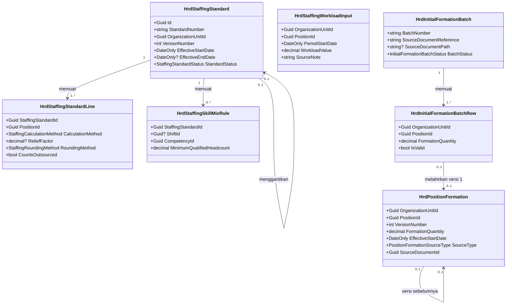

#### 16.3.2 Rencana tahunan dan potret gap

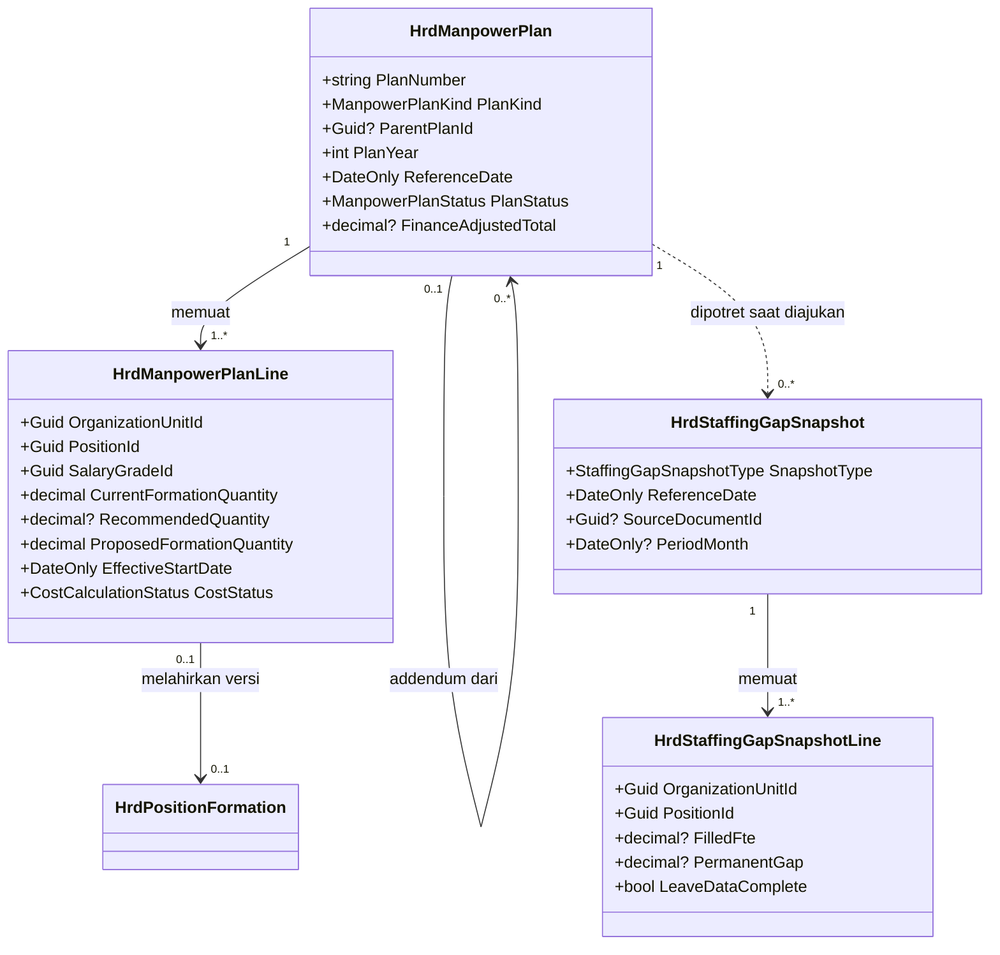

#### 16.3.3 Permintaan headcount dan pemenuhannya

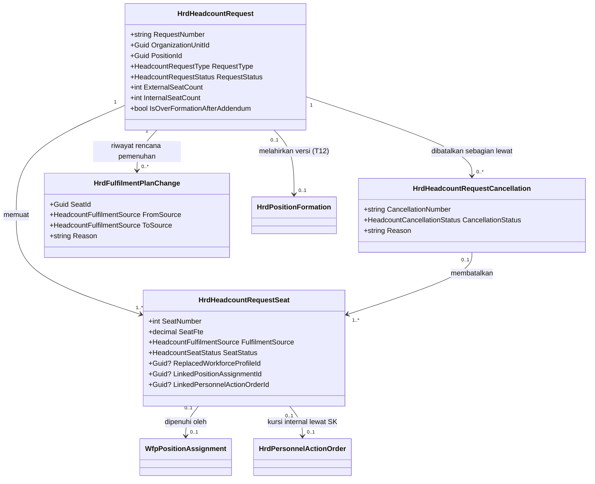

`WfpPositionAssignment` dan `HrdPersonnelActionOrder` milik Workforce Core; `S-D1` hanya
merujuknya.

### 16.4 Penjelasan setiap class

#### 16.4.1 `HrdStaffingStandard`, `HrdStaffingStandardLine`, `HrdStaffingSkillMixRule`

| Aspek | Penjelasan |
| --- | --- |
| **Status** | `Baru` (ketiganya) |
| **Lokasi file** | `Areas/Corporate/HumanResource/WorkforcePlanning/Models/HrdStaffingStandard.cs` — satu berkas memuat ketiga class, mengikuti pola `HrdInitialPlacementBatch.cs` yang memuat kelas barisnya |
| Kategori | Transaksi kebijakan berversi |
| Tanggung jawab utama | Menyimpan aturan "berapa tenaga yang dibutuhkan" satu unit, satu versi per periode. Setiap baris jabatan memilih satu metode: jumlah tetap/minimum, rasio terhadap beban, atau cakupan layanan (`HRD-DEC-060`). Aturan skill mix per shift ikut di dalam versi yang sama, karena Penjadwalan membacanya bersama-sama (`HRD-DEC-058` `WFP_OWNS_STANDARD`) |
| Field penting | Header: `StandardNumber`, `OrganizationUnitId`, `VersionNumber`, `EffectiveStartDate`, `EffectiveEndDate`, `StandardStatus`, `SupersedesStandardId`, `WorkflowInstanceId`. Baris: `PositionId`, `ProfessionId`, `CalculationMethod`, `MinimumHeadcount`, `RatioStaffQuantity`, `RatioWorkloadQuantity`, `WorkloadUnit`, `ShiftsPerDay`, `StaffPerShift`, `ServiceHoursPerDay`, `ReliefFactor`, `RoundingMethod`, `CountsOutsourced`. Skill mix: `ShiftId`, `ProfessionId`, `CompetencyId`, `MinimumCompetencyLevel`, `MinimumQualifiedHeadcount`, `IsMandatory` |
| Relasi | Menunjuk `MstHospitalSite`, `MstOrganizationUnit`, `MstPosition`, `MstProfession`, `MstShift`, `MstCompetency`; versi baru menunjuk versi yang digantikannya |
| Pemakaian dalam alur bisnis | HR Admin atau Kepala Unit menyusun draf → mengajukan → `T9` (HR Manager, lalu Direktur yang membawahi unit) → `Scheduled` atau langsung `Active` pada tanggal berlakunya → versi lama `Superseded` sehari sebelumnya |
| Catatan desain | Faktor cadangan dan cara pembulatan **wajib dipilih** pemilik standar; sistem tidak menetapkan nilai bawaan (`HRD-DEC-060`). Metode ABK dicadangkan sebagai nilai enum berikutnya tanpa perilaku. Standar yang belum `Active` **MUST NOT** dipakai hitungan gap maupun Penjadwalan |
| Ekuivalen model lama | `MstStaffingStandard`, `MstStaffingRatio`, `MstShiftSkillRequirement` — ditolak, bagian 16.10 |

#### 16.4.2 `HrdStaffingWorkloadInput`

| Aspek | Penjelasan |
| --- | --- |
| **Status** | `Baru` |
| **Lokasi file** | `Areas/Corporate/HumanResource/WorkforcePlanning/Models/HrdStaffingWorkloadInput.cs` |
| Kategori | Transaksi isian |
| Tanggung jawab utama | Menyimpan angka beban per unit × jabatan per periode, misalnya "rata-rata 7 pasien ICU terisi per hari, Januari–Maret 2027", beserta keterangan sumbernya (`HRD-DEC-060` `MANUAL_WORKLOAD_INPUT`) |
| Field penting | `OrganizationUnitId`, `PositionId`, `PeriodStartDate`, `PeriodEndDate`, `WorkloadValue`, `SourceNote` |
| Pemakaian dalam alur bisnis | Dipakai hitungan rekomendasi untuk baris bermetode rasio. Tidak melewati persetujuan karena hanya memengaruhi angka rekomendasi, bukan formasi |
| Catatan desain | Sengaja **tidak** menunjuk baris standar, agar isian tetap berlaku saat standar naik versi |
| Ekuivalen model lama | — |

#### 16.4.3 `HrdPositionFormation`

| Aspek | Penjelasan |
| --- | --- |
| **Status** | `Baru` |
| **Lokasi file** | `Areas/Corporate/HumanResource/WorkforcePlanning/Models/HrdPositionFormation.cs` |
| Kategori | Hasil berversi (bukan dokumen yang disetujui langsung) |
| Tanggung jawab utama | "Buku formasi berlaku": berapa kursi jabatan yang sah per unit × jabatan pada suatu tanggal (`HRD-DEC-062`). Setiap versi menyimpan dokumen sumber yang melahirkannya |
| Field penting | `OrganizationUnitId`, `PositionId`, `VersionNumber`, `FormationQuantity`, `EffectiveStartDate`, `EffectiveEndDate`, `SourceType`, `SourceDocumentId`, `SourceDocumentNumber`, `ApprovedByUserId`, `ApprovedAt`, `PreviousFormationId` |
| Pemakaian dalam alur bisnis | Dibuat **hanya** oleh `HrdPositionFormationService` saat batch awal, rencana, addendum, permintaan `T12`, atau pembatalan kursi `T12` disetujui. Tidak ada endpoint tulis |
| Catatan desain | `NO_DIRECT_FORMATION_EDIT`: kolom selain `EffectiveEndDate` tidak pernah diubah setelah ditulis. `FORMATION_CARRIES_FORWARD`: versi terakhir dibiarkan terbuka (`EffectiveEndDate` kosong) sampai digantikan |
| Ekuivalen model lama | `MstPositionHeadcountPlan` — ditolak |

#### 16.4.4 `HrdInitialFormationBatch` dan `HrdInitialFormationBatchRow`

| Aspek | Penjelasan |
| --- | --- |
| **Status** | `Baru` |
| **Lokasi file** | `Areas/Corporate/HumanResource/WorkforcePlanning/Models/HrdInitialFormationBatch.cs` |
| Kategori | Batch administrasi data awal |
| Tanggung jawab utama | Mengisi formasi versi 1 dari dokumen formasi resmi rumah sakit (`HRD-DEC-070`) |
| Field penting | Batch: `BatchNumber`, `HospitalSiteId`, `SourceDocumentReference`, `SourceDocumentPath`, `SourceDocumentFileName`, `BatchStatus`, `TotalRows`, `ValidRows`, `InvalidRows`, `WorkflowInstanceId`. Baris: `OrganizationUnitId`, `PositionId`, `FormationQuantity`, `EffectiveStartDate`, `IsValid`, `ValidationMessage`, `CreatedFormationId` |
| Pemakaian dalam alur bisnis | HR Admin mengunduh templat → mengisi → validasi → unggah scan dokumen → ajukan → `T10` → `Applied`: versi 1 lahir per baris |
| Catatan desain | **Tidak meniru** `HrdInitialPlacementBatch`: batch formasi **MUST** melewati persetujuan orang lain (`T10`), dan **MUST NOT** dapat diajukan selama `InvalidRows > 0` atau scan dokumen belum ada — dua cacat yang tercatat `HRD-TF-033` dan `HRD-TF-034` |
| Ekuivalen model lama | — |

#### 16.4.5 `HrdManpowerPlan` dan `HrdManpowerPlanLine`

| Aspek | Penjelasan |
| --- | --- |
| **Status** | `Baru` |
| **Lokasi file** | `Areas/Corporate/HumanResource/WorkforcePlanning/Models/HrdManpowerPlan.cs` |
| Kategori | Dokumen usulan |
| Tanggung jawab utama | Rencana kebutuhan tenaga tahunan **dan** addendumnya dalam satu bentuk; `PlanKind` membedakan keduanya (`HRD-DEC-062`, `HRD-DEC-068`). Baris menyimpan potret formasi saat ini, angka rekomendasi beserta rinciannya, angka usulan, alasan bila berbeda dari rekomendasi, tanggal berlaku, dan estimasi biaya dari gaji tengah grade |
| Field penting | Header: `PlanNumber`, `PlanKind`, `ParentPlanId`, `AddendumSequence`, `HospitalSiteId`, `PlanYear`, `PeriodStartDate`, `PeriodEndDate`, `ReferenceDate`, `PlanStatus`, `TotalEstimatedCost`, `FinanceAdjustedTotal`, `FinanceAdjustmentReason`. Baris: `OrganizationUnitId`, `PositionId`, `SalaryGradeId`, `CurrentFormationQuantity`, `RecommendedQuantity`, `RecommendationBreakdown`, `ProposedFormationQuantity`, `ChangeQuantity`, `DeviationReason`, `EffectiveStartDate`, `MonthlyRateSnapshot`, `MonthsInPeriod`, `EstimatedCost`, `IncrementalCost`, `CostStatus`, `CreatedFormationId` |
| Pemakaian dalam alur bisnis | HR Admin menyusun dari usulan unit → hitung ulang → ajukan (potret gap tersimpan) → `T10` (HR Manager, Finance, Direktur Utama) → `Approved`: versi formasi baru lahir per baris |
| Catatan desain | `APPROVED_PLAN_LOCKED`: tidak ada endpoint ubah untuk status `Approved`. Addendum **MUST** merujuk rencana induk berstatus `Approved` dan hanya memuat baris yang berubah. Biaya selalu dari `MstSalaryGrade.MidpointSalary` (`HRD-DEC-065`) |
| Ekuivalen model lama | `TrxAnnualManpowerPlan`, `TrxManpowerPlanDetail` — ditolak |

#### 16.4.6 `HrdHeadcountRequest`, `HrdHeadcountRequestSeat`, `HrdHeadcountRequestCancellation`, `HrdFulfilmentPlanChange`

| Aspek | Penjelasan |
| --- | --- |
| **Status** | `Baru` (keempatnya) |
| **Lokasi file** | `Areas/Corporate/HumanResource/WorkforcePlanning/Models/HrdHeadcountRequest.cs` (memuat `HrdHeadcountRequestSeat`); `HrdHeadcountRequestCancellation.cs`; `HrdFulfilmentPlanChange.cs` |
| Kategori | Dokumen permintaan beserta kursinya |
| Tanggung jawab utama | Satu permintaan untuk satu unit × jabatan, dipecah menjadi **kursi**. Setiap kursi punya porsi kerja, sumber pemenuhan (luar/internal), orang yang digantikan bila pengganti, dan tautan ke penempatan atau SK yang memenuhinya (`HRD-DEC-063`, `HRD-DEC-066`, `HRD-DEC-067`). Pembatalan kursi dan perubahan rencana pemenuhan tercatat sebagai baris tersendiri (`HRD-DEC-071`) |
| Field penting | Permintaan: `RequestNumber`, `OrganizationUnitId`, `PositionId`, `SalaryGradeId`, `RequestType`, `RequestStatus`, `RequiredStartDate`, `TemporaryEndDate`, `TemporaryReasonWorkforceProfileId`, `Justification`, `RequestedQuantity`, `ExternalSeatCount`, `InternalSeatCount`, `FormationVersionIdAtSubmission`, `RemainingSeatsAtSubmission`, `EstimatedCost`, `FinanceAdjustedCost`, `IsOverFormationAfterAddendum`, `IsOverdue`, `CreatedFormationId`. Kursi: `SeatNumber`, `SeatFte`, `FulfilmentSource`, `SeatStatus`, `ReplacedWorkforceProfileId`, `LinkedPositionAssignmentId`, `LinkedPersonnelActionOrderId`, `FulfilledAt`, `CancellationId` |
| Pemakaian dalam alur bisnis | Kepala Unit mengajukan → `T11` atau `T12` → `ReadyForRecruitment` → Recruiter melihat kursi luar; HR menyiapkan SK untuk kursi internal → kursi `Linked` → `Fulfilled` saat penempatannya mulai berlaku → permintaan `PartiallyFulfilled` lalu `Fulfilled` atau `Closed` |
| Catatan desain | Satu penempatan dan satu SK masing-masing hanya boleh menautkan satu kursi aktif (indeks unik terfilter). Kursi pecahan memakai `SeatFte` 0,10–1,00, sehingga sisa formasi 0,5 dapat diminta sebagai satu kursi paruh waktu — jawaban atas "pembulatan permintaan pecahan" yang ditinggalkan `HRD-DEC-063` |
| Ekuivalen model lama | `TrxHeadcountRequest` — ditolak |

#### 16.4.7 `HrdStaffingGapSnapshot` dan `HrdStaffingGapSnapshotLine`

| Aspek | Penjelasan |
| --- | --- |
| **Status** | `Baru` |
| **Lokasi file** | `Areas/Corporate/HumanResource/WorkforcePlanning/Models/HrdStaffingGapSnapshot.cs` |
| Kategori | Potret tidak dapat diubah |
| Tanggung jawab utama | Mengunci angka gap per unit × jabatan pada saat dokumen diajukan, atau pada akhir bulan, lengkap dengan lapisan `HRD-DEC-061` dan penanda kelengkapan data (`HRD-DEC-069`) |
| Field penting | Header: `SnapshotType`, `HospitalSiteId`, `ReferenceDate`, `SourceDocumentType`, `SourceDocumentId`, `PeriodMonth`, `TakenAt`, `ReconstructedAt`. Baris: `FormationQuantity`, `FilledFte`, `ToBeVacatedFte`, `TemporarilyUnavailableFte`, `NotYetCompetentFte`, `ConcurrentAssignmentCount`, `OutsourcedFte`, `PermanentGap`, `TemporaryGap`, `CompetencyGap`, `PlacementDataComplete`, `LeaveDataComplete`, `CompetencyDataComplete`, `WorkforceTypeDataComplete`, `ShortageSummaryCount` |
| Catatan desain | Tidak ada endpoint ubah maupun hapus (`SNAPSHOT_IMMUTABLE`). Potret susulan wajib berjenis `Reconstructed` (`MISSED_SNAPSHOT_NOT_FAKED`). Lapisan yang datanya belum ada disimpan `null`, bukan 0 |
| Ekuivalen model lama | `TrxStaffingGapAnalysis` — ditolak |

#### 16.4.8 `HrdWorkforcePlanningSetting`

| Aspek | Penjelasan |
| --- | --- |
| **Status** | `Baru` |
| **Lokasi file** | `Areas/Corporate/HumanResource/WorkforcePlanning/Models/HrdWorkforcePlanningSetting.cs` |
| Kategori | Pengaturan kebijakan per rumah sakit |
| Tanggung jawab utama | Menyimpan dua angka kebijakan yang sengaja tidak ditetapkan sistem: batas hari cuti yang dianggap "tidak tersedia sementara" (`HRD-DEC-061`) dan batas umur permintaan yang ditandai "lewat batas" (`HRD-DEC-071`) |
| Field penting | `HospitalSiteId` (unik), `LongLeaveThresholdDays`, `OverdueRequestThresholdDays`, `ChangeReason` |
| Catatan desain | Selama kosong, lapisan "tidak tersedia sementara" tampil "data belum tersedia" dan tanda "lewat batas" tidak pernah menyala. Hanya HR Manager yang mengubah |
| Ekuivalen model lama | — |

#### 16.4.9 Service

Seluruh service `Baru` berada di `Areas/Corporate/HumanResource/WorkforcePlanning/Services/`,
didaftarkan `AddScoped<T>()` di `Program.cs` dekat registrasi HR lain (pola baris 979).

| Service | Fungsi utama | Dipanggil oleh | Membuka transaksi |
| --- | --- | --- | :---: |
| `HrdStaffingStandardService` | Draf, versi, pengajuan `T9`, aktivasi, penggantian versi; baca standar berlaku per tanggal untuk Penjadwalan | `HrdStaffingStandardController`, scheduler, integrasi workflow | Ya |
| `HrdStaffingRecommendationService` | Menghitung angka rekomendasi per baris beserta rinciannya | Standard dan plan service | Tidak |
| `HrdStaffingWorkloadService` | Isian angka beban | `HrdStaffingWorkloadController` | Ya |
| `HrdPositionFormationService` | Satu-satunya penulis formasi: buat versi, tutup versi lama, baca formasi berlaku dan riwayat | Batch, plan, request service — **tidak** dipanggil controller untuk menulis | Ikut transaksi pemanggil |
| `HrdInitialFormationBatchService` | Templat, validasi, unggah dokumen, pengajuan `T10`, penerapan | `HrdInitialFormationBatchController`, integrasi workflow | Ya |
| `HrdManpowerPlanService` | Rencana dan addendum: hitung ulang, pengajuan `T10`, koreksi Finance, penerapan, penandaan permintaan yang melebihi formasi | `HrdManpowerPlanController`, integrasi workflow | Ya |
| `HrdHeadcountRequestService` | Permintaan: sisa kursi, pengajuan `T11`/`T12`, tarik kembali, antrean Recruiter, perubahan rencana pemenuhan, pembatalan `T13` | `HrdHeadcountRequestController`, integrasi workflow, scheduler | Ya |
| `HrdHeadcountFulfilmentService` | Tautkan dan lepas penempatan atau SK ke kursi; ubah kursi `Linked` → `Fulfilled` | `HrdHeadcountRequestController`, scheduler | Ya |
| `HrdStaffingGapCalculationService` | Menghitung lapisan dan tiga gap per unit × jabatan pada tanggal acuan, beserta penanda kelengkapan | Gap controller, snapshot service, plan dan request service | Tidak |
| `HrdStaffingGapSnapshotService` | Potret pengajuan, bulanan, dan rekonstruksi | Plan dan request service, scheduler | Ikut transaksi pemanggil |
| `HrdWorkforcePlanningCostService` | Tarif gaji tengah grade pada tanggal; hitung estimasi; penyamaran angka biaya bagi yang tidak berhak | Plan dan request service | Tidak |
| `HrdWorkforcePlanningWorkflowIntegrationService` | Memulai instance untuk lima jenis rujukan; menerima keputusan akhir dan meneruskannya ke service domain | Service domain; `WorkflowReferenceLifecycleService` | Ya |
| `HrdWorkforcePlanningSchedulerService` | Harian: aktivasi standar, kursi `Linked` → `Fulfilled`, kursi kembali `Open` bila SK batal, tanda "lewat batas". Akhir bulan: potret bulanan | `HrdWorkforcePlanningSchedulerHostedService` | Ya, per langkah |
| `HrdWorkforcePlanningSchedulerHostedService` | Pembungkus `BackgroundService`, didaftarkan `AddHostedService` dekat `Program.cs:1287` | Host aplikasi | — |
| `HrdWorkforcePlanningSettingService` | Baca dan ubah pengaturan | `HrdWorkforcePlanningSettingController` | Ya |

Nomor `StandardNumber`, `BatchNumber`, `PlanNumber`, `RequestNumber`, dan `CancellationNumber`
dialokasikan `Areas/Platform/NumberSeriesManagement/Services/NumberSeriesAllocator.cs` di luar
transaksi pemanggil, mengikuti `EmployeeBenefitEnrollmentService.cs:323-330` (`QBE-CODE-002`,
`QBE-CODE-003`). Controller tidak pernah membuat nomor.

**Service yang `Diperbarui`:**

| Service | Lokasi | Perubahan |
| --- | --- | --- |
| `WorkflowService` | `Areas/Corporate/HumanResource/WorkflowManagement/Services/WorkflowService.cs` | Pencocokan `MstApprovalMatrix` pada baris 1621 dan 1669 kini menelusuri unit induk lewat `ParentOrganizationUnitId` sampai baris cocok ditemukan (`HRD-DEC-072` `MATRIX_FOLLOWS_UNIT_ANCESTOR`). Baris unit yang lebih dekat menang atas baris unit induk. Tanpa perubahan perilaku bagi baris matriks yang sudah ada, karena saat ini matriks kosong |
| `WorkflowReferenceLifecycleService` | `.../WorkflowManagement/Services/WorkflowReferenceLifecycleService.cs` | Lima jenis rujukan baru didaftarkan: `WorkforceStaffingStandard`, `WorkforceInitialFormationBatch`, `WorkforceManpowerPlan`, `WorkforceHeadcountRequest`, `WorkforceHeadcountCancellation` |

**Yang dipakai ulang tanpa perubahan:** penolakan langkah tanpa penyetuju dan pembuangan pembuat dari
daftar penyetuju sudah ada di `WorkflowService.cs:534-556`. `UNRESOLVED_STEP_FAILS_CLOSED` dan
`APPROVER_MUST_DIFFER_FROM_CREATOR` cukup memakai perilaku itu, dengan syarat langkah `T9` s.d.
`T13` didefinisikan `AllowSelfApproval = false`.

#### 16.4.10 Controller

Seluruhnya `Baru`, di `Areas/Corporate/HumanResource/WorkforcePlanning/Controllers/`, memakai
`[AccessController]` di kelas dan `[AccessPermission(...)]` di setiap endpoint. Tidak satu pun
mengakses `ApplicationDbContext` langsung (`QBE-SVC-001`).

| Controller | Service yang dipakai | Grup Swagger | Endpoint yang diurus |
| --- | --- | --- | --- |
| `HrdStaffingStandardController` | `HrdStaffingStandardService`, `HrdStaffingRecommendationService` | `Corporate / Human Resource / Workforce Planning / Staffing Standard` | Daftar, detail, draf versi baru, ubah draf, ajukan, batalkan, rekomendasi, standar berlaku |
| `HrdStaffingWorkloadController` | `HrdStaffingWorkloadService` | `Corporate / Human Resource / Workforce Planning / Staffing Workload` | Daftar, buat, ubah |
| `HrdPositionFormationController` | `HrdPositionFormationService` | `Corporate / Human Resource / Workforce Planning / Position Formation` | Daftar berlaku, riwayat — **baca saja** |
| `HrdInitialFormationBatchController` | `HrdInitialFormationBatchService` | `Corporate / Human Resource / Workforce Planning / Initial Formation Batch` | Templat, validasi, buat, ubah, unggah dokumen, ajukan, batalkan, daftar, detail |
| `HrdManpowerPlanController` | `HrdManpowerPlanService` | `Corporate / Human Resource / Workforce Planning / Manpower Plan` | Daftar, detail, buat rencana, buat addendum, ubah, hitung ulang, ajukan, batalkan, koreksi Finance, potret |
| `HrdHeadcountRequestController` | `HrdHeadcountRequestService`, `HrdHeadcountFulfilmentService` | `Corporate / Human Resource / Workforce Planning / Headcount Request` | Daftar, detail, sisa kursi, buat, ubah, ajukan, tarik kembali, koreksi Finance, perubahan rencana pemenuhan, pembatalan, tautan pemenuhan |
| `HrdRecruitmentQueueController` | `HrdHeadcountRequestService` | `Corporate / Human Resource / Workforce Planning / Recruitment Queue` | Antrean kursi luar untuk Recruiter, tanpa kolom biaya |
| `HrdStaffingGapController` | `HrdStaffingGapCalculationService`, `HrdStaffingGapSnapshotService` | `Corporate / Human Resource / Workforce Planning / Staffing Gap` | Gap langsung, daftar potret, detail potret |
| `HrdWorkforcePlanningSettingController` | `HrdWorkforcePlanningSettingService` | `Corporate / Human Resource / Workforce Planning / Setting` | Baca, ubah |

Persetujuan **tidak** punya endpoint di controller domain. Seluruh keputusan `T9` s.d. `T13`
dijalankan lewat kotak masuk persetujuan yang sudah ada (`HRD-DEC-018`), lalu diteruskan ke domain
oleh `HrdWorkforcePlanningWorkflowIntegrationService`.

#### 16.4.11 DTO, enum, konstanta, dan configuration

| Jenis | Lokasi | Isi |
| --- | --- | --- |
| DTO | `Areas/Corporate/HumanResource/WorkforcePlanning/DTOs/` | `StaffingStandardDtos.cs`, `StaffingWorkloadDtos.cs`, `PositionFormationDtos.cs`, `InitialFormationBatchDtos.cs`, `ManpowerPlanDtos.cs`, `HeadcountRequestDtos.cs`, `StaffingGapDtos.cs`, `WorkforcePlanningSettingDtos.cs`. Bentuk request dan response per endpoint pada `contracts/api-contract.md` bagian 13 |
| Enum | `Areas/Corporate/HumanResource/WorkforcePlanning/Enums/` | Daftar pada tabel di bawah |
| Konstanta | `Areas/Corporate/HumanResource/WorkforcePlanning/Constants/WorkforcePlanningValueConstants.cs` | Lima jenis rujukan workflow, kunci number series, nama kunci advisory lock |
| Configuration | `Repositories/Configurations/Corporate/HumanResource/WorkforcePlanning/` | Satu berkas per tabel baru, `Hrd<Nama>Configuration.cs`; index, unique, dan `DeleteBehavior` pada `data/data-dictionary.md` bagian 8 |
| DbSet | `Repositories/ApplicationDbContext.cs` | 16 `DbSet` baru, jamak: `HrdStaffingStandards`, `HrdStaffingStandardLines`, dan seterusnya |

| Enum | Nilai | Bawaan |
| --- | --- | --- |
| `StaffingStandardStatus` | `Draft=1`, `Submitted=2`, `Returned=3`, `Rejected=4`, `Scheduled=5`, `Active=6`, `Superseded=7`, `Cancelled=8` | `Draft` |
| `StaffingCalculationMethod` | `FixedMinimum=1`, `WorkloadRatio=2`, `ServiceCoverage=3`, `WorkloadAnalysis=4` (dicadangkan, **tidak** dapat dipilih pada rilis ini) | — wajib dipilih |
| `StaffingRoundingMethod` | `Ceiling=1`, `Floor=2`, `Nearest=3`, `NoRounding=4` | — wajib dipilih |
| `PositionFormationSourceType` | `InitialBatch=1`, `ManpowerPlan=2`, `PlanAddendum=3`, `HeadcountRequest=4`, `HeadcountCancellation=5` | — |
| `InitialFormationBatchStatus` | `Draft=1`, `Submitted=2`, `Returned=3`, `Rejected=4`, `Applied=5`, `Cancelled=6` | `Draft` |
| `ManpowerPlanKind` | `AnnualPlan=1`, `Addendum=2` | — |
| `ManpowerPlanStatus` | `Draft=1`, `Submitted=2`, `Returned=3`, `Rejected=4`, `Approved=5`, `Cancelled=6` | `Draft` |
| `CostCalculationStatus` | `Calculated=1`, `RateUnavailable=2` | — |
| `HeadcountRequestType` | `Replacement=1`, `AdditionalWithinFormation=2`, `AdditionalBeyondFormation=3`, `Temporary=4` | — |
| `HeadcountRequestStatus` | `Draft=1`, `Submitted=2`, `Returned=3`, `Rejected=4`, `Withdrawn=5`, `ReadyForRecruitment=6`, `PartiallyFulfilled=7`, `Fulfilled=8`, `Closed=9` | `Draft` |
| `HeadcountSeatStatus` | `Open=1`, `Linked=2`, `Fulfilled=3`, `Frozen=4`, `Cancelled=5` | `Open` |
| `HeadcountFulfilmentSource` | `External=1`, `Internal=2` | — |
| `HeadcountCancellationStatus` | `Submitted=1`, `Approved=2`, `Rejected=3` | `Submitted` |
| `StaffingGapSnapshotType` | `Submission=1`, `Monthly=2`, `Reconstructed=3` | — |

Jenis `Project` dan `Seasonal` pada model kandidat **dilebur** ke `Temporary`: keduanya sama-sama
berakhir pada tanggal tertentu dan tidak mengubah formasi. Jawaban atas butir yang ditinggalkan
`HRD-DEC-063`.

### 16.5 Arsitektur folder

```text
Areas/Corporate/HumanResource/WorkforcePlanning/
├── Constants/
│   └── WorkforcePlanningValueConstants.cs              Baru
├── Controllers/                                       Baru — 9 controller pada 16.4.10
├── DTOs/                                              Baru — 8 berkas pada 16.4.11
├── Enums/                                             Baru — 14 enum pada 16.4.11
├── Models/
│   ├── HrdStaffingStandard.cs                         Baru (+ Line, SkillMixRule)
│   ├── HrdStaffingWorkloadInput.cs                    Baru
│   ├── HrdPositionFormation.cs                        Baru
│   ├── HrdInitialFormationBatch.cs                    Baru (+ Row)
│   ├── HrdManpowerPlan.cs                             Baru (+ Line)
│   ├── HrdHeadcountRequest.cs                         Baru (+ Seat)
│   ├── HrdHeadcountRequestCancellation.cs             Baru
│   ├── HrdFulfilmentPlanChange.cs                     Baru
│   ├── HrdStaffingGapSnapshot.cs                      Baru (+ Line)
│   ├── HrdWorkforcePlanningSetting.cs                 Baru
│   ├── MstPositionHeadcountPlan.cs                    Sudah ada — kandidat ditolak, tidak disentuh
│   ├── MstShiftSkillRequirement.cs                    Sudah ada — idem; masih dirujuk TrxShiftAssignment
│   ├── MstStaffingRatio.cs                            Sudah ada — idem
│   ├── MstStaffingStandard.cs                         Sudah ada — idem; masih dirujuk TrxDailyStaffingRequirement
│   ├── MstWorkforceRequirement.cs                     Sudah ada — milik master persyaratan berkas; utang teknis lokasi
│   ├── TrxAnnualManpowerPlan.cs                       Sudah ada — kandidat ditolak; masih dirujuk TrxJobRequisition
│   ├── TrxDailyStaffingRequirement.cs                 Sudah ada — milik desain Penjadwalan (HRD-DEC-058)
│   ├── TrxHeadcountRequest.cs                         Sudah ada — kandidat ditolak; masih dirujuk TrxJobRequisition
│   ├── TrxManpowerPlanDetail.cs                       Sudah ada — kandidat ditolak; masih dirujuk TrxJobRequisition
│   ├── TrxStaffingGapAnalysis.cs                      Sudah ada — kandidat ditolak
│   └── TrxWorkforceAllocation.cs                      Sudah ada — milik desain Penjadwalan (HRD-DEC-058)
└── Services/                                          Baru — 15 service pada 16.4.9

Repositories/Configurations/Corporate/HumanResource/WorkforcePlanning/
└── Hrd*Configuration.cs                               Baru — 16 berkas; konfigurasi kandidat lama tidak disentuh
```

**Utang teknis yang tercatat, tidak dirapikan diam-diam:**

| Penyimpangan | Keadaan | Penanganan |
| --- | --- | --- |
| `MstWorkforceRequirement` berada di folder `WorkforcePlanning`, bukan `MasterData` | Model master persyaratan berkas yang sudah dipakai layar | Pemindahan folder adalah task tersendiri dengan approval pemilik arsitektur backend; **MUST NOT** ikut task `S-D1` |
| Sepuluh model kandidat `Mst*`/`Trx*` tetap terdaftar sebagai `DbSet` | Tabel kosong, tidak dipakai `S-D1` | Dibuang lewat migration pembersihan terpisah, bagian 16.7 |

### 16.6 Status model dan dampak migration

| Model | Status | Kolom yang berubah | Dampak migration |
| --- | --- | --- | --- |
| 16 tabel `Hrd*` pada 16.4 | `Baru` | Seluruh kolom pada `data/data-dictionary.md` bagian 8 | Membuat tabel; tidak menyentuh data mana pun |
| `MstApprovalMatrix` | `Sudah ada` | Tidak ada | Tidak ada. Perluasan pencocokan hanya pada kode `WorkflowService` |
| `WfpPositionAssignment`, `WfpOrganizationAssignment`, `HrdPersonnelActionOrder` | `Sudah ada` | Tidak ada. Porsi kerja adalah dependency 02 (`HRD-CAP-53`), dirancang di Workforce Core | Tidak ada |
| `MstSalaryGrade`, `MstPosition`, `MstOrganizationUnit`, `MstShift`, `MstCompetency`, `MstProfession`, `MstHospitalSite` | `Sudah ada` | Tidak ada | Tidak ada; hanya dirujuk FK |
| Sepuluh model kandidat `WorkforcePlanning` | `Sudah ada` | Tidak ada pada slice ini | Tidak ada pada slice ini |

### 16.7 Rencana migration

**Peringatan:** blueprint tidak memberi wewenang membuat atau menjalankan migration. Rencana ini
adalah bahan task implementasi.

| Urutan | Migration | Isi | Tanpa downtime? | Pengisian data lama | Langkah mundur |
| ---: | --- | --- | :---: | --- | --- |
| 1 | `AddWorkforcePlanningCore` | Membuat 16 tabel `Hrd*` beserta index, unique, dan FK | **Ya** — hanya `CREATE TABLE` dan `CREATE INDEX` pada tabel baru yang kosong | Tidak ada; seluruh tabel lahir kosong | `Down()` membuang ke-16 tabel. Aman selama belum ada data; setelah ada data, mundur hanya lewat migration baru yang mempertahankan isi |
| — | `RetireWorkforcePlanningCandidateTables` | Membuang tabel kandidat yang ditolak | **Tidak dijadwalkan pada `S-D1`** | — | — |

**Kenapa pembersihan kandidat tidak ikut `S-D1`.** Lima dari sepuluh tabel kandidat masih dirujuk FK
milik slice lain: `TrxJobRequisition` (`S-D2`) merujuk `TrxAnnualManpowerPlan`,
`TrxManpowerPlanDetail`, dan `TrxHeadcountRequest`; `TrxShiftAssignment` dan
`TrxDailyStaffingRequirement` (Penjadwalan) merujuk `MstShiftSkillRequirement`, `MstStaffingStandard`,
dan `TrxStaffingGapAnalysis`. Membuangnya sekarang berarti mengubah tabel milik dua slice lain di
dalam task `S-D1`. Pembersihan dilakukan **setelah** desain `S-D2` dan Penjadwalan menetapkan nasib
FK itu, dalam satu migration yang:

1. **MUST** membuka setiap pembuangan tabel dengan blok `DO $$ … IF EXISTS (SELECT 1 FROM … ) THEN RAISE EXCEPTION … END IF; $$`, mengikuti `Migrations/20260902072756_DropTableMstBillingCategory.cs:36-42` (`HRD-DEC-059` `EMPTY_TABLE_GUARD`);
2. **MUST NOT** memakai `DROP … CASCADE` (`NO_GUARD_BYPASS`);
3. bila pengaman berhenti di lingkungan mana pun, `HRD-DEC-059` kembali `draft` dan `S-D1` kembali
   `BLOCKED` untuk pembersihan itu (`GUARD_FAILURE_REOPENS_DECISION`).

### 16.8 Rencana data master awal

Tanpa isian di bawah, `S-D1` tidak dapat dipakai sama sekali.

| Data | Isi minimum | Sumber nilai | Diisi lewat |
| --- | --- | --- | --- |
| Jabatan direktur | Sekurang-kurangnya "Direktur Utama" dan satu jabatan direktur per direktorat yang membawahi unit pemohon, misalnya "Direktur Pelayanan Medis" | Struktur organisasi rumah sakit | Master jabatan yang sudah ada |
| Penempatan pemegang jabatan direktur | Satu penempatan utama aktif per jabatan direktur | SK pengangkatan | Batch penempatan awal atau SK (`S-A1`) |
| Matriks persetujuan langkah Direktur | Satu baris per direktorat untuk `T9` dan `T12` dengan sumber penyetuju `Position`, ditambah satu baris `IsFallback` ke jabatan Direktur Utama (`HRD-DEC-072`) | Struktur organisasi | Master matriks persetujuan yang sudah ada |
| Definisi alur `T9` s.d. `T13` | Lima definisi beserta langkahnya sesuai `HRD-DEC-064` dan `HRD-DEC-071`; setiap langkah `AllowSelfApproval = false` | `HRD-DEC-064` | Master definisi workflow yang sudah ada |
| Number series | Lima kunci: standar, batch formasi, rencana, permintaan, pembatalan | Konvensi penomoran HR | Konfigurasi number series |
| Pengaturan perencanaan | Satu baris per rumah sakit: batas hari cuti panjang, batas umur permintaan | Kebijakan HR rumah sakit — **bukan** nilai sistem | Layar pengaturan, oleh HR Manager |
| Grade gaji | Gaji tengah terisi untuk setiap grade yang dipakai baris rencana dan permintaan | Struktur gaji rumah sakit | Master grade gaji yang sudah ada (5 baris di dev) |
| Pemetaan peran | Finance / Anggaran, Direktur, Recruiter ke peran aplikasi | Administrator | `HRD-DEC-032` — `MAPPING_REQUIRED` |

### 16.9 Hitungan yang dirancang

**Rekomendasi per baris standar** (`HrdStaffingRecommendationService`):

| Metode | Rumus | Contoh |
| --- | --- | --- |
| `FixedMinimum` | `MinimumHeadcount` | Farmasi: 4 → **4** |
| `WorkloadRatio` | `WorkloadValue ÷ RatioWorkloadQuantity × RatioStaffQuantity` per shift × `ShiftsPerDay` × `ReliefFactor`, lalu dibulatkan menurut `RoundingMethod` | ICU: 7 ÷ 1 × 1 = 7; 7 × 3 = 21; 21 × 1,5 = 31,5 → **32** bila `Ceiling` |
| `ServiceCoverage` | `ShiftsPerDay` × `StaffPerShift` × `ReliefFactor`, lalu dibulatkan | IGD: 3 × 2 = 6; 6 × 1,5 = 9 → **9** |

Rincian hitung disimpan sebagai teks pada `HrdManpowerPlanLine.RecommendationBreakdown` agar dapat
dibaca tanpa menghitung ulang. Bila angka beban periode itu belum diisi, rekomendasi baris rasio
kosong dan tampil "angka beban belum diisi".

**Lapisan tenaga tersedia dan tiga gap** (`HrdStaffingGapCalculationService`, `HRD-DEC-061`), per
unit × jabatan pada tanggal acuan `D`:

| Lapisan | Sumber | Aturan |
| --- | --- | --- |
| Terisi | `WfpOrganizationAssignment` dan `WfpPositionAssignment` utama yang aktif pada `D` | Jumlah porsi kerja; porsi kerja yang belum ada dihitung 1 |
| Akan kosong | Pengunduran diri `Approved` dengan hari kerja terakhir di dalam periode; penempatan utama yang `EffectiveEndDate`-nya di dalam periode; SK pindah keluar yang `Scheduled` | Bagian dari terisi |
| Tidak tersedia sementara | Cuti berstatus disetujui yang beririsan dengan periode dan lamanya ≥ `LongLeaveThresholdDays` | Kosong bila pengaturan belum diisi |
| Belum memenuhi kompetensi | Orang terisi yang tidak punya `WfpCompetencyAssessment` aktif untuk setiap kompetensi wajib pada skill mix standar berlaku | Kosong bila standar tidak punya skill mix wajib |
| Rangkap/Plt | Penempatan bukan utama di unit × jabatan itu | Informasi; tidak menambah terisi |
| Alih daya | Orang dengan kategori sumber tenaga alih daya | Kosong sampai master jenis tenaga diisi (dependency 01) |

| Gap | Rumus |
| --- | --- |
| Permanen | formasi berlaku − (terisi − akan kosong); ditambah alih daya hanya bila `CountsOutsourced = true` pada baris standar |
| Sementara | tidak tersedia sementara |
| Kompetensi | belum memenuhi kompetensi |

**Sisa kursi** (`HrdHeadcountRequestService`, `HRD-DEC-063` `REMAINING_SEATS`) = formasi berlaku −
(terisi − akan kosong) − jumlah `SeatFte` kursi `Open`/`Linked` pada permintaan lain untuk unit ×
jabatan yang sama yang berstatus `Submitted`, `ReadyForRecruitment`, atau `PartiallyFulfilled`.

### 16.10 Yang sengaja tidak dibuat

| Yang ditolak | Alasan |
| --- | --- |
| Memakai ulang `MstStaffingStandard`, `MstStaffingRatio`, `MstShiftSkillRequirement` | Prefix master untuk dokumen bersiklus persetujuan; rasio terpisah dari standar membuat satu versi tersebar di dua aggregate; tidak punya versi maupun rujukan `T9` |
| Memakai ulang `MstPositionHeadcountPlan` | Berprefix master tetapi bersiklus status, terikat `PlanYear`, tanpa versi dan dokumen sumber (`HRD-TF-027`) |
| Memakai ulang `TrxAnnualManpowerPlan` dan `TrxManpowerPlanDetail` | Tanpa konsep addendum; `Trx*` dilarang untuk `NEW CODE` (`QBE-NAM-001`) |
| Memakai ulang `TrxHeadcountRequest` | Tanpa kursi, rencana pemenuhan, maupun tautan pemenuhan |
| Memakai ulang `TrxStaffingGapAnalysis` | Tanpa lapisan `HRD-DEC-061` dan tanpa penanda kelengkapan |
| Me-rename kandidat `Trx*` menjadi `Hrd*` (ratchet) | Tiga di antaranya dirujuk `TrxJobRequisition`; rename memaksa menyentuh model `S-D2` yang masih `BLOCKED` |
| Kebutuhan harian dan alokasi per shift | Milik Penjadwalan (`HRD-DEC-058`) |
| Kolom "kepala unit" pada master unit | Ditolak `HRD-DEC-072`; direktur dibaca dari penempatan jabatan |
| Endpoint ubah atau hapus formasi | `NO_DIRECT_FORMATION_EDIT` |
| Endpoint ubah atau hapus potret | `SNAPSHOT_IMMUTABLE` |
| Endpoint persetujuan di controller domain | Persetujuan satu pintu lewat kotak masuk (`HRD-DEC-018`) |
| Kedaluwarsa otomatis permintaan | `NO_AUTO_EXPIRY` (`HRD-DEC-071`) |
| Penarikan otomatis angka beban dari data pasien | `HRD-DEP-005` `MISSING`; ditunda (`HRD-DEC-060`) |
| Metode Analisis Beban Kerja | Ditunda; nilai enum dicadangkan (`HRD-DEC-060` `ABK_LATER_SLICE`) |

### 16.11 Strategi test `S-D1`

Backend tidak memelihara proyek automated test (`rules/backend/TEST_POLICY.md`). Bukti verifikasi
tiap task: `dotnet build`, pemeriksaan QBE, dan uji API terhadap database dev mengikuti
`testing/acceptance-test-matrix.md` bagian 15. Uji yang paling penting dan paling mudah terlewat:
dua pengajuan bersamaan atas sisa kursi yang sama, potret yang tidak berubah sesudah data berubah,
dan pengaman tabel kosong pada migration pembersihan.

### 16.12 Traceability `S-D1`

| Keputusan | Dirancang pada |
| --- | --- |
| `HRD-DEC-058` | 16.2, 16.10 |
| `HRD-DEC-059` | 16.7 |
| `HRD-DEC-060` | 16.4.1, 16.4.2, 16.9 |
| `HRD-DEC-061` | 16.4.7, 16.4.8, 16.9 |
| `HRD-DEC-062` | 16.4.3, 16.4.5 |
| `HRD-DEC-063` | 16.4.6, 16.9 |
| `HRD-DEC-064`, `HRD-DEC-072` | 16.4.9 (`WorkflowService`), 16.8 |
| `HRD-DEC-065` | 16.4.5, 16.4.9 (`HrdWorkforcePlanningCostService`) |
| `HRD-DEC-066`, `HRD-DEC-067` | 16.4.6 |
| `HRD-DEC-068` | 16.4.5 |
| `HRD-DEC-069` | 16.4.7 |
| `HRD-DEC-070` | 16.4.4 |
| `HRD-DEC-071` | 16.4.6, 16.4.8 |


---

## 17. Desain Arsitektur Backend S-D2 — Rekrutmen dan Hiring (RecruitmentManagement)

### 17.1 Ringkasan dan Batas Tanggung Jawab

Arsitektur backend untuk Delivery Slice `S-D2` (Rekrutmen dan Hiring) diturunkan secara resmi dari keputusan bisnis
`HRD-DEC-073` s.d. `HRD-DEC-080`. Slice ini bertugas mengelola pengadaan tenaga kerja rumah sakit mulai dari penarikan
alokasi kursi dari `HeadcountRequest` (Sub-modul 03), penayangan lowongan, penampungan berkas pelamar, penapisan
dokumen profesi klinis (STR), wawancara HR dan asesmen klinis unit dengan hak veto klinis, penerbitan penawaran bersyarat,
pemeriksaan MCU pra-kerja dengan perlindungan privasi medis, persetujuan penawaran bertingkat, pengelolaan talent pool,
hingga serah terima kandidat ke Sub-modul 05 Onboarding.

| Aspek | Batas Tanggung Jawab |
| --- | --- |
| Hulu (Input) | Membaca `HeadcountRequest` yang disetujui (`HRD-DEC-073`); membaca master jabatan, unit, spesialisasi, dan `MstSalaryGrade` |
| Internal S-D2 | Requisition, Vacancy, Candidate, Application, Document, Screening, Evaluation, Offer, OfferApproval, McuCheck, TalentPool, HiringHandoff |
| Hilir (Output) | Menyerahkan draf `WorkforceProfile` berstatus `Pending Onboarding` ke Sub-modul 05; mengembalikan kursi ke status terpenuhi di Sub-modul 03 |
| Yang DILARANG | Membuat `WorkforceProfile` aktif sebelum offer accepted (`HRD-DEC-075`); menampilkan detail diagnosis medis MCU ke HR (`HRD-DEC-078`); menganulir veto klinis unit (`HRD-DEC-077`) |

### 17.2 Class Diagram Bounded Context RecruitmentManagement

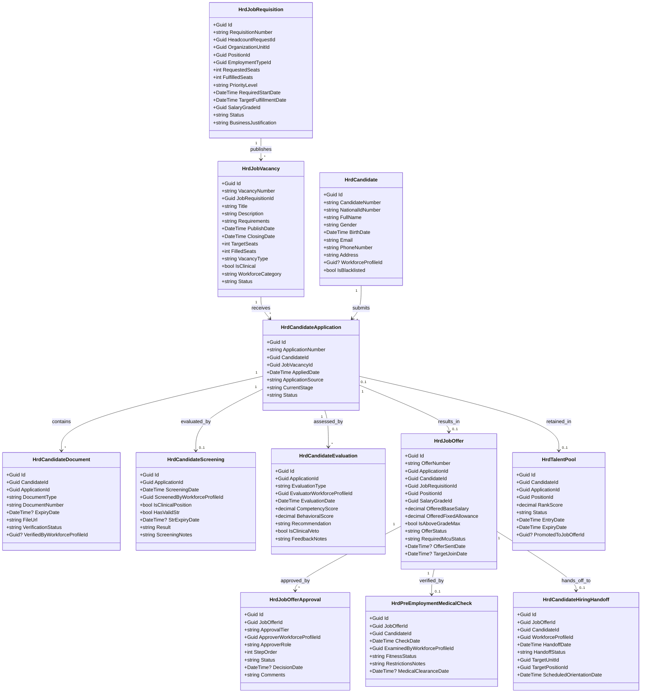

### 17.3 Penjelasan Class & Tanggung Jawab

| Nama Class | Layer | Status | Lokasi File | Fungsi Utama |
| --- | --- | --- | --- | --- |
| `HrdJobRequisition` | Model | Baru | `Areas/Corporate/HumanResource/RecruitmentManagement/Models/` | Entitas permohonan pengadaan tenaga berbasis alokasi kursi luar `HeadcountRequest` |
| `HrdJobVacancy` | Model | Baru | `Areas/Corporate/HumanResource/RecruitmentManagement/Models/` | Entitas lowongan kerja publikasi dengan kuota, batas tanggal, dan kualifikasi profesi |
| `HrdCandidate` | Model | Baru | `Areas/Corporate/HumanResource/RecruitmentManagement/Models/` | Entitas identitas pelamar independen dengan validasi unik NIK/KTP |
| `HrdCandidateApplication` | Model | Baru | `Areas/Corporate/HumanResource/RecruitmentManagement/Models/` | Entitas pelacakan berkas lamaran per lowongan dan tahap siklus rekrutmen |
| `HrdCandidateDocument` | Model | Baru | `Areas/Corporate/HumanResource/RecruitmentManagement/Models/` | Entitas penyimpanan dan status verifikasi dokumen legalitas/profesi (STR, Ijazah, Pelatihan) |
| `HrdCandidateScreening` | Model | Baru | `Areas/Corporate/HumanResource/RecruitmentManagement/Models/` | Entitas rekam penapisan berkas administrasi dan gerbang otomatis STR aktif posisi klinis |
| `HrdCandidateEvaluation` | Model | Baru | `Areas/Corporate/HumanResource/RecruitmentManagement/Models/` | Entitas formulir penilaian wawancara HR dan uji klinis dengan hak veto mutlak |
| `HrdJobOffer` | Model | Baru | `Areas/Corporate/HumanResource/RecruitmentManagement/Models/` | Entitas surat penawaran kerja bersyarat dengan rincian remunerasi dan status respon |
| `HrdJobOfferApproval` | Model | Baru | `Areas/Corporate/HumanResource/RecruitmentManagement/Models/` | Entitas log persetujuan bertingkat (`T13` standar vs `T14` plafon gaji terlampaui) |
| `HrdPreEmploymentMedicalCheck` | Model | Baru | `Areas/Corporate/HumanResource/RecruitmentManagement/Models/` | Entitas kesimpulan kelaikan fisik kerja (Fit/Unfit) tanpa membocorkan rekam medis detail |
| `HrdTalentPool` | Model | Baru | `Areas/Corporate/HumanResource/RecruitmentManagement/Models/` | Entitas bank data kandidat cadangan berperingkat aktif 6 bulan untuk promosi cepat |
| `HrdCandidateHiringHandoff` | Model | Baru | `Areas/Corporate/HumanResource/RecruitmentManagement/Models/` | Entitas serah terima kandidat yang menerima tawaran ke Sub-modul 05 Onboarding |
| `JobRequisitionController` | Controller | Baru | `Areas/Corporate/HumanResource/RecruitmentManagement/Controllers/` | Endpoint API pengelolaan requisition dan penarikan alokasi kursi |
| `JobVacancyController` | Controller | Baru | `Areas/Corporate/HumanResource/RecruitmentManagement/Controllers/` | Endpoint API penayangan lowongan, syarat kualifikasi, dan penutupan kuota |
| `CandidateController` | Controller | Baru | `Areas/Corporate/HumanResource/RecruitmentManagement/Controllers/` | Endpoint API pendaftaran pelamar, unggah berkas, dan penapisan administrasi |
| `CandidateEvaluationController` | Controller | Baru | `Areas/Corporate/HumanResource/RecruitmentManagement/Controllers/` | Endpoint API penjadwalan evaluasi, input nilai HR, dan input uji klinis unit |
| `JobOfferController` | Controller | Baru | `Areas/Corporate/HumanResource/RecruitmentManagement/Controllers/` | Endpoint API draf penawaran kerja, persetujuan bertingkat, dan konfirmasi respon kandidat |
| `TalentPoolController` | Controller | Baru | `Areas/Corporate/HumanResource/RecruitmentManagement/Controllers/` | Endpoint API penelusuran kandidat cadangan dan aksi promosi cepat (*Fast-Track*) |
| `RecruitmentService` | Service | Baru | `Areas/Corporate/HumanResource/RecruitmentManagement/Services/` | Logika bisnis validasi kuota kursi, gerbang STR aktif, hak veto klinis, dan eskalasi offer |

### 17.4 Arsitektur Folder Backend

Pohon folder canonical untuk domain `RecruitmentManagement`:

```text
NewQuilvianSystemBackend/
├── Areas/Corporate/HumanResource/RecruitmentManagement/
│   ├── Controllers/
│   │   ├── JobRequisitionController.cs
│   │   ├── JobVacancyController.cs
│   │   ├── CandidateController.cs
│   │   ├── CandidateEvaluationController.cs
│   │   ├── JobOfferController.cs
│   │   └── TalentPoolController.cs
│   ├── Models/
│   │   ├── HrdJobRequisition.cs
│   │   ├── HrdJobVacancy.cs
│   │   ├── HrdCandidate.cs
│   │   ├── HrdCandidateApplication.cs
│   │   ├── HrdCandidateDocument.cs
│   │   ├── HrdCandidateScreening.cs
│   │   ├── HrdCandidateEvaluation.cs
│   │   ├── HrdJobOffer.cs
│   │   ├── HrdJobOfferApproval.cs
│   │   ├── HrdPreEmploymentMedicalCheck.cs
│   │   ├── HrdTalentPool.cs
│   │   └── HrdCandidateHiringHandoff.cs
│   ├── Services/
│   │   ├── IRecruitmentService.cs
│   │   ├── RecruitmentService.cs
│   │   ├── ICandidateEvaluationService.cs
│   │   └── CandidateEvaluationService.cs
│   └── DTOs/
│       ├── JobRequisitionDto.cs
│       ├── JobVacancyDto.cs
│       ├── CandidateApplicationDto.cs
│       ├── CandidateDocumentDto.cs
│       ├── CandidateEvaluationDto.cs
│       ├── JobOfferDto.cs
│       └── TalentPoolDto.cs
└── Repositories/Configurations/Corporate/HumanResource/RecruitmentManagement/
    ├── HrdJobRequisitionConfiguration.cs
    ├── HrdJobVacancyConfiguration.cs
    ├── HrdCandidateConfiguration.cs
    ├── HrdCandidateApplicationConfiguration.cs
    ├── HrdCandidateDocumentConfiguration.cs
    ├── HrdCandidateScreeningConfiguration.cs
    ├── HrdCandidateEvaluationConfiguration.cs
    ├── HrdJobOfferConfiguration.cs
    ├── HrdJobOfferApprovalConfiguration.cs
    ├── HrdPreEmploymentMedicalCheckConfiguration.cs
    ├── HrdTalentPoolConfiguration.cs
    └── HrdCandidateHiringHandoffConfiguration.cs
```

### 17.5 Status Model & Dampak Migration

Sesuai `HRD-DEC-074`, 20 model kandidat lama yang terbukti 0 baris dibuang dan digantikan oleh 12 entitas baru ber-prefix `Hrd`.

| Tabel Lama (Dibersihkan) | Status | Tindakan Migration |
| --- | --- | --- |
| `MstAssessmentMethod`, `MstCandidateStatus`, `MstInterviewTemplate`, `MstRecruitmentSource`, `MstRecruitmentStage` | Dibuang | Dibersihkan dengan pengaman `EMPTY_TABLE_GUARD` |
| `TrxJobRequisition`, `TrxJobRequisitionApproval`, `TrxJobVacancy` | Diganti | Digantikan oleh `HrdJobRequisition`, `HrdJobVacancy` |
| `TrxCandidate`, `TrxCandidateApplication`, `TrxCandidateDocument`, `TrxCandidateScreening` | Diganti | Digantikan oleh `HrdCandidate`, `HrdCandidateApplication`, `HrdCandidateDocument`, `HrdCandidateScreening` |
| `TrxCandidateAssessment`, `TrxCandidateInterview`, `TrxInterviewEvaluation` | Digabung | Digabung menjadi satu model seragam `HrdCandidateEvaluation` |
| `TrxJobOffer` | Diganti | Digantikan oleh `HrdJobOffer` dan `HrdJobOfferApproval` |
| `TrxPreEmploymentMedicalCheck` | Diganti | Digantikan oleh `HrdPreEmploymentMedicalCheck` |
| `TrxReferenceCheck`, `TrxBackgroundCheck` | Disederhanakan | Terintegrasi ke verifikasi berkas dan MCU |
| `TrxCandidateHiring` | Diganti | Digantikan oleh `HrdCandidateHiringHandoff` |

### 17.6 Rencana Migration & Penerapan EMPTY_TABLE_GUARD

Setiap file migration pembersihan 20 tabel lama **WAJIB** menyertakan blok pengaman SQL berikut:

```sql
DO $$
BEGIN
    IF EXISTS (SELECT 1 FROM public."TrxJobRequisition" LIMIT 1) THEN
        RAISE EXCEPTION 'MIGRATION ABORTED: Tabel TrxJobRequisition berisi data riil!';
    END IF;
    IF EXISTS (SELECT 1 FROM public."TrxCandidate" LIMIT 1) THEN
        RAISE EXCEPTION 'MIGRATION ABORTED: Tabel TrxCandidate berisi data riil!';
    END IF;
    -- Dilanjutkan untuk seluruh 20 tabel kandidat rekrutmen lama
END $$;

DROP TABLE IF EXISTS public."TrxCandidateHiring";
DROP TABLE IF EXISTS public."TrxJobOffer";
-- Diteruskan hingga 20 tabel lama terhapus bersih
```

### 17.7 Rencana Data Master Awal

| Master Data | Isi Minimum Awal | Sumber Nilai |
| --- | --- | --- |
| Sumber Rekrutmen (*Recruitment Source*) | `Career Portal RS`, `Job Portal Eksternal`, `Rujukan Karyawan (Referral)`, `Bursa Kerja Kampus / Poltekkes`, `Internal RS` | Standar HR |
| Kategori Dokumen (*Document Types*) | `KTP / Identitas`, `Ijazah Profesi`, `STR (Surat Tanda Registrasi)`, `Sertifikat BTCLS`, `Sertifikat ACLS/ATLS`, `Curriculum Vitae`, `Surat Keterangan Sehat` | Regulasi Kemenkes & RS |
| Skala Upah (*Salary Grade*) | Menggunakan data aktif `MstSalaryGrade` (5 baris di database dev) untuk validasi rentang plafon gaji penawaran | Sub-modul 01 |

### 17.8 Yang Sengaja Tidak Dibuat

1. **Pembuatan Profil Pegawai Dini**: Tidak membuat `WorkforceProfile` selama tahap wawancara/tes untuk mencegah mengotori tabel master pegawai (`HRD-DEC-075`).
2. **Detail Rekam Medis MCU di Modul Rekrutmen**: Tidak membuat tabel hasil lab/rontgen darah di modul rekrutmen; seluruh detail klinis tetap milik Sub-modul 18 K3RS (`HRD-DEC-078`).
3. **Penerbitan Kontrak Kerja / Surat Keputusan (SK)**: Pembuatan kontrak kerja resmi (PKWT/PKWTT) merupakan domain Sub-modul 05 Onboarding & Lifecycle.

### 17.9 Strategi Test & Verifikasi Backend

- **Kompilasi**: `dotnet build` tanpa error maupun warning baru.
- **Pemeriksaan Arsitektur QBE**: Skrip `Invoke-QbeConformanceCheck.ps1` memvalidasi kepemilikan prefix `Hrd` pada namespace `RecruitmentManagement`.
- **Pengujian Fungsional Database**:
  - Validasi bahwa requisition menolak alokasi melebihi kursi luar `HeadcountRequest`.
  - Validasi gerbang otomatis penolakan pelamar klinis tanpa STR aktif.
  - Validasi hak veto klinis: rekomendasi `NOT_RECOMMENDED` dari unit memblokir penerbitan offer.
  - Validasi eskalasi persetujuan offer jika gaji melebihi `MaximumSalary` dari `MstSalaryGrade`.

### 17.10 Traceability S-D2

| Keputusan Bisnis | Implementasi Arsitektur Backend |
| --- | --- |
| `HRD-DEC-073` | Bagian 17.1, 17.2 (`HrdJobRequisition.HeadcountRequestId`) |
| `HRD-DEC-074` | Bagian 17.5, 17.6 (`EMPTY_TABLE_GUARD` pada migration) |
| `HRD-DEC-075` | Bagian 17.2, 17.3 (`HrdCandidate.NationalIdNumber` deduplication & `HrdCandidateHiringHandoff`) |
| `HRD-DEC-076` | Bagian 17.2, 17.3 (`HrdCandidateScreening.HasValidStr` auto-reject) |
| `HRD-DEC-077` | Bagian 17.2, 17.3 (`HrdCandidateEvaluation.IsClinicalVeto`) |
| `HRD-DEC-078` | Bagian 17.2, 17.3 (`HrdJobOffer.OfferStatus = CONDITIONAL_ACCEPTED` & `HrdPreEmploymentMedicalCheck`) |
| `HRD-DEC-079` | Bagian 17.2, 17.3 (`HrdJobOffer.IsAboveGradeMax` & `HrdJobOfferApproval.ApprovalTier`) |
| `HRD-DEC-080` | Bagian 17.2, 17.3 (`HrdTalentPool` dengan status `ACTIVE` & retensi 6 bulan) |


---

## 18. Slice `S-C4-ONB` — Onboarding dan Kontrak Kerja, sub-modul 05 (revision `5`, 4 November 2026)

| Field | Value |
| --- | --- |
| Status | `approved` — Pengguna (pemilik teknis dan produk, `HRD-DEC-015`), 2026-11-04, beserta kelima pilihan desain (`HRD-DEC-096`). Jawaban pemilik: "setujui semua ya dan kerjakan" |
| Backend SHA saat bagian ini ditulis | `8b17b75a` (branch `MHamzah`) |
| Frontend SHA | `44990b3d3` (branch `HamzahV2`) |
| `input_revision` — decision log | `00-interview-decisions.md` revision `19`, bagian 34 (`HRD-DEC-081` s.d. `HRD-DEC-090`, `HRD-DEC-095`; fakta `HRD-TF-039` s.d. `HRD-TF-055`) |
| `input_revision` — capability map | `01-existing-capability-map.md` revision `1.3`. Baris `HRD-CAP-17` (`LifecycleManagement`) **basi**; fakta penggantinya diperiksa langsung pada HEAD dan dicatat sebagai `HRD-TF-039` s.d. `HRD-TF-048` |
| Impact scan | BE `e8d47c77` → `8b17b75a`, FE `cfa82fbb3` → `44990b3d3`: `NO_IMPACT` pada `LifecycleManagement`, `WorkforceCore`, dan `MasterData/Workforce` (decision log bagian 34.9) |
| Kesiapan requirement | Tidak memakai `requirement-completeness-gate`, mengikuti preseden modul HR (bagian 16): gerbang itu diwajibkan untuk slice klinis. Bagian klinis sub-modul 05 hanya **penanda dan bukti** — keputusan kompetensi tetap pada Kepala Unit (`HRD-DEC-087` `CLINICAL_DECISION_NOT_HRD`) dan aturan blokir kredensial tetap menunggu Komite Medik (`CREDENTIAL_WARNING_ONLY_UNTIL_14`). Tidak ada nilai kebijakan klinis yang diputuskan di sini |
| Kesiapan arsitektur domain | `DOMAIN_ARCHITECTURE_NOT_RUN` — tidak ada bounded context klinis, billing pasien, atau master bersama lintas modul yang dirancang ulang |
| Label slice | `S-C4-ONB` adalah **usulan kerja** untuk bagian sub-modul 05 dari `S-C4`. Bagian exit clearance tetap `S-C4`. Penamaan akhir milik `plan-module-delivery` |
| Kompatibilitas | 12 tabel baru; 5 tabel `Diperbarui` (2 master template, `WfpContractHistory` hanya penambahan kolom, `MstContractType`, `HrdJobOffer`); 6 tabel kandidat kosong dibuang dengan pengaman tabel kosong. **Satu perubahan perilaku yang memutus:** endpoint tulis riwayat kontrak sub-modul 02 berhenti menerima perubahan (bagian 18.4.11) |

Prinsip yang mengikat seluruh bagian ini adalah `HRD-DEC-081`: satu pengaju, HRD memutuskan dengan
**Setujui / Minta Revisi / Tolak**, tanpa persetujuan bertingkat; data yang sudah ada diisi otomatis;
bawaan untuk rumah sakit umum.

### 18.1 Bounded context dan ownership

| ID | Bounded context | Aggregate root | Invariant utama |
| --- | --- | --- | --- |
| `BC-HR-12` | Onboarding dan Kontrak Kerja | `HrdOnboardingCase`, `HrdProbation`, `HrdClinicalPreceptorship`, `HrdContractDecision`, `HrdContractCorrection`, `HrdInitialContractBatch` | Satu serah terima tepat satu kasus (`HRD-DEC-083`); kontrak sah hanya dengan scan bertanda tangan (`HRD-DEC-084`); masa percobaan hanya untuk PKWTT sejak bergabung, 3 bulan, lulus otomatis bila tidak dinilai (`HRD-DEC-085`, `HRD-DEC-089` butir 6); butir otomatis tidak dapat dicentang tangan (`HRD-DEC-086`); siap kerja hanya bila seluruh butir wajib selesai (`HRD-DEC-088`); total PKWT tidak melebihi 5 tahun dan tidak ada hasil otomatis atas kontrak (`HRD-DEC-089`); satu pegawai sekali masuk batch data awal (`HRD-DEC-090`) |

**Kenapa enam aggregate, bukan satu.** Keenamnya punya siklus hidup dan pengambil keputusan sendiri:
kasus onboarding diputus HRD lewat **Nyatakan Siap Kerja**; masa percobaan diputus lewat `T15`;
pendampingan klinis diputus Kepala Unit tanpa HRD; keputusan kontrak lewat `T16`; koreksi kontrak lewat
`T17`; batch data awal lewat `T18`. Menggabungkannya membuat satu persetujuan mengunci data yang bukan
miliknya.

**Kontrak kerja bukan aggregate baru.** Baris kontrak tetap disimpan di `WfpContractHistory` milik
sub-modul 02 (decision log bagian 31.3: "kontrak dicatat di sini, siklusnya diatur di 05"). Sub-modul 05
**MUST NOT** membuat tabel kontrak kedua. Penulisannya lewat satu service milik 02,
`WfpContractHistoryWriteService` (bagian 18.4.10), yang hanya dipanggil service 05.

**Batas transaksi.**

| Kejadian | Yang ditulis dalam satu transaksi | Bila gagal |
| --- | --- | --- |
| Serah terima dari 04 dijalankan | Status serah terima → `TransferredToOnboarding`; kasus onboarding beserta seluruh butirnya; draf kontrak pertama; permintaan akun | Seluruhnya batal; serah terima tetap `Generated` dan dapat diulang (`INT-HR-25`) |
| Kontrak pertama ditandai sudah ditandatangani | Kontrak → `Active`, `IsCurrent`; penempatan organisasi, jabatan, dan penetapan gaji awal (02); jenis kepegawaian, tanggal masuk, tanggal akhir kontrak pada `MstEmployee` (01); masa percobaan bila PKWTT; butir otomatis "kontrak sudah ditandatangani" | Seluruhnya batal; kontrak tetap `Draft`, berkas unggahan dihapus |
| Siap kerja dinyatakan | Kasus → `Completed`; status kepegawaian → Aktif; relasi atasan (02); pendampingan → `Accompanied`; permintaan akses kerja | Seluruhnya batal; kasus tetap `InProgress` |
| Batal bergabung | Kasus → `Cancelled`; status kepegawaian → batal bergabung; profil nonaktif; kontrak draf → `Cancelled`; serah terima → `Cancelled`; kursi kembali terbuka di 04; akun dinonaktifkan | Seluruhnya batal; kasus tetap `InProgress` |
| Keputusan `T15` atau `T16` disetujui | Status keputusan; untuk perpanjang/pegawai tetap: draf kontrak lanjutan; untuk tidak lulus/tidak diperpanjang: catatan pemisahan di 20 | Seluruhnya batal; keputusan tetap `Submitted` dan langkah inbox dapat diulang |
| Kontrak lanjutan ditandatangani | Kontrak baru → `Active`; bila tanggal mulainya hari ini atau sudah lewat, kontrak lama → `Completed` dan `IsCurrent` berpindah | Seluruhnya batal |
| Batch data awal disetujui | Satu baris `WfpContractHistory` per baris batch, salinan `MstEmployee`, status batch `Applied` | Seluruhnya batal; batch tetap `Submitted` |

Perubahan kontrak satu pegawai diserialkan dengan
`pg_advisory_xact_lock(hashtext('HRD_LIFECYCLE_CONTRACT_<workforceProfileId>'))`, mengikuti pola
`EmployeeBenefitEnrollmentService.cs:726`, sehingga penandatanganan kontrak lanjutan dan pekerjaan
scheduler harian tidak saling menimpa.

**Concurrency.** Setiap tabel dokumen baru memakai `RowVersion` (`Guid`, `IsConcurrencyToken()`),
mengikuti `HrdJobOffer`. `WfpContractHistory` mendapat kolom yang sama. Dua petugas yang menyimpan
dokumen yang sama: penyimpanan kedua ditolak `409` dan diminta memuat ulang.

### 18.2 Tabel kepemilikan data `S-C4-ONB`

| Kelompok data | Modul pemilik | Dipakai `S-C4-ONB` | Dibuat ulang di `S-C4-ONB` |
| --- | --- | :---: | --- |
| Kasus onboarding dan butir checklist | HR — `S-C4-ONB` | Ya | **Ya, baru.** `TrxEmployeeOnboarding`, `TrxEmployeeOnboardingTask`, `WfpOnboardingChecklist`, `WfpOnboardingTask` dibuang (bagian 18.10) |
| Template checklist | HR — `S-C4-ONB` | Ya | **Tidak.** `MstOnboardingTemplate` dan `MstOnboardingTemplateTask` dipakai dan `Diperbarui` |
| Masa percobaan dan penilaiannya | HR — `S-C4-ONB` | Ya | **Ya, baru.** `TrxProbationReview` dibuang |
| Pendampingan klinis | HR — `S-C4-ONB` | Ya | **Ya, baru.** Belum ada model kandidat |
| Keputusan perpanjang / pegawai tetap / tidak diperpanjang | HR — `S-C4-ONB` | Ya | **Ya, baru.** `TrxContractNonRenewal` dibuang |
| Koreksi kontrak, batch data awal kontrak, permintaan akses, pengaturan | HR — `S-C4-ONB` | Ya | **Ya, baru** |
| Baris kontrak kerja (riwayat kontrak) | 02 Workforce Core | Ya, tulis lewat service 02 | **Tidak.** `WfpContractHistory` `Diperbarui` (penambahan kolom) |
| Penempatan organisasi, jabatan, gaji, relasi atasan | 02 Workforce Core (`HRD-DEC-047`, `HRD-DEC-049`) | Ya, tulis lewat service 02 | Tidak |
| Status kepegawaian, jenis kepegawaian, tanggal masuk, tanggal akhir kontrak dan masa percobaan (`MstEmployee`) | 01 Master Data HR | Ya, tulis lewat service 01 | Tidak (`HRD-TF-055`) |
| Master jenis kontrak, jenis kepegawaian, status kepegawaian | 01 Master Data HR | Ya, baca | Tidak. `MstContractType` mendapat satu kolom (bagian 18.6) |
| Serah terima, tawaran, kelaikan MCU, requisition, lowongan | 04 Rekrutmen (`S-D2`) | Ya, baca | Tidak. `HrdJobOffer` mendapat dua kolom (`HRD-DEC-095`) |
| Sertifikat pelatihan wajib (`WfpCertification`) | `CredentialingManagement` (di source) | Ya, baca | Tidak. Catatan: `HRD-DEC-086` menyebut "sub-modul 16"; di source sertifikat bermasa berlaku tinggal di `CredentialingManagement` (bagian 18.9) |
| Kewenangan klinis (`WfpClinicalPrivilege`) | 14 — `BLOCKED` | Ya, baca untuk peringatan | Tidak |
| Catatan pemisahan dan exit clearance | 20 (`TrxEmployeeSeparation`, `TrxExitClearance`) | Ya, tulis lewat service 20 | Tidak (`HRD-TF-054`) |
| Akun login dan peran | Identity; pembuatan akun pegawai ada di 01 (`HRD-TF-053`) | Ya, lewat service 01 | Tidak. Peran kerja tetap diberikan Administrator (`HRD-DEP-003`) |
| Instance dan langkah persetujuan | `BC-HR-07` Persetujuan Bersama | Ya | Tidak. Empat jenis rujukan baru didaftarkan |
| Berkas scan | Shared — `WorkflowFileStorageService` (`HRD-DEP-006`) | Ya | Tidak. HR menyimpan path dan nama berkas saja |
| Jadwal dinas | 06 Penjadwalan | Tidak | Tidak. 06 membaca kesiapan dari 05 (`INT-HR-31`) |

### 18.3 Class diagram

Dipecah empat agar masing-masing muat satu layar. Field lengkap ada di `data/data-dictionary.md`
bagian 10.

#### 18.3.1 Kasus onboarding dan template

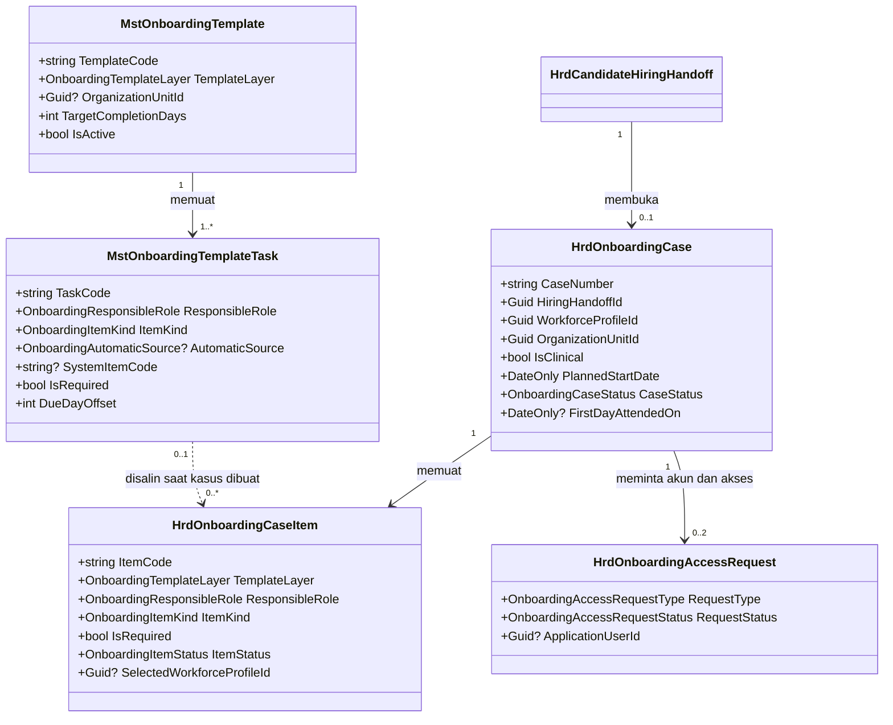

#### 18.3.2 Kontrak kerja dan keputusannya

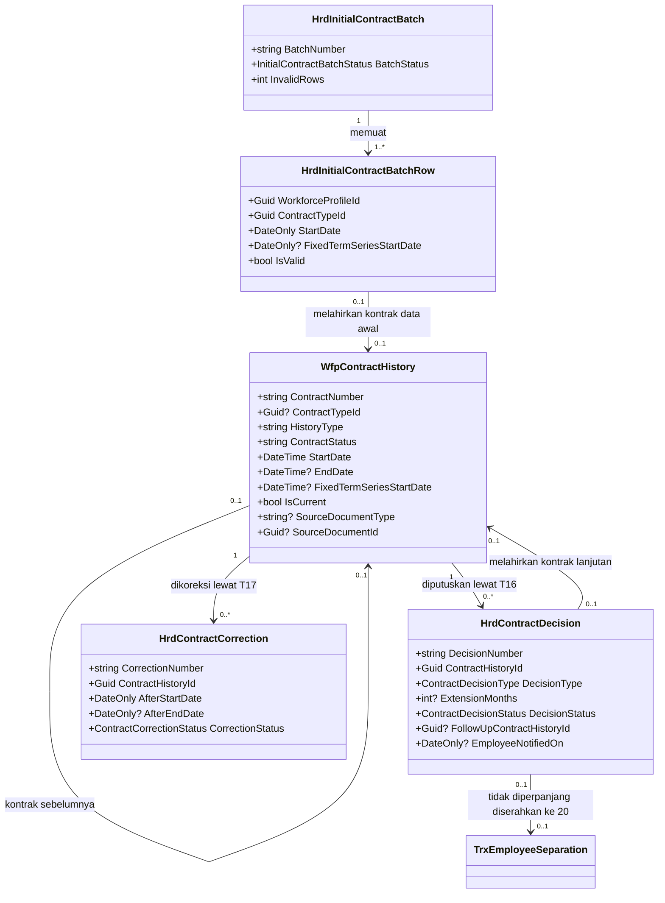

#### 18.3.3 Masa percobaan dan pendampingan klinis

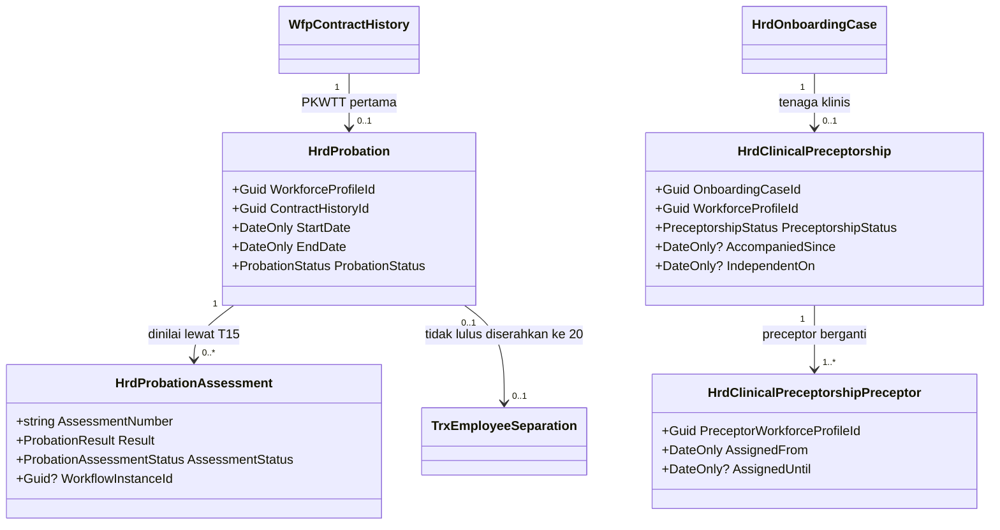

#### 18.3.4 Controller, service, dan service pemilik di modul lain

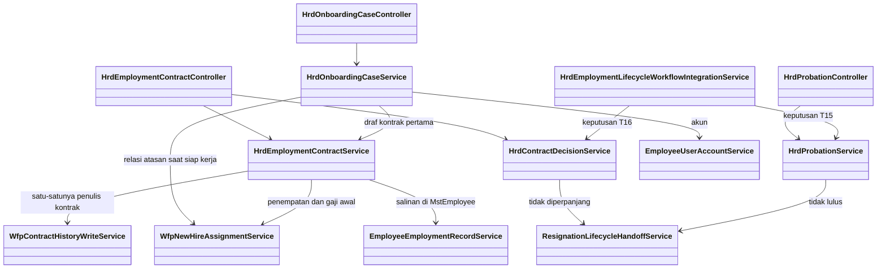

### 18.4 Penjelasan setiap class

#### 18.4.1 `HrdOnboardingCase`

| Aspek | Penjelasan |
| --- | --- |
| **Status** | `Baru` |
| **Lokasi file** | `Areas/Corporate/HumanResource/LifecycleManagement/Models/HrdOnboardingCase.cs` |
| Kategori | Transaksi |
| Tanggung jawab utama | Satu perjalanan pegawai baru dari serah terima rekrutmen sampai siap kerja atau batal bergabung. Memegang tanggal mulai rencana, unit dan jabatan tujuan, koordinator HRD, dan tanda hadir hari pertama |
| Field penting | `CaseNumber`, `HiringHandoffId` (unik), `WorkforceProfileId`, `HospitalSiteId`, `OrganizationUnitId`, `PositionId`, `IsClinical`, `PlannedStartDate`, `CoordinatorUserId`, `CaseStatus`, `FirstDayAttendedOn`, `ReadyForWorkAt`, `ReadyForWorkByUserId`, `CancelReason`, `CancelNote`, `HasGeneralTemplate`, `RowVersion` |
| Navigation property dan relasi | Milik satu `HrdCandidateHiringHandoff`; punya banyak `HrdOnboardingCaseItem`, nol atau satu `HrdClinicalPreceptorship`, nol sampai dua `HrdOnboardingAccessRequest` |
| Pemakaian dalam alur bisnis | Dibuat otomatis saat HR Manager menjalankan serah terima di 04 (`HRD-DEC-083`). Dibuka HRD dan Kepala Unit setiap hari sampai pegawai siap kerja |
| Catatan desain | Unit, jabatan, `IsClinical`, dan tanggal mulai **disalin** dari serah terima saat kasus dibuat agar penyaringan cakupan unit tidak perlu menelusuri rekrutmen. `HasGeneralTemplate = false` bila saat kasus dibuat belum ada Template Umum aktif; kasus tetap terbentuk dengan butir sistem saja dan menampilkan peringatan |
| Ekuivalen model lama | `TrxEmployeeOnboarding`, `WfpOnboardingChecklist` (dibuang) |

#### 18.4.2 `HrdOnboardingCaseItem`

| Aspek | Penjelasan |
| --- | --- |
| **Status** | `Baru` |
| **Lokasi file** | `Areas/Corporate/HumanResource/LifecycleManagement/Models/HrdOnboardingCaseItem.cs` |
| Kategori | Transaksi (anak kasus) |
| Tanggung jawab utama | Satu butir checklist milik satu pegawai, disalin dari template saat kasus dibuat. Menyimpan siapa yang mencentang, kapan, bukti, dan orang yang dipilih untuk butir pemilihan |
| Field penting | `OnboardingCaseId`, `TemplateLayer`, `SourceTemplateTaskId`, `ItemCode`, `ItemName`, `SystemItemCode`, `ResponsibleRole`, `ItemKind`, `AutomaticSource`, `CertificationTypeId`, `IsRequired`, `DueDayOffset`, `DueDate`, `ItemStatus`, `CompletedAt`, `CompletedByUserId`, `CompletionNote`, `SelectedWorkforceProfileId`, `EvidenceStoragePath`, `EvidenceFileName`, `AutomaticResultNote` |
| Navigation property dan relasi | Milik `HrdOnboardingCase`; menunjuk butir template asal bila ada; menunjuk profil yang dipilih (atasan langsung atau preceptor) |
| Pemakaian dalam alur bisnis | Dicentang HRD atau Kepala Unit sesuai `ResponsibleRole`; butir otomatis diisi sistem |
| Catatan desain | Urutan tampil memakai field semantik `TemplateLayer` lalu `DueDayOffset` lalu `ItemName`, **bukan** `SortOrder` (kontrak rekayasa backend baris 48). Perubahan template tidak mengubah butir yang sudah disalin (`HRD-DEC-086` `TEMPLATE_CHANGE_NOT_RETROACTIVE`) |
| Ekuivalen model lama | `TrxEmployeeOnboardingTask`, `WfpOnboardingTask` (dibuang) |

**Lima butir sistem** selalu ada pada kasus yang sesuai, tidak dapat dihapus dari template, dan selalu
wajib:

| `SystemItemCode` | Lapis | Jenis | Penanggung jawab | Selesai bila | Dasar |
| --- | --- | --- | --- | --- | --- |
| `FIRST_DAY_ATTENDANCE` | Umum | Manual | HRD | HRD mencatat pegawai hadir pada hari pertama | `HRD-DEC-083` butir 7, `HRD-DEC-088` butir 1 |
| `CONTRACT_SIGNED` | Umum | Otomatis | Sistem | Kontrak pertama berstatus `Active` | `HRD-DEC-084` butir 5 |
| `FITNESS_CLEARANCE` | Umum | Otomatis | Sistem | Kesimpulan MCU pada tawaran `Fit` atau `FitWithRestrictions` | `HRD-DEC-078`, `HRD-TF-050` |
| `DIRECT_SUPERVISOR_ASSIGNED` | Umum | Pemilihan orang | Kepala Unit | Kepala Unit memilih atasan langsung | Bagian 18.9.6 |
| `PRECEPTOR_ASSIGNED` | Klinis | Pemilihan orang | Kepala Unit | Kepala Unit memilih preceptor | `HRD-DEC-087` butir 2 |

#### 18.4.3 `MstOnboardingTemplate` dan `MstOnboardingTemplateTask`

| Aspek | Penjelasan |
| --- | --- |
| **Status** | `Diperbarui` — kolom yang dibuang dan ditambah dirinci pada bagian 18.6 |
| **Lokasi file** | `Areas/Corporate/HumanResource/LifecycleManagement/Models/MstOnboardingTemplate.cs`, `MstOnboardingTemplateTask.cs` |
| Kategori | Master |
| Tanggung jawab utama | Tiga lapis template (`HRD-DEC-086`): tepat satu Template Umum aktif, tepat satu Template Tambahan Tenaga Klinis aktif, dan nol atau satu Template Tambahan Unit aktif per unit |
| Field penting | Template: `TemplateCode`, `TemplateName`, `TemplateLayer`, `OrganizationUnitId`, `TargetCompletionDays`, `Version`, `IsActive`. Butir: `TaskCode`, `TaskName`, `TaskCategory`, `ResponsibleRole`, `ItemKind`, `AutomaticSource`, `CertificationTypeId`, `SystemItemCode`, `IsRequired`, `DueDayOffset`, `IsActive` |
| Navigation property dan relasi | Template punya banyak butir; butir otomatis jenis sertifikat menunjuk `MstCertificationType` |
| Pemakaian dalam alur bisnis | Disusun HRD sekali; dibaca saat kasus onboarding dibuat |
| Catatan desain | Prefix `Mst` tetap (`HRD-DEC-019`). **Utang teknis lokasi:** master berada di folder `LifecycleManagement/Models`, bukan `MasterData`; pemindahan folder adalah task tersendiri dan **MUST NOT** ikut task slice ini. `Version` naik setiap kali template disimpan, untuk jejak audit |
| Ekuivalen model lama | Model yang sama, dengan 15 kolom pembeda dan pengaturan yang tidak dipakai dibuang |

#### 18.4.4 `WfpContractHistory`

| Aspek | Penjelasan |
| --- | --- |
| **Status** | `Diperbarui` — **hanya penambahan kolom**; tidak ada kolom yang dibuang atau berubah tipe |
| **Lokasi file** | `Areas/Corporate/HumanResource/WorkforceCore/Models/WfpContractHistory.cs` (milik 02) |
| Kategori | Transaksi milik Workforce Core |
| Tanggung jawab utama | Satu baris per kontrak kerja pegawai. Perpanjangan dirantai lewat `PreviousContractHistoryId` dan `RenewalSequence` |
| Field penting (baru) | `SourceDocumentType`, `SourceDocumentId`, `FixedTermSeriesStartDate`, `DocumentFileName`, `DocumentContentType`, `SignedRecordedAt`, `SignedRecordedByUserId`, `RowVersion` |
| Nilai baru pada kolom teks yang sudah ada | `HistoryType`: tambah `InitialData` dan `Conversion`. `ContractStatus`: tambah `Completed` dan `LapsedWithoutDecision`. Nilai lama tetap dikenali saat dibaca |
| Navigation property dan relasi | Menunjuk profil, jenis kontrak, jenis kepegawaian; punya nol atau satu `HrdProbation`, banyak `HrdContractDecision` dan `HrdContractCorrection` |
| Pemakaian dalam alur bisnis | Ditulis **hanya** oleh `WfpContractHistoryWriteService`, yang dipanggil service 05 |
| Catatan desain | Indeks yang sudah ada dipakai apa adanya: nomor kontrak unik per pegawai, dan tepat satu kontrak `IsCurrent` per pegawai (`WfpContractHistoryConfiguration.cs:35-36`). `ProbationEndDate` diisi sistem dari `HrdProbation` dan tidak pernah diisi tangan |
| Ekuivalen model lama | — |

#### 18.4.5 `HrdProbation` dan `HrdProbationAssessment`

| Aspek | Penjelasan |
| --- | --- |
| **Status** | `Baru` |
| **Lokasi file** | `Areas/Corporate/HumanResource/LifecycleManagement/Models/HrdProbation.cs`, `HrdProbationAssessment.cs` |
| Kategori | Transaksi |
| Tanggung jawab utama | `HrdProbation`: satu masa percobaan per kontrak PKWTT pertama pegawai yang bergabung langsung sebagai PKWTT. `HrdProbationAssessment`: satu pengajuan hasil oleh atasan; pengajuan yang ditolak tetap tersimpan, dan atasan dapat membuat pengajuan baru |
| Field penting | Masa percobaan: `WorkforceProfileId`, `ContractHistoryId` (unik), `StartDate`, `EndDate`, `ReminderFromDate`, `ProbationStatus`, `ClosedAt`, `EmployeeSeparationId`. Penilaian: `AssessmentNumber`, `ProbationId`, `Result`, `ReasonText`, `Evidence*`, `AssessmentStatus`, `WorkflowInstanceId`, `SubmittedByUserId`, `DecidedByUserId`, `DecisionNote` |
| Navigation property dan relasi | Masa percobaan milik satu kontrak; punya banyak penilaian; bila tidak lulus menunjuk catatan pemisahan di 20 |
| Pemakaian dalam alur bisnis | Dibuat sistem saat kontrak PKWTT pertama ditandatangani; dinilai atasan lewat `T15` |
| Catatan desain | Tidak ada kolom skor dan tidak ada tanggal perpanjangan (`HRD-DEC-085` `SIMPLE_RESULT`, `THREE_MONTHS_FIXED`). Paling banyak satu penilaian berstatus `Submitted` atau `Returned` per masa percobaan |
| Ekuivalen model lama | `TrxProbationReview` (dibuang) |

#### 18.4.6 `HrdClinicalPreceptorship` dan `HrdClinicalPreceptorshipPreceptor`

| Aspek | Penjelasan |
| --- | --- |
| **Status** | `Baru` |
| **Lokasi file** | `Areas/Corporate/HumanResource/LifecycleManagement/Models/HrdClinicalPreceptorship.cs`, `HrdClinicalPreceptorshipPreceptor.cs` |
| Kategori | Transaksi |
| Tanggung jawab utama | Pendampingan klinis tenaga klinis baru, terpisah dari masa percobaan (`HRD-DEC-087`). Baris preceptor menyimpan siapa mendampingi dari tanggal berapa sampai tanggal berapa, sehingga pergantian preceptor tetap tertelusuri untuk akreditasi |
| Field penting | `OnboardingCaseId` (unik), `WorkforceProfileId`, `OrganizationUnitId`, `PreceptorshipStatus`, `AccompaniedSince`, `IndependentOn`, `DeclaredByUserId`, `Evidence*`, `AssessmentNote`; preceptor: `PreceptorWorkforceProfileId`, `AssignedFrom`, `AssignedUntil`, `AssignedByUserId`, `ChangeReason` |
| Navigation property dan relasi | Milik satu kasus onboarding; punya satu atau lebih baris preceptor; tepat satu baris tanpa `AssignedUntil` selama pendampingan berjalan |
| Pemakaian dalam alur bisnis | Lahir saat butir `PRECEPTOR_ASSIGNED` dicentang; menjadi `Accompanied` saat siap kerja; menjadi `Independent` saat Kepala Unit menekan **Siap Mandiri** |
| Catatan desain | **Tidak** masuk mesin persetujuan (`CLINICAL_DECISION_NOT_HRD`). HRD hanya membaca |
| Ekuivalen model lama | — |

#### 18.4.7 `HrdContractDecision` dan `HrdContractCorrection`

| Aspek | Penjelasan |
| --- | --- |
| **Status** | `Baru` |
| **Lokasi file** | `Areas/Corporate/HumanResource/LifecycleManagement/Models/HrdContractDecision.cs`, `HrdContractCorrection.cs` |
| Kategori | Transaksi |
| Tanggung jawab utama | Keputusan: satu dari tiga pilihan atas kontrak PKWT yang akan berakhir (`HRD-DEC-089` butir 2), diputus lewat `T16`. Koreksi: perbaikan isi kontrak yang sudah ditandatangani lewat `T17`; menyimpan nilai **sebelum** dan **sesudah** beserta scan perbaikan |
| Field penting | Keputusan: `DecisionNumber`, `ContractHistoryId`, `WorkforceProfileId`, `DecisionType`, `ExtensionMonths`, `ProposedStartDate`, `ProposedEndDate`, `ReasonText`, `DecisionStatus`, `WorkflowInstanceId`, `FollowUpContractHistoryId`, `EmployeeNotifiedOn`, `EmployeeSeparationId`. Koreksi: `CorrectionNumber`, `ContractHistoryId`, `Before*`, `After*`, `ReasonText`, `Evidence*`, `CorrectionStatus`, `WorkflowInstanceId`, `AppliedAt` |
| Navigation property dan relasi | Keduanya milik satu baris kontrak; keputusan yang disetujui menunjuk kontrak lanjutan atau catatan pemisahan |
| Pemakaian dalam alur bisnis | Keputusan diajukan atasan langsung atau Kepala Unit dari daftar Perlu Tindakan; koreksi diajukan petugas HRD |
| Catatan desain | Koreksi memperbarui baris kontrak **di tempat** dan menyimpan versi lama sebagai kolom `Before*` pada baris koreksi (`HRD-DEC-089` `CONTRACT_CORRECTION`: versi lama tetap tersimpan). Pilihan ini menjaga rantai perpanjangan dan hitungan 5 tahun tetap satu jalur |
| Ekuivalen model lama | `TrxContractNonRenewal` (dibuang) untuk keputusan tidak diperpanjang |

#### 18.4.8 `HrdInitialContractBatch` dan `HrdInitialContractBatchRow`

| Aspek | Penjelasan |
| --- | --- |
| **Status** | `Baru` |
| **Lokasi file** | `Areas/Corporate/HumanResource/LifecycleManagement/Models/HrdInitialContractBatch.cs`, `HrdInitialContractBatchRow.cs` |
| Kategori | Transaksi |
| Tanggung jawab utama | Data awal kontrak pegawai yang sudah bekerja sebelum sub-modul ini berjalan (`HRD-DEC-090`), disetujui sekali lewat `T18` |
| Field penting | Batch: `BatchNumber`, `HospitalSiteId`, `BatchStatus`, `TotalRows`, `ValidRows`, `InvalidRows`, `WorkflowInstanceId`, `AppliedAt`. Baris: `WorkforceProfileId`, `ContractTypeId`, `ContractNumber`, `StartDate`, `EndDate`, `FixedTermSeriesStartDate`, `IsValid`, `ValidationMessage`, `CreatedContractHistoryId` |
| Navigation property dan relasi | Batch punya banyak baris; baris yang diterapkan menunjuk kontrak yang lahir |
| Pemakaian dalam alur bisnis | Sekali saat sub-modul mulai dipakai; sesekali untuk pegawai yang tertinggal |
| Catatan desain | Mengikuti pola `HrdInitialPlacementBatch` (`HRD-DEC-054`). Scan kontrak lama boleh menyusul (`SCAN_MAY_FOLLOW_FOR_LEGACY`) |
| Ekuivalen model lama | — |

#### 18.4.9 `HrdOnboardingAccessRequest` dan `HrdEmploymentLifecycleSetting`

| Aspek | Penjelasan |
| --- | --- |
| **Status** | `Baru` |
| **Lokasi file** | `Areas/Corporate/HumanResource/LifecycleManagement/Models/HrdOnboardingAccessRequest.cs`, `HrdEmploymentLifecycleSetting.cs` |
| Kategori | Transaksi; pengaturan |
| Tanggung jawab utama | Permintaan akses: dua baris per kasus — `AccountCreation` (dikerjakan sistem lewat service 01) dan `WorkAccess` (dikerjakan Administrator/IT setelah siap kerja). Pengaturan: empat angka kebijakan per rumah sakit |
| Field penting | Permintaan: `OnboardingCaseId`, `WorkforceProfileId`, `RequestType`, `RequestStatus`, `ApplicationUserId`, `FailureMessage`, `SelfServiceActivatedAt`, `RequestedAt`, `CompletedAt`, `CompletedByUserId`, `CompletionNote`. Pengaturan: `HospitalSiteId` (unik), `ContractReminderDays`, `ContractEscalationDays`, `ProbationReminderDays`, `LateStartFlagDays` |
| Navigation property dan relasi | Permintaan milik kasus; pengaturan per site |
| Pemakaian dalam alur bisnis | Permintaan akun dibuat bersama kasus; akses kerja diminta saat siap kerja; pengaturan diubah HR Manager |
| Catatan desain | Pemberian peran tetap di layar peran yang sudah ada milik Administrator; sub-modul 05 **MUST NOT** memberi peran sendiri (`HRD-DEP-003`, `HRD-DEC-032`) |
| Ekuivalen model lama | `TrxAccessRevocation` milik 20 untuk sisi pencabutan — tidak disentuh |

#### 18.4.10 Service

Seluruh service `Baru` sub-modul 05 berada di
`Areas/Corporate/HumanResource/LifecycleManagement/Services/`, tanpa interface, didaftarkan
`AddScoped<T>()` di `Program.cs` dekat registrasi HR lain.

| Service | Fungsi utama | Dipanggil oleh | Membuka transaksi |
| --- | --- | --- | :---: |
| `HrdOnboardingCaseService` | Membuat kasus dari serah terima (idempoten per `HiringHandoffId`), menggabung tiga lapis template, mencatat hadir hari pertama, mencentang dan membatalkan centang butir, mengalihkan koordinator, menyatakan siap kerja, batal bergabung | `HrdOnboardingCaseController`; service serah terima 04 | Ya, kecuali saat dipanggil 04 — ikut transaksi pemanggil |
| `HrdOnboardingAutomaticItemService` | Menilai butir otomatis: kontrak sudah ditandatangani, kelaikan MCU, sertifikat pelatihan wajib | Case service, contract service, scheduler | Ikut transaksi pemanggil |
| `HrdOnboardingTemplateService` | Menyusun tiga lapis template dan menjaga butir sistem | `HrdOnboardingTemplateController` | Ya |
| `HrdEmploymentContractService` | Menyusun draf kontrak pertama dari tawaran (`HRD-DEC-084`, `HRD-DEC-095`), menandai sudah ditandatangani, menyusun draf kontrak lanjutan, unggah scan kontrak data awal, data cetak, hitungan 5 tahun | Controller kontrak; case service; decision service; batch service | Ya |
| `HrdContractDecisionService` | Mengajukan, mengubah, menarik keputusan; menerapkan keputusan yang disetujui; mencatat tanggal pemberitahuan | Controller kontrak; integrasi workflow | Ya |
| `HrdContractCorrectionService` | Mengajukan dan menerapkan koreksi kontrak | Controller kontrak; integrasi workflow | Ya |
| `HrdProbationService` | Membuat masa percobaan, pengajuan hasil, penerapan keputusan, lulus otomatis | Controller masa percobaan; contract service; integrasi workflow; scheduler | Ya |
| `HrdClinicalPreceptorshipService` | Membuat pendampingan dari butir preceptor, mengganti preceptor, menyatakan siap mandiri | Controller pendampingan; case service | Ya |
| `HrdInitialContractBatchService` | Templat, validasi, simpan, ajukan `T18`, terapkan | Controller batch; integrasi workflow | Ya |
| `HrdOnboardingAccessService` | Membuat akun lewat `EmployeeUserAccountService`, mengaktifkan akun layanan mandiri saat hadir hari pertama, meminta akses kerja, menandai selesai, mengulang yang gagal | Case service; controller permintaan akses | Ikut transaksi pemanggil, kecuali ulang dan tandai selesai |
| `HrdEmploymentReadinessReadService` | **Kontrak baca untuk sub-modul lain**: boleh dijadwalkan pada tanggal tertentu, penanda Didampingi beserta nama preceptor, peringatan kredensial, penahan jadwal kontrak | 06 Penjadwalan; controller daftar kerja | Tidak |
| `HrdLifecycleWorklistService` | Menyusun daftar Perlu Tindakan per peran dari kasus, kontrak, dan masa percobaan | `HrdLifecycleWorklistController` | Tidak |
| `HrdLifecycleAttachmentService` | Memeriksa jenis dan ukuran berkas, lalu menyimpan lewat `WorkflowFileStorageService` | Seluruh service yang menerima scan atau bukti | Tidak |
| `HrdEmploymentLifecycleWorkflowIntegrationService` | Memulai instance `T15` s.d. `T18`; menerima keputusan akhir dan meneruskannya ke service domain | Service domain; `WorkflowReferenceLifecycleService` | Ya |
| `HrdEmploymentLifecycleSchedulerService` | Harian: lulus otomatis masa percobaan, perpindahan `IsCurrent` pada tanggal mulai kontrak lanjutan, kontrak tidak diperpanjang → `Ended`, kontrak tanpa keputusan → `LapsedWithoutDecision`, penilaian ulang butir otomatis kasus berjalan | `HrdEmploymentLifecycleSchedulerHostedService` | Ya, per langkah |
| `HrdEmploymentLifecycleSchedulerHostedService` | Pembungkus `BackgroundService`, didaftarkan `AddHostedService` dekat registrasi scheduler HR lain | Host aplikasi | — |
| `HrdEmploymentLifecycleSettingService` | Baca dan ubah pengaturan | Controller pengaturan; service lain | Ya |

**Service di modul lain yang `Baru` atau `Diperbarui`:**

| Service | Lokasi | Status | Perubahan |
| --- | --- | --- | --- |
| `WfpContractHistoryWriteService` | `Areas/Corporate/HumanResource/WorkforceCore/Services/` | `Baru` | Satu-satunya penulis `WfpContractHistory`: buat draf, tandai ditandatangani, pindahkan `IsCurrent`, akhiri, tandai tanpa keputusan, terapkan koreksi, sisipkan baris data awal. Dipanggil hanya service 05 |
| `WfpNewHireAssignmentService` | `Areas/Corporate/HumanResource/WorkforceCore/Services/` | `Baru` | Membuat penempatan organisasi, penempatan jabatan, dan penetapan gaji awal saat kontrak pertama ditandatangani, berlaku sejak tanggal mulai kontrak; membuat relasi atasan saat siap kerja. Memakai aturan tumpang tindih `HRD-DEC-049` yang sama dengan `HrdInitialPlacementBatchService` |
| `EmployeeEmploymentRecordService` | `Areas/Corporate/HumanResource/MasterData/Workforce/Services/` | `Baru` | Menulis `EmploymentStatusId`, `EmploymentTypeId`, `JoinDate`, `ContractEndDate`, `ProbationEndDate` pada `MstEmployee` (atau `MstDoctor` untuk profil dokter) sebagai salinan dari kontrak dan masa percobaan |
| `EmployeeUserAccountService` | `Areas/Corporate/HumanResource/MasterData/Workforce/Services/` | `Baru` — **ekstraksi tanpa perubahan perilaku** | Logika pembuatan akun yang hari ini ada di `EmployeeController.cs:3555-3660` dipindah ke service agar dapat dipanggil 05. `EmployeeController` memanggil service ini; perilaku endpoint lamanya tidak berubah. Ditambah dua metode: aktifkan dan nonaktifkan akun |
| `ResignationLifecycleHandoffService` | `Areas/Corporate/HumanResource/LifecycleManagement/Services/` | `Diperbarui` | Metode baru `HandoffLifecycleSeparationAsync` untuk `SeparationType` `ContractNonRenewal` dan `ProbationFailed`: membuat `TrxEmployeeSeparation` berstatus disetujui beserta tanggal terakhir bekerja, lalu membuka exit clearance seperti jalur pengunduran diri. Jalur pengunduran diri tidak berubah |
| `WorkflowReferenceLifecycleService` | `Areas/Corporate/HumanResource/WorkflowManagement/Services/` | `Diperbarui` | Empat jenis rujukan baru: `WorkforceProbationAssessment` (`T15`), `WorkforceContractDecision` (`T16`), `WorkforceContractCorrection` (`T17`), `WorkforceInitialContractBatch` (`T18`) |
| Service serah terima rekrutmen (`BE-HRD-061`, `S-D2`) | `Areas/Corporate/HumanResource/RecruitmentManagement/Services/` | `Diperbarui` pada task 05 | Memanggil `HrdOnboardingCaseService.CreateFromHandoffAsync` di dalam transaksi serah terima (`INT-HR-25`) |
| Service tawaran rekrutmen (`S-D2`) | `.../RecruitmentManagement/Services/` | `Diperbarui` | Validasi jenis dan lama kontrak (`HRD-DEC-095`, `VR-ONB-50`, `VR-ONB-51`) |

**Yang dipakai ulang tanpa perubahan:** mesin persetujuan bersama (`WorkflowService`, termasuk
penolakan swa-setuju `WorkflowService.cs:534-556` bila langkah didefinisikan
`AllowSelfApproval = false`); `NumberSeriesAllocator` untuk seluruh nomor dokumen
(`QBE-CODE-002`, `QBE-CODE-003`) — dipanggil di luar transaksi pemanggil, controller tidak pernah
membuat nomor; `OrganizationAuthorizationProjectionService` untuk cakupan unit Kepala Unit;
`WorkflowFileStorageService` untuk berkas.

#### 18.4.11 Controller

Seluruhnya `Baru` kecuali yang disebut, di `Areas/Corporate/HumanResource/LifecycleManagement/Controllers/`,
memakai `[AccessController]` di kelas dan `[AccessPermission(...)]` di setiap endpoint. Tidak satu pun
mengakses `ApplicationDbContext` langsung (`QBE-SVC-001`). Route dasar
`api/v1/corporate/human-resource/lifecycle-management/...`, mengikuti `ExitClearanceController`.

| Controller | Service yang dipakai | Grup Swagger | Endpoint yang diurus |
| --- | --- | --- | --- |
| `HrdOnboardingCaseController` | `HrdOnboardingCaseService`, `HrdOnboardingAccessService` | `Corporate / Human Resource / Lifecycle Management / Onboarding Case` | Daftar, ringkasan, detail, hadir hari pertama, centang dan batal centang butir HRD, centang dan batal centang butir unit, alihkan koordinator, siap kerja, batal bergabung |
| `HrdOnboardingTemplateController` | `HrdOnboardingTemplateService` | `Corporate / Human Resource / Lifecycle Management / Onboarding Template` | Daftar, detail, buat, ubah, aktif/nonaktif |
| `HrdEmploymentContractController` | `HrdEmploymentContractService`, `HrdContractDecisionService`, `HrdContractCorrectionService` | `Corporate / Human Resource / Lifecycle Management / Employment Contract` | Daftar, detail, data cetak, tandai ditandatangani, unggah scan data awal, keputusan (ajukan, ubah, tarik, catat pemberitahuan), koreksi (ajukan, ubah, tarik) |
| `HrdProbationController` | `HrdProbationService` | `Corporate / Human Resource / Lifecycle Management / Probation` | Daftar, detail, ajukan hasil, ubah hasil yang dikembalikan, tarik |
| `HrdClinicalPreceptorshipController` | `HrdClinicalPreceptorshipService` | `Corporate / Human Resource / Lifecycle Management / Clinical Preceptorship` | Daftar, detail, ganti preceptor, siap mandiri |
| `HrdInitialContractBatchController` | `HrdInitialContractBatchService` | `Corporate / Human Resource / Lifecycle Management / Initial Contract Batch` | Templat, validasi, daftar, detail, buat, ubah, ajukan, batalkan |
| `HrdOnboardingAccessRequestController` | `HrdOnboardingAccessService` | `Corporate / Human Resource / Lifecycle Management / Onboarding Access Request` | Daftar, tandai selesai, ulang pembuatan akun |
| `HrdLifecycleWorklistController` | `HrdLifecycleWorklistService` | `Corporate / Human Resource / Lifecycle Management / Lifecycle Worklist` | Daftar Perlu Tindakan dan hitungannya |
| `HrdEmploymentLifecycleSettingController` | `HrdEmploymentLifecycleSettingService` | `Corporate / Human Resource / Lifecycle Management / Lifecycle Setting` | Baca, ubah |
| `WfpContractHistoryController` | — | `Corporate / Human Resource / Workforce Core / Contract History` | **`Diperbarui`.** Lima endpoint tulis (`POST`, `PUT`, `PATCH status`, `PATCH current`, `DELETE`) menjawab `409` `CONTRACT_MANAGED_BY_LIFECYCLE` (`VR-ONB-32`). Empat endpoint baca tidak berubah |
| `EmployeeController` | `EmployeeUserAccountService` (baru) | Tidak berubah | **`Diperbarui`.** Pembuatan akun memanggil service hasil ekstraksi. `PUT` menolak perubahan `EmploymentTypeId`, `EmploymentStatusId`, `JoinDate`, `ContractEndDate`, dan `ProbationEndDate` untuk pegawai yang kontraknya sudah dikelola 05 (`VR-ONB-33`) |

**Perubahan yang memutus — penilaian consumer.** Endpoint tulis riwayat kontrak 02 hari ini dipakai satu
consumer: tab riwayat kontrak pada `src/components/features/workforce/workforce-resource-editor.jsx`
(`HRD-TF-043`). Isi tabel 0 baris di dev (`HRD-TF-044`). Tab itu menjadi baca saja dengan tautan ke
layar Kontrak Kerja (`03-frontend-architecture.md` bagian 14). Endpoint dipertahankan dan menjawab
`409` beserta pesan, bukan dihapus, agar consumer lama mendapat penjelasan, bukan `404`.

Persetujuan **tidak** punya endpoint di controller domain. Keputusan `T15` s.d. `T18` lewat kotak
masuk persetujuan yang sudah ada (`HRD-DEC-018`).

#### 18.4.12 DTO, enum, konstanta, dan configuration

| Jenis | Lokasi | Isi |
| --- | --- | --- |
| DTO | `Areas/Corporate/HumanResource/LifecycleManagement/DTOs/` | `OnboardingCaseDtos.cs`, `OnboardingTemplateDtos.cs`, `EmploymentContractDtos.cs`, `ContractDecisionDtos.cs`, `ContractCorrectionDtos.cs`, `ProbationDtos.cs`, `ClinicalPreceptorshipDtos.cs`, `InitialContractBatchDtos.cs`, `OnboardingAccessRequestDtos.cs`, `LifecycleWorklistDtos.cs`, `LifecycleSettingDtos.cs`. Bentuk per endpoint pada `contracts/api-contract.md` bagian 15 |
| Enum | `Areas/Corporate/HumanResource/LifecycleManagement/Enums/` | Tabel di bawah. Disimpan sebagai integer (`HasConversion<int>()`) |
| Konstanta | `Areas/Corporate/HumanResource/LifecycleManagement/Constants/EmploymentLifecycleValueConstants.cs` | Lima `SystemItemCode`, empat jenis rujukan workflow, enam kunci number series, nilai baru `HistoryType` dan `ContractStatus`, nilai `SourceDocumentType`, kode `SeparationType` baru, nama kunci advisory lock |
| Configuration | `Repositories/Configurations/Corporate/HumanResource/LifecycleManagement/` | Satu berkas per tabel baru, `Hrd<Nama>Configuration.cs`; dua berkas template yang ada diperbarui. `WfpContractHistoryConfiguration.cs` (WorkforceCore), `MstContractTypeConfiguration` (MasterData), `HrdJobOfferConfiguration.cs` (RecruitmentManagement) diperbarui |
| DbSet | `Repositories/ApplicationDbContext.cs` | 12 `DbSet` baru, jamak: `HrdOnboardingCases`, `HrdOnboardingCaseItems`, dan seterusnya. Enam `DbSet` kandidat dibuang |

| Enum | Nilai | Bawaan |
| --- | --- | --- |
| `OnboardingCaseStatus` | `InProgress=1`, `Completed=2`, `Cancelled=3` | `InProgress` |
| `OnboardingCancelReason` | `NoShow=1`, `Withdrew=2`, `Other=3` | — wajib dipilih |
| `OnboardingTemplateLayer` | `General=1`, `Clinical=2`, `Unit=3` | — |
| `OnboardingResponsibleRole` | `Hrd=1`, `UnitHead=2`, `System=3` | — |
| `OnboardingItemKind` | `Manual=1`, `EvidenceRequired=2`, `Automatic=3`, `PersonSelection=4` | `Manual` |
| `OnboardingAutomaticSource` | `ContractSigned=1`, `FitnessClearance=2`, `MandatoryCertification=3` | — |
| `OnboardingItemStatus` | `Pending=1`, `Completed=2` | `Pending` |
| `OnboardingAccessRequestType` | `AccountCreation=1`, `WorkAccess=2` | — |
| `OnboardingAccessRequestStatus` | `Requested=1`, `Completed=2`, `Failed=3`, `Cancelled=4` | `Requested` |
| `ProbationStatus` | `Running=1`, `AwaitingDecision=2`, `Passed=3`, `PassedAutomatically=4`, `Failed=5` | `Running` |
| `ProbationResult` | `Pass=1`, `Fail=2` | — wajib dipilih |
| `ProbationAssessmentStatus` | `Submitted=1`, `Returned=2`, `Rejected=3`, `Approved=4`, `Withdrawn=5`, `ClosedOnExpiry=6` | `Submitted` |
| `PreceptorshipStatus` | `PreceptorAssigned=1`, `Accompanied=2`, `Independent=3`, `Cancelled=4` | `PreceptorAssigned` |
| `ContractDecisionType` | `Extend=1`, `ConvertToPermanent=2`, `NotRenew=3` | — wajib dipilih |
| `ContractDecisionStatus` | `Submitted=1`, `Returned=2`, `Rejected=3`, `Approved=4`, `Withdrawn=5` | `Submitted` |
| `ContractCorrectionStatus` | `Submitted=1`, `Returned=2`, `Rejected=3`, `Approved=4`, `Withdrawn=5` | `Submitted` |
| `InitialContractBatchStatus` | `Draft=1`, `Submitted=2`, `Returned=3`, `Rejected=4`, `Applied=5`, `Cancelled=6` | `Draft` |

Kolom teks `WfpContractHistory.ContractStatus` **tetap teks** agar nilai lama tidak berubah tipe;
nilai yang dipakai 05 adalah `Draft`, `Active`, `Completed`, `Ended`, `LapsedWithoutDecision`,
`Cancelled`.

### 18.5 Arsitektur folder

```text
Areas/Corporate/HumanResource/LifecycleManagement/
├── Constants/
│   ├── ResignationValueConstants.cs                    Sudah ada — tidak berubah
│   └── EmploymentLifecycleValueConstants.cs            Baru
├── Controllers/
│   ├── ExitClearanceController.cs                      Sudah ada — tidak berubah
│   ├── ResignationController.cs                        Sudah ada — tidak berubah
│   └── Hrd*Controller.cs                               Baru — 9 controller pada 18.4.11
├── DTOs/                                               Baru — 11 berkas pada 18.4.12 (2 berkas lama tidak berubah)
├── Enums/                                              Baru — 17 enum pada 18.4.12
├── Models/
│   ├── HrdOnboardingCase.cs                            Baru (+ CaseItem)
│   ├── HrdOnboardingAccessRequest.cs                   Baru
│   ├── HrdProbation.cs                                 Baru (+ Assessment)
│   ├── HrdClinicalPreceptorship.cs                     Baru (+ Preceptor)
│   ├── HrdContractDecision.cs                          Baru
│   ├── HrdContractCorrection.cs                        Baru
│   ├── HrdInitialContractBatch.cs                      Baru (+ Row)
│   ├── HrdEmploymentLifecycleSetting.cs                Baru
│   ├── MstOnboardingTemplate.cs                        Diperbarui — utang teknis lokasi (master di luar MasterData)
│   ├── MstOnboardingTemplateTask.cs                    Diperbarui — idem
│   ├── TrxEmployeeOnboarding.cs                        Dibuang
│   ├── TrxEmployeeOnboardingTask.cs                    Dibuang
│   ├── WfpOnboardingChecklist.cs                       Dibuang
│   ├── WfpOnboardingTask.cs                            Dibuang
│   ├── TrxProbationReview.cs                           Dibuang
│   ├── TrxContractNonRenewal.cs                        Dibuang
│   └── Trx*/Wfp*/Mst* offboarding, pemisahan, exit     Sudah ada — milik 20, tidak disentuh
└── Services/
    ├── ExitClearanceService.cs                         Sudah ada — tidak berubah
    ├── ResignationLifecycleHandoffService.cs           Diperbarui — satu metode baru
    ├── Resignation*Service.cs                          Sudah ada — tidak berubah
    └── Hrd*Service.cs                                  Baru — 17 service pada 18.4.10

Areas/Corporate/HumanResource/WorkforceCore/
├── Controllers/WfpContractHistoryController.cs         Diperbarui — endpoint tulis menjawab 409
├── Models/WfpContractHistory.cs                        Diperbarui — 8 kolom baru
└── Services/
    ├── WfpContractHistoryWriteService.cs               Baru
    └── WfpNewHireAssignmentService.cs                  Baru

Areas/Corporate/HumanResource/MasterData/Workforce/
├── Controllers/EmployeeController.cs                   Diperbarui — memanggil service akun; kunci 5 isian
├── Models/MstContractType.cs                           Diperbarui — 1 kolom baru
└── Services/
    ├── EmployeeUserAccountService.cs                   Baru — ekstraksi
    └── EmployeeEmploymentRecordService.cs              Baru

Areas/Corporate/HumanResource/RecruitmentManagement/Models/HrdJobOffer.cs   Diperbarui — 2 kolom baru (HRD-DEC-095)

Repositories/Configurations/Corporate/HumanResource/LifecycleManagement/
├── Hrd*Configuration.cs                                Baru — 12 berkas
├── MstOnboardingTemplateConfiguration.cs               Diperbarui
├── MstOnboardingTemplateTaskConfiguration.cs           Diperbarui
└── *Configuration.cs enam kandidat                     Dibuang bersama modelnya
```

**Utang teknis yang tercatat, tidak dirapikan diam-diam:**

| Penyimpangan | Keadaan | Penanganan |
| --- | --- | --- |
| `MstOnboardingTemplate` dan `MstOnboardingTemplateTask` berada di `LifecycleManagement/Models`, bukan `MasterData` | Master yang dipakai slice ini | Pemindahan folder adalah task tersendiri dengan approval pemilik arsitektur backend |
| Logika pembuatan akun ada di dalam `EmployeeController` (controller mengakses `UserManager` dan context langsung) | Dipakai master pegawai | Hanya diekstrak sebatas yang dibutuhkan 05; perapian controller lainnya **MUST NOT** ikut |
| `ResignationLifecycleHandoffService.GenerateNumber("SEP")` membuat nomor tanpa number series | Pola lama 20 | Metode baru memakai `NumberSeriesAllocator` untuk nomor pemisahan yang dibuatnya; metode lama tidak disentuh |

### 18.6 Status model dan dampak migration

| Model | Status | Kolom yang berubah | Dampak migration |
| --- | --- | --- | --- |
| 12 tabel `Hrd*` pada 18.4 | `Baru` | Seluruh kolom pada `data/data-dictionary.md` bagian 10 | Membuat tabel; tidak menyentuh data mana pun |
| `MstOnboardingTemplate` | `Diperbarui` | **Tambah:** `TemplateLayer` (`int`, wajib). **Buang:** `TemplateType`, `LegalEntityId`, `HospitalSiteId`, `DepartmentId`, `PositionId`, `WorkforceTypeId`, `EmployeeCategoryId`, `EmploymentTypeId`, `WorkflowDefinitionId`, `AutoCreateChecklist`, `RequiresProbationReview`, `ProbationReviewAfterDays`, `EffectiveStartDate`, `EffectiveEndDate`, `IsDefault`. **Indeks baru:** satu template aktif per lapis Umum dan Klinis; satu template aktif per unit untuk lapis Unit | Tabel 0 baris (`HRD-TF-047`); pengaman tabel kosong wajib (`HRD-DEC-090` butir 11) |
| `MstOnboardingTemplateTask` | `Diperbarui` | **Tambah:** `ResponsibleRole`, `ItemKind`, `AutomaticSource`, `CertificationTypeId`, `SystemItemCode`. **Buang:** `ResponsiblePartyType`, `ResponsibleOrganizationUnitId`, `ResponsiblePositionId`, `RequiresDocument`, `RequiresVerification`, `CompletionSource`, `SortOrder`. **Indeks:** unik (`OnboardingTemplateId`, `TaskCode`) | Tabel 0 baris; pengaman tabel kosong wajib |
| `WfpContractHistory` | `Diperbarui` | **Tambah saja:** `SourceDocumentType` (`varchar(50)`, null), `SourceDocumentId` (`uuid`, null), `FixedTermSeriesStartDate` (`timestamp`, null), `DocumentFileName` (`varchar(250)`, null), `DocumentContentType` (`varchar(150)`, null), `SignedRecordedAt` (`timestamp`, null), `SignedRecordedByUserId` (`uuid`, null), `RowVersion` (`uuid`, wajib, bawaan `gen_random_uuid()`) | Penambahan kolom boleh-null dan satu kolom berbawaan; **aman bagi data yang ada**. Tabel milik 02 ini **tidak** termasuk penutupan `HRD-Q-05` (`HRD-DEC-090` butir 10), sehingga tidak ada kolom yang dibuang |
| `MstContractType` | `Diperbarui` | **Tambah:** `EmploymentTypeId` (`uuid`, null, FK `MstEmploymentType`, `Restrict`) — jenis kepegawaian yang dipakai kontrak jenis ini | Penambahan kolom boleh-null; aman |
| `HrdJobOffer` | `Diperbarui` | **Tambah:** `ContractTypeId` (`uuid`, null di database, wajib di aturan service; FK `MstContractType`, `Restrict`), `ContractDurationMonths` (`int`, null) (`HRD-DEC-095`) | Penambahan kolom boleh-null; aman bagi baris uji `S-D2` yang mungkin sudah ada |
| `MstEmployee`, `MstDoctor` | `Sudah ada` | Tidak ada | Tidak ada; hanya aturan penulisan lima isian yang berubah |
| `WfpOrganizationAssignment`, `WfpPositionAssignment`, `WfpSalaryAssignment`, `WfpManagerAssignment` | `Sudah ada` | Tidak ada | Tidak ada |
| `TrxEmployeeSeparation` | `Sudah ada` | Tidak ada — nilai teks baru `ContractNonRenewal` dan `ProbationFailed` pada `SeparationType` | Tidak ada; bukan *material touch* menurut `HRD-DEC-019` karena kontrak persistence tidak berubah |
| `MstEmploymentStatus`, `MstEmploymentType`, `MstCertificationType` | `Sudah ada` | Tidak ada; hanya baris data (bagian 18.8) | Tidak ada |
| `TrxEmployeeOnboarding`, `TrxEmployeeOnboardingTask`, `WfpOnboardingChecklist`, `WfpOnboardingTask`, `TrxProbationReview`, `TrxContractNonRenewal` | Dibuang | Seluruh tabel | Dibuang dengan pengaman tabel kosong (bagian 18.7) |

### 18.7 Rencana migration

**Peringatan:** blueprint tidak memberi wewenang membuat atau menjalankan migration. Rencana ini
adalah bahan task implementasi.

| Urutan | Migration | Isi | Tanpa downtime? | Pengisian data lama | Langkah mundur |
| ---: | --- | --- | :---: | --- | --- |
| 1 | `AddOfferContractTerms` | Dua kolom pada `HrdJobOffer` (`HRD-DEC-095`) | **Ya** — hanya `ADD COLUMN` boleh-null | Tidak ada | `Down()` membuang kedua kolom |
| 2 | `RetireLifecycleOnboardingCandidateTables` | Membuang enam tabel kandidat: urutan `TrxProbationReview` → `TrxEmployeeOnboardingTask` → `TrxEmployeeOnboarding` → `WfpOnboardingTask` → `WfpOnboardingChecklist` → `TrxContractNonRenewal` | **Ya** — tabel tidak dipakai kode mana pun | Tidak ada; tabel kosong | Hanya lewat migration baru yang membuat ulang tabel; tidak ada data yang hilang karena pengaman |
| 3 | `ReshapeOnboardingTemplates` | Mengubah dua tabel template sesuai bagian 18.6 | **Ya** | Tidak ada; tabel kosong | `Down()` mengembalikan kolom lama tanpa isi |
| 4 | `AddEmploymentLifecycleCore` | Membuat 12 tabel `Hrd*`; menambah kolom `WfpContractHistory` dan `MstContractType` | **Ya** — `CREATE TABLE` dan `ADD COLUMN` boleh-null | `RowVersion` pada baris kontrak yang ada diisi bawaan | `Down()` membuang tabel dan kolom baru; aman selama belum ada data, setelah itu mundur hanya lewat migration baru |

**Pengaman tabel kosong (`HRD-DEC-090` butir 11–12).** Migration 2 dan 3 **MUST** membuka setiap
pembuangan tabel atau kolom dengan blok `DO $$ … IF EXISTS (SELECT 1 FROM public."<tabel>" LIMIT 1)
THEN RAISE EXCEPTION 'MIGRATION ABORTED: tabel <tabel> berisi % baris', … END IF; $$`, mengikuti
`Migrations/20260902072756_DropTableMstBillingCategory.cs:36-42`; **MUST NOT** memakai
`DROP … CASCADE`. Bila pengaman berhenti di lingkungan mana pun, `HRD-DEC-090` butir 10 kembali
`draft`.

**Urutan terhadap `S-D2`.** Pada HEAD `8b17b75a`, `TrxEmployeeOnboarding` dan
`WfpOnboardingChecklist` merujuk `TrxCandidateHiring`, yang dibuang pembersihan `S-D2` (bagian
17.5). Saat bagian ini ditulis, pembersihan itu **sedang dikerjakan di working tree dan belum
di-commit**: `TrxCandidateHiring` dihapus, navigasi `CandidateHiring` pada kedua model dipindah ke
`HrdCandidateHiringHandoff`, dan migration `20261104113000_AddRecruitmentManagementCoreAndRetireLegacy`
ditambahkan. Akibatnya:

1. bila pembersihan `S-D2` itu masuk lebih dulu, migration 2 di atas membuang kedua tabel yang kini
   merujuk `HrdCandidateHiringHandoff` — urutannya tidak lagi saling mengunci;
2. bila migration 2 masuk lebih dulu, pembersihan `S-D2` tidak perlu memindahkan rujukan kedua
   tabel itu lagi;
3. task implementasi `S-C4-ONB` **MUST** memeriksa ulang keadaan kedua model dan migration
   tersebut pada HEAD saat task dikerjakan, bukan memakai keadaan bagian ini.

### 18.8 Rencana data master awal

Tanpa isian di bawah, sub-modul 05 tidak dapat dipakai sama sekali.

| Data | Isi minimum | Sumber nilai | Diisi lewat |
| --- | --- | --- | --- |
| Jenis kontrak (`MstContractType`, 0 baris hari ini) | `PKWT` — wajib tanggal berakhir, dapat diperpanjang, **tanpa** masa percobaan, jenis kepegawaian "Kontrak"; `PKWTT` — tanpa tanggal berakhir, tidak diperpanjang, **dengan** masa percobaan, jenis kepegawaian "Tetap" | PP 35/2021; UU 13/2003 Pasal 60 | Master jenis kontrak yang sudah ada (`ContractTypeController`) |
| Jenis kepegawaian (`MstEmploymentType`, 1 baris `Legacy`) | "Kontrak" (`IsContractBased`, wajib tanggal akhir kontrak) dan "Tetap" (`IsPermanent`) | Kebijakan HR | Master yang sudah ada |
| Status kepegawaian (`MstEmploymentStatus`, 1 baris `Legacy`) | `PENDING_ONBOARDING` — belum aktif bekerja, **tidak** boleh dijadwalkan, layak payroll; `ACTIVE` — aktif, boleh dijadwalkan, layak payroll; `CANCELLED_JOIN` — batal bergabung, tidak boleh dijadwalkan, tidak layak payroll, status akhir | `HRD-DEC-075`, `HRD-DEC-088` | Master yang sudah ada (`EmploymentStatusController`) |
| Template Umum RS | Satu template aktif berisi butir sistem `FIRST_DAY_ATTENDANCE`, `CONTRACT_SIGNED`, `FITNESS_CLEARANCE`, `DIRECT_SUPERVISOR_ASSIGNED`, ditambah butir rumah sakit — contoh: orientasi umum (wajib bukti daftar hadir), ID card dan seragam, data rekening | SOP orientasi rumah sakit | Layar Template Onboarding |
| Template Tambahan Tenaga Klinis | Satu template aktif berisi butir sistem `PRECEPTOR_ASSIGNED`, ditambah butir sertifikat wajib — contoh: BLS/BTCLS berlaku | SOP keperawatan dan Komite | Layar Template Onboarding |
| Jenis sertifikat (`MstCertificationType`, 8 baris di dev) | Jenis yang dipakai butir otomatis sertifikat, misalnya BTCLS dan BLS | Master yang sudah ada | Tidak perlu diisi ulang bila sudah ada |
| Definisi alur `T15` s.d. `T18` | Empat definisi, masing-masing **satu langkah** berpenyetuju `SiteHr` dan `AllowSelfApproval = false` (`HRD-DEC-081`) | `HRD-DEC-081` | Master definisi workflow yang sudah ada |
| Number series | Enam kunci: kasus onboarding, kontrak kerja, penilaian masa percobaan, keputusan kontrak, koreksi kontrak, batch data awal kontrak | Konvensi penomoran HR | Konfigurasi number series |
| Pengaturan siklus | Satu baris per rumah sakit dengan bawaan 60 / 14 / 14 / 3 hari (bagian 18.9.5) | `HRD-DEC-085` butir 4, `HRD-DEC-089` butir 1 dan 8 — **nilai kebijakan, dapat diubah HR Manager** | Layar Pengaturan |
| Pemetaan peran | HR Admin, HR Manager, Kepala Unit, Administrator/IT ke peran aplikasi | Administrator | `HRD-DEC-032` — `MAPPING_REQUIRED` |

### 18.9 Hitungan dan aturan yang dirancang

#### 18.9.1 Tanggal kontrak

| Hitungan | Rumus | Contoh |
| --- | --- | --- |
| Tanggal berakhir kontrak pertama PKWT | tanggal mulai + lama kontrak (bulan) − 1 hari | Mulai 1 Februari 2027, 12 bulan → **31 Januari 2028** |
| Tanggal mulai kontrak lanjutan | tanggal berakhir kontrak sebelumnya + 1 hari | Berakhir 31 Januari 2028 → mulai **1 Februari 2028** |
| Tanggal berakhir perpanjangan | tanggal mulai lanjutan + bulan perpanjangan − 1 hari | Mulai 1 Februari 2028, 12 bulan → **31 Januari 2029** |

#### 18.9.2 Batas 5 tahun PKWT

`FixedTermSeriesStartDate` adalah tanggal mulai PKWT pertama dalam satu rangkaian PKWT yang tidak
terputus. Diisi sistem pada kontrak PKWT pertama (sama dengan tanggal mulainya), diwariskan ke setiap
perpanjangan, dan diisi dari batch untuk data awal (`HRD-DEC-090` `FIRST_PKWT_DATE_REQUIRED`).

Total PKWT = tanggal berakhir yang diusulkan − `FixedTermSeriesStartDate` + 1 hari. Perpanjangan
ditolak bila totalnya lebih dari 5 tahun (`VR-ONB-36`).

**Contoh.** Budi: PKWT pertama mulai 1 April 2024. Kontrak berjalan berakhir 31 Maret 2027 (total 3
tahun). Perpanjangan 24 bulan → berakhir 31 Maret 2029 → total 5 tahun → **diterima**. Perpanjangan
30 bulan → berakhir 30 September 2029 → total 5 tahun 6 bulan → **ditolak**; pilihan yang tersisa
Angkat jadi Pegawai Tetap atau Tidak Diperpanjang.

#### 18.9.3 Masa percobaan

| Hitungan | Rumus | Contoh |
| --- | --- | --- |
| Berlaku untuk | Kontrak pertama pegawai **dan** jenis kontraknya `IsProbationApplicable = true` **dan** `HistoryType = Initial` | Andi PKWTT sejak bergabung → ada; Rina PKWT → tidak ada; Rina diangkat PKWTT (`HistoryType = Conversion`) → tidak ada |
| Tanggal akhir | tanggal mulai kontrak + 3 bulan − 1 hari | Mulai 1 Februari 2027 → **30 April 2027** |
| Muncul di Perlu Tindakan atasan | tanggal akhir − `ProbationReminderDays` | 30 April − 14 hari → **16 April 2027** |
| Lulus otomatis | Scheduler pada hari sesudah tanggal akhir, bila belum ada hasil yang disetujui | 1 Mei 2027 dini hari → `PassedAutomatically` |

#### 18.9.4 Kontrak tanpa keputusan

Pada hari sesudah tanggal berakhir, scheduler memeriksa setiap kontrak PKWT `Active` yang tanggal
berakhirnya sudah lewat:

| Keadaan | Hasil |
| --- | --- |
| Ada keputusan Tidak Diperpanjang yang disetujui | Kontrak → `Ended` |
| Ada kontrak lanjutan yang sudah ditandatangani | Kontrak lama → `Completed`; kontrak lanjutan menjadi `IsCurrent` |
| Selain itu | Kontrak → `LapsedWithoutDecision`; jadwal sesudah tanggal berakhir ditahan (18.9.7) |

#### 18.9.5 Daftar Perlu Tindakan

Pengingat dirancang sebagai **daftar Perlu Tindakan**, bukan pesan terkirim, karena repository tidak
punya layanan notifikasi (`HRD-TF-052`).

| Butir daftar | Tampil bagi | Muncul sejak | Hilang bila |
| --- | --- | --- | --- |
| Kontrak akan berakhir | Atasan langsung, Kepala Unit, HRD | tanggal berakhir − `ContractReminderDays` (bawaan 60) | Ada keputusan disetujui |
| Kontrak perlu eskalasi | HR Manager | tanggal berakhir − `ContractEscalationDays` (bawaan 14), belum ada keputusan disetujui | Ada keputusan disetujui |
| Kontrak berakhir tanpa keputusan | HRD, HR Manager | Status `LapsedWithoutDecision` | Kontrak lanjutan ditandatangani atau Tidak Diperpanjang disetujui |
| Masa percobaan perlu dinilai | Atasan langsung, Kepala Unit | `ReminderFromDate` | Hasil disetujui atau lulus otomatis |
| Pemberitahuan tidak diperpanjang belum dicatat | HRD | Keputusan Tidak Diperpanjang disetujui | Tanggal pemberitahuan dicatat |
| Kontrak pertama belum ditandatangani | HRD | Kasus onboarding berjalan, kontrak `Draft` | Kontrak `Active` atau kasus batal |
| Pegawai baru terlambat mulai | HRD | Hari ini > tanggal mulai rencana + `LateStartFlagDays` (bawaan 3), belum hadir hari pertama | Hadir dicatat atau Batal Bergabung |
| Scan kontrak data awal belum diunggah | HRD | Kontrak `InitialData` tanpa `DocumentPath` | Scan diunggah |
| Kontrak belum tercatat | HRD | Pegawai aktif tanpa satu pun baris kontrak | Pegawai masuk batch data awal |

#### 18.9.6 Atasan langsung pegawai baru

Pegawai baru tanpa relasi atasan tidak dapat mengajukan cuti (`T1` memakai `RequesterManager`) dan
masa percobaannya tidak punya penilai (`HRD-DEC-085` butir 4). Desain menjawab butir yang
ditinggalkan `HRD-DEC-088` dengan butir sistem `DIRECT_SUPERVISOR_ASSIGNED`:

1. Kepala Unit memilih atasan langsung pada checklist.
2. Relasi atasan (`WfpManagerAssignment`) dibuat saat HRD menyatakan siap kerja, berlaku sejak tanggal
   mulai kontrak, dengan pencatat = Kepala Unit dan penyetuju = petugas HRD yang menyatakan siap kerja.
3. Bila keduanya orang yang sama, siap kerja ditolak (`VR-ONB-12`), sesuai `HRD-DEC-031`.

**Penempatan dan gaji awal** dibuat saat kontrak pertama ditandatangani, dari tawaran yang sudah
disetujui berjenjang (`HRD-DEC-079`, `HRD-DEC-095`). Rantai tawaran itulah persetujuan
`HRD-DEC-031` untuk penempatan dan gaji pertama; tidak ada persetujuan kedua (`HRD-DEC-084`
`NO_SECOND_APPROVAL`). Jejak audit penempatan dan gaji menyimpan nomor tawaran sebagai rujukan
persetujuannya.

#### 18.9.7 Kesiapan dijadwalkan (`HrdEmploymentReadinessReadService`)

Untuk satu pegawai pada tanggal `D`:

| Urutan | Pemeriksaan | Hasil bila kena |
| ---: | --- | --- |
| 1 | Status kepegawaian `IsSchedulable = false` (misalnya `PENDING_ONBOARDING`) | `NotReady` — "belum siap kerja" |
| 2 | Kontrak berjalan PKWT berakhir sebelum `D`, dan tidak ada kontrak bertanda tangan yang mencakup `D` | `ContractHold` — "kontrak berakhir tanpa kontrak lanjutan" |
| 3 | Tidak ada satu pun baris kontrak | `Eligible`, dengan penanda "kontrak belum tercatat" (`HRD-DEC-090` butir 8) |
| 4 | Selain itu | `Eligible` |

Setiap hasil membawa dua penanda informatif: **Didampingi** beserta nama preceptor
(`HRD-DEC-087` butir 4), dan **peringatan kredensial** bila tenaga klinis belum punya
`WfpClinicalPrivilege` aktif (`CREDENTIAL_WARNING_ONLY_UNTIL_14`). Kedua penanda **tidak** menahan
jadwal.

#### 18.9.8 Butir otomatis

| Sumber | Tercentang bila | Diperiksa |
| --- | --- | --- |
| `ContractSigned` | Kontrak pertama berstatus `Active` | Saat kontrak ditandai sudah ditandatangani |
| `FitnessClearance` | Kesimpulan MCU tawaran `Fit` atau `FitWithRestrictions` | Saat kasus dibuat |
| `MandatoryCertification` | Ada `WfpCertification` milik pegawai dengan jenis yang sama, terverifikasi, dan berlaku sampai sesudah hari ini atau seumur hidup | Saat kasus dibuat, setiap hari oleh scheduler, dan sesaat sebelum siap kerja |

`HRD-DEC-086` menyebut status pelatihan wajib "dibaca dari sub-modul 16". Di source, sertifikat
bermasa berlaku seperti BLS/BTCLS disimpan `WfpCertification` di `CredentialingManagement`,
sedangkan `WfpTrainingRecord` (`LearningAndDevelopment`) tidak menyimpan masa berlaku. Desain membaca
`WfpCertification` karena hanya tabel itu yang dapat menjawab "masih berlaku atau tidak". Maksud
keputusan — butir terisi dari data sistem, bukan diketik — tidak berubah.

### 18.10 Yang sengaja tidak dibuat

| Yang ditolak | Alasan |
| --- | --- |
| Memakai ulang `TrxEmployeeOnboarding` atau `WfpOnboardingChecklist` | Dua struktur kembar (`HRD-TF-040`); keduanya merujuk `TrxCandidateHiring` yang sudah digantikan; `WfpOnboardingChecklist` menyimpan hitungan butir sebagai kolom yang dapat basi; `TrxEmployeeOnboarding` membawa `ProbationEndDate` yang menyatukan onboarding dengan masa percobaan |
| Ratchet `TrxEmployeeOnboarding` → `Hrd*` | Bentuknya berubah terlalu banyak; mengikuti preseden `S-D1` dan `S-D2`, model kandidat kosong dibuang dan entity baru diturunkan dari keputusan |
| Memakai ulang `TrxProbationReview` | Membawa skor berbobot dan tanggal perpanjangan yang ditolak `HRD-DEC-085` |
| Memakai ulang `TrxContractNonRenewal` | Hanya mengenal satu dari tiga keputusan kontrak |
| Tabel kontrak kerja kedua di `LifecycleManagement` | Kontrak sudah dimiliki 02 (`WfpContractHistory`) |
| Kolom skor penilaian masa percobaan dan tombol perpanjangan masa percobaan | `HRD-DEC-085` `SIMPLE_RESULT`, `THREE_MONTHS_FIXED` |
| Verifikasi orang kedua per butir checklist | `HRD-DEC-086` `NO_PER_ITEM_VERIFICATION` |
| Template per jabatan, site, atau entitas hukum | `HRD-DEC-086` `THREE_TEMPLATE_LAYERS`, `HRD-DEC-081` butir 6 |
| Persetujuan HRD atas **Siap Mandiri** | `HRD-DEC-087` `CLINICAL_DECISION_NOT_HRD` |
| Blokir kredensial | `HRD-DEC-005` masih `draft`; hanya peringatan |
| Perpanjangan kontrak otomatis atau pengeluaran pegawai otomatis | `HRD-DEC-089` `NO_AUTOMATIC_OUTCOME` |
| Layanan notifikasi surel/push | Tidak ada di repository (`HRD-TF-052`); pengingat lewat daftar Perlu Tindakan |
| Pemberian peran kerja oleh 05 | Wewenang Administrator (`HRD-DEP-003`, `HRD-DEC-032`) |
| SK pengangkatan untuk pegawai baru | Kontrak bertanda tangan sudah menjadi dokumen sahnya; penempatan pertama disetujui lewat tawaran (18.9.6) |
| Endpoint persetujuan di controller domain | Persetujuan satu pintu lewat kotak masuk (`HRD-DEC-018`) |
| Penghitungan uang kompensasi PKWT | Milik 10 Payroll; 05 hanya menyediakan tanggal dan jenis pemisahan |
| Layar "Kontrak Saya" bagi pegawai | Tidak diminta pada pass ini; dapat diusulkan di `S-A2` s.d. `S-A6` |

### 18.11 Strategi test `S-C4-ONB`

Backend tidak memelihara proyek automated test (`rules/backend/TEST_POLICY.md`). Bukti verifikasi tiap
task: `dotnet build`, pemeriksaan QBE, dan uji API terhadap database dev mengikuti
`testing/acceptance-test-matrix.md` bagian 17. Uji yang paling penting dan paling mudah terlewat:

1. serah terima yang dijalankan dua kali tetap menghasilkan satu kasus;
2. penandatanganan kontrak yang gagal di tengah tidak meninggalkan penempatan atau gaji setengah jadi;
3. masa percobaan yang lewat tanpa keputusan berubah menjadi lulus otomatis tepat sehari sesudah
   tanggal akhirnya, dan pengajuan Tidak Lulus yang tertunda tidak dapat disetujui lagi;
4. kontrak PKWT tanpa keputusan menahan jadwal sesudah tanggal berakhirnya;
5. pengaman tabel kosong menghentikan migration bila tabel kandidat diisi satu baris uji;
6. endpoint tulis riwayat kontrak 02 menjawab `409` dengan pesan yang terbaca.

### 18.12 Traceability `S-C4-ONB`

| Keputusan | Dirancang pada |
| --- | --- |
| `HRD-DEC-081` | 18.1, 18.4.10 (`T15` s.d. `T18` satu langkah), 18.8 |
| `HRD-DEC-082` | 18.2, 18.4.10 (`ResignationLifecycleHandoffService`) |
| `HRD-DEC-083` | 18.1, 18.4.1, 18.4.2 |
| `HRD-DEC-084`, `HRD-DEC-095` | 18.4.4, 18.4.10 (`HrdEmploymentContractService`), 18.6 (`HrdJobOffer`), 18.9.1, 18.9.6 |
| `HRD-DEC-085` | 18.4.5, 18.9.3 |
| `HRD-DEC-086` | 18.4.2, 18.4.3, 18.9.8 |
| `HRD-DEC-087` | 18.4.6, 18.9.7 |
| `HRD-DEC-088` | 18.4.9, 18.4.10 (`HrdOnboardingAccessService`), 18.9.6 |
| `HRD-DEC-089` | 18.4.7, 18.9.2, 18.9.4, 18.9.5, 18.9.7 |
| `HRD-DEC-090` | 18.4.8, 18.7 |


---

## 19. Slice `S-B4` — Penjadwalan, Roster, dan On-Call, sub-modul 06 (revision `6`, 4 November 2026)

| Field | Value |
| --- | --- |
| Status | `draft` — Siap diajukan untuk approval pengguna |
| Backend SHA saat bagian ini ditulis | `38e892b0` (branch `MHamzah`) |
| Frontend SHA | `44990b3d3` (branch `HamzahV2`) |
| `input_revision` — decision log | `00-interview-decisions.md` revision `20`, bagian 36 (`HRD-DEC-097` s.d. `HRD-DEC-103`, `HRD-ASM-05` s.d. `HRD-ASM-14`, fakta `HRD-TF-050` s.d. `HRD-TF-057`) |
| `input_revision` — capability map | `01-existing-capability-map.md` revision `1.3`. Baris `HRD-CAP-09` (`SchedulingManagement`) **diperbarui penuh** oleh pass ini |
| Kesiapan requirement | Mengikuti preseden modul HR: gerbang requirement diwajibkan untuk clinical slice; sub-modul 06 beroperasi di atas penanda siap kerja, preceptor, dan kualifikasi yang sudah disepakati di sub-modul 05 (`HRD-DEC-087`, `HRD-DEC-088`) dan master shift |
| Kesiapan arsitektur domain | `DOMAIN_ARCHITECTURE_NOT_RUN` — tidak membuat bounded context klinis atau billing pasien baru; menggunakan titik integrasi read-only ke Lab (`LAB-DEC-111`), Kehadiran (07), Lembur (09), dan Payroll (10) |
| Label slice | `S-B4` — Penjadwalan, Roster, dan On-Call |
| Kompatibilitas | 1 tabel baru (`HrdSchedulingSetting`); 4 tabel `Diperbarui` (`TrxRosterPeriod`, `TrxShiftAssignment`, `TrxShiftReplacement`, `TrxOnCallAssignment`); 2 tabel master awal diisi (`MstShiftPattern`, `MstOnCallType`); 2 tabel ditunda (`TrxEmergencyStaffingRequest`, `TrxRosterApproval` — `HRD-DEC-097`, `HRD-DEC-098`) |

Prinsip yang mengikat seluruh bagian ini:
1. `UNIT_HEAD_COMPOSES_AND_PUBLISHES`: Kepala unit menyusun dan menerbitkan roster unitnya sendiri tanpa persetujuan berjenjang sebelum terbit (`HRD-DEC-098`).
2. `FAIL_SAFE_SAFETY`: Blokir hanya hal yang mustahil secara fisik atau melanggar hukum/kebijakan sah (`B1`–`B7`), sisanya peringatan dengan konfirmasi alasan tertulis (`W1`–`W7`) (`HRD-DEC-099`, `HRD-DEC-100`).
3. `OVERRIDE_PRESERVES_PUBLISHED`: Perubahan setelah terbit tidak boleh menurunkan status periode ke `Draft`; perubahan dicatat dengan audit trail lengkap dan notifikasi otomatis (`HRD-DEC-101`).
4. `MUTABLE_WINDOW_3_DAYS`: Koreksi mundur mandiri dibatasi 3 hari kalender ke belakang; penutupan periode oleh HRD Payroll mengunci jadwal secara mutlak (`Closed`) (`HRD-DEC-102`).
5. `LAB_CONTRACT_PRESERVED`: Status siaga aktif diselaraskan dengan kontrak `LAB-DEC-111` agar dokter konfirmator lab hasil kritis tidak hilang saat dipanggil (`HRD-DEC-103`).

### 19.1 Bounded context dan ownership

| ID | Bounded context | Aggregate root | Tanggung jawab utama | Pemilik modul |
| --- | --- | --- | --- | --- |
| `BC-SCH-01` | Roster Period & Planning | `TrxRosterPeriod` | Periode roster per unit, daftar penugasan staf, validasi bentrok, cuti, siap kerja, kuota minimal, dan penerbitan roster | Corporate HR (Sub-modul 06) |
| `BC-SCH-02` | Shift Assignment & Override | `TrxShiftAssignment` | Penugasan shift harian per pegawai, penggantian shift mendadak (`TrxShiftReplacement`), riwayat perubahan, dan koreksi mundur | Corporate HR (Sub-modul 06) |
| `BC-SCH-03` | On-Call & Emergency Activation | `TrxOnCallAssignment` | Penugasan siaga dokter dan staf penunjang, pencatatan pemanggilan (*call-in*), pemenuhan SLA waktu respon, dan integrasi Lab/Payroll | Corporate HR (Sub-modul 06) & Pelayanan Medis |
| `BC-SCH-04` | Scheduling Governance & Rules | `HrdSchedulingSetting` | Setelan jeda istirahat minimal, batas hari kerja berturut-turut, toleransi koreksi mundur, dan eskalasi aturan peringatan | Corporate HR (Sub-modul 06 / HR Admin) |

### 19.2 Tabel kepemilikan data `S-B4`

| Tabel | Bounded context | Status | Modul pemilik | Dipakai S-B4 | Catatan kepemilikan |
| --- | --- | --- | --- | --- | --- |
| `TrxRosterPeriod` | `BC-SCH-01` | `Diperbarui` | HumanResource (06) | Ya | Tambah kolom tracking publish & closed, perbaiki status vocabulary |
| `TrxRosterAssignment` | `BC-SCH-01` | `Sudah ada` | HumanResource (06) | Ya | Pemetaan staf eligible ke periode roster unit |
| `TrxShiftAssignment` | `BC-SCH-02` | `Diperbarui` | HumanResource (06) | Ya | Tambah flag didampingi, preceptor, override reason, original employee |
| `TrxShiftReplacement` | `BC-SCH-02` | `Diperbarui` | HumanResource (06) | Ya | Penggantian shift darurat dengan validasi B1-B7 dan alasan wajib |
| `TrxOnCallAssignment` | `BC-SCH-03` | `Diperbarui` | HumanResource (06) | Ya | Status diselaraskan dengan Lab, tambah tracking call-in dan SLA |
| `HrdSchedulingSetting` | `BC-SCH-04` | `Baru` | HumanResource (06) | Ya | Menyimpan batas istirahat 11 jam, hari berturut-turut, toleransi 3 hari |
| `TrxRosterPublication` | `BC-SCH-01` | `Sudah ada` | HumanResource (06) | Ya | Jejak audit penerbitan roster bulanan |
| `TrxRosterApproval` | `BC-SCH-01` | `Sudah ada` | HumanResource (06) | **Ditunda** | Ditunda pada rilis pertama sesuai `HRD-DEC-098`, schema tetap ada |
| `TrxEmergencyStaffingRequest` | `BC-SCH-01` | `Sudah ada` | HumanResource (06) | **Ditunda** | Ditunda pada rilis pertama sesuai `HRD-DEC-097`, schema tetap ada |
| `MstShift` | Master Data | `Sudah ada` | HumanResource (01) | Ya (Read-only) | Master definisi jam shift (Pagi, Siang, Malam, Lepas Jaga) |
| `MstShiftPattern` | Master Data | `Sudah ada` | HumanResource (01) | Ya (Read-only) | Pola shift berulang (misal P-S-M-L-L) untuk percepatan penyusunan |
| `MstOnCallType` | Master Data | `Sudah ada` | HumanResource (01) | Ya (Read-only) | Jenis siaga dan target SLA respon menit (Cito Bedah, Lab Hasil Kritis) |
| `MstWorkforceProfile` | WorkforceCore | `Sudah ada` | HumanResource (02) | Ya (Read-only) | Profil pegawai, status keaktifan, dan status kesiapan kerja |
| `HrdClinicalPreceptorship` | Lifecycle | `Sudah ada` | HumanResource (05) | Ya (Read-only) | Penanda status Didampingi dan nama preceptor (`HRD-DEC-087`) |

### 19.3 Class diagram

#### 19.3.1 Roster Period dan Shift Assignment (`BC-SCH-01`, `BC-SCH-02`)

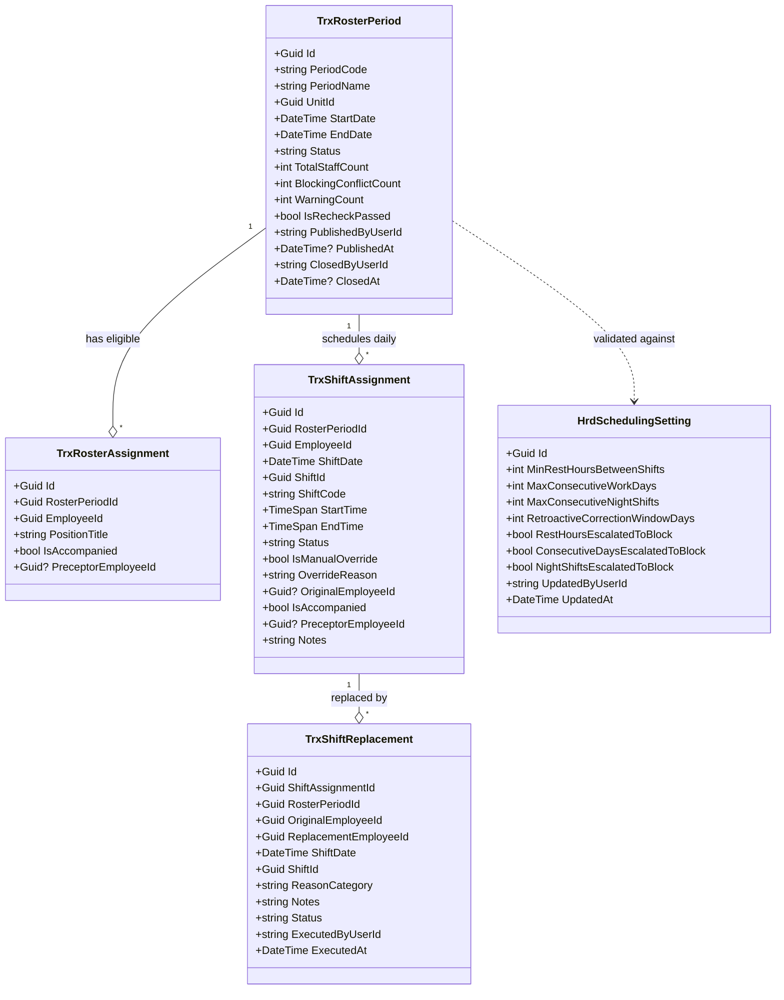

#### 19.3.2 On-Call, Call-in, dan Integrasi Lab (`BC-SCH-03`)

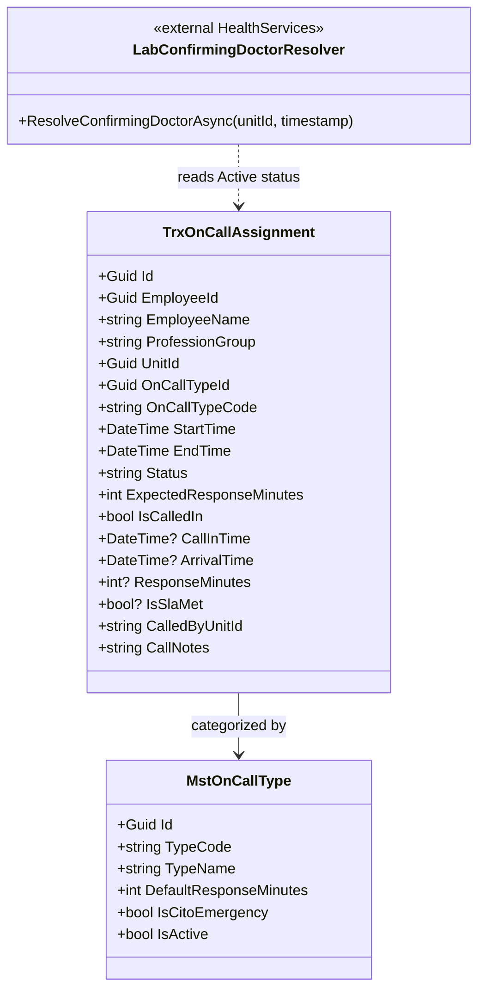

### 19.4 Penjelasan setiap class

#### 19.4.1 Model

| Class | Status | Lokasi file | Tanggung jawab |
| --- | --- | --- | --- |
| `TrxRosterPeriod` | `Diperbarui` | `Areas/Corporate/HumanResource/SchedulingManagement/Models/TrxRosterPeriod.cs` | Entity aggregate root untuk periode roster bulanan per unit. Ditambahkan kolom tracking `PublishedByUserId`, `PublishedAt`, `ClosedByUserId`, `ClosedAt`, dan normalisasi status (`Draft`, `Validation`, `Published`, `Closed`) |
| `TrxShiftAssignment` | `Diperbarui` | `Areas/Corporate/HumanResource/SchedulingManagement/Models/TrxShiftAssignment.cs` | Entity penugasan shift individual per hari. Ditambahkan kolom `IsManualOverride`, `OverrideReason`, `OriginalEmployeeId`, `IsAccompanied`, `PreceptorEmployeeId` |
| `TrxShiftReplacement` | `Diperbarui` | `Areas/Corporate/HumanResource/SchedulingManagement/Models/TrxShiftReplacement.cs` | Entity mutasi penggantian staf pada shift terbit (`HRD-DEC-101`). Menyimpan pegawai asal, pengganti, alasan, dan waktu eksekusi langsung |
| `TrxOnCallAssignment` | `Diperbarui` | `Areas/Corporate/HumanResource/SchedulingManagement/Models/TrxOnCallAssignment.cs` | Entity penugasan siaga (*on-call*). Ditambahkan field pemanggilan: `IsCalledIn`, `CallInTime`, `ArrivalTime`, `ResponseMinutes`, `ExpectedResponseMinutes`, `IsSlaMet`, `CalledByUnitId`, dan penyelarasan status `Active` (`HRD-DEC-103`) |
| `HrdSchedulingSetting` | `Baru` | `Areas/Corporate/HumanResource/SchedulingManagement/Models/HrdSchedulingSetting.cs` | Entity konfigurasi parameter penjadwalan korporat: jeda istirahat (default 11 jam), batas hari berurutan, toleransi koreksi mundur (default 3 hari), dan toggle eskalasi ke blocking |
| `TrxEmergencyStaffingRequest` | `Sudah ada` | `Areas/Corporate/HumanResource/SchedulingManagement/Models/TrxEmergencyStaffingRequest.cs` | Dipertahankan dalam skema EF Core tetapi ditandai **Ditunda pada rilis pertama** (`HRD-DEC-097`) |
| `TrxRosterApproval` | `Sudah ada` | `Areas/Corporate/HumanResource/SchedulingManagement/Models/TrxRosterApproval.cs` | Dipertahankan dalam skema EF Core tetapi ditandai **Ditunda pada rilis pertama** (`HRD-DEC-098`) |

#### 19.4.2 Service

| Service | Status | Lokasi file | Fungsi utama |
| --- | --- | --- | --- |
| `RosterPeriodService` | `Diperbarui` | `Areas/Corporate/HumanResource/SchedulingManagement/Services/RosterPeriodService.cs` | Mengelola siklus hidup roster: buat periode (kode unik aman konkurensi), populate staf eligible unit otomatis, salin periode lalu, terapkan pola shift, validasi komprehensif (`B1`–`B7` dan `W1`–`W7`), penerbitan dengan validasi ulang otomatis (`HRD-DEC-098`), serta penutupan periode mutlak oleh HRD (`HRD-DEC-102`) |
| `ShiftReplacementService` | `Diperbarui` | `Areas/Corporate/HumanResource/SchedulingManagement/Services/ShiftReplacementService.cs` | Mengeksekusi **Ganti Petugas** langsung pada roster terbit tanpa merusak status `Published` (`HRD-DEC-101`), memvalidasi pengganti terhadap aturan keselamatan, dan mengirim event notifikasi |
| `OnCallAssignmentService` | `Diperbarui` | `Areas/Corporate/HumanResource/SchedulingManagement/Services/OnCallAssignmentService.cs` | Mengelola jadwal siaga dokter & staf, mencatat pemanggilan (*call-in*), mengukur pemenuhan SLA respon menit, menyelaraskan status `Active` dengan Lab resolver (`HRD-DEC-103`), dan meneruskan data kompensasi ke Payroll |
| `SchedulingSettingService` | `Baru` | `Areas/Corporate/HumanResource/SchedulingManagement/Services/SchedulingSettingService.cs` | Membaca dan memperbarui parameter aturan kerja korporat (`HrdSchedulingSetting`), menghapus hardcode angka 11 jam |

#### 19.4.3 Controller

| Controller | Status | Lokasi file | Tanggung jawab |
| --- | --- | --- | --- |
| `RosterPeriodController` | `Diperbarui` | `Areas/Corporate/HumanResource/SchedulingManagement/Controllers/RosterPeriodController.cs` | Endpoint CRUD periode roster, validasi, terbitkan, tutup periode, salin periode, dan terapkan pola |
| `ShiftReplacementController` | `Diperbarui` | `Areas/Corporate/HumanResource/SchedulingManagement/Controllers/ShiftReplacementController.cs` | Endpoint eksekusi penggantian shift langsung dan riwayat mutasi shift |
| `OnCallAssignmentController` | `Diperbarui` | `Areas/Corporate/HumanResource/SchedulingManagement/Controllers/OnCallAssignmentController.cs` | Endpoint jadwal siaga, aktivasi siaga, pencatatan pemanggilan (*call-in*), dan pencatatan kedatangan dokter |
| `SchedulingSettingController` | `Baru` | `Areas/Corporate/HumanResource/SchedulingManagement/Controllers/SchedulingSettingController.cs` | Endpoint konfigurasi kebijakan waktu kerja dan aturan validasi jadwal oleh HR Admin |

### 19.5 Arsitektur folder backend

```text
NewQuilvianSystemBackend/Areas/Corporate/HumanResource/SchedulingManagement/
├── Constants/
│   ├── SchedulingRequestValueConstants.cs          [Sudah ada]
│   └── SchedulingValidationRuleCodes.cs            [Baru - Kode B1-B7 dan W1-W7]
├── Controllers/
│   ├── OnCallAssignmentController.cs               [Diperbarui - Endpoint Call-in & SLA]
│   ├── RosterPeriodController.cs                   [Diperbarui - Recheck publish & Close lock]
│   ├── ScheduleChangeController.cs                 [Sudah ada]
│   ├── SchedulingSettingController.cs              [Baru - Pengaturan waktu kerja HRD]
│   ├── ShiftReplacementController.cs               [Diperbarui - Ganti petugas langsung]
│   ├── ShiftSwapController.cs                      [Sudah ada]
│   └── WfpWorkScheduleAssignmentController.cs       [Sudah ada]
├── DTOs/
│   ├── OnCallSchedulingDtos.cs                     [Diperbarui - DTO CallInRequest & SLA]
│   ├── RosterSchedulingDtos.cs                     [Diperbarui - DTO ValidationResult & Reason]
│   ├── SchedulingSettingDtos.cs                    [Baru - DTO Get/Update Setting]
│   └── ShiftReplacementDtos.cs                     [Diperbarui - DTO ExecuteReplacement]
├── Models/
│   ├── HrdSchedulingSetting.cs                     [Baru - Model setelan penjadwalan]
│   ├── TrxEmergencyStaffingRequest.cs              [Sudah ada - Ditunda rilis pertama]
│   ├── TrxOnCallAssignment.cs                      [Diperbarui - Field CallIn & SLA]
│   ├── TrxRosterApproval.cs                        [Sudah ada - Ditunda rilis pertama]
│   ├── TrxRosterAssignment.cs                      [Sudah ada]
│   ├── TrxRosterPeriod.cs                          [Diperbarui - Field publish & closed]
│   ├── TrxRosterPublication.cs                     [Sudah ada]
│   ├── TrxShiftAssignment.cs                       [Diperbarui - Field override & preceptor]
│   └── TrxShiftReplacement.cs                      [Diperbarui - Field eksekusi & alasan]
└── Services/
    ├── OnCallAssignmentService.cs                  [Diperbarui - Status kontrak Lab & SLA]
    ├── RosterPeriodService.cs                      [Diperbarui - Validasi B1-B7/W1-W7]
    ├── SchedulingSettingService.cs                 [Baru - Service baca/tulis setelan]
    └── ShiftReplacementService.cs                  [Diperbarui - Eksekusi override langsung]
```

### 19.6 Status model dan dampak migration

| Model | Status | Kolom yang ditambah / diubah | Dampak migration |
| --- | --- | --- | --- |
| `HrdSchedulingSetting` | `Baru` | Seluruh kolom: `Id`, `MinRestHoursBetweenShifts`, `MaxConsecutiveWorkDays`, `MaxConsecutiveNightShifts`, `RetroactiveCorrectionWindowDays`, `RestHoursEscalatedToBlock`, `ConsecutiveDaysEscalatedToBlock`, `NightShiftsEscalatedToBlock`, kolom audit | Migration create table `HrdSchedulingSettings` |
| `TrxRosterPeriod` | `Diperbarui` | Tambah kolom: `PublishedByUserId` (nvarchar 450 null), `PublishedAt` (datetime null), `ClosedByUserId` (nvarchar 450 null), `ClosedAt` (datetime null), `IsRecheckPassed` (bool default false) | Migration add columns ke `TrxRosterPeriods` |
| `TrxShiftAssignment` | `Diperbarui` | Tambah kolom: `IsManualOverride` (bool default false), `OverrideReason` (nvarchar 500 null), `OriginalEmployeeId` (guid null FK), `IsAccompanied` (bool default false), `PreceptorEmployeeId` (guid null FK) | Migration add columns ke `TrxShiftAssignments` |
| `TrxShiftReplacement` | `Diperbarui` | Tambah kolom: `ReasonCategory` (nvarchar 100 not null), `Notes` (nvarchar 500 null), `ExecutedByUserId` (nvarchar 450 not null), `ExecutedAt` (datetime not null) | Migration add columns ke `TrxShiftReplacements` |
| `TrxOnCallAssignment` | `Diperbarui` | Tambah kolom: `ExpectedResponseMinutes` (int default 30), `IsCalledIn` (bool default false), `CallInTime` (datetime null), `ArrivalTime` (datetime null), `ResponseMinutes` (int null), `IsSlaMet` (bool null), `CalledByUnitId` (guid null), `CallNotes` (nvarchar 500 null) | Migration add columns ke `TrxOnCallAssignments` |

### 19.7 Rencana migration

1. **Nama Migration:** `AddSchedulingSettingsAndHardenRosterSliceB4`
2. **Sifat Migration:** Non-breaking / additive only. Seluruh penambahan kolom bersifat `nullable` atau memiliki nilai bawaan (*default value*), sehingga tidak mengganggu data dev yang sudah ada.
3. **Seed Data:** Menambahkan 1 baris default `HrdSchedulingSetting` (jeda minimal 11 jam, hari berturut-turut 6 hari, toleransi mundur 3 hari).

### 19.8 Rencana data master awal

| Tabel | Kebutuhan baris awal | Contoh isi awal |
| --- | --- | --- |
| `HrdSchedulingSetting` | 1 baris korporat | `MinRestHoursBetweenShifts = 11`, `MaxConsecutiveWorkDays = 6`, `MaxConsecutiveNightShifts = 2`, `RetroactiveCorrectionWindowDays = 3` |
| `MstOnCallType` | Minimal 3 jenis siaga RS | (1) `ONCALL-CITO` — Siaga Cito Tindakan Medis Darurat (SLA 30 menit, Cito = true)<br>(2) `ONCALL-LAB` — Siaga Konfirmasi Hasil Kritis Laboratorium (SLA 30 menit, Cito = true)<br>(3) `ONCALL-SPES` — Siaga Konsultasi Spesialis Standby (SLA 60 menit, Cito = false) |
| `MstShiftPattern` | Minimal 2 pola shift lazim | (1) `POLA-3SHIFT-A` — Pagi, Siang, Malam, Libur, Libur<br>(2) `POLA-ICU-B` — Siang, Malam, Lepas Jaga, Libur, Pagi |

### 19.9 Hitungan dan aturan bisnis yang dirancang

#### 19.9.1 Validasi Pemeriksaan Per Pegawai (`HRD-DEC-099`)
Sistem menjalankan evaluasi otomatis:
- **Pemeriksaan Memblokir (`BLOCKING` / `B1`–`B6`):**
  - `B1`: Tabrakan jam dua shift pada hari/rentang yang sama.
  - `B2`: Pegawai memiliki cuti sehari penuh yang berstatus disetujui (`B2`).
  - `B3`: Pegawai tidak memiliki penempatan aktif di unit tersebut pada tanggal shift.
  - `B4`: Pegawai belum dinyatakan siap kerja oleh HRD (`HRD-DEC-088`).
  - `B5`: Tanggal shift berada sesudah tanggal akhir kontrak kerja yang belum diputuskan perpanjangannya (`HRD-DEC-089`).
  - `B6`: Status kesiapan kerja tidak dapat dibaca dari sistem (`INT-HR-31`, gagal tertutup).
- **Pemeriksaan Peringatan dengan Alasan (`WARNING` / `W1`–`W5`):**
  - `W1`: Jeda istirahat antar shift < `MinRestHoursBetweenShifts` (default 11 jam).
  - `W2`: Hari kerja berturut-turut tanpa hari libur > `MaxConsecutiveWorkDays` (default 6 hari).
  - `W3`: Shift malam berturut-turut > `MaxConsecutiveNightShifts` (default 2 malam).
  - `W4`: Terdapat pengajuan cuti yang masih berstatus pending pada tanggal shift.
  - `W5`: STR, SIP, atau kredensial kedaluwarsa pada tanggal shift (`HRD-DEC-005`).

#### 19.9.2 Validasi Kelayakan Shift & Skill Mix (`HRD-DEC-100`)
- `B7` (`BLOCKING`): Pegawai bertanda **Didampingi** (`HRD-DEC-087`) dijadwalkan pada shift yang tidak memiliki satupun perawat berstatus **Mandiri**. Ditolak demi keselamatan pasien.
- `W6` (`WARNING`): Jumlah tenaga pada shift kurang dari kuota target unit. Wajib memilih alasan (`Kekurangan tenaga`, `Volume pasien/BOR rendah`, atau `Lainnya`).
- `W7` (`WARNING`): Kebutuhan kualifikasi khusus shift (misal: perawat penanggung jawab / sertifikasi ICU) tidak terpenuhi. Wajib memilih alasan konfirmasi.

#### 19.9.3 Penggantian Shift & Mutasi Setelah Terbit (`HRD-DEC-101`)
- Kepala unit dapat langsung menunjuk pengganti (*Ganti Petugas*) pada roster terbit.
- Perubahan langsung efektif (*directly effective*) tanpa approval Kepala Bidang.
- Pengganti wajib lolos validasi `B1`–`B7`.
- Alasan perubahan wajib dicatat (`Sakit Mendadak`, `Izin/Keluarga`, `Lonjakan Pasien`, `Lainnya`).
- Status roster tetap **`Published`** dan tidak pernah turun ke `Draft`.
- Notifikasi otomatis dikirim ke pegawai diganti, pengganti, dan Kepala Bidang (*FYI*).

#### 19.9.4 Koreksi Mundur & Penguncian Mutlak (`HRD-DEC-102`)
- Koreksi mundur tanggal yang sudah lewat diizinkan mandiri bagi Kepala Unit maksimal **3 hari kalender ke belakang** (`today - shift_date <= 3`).
- Koreksi mundur otomatis memicu rekalkulasi kehadiran harian di modul 07.
- Koreksi > 3 hari ke belakang terkunci bagi Kepala Unit dan memerlukan bantuan verifikasi HRD.
- Roster periode ditutup (**`Closed`**) oleh HRD/Payroll Officer saat cut-off penggajian.
- Periode berstatus `Closed` berstatus **terkunci mutlak (*read-only*)** tanpa pengecualian.

#### 19.9.5 Siklus Status Siaga & Penyelarasan Kontrak Lab (`HRD-DEC-103`)
- Kosakata status siaga: `Scheduled` → `Confirmed` → `Active` → `Completed`.
- Memperbaiki bug `HRD-TF-053`: saat siaga dipanggil (*call-in*), status penugasan tetap **`Active`** (bukan `Activated`), sehingga `LabConfirmingDoctorResolver` (`LAB-DEC-111`) tetap mengenali dokter siaga sebagai konfirmator sah hasil kritis laboratorium.
- Pemanggilan mencatat `CallInTime`, `ArrivalTime`, selisih waktu `ResponseMinutes`, dan memvalidasi `IsSlaMet = (ResponseMinutes <= ExpectedResponseMinutes)`.
- Jam standby otomatis diintegrasikan ke tunjangan siaga Payroll (10), dan pemanggilan fisik otomatis menjadi tiket tugas panggil cito di modul Lembur (09) dan Payroll (10).

### 19.10 Yang sengaja tidak dibuat pada rilis pertama `S-B4`

| Fitur / Komponen | Alasan | Penanganan selama MVP |
| --- | --- | --- |
| `TrxEmergencyStaffingRequest` | `HRD-DEC-097` — Kebutuhan darurat ditutup langsung oleh Kepala Unit | Kepala Unit menggunakan fitur **Ganti Petugas** atau rencana lembur modul 09 |
| `TrxRosterApproval` | `HRD-DEC-098` — Tidak ada persetujuan sebelum terbit | Kepala Unit menerbitkan langsung; Kepala Bidang menerima tembusan notifikasi dan hak pantau |
| Setelan aturan kerja berbeda per masing-masing unit | `HRD-ASM-10` — Satu kebijakan korporat rumah sakit untuk kesederhanaan rilis pertama | Menggunakan nilai default korporat pada `HrdSchedulingSetting` |

### 19.11 Traceability keputusan

| Keputusan | Bab / Bagian Arsitektur Backend |
| --- | --- |
| `HRD-DEC-097` | 19.1, 19.2, 19.10 (`TrxEmergencyStaffingRequest` ditunda) |
| `HRD-DEC-098` | 19.1, 19.4.2 (`RosterPeriodService.PublishAsync`), 19.10 (`TrxRosterApproval` ditunda) |
| `HRD-DEC-099` | 19.4.1 (`HrdSchedulingSetting`), 19.4.2, 19.9.1 (Pemeriksaan `B1`–`B6` dan `W1`–`W5`) |
| `HRD-DEC-100` | 19.4.1 (`TrxShiftAssignment.IsAccompanied`), 19.9.2 (Pemeriksaan `B7`, `W6`, `W7`) |
| `HRD-DEC-101` | 19.4.1 (`TrxShiftReplacement`), 19.4.2 (`ShiftReplacementService`), 19.9.3 |
| `HRD-DEC-102` | 19.4.1 (`TrxRosterPeriod.ClosedAt`), 19.4.2, 19.9.4 (Koreksi mundur 3 hari & Close lock) |
| `HRD-DEC-103` | 19.3.2, 19.4.1 (`TrxOnCallAssignment`), 19.4.2 (`OnCallAssignmentService`), 19.9.5 |


---

## 20. Slice `S-B1` — Administrasi Kehadiran dan Presensi Staf Rumah Sakit (Sub-modul 07, `last_changed_in` `v11`, 4 November 2026)

Bagian ini merancang arsitektur backend target untuk **Slice `S-B1` — Administrasi Kehadiran dan Presensi Staf Rumah Sakit 24/7**, menyerap keputusan interview `HRD-DEC-028` (koreksi on-behalf), `HRD-DEC-029` (tiga peran waktu & early leave), `HRD-DEC-104` s.d. `HRD-DEC-109`, serta asumsi `HRD-ASM-15` s.d. `HRD-ASM-18`.

### 20.1 Tabel Kepemilikan Data (Data Ownership Matrix)

| Kelompok Data | Modul Pemilik | Dipakai di `S-B1`? | Dibuat Ulang? | Keterangan & Entitas |
| --- | --- | :---: | :---: | --- |
| Rekaman Mentah Biometrik | `AttendanceManagement` | Ya | Tidak (REUSE) | `HrdAttendanceRawLog` — *immutable*, mencatat `EventAt`, `DeviceId`, `PunchType`, `SourceType` (Fingerprint/Face/Mobile/API). |
| Kehadiran Harian Olahan | `AttendanceManagement` | Ya | Tidak (EXTEND) | `HrdAttendanceDaily` — membawa `ShiftDate`, `CheckInAt`, `CheckOutAt`, `EffectiveWorkMinutes`, `LateMinutes`, `EarlyLeaveMinutes`, `Status`. |
| Pengecualian Kehadiran | `AttendanceManagement` | Ya | Tidak (EXTEND) | `HrdAttendanceException` — mencatat keterlambatan, pulang cepat, lupa tap, atau mangkir. |
| Koreksi Kehadiran | `AttendanceManagement` | Ya | Tidak (EXTEND) | `HrdAttendanceCorrection` — mendukung pengajuan mandiri ESS dan kuasa HR *on-behalf* (`HRD-DEC-028`). |
| Izin Pulang Cepat | `AttendanceManagement` | Ya | **Baru (NEW)** | `HrdEarlyLeavePermission` — izin administratif resmi *non-deductible* (`HRD-DEC-107`). |
| Surat Tugas Dinas Luar | `AttendanceManagement` | Ya | **Baru (NEW)** | `HrdOfficialDutyRequest` — penugasan ambulans rujukan, kurir lab, pelatihan, home care (`HRD-DEC-109`). |
| Konfigurasi Kebijakan Presensi | `AttendanceManagement` | Ya | **Baru (NEW)** | `HrdAttendanceSetting` — parameter toleransi keterlambatan (`GracePeriod`), toleransi koreksi (`HRD-DEC-105`). |
| Roster & Shift Harian | `SchedulingManagement` (`S-B4`) | Ya | Tidak (READ ONLY) | `TrxRosterPeriod`, `TrxShiftAssignment` — acuan jadwal resmi untuk pencocokan jam shift. |
| Master Karyawan & Penempatan | `WorkforceCore` (`S-A1`) | Ya | Tidak (READ ONLY) | `MstWorkforceProfile`, `WfpEmploymentPlacement` — verifikasi keaktifan staf. |
| Serah Terima Payroll | `PayrollManagement` (`S-B5`) | Ya | Tidak (INTEGRASI) | `TrxAttendancePayrollHandoff` — eksekusi transfer data bersih dan mekanisme *rollback* (`HRD-DEC-108`). |

### 20.2 Diagram Kelas Bounded Context Attendance Management (Mermaid)


### 20.3 Rincian Class, Service, dan Tanggung Jawab

| Nama Komponen | Tipe | Lokasi File | Status | Fungsi Utama |
| --- | :---: | --- | :---: | --- |
| `HrdEarlyLeavePermission` | Model | `Areas/Corporate/HumanResource/AttendanceManagement/Models/` | Baru | Entitas perizinan pulang cepat administratif non-deductible (`HRD-DEC-107`). |
| `HrdOfficialDutyRequest` | Model | `Areas/Corporate/HumanResource/AttendanceManagement/Models/` | Baru | Entitas surat tugas dinas luar (ambulans, kurir, pelatihan, home care `HRD-DEC-109`). |
| `HrdAttendanceSetting` | Model | `Areas/Corporate/HumanResource/AttendanceManagement/Models/` | Baru | Entitas pengaturan toleransi keterlambatan dan kebijakan penutupan periode (`HRD-DEC-105`). |
| `HrdAttendanceDaily` | Model | `Areas/Corporate/HumanResource/AttendanceManagement/Models/` | Diperbarui | Penambahan kolom relasi `EarlyLeavePermissionId`, `OfficialDutyRequestId`, dan status `IncompletePunch`. |
| `HrdScheduleResolverService` | Service | `Areas/Corporate/HumanResource/AttendanceManagement/Services/` | Diperbarui | Mesin pencocok log mentah ke shift roster terbit, menangani shift malam lintas hari (`HRD-DEC-104`). |
| `HrdAttendanceCalculationEngine` | Service | `Areas/Corporate/HumanResource/AttendanceManagement/Services/` | Diperbarui | Perhitungan menit kerja, evaluasi toleransi keterlambatan grace period (`HRD-DEC-105`), deteksi 1 tap (`HRD-DEC-106`). |
| `HrdAttendanceCorrectionService` | Service | `Areas/Corporate/HumanResource/AttendanceManagement/Services/` | Diperbarui | Pengajuan & persetujuan koreksi mandiri dan kuasa HR on-behalf (`HRD-DEC-028`). |
| `HrdEarlyLeavePermissionService` | Service | `Areas/Corporate/HumanResource/AttendanceManagement/Services/` | Baru | Pengelolaan izin pulang cepat administratif, approval atasan, dan penandaan waiver pengecualian. |
| `HrdOfficialDutyService` | Service | `Areas/Corporate/HumanResource/AttendanceManagement/Services/` | Baru | Pengelolaan surat tugas dinas luar, verifikasi koordinat GPS/foto, dan penandaan status `OnDuty`. |
| `HrdAttendancePeriodService` | Service | `Areas/Corporate/HumanResource/AttendanceManagement/Services/` | Diperbarui | Penutupan periode presensi (guard penolakan bila ada pending `HRD-DEC-108`) dan buka kembali darurat (rollback payroll). |
| `AttendancePeriodController` | Controller | `Areas/Corporate/HumanResource/AttendanceManagement/Controllers/` | Diperbarui | Endpoint close dan reopen periode terhubung dengan pemeriksaan guard dan rollback payroll. |
| `EarlyLeavePermissionController` | Controller | `Areas/Corporate/HumanResource/AttendanceManagement/Controllers/` | Baru | Endpoint RESTful untuk pengajuan, approval, dan query izin pulang cepat. |
| `OfficialDutyController` | Controller | `Areas/Corporate/HumanResource/AttendanceManagement/Controllers/` | Baru | Endpoint RESTful untuk permohonan dinas luar dan approval atasan. |
| `AttendanceSettingController` | Controller | `Areas/Corporate/HumanResource/AttendanceManagement/Controllers/` | Baru | Endpoint RESTful konfigurasi parameter presensi rumah sakit. |

### 20.4 Aturan Bisnis Inti Backend (`ATT-B1` s.d. `ATT-B7` & `ATT-W1` s.d. `ATT-W6`)

#### Aturan Pemblokir / Penolakan (Blocking Rules)
* **`ATT-B1` — Immutability Raw Log:** Rekaman mentah presensi (`HrdAttendanceRawLog`) tidak dapat diubah (*update*) atau dihapus (*delete*) melalui endpoint mana pun. Koreksi kesalahan data wajib melalui entitas `HrdAttendanceCorrection`.
* **`ATT-B2` — Penguncian Periode Closed:** Seluruh operasi tulis (*create*, *update*, *delete*) pada `HrdAttendanceDaily`, koreksi, maupun perizinan yang menyentuh tanggal di dalam periode berstatus `Closed` ditolak dengan kode `409 Conflict`.
* **`ATT-B3` — Penolakan Tutup Periode Bila Ada Koreksi Pending (`HRD-DEC-108`):** Permintaan `CloseAttendancePeriod` ditolak dengan kode `409 Conflict` bila masih terdapat `HrdAttendanceCorrection` berstatus `Submitted` / `PendingApproval`.
* **`ATT-B4` — Pembatasan Otorisasi Buka Kembali Periode:** Aksi `ReopenAttendancePeriod` ditolak dengan kode `403 Forbidden` bila aktor tidak memiliki wewenang `AttendancePeriod : Reopen` (khusus HR Manager / Kadiv SDM) atau bila alasan pembukaan kembali kosong.
* **`ATT-B5` — Anti-Self-Approval Koreksi On-Behalf:** Petugas HR yang mengajukan koreksi presensi atas nama pegawai (`IsOnBehalf = true`) dilarang bertindak sebagai penyetuju (*approver*); persetujuan wajib dilakukan oleh atasan langsung pegawai yang bersangkutan.
* **`ATT-B6` — Validasi Rentang Jam Dinas Luar:** Permohonan dinas luar ditolak bila `EndAt <= StartAt` atau bila tanggal penugasan telah melewati batas cut-off periode `Closed`.
* **`ATT-B7` — Penolakan Koreksi Mundur Melewati Batas Toleransi:** Permohonan koreksi presensi ditolak bila tanggal shift yang dikoreksi melebihi `MaxBackdatedCorrectionDays` (default 3 hari kalender ke belakang) tanpa otorisasi khusus HR Manager.

#### Aturan Peringatan & Evaluasi Logika (Warning / Logical Evaluation Rules)
* **`ATT-W1` — Evaluasi Toleransi Keterlambatan Grace Period (`HRD-DEC-105`):** Kedatangan di dalam batas `GracePeriodMinutes` menghasilkan `LateMinutes = 0` dan `Status = Present`. Kedatangan di atas batas toleransi menghasilkan `LateMinutes = ActualCheckIn - ScheduledStart` dan `Status = Late`.
* **`ATT-W2` — Shift Malam Lintas Hari (`HRD-DEC-104`):** Log tap masuk malam (hari H) dan log tap keluar pagi (hari H+1) dipasangkan secara utuh ke penugasan shift hari H (`ShiftDate = Hari H`).
* **`ATT-W3` — Deteksi Lupa Tap & Konversi Otomatis (`HRD-DEC-106`):** Catatan presensi dengan 1 tap tunggal diberi status sementara `IncompletePunch`. Saat periode ditutup, sisa `IncompletePunch` yang belum dikoreksi otomatis dikonversi menjadi `Absent` (Mangkir).
* **`ATT-W4` — Izin Pulang Cepat Non-Deductible (`HRD-DEC-107`):** Izin pulang cepat yang disetujui atasan menghasilkan penandaan `Waived` pada pengecualian `EarlyLeave`, jam kerja dihitung hingga tap-out aktual, dan tidak memotong kuota cuti tahunan.
* **`ATT-W5` — Rollback Serah Terima Payroll Saat Reopen (`HRD-DEC-108`):** Pembukaan kembali periode tertutup otomatis mengeksekusi `AttendancePayrollHandoff.Rollback` bila serah terima payroll telah berstatus `Executed`.
* **`ATT-W6` — Pengakuan Jam Kerja Dinas Luar (`HRD-DEC-109`):** Permohonan dinas luar yang disetujui menghasilkan status `OnDuty` dan jam kerja dihitung penuh setara hadir kerja (`Present`) untuk kalkulasi payroll.

### 20.5 Rencana Migrasi Database EF Core

1. **Nama Migration:** `AddAttendanceOperationalExtensionsAndSettings`
2. **Perubahan Skema:**
   * Penambahan tabel baru `hrd_attendance_settings` (konfigurasi toleransi keterlambatan, hari koreksi mundur).
   * Penambahan tabel baru `hrd_early_leave_permissions` (tabel transaksi izin pulang cepat administratif).
   * Penambahan tabel baru `hrd_official_duty_requests` (tabel transaksi surat tugas dinas luar, koordinat GPS, foto bukti).
   * Penambahan kolom nullable pada `hrd_attendance_dailies`: `early_leave_permission_id` (Guid?, FK), `official_duty_request_id` (Guid?, FK), `incomplete_punch_reason` (string, max 500).
   * Penambahan nilai enum pada `AttendanceDailyStatus`: `IncompletePunch`, `OnDuty`.
3. **Sifat Migration:** Bersifat *additive* (tanpa downtime, tanpa penghapusan kolom existing).
4. **Seeder Bawaan:** `DefaultAttendanceSettingSeeder` mengisi 1 baris konfigurasi default RS (`GracePeriodMinutes = 10`, `MaxBackdatedCorrectionDays = 3`, `RequireAttachmentForCorrection = true`, `AutoConvertIncompleteToAbsent = true`).

### 20.6 Yang Sengaja Tidak Dibuat

* **Tabel Perangkat Keras / Driver Fingerprint:** Sistem tidak menyimpan data firmware/driver mesin fisik. Komunikasi data dilakukan via file log/REST API Ingestion standard.
* **Tabel Potongan Denda Keterlambatan Finansial:** Logika pemotongan uang makan atau denda nominal rupiah adalah wewenang penuh Sub-Modul 10 (Payroll) dan Sub-Modul 09 (Overtime), bukan dihitung di modul presensi.
* **Approval Berjenjang Khusus On-Behalf:** Koreksi yang diajukan HR atas nama pegawai tidak membuat alur persetujuan baru; persetujuan tetap mengikuti atasan langsung pegawai yang bersangkutan per `HRD-DEC-028`.


---

## 21. Slice `S-B2` — Administrasi Cuti & Izin Pegawai Rumah Sakit (Sub-modul 08, `last_changed_in` `v12`, 4 November 2026)

Bagian ini merancang arsitektur backend target untuk **Slice `S-B2` — Administrasi Cuti & Izin Pegawai Rumah Sakit**, menyerap keputusan interview `HRD-DEC-023` (koreksi terkontrol), `HRD-DEC-024` (pemanggilan kembali), `HRD-DEC-110` (hak cuti 12 hari & carry-forward max 6 hari s.d. 30 Juni), `HRD-DEC-111` (safe staffing coverage warning), `HRD-DEC-112` (cuti sakit & privasi dokter), `HRD-DEC-113` (leave recall darurat & pemulihan saldo), `HRD-DEC-114` (rekonsiliasi retrospektif payroll), `HRD-DEC-115` (penguncian immutabilitas /reverse HRD-Q-35), serta asumsi rekayasa `HRD-ASM-19` s.d. `HRD-ASM-22`.

### 21.1 Tabel Kepemilikan Data (Data Ownership Matrix)

| Kelompok Data | Modul Pemilik | Dipakai di `S-B2`? | Dibuat Ulang? | Keterangan & Entitas |
| --- | --- | :---: | :---: | --- |
| Buku Besar Mutasi Saldo Cuti | `LeaveManagement` | Ya | **Baru (NEW)** | `TrxLeaveBalanceLedger` — mencatat mutasi saldo atomik (`Entitlement`, `CarryForward`, `Taken`, `CancellationRestore`, `RecallRestore`, `Forfeiture`, `Adjustment`). |
| Pemanggilan Kembali Cuti Darurat | `LeaveManagement` | Ya | **Baru (NEW)** | `TrxLeaveRecallRequest` — inisiasi Kepala Ruangan saat KLB/bencana, verifikasi HR Manager, pemulihan saldo otomatis (`HRD-DEC-113`). |
| Penyesuaian Saldo Audit HR | `LeaveManagement` | Ya | Tidak (REUSE/EXTEND) | `TrxLeaveAdjustment` — satu-satunya pintu koreksi saldo historis resmi pasca-tutup periode payroll (`HRD-DEC-115`). |
| Permohonan Cuti & Izin | `LeaveManagement` | Ya | Tidak (EXTEND) | `WfpLeaveRequest` / `TrxLeaveRequest` — ditambahkan indikator peringatan kuota shift (`CoverageWarning`), flag privasi surat dokter K3RS, dan flag immutabilitas payroll. |
| Master Jenis Cuti & Izin | `LeaveManagement` | Ya | Tidak (REUSE) | `MstLeaveType` — master jenis cuti (Tahunan, Sakit, Melahirkan, Ibadah, Cuti Bersama, Alasan Penting) beserta aturan pemotongan saldo. |
| Lampiran Dokumen Surat Sakit | `LeaveManagement` | Ya | Tidak (EXTEND) | `TrxLeaveRequestAttachment` — berkas surat dokter ber-SIP resmi dengan hak akses terbatas (masking diagnosa K3RS per `HRD-DEC-112`). |
| Roster & Jadwal Shift Staf | `SchedulingManagement` (`S-B4`) | Ya | Tidak (READ ONLY) | `TrxShiftAssignment`, `TrxRosterPeriod` — query evaluasi rasio ketersediaan staf (*Safe Staffing Coverage* `HRD-DEC-111`). |
| Rekonsiliasi & Integrasi Payroll | `PayrollManagement` (`S-B5`) | Ya | Tidak (INTEGRASI) | `TrxLeavePayrollHandoff` — sinkronisasi penyesuaian retrospektif cuti pending yang disetujui terlambat (`HRD-DEC-114`). |

### 21.2 Diagram Kelas Bounded Context Leave Management (Mermaid)

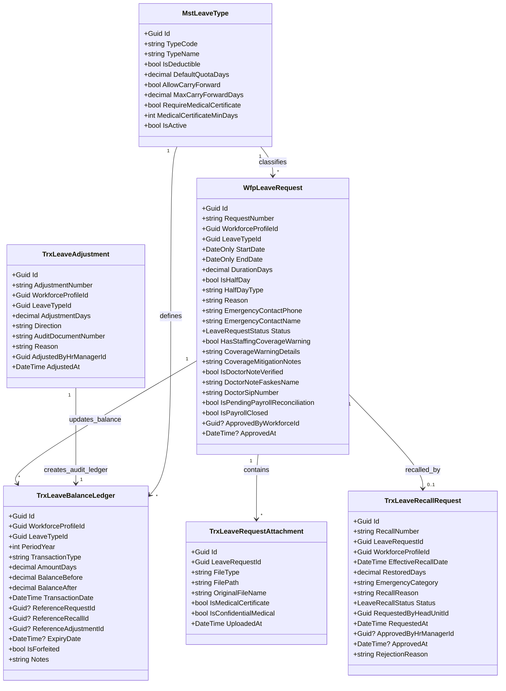

### 21.3 Rincian Class, Service, dan Tanggung Jawab

| Nama Komponen | Tipe | Lokasi File | Status | Fungsi Utama |
| --- | :---: | --- | :---: | --- |
| `TrxLeaveBalanceLedger` | Model | `Areas/Corporate/HumanResource/LeaveManagement/Models/` | Baru | Entitas buku besar (*balance ledger*) untuk pencatatan mutasi kredit/debit saldo cuti secara atomik (`HRD-DEC-110`). |
| `TrxLeaveRecallRequest` | Model | `Areas/Corporate/HumanResource/LeaveManagement/Models/` | Baru | Entitas pemanggilan kembali cuti darurat berjenjang (Kepala Unit -> HR Manager) dan pemulihan saldo otomatis (`HRD-DEC-113`). |
| `WfpLeaveRequest` | Model | `Areas/Corporate/HumanResource/LeaveManagement/Models/` | Diperbarui | Ditambahkan kolom coverage warning, catatan mitigasi, metadata verifikasi surat dokter, dan penanda kunci payroll (`HRD-DEC-111`, `HRD-DEC-115`). |
| `TrxLeaveAdjustment` | Model | `Areas/Corporate/HumanResource/LeaveManagement/Models/` | Diperbarui | Entitas penyesuaian saldo resmi dengan kewajiban nomor dokumen audit (`HRD-DEC-115`). |
| `LeaveBalanceLedgerService` | Service | `Areas/Corporate/HumanResource/LeaveManagement/Services/` | Baru | Menghitung sisa saldo aktif, memvalidasi kecukupan saldo cuti, memposting transaksi akrual 12 hari, dan mengeksekusi hangus carry-forward pasca 30 Juni (`HRD-DEC-110`). |
| `SafeStaffingCoverageGuard` | Service | `Areas/Corporate/HumanResource/LeaveManagement/Services/` | Baru | Memeriksa ketersediaan tenaga unit 24/7 ke jadwal dinas `S-B4`, menghasilkan indikator peringatan kuota (*Coverage Warning*) pada Approval Inbox (`HRD-DEC-111`). |
| `MedicalCertificateVerificationService` | Service | `Areas/Corporate/HumanResource/LeaveManagement/Services/` | Baru | Memvalidasi keabsahan surat keterangan sakit dokter ber-SIP (>= 2 hari) dan mengelola hak akses masking privasi diagnosa medis pegawai (`HRD-DEC-112`). |
| `LeaveRecallWorkflowService` | Service | `Areas/Corporate/HumanResource/LeaveManagement/Services/` | Baru | Mengatur alur pemanggilan dinas darurat, otorisasi HR Manager, posting `RecallRestore` pada ledger, dan pemulihan jadwal di Roster 06 (`HRD-DEC-113`). |
| `LeavePayrollReconciliationService` | Service | `Areas/Corporate/HumanResource/LeaveManagement/Services/` | Baru | Menangani cuti pending saat cut-off payroll, menyusun snapshot rekonsiliasi retrospektif bulan berikutnya, dan mengunci cuti `Completed` dari /reverse (`HRD-DEC-114`, `HRD-DEC-115`). |
| `LeaveExecutionProcessorService` | Service | `Areas/Corporate/HumanResource/LeaveManagement/Services/` | Diperbarui | Refaktor guard keamanan: menolak `/reverse` jika status `Completed` atau periode payroll telah `Closed` (menutup celah `HRD-Q-35`). |
| `LeaveBalanceLedgerController` | Controller | `Areas/Corporate/HumanResource/LeaveManagement/Controllers/` | Baru | Endpoint RESTful saldo real-time, riwayat buku besar pegawai, dan penjadwalan carry-forward. |
| `LeaveRequestWorkflowController` | Controller | `Areas/Corporate/HumanResource/LeaveManagement/Controllers/` | Diperbarui | Endpoint pengajuan mandiri ESS (half-day 0.5 hari), persetujuan atasan dengan indikator coverage warning, dan pre-leave cancellation. |
| `LeaveRecallController` | Controller | `Areas/Corporate/HumanResource/LeaveManagement/Controllers/` | Diperbarui | Endpoint inisiasi recall oleh Kepala Unit dan persetujuan eksekusi oleh HR Manager. |
| `LeaveAdjustmentController` | Controller | `Areas/Corporate/HumanResource/LeaveManagement/Controllers/` | Diperbarui | Endpoint penyesuaian saldo resmi HR berdokumen audit resmi. |
| `LeaveFinalReconciliationController` | Controller | `Areas/Corporate/HumanResource/LeaveManagement/Controllers/` | Diperbarui | Endpoint penutupan periode cuti payroll dan handoff rekonsiliasi retrospektif. |

### 21.4 Arsitektur Folder Backend

```text
NewQuilvianSystemBackend/Areas/Corporate/HumanResource/LeaveManagement/
├── Constants/
│   ├── LeaveBalanceTransactionTypeConstants.cs     [Baru - Tipe Entitlement, CarryForward, dll]
│   ├── LeaveRecallValueConstants.cs                [Baru - Status workflow recall]
│   ├── LeaveStaffingCoverageWarningConstants.cs    [Baru - Ambang batas rasio aman]
│   └── LeaveValueConstants.cs                      [Sudah ada]
├── Controllers/
│   ├── LeaveAdjustmentController.cs                [Diperbarui - Wajib nomor dokumen audit]
│   ├── LeaveBalanceLedgerController.cs             [Baru - Endpoint buku besar mutasi saldo]
│   ├── LeaveCalendarController.cs                  [Sudah ada]
│   ├── LeaveCarryForwardController.cs              [Diperbarui - Batas 6 hari & cut-off 30 Juni]
│   ├── LeaveExecutionController.cs                 [Diperbarui - Guard reverse immutability 409]
│   ├── LeaveFinalReconciliationController.cs       [Diperbarui - Rekonsiliasi retrospektif payroll]
│   ├── LeaveRecallController.cs                    [Diperbarui - Alur recall Kepala Unit & HR]
│   └── LeaveRequestWorkflowController.cs           [Diperbarui - Coverage warning & privasi sakit]
├── DTOs/
│   ├── LeaveAdjustmentDtos.cs                      [Diperbarui]
│   ├── LeaveBalanceLedgerDtos.cs                   [Baru - DTO riwayat mutasi saldo ledger]
│   ├── LeaveRecallDtos.cs                          [Baru - DTO inisiasi & persetujuan recall]
│   ├── LeaveReconciliationDtos.cs                  [Baru - DTO snapshot payroll retrospektif]
│   ├── LeaveRequestApprovalWithCoverageDto.cs      [Baru - DTO payload approval berindikator kuota]
│   └── LeaveRequestDtos.cs                         [Diperbarui - Field half-day & medical check]
├── Models/
│   ├── MstLeaveType.cs                             [Sudah ada - Master jenis cuti]
│   ├── TrxLeaveAdjustment.cs                       [Diperbarui - Dokumen audit nomor]
│   ├── TrxLeaveBalanceLedger.cs                    [Baru - Entitas ledger mutasi saldo]
│   ├── TrxLeaveRecallRequest.cs                    [Baru - Entitas permohonan recall darurat]
│   ├── TrxLeaveRequestAttachment.cs                [Diperbarui - Penanda surat sakit K3RS]
│   └── WfpLeaveRequest.cs                          [Diperbarui - Field coverage warning & payroll lock]
└── Services/
    ├── LeaveAdjustmentService.cs                   [Diperbarui - Posting audit ledger]
    ├── LeaveBalanceLedgerService.cs                [Baru - Kalkulasi saldo & carry-forward]
    ├── LeaveExecutionBalanceService.cs             [Diperbarui - Penyesuaian pemulihan saldo]
    ├── LeaveExecutionProcessorService.cs           [Diperbarui - Guard status reverse HTTP 409]
    ├── LeaveFinalReconciliationService.cs          [Diperbarui - Logika retrospektif payroll]
    ├── LeavePayrollIntegrationService.cs           [Diperbarui - Serah terima snapshot]
    ├── LeaveRecallWorkflowService.cs               [Baru - Mesin workflow pemanggilan dinas]
    ├── LeaveRequestWorkflowLifecycleService.cs     [Diperbarui - Notifikasi & approval flow]
    ├── MedicalCertificateVerificationService.cs    [Baru - Masking diagnosa medis K3RS]
    └── SafeStaffingCoverageGuard.cs                [Baru - Engine validasi ketersediaan staf]
```

### 21.5 Status Model dan Dampak Migration

| Model | Status | Kolom yang Ditambah / Diubah | Dampak Migration |
| --- | :---: | --- | --- |
| `TrxLeaveBalanceLedger` | `Baru` | Seluruh kolom: `Id`, `WorkforceProfileId`, `LeaveTypeId`, `PeriodYear`, `TransactionType`, `AmountDays`, `BalanceBefore`, `BalanceAfter`, `TransactionDate`, `ReferenceRequestId`, `ReferenceRecallId`, `ReferenceAdjustmentId`, `ExpiryDate`, `IsForfeited`, `Notes`, kolom audit | Migration create table `trx_leave_balance_ledgers` |
| `TrxLeaveRecallRequest` | `Baru` | Seluruh kolom: `Id`, `RecallNumber`, `LeaveRequestId`, `WorkforceProfileId`, `EffectiveRecallDate`, `RestoredDays`, `EmergencyCategory`, `RecallReason`, `Status`, `RequestedByHeadUnitId`, `RequestedAt`, `ApprovedByHrManagerId`, `ApprovedAt`, `RejectionReason`, kolom audit | Migration create table `trx_leave_recall_requests` |
| `WfpLeaveRequest` | `Diperbarui` | Tambah kolom: `HasStaffingCoverageWarning` (bool default false), `CoverageWarningDetails` (text null), `CoverageMitigationNotes` (varchar 500 null), `IsDoctorNoteVerified` (bool default false), `DoctorNoteFaskesName` (varchar 255 null), `DoctorSipNumber` (varchar 100 null), `IsPendingPayrollReconciliation` (bool default false), `IsPayrollClosed` (bool default false) | Migration add columns ke `wfp_leave_requests` |
| `TrxLeaveAdjustment` | `Diperbarui` | Tambah kolom: `AuditDocumentNumber` (varchar 100 not null), `AdjustedByHrManagerId` (uuid not null) | Migration add columns ke `trx_leave_adjustments` |
| `TrxLeaveRequestAttachment` | `Diperbarui` | Tambah kolom: `IsMedicalCertificate` (bool default false), `IsConfidentialMedical` (bool default true) | Migration add columns ke `trx_leave_request_attachments` |

### 21.6 Rencana Migration EF Core

1. **Nama Migration:** `AddLeaveLedgerCoverageWarningAndRecallExtensions`
2. **Perubahan Skema:**
   * Pembuatan tabel `trx_leave_balance_ledgers` dengan foreign key ke `mst_workforce_profiles` dan `mst_leave_types`.
   * Pembuatan tabel `trx_leave_recall_requests` dengan foreign key ke `wfp_leave_requests` dan `mst_workforce_profiles`.
   * Penambahan kolom toleransi coverage warning dan privasi surat sakit pada `wfp_leave_requests`.
   * Penambahan kolom nomor dokumen audit pada `trx_leave_adjustments`.
3. **Sifat Migration:** Bersifat *non-breaking* / *additive only*. Seluruh kolom baru bersifat nullable atau memiliki nilai bawaan.
4. **Data Seeder:** Memastikan master data `MstLeaveType` terisi dengan konfigurasi hak dasar RS (Tahunan 12 hari, Sakit, Bersama, Melahirkan).

### 21.7 Rencana Data Master Awal

| Tabel | Kebutuhan Baris Awal | Contoh Isi Awal |
| --- | --- | --- |
| `MstLeaveType` | Minimal 6 jenis cuti/izin standar RS | (1) `CUTI-TAHUNAN` — Cuti Tahunan (12 hari, deduct = true, max carry-forward 6 hari, expire 30 Juni)<br>(2) `CUTI-SAKIT` — Cuti Sakit (deduct = false, min surat dokter = 2 hari)<br>(3) `CUTI-BERSAMA` — Cuti Bersama Pemerintah (deduct = true per `HRD-ASM-19`)<br>(4) `CUTI-MELAHIRKAN` — Cuti Melahirkan (90 hari, deduct = false)<br>(5) `CUTI-IBADAH` — Cuti Ibadah Keagamaan / Haji / Umroh (deduct = false, lampiran wajib)<br>(6) `IZIN-PENTING` — Izin Alasan Penting / Menikah / Berduka (deduct = false, 2–3 hari) |

### 21.8 Hitungan dan Aturan Bisnis Inti Backend (`LEV-B1` s.d. `LEV-B8` & `LEV-W1` s.d. `LEV-W6`)

#### Aturan Pemblokir / Penolakan (Blocking Rules)
* **`LEV-B1` — Saldo Tidak Mencukupi untuk Cuti Potong Saldo:** Pengajuan cuti jenis potong saldo (*deductible*) ditolak otomatis bila `DurationDays > CurrentAvailableBalance`.
* **`LEV-B2` — Tabrakan dengan Jadwal Shift Aktif Terbit Tanpa Pengganti / Pembatalan:** Pengajuan cuti ditolak jika pada rentang tanggal tersebut pegawai telah terdaftar dinas shift pada Roster Terbit (`S-B4`) dan belum diajukan permohonan penggantian tugas dinas.
* **`LEV-B3` — Kewajiban Surat Dokter Sakit $\ge 2$ Hari (`HRD-DEC-112`):** Pengajuan cuti sakit 2 hari kerja berturut-turut atau lebih ditolak tanpa unggah berkas Surat Keterangan Sakit resmi dokter.
* **`LEV-B4` — Penguncian Immutabilitas Cuti Selesai / Payroll Closed (`HRD-DEC-115`):** Pemanggilan endpoint pembatalan biasa `POST /{leaveRequestId}/reverse` ditolak dengan kode `409 Conflict` bila permohonan cuti telah berstatus `Completed` atau telah dikunci dalam periode penutupan payroll (`IsPayrollClosed = true`). Menutup celah `HRD-Q-35`.
* **`LEV-B5` — Otorisasi Persetujuan Recall Darurat (`HRD-DEC-113`):** Eksekusi pemanggilan kembali dinas darurat (*Leave Recall*) ditolak dengan kode `403 Forbidden` bila aktor yang menyetujui bukan HR Manager (`HRD-DEC-024` / `HRD-Q-36`).
* **`LEV-B6` — Penolakan Koreksi Saldo Tanpa Dokumen Audit (`HRD-DEC-115`):** Permintaan `POST /adjustments` ditolak dengan kode `400 Bad Request` bila nomor dokumen audit (*AuditDocumentNumber*) atau alasan tertulis tidak diisi.
* **`LEV-B7` — Batas Maksimal Cuti Berurutan 12 Hari (`HRD-ASM-22`):** Pengajuan cuti tahunan berturut-turut > 12 hari kerja ditolak oleh sistem, kecuali disertai otorisasi dispensasi khusus Direktur RS.
* **`LEV-B8` — Batas Maksimal Carry-Forward 6 Hari (`HRD-DEC-110`):** Scheduler akhir tahun membatasi pemindahan sisa saldo cuti maksimal 6 hari kerja; sisa kuota di atas 6 hari otomatis dicatat sebagai transaksi `Forfeiture` (Hangus).

#### Aturan Peringatan & Evaluasi Logika (Warning / Logical Evaluation Rules)
* **`LEV-W1` — Peringatan Kuota Pelayanan Staf Unit (*Safe Staffing Coverage Warning* `HRD-DEC-111`):** Jika permohonan cuti staf klinis menyebabkan jumlah perawat/staf aktif pada shift tertentu berada di bawah ambang batas minimal unit, kotak masuk approval Kepala Unit memunculkan banner peringatan kuota layanan. Kepala Unit dapat menyetujui dengan memilih opsi `Approve with Mitigation` serta mencatat nama perawat pengganti.
* **`LEV-W2` — Batas Kedaluwarsa Saldo Carry-Forward 30 Juni (`HRD-DEC-110`):** Seluruh sisa saldo cuti bawaan tahun sebelumnya yang belum digunakan hingga pukul 23:59:59 WIB tanggal 30 Juni otomatis dihanguskan oleh scheduler dan dibukukan dengan transaksi `CarryForwardForfeiture`.
* **`LEV-W3` — Masking Privasi Diagnosa Medis K3RS (`HRD-DEC-112`):** Atasan langsung hanya dapat melihat durasi istirahat, nama faskes, dan nomor SIP dokter. Diagnosa ICD-10 dan berkas rekam medis klinis dimaskir dari atasan langsung dan hanya dapat diakses oleh Dokter Pemeriksa K3RS / HR Admin Medis.
* **`LEV-W4` — Pemulihan Saldo Otomatis Pasca Recall Disetujui (`HRD-DEC-113`):** Persetujuan leave recall oleh HR Manager secara otomatis memposting transaksi kredit `RecallRestore` pada buku besar saldo cuti sebesar sisa hari cuti yang belum dijalankan, dan mengirimkan event pemulihan shift ke Sub-Modul 06 (`INT-HR-46`).
* **`LEV-W5` — Rekonsiliasi Retrospektif Cuti Menggantung saat Cut-Off Payroll (`HRD-DEC-114`):** Permohonan cuti yang masih berstatus `WaitingApproval` saat cut-off payroll tidak memotong gaji pegawai; jika baru disetujui pasca-cut-off, sistem otomatis menandai `IsPendingPayrollReconciliation = true` untuk diperhitungkan pada payroll periode berikutnya.
* **`LEV-W6` — Cuti Setengah Hari 0.5 Hari Kerja (`HRD-ASM-20`):** Cuti setengah hari mendebit buku besar sebesar tepat 0.5 hari kerja dan mengharuskan staf memilih sesi (Pagi atau Siang/Sore).

### 21.9 Yang Sengaja Tidak Dibuat pada Rilis Pertama `S-B2`

| Fitur / Komponen | Alasan | Penanganan selama MVP |
| --- | --- | --- |
| Konversi Sisa Cuti Menjadi Uang Tunai (*Leave Encashment*) | Kebijakan RS melarang uangkan cuti tahunan demi kesehatan mental staf dan keselamatan pasien | Sisa cuti hangus per 30 Juni (`HRD-DEC-110`) |
| Pengajuan Cuti Utang (*Negative Leave Balance*) | Menghindari risiko piutang hari kerja saat pegawai resign mendadak | Pengajuan cuti melebihi saldo ditolak keras oleh `LEV-B1` |
| Akses Diagnosa Medis Karyawan oleh Atasan Langsung | Melanggar kerahasiaan medis pasien/staf (UU PDP 27/2022 & K3RS per `HRD-DEC-112`) | Hanya durasi istirahat dan status verifikasi surat dokter yang ditampilkan |
| Endpoint Pembatalan Terbuka `/reverse` Tanpa Guard | Merupakan celah keamanan audit (`HRD-Q-35`) yang ditutup oleh `HRD-DEC-115` | Cuti selesai hanya dapat dikoreksi melalui `LeaveAdjustmentController` berdokumen audit |

### 21.10 Traceability Keputusan ke Arsitektur Backend

| Keputusan / Asumsi | Bagian Desain Backend |
| --- | --- |
| `HRD-DEC-110` | 21.1, 21.2 (`TrxLeaveBalanceLedger`), 21.3 (`LeaveBalanceLedgerService`), 21.7, 21.8 (`LEV-B8`, `LEV-W2`) |
| `HRD-DEC-111` | 21.1, 21.2 (`WfpLeaveRequest`), 21.3 (`SafeStaffingCoverageGuard`), 21.8 (`LEV-W1`) |
| `HRD-DEC-112` | 21.1, 21.2 (`TrxLeaveRequestAttachment`), 21.3 (`MedicalCertificateVerificationService`), 21.8 (`LEV-B3`, `LEV-W3`) |
| `HRD-DEC-113` | 21.1, 21.2 (`TrxLeaveRecallRequest`), 21.3 (`LeaveRecallWorkflowService`), 21.8 (`LEV-B5`, `LEV-W4`) |
| `HRD-DEC-114` | 21.1, 21.3 (`LeavePayrollReconciliationService`), 21.8 (`LEV-W5`) |
| `HRD-DEC-115` (`HRD-Q-35`) | 21.1, 21.3 (`LeaveExecutionProcessorService`), 21.8 (`LEV-B4`, `LEV-B6`), 21.9 |
| `HRD-ASM-19` | 21.7 (`MstLeaveType.CUTI-BERSAMA` deductible) |
| `HRD-ASM-20` | 21.2 (`WfpLeaveRequest.IsHalfDay`), 21.8 (`LEV-W6`) |
| `HRD-ASM-21` | 21.3 (`LeaveRequestWorkflowController` pre-leave cancel restore 100%) |
| `HRD-ASM-22` | 21.8 (`LEV-B7` batas maksimal 12 hari berurutan) |


---

## 22. Bagian `S-B3` — Arsitektur Backend Administrasi Lembur Pegawai Rumah Sakit (Sub-modul 09, `last_changed_in` `v13`, 4 November 2026)

Bagian ini mendefinisikan arsitektur backend komprehensif untuk **Sub-modul 09. Overtime Management (Slice `S-B3`)**, menyerap keputusan bisnis `HRD-DEC-116` s.d. `HRD-DEC-121`, asumsi `HRD-ASM-23` s.d. `HRD-ASM-26`, serta memetakan kapabilitas existing `HRD-CAP-08` (9 controller, 78 endpoint di folder `Areas/Corporate/HumanResource/OvertimeManagement`).

### 22.1 Konteks Domain & Kepemilikan Data (`OvertimeManagement`)

| Kelompok Data / Entitas | Modul Pemilik | Dipakai di Sub-Modul 09 | Status Kepemilikan | Keterangan & Batas Tanggung Jawab |
| :--- | :--- | :---: | :---: | :--- |
| Profil Pegawai & Penempatan | Workforce Core (01/02) | Ya | Read-Only | Mengambil identitas pegawai, unit kerja, jabatan, dan garis atasan langsung (`ReportingLineResolver`) |
| Jadwal Roster Dinas Terbit | Scheduling (06) | Ya | Read-Only | Memvalidasi jam kerja reguler pegawai untuk memastikan lembur berada di luar jam dinas reguler |
| Presensi Biometrik Aktual | Attendance (07) | Ya | Read-Only | Membaca jam tap check-in/check-out aktual mesin presensi untuk verifikasi silang durasi lembur riil |
| SPKL Pra-Dinas (*Planned OT*) | Overtime (09) | Ya | **Owner (Baru/Diperbarui)** | Entitas `TrxOvertimePlan` & `TrxOvertimePlanDetail` untuk pendaftaran lembur terencana H-1 |
| Klaim Darurat Cito (*Post-OT*) | Overtime (09) | Ya | **Owner (Baru/Diperbarui)** | Entitas `TrxOvertimeRealization` & `TrxOvertimeRealizationDetail` untuk klaim darurat pasca-dinas H+1 |
| Verifikasi Silang Biometrik | Overtime (09) | Ya | **Owner (Baru/Diperbarui)** | Entitas `TrxOvertimeVerification` untuk menghitung durasi sah terkecil (*min-duration rule*) dan kelola *discrepancy* |
| Kompensasi Waktu Libur (CTO) | Overtime (09) | Ya | **Owner (Baru/Diperbarui)** | Entitas `TrxCompensatoryTimeOff` untuk pencatatan hak libur lembur berkedaluwarsa 3 bulan |
| Saldo Cuti Buku Besar | Leave (08) | Ya | Event / Mutasi | Menerima mutasi kredit saldo `CTO` dari Sub-modul 09 ke entitas `TrxLeaveBalanceLedger` (`INT-HR-49`) |
| Periode & Cut-off Lembur | Overtime (09) | Ya | **Owner (Baru/Diperbarui)** | Entitas `TrxOvertimePeriod` untuk penguncian data bulanan (*immutable snapshot*) pra-payroll |
| Persetujuan Workflow Lembur | Overtime (09) | Ya | **Owner (Baru/Diperbarui)** | Entitas `TrxOvertimeRequestApproval` untuk pencatatan persetujuan 2-tahap dan eskalasi Direktur |
| Penggajian & Transfer Finansial | Payroll (10) | Ya | Serah Terima (Handoff) | Menerima paket data rekonsiliasi lembur siap bayar dan rekonsiliasi retrospektif (`INT-HR-52`) |

---

### 22.2 Diagram Kelas Konseptual & Relasi Entitas (Mermaid `classDiagram`)

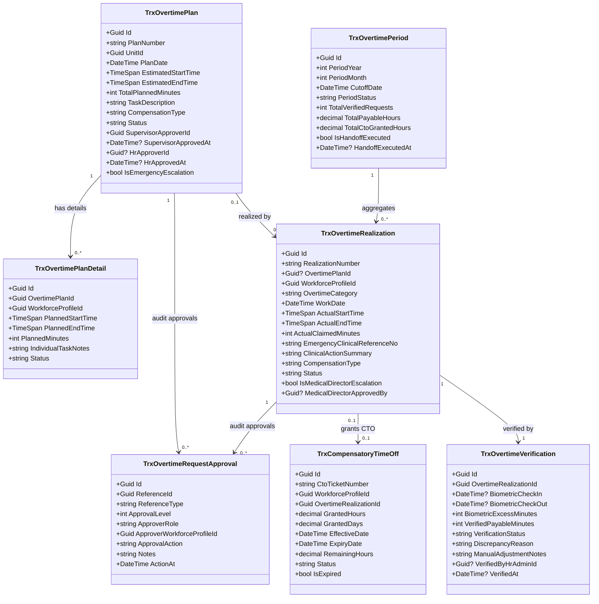

---

### 22.3 Rincian Komponen Backend (Model, DTO, Service, Controller)

#### 1. Models & Entitas Inti
* **`TrxOvertimePlan` & `TrxOvertimePlanDetail`:** Menyimpan pengajuan SPKL terencana pra-dinas (H-1) per ruangan dengan dukungan satu pengajuan induk kelompok (*team overtime*) untuk banyak staf (`HRD-ASM-26`).
* **`TrxOvertimeRealization` & `TrxOvertimeRealizationDetail`:** Menyimpan realisasi lembur pasca-dinas untuk lembur terencana maupun lembur darurat tindakan cito medis H+1 (`HRD-DEC-116`). Memuat nomor rekam medis/insiden dan ringkasan tindakan darurat.
* **`TrxOvertimeVerification`:** Menyimpan hasil penelusuran silang terhadap rekaman mesin presensi biometrik Sub-modul 07, formula `min(claimed, biometric)`, status *Flagged Discrepancy*, dan catatan investigasi manual HR Admin (`HRD-DEC-119`).
* **`TrxCompensatoryTimeOff`:** Menyimpan kuota kompensasi hak libur pengganti staf pelaksana dengan pencatatan tanggal kedaluwarsa 3 bulan (90 hari kalender) (`HRD-DEC-118`, `HRD-ASM-25`).
* **`TrxOvertimePeriod`:** Mengelola penutupan cut-off lembur bulanan, penguncian snapshot immutable, dan registri rekonsiliasi retrospektif ke Payroll (`HRD-DEC-121`).
* **`TrxOvertimeRequestApproval`:** Jejak riwayat persetujuan bertahap (Tahap 1 Kepala Ruangan, Tahap 2 HR Officer, dan Eskalasi Direktur Medis) serta penjaga *anti-self-approval* (`HRD-DEC-120`).

#### 2. Services & Domain Logic
* **`OvertimePlanService`:** Mengelola pembuatan, kalkulasi estimasi durasi, dan pengesahan SPKL pra-dinas terencana.
* **`OvertimeRealizationService`:** Mengelola pelaporan lembur aktual pasca-dinas, validasi tenggat H+1, dan pencatatan nomor rekam medis cito medis.
* **`OvertimeBiometricVerificationService`:** Melakukan kueri ke Sub-modul 07 (`IAttendanceReadService`), mengevaluasi selisih tap fisik, menjalankan logika nilai terkecil (*Min-Duration Rule*), menerapkan pembulatan kelipatan 30 menit ke bawah (`HRD-ASM-23`), dan menandai anomali *Discrepancy*.
* **`OvertimeQuotaEnforcementGuard`:** Menjaga kepatuhan kuota lembur PP 35/2021 (maks 4 jam/hari dan 18 jam/minggu). Menolak otomatis pengajuan lembur biasa dan mengalihkan permohonan cito darurat ke alur eskalasi Direktur Pelayanan Medik (`HRD-DEC-117`).
* **`CompensatoryTimeOffService`:** Menghitung konversi durasi lembur menjadi kuota jam/hari libur pengganti, mengirimkan mutasi kredit ke `TrxLeaveBalanceLedger` Sub-modul 08 (`INT-HR-49`), serta menjalankan scheduler kadaluwarsa 90 hari (`HRD-DEC-118`).
* **`OvertimePeriodReconciliationService`:** Mengunci snapshot periode lembur pada tanggal cut-off bulanan, menandai SPKL pending sebagai `PendingNextReconciliation`, dan menghitung rapel retrospektif periode lalu (`HRD-DEC-121`).
* **`OvertimePayrollHandoffService`:** Membentuk paket serah terima data lembur siap bayar yang immutable ke Sub-modul 10 Payroll.

#### 3. Controllers & Endpoints
* **`OvertimePlanController`:** Endpoint pembuatan, update draf, dan pembatalan SPKL pra-dinas mandiri/tim.
* **`OvertimeRealizationController`:** Endpoint pelaporan realisasi lembur aktual dan klaim darurat medis cito H+1.
* **`OvertimeVerificationController`:** Endpoint evaluasi otomatis presensi biometrik, daftar anomali discrepancy, dan penyesuaian manual bukti fisik oleh HR Admin.
* **`OvertimeCompensatoryLeaveController`:** Endpoint monitoring saldo CTO pegawai, penyesuaian, dan riwayat mutasi libur pengganti.
* **`OvertimeWorkflowController`:** Endpoint persetujuan bertingkat (Kepala Ruangan, HR Officer, dan Direktur Pelayanan Medik) dilengkapi guard blokir *self-approval*.
* **`OvertimePeriodController`:** Endpoint manajemen periode cut-off bulanan, penguncian berkas (*lock snapshot*), dan pemantauan status penutupan.
* **`OvertimeReconciliationController`:** Endpoint rekonsiliasi data lembur pra-payroll dan rekonsiliasi retrospektif SPKL pending periode lampau.
* **`OvertimePayrollHandoffController`:** Endpoint eksekusi serah terima data lembur ke modul Payroll.
* **`OvertimeSchedulerController`:** Endpoint background runner untuk sinkronisasi otomatis presensi biometrik dan pembersihan saldo CTO kedaluwarsa.

---

### 22.4 Pohon Folder dan Struktur File

```text
NewQuilvianSystemBackend/
├── Areas/Corporate/HumanResource/OvertimeManagement/
│   ├── Controllers/
│   │   ├── OvertimePlanController.cs                       [Sudah ada — Diperbarui V2]
│   │   ├── OvertimeRealizationController.cs                [Sudah ada — Diperbarui V2]
│   │   ├── OvertimeVerificationController.cs               [Sudah ada — Diperbarui V2]
│   │   ├── OvertimeCompensatoryLeaveController.cs          [Sudah ada — Diperbarui V2]
│   │   ├── OvertimeWorkflowController.cs                   [Sudah ada — Diperbarui V2]
│   │   ├── OvertimePeriodController.cs                     [Sudah ada — Diperbarui V2]
│   │   ├── OvertimeReconciliationController.cs             [Sudah ada — Diperbarui V2]
│   │   ├── OvertimePayrollHandoffController.cs             [Sudah ada — Diperbarui V2]
│   │   └── OvertimeSchedulerController.cs                  [Sudah ada — Diperbarui V2]
│   ├── Models/
│   │   ├── TrxOvertimePlan.cs                              [Sudah ada — Diperbarui]
│   │   ├── TrxOvertimePlanDetail.cs                        [Sudah ada — Diperbarui]
│   │   ├── TrxOvertimeRealization.cs                       [Sudah ada — Diperbarui]
│   │   ├── TrxOvertimeRealizationDetail.cs                 [Sudah ada — Diperbarui]
│   │   ├── TrxOvertimeVerification.cs                      [Sudah ada — Diperbarui]
│   │   ├── TrxCompensatoryTimeOff.cs                       [Sudah ada — Diperbarui]
│   │   ├── TrxOvertimePeriod.cs                            [Sudah ada — Diperbarui]
│   │   ├── TrxOvertimeRequestApproval.cs                   [Sudah ada — Diperbarui]
│   │   ├── TrxOvertimeRequestDetail.cs                     [Sudah ada — Dipertahankan]
│   │   ├── TrxOvertimeSchedulerJob.cs                      [Sudah ada — Dipertahankan]
│   │   └── WfpOvertimeRequest.cs                           [Sudah ada — Dipertahankan]
│   ├── Services/
│   │   ├── IOvertimePlanService.cs                         [Baru]
│   │   ├── OvertimePlanService.cs                          [Baru]
│   │   ├── IOvertimeRealizationService.cs                  [Baru]
│   │   ├── OvertimeRealizationService.cs                   [Baru]
│   │   ├── IOvertimeBiometricVerificationService.cs        [Baru]
│   │   ├── OvertimeBiometricVerificationService.cs         [Baru]
│   │   ├── IOvertimeQuotaEnforcementGuard.cs               [Baru]
│   │   ├── OvertimeQuotaEnforcementGuard.cs                [Baru]
│   │   ├── ICompensatoryTimeOffService.cs                  [Baru]
│   │   ├── CompensatoryTimeOffService.cs                   [Baru]
│   │   ├── IOvertimePeriodReconciliationService.cs         [Baru]
│   │   ├── OvertimePeriodReconciliationService.cs          [Baru]
│   │   └── OvertimePayrollHandoffService.cs                [Baru]
│   └── DTOs/
│       ├── OvertimePlanDtos.cs                             [Baru]
│       ├── OvertimeRealizationDtos.cs                      [Baru]
│       ├── OvertimeVerificationDtos.cs                     [Baru]
│       ├── CompensatoryTimeOffDtos.cs                      [Baru]
│       ├── OvertimeApprovalDtos.cs                         [Baru]
│       └── OvertimeReconciliationDtos.cs                   [Baru]
```

---

### 22.5 Status Model & Dampak Skema Database

| Nama Entitas / Model | Status | Tabel Database | Dampak Skema & Kolom Kunci Baru |
| --- | :---: | --- | --- |
| `TrxOvertimePlan` | Diperbarui | `trx_overtime_plans` | Penambahan kolom: `CompensationType`, `IsEmergencyEscalation`, `WeeklyQuotaHoursAtPlan` |
| `TrxOvertimePlanDetail` | Diperbarui | `trx_overtime_plan_details` | Penambahan kolom: `IndividualTaskNotes`, `PlannedMinutes` |
| `TrxOvertimeRealization` | Diperbarui | `trx_overtime_realizations` | Penambahan kolom: `OvertimeCategory` (`Planned`, `EmergencyCito`), `EmergencyClinicalReferenceNo`, `ClinicalActionSummary`, `CompensationType`, `IsMedicalDirectorEscalation`, `MedicalDirectorApprovedBy`, `IsRetrospectiveAdjustment` |
| `TrxOvertimeVerification` | Diperbarui | `trx_overtime_verifications` | Penambahan kolom: `BiometricCheckIn`, `BiometricCheckOut`, `BiometricExcessMinutes`, `VerifiedPayableMinutes`, `VerificationStatus` (`AutoVerified`, `FlaggedDiscrepancy`, `ManuallyAdjusted`, `RejectedDiscrepancy`), `DiscrepancyReason`, `ManualAdjustmentNotes` |
| `TrxCompensatoryTimeOff` | Diperbarui | `trx_compensatory_time_offs` | Penambahan kolom: `ExpiryDate` (H+90 hari), `GrantedDays`, `RemainingHours`, `IsExpired` |
| `TrxOvertimePeriod` | Diperbarui | `trx_overtime_periods` | Penambahan kolom: `CutoffDate`, `PeriodStatus` (`Open`, `CutoffLocked`, `Reconciled`, `Closed`), `TotalCtoGrantedHours`, `IsHandoffExecuted` |
| `TrxOvertimeRequestApproval` | Diperbarui | `trx_overtime_request_approvals` | Standardisasi approval multi-level dan pencegahan *self-approval* |

---

### 22.6 Rencana Migrasi Database (Postgres DDL)

Migrasi dieksekusi dengan pendekatan aman tanpa mematikan layanan (*Zero-Downtime Migration*):

```sql
-- Migrasi Skema Sub-Modul 09 Overtime Management (Slice S-B3)

-- 1. Penambahan Kolom pada Tabel trx_overtime_plans
ALTER TABLE trx_overtime_plans
ADD COLUMN IF NOT EXISTS compensation_type VARCHAR(50) NOT NULL DEFAULT 'FinancialPayout',
ADD COLUMN IF NOT EXISTS is_emergency_escalation BOOLEAN NOT NULL DEFAULT false,
ADD COLUMN IF NOT EXISTS weekly_quota_hours_at_plan DECIMAL(5,2);

-- 2. Penambahan Kolom pada Tabel trx_overtime_realizations
ALTER TABLE trx_overtime_realizations
ADD COLUMN IF NOT EXISTS overtime_category VARCHAR(50) NOT NULL DEFAULT 'Planned',
ADD COLUMN IF NOT EXISTS emergency_clinical_reference_no VARCHAR(100),
ADD COLUMN IF NOT EXISTS clinical_action_summary TEXT,
ADD COLUMN IF NOT EXISTS compensation_type VARCHAR(50) NOT NULL DEFAULT 'FinancialPayout',
ADD COLUMN IF NOT EXISTS is_medical_director_escalation BOOLEAN NOT NULL DEFAULT false,
ADD COLUMN IF NOT EXISTS medical_director_approved_by UUID,
ADD COLUMN IF NOT EXISTS is_retrospective_adjustment BOOLEAN NOT NULL DEFAULT false,
ADD CONSTRAINT fk_ot_realization_med_dir FOREIGN KEY (medical_director_approved_by) REFERENCES mst_workforce_profiles(id);

-- 3. Penambahan Kolom pada Tabel trx_overtime_verifications
ALTER TABLE trx_overtime_verifications
ADD COLUMN IF NOT EXISTS biometric_check_in TIMESTAMPTZ,
ADD COLUMN IF NOT EXISTS biometric_check_out TIMESTAMPTZ,
ADD COLUMN IF NOT EXISTS biometric_excess_minutes INT NOT NULL DEFAULT 0,
ADD COLUMN IF NOT EXISTS verified_payable_minutes INT NOT NULL DEFAULT 0,
ADD COLUMN IF NOT EXISTS verification_status VARCHAR(50) NOT NULL DEFAULT 'AutoVerified',
ADD COLUMN IF NOT EXISTS discrepancy_reason VARCHAR(255),
ADD COLUMN IF NOT EXISTS manual_adjustment_notes TEXT,
ADD COLUMN IF NOT EXISTS verified_by_hr_admin_id UUID,
ADD CONSTRAINT fk_ot_verification_hr_admin FOREIGN KEY (verified_by_hr_admin_id) REFERENCES mst_workforce_profiles(id);

-- 4. Penambahan Kolom pada Tabel trx_compensatory_time_offs
ALTER TABLE trx_compensatory_time_offs
ADD COLUMN IF NOT EXISTS expiry_date DATE,
ADD COLUMN IF NOT EXISTS granted_days DECIMAL(4,1) NOT NULL DEFAULT 0,
ADD COLUMN IF NOT EXISTS remaining_hours DECIMAL(5,2) NOT NULL DEFAULT 0,
ADD COLUMN IF NOT EXISTS is_expired BOOLEAN NOT NULL DEFAULT false;

-- 5. Penambahan Kolom pada Tabel trx_overtime_periods
ALTER TABLE trx_overtime_periods
ADD COLUMN IF NOT EXISTS cutoff_date DATE,
ADD COLUMN IF NOT EXISTS period_status VARCHAR(50) NOT NULL DEFAULT 'Open',
ADD COLUMN IF NOT EXISTS total_cto_granted_hours DECIMAL(6,2) NOT NULL DEFAULT 0,
ADD COLUMN IF NOT EXISTS is_handoff_executed BOOLEAN NOT NULL DEFAULT false;

-- 6. Indeks Performa Kueri Lembur Rumah Sakit
CREATE INDEX IF NOT EXISTS idx_ot_plan_unit_date ON trx_overtime_plans(unit_id, plan_date, status);
CREATE INDEX IF NOT EXISTS idx_ot_realization_workforce_date ON trx_overtime_realizations(workforce_profile_id, work_date, status);
CREATE INDEX IF NOT EXISTS idx_ot_realization_category ON trx_overtime_realizations(overtime_category, is_medical_director_escalation);
CREATE INDEX IF NOT EXISTS idx_ot_verification_status ON trx_overtime_verifications(verification_status);
CREATE INDEX IF NOT EXISTS idx_cto_workforce_expiry ON trx_compensatory_time_offs(workforce_profile_id, expiry_date, is_expired);
CREATE INDEX IF NOT EXISTS idx_ot_period_year_month ON trx_overtime_periods(period_year, period_month, period_status);
```

---

### 22.7 Rencana Data Master & Nilai Default Konfigurasi

Modul memerlukan parameter konfigurasi operasional lembur yang disimpan pada tabel konfigurasi sistem:

| Parameter Konfigurasi | Nilai Default | Keterangan & Rujukan Keputusan |
| --- | :---: | --- |
| `Overtime.DailyMaxHoursRegular` | `4` Jam | Batas maksimal jam lembur per hari kerja reguler (`HRD-DEC-117`, PP 35/2021) |
| `Overtime.WeeklyMaxHoursRegular` | `18` Jam | Batas maksimal akumulasi lembur per minggu kerja (`HRD-DEC-117`, PP 35/2021) |
| `Overtime.RoundingIntervalMinutes` | `30` Menit | Interval pembulatan durasi lembur ke bawah (`HRD-ASM-23`) |
| `Overtime.MinimumThresholdMinutes` | `30` Menit | Ambang batas durasi minimal agar lembur diakui (durasi < 30 menit = 0 jam) |
| `Overtime.CtoValidityDays` | `90` Hari (3 Bulan) | Masa berlaku hak cuti pengganti sebelum otomatis hangus (`HRD-DEC-118`, `HRD-ASM-25`) |
| `Overtime.MonthlyCutoffDay` | `20` | Tanggal penutupan cut-off transaksi lembur setiap bulan kalender (`HRD-DEC-121`) |
| `Overtime.BiometricDiscrepancyTolerance` | `30` Menit | Toleransi perbedaan waktu SPKL vs mesin presensi sebelum ditandai anomali (`HRD-DEC-119`) |
| `Overtime.PostClaimCitoGraceDays` | `1` Hari Kerja (H+1) | Batas maksimal penyerahan klaim darurat medis pasca-dinas (`HRD-DEC-116`) |

---

### 22.8 Logika Bisnis & Validasi Inti (Core Business Rules)

#### Aturan Blokir Mutlak (Blocking Business Rules)
* **`OT-B1` — Validasi Pra-Dinas Lembur Terencana (`HRD-DEC-116`):** Pengajuan berkategori `Planned` ditolak otomatis bila jam mulai lembur berada di masa lampau (`PlanStartTime <= CurrentTime`).
* **`OT-B2` — Tenggat Waktu Pelaporan Cito Medis H+1 (`HRD-DEC-116`):** Pengajuan klaim lembur darurat medis pasca-dinas ditolak bila diserahkan melebihi batas waktu H+1 hari kerja (`SubmissionDate > WorkDate + 1 WorkingDay`).
* **`OT-B3` — Kewajiban Nomor RM / Insiden Klinis Darurat (`HRD-DEC-116`):** Pengajuan lembur darurat cito ditolak bila kolom `EmergencyClinicalReferenceNo` atau `ClinicalActionSummary` kosong.
* **`OT-B4` — Penegakan Kuota Maksimal Lembur PP 35/2021 (`HRD-DEC-117`):** Pengajuan lembur terencana biasa ditolak keras bila menyebabkan total jam lembur harian > 4 jam atau mingguan > 18 jam.
* **`OT-B5` — Blokir Persetujuan Diri Sendiri (*Anti-Self-Approval* `HRD-DEC-120`):** Sistem menolak dengan HTTP 403 Forbidden bila aktor yang menekan tombol setujui adalah pegawai yang sama dengan pemohon lembur (`ApproverUserId == RequestEmployeeUserId`).
* **`OT-B6` — Pengecualian Lembur Finansial Pejabat Struktural (`HRD-DEC-118`):** Pegawai dengan level jabatan Manajer ke atas (`JobLevel >= Manager`) diblokir dari pemilihan kompensasi `FinancialPayout` (*Overtime Exempt*).
* **`OT-B7` — Penguncian Periode Cut-off Closed (`HRD-DEC-121`):** Penambahan, perubahan, atau pembatalan SPKL pada periode lembur yang telah berstatus `CutoffLocked` atau `Closed` ditolak dengan HTTP 409 Conflict.
* **`OT-B8` — Batas Minimal Pembulatan 30 Menit (`HRD-ASM-23`):** Durasi klaim lembur fisik kurang dari 30 menit menghasilkan `VerifiedPayableMinutes = 0`.

#### Aturan Peringatan & Evaluasi Logika (Warning / Logical Evaluation Rules)
* **`OT-W1` — Eskalasi Otorisasi Darurat Direktur Medis (`HRD-DEC-117`):** Klaim cito darurat medis yang melampaui 4 jam/hari atau 18 jam/minggu diizinkan masuk sistem, tetapi dialihkan ke antrean persetujuan Direktur Pelayanan Medik dengan asesmen risiko kelelahan nakes.
* **`OT-W2` — Anomali Presensi Biometrik (*Discrepancy Flagging* `HRD-DEC-119`):** Jika selisih antara durasi form SPKL dan log fisik mesin presensi > 30 menit atau log mesin presensi tidak ditemukan, sistem memberi penanda `FlaggedDiscrepancy` dan menahan pembayaran hingga HR memverifikasi bukti logbook.
* **`OT-W3` — Aturan Nilai Terkecil (*Min-Duration Rule* `HRD-DEC-119`):** Sistem secara otomatis mengambil nilai durasi terkecil antara estimasi persetujuan atasan dan kehadiran aktual fisik mesin: `VerifiedMinutes = Math.Min(ClaimedMinutes, BiometricExcessMinutes)`.
* **`OT-W4` — Otomasi Kredit Saldo Cuti Pengganti CTO (`HRD-DEC-118`):** Klaim dengan opsi CTO yang disetujui otomatis menerbitkan mutasi kredit ke Sub-modul 08 (`TrxLeaveBalanceLedger`) dengan tanggal kedaluwarsa 90 hari kalender.
* **`OT-W5` — Rekonsiliasi Retrospektif SPKL Menggantung (`HRD-DEC-121`):** SPKL yang masih dalam status investigasi/pending saat cut-off tanggal 20 diberi flag `IsRetrospectiveAdjustment = true` dan otomatis dibayarkan pada payroll bulan depan begitu disetujui.
* **`OT-W6` — Penugasan Lembur Tim Medis Ruangan (`HRD-ASM-26`):** SPKL induk tim medis mendistribusikan penugasan lembur ke seluruh nakes pelaksana terdaftar, dengan verifikasi biometrik tetap dilakukan per individu.

---

### 22.9 Yang Sengaja Tidak Dibuat pada Rilis Pertama `S-B3`

| Fitur / Komponen | Alasan | Penanganan selama MVP |
| --- | --- | --- |
| Pembayaran Uang Lembur Langsung via Kas / Petty Cash | Seluruh pembayaran uang lembur wajib melalui slip gaji payroll resmi terpusat | Data diserahterimakan ke Sub-modul 10 Payroll |
| Pembacaan Langsung Port Mesin Biometrik Fisik di Modul Lembur | Tanggung jawab pembacaan mentah perangkat keras absensi berada pada Sub-modul 07 Attendance | Sub-modul 09 mengonsumsi data olahan presensi via `INT-HR-50` |
| Uangkan Saldo CTO yang Hangus | Kebijakan RS melarang uangkan hak libur pengganti demi keselamatan kerja staf | Hangus otomatis tanpa uang tunai per 90 hari (`HRD-ASM-25`) |
| Pengajuan Lembur Harian Tanpa Batas Waktu Kadaluwarsa | Menghindari manipulasi data historis masa lampau yang tidak dapat diverifikasi | Klaim cito darurat dibatasi mutlak H+1 hari kerja (`HRD-DEC-116`) |

---

### 22.10 Traceability Keputusan ke Arsitektur Backend

| Keputusan / Asumsi | Bagian Desain Backend Terkait |
| --- | --- |
| `HRD-DEC-116` | 22.1, 22.2 (`TrxOvertimePlan`, `TrxOvertimeRealization`), 22.3 (`OvertimePlanService`, `OvertimeRealizationService`), 22.8 (`OT-B1`, `OT-B2`, `OT-B3`) |
| `HRD-DEC-117` | 22.1, 22.2 (`TrxOvertimeRealization`), 22.3 (`OvertimeQuotaEnforcementGuard`), 22.7, 22.8 (`OT-B4`, `OT-W1`) |
| `HRD-DEC-118` | 22.1, 22.2 (`TrxCompensatoryTimeOff`), 22.3 (`CompensatoryTimeOffService`), 22.7, 22.8 (`OT-B6`, `OT-W4`) |
| `HRD-DEC-119` | 22.1, 22.2 (`TrxOvertimeVerification`), 22.3 (`OvertimeBiometricVerificationService`), 22.8 (`OT-W2`, `OT-W3`) |
| `HRD-DEC-120` | 22.1, 22.2 (`TrxOvertimeRequestApproval`), 22.3 (`OvertimeWorkflowController`), 22.8 (`OT-B5`) |
| `HRD-DEC-121` | 22.1, 22.2 (`TrxOvertimePeriod`), 22.3 (`OvertimePeriodReconciliationService`, `OvertimePayrollHandoffService`), 22.8 (`OT-B7`, `OT-W5`) |
| `HRD-ASM-23` | 22.7 (`Overtime.RoundingIntervalMinutes`), 22.8 (`OT-B8`) |
| `HRD-ASM-24` | 22.1, 22.3 (`OvertimeRealizationService` integrasi on-call Sub-modul 06) |
| `HRD-ASM-25` | 22.2, 22.7 (`Overtime.CtoValidityDays` 90 hari), 22.9 |
| `HRD-ASM-26` | 22.2 (`TrxOvertimePlanDetail`), 22.8 (`OT-W6`) |

---

## 23. Bagian `S-B5` — Arsitektur Backend Penggajian Pegawai Rumah Sakit (Sub-modul 10, `last_changed_in` `v14`, 5 November 2026)

Bagian ini mendefinisikan arsitektur backend komprehensif untuk **Sub-modul 10. Payroll Management (Slice `S-B5`)**, menyerap keputusan bisnis `HRD-DEC-122` s.d. `HRD-DEC-127`, asumsi `HRD-ASM-27` s.d. `HRD-ASM-30`, penegasan batas kepemilikan `HRD-DEC-009`, serta memetakan kapabilitas existing `HRD-CAP-09` (49 endpoint di folder `Areas/Corporate/HumanResource/PayrollManagement`).

### 23.1 Konteks Domain & Kepemilikan Data (`PayrollManagement`)

| Kelompok Data / Entitas | Modul Pemilik | Dipakai di Sub-Modul 10 | Status Kepemilikan | Keterangan & Batas Tanggung Jawab |
| :--- | :--- | :---: | :---: | :--- |
| Profil Pegawai & Gaji Pokok | Workforce Core (01/02) | Ya | Read-Only | Mengambil status kepegawaian, golongan/grade, jabatan, PTKP, dan `WfpSalaryAssignment` |
| Presensi & Potongan Mangkir | Attendance (07) | Ya | Snapshot Handoff | Membaca jam kerja riil, potongan keterlambatan, dan denda mangkir via `TrxPayrollAttendanceInput` |
| Cuti Tak Berbayar (Unpaid) | Leave (08) | Ya | Snapshot Handoff | Membaca pemotongan hari cuti tak berbayar (*unearned leave*) via `TrxPayrollVariableInput` |
| Lembur & Rapel Retrospektif | Overtime (09) | Ya | Snapshot Handoff | Membaca uang lembur sah terverifikasi dan rapel periode lalu via `TrxPayrollOvertimeInput` |
| Potongan Kasbon / Cicilan RS | Restitution (11) | Ya | Integrasi Potongan | Menarik angsuran pinjaman internal staf dan restitusi via event `INT-HR-55` |
| Siklus Penggajian Bulanan | Payroll (10) | Ya | **Owner (Diperbarui)** | Entitas `TrxPayrollRun` mengelola siklus status draft, kalkulasi, review, approval, hingga handoff |
| Rincian Komponen Pendapatan & Potongan | Payroll (10) | Ya | **Owner (Baru)** | Entitas `TrxPayrollItemDetail` menyimpan seluruh baris pendapatan, pajak TER, BPJS, dan potongan internal |
| Deteksi Anomali Variansi Gaji | Payroll (10) | Ya | **Owner (Baru)** | Entitas `TrxPayrollVarianceAlert` mencatat bendera deviasi $\ge 20\%$ dan justifikasi wajib |
| Persetujuan Berjenjang 3-Tahap | Payroll (10) | Ya | **Owner (Baru)** | Entitas `TrxPayrollApproval` menegakkan pemisahan wewenang (*Segregation of Duties*) & anti-self-approval |
| Berkas Serah Terima Keuangan | Payroll (10) | Ya | **Owner (Baru)** | Entitas `TrxPayrollHandoffBatch` mencatat payload immutable terenkripsi dan protokol rollback Finance |
| Slip Gaji Digital Mandiri (ESS) | Payroll (10) | Ya | **Owner (Diperbarui)** | Entitas `TrxPayrollPayslip` melayani pembacaan slip gaji ESS terlindungi PIN sekunder |
| Pengaturan Kebijakan Penggajian RS | Payroll (10) | Ya | **Owner (Baru)** | Entitas `HrdPayrollSetting` menyimpan konfigurasi tanggal cut-off, ambang variansi, dan tarif BPJS |
| Transfer Bank & Jurnal Akuntansi | Finance & Accounting | Ya | Outbound Handoff | **Di luar wewenang HR (`HRD-DEC-009`)**: Eksekusi kliring bank dan pencatatan buku besar umum |

---

### 23.2 Class Diagram Domain Penggajian (`PayrollManagement`)

```mermaid
classDiagram
  class TrxPayrollRun {
    +Guid Id
    +string RunNumber
    +Guid PeriodId
    +DateTime PeriodStartDate
    +DateTime PeriodEndDate
    +DateTime CutoffDate
    +string RunStatus
    +int TotalEmployees
    +decimal TotalGrossPay
    +decimal TotalDeductions
    +decimal TotalTaxWithheld
    +decimal TotalBpjsEmployer
    +decimal TotalBpjsEmployee
    +decimal TotalNetPay
    +bool IsLocked
    +DateTime? LockedAt
    +Guid? LockedByUserId
    +string ChecksumSha256
    +DateTime CreatedAt
    +InitializeRun()
    +CalculateTotals()
    +LockForHandoff()
    +RejectFromFinance()
  }

  class TrxPayrollItemDetail {
    +Guid Id
    +Guid PayrollRunId
    +Guid EmployeeId
    +string ComponentCategory
    +string ComponentCode
    +string ComponentName
    +decimal Amount
    +string RateType
    +decimal Multiplier
    +string ProvenanceSourceModule
    +string ProvenanceReferenceId
    +string TaxClassification
    +bool IsSubjectToBpjs
  }

  class TrxPayrollVarianceAlert {
    +Guid Id
    +Guid PayrollRunId
    +Guid EmployeeId
    +decimal PreviousNetPay
    +decimal CurrentNetPay
    +decimal VariancePercentage
    +decimal VarianceAmount
    +string AlertSeverity
    +string JustificationReason
    +Guid? JustifiedByUserId
    +DateTime? JustifiedAt
    +bool IsResolved
  }

  class TrxPayrollApproval {
    +Guid Id
    +Guid PayrollRunId
    +int ApprovalTierLevel
    +string TierRoleName
    +Guid ApproverUserId
    +string ApprovalAction
    +string Notes
    +DateTime ActionAt
    +string IpAddress
  }

  class TrxPayrollHandoffBatch {
    +Guid Id
    +Guid PayrollRunId
    +string BatchReferenceNumber
    +string HandoffStatus
    +string BankDisbursementPayloadJson
    +string IntegrityChecksum
    +DateTime DispatchedAt
    +Guid DispatchedByUserId
    +DateTime? FinanceAcknowledgedAt
    +string FinanceRejectionReason
    +DateTime? FinanceRejectionAt
  }

  class TrxPayrollPayslip {
    +Guid Id
    +Guid PayrollRunId
    +Guid EmployeeId
    +string PayslipNumber
    +decimal GrossAmount
    +decimal TotalDeductions
    +decimal NetAmount
    +string PayslipStatus
    +bool IsReleasedToEss
    +DateTime? ReleasedAt
    +int FailedPinAttemptCount
    +DateTime? PinLockedUntil
  }

  class HrdPayrollSetting {
    +Guid Id
    +string SettingKey
    +int MonthlyCutoffDay
    +int OfficialDisbursementDay
    +decimal VarianceThresholdPercent
    +decimal VarianceThresholdNominal
    +decimal BpjsHealthEmployerRate
    +decimal BpjsHealthEmployeeRate
    +decimal BpjsTkJhtEmployerRate
    +decimal BpjsTkJhtEmployeeRate
    +decimal BpjsTkJpCapAmount
    +bool IsPinSecondaryAuthRequired
    +bool IsActive
  }

  TrxPayrollRun "1" --> "*" TrxPayrollItemDetail : aggregates
  TrxPayrollRun "1" --> "*" TrxPayrollVarianceAlert : flags
  TrxPayrollRun "1" --> "*" TrxPayrollApproval : authorizes
  TrxPayrollRun "1" --> "1" TrxPayrollHandoffBatch : dispatches
  TrxPayrollRun "1" --> "*" TrxPayrollPayslip : generates
```

---

### 23.3 Daftar Class Backend Baru & Diperbarui

#### 1. Lapisan Model & Konfigurasi Entitas (`Domain & EntityFramework`)

| Nama Class | Status | Lokasi File | Fungsi & Tanggung Jawab |
| :--- | :---: | :--- | :--- |
| `TrxPayrollRun` | Diperbarui | `Areas/Corporate/HumanResource/PayrollManagement/Models/TrxPayrollRun.cs` | Aggregate root siklus payroll: mengelola transisi status lifecycle, pembekuan snapshot, dan kalkulasi agregat finansial |
| `TrxPayrollItemDetail` | **Baru** | `Areas/Corporate/HumanResource/PayrollManagement/Models/TrxPayrollItemDetail.cs` | Baris transaksi atomik komponen gaji: pendapatan tetap, pendapatan variabel, potongan TER PPh 21, BPJS, dan pinjaman |
| `TrxPayrollVarianceAlert` | **Baru** | `Areas/Corporate/HumanResource/PayrollManagement/Models/TrxPayrollVarianceAlert.cs` | Rekaman anomali deviasi gaji ($\ge 20\%$ atau $\ge$ Rp 2 jt) beserta pencatatan justifikasi audit wajib Payroll Officer |
| `TrxPayrollApproval` | **Baru** | `Areas/Corporate/HumanResource/PayrollManagement/Models/TrxPayrollApproval.cs` | Rekaman audit log persetujuan 3-jenjang (Officer $	o$ Manager $	o$ Direktur) dengan perlindungan *anti-self-approval* |
| `TrxPayrollHandoffBatch` | **Baru** | `Areas/Corporate/HumanResource/PayrollManagement/Models/TrxPayrollHandoffBatch.cs` | Entitas serah terima ke Finance: memuat payload immutable, checksum SHA-256, dan status penolakan rollback |
| `TrxPayrollPayslip` | Diperbarui | `Areas/Corporate/HumanResource/PayrollManagement/Models/TrxPayrollPayslip.cs` | Penyedia data slip gaji digital ESS: memuat kontrol rilis terjadwal dan proteksi kunci PIN sekunder |
| `HrdPayrollSetting` | **Baru** | `Areas/Corporate/HumanResource/PayrollManagement/Models/HrdPayrollSetting.cs` | Tabel master parameter operasional payroll rumah sakit: tanggal cut-off, ambang batas variansi, dan tarif regulasi |

#### 2. Lapisan Service Domain & Application Logic (`Services`)

| Nama Service | Status | Lokasi File | Dipanggil Oleh | Tanggung Jawab Utama |
| :--- | :---: | :--- | :--- | :--- |
| `PayrollInputPreconditionGuard` | **Baru** | `.../PayrollManagement/Services/PayrollInputPreconditionGuard.cs` | `PayrollRunCycleController` | Memvalidasi seluruh periode Sub-07, 08, 09 berstatus `Closed/Reconciled`; memblokir jika ada transaksi pending |
| `PayrollCalculationEngine` | **Baru** | `.../PayrollManagement/Services/PayrollCalculationEngine.cs` | `PayrollCalculationController` | Menjalankan pipeline kalkulasi pendapatan tetap, pendapatan variabel, integrasi lembur/presensi, dan potongan |
| `IndonesianTaxCalculator` | **Baru** | `.../PayrollManagement/Services/IndonesianTaxCalculator.cs` | `PayrollCalculationEngine` | Menghitung PPh 21 skema TER (Kategori A, B, C) sesuai PMK 168/2023 dan rekonsiliasi Pasal 17 masa Desember |
| `BpjsContributionCalculator` | **Baru** | `.../PayrollManagement/Services/BpjsContributionCalculator.cs` | `PayrollCalculationEngine` | Menghitung iuran BPJS Kesehatan (1% staf, 4% RS) dan Ketenagakerjaan (JHT, JKK, JKM, JP dengan batas upah) |
| `PayrollVarianceDetectionService` | **Baru** | `.../PayrollManagement/Services/PayrollVarianceDetectionService.cs` | `PayrollCalculationEngine` | Membandingkan Net Pay vs bulan lalu, menerbitkan `VarianceAlert`, dan memvalidasi kelengkapan justifikasi |
| `PayrollRunLifecycleManager` | **Baru** | `.../PayrollManagement/Services/PayrollRunLifecycleManager.cs` | `PayrollApprovalController` | Mengelola pemajuan status siklus 3-tier SoD, mengunci transaksi menjadi immutable, dan audit jejak penilai |
| `PayrollFinanceHandoffService` | **Baru** | `.../PayrollManagement/Services/PayrollFinanceHandoffService.cs` | `PayrollFinanceHandoffController` | Menyusun paket serah terima terenkripsi ber-checksum SHA-256 dan menangani rollback penolakan dari Finance |
| `PayslipReleaseService` | **Baru** | `.../PayrollManagement/Services/PayslipReleaseService.cs` | `PayrollSelfServiceController` | Mengontrol rilis slip gaji ESS, memverifikasi PIN 6-digit pegawai, dan menghasilkan PDF ber-watermark resmi |

#### 3. Lapisan API Controller (`Controllers`)

| Nama Controller | Status | Tag Swagger & Rute Base | Izin Akses (`[AccessPermission]`) |
| :--- | :---: | :--- | :--- |
| `PayrollRunCycleController` | **Baru** | `[Tags("HR Payroll - Run Cycles")]`<br>`/api/v1/hr/payroll/runs` | `PayrollRun:View`, `PayrollRun:Create`, `PayrollRun:Cancel` |
| `PayrollCalculationController` | **Baru** | `[Tags("HR Payroll - Calculations & Variance")]`<br>`/api/v1/hr/payroll/calculations` | `PayrollCalculation:Execute`, `PayrollVariance:Justify` |
| `PayrollApprovalController` | **Baru** | `[Tags("HR Payroll - Approvals")]`<br>`/api/v1/hr/payroll/approvals` | `PayrollApproval:Review`, `PayrollApproval:AuthorizeFinal` |
| `PayrollFinanceHandoffController` | **Baru** | `[Tags("HR Payroll - Finance Handoff")]`<br>`/api/v1/hr/payroll/finance-handoff` | `PayrollHandoff:Dispatch`, `PayrollHandoff:HandleRejection` |
| `PayrollSelfServiceController` | Diperbarui | `[Tags("HR Payroll - Self-Service Payslips")]`<br>`/api/v1/hr/self-service/payroll` | `SelfServicePayroll:View`, `SelfServicePayroll:VerifyPin` |
| `PayrollSettingController` | **Baru** | `[Tags("HR Payroll - Settings")]`<br>`/api/v1/hr/payroll/settings` | `PayrollSetting:View`, `PayrollSetting:Manage` |

---

### 23.4 Pohon Direktori Source Backend C#

```text
NewQuilvianSystemBackend/
├── Areas/Corporate/HumanResource/PayrollManagement/
│   ├── Controllers/
│   │   ├── AttendancePayrollHandoffController.cs        [EXISTING]
│   │   ├── LeavePayrollIntegrationController.cs         [EXISTING]
│   │   ├── OvertimePayrollHandoffController.cs          [EXISTING]
│   │   ├── PayrollApprovalController.cs                 [NEW]
│   │   ├── PayrollCalculationController.cs              [NEW]
│   │   ├── PayrollFinanceHandoffController.cs           [NEW]
│   │   ├── PayrollRunCycleController.cs                 [NEW]
│   │   ├── PayrollSelfServiceController.cs              [NEW / EXTEND]
│   │   └── PayrollSettingController.cs                  [NEW]
│   ├── DTOs/
│   │   ├── PayrollCalculationDtos.cs                    [NEW]
│   │   ├── PayrollFinanceHandoffDtos.cs                 [NEW]
│   │   ├── PayrollRunCycleDtos.cs                       [NEW]
│   │   ├── PayrollSelfServiceDtos.cs                    [NEW]
│   │   └── PayrollSettingDtos.cs                        [NEW]
│   ├── Models/
│   │   ├── HrdPayrollSetting.cs                         [NEW]
│   │   ├── TrxPayrollApproval.cs                        [NEW]
│   │   ├── TrxPayrollAttendanceInput.cs                 [EXISTING]
│   │   ├── TrxPayrollHandoffBatch.cs                    [NEW]
│   │   ├── TrxPayrollItemDetail.cs                      [NEW]
│   │   ├── TrxPayrollOvertimeInput.cs                   [EXISTING]
│   │   ├── TrxPayrollPayslip.cs                         [EXISTING / EXTEND]
│   │   ├── TrxPayrollRun.cs                             [EXISTING / EXTEND]
│   │   ├── TrxPayrollVariableInput.cs                   [EXISTING]
│   │   └── TrxPayrollVarianceAlert.cs                   [NEW]
│   ├── Services/
│   │   ├── BpjsContributionCalculator.cs                [NEW]
│   │   ├── IndonesianTaxCalculator.cs                   [NEW]
│   │   ├── PayrollCalculationEngine.cs                  [NEW]
│   │   ├── PayrollFinanceHandoffService.cs              [NEW]
│   │   ├── PayrollInputPreconditionGuard.cs             [NEW]
│   │   ├── PayrollRunLifecycleManager.cs                [NEW]
│   │   ├── PayrollVarianceDetectionService.cs           [NEW]
│   │   └── PayslipReleaseService.cs                     [NEW]
│   └── Validators/
│       ├── FinanceRejectionValidator.cs                 [NEW]
│       ├── PayrollApprovalValidator.cs                  [NEW]
│       ├── PayrollCalculationValidator.cs               [NEW]
│       ├── PayrollRunInitializeValidator.cs             [NEW]
│       ├── PayslipPinVerificationValidator.cs           [NEW]
│       └── VarianceJustificationValidator.cs            [NEW]
```

---

### 23.5 Rencana Migrasi Database PostgreSQL

1. **Urutan Eksekusi Migrasi:**
   * Migrasi 1: Pembuatan tabel konfigurasi penggajian `hrd_payroll_settings`.
   * Migrasi 2: Penambahan kolom status penguncian dan checksum integritas pada tabel `trx_payroll_runs`.
   * Migrasi 3: Pembuatan tabel rincian transaksi atomik komponen gaji `trx_payroll_item_details`.
   * Migrasi 4: Pembuatan tabel anomali variansi `trx_payroll_variance_alerts`.
   * Migrasi 5: Pembuatan tabel audit persetujuan bertingkat `trx_payroll_approvals`.
   * Migrasi 6: Pembuatan tabel serah terima berkas ke Finance `trx_payroll_handoff_batches`.
   * Migrasi 7: Penambahan kolom kontrol PIN sekunder dan rilis terjadwal pada `trx_payroll_payslips`.
2. **Ketersediaan Layanan (Zero Downtime):**
   * Seluruh penambahan kolom bersifat `NULLABLE` atau memiliki nilai default aman (`DEFAULT 0`, `DEFAULT FALSE`).
   * Tidak ada instruksi `DROP TABLE` atau pengubahan tipe data kolom lama yang merusak data operasional.
3. **Langkah Mundur (Rollback Strategy):**
   * Setiap skrip migration EF Core dilengkapi method `Down()` yang secara presisi menghapus tabel dan indeks terkait tanpa memengaruhi tabel master pegawai.

---

### 23.6 Skema DDL Tabel Baru & Penambahan Kolom

```sql
-- 1. Tabel Konfigurasi Parameter Payroll Rumah Sakit
CREATE TABLE IF NOT EXISTS hrd_payroll_settings (
    id UUID PRIMARY KEY DEFAULT gen_random_uuid(),
    setting_key VARCHAR(100) NOT NULL UNIQUE,
    monthly_cutoff_day INT NOT NULL DEFAULT 20,
    official_disbursement_day INT NOT NULL DEFAULT 25,
    variance_threshold_percent NUMERIC(5,2) NOT NULL DEFAULT 20.00,
    variance_threshold_nominal NUMERIC(18,2) NOT NULL DEFAULT 2000000.00,
    bpjs_health_employer_rate NUMERIC(5,4) NOT NULL DEFAULT 0.0400,
    bpjs_health_employee_rate NUMERIC(5,4) NOT NULL DEFAULT 0.0100,
    bpjs_tk_jht_employer_rate NUMERIC(5,4) NOT NULL DEFAULT 0.0370,
    bpjs_tk_jht_employee_rate NUMERIC(5,4) NOT NULL DEFAULT 0.0200,
    bpjs_tk_jp_cap_amount NUMERIC(18,2) NOT NULL DEFAULT 10042300.00,
    is_pin_secondary_auth_required BOOLEAN NOT NULL DEFAULT TRUE,
    is_active BOOLEAN NOT NULL DEFAULT TRUE,
    created_at TIMESTAMPTZ NOT NULL DEFAULT CURRENT_TIMESTAMP,
    created_by VARCHAR(100) NOT NULL DEFAULT 'SYSTEM',
    updated_at TIMESTAMPTZ NULL,
    updated_by VARCHAR(100) NULL,
    is_deleted BOOLEAN NOT NULL DEFAULT FALSE
);

-- 2. Penambahan Kolom Penguncian & Checksum pada Tabel TrxPayrollRun
ALTER TABLE trx_payroll_runs
    ADD COLUMN IF NOT EXISTS is_locked BOOLEAN NOT NULL DEFAULT FALSE,
    ADD COLUMN IF NOT EXISTS locked_at TIMESTAMPTZ NULL,
    ADD COLUMN IF NOT EXISTS locked_by_user_id UUID NULL,
    ADD COLUMN IF NOT EXISTS checksum_sha256 VARCHAR(64) NULL,
    ADD COLUMN IF NOT EXISTS finance_handoff_status VARCHAR(50) NOT NULL DEFAULT 'PendingHandoff';

-- 3. Tabel Rincian Komponen Gaji Atomik (Earnings & Deductions)
CREATE TABLE IF NOT EXISTS trx_payroll_item_details (
    id UUID PRIMARY KEY DEFAULT gen_random_uuid(),
    payroll_run_id UUID NOT NULL REFERENCES trx_payroll_runs(id) ON DELETE RESTRICT,
    employee_id UUID NOT NULL,
    component_category VARCHAR(50) NOT NULL, -- FixedEarning, VariableEarning, StatutoryDeduction, VoluntaryDeduction
    component_code VARCHAR(50) NOT NULL,     -- BASIC, POS_ALLOW, NIGHT_SHIFT, OVERTIME, PPH21_TER, BPJS_KES, BPJS_TK, LOAN_DEDUCTION
    component_name VARCHAR(150) NOT NULL,
    amount NUMERIC(18,2) NOT NULL DEFAULT 0.00,
    rate_type VARCHAR(50) NOT NULL DEFAULT 'Fixed', -- Fixed, Percentage, Formula, HoursMultiplied
    multiplier NUMERIC(8,2) NOT NULL DEFAULT 1.00,
    provenance_source_module VARCHAR(50) NOT NULL, -- Attendance07, Leave08, Overtime09, Restitution11, SalaryConfig
    provenance_reference_id VARCHAR(100) NULL,
    tax_classification VARCHAR(50) NOT NULL DEFAULT 'TaxableRegular',
    is_subject_to_bpjs BOOLEAN NOT NULL DEFAULT TRUE,
    created_at TIMESTAMPTZ NOT NULL DEFAULT CURRENT_TIMESTAMP,
    created_by VARCHAR(100) NOT NULL DEFAULT 'SYSTEM'
);

CREATE INDEX IF NOT EXISTS idx_payroll_item_run_emp ON trx_payroll_item_details(payroll_run_id, employee_id);
CREATE INDEX IF NOT EXISTS idx_payroll_item_category ON trx_payroll_item_details(component_category);

-- 4. Tabel Deteksi Anomali Variansi Gaji (Variance Alerts)
CREATE TABLE IF NOT EXISTS trx_payroll_variance_alerts (
    id UUID PRIMARY KEY DEFAULT gen_random_uuid(),
    payroll_run_id UUID NOT NULL REFERENCES trx_payroll_runs(id) ON DELETE CASCADE,
    employee_id UUID NOT NULL,
    previous_net_pay NUMERIC(18,2) NOT NULL,
    current_net_pay NUMERIC(18,2) NOT NULL,
    variance_percentage NUMERIC(6,2) NOT NULL,
    variance_amount NUMERIC(18,2) NOT NULL,
    alert_severity VARCHAR(20) NOT NULL DEFAULT 'Warning', -- Warning (20-49%), Critical (>=50%)
    justification_reason TEXT NULL,
    justified_by_user_id UUID NULL,
    justified_at TIMESTAMPTZ NULL,
    is_resolved BOOLEAN NOT NULL DEFAULT FALSE,
    created_at TIMESTAMPTZ NOT NULL DEFAULT CURRENT_TIMESTAMP
);

CREATE INDEX IF NOT EXISTS idx_payroll_variance_run ON trx_payroll_variance_alerts(payroll_run_id, is_resolved);

-- 5. Tabel Audit Otorisasi Berjenjang (3-Tier Segregation of Duties)
CREATE TABLE IF NOT EXISTS trx_payroll_approvals (
    id UUID PRIMARY KEY DEFAULT gen_random_uuid(),
    payroll_run_id UUID NOT NULL REFERENCES trx_payroll_runs(id) ON DELETE CASCADE,
    approval_tier_level INT NOT NULL, -- 1: Officer Review, 2: HR Manager Approval, 3: Director Final Authorization
    tier_role_name VARCHAR(50) NOT NULL,
    approver_user_id UUID NOT NULL,
    approval_action VARCHAR(50) NOT NULL, -- Submitted, Approved, Rejected, RequestedRevision
    notes TEXT NULL,
    action_at TIMESTAMPTZ NOT NULL DEFAULT CURRENT_TIMESTAMP,
    ip_address VARCHAR(50) NULL
);

CREATE INDEX IF NOT EXISTS idx_payroll_approval_run ON trx_payroll_approvals(payroll_run_id, approval_tier_level);

-- 6. Tabel Berkas Serah Terima ke Keuangan (Finance Handoff Batch)
CREATE TABLE IF NOT EXISTS trx_payroll_handoff_batches (
    id UUID PRIMARY KEY DEFAULT gen_random_uuid(),
    payroll_run_id UUID NOT NULL UNIQUE REFERENCES trx_payroll_runs(id) ON DELETE RESTRICT,
    batch_reference_number VARCHAR(100) NOT NULL UNIQUE,
    handoff_status VARCHAR(50) NOT NULL DEFAULT 'Dispatched', -- Dispatched, AcknowledgedByFinance, RejectedByFinance, PaymentConfirmed
    bank_disbursement_payload_json JSONB NOT NULL,
    integrity_checksum VARCHAR(64) NOT NULL,
    dispatched_at TIMESTAMPTZ NOT NULL DEFAULT CURRENT_TIMESTAMP,
    dispatched_by_user_id UUID NOT NULL,
    finance_acknowledged_at TIMESTAMPTZ NULL,
    finance_rejection_reason TEXT NULL,
    finance_rejection_at TIMESTAMPTZ NULL,
    payment_confirmed_at TIMESTAMPTZ NULL
);

-- 7. Penambahan Kolom Keamanan PIN Sekunder pada TrxPayrollPayslip
ALTER TABLE trx_payroll_payslips
    ADD COLUMN IF NOT EXISTS is_released_to_ess BOOLEAN NOT NULL DEFAULT FALSE,
    ADD COLUMN IF NOT EXISTS released_at TIMESTAMPTZ NULL,
    ADD COLUMN IF NOT EXISTS secondary_pin_hash VARCHAR(255) NULL,
    ADD COLUMN IF NOT EXISTS failed_pin_attempt_count INT NOT NULL DEFAULT 0,
    ADD COLUMN IF NOT EXISTS pin_locked_until TIMESTAMPTZ NULL;
```

---

### 23.7 Rencana Data Master Awal & Konfigurasi Sistem

Seeder otomatis pada saat inisialisasi aplikasi menyediakan nilai default parameter operasional pada tabel `hrd_payroll_settings`:

| Key Konfigurasi | Nilai Default | Deskripsi & Regulasi Acuan |
| :--- | :--- | :--- |
| `Payroll.MonthlyCutoffDay` | `20` | Tanggal penutupan transaksi waktu kerja bulanan (`HRD-ASM-27`) |
| `Payroll.OfficialDisbursementDay` | `25` | Tanggal gajian resmi dan jadwal rilis slip gaji ESS (`HRD-ASM-27`) |
| `Payroll.VarianceThresholdPercent` | `20.00` | Ambang persentase batas lonjakan deviasi gaji bersih (`HRD-ASM-29`) |
| `Payroll.VarianceThresholdNominal` | `2000000.00` | Ambang batas selisih nominal uang yang memicu alert (`HRD-ASM-29`) |
| `Payroll.BpjsHealthEmployerRate` | `0.0400` | Iuran BPJS Kesehatan beban pemberi kerja RS (4.0%) |
| `Payroll.BpjsHealthEmployeeRate` | `0.0100` | Iuran BPJS Kesehatan potongan dari gaji staf (1.0%) |
| `Payroll.BpjsTkJhtEmployerRate` | `0.0370` | Iuran Jaminan Hari Tua (JHT) beban RS (3.7%) |
| `Payroll.BpjsTkJhtEmployeeRate` | `0.0200` | Iuran Jaminan Hari Tua (JHT) beban staf (2.0%) |
| `Payroll.BpjsTkJpCapAmount` | `10042300.00` | Plafon maksimal dasar perhitungan Jaminan Pensiun (JP) BPJS TK |
| `Payroll.TaxCalculationMethod` | `TER_PMK_168_2023` | Metode baku perpajakan PPh 21 TER Kategori A/B/C (`HRD-ASM-28`) |
| `Payroll.IsPinSecondaryAuthRequired` | `true` | Kewajiban autentikasi PIN 6-digit saat buka slip gaji (`HRD-ASM-30`) |

---

### 23.8 Matriks Aturan Bisnis & Validasi Keselamatan (`PAY-B` & `PAY-W`)

#### 1. Validasi Pemblokir Kritis (*Hard-Blocking Rules — PAY-B*)

| Kode Aturan | Kondisi Pelanggaran | Tindakan Sistem | Kode HTTP / Error |
| :--- | :--- | :--- | :---: |
| `PAY-B1` | Periode presensi, cuti, atau lembur belum berstatus `Closed/Reconciled` saat inisiasi payroll | Blokir proses kalkulasi; tampilkan daftar transaksi gantung | 422 Unprocessable Entity (`VR-PAY-01`) |
| `PAY-B2` | Status payroll run sudah terminal (`ApprovedFinal`, `Closed`, `HandoffReady`) saat ada perubahan data | Blokir mutasi data; run telah berstatus immutable | 409 Conflict (`VR-PAY-02`) |
| `PAY-B3` | Terdapat baris pegawai bertanda `VarianceAlert` yang belum memiliki justifikasi tertulis saat diajukan | Blokir aksi pengajuan (*Submit for Review*); kunci tombol submit | 400 Bad Request (`VR-PAY-07`) |
| `PAY-B4` | Approver mencoba menyetujui payroll run yang dibuat/dihitung oleh dirinya sendiri (*Self-Approval*) | Tolak eksekusi approval secara mutlak; wajib dialihkan ke penilai lain | 403 Forbidden (`VR-PAY-08`) |
| `PAY-B5` | Pegawai mencoba membuka rincian slip gaji sebelum tanggal rilis atau sebelum `PaymentConfirmed` | Blokir akses pembacaan lembar slip gaji di ESS | 403 Forbidden (`VR-PAY-18`) |
| `PAY-B6` | Percobaan input PIN slip gaji salah $\ge 3$ kali berturut-turut | Kunci akses menu slip gaji pegawai selama 30 menit | 429 Too Many Requests (`VR-PAY-19`) |
| `PAY-B7` | Finance mencoba melakukan penolakan batch tanpa mengisi catatan alasan tertulis resmi | Tolak penolakan batch; alasan wajib diisi minimal 15 karakter | 400 Bad Request (`VR-PAY-16`) |
| `PAY-B8` | Checksum SHA-256 berkas serah terima tidak cocok (*tampered data*) saat diverifikasi Finance | Batalkan proses handoff dan tandai peringatan manipulasi data | 422 Unprocessable Entity (`VR-PAY-15`) |

#### 2. Peringatan Validasi Beralasan (*Warning Rules — PAY-W*)

| Kode Peringatan | Kondisi Terdeteksi | Dampak & Tindakan yang Diizinkan |
| :--- | :--- | :--- |
| `PAY-W1` | Kenaikan/penurunan gaji bersih pegawai $\ge 20\%$ dibanding bulan lalu | Tampilkan badge kuning `VarianceAlert`; izinkan submit setelah diisi justifikasi |
| `PAY-W2` | Kenaikan gaji bersih $\ge 50\%$ akibat akumulasi jam lembur cito masif | Tampilkan badge merah `CriticalVariance`; kirim notifikasi khusus ke HR Manager |
| `PAY-W3` | Gaji bersih (*Net Pay*) pegawai bernilai $\le$ 30% dari total gaji pokok akibat potongan pinjaman | Tampilkan peringatan batas minimum take-home-pay ketenagakerjaan |
| `PAY-W4` | Pegawai baru pertama kali menerima gaji (belum memiliki data komparasi bulan lalu) | Beri label `NewEmployeePayroll`; lewati komparasi otomatis dengan verifikasi penugasan |
| `PAY-W5` | Adanya rapel retrospektif lembur/cuti periode lampau yang masuk pada bulan berjalan | Tampilkan label `RetrospectiveIncluded` dan rincian dokumen asal pada lembar slip gaji |
| `PAY-W6` | Format rekening bank pegawai tidak standar menurut ketentuan bank mitra RS | Beri peringatan oranye `InvalidBankFormatWarning` pada tabel serah terima Finance |

---

### 23.9 Yang Sengaja Tidak Dibuat pada Rilis Pertama `S-B5`

| Fitur / Komponen | Alasan Dikecualikan | Penanganan Selama Rilis Berjalan |
| :--- | :--- | :--- |
| Pembayaran Aktual Rekening Bank Pegawai | Wewenang mutlak Departemen Keuangan/Kasir (`HRD-DEC-009`) | Diserahkan via berkas serah terima terenkripsi `TrxPayrollHandoffBatch` |
| Pembuatan Jurnal Umum Akuntansi (GL) | Wewenang sistem akuntansi Modul Finance | Finance membentuk ayat jurnal akuntansi dari berkas serah terima |
| Perhitungan Jasa Medis Dokter Spesialis RCM | Logika pembagian jasa medis berdasarkan tarif klaim tindakan medis | Dikelola modul Billing/Remunerasi Medis terpisah |
| Penyetoran Kas Negara PPh 21 / BPJS | Tanggung jawab pembayaran pajak berada di Departemen Keuangan | Sistem HR hanya menyediakan laporan rekapitulasi bukti potong TER |

---

### 23.10 Traceability Keputusan ke Arsitektur Backend

| Keputusan / Asumsi | Bagian Desain Backend Terkait |
| :--- | :--- |
| `HRD-DEC-122` | 23.1, 23.3 (`PayrollInputPreconditionGuard`), 23.8 (`PAY-B1`) |
| `HRD-DEC-123` | 23.1, 23.2 (`TrxPayrollItemDetail`), 23.3 (`PayrollCalculationEngine`, `IndonesianTaxCalculator`, `BpjsContributionCalculator`), 23.6, 23.7 |
| `HRD-DEC-124` | 23.1, 23.2 (`TrxPayrollVarianceAlert`), 23.3 (`PayrollVarianceDetectionService`), 23.6, 23.8 (`PAY-B3`, `PAY-W1`, `PAY-W2`) |
| `HRD-DEC-125` | 23.1, 23.2 (`TrxPayrollApproval`), 23.3 (`PayrollRunLifecycleManager`, `PayrollApprovalController`), 23.6, 23.8 (`PAY-B4`) |
| `HRD-DEC-126` | 23.1, 23.2 (`TrxPayrollHandoffBatch`), 23.3 (`PayrollFinanceHandoffService`), 23.6, 23.8 (`PAY-B7`, `PAY-B8`) |
| `HRD-DEC-127` | 23.1, 23.2 (`TrxPayrollPayslip`), 23.3 (`PayslipReleaseService`, `PayrollSelfServiceController`), 23.6, 23.8 (`PAY-B5`, `PAY-B6`) |
| `HRD-ASM-27` | 23.6, 23.7 (`Payroll.MonthlyCutoffDay` = 20, `Payroll.OfficialDisbursementDay` = 25) |
| `HRD-ASM-28` | 23.3 (`IndonesianTaxCalculator` TER PMK 168/2023), 23.7 |
| `HRD-ASM-29` | 23.6, 23.7 (`Payroll.VarianceThresholdPercent` = 20%, `Payroll.VarianceThresholdNominal` = Rp 2 jt) |
| `HRD-ASM-30` | 23.3 (`PayslipReleaseService`), 23.6 (`secondary_pin_hash`), 23.8 (`PAY-B6`) |

## 24. Bagian `S-B6` — Arsitektur Backend Restitusi & Pemotongan Penggajian Pegawai Rumah Sakit (Sub-modul 11, `last_changed_in` `v15`, 5 November 2026)

Bagian ini mendefinisikan arsitektur backend komprehensif untuk **Sub-modul 11. Restitusi & Integrasi Pemotongan Penggajian (Slice `S-B6`)**, menyerap keputusan bisnis `HRD-DEC-128` s.d. `HRD-DEC-133`, asumsi rekayasa `HRD-ASM-31` s.d. `HRD-ASM-34`, penegasan batas kepemilikan piutang Finance `HRD-DEC-009` & `HRD-DEC-129`, batasan pemotongan upah tenaga kerja Pasal 65 PP 36/2021 jo PP 49/2025 (*Hard-Cap 50%*), pemisahan slip penutupan PHK/Resign (Sub-20 Exit Clearance), serta perlindungan jalur cepat kasir darurat (*Urgent Disbursement Cito*).

### 24.1 Konteks Domain & Kepemilikan Data (`RestitutionAndDeductions`)

| Kelompok Data / Entitas | Modul Pemilik | Dipakai di Sub-Modul 11 | Status Kepemilikan | Keterangan & Batas Tanggung Jawab |
| :--- | :--- | :---: | :---: | :--- |
| Profil Pegawai & Gaji Bruto | Workforce Core (01/02) / Payroll (10) | Ya | Read-Only | Mengambil status kepegawaian, grade/golongan, dan nilai `GrossPay` bulan berjalan untuk penentuan plafon 50% |
| Buku Besar Piutang & Pinjaman RS | Finance & Accounting | Ya | Inbound / Outbound Callback | **Di luar HR (`HRD-DEC-009`, `HRD-DEC-129`)**: Finance memegang saldo buku besar, HR hanya menerima jadwal cicilan aktif (`INT-HR-55`) dan mengirim callback realisasi (`INT-HR-58`) |
| Koperasi Pegawai RS | Koperasi Karyawan (Unit Eksternal/Kemitraan) | Ya | Inbound Invoice | Tagihan belanja / simpan pinjam koperasi disalurkan melalui Finance/HR sebagai potongan prioritas ke-3 |
| Klaim Restitusi Mandiri ESS | Restitution (11) | Ya | **Owner (Baru)** | Entitas `TrxEmployeeRestitutionClaim` menampung klaim kacamata kerja, faskes luar, dan dinas darurat staf |
| Penyesuaian Restitusi Slip Gaji | Restitution (11) | Ya | **Owner (Baru)** | Entitas `TrxPayrollRestitution` menampung reimbursement klaim approved dan koreksi salah potong periode lampau (`PAY-B6`) |
| Jadwal Angsuran Pemotongan Gaji | Restitution (11) | Ya | **Owner (Baru)** | Entitas `TrxPayrollDeductionSchedule` mengelola master cicilan bulanan yang ditarik dari Finance |
| Rincian Eksekusi Potongan Periode | Restitution (11) | Ya | **Owner (Baru)** | Entitas `TrxPayrollDeductionItem` menyimpan hasil eksekusi potong per komponen dengan penegakan hard-cap 50% berjenjang |
| Voucher Pencairan Darurat Kasir | Restitution (11) | Ya | **Owner (Baru)** | Entitas `TrxCashierDisbursementVoucher` menerbitkan QR/PIN voucher tunai 24/7 di Kasir RS untuk kecelakaan kerja medis cito |
| Konfigurasi Plafon & Kebijakan | Restitution (11) | Ya | **Owner (Baru)** | Entitas `HrdRestitutionSetting` menyimpan aturan plafon tahunan per grade dan ambang hard-cap upah |
| Rekonsiliasi Pelunasan PHK / Resign | Exit Clearance (Sub-Modul 20) | Ya | Inter-Module Contract | Integrasi dengan Sub-Modul 20 untuk penyelesaian sisa pinjaman pada slip akhir (*Final Clearance Payslip*) |

---

### 24.2 Class Diagram Domain Restitusi & Pemotongan (`RestitutionAndDeductions`)

```mermaid
classDiagram
  class TrxEmployeeRestitutionClaim {
    +Guid Id
    +string ClaimNumber
    +Guid EmployeeId
    +string ClaimCategory
    +DateTime ExpenseDate
    +decimal ClaimAmount
    +decimal ApprovedAmount
    +string ReceiptAttachmentUrl
    +string MedicalResumeAttachmentUrl
    +string ClaimStatus
    +string ReasonNotes
    +Guid? SupervisorId
    +DateTime? SupervisorApprovedAt
    +Guid? HrReviewerId
    +DateTime? HrReviewedAt
    +Guid? FinalApproverId
    +DateTime? FinalApprovedAt
    +bool IsCitoEmergency
    +DateTime CreatedAt
  }

  class TrxPayrollRestitution {
    +Guid Id
    +string RestitutionNumber
    +Guid EmployeeId
    +Guid? ClaimId
    +string RestitutionType
    +decimal Amount
    +Guid? AffectedPayrollRunId
    +Guid? AffectedPayslipId
    +Guid? TargetPayrollRunId
    +string Status
    +string Justification
    +DateTime CreatedAt
  }

  class TrxPayrollDeductionSchedule {
    +Guid Id
    +string ScheduleNumber
    +Guid EmployeeId
    +string DeductionCategory
    +int PriorityLevel
    +string ExternalReferenceId
    +decimal TotalLoanPrincipal
    +decimal MonthlyInstallmentAmount
    +int TotalInstallmentMonths
    +int PaidInstallmentCount
    +decimal RemainingPrincipal
    +DateTime StartDate
    +DateTime? EndDate
    +string ScheduleStatus
    +bool AutoCarryOverOnCapExceeded
  }

  class TrxPayrollDeductionItem {
    +Guid Id
    +Guid PayrollRunId
    +Guid DeductionScheduleId
    +Guid EmployeeId
    +string DeductionCategory
    +int PriorityLevel
    +decimal ScheduledAmount
    +decimal ActualDeductedAmount
    +decimal DeferredAmount
    +string ExecutionStatus
    +string DeferralReason
    +DateTime ExecutedAt
  }

  class TrxCashierDisbursementVoucher {
    +Guid Id
    +string VoucherNumber
    +Guid ClaimId
    +Guid EmployeeId
    +decimal VoucherAmount
    +string SecurityTokenHash
    +DateTime IssuedAt
    +DateTime ExpiredAt
    +string VoucherStatus
    +Guid? CashedByUserId
    +DateTime? CashedAt
    +string CashierReceiptNumber
  }

  class HrdRestitutionSetting {
    +Guid Id
    +string GradeLevelCode
    +string BenefitCategory
    +decimal AnnualLimitAmount
    +int MinimumServiceMonthsRequired
    +decimal MaxDeductionPercentageOfGross
    +bool AllowEmergencyCitoCashier
    +bool IsActive
  }

  TrxEmployeeRestitutionClaim "1" -- "0..1" TrxPayrollRestitution : generates
  TrxEmployeeRestitutionClaim "1" -- "0..1" TrxCashierDisbursementVoucher : fast_track_cashier
  TrxPayrollDeductionSchedule "1" -- "0..*" TrxPayrollDeductionItem : generates_monthly_cut
  HrdRestitutionSetting "1" -- "0..*" TrxEmployeeRestitutionClaim : validates_limit
```

---

### 24.3 Daftar Class Backend Baru & Diperbarui

| Nama Class | Layer / Tipe | Status | Lokasi File | Fungsi Utama & Batas Tanggung Jawab |
| :--- | :--- | :---: | :--- | :--- |
| `TrxEmployeeRestitutionClaim` | Domain Entity | **Baru** | `Areas/Corporate/HumanResource/PayrollManagement/Entities/TrxEmployeeRestitutionClaim.cs` | Entitas tabel klaim restitusi mandiri staf berlampiran nota/kuitansi asli dan audit persetujuan 3 tingkat |
| `TrxPayrollRestitution` | Domain Entity | **Baru** | `Areas/Corporate/HumanResource/PayrollManagement/Entities/TrxPayrollRestitution.cs` | Entitas komponen pengembalian uang/restitusi pada penggajian bulanan (termasuk kompensasi salah potong masa lalu) |
| `TrxPayrollDeductionSchedule` | Domain Entity | **Baru** | `Areas/Corporate/HumanResource/PayrollManagement/Entities/TrxPayrollDeductionSchedule.cs` | Entitas master jadwal cicilan piutang/pinjaman yang tersinkronisasi dengan Departemen Keuangan |
| `TrxPayrollDeductionItem` | Domain Entity | **Baru** | `Areas/Corporate/HumanResource/PayrollManagement/Entities/TrxPayrollDeductionItem.cs` | Entitas rincian eksekusi potongan slip gaji per periode dengan penegakan batas 50% dan pencatatan nilai ditunda |
| `TrxCashierDisbursementVoucher` | Domain Entity | **Baru** | `Areas/Corporate/HumanResource/PayrollManagement/Entities/TrxCashierDisbursementVoucher.cs` | Entitas voucher pencairan tunai kasir 24/7 untuk klaim darurat medis nakes (*Urgent Disbursement Cito*) |
| `HrdRestitutionSetting` | Domain Entity | **Baru** | `Areas/Corporate/HumanResource/PayrollManagement/Entities/HrdRestitutionSetting.cs` | Entitas pengaturan plafon tahunan restitusi per golongan dan persentase batasan pemotongan upah (default 50%) |
| `RestitutionClaimService` | Application Service | **Baru** | `Areas/Corporate/HumanResource/PayrollManagement/Services/RestitutionClaimService.cs` | Menangani siklus pengajuan klaim ESS, kalkulasi sisa plafon tahunan, alur persetujuan, dan penguncian voucher cito |
| `PayrollDeductionEngineService` | Application Service | **Baru** | `Areas/Corporate/HumanResource/PayrollManagement/Services/PayrollDeductionEngineService.cs` | Menjalankan perhitungan batasan hard-cap 50% PP 36/2021, pemangkasan berjenjang prioritas 1-4, dan penjadwalan sisa carry-over |
| `FinanceDeductionSyncService` | Application Service | **Baru** | `Areas/Corporate/HumanResource/PayrollManagement/Services/FinanceDeductionSyncService.cs` | Mengelola sinkronisasi batch jadwal cicilan H-3 dari Finance (`INT-HR-55`) dan pengiriman callback realisasi tgl 25 (`INT-HR-58`) |
| `CashierVoucherDisbursementService`| Application Service | **Baru** | `Areas/Corporate/HumanResource/PayrollManagement/Services/CashierVoucherDisbursementService.cs` | Melayani validasi dan pencairan voucher di loket Kasir RS serta memastikan flag `DisbursedViaCashier` terkunci |
| `ExitClearanceReceivableService` | Application Service | **Baru** | `Areas/Corporate/HumanResource/PayrollManagement/Services/ExitClearanceReceivableService.cs` | Menghitung sisa pinjaman saat resign/PHK, memotong hingga 100% dari pesangon penutupan, dan menerbitkan tagihan residu |
| `RestitutionClaimController` | Web API Controller | **Baru** | `Areas/Corporate/HumanResource/PayrollManagement/Controllers/RestitutionClaimController.cs` | Menyediakan endpoint RESTful pengajuan klaim ESS, persetujuan bertingkat, dan monitoring kuota plafon |
| `PayrollDeductionScheduleController`| Web API Controller | **Baru** | `Areas/Corporate/HumanResource/PayrollManagement/Controllers/PayrollDeductionScheduleController.cs` | Menyediakan endpoint RESTful sinkronisasi jadwal Finance, evaluasi simulasi plafon 50%, dan manajemen angsuran |
| `CashierVoucherController` | Web API Controller | **Baru** | `Areas/Corporate/HumanResource/PayrollManagement/Controllers/CashierVoucherController.cs` | Menyediakan endpoint RESTful penerbitan, otorisasi, dan kliring voucher kasir darurat 24/7 |
| `RestitutionSettingController` | Web API Controller | **Baru** | `Areas/Corporate/HumanResource/PayrollManagement/Controllers/RestitutionSettingController.cs` | Menyediakan endpoint RESTful konfigurasi batas plafon benefit dan aturan penegakan persentase potongan upah |
| `DeductionScheduleDtos` | DTO Model | **Baru** | `Areas/Corporate/HumanResource/PayrollManagement/DTOs/DeductionScheduleDtos.cs` | Kumpulan DTO Create, Update, Filter, dan Response untuk jadwal angsuran dan simulasi plafon 50% |
| `RestitutionClaimDtos` | DTO Model | **Baru** | `Areas/Corporate/HumanResource/PayrollManagement/DTOs/RestitutionClaimDtos.cs` | Kumpulan DTO pengajuan klaim ESS, payload kuitansi, persetujuan berjenjang, dan riwayat klaim |
| `CashierVoucherDtos` | DTO Model | **Baru** | `Areas/Corporate/HumanResource/PayrollManagement/DTOs/CashierVoucherDtos.cs` | Kumpulan DTO penerbitan voucher cito, verifikasi token kasir, dan konfirmasi pencairan tunai |
| `RestitutionSettingDtos` | DTO Model | **Baru** | `Areas/Corporate/HumanResource/PayrollManagement/DTOs/RestitutionSettingDtos.cs` | Kumpulan DTO konfigurasi plafon benefit tahunan dan penegakan batas maksimal potongan gaji |

---

### 24.4 Pohon Direktori Source Backend C#

```text
NewQuilvianSystemBackend/
└── Areas/
    └── Corporate/
        └── HumanResource/
            └── PayrollManagement/
                ├── Controllers/
                │   ├── RestitutionClaimController.cs           [Baru - S-B6]
                │   ├── PayrollDeductionScheduleController.cs   [Baru - S-B6]
                │   ├── CashierVoucherController.cs             [Baru - S-B6]
                │   └── RestitutionSettingController.cs         [Baru - S-B6]
                ├── Services/
                │   ├── RestitutionClaimService.cs              [Baru - S-B6]
                │   ├── PayrollDeductionEngineService.cs        [Baru - S-B6]
                │   ├── FinanceDeductionSyncService.cs          [Baru - S-B6]
                │   ├── CashierVoucherDisbursementService.cs   [Baru - S-B6]
                │   └── ExitClearanceReceivableService.cs       [Baru - S-B6]
                ├── Entities/
                │   ├── TrxEmployeeRestitutionClaim.cs          [Baru - S-B6]
                │   ├── TrxPayrollRestitution.cs                [Baru - S-B6]
                │   ├── TrxPayrollDeductionSchedule.cs          [Baru - S-B6]
                │   ├── TrxPayrollDeductionItem.cs              [Baru - S-B6]
                │   ├── TrxCashierDisbursementVoucher.cs        [Baru - S-B6]
                │   └── HrdRestitutionSetting.cs                [Baru - S-B6]
                ├── EntityConfigurations/
                │   ├── TrxEmployeeRestitutionClaimConfiguration.cs   [Baru - S-B6]
                │   ├── TrxPayrollRestitutionConfiguration.cs         [Baru - S-B6]
                │   ├── TrxPayrollDeductionScheduleConfiguration.cs   [Baru - S-B6]
                │   ├── TrxPayrollDeductionItemConfiguration.cs       [Baru - S-B6]
                │   ├── TrxCashierDisbursementVoucherConfiguration.cs [Baru - S-B6]
                │   └── HrdRestitutionSettingConfiguration.cs         [Baru - S-B6]
                └── DTOs/
                    ├── DeductionScheduleDtos.cs                [Baru - S-B6]
                    ├── RestitutionClaimDtos.cs                 [Baru - S-B6]
                    ├── CashierVoucherDtos.cs                   [Baru - S-B6]
                    └── RestitutionSettingDtos.cs               [Baru - S-B6]
```

---

### 24.5 Rencana Migrasi Database PostgreSQL

1. **Nama File Migrasi:** `20261105_AddRestitutionAndPayrollDeductionTables.cs`
2. **Karakteristik Eksekusi:** Zero-downtime, fully non-blocking, menambahkan 6 tabel baru tanpa mengubah kolom tabel produksi existing secara destruktif.
3. **Pemberian Indeks Performa:**
   - Indeks unik terklaster pada nomor klaim (`claim_number`), nomor jadwal (`schedule_number`), dan nomor voucher (`voucher_number`).
   - Indeks gabungan `(employee_id, expense_date)` pada `trx_employee_restitution_claims` untuk kalkulasi cepat akumulasi plafon tahunan.
   - Indeks komposit `(payroll_run_id, deduction_schedule_id)` pada `trx_payroll_deduction_items` untuk pemrosesan paralel engine penggajian.
4. **Strategi Mundur (Rollback Strategy):**
   - Bila migrasi gagal, eksekusi drop table berurutan dari tabel turunan: `trx_cashier_disbursement_vouchers`, `trx_payroll_deduction_items`, `trx_payroll_restitutions`, `trx_payroll_deduction_schedules`, `trx_employee_restitution_claims`, `hrd_restitution_settings`.

---

### 24.6 Skema DDL Tabel Baru & Penambahan Kolom

```sql
-- 1. Tabel Master Konfigurasi Plafon Restitusi & Batas Pemotongan Upah
CREATE TABLE IF NOT EXISTS public.hrd_restitution_settings (
    id UUID PRIMARY KEY DEFAULT gen_random_uuid(),
    grade_level_code VARCHAR(50) NOT NULL,
    benefit_category VARCHAR(100) NOT NULL, -- 'KacamataKerja', 'FaskesLuarDarurat', 'DinasCitoMedis'
    annual_limit_amount NUMERIC(15, 2) NOT NULL DEFAULT 0.00,
    minimum_service_months_required INT NOT NULL DEFAULT 0,
    max_deduction_percentage_of_gross NUMERIC(5, 2) NOT NULL DEFAULT 50.00, -- Hard-cap 50% PP 36/2021
    allow_emergency_cito_cashier BOOLEAN NOT NULL DEFAULT FALSE,
    is_active BOOLEAN NOT NULL DEFAULT TRUE,
    created_by_user_id UUID NOT NULL,
    created_at TIMESTAMP WITH TIME ZONE NOT NULL DEFAULT CURRENT_TIMESTAMP,
    updated_by_user_id UUID NULL,
    updated_at TIMESTAMP WITH TIME ZONE NULL,
    CONSTRAINT uq_restitution_setting_grade_category UNIQUE (grade_level_code, benefit_category)
);

-- 2. Tabel Pengajuan Klaim Restitusi Mandiri di ESS
CREATE TABLE IF NOT EXISTS public.trx_employee_restitution_claims (
    id UUID PRIMARY KEY DEFAULT gen_random_uuid(),
    claim_number VARCHAR(100) NOT NULL UNIQUE,
    employee_id UUID NOT NULL REFERENCES public.m_employees(id),
    claim_category VARCHAR(100) NOT NULL,
    expense_date DATE NOT NULL,
    claim_amount NUMERIC(15, 2) NOT NULL,
    approved_amount NUMERIC(15, 2) NOT NULL DEFAULT 0.00,
    receipt_attachment_url TEXT NOT NULL,
    medical_resume_attachment_url TEXT NULL,
    claim_status VARCHAR(50) NOT NULL DEFAULT 'Draft', -- 'Draft', 'Submitted', 'SupervisorApproved', 'HrReviewed', 'Approved', 'Rejected', 'QueuedForPayroll', 'ProcessedInPayroll', 'VoucherIssued', 'DisbursedViaCashier', 'Closed'
    reason_notes TEXT NOT NULL,
    rejection_reason TEXT NULL,
    supervisor_id UUID NULL,
    supervisor_approved_at TIMESTAMP WITH TIME ZONE NULL,
    hr_reviewer_id UUID NULL,
    hr_reviewed_at TIMESTAMP WITH TIME ZONE NULL,
    final_approver_id UUID NULL,
    final_approved_at TIMESTAMP WITH TIME ZONE NULL,
    is_cito_emergency BOOLEAN NOT NULL DEFAULT FALSE,
    created_by_user_id UUID NOT NULL,
    created_at TIMESTAMP WITH TIME ZONE NOT NULL DEFAULT CURRENT_TIMESTAMP,
    updated_at TIMESTAMP WITH TIME ZONE NULL
);
CREATE INDEX idx_restitution_claim_employee_date ON public.trx_employee_restitution_claims (employee_id, expense_date);

-- 3. Tabel Komponen Restitusi Penggajian (Reimbursement & Koreksi Salah Potong Masa Lalu)
CREATE TABLE IF NOT EXISTS public.trx_payroll_restitutions (
    id UUID PRIMARY KEY DEFAULT gen_random_uuid(),
    restitution_number VARCHAR(100) NOT NULL UNIQUE,
    employee_id UUID NOT NULL REFERENCES public.m_employees(id),
    claim_id UUID NULL REFERENCES public.trx_employee_restitution_claims(id),
    restitution_type VARCHAR(50) NOT NULL, -- 'BenefitReimbursement', 'SalaryAdjustmentCorrection' (HRD-DEC-131)
    amount NUMERIC(15, 2) NOT NULL,
    affected_payroll_run_id UUID NULL REFERENCES public.trx_payroll_runs(id), -- Slip masa lalu yang salah potong
    affected_payslip_id UUID NULL REFERENCES public.trx_payroll_payslips(id),
    target_payroll_run_id UUID NULL REFERENCES public.trx_payroll_runs(id), -- Siklus penggajian berjalan tempat uang dikembalikan
    status VARCHAR(50) NOT NULL DEFAULT 'PendingApproval', -- 'PendingApproval', 'Approved', 'IncludedInPayroll', 'Cancelled'
    justification TEXT NOT NULL,
    approved_by_user_id UUID NULL,
    approved_at TIMESTAMP WITH TIME ZONE NULL,
    created_by_user_id UUID NOT NULL,
    created_at TIMESTAMP WITH TIME ZONE NOT NULL DEFAULT CURRENT_TIMESTAMP
);

-- 4. Tabel Master Jadwal Angsuran Cicilan Pemotongan Gaji
CREATE TABLE IF NOT EXISTS public.trx_payroll_deduction_schedules (
    id UUID PRIMARY KEY DEFAULT gen_random_uuid(),
    schedule_number VARCHAR(100) NOT NULL UNIQUE,
    employee_id UUID NOT NULL REFERENCES public.m_employees(id),
    deduction_category VARCHAR(100) NOT NULL, -- 'GantiRugiAsetKasir', 'KasbonPinjamanRS', 'CicilanKoperasi', 'IuranPaguyuban'
    priority_level INT NOT NULL, -- 1: Ganti Rugi, 2: Kasbon RS, 3: Koperasi, 4: Paguyuban (HRD-DEC-128)
    external_reference_id VARCHAR(100) NULL, -- ID Piutang di modul Keuangan (Finance AR Code)
    total_loan_principal NUMERIC(15, 2) NOT NULL,
    monthly_installment_amount NUMERIC(15, 2) NOT NULL,
    total_installment_months INT NOT NULL DEFAULT 1,
    paid_installment_count INT NOT NULL DEFAULT 0,
    remaining_principal NUMERIC(15, 2) NOT NULL,
    start_date DATE NOT NULL,
    end_date DATE NULL,
    schedule_status VARCHAR(50) NOT NULL DEFAULT 'Active', -- 'Active', 'Paused', 'Completed', 'Cancelled', 'ClearedAtSeparation'
    auto_carry_over_on_cap_exceeded BOOLEAN NOT NULL DEFAULT TRUE,
    created_by_user_id UUID NOT NULL,
    created_at TIMESTAMP WITH TIME ZONE NOT NULL DEFAULT CURRENT_TIMESTAMP,
    updated_at TIMESTAMP WITH TIME ZONE NULL
);
CREATE INDEX idx_deduction_schedule_emp_priority ON public.trx_payroll_deduction_schedules (employee_id, priority_level);

-- 5. Tabel Rincian Eksekusi Pemotongan Gaji per Periode
CREATE TABLE IF NOT EXISTS public.trx_payroll_deduction_items (
    id UUID PRIMARY KEY DEFAULT gen_random_uuid(),
    payroll_run_id UUID NOT NULL REFERENCES public.trx_payroll_runs(id),
    deduction_schedule_id UUID NOT NULL REFERENCES public.trx_payroll_deduction_schedules(id),
    employee_id UUID NOT NULL REFERENCES public.m_employees(id),
    deduction_category VARCHAR(100) NOT NULL,
    priority_level INT NOT NULL,
    scheduled_amount NUMERIC(15, 2) NOT NULL,
    actual_deducted_amount NUMERIC(15, 2) NOT NULL DEFAULT 0.00,
    deferred_amount NUMERIC(15, 2) NOT NULL DEFAULT 0.00, -- Nilai ditunda karena mentok batas 50%
    execution_status VARCHAR(50) NOT NULL DEFAULT 'Pending', -- 'Pending', 'DeductedInFull', 'PartiallyDeducted', 'DeferredDueToSalaryCap', 'Cancelled'
    deferral_reason TEXT NULL,
    executed_at TIMESTAMP WITH TIME ZONE NOT NULL DEFAULT CURRENT_TIMESTAMP,
    CONSTRAINT uq_deduction_item_run_schedule UNIQUE (payroll_run_id, deduction_schedule_id)
);

-- 6. Tabel Voucher Pencairan Kasir Darurat Cito 24/7
CREATE TABLE IF NOT EXISTS public.trx_cashier_disbursement_vouchers (
    id UUID PRIMARY KEY DEFAULT gen_random_uuid(),
    voucher_number VARCHAR(100) NOT NULL UNIQUE,
    claim_id UUID NOT NULL REFERENCES public.trx_employee_restitution_claims(id),
    employee_id UUID NOT NULL REFERENCES public.m_employees(id),
    voucher_amount NUMERIC(15, 2) NOT NULL,
    security_token_hash VARCHAR(256) NOT NULL, -- SHA-256 token satu kali pakai untuk kasir
    issued_at TIMESTAMP WITH TIME ZONE NOT NULL DEFAULT CURRENT_TIMESTAMP,
    expired_at TIMESTAMP WITH TIME ZONE NOT NULL, -- Berlaku 48 jam sejak terbit
    voucher_status VARCHAR(50) NOT NULL DEFAULT 'Issued', -- 'Issued', 'ClaimedAtCashier', 'DisbursedViaCashier', 'Expired', 'Cancelled'
    cashed_by_user_id UUID NULL, -- ID User Kasir RS yang memverifikasi voucher
    cashed_at TIMESTAMP WITH TIME ZONE NULL,
    cashier_receipt_number VARCHAR(100) NULL,
    notes TEXT NULL,
    created_by_user_id UUID NOT NULL
);
CREATE INDEX idx_cashier_voucher_status_exp ON public.trx_cashier_disbursement_vouchers (voucher_status, expired_at);
```

---

### 24.7 Rencana Data Master Awal & Konfigurasi Sistem

Data awal disemai (*seeded*) pada tabel `hrd_restitution_settings` untuk menjamin kepatuhan batas pemotongan upah dan ketersediaan batas plafon benefit:

| Golongan Pegawai (`grade_level_code`) | Kategori Manfaat (`benefit_category`) | Plafon Tahunan (`annual_limit_amount`) | Min. Masa Kerja | Batas Maks. Potongan (`max_deduction_percentage`) | Cito Kasir Diizinkan? |
| :--- | :--- | :--- | :--- | :---: | :---: |
| `GRADE-ALL` | `KebijakanUmumPemotongan` | Rp 0 | 0 bulan | **50.00%** (PP 36/2021) | Tidak |
| `GRADE-I` (Staf Medis / Dokter Spesialis) | `KacamataKerja` | Rp 2.500.000 | 6 bulan | 50.00% | Tidak |
| `GRADE-I` (Staf Medis / Dokter Spesialis) | `FaskesLuarDarurat` | Rp 10.000.000 | 3 bulan | 50.00% | **Ya (Cito Nakes)** |
| `GRADE-II` (Perawat & Bidan) | `KacamataKerja` | Rp 1.500.000 | 6 bulan | 50.00% | Tidak |
| `GRADE-II` (Perawat & Bidan) | `FaskesLuarDarurat` | Rp 7.500.000 | 3 bulan | 50.00% | **Ya (Cito Nakes)** |
| `GRADE-III` (Penunjang Medik & Laboran) | `KacamataKerja` | Rp 1.250.000 | 6 bulan | 50.00% | Tidak |
| `GRADE-III` (Penunjang Medik & Laboran) | `FaskesLuarDarurat` | Rp 5.000.000 | 3 bulan | 50.00% | **Ya (Cito Nakes)** |
| `GRADE-IV` (Staf Umum & Administrasi) | `KacamataKerja` | Rp 1.000.000 | 12 bulan | 50.00% | Tidak |
| `GRADE-IV` (Staf Umum & Administrasi) | `FaskesLuarDarurat` | Rp 3.000.000 | 12 bulan | 50.00% | Tidak |

---

### 24.8 Matriks Aturan Bisnis & Validasi Keselamatan (`DED-B` & `DED-W`)

| Kode Aturan | Jenis | Target / Entitas | Deskripsi Aturan & Batas Keselamatan Finansial |
| :--- | :--- | :--- | :--- |
| `DED-B1` | Hard Invariant | `PayrollDeductionEngine` | Total seluruh pemotongan non-regulasi dalam 1 siklus penggajian bulanan dilarang keras melebihi **50% dari Gross Pay** (`HRD-DEC-128`, Pasal 65 PP 36/2021). |
| `DED-B2` | Hard Invariant | `PayrollDeductionEngine` | Pemotongan wajib tunduk pada hirarki prioritas berjenjang mutlak: Priority 1 (Ganti rugi kasir/aset RS) $
ightarrow$ Priority 2 (Pinjaman kasbon pokok RS) $
ightarrow$ Priority 3 (Cicilan Koperasi RS) $
ightarrow$ Priority 4 (Iuran sosial paguyuban). |
| `DED-B3` | Hard Invariant | `TrxPayrollDeductionItem`| Tagihan yang tidak dapat dipotong akibat mentok batas plafon 50% wajib diberi status `DeferredDueToSalaryCap` dan secara otomatis ditunda (*carry-over*) ke periode bulan berikutnya tanpa denda bunga (`HRD-DEC-128`). |
| `DED-B4` | Hard Invariant | `TrxPayrollRestitution` | Slip gaji final yang telah disahkan dan dibayarkan haram diubah nilainya (`PAY-B6`). Koreksi pengembalian salah potong periode lampau wajib melalui entitas `TrxPayrollRestitution` bertipe `SalaryAdjustmentCorrection` dengan audit referensi slip asal (`HRD-DEC-131`). |
| `DED-B5` | Hard Invariant | `TrxPayrollRestitution` | Nominal pengembalian salah potong (*RestitutionAdjustment*) wajib diklasifikasikan sebagai komponen non-objek pajak PPh 21 guna mencegah pengenaan pajak ganda pada karyawan (`HRD-ASM-33`). |
| `DED-B6` | Hard Invariant | `TrxCashierDisbursementVoucher`| Voucher kasir darurat cito yang telah dicairkan tunai berstatus `DisbursedViaCashier` haram masuk ke antrean transfer gaji bulanan tgl 25 guna mencegah pembayaran ganda (`HRD-DEC-133`). |
| `DED-B7` | Hard Invariant | `ExitClearanceReceivable`| Pengecualian batas 50% hanya berlaku sah pada slip gaji penutupan akhir PHK/Resign (*Final Clearance Payslip*), di mana hak pesangon dan cuti dapat dipotong hingga 100% untuk melunasi sisa pinjaman rumah sakit (`HRD-DEC-132`). |
| `DED-B8` | Hard Invariant | `TrxEmployeeRestitutionClaim`| Pengajuan klaim mandiri ESS dilarang disetujui sendiri oleh atasan pemohon (*Anti-Self-Approval*). Jika pemohon adalah kepala unit/direktur, persetujuan dialihkan ke pejabat 1 tingkat di atasnya. |
| `DED-W1` | Safety Warning | `TrxPayrollDeductionItem`| Munculkan peringatan oranye ke HR Payroll Officer jika seorang pegawai memiliki cicilan yang tertunda (*deferred*) selama lebih dari 2 bulan berturut-turut. |
| `DED-W2` | Safety Warning | `TrxEmployeeRestitutionClaim`| Munculkan notifikasi jika sisa kuota kacamata staf kurang dari 20% dari plafon tahunan. |
| `DED-W3` | Safety Warning | `TrxCashierDisbursementVoucher`| Sistem mengirimkan notifikasi SMS/WA peringatan ke pemegang voucher jika voucher darurat cito belum dicairkan dalam kurun waktu 36 jam (mendekati batas kedaluwarsa 48 jam). |
| `DED-W4` | Safety Warning | `FinanceDeductionSync` | Berikan peringatan visual jika data cicilan Finance per tgl 17 memiliki selisih nominal lebih dari 10% dibanding saldo bulan sebelumnya. |
| `DED-W5` | Safety Warning | `ExitClearanceReceivable`| Terbitkan *Outstanding Receivable Statement* dan blokir penandatanganan formulir Exit Clearance Sub-20 jika hak pesangon tidak mencukupi untuk melunasi seluruh sisa pinjaman RS. |
| `DED-W6` | Safety Warning | `TrxEmployeeRestitutionClaim`| Blokir unggahan berkas kuitansi klaim jika format bukan PDF/JPG/PNG atau ukuran berkas melebihi 5 MB. |

---

### 24.9 Yang Sengaja Tidak Dibuat pada Rilis Pertama `S-B6`

1. **Sistem Perhitungan Bunga Majemuk & Amortisasi Pinjaman Bank:** Perhitungan bunga pinjaman komersial dan pembukuan piutang piutang adalah wewenang penuh Departemen Keuangan (`HRD-DEC-009`); HRD hanya bertindak sebagai eksekutor pemotongan nominal pokok sesuai snapshot tagihan.
2. **Manajemen Inventaris & Penjualan Unit Koperasi Pegawai:** Aplikasi kasir ritel atau e-commerce koperasi karyawan tidak dirancang di modul HR; HR hanya menerima rekap invoice potongan cicilan belanja.
3. **Pencairan Uang Fisik Kasir secara Otomatis dari HR:** HR tidak memegang brankas kasir kas kecil; pencairan kas fisik wajib melalui loket Kasir RS 24/7 dengan verifikasi voucher elektronik terenkripsi.
4. **Pemotongan Otomatis terhadap Rekening Bank Pribadi Karyawan:** HRD tidak melakukan auto-debet perbankan di luar eksekusi slip gaji; bila hak gaji habis saat PHK, pegawai menyetor manual ke kasir RS.

---

### 24.10 Traceability Keputusan ke Arsitektur Backend

| ID Keputusan | Komponen Arsitektur Backend yang Mewadahi | Lokasi Implementasi Kode C# |
| :--- | :--- | :--- |
| `HRD-DEC-128` | Engine Guard Batas 50% & Hirarki Prioritas 1-4 | `PayrollDeductionEngineService.cs`, tabel `trx_payroll_deduction_items`, kolom `deferred_amount` |
| `HRD-DEC-129` | Sinkronisasi Dua Arah H-3 Snapshot & Callback Tgl 25 | `FinanceDeductionSyncService.cs`, `INT-HR-55`, `INT-HR-58` |
| `HRD-DEC-130` | Klaim Restitusi Mandiri ESS & Multi-Level Approval | `RestitutionClaimService.cs`, `TrxEmployeeRestitutionClaim.cs`, `RestitutionClaimController.cs` |
| `HRD-DEC-131` | Restitusi Koreksi Salah Potong Periode Lampau Non-Pajak | `TrxPayrollRestitution.cs` tipe `SalaryAdjustmentCorrection`, integrasi komponen slip gaji berjalan |
| `HRD-DEC-132` | Pelunasan Pinjaman Resign/PHK via Exit Clearance | `ExitClearanceReceivableService.cs`, pengecualian batas 50% khusus pesangon akhir, integrasi Sub-20 |
| `HRD-DEC-133` | Kanal Pencairan: Payroll Tgl 25 vs Cito Kasir RS 24/7 | `CashierVoucherDisbursementService.cs`, `TrxCashierDisbursementVoucher.cs`, token SHA-256 |


---

## 25. Desain Target Arsitektur Backend Sub-Modul 12 (Slice S-D3 Benefit Management — Manajemen Manfaat, Asuransi BPJS & Tanggungan Pegawai Rumah Sakit)

Bagian ini mendefinisikan arsitektur backend target untuk **Sub-Modul 12 (Benefit Management — Slice `S-D3`)**, mencakup perancangan struktur paket manfaat 3-lapisan (Regulasi BPJS wajib, Asuransi Swasta Tambahan per grade, dan Subsidi Berobat Internal di RS Quilvian sendiri sesuai `HRD-DEC-134`), batasan hak tanggungan keluarga inti sah (maksimal 1 pasangan + 3 anak hingga usia 21/25 tahun kuliah via verifikasi KK/Akta sesuai `HRD-DEC-135`), integrasi real-time loket registrasi dan kasir SIMRS untuk layanan berobat nakes di RS sendiri (`INT-HR-61` sesuai `HRD-DEC-136`), penegakan aturan Koordinasi Manfaat (*Coordination of Benefits* - COB) BPJS Kesehatan sebagai Penjamin Primer (*Primary Payer*) ber-SEP dan asuransi swasta sebagai Penjamin Sekunder (*Secondary Payer*) (`HRD-DEC-137`), perlindungan keselamatan kerja nakes sejak H+0 Onboarding dan aktivasi bertahap pasca-lulus masa percobaan 3 bulan (`HRD-DEC-138`), serta penonaktifan hak benefit otomatis pada tanggal efektif pemutusan hubungan kerja melalui gerbang Exit Clearance Sub-Modul 20 (`HRD-DEC-139`).

---

### 25.1 Tabel Kepemilikan Data (Data Ownership Boundary)

| Kelompok Data | Modul Pemilik | Status di Sub-12 | Dibuat Ulang? | Keterangan & Alasan Arsitektural |
| :--- | :--- | :---: | :---: | :--- |
| Paket Manfaat & Kelayakan Grade | `BenefitManagement` (HRD) | Pemilik Utama | Tidak | Mengatur struktur paket bertingkat 3-lapisan dan matriks kelayakan per grade/level kepegawaian. |
| Kepesertaan Asuransi & Tanggungan | `BenefitManagement` (HRD) | Pemilik Utama | Tidak | Menyimpan nomor kepesertaan BPJS Kesehatan/TK, polis komersial, serta verifikasi keluarga inti sah. |
| Buku Besar Mutasi Plafon Berobat RS | `BenefitManagement` (HRD) | Pemilik Utama | Tidak | Menjaga integritas saldo subsidi perawatan internal RS Quilvian (*double-entry balance movement ledger*). |
| Transaksi Klaim & COB Sekunder | `BenefitManagement` (HRD) | Pemilik Utama | Tidak | Mengelola pengajuan klaim penjamin sekunder asuransi swasta/RS berlampiran SEP BPJS Kesehatan. |
| Profil Staf & Tanggal Masuk/Keluar | `WorkforceManagement` (Sub-02) | Konsumen (Read) | Tidak | Membaca data NIP, status PKWT/PKWTT, tanggal onboarding H+0, dan tanggal efektif keluar. |
| Pemotongan Iuran & Ekses Tagihan | `PayrollManagement` (Sub-10/11) | Integrasi (Async) | Tidak | Ekses tagihan yang melebihi plafon dialihkan ke pemotongan payroll Sub-Modul 11 (`S-B6`). |
| Billing & Admission Kunjungan Pasien | `SIMRS Billing & Admission` | Integrasi (Sync) | Tidak | Pengecekan real-time hak berobat nakes di loket RS dan penguncian tagihan tindakan (`INT-HR-61`). |
| Checklist Kliring Bebas Tunggakan | `ExitClearance` (Sub-20) | Integrasi (Sync) | Tidak | Validasi bahwa pegawai yang keluar tidak memiliki sisa tagihan medis rawat inap tertunggak. |

---

### 25.2 Class Diagram Target (Bounded Context: BenefitManagement)

```mermaid
classDiagram
  class MstBenefitPlan {
    +UUID Id
    +string PlanCode
    +string PlanName
    +string BenefitCategory
    +string CoverageTier
    +decimal AnnualLimitAmount
    +decimal HospitalDiscountPercentage
    +bool RequiresBPJSPrimaryCOB
    +int MinimumServiceMonths
    +bool IsActive
  }

  class HrdBenefitGradeEligibility {
    +UUID Id
    +UUID BenefitPlanId
    +string GradeLevelCode
    +string EmploymentTypeCode
    +decimal SpecificAnnualLimit
    +string InpatientRoomClass
    +bool IsActive
  }

  class TrxEmployeeInsuranceEnrollment {
    +UUID Id
    +UUID EmployeeId
    +UUID BenefitPlanId
    +string BpjsKesehatanNumber
    +string BpjsKetenagakerjaanNumber
    +string PrivateInsurancePolicyNumber
    +string PrivateInsuranceProviderName
    +string EnrollmentStatus
    +DateTime EffectiveDate
    +DateTime? ExpiryDate
    +DateTime? TerminationDate
  }

  class TrxEmployeeBenefitDependent {
    +UUID Id
    +UUID EmployeeEnrollmentId
    +string DependentName
    +string NationalIdNumber
    +string RelationshipType
    +DateTime BirthDate
    +bool IsActiveStudent
    +string StudentVerificationLetterPath
    +DateTime? StudentVerificationExpiryDate
    +string VerificationStatus
    +DateTime? VerifiedAt
    +UUID? VerifiedByUserId
  }

  class HrdBenefitBalanceMovement {
    +UUID Id
    +UUID EmployeeId
    +UUID BenefitPlanId
    +string MovementType
    +decimal MovementAmount
    +decimal BalanceBefore
    +decimal BalanceAfter
    +string ReferenceNumber
    +string Description
    +DateTime MovementDate
  }

  class TrxBenefitClaim {
    +UUID Id
    +string ClaimNumber
    +UUID EmployeeId
    +UUID? DependentId
    +UUID BenefitPlanId
    +string ServiceType
    +string HospitalName
    +string SepBpjsNumber
    +decimal TotalHospitalBill
    +decimal PrimaryPayerCoveredAmount
    +decimal SecondaryClaimAmount
    +decimal OutOfPocketExcessAmount
    +string ClaimStatus
    +DateTime ServiceDate
    +DateTime SubmittedAt
    +DateTime? SettledAt
  }

  class TrxBenefitClaimDocument {
    +UUID Id
    +UUID ClaimId
    +string DocumentType
    +string DocumentNumber
    +string FileStoragePath
    +long FileSizeBytes
    +string MimeType
  }

  MstBenefitPlan "1" --> "*" HrdBenefitGradeEligibility : defines eligibility
  MstBenefitPlan "1" --> "*" TrxEmployeeInsuranceEnrollment : enrolled into
  TrxEmployeeInsuranceEnrollment "1" --> "*" TrxEmployeeBenefitDependent : registers
  TrxEmployeeInsuranceEnrollment "1" --> "*" HrdBenefitBalanceMovement : tracks balance
  TrxEmployeeInsuranceEnrollment "1" --> "*" TrxBenefitClaim : submits claims
  TrxBenefitClaim "1" --> "*" TrxBenefitClaimDocument : contains
```

---

### 25.3 Penjelasan Class & Tanggung Jawab Komponen Backend

| Nama Class / Komponen | Status | Lokasi File | Tanggung Jawab & Logika Transaksional |
| :--- | :---: | :--- | :--- |
| `MstBenefitPlan` | Baru | `Areas/Corporate/HumanResource/BenefitManagement/Models/MstBenefitPlan.cs` | Master paket manfaat 3-lapisan, menyimpan kuota limit, tier kamar rawat inap, persentase diskon internal RS, dan parameter mandatory COB BPJS. |
| `HrdBenefitGradeEligibility` | Baru | `Areas/Corporate/HumanResource/BenefitManagement/Models/HrdBenefitGradeEligibility.cs` | Matriks pemetaan antara paket benefit dengan level golongan/grade kepegawaian staf rumah sakit serta status kerja (PKWT/PKWTT). |
| `TrxEmployeeInsuranceEnrollment`| Baru | `Areas/Corporate/HumanResource/BenefitManagement/Models/TrxEmployeeInsuranceEnrollment.cs` | Entitas induk kepesertaan asuransi pegawai, menyimpan nomor BPJS Kes/TK, nomor polis asuransi swasta tambahan, status aktivasi bertahap, dan tanggal terminasi. |
| `TrxEmployeeBenefitDependent` | Baru | `Areas/Corporate/HumanResource/BenefitManagement/Models/TrxEmployeeBenefitDependent.cs` | Entitas tanggungan keluarga inti (maks 1 pasangan + 3 anak), memvalidasi NIK, batas umur 21/25 tahun kuliah, dan status verifikasi fisik dokumen oleh HR. |
| `HrdBenefitBalanceMovement` | Baru | `Areas/Corporate/HumanResource/BenefitManagement/Models/HrdBenefitBalanceMovement.cs` | Buku besar mutasi saldo subsidi plafon berobat internal RS Quilvian (alokasi tahunan, pengurangan transaksi berobat, penyesuaian manual). Menjamin saldo tidak pernah negatif. |
| `TrxBenefitClaim` | Baru | `Areas/Corporate/HumanResource/BenefitManagement/Models/TrxBenefitClaim.cs` | Transaksi penyelesaian klaim biaya perawatan kesehatan dengan mekanisme COB, memvalidasi nomor SEP BPJS Kesehatan (`sep_number`), rincian biaya primer, sekunder, dan ekses. |
| `TrxBenefitClaimDocument` | Baru | `Areas/Corporate/HumanResource/BenefitManagement/Models/TrxBenefitClaimDocument.cs` | Dokumen bukti pendukung klaim (salinan SEP, kuitansi bermaterai, perincian obat non-formularium, surat dekanat anak kuliah). |
| `BenefitPlanService` | Baru | `Areas/Corporate/HumanResource/BenefitManagement/Services/BenefitPlanService.cs` | Layanan pengelola master paket manfaat, konfigurasi matriks eligibilitas grade, dan kalkulasi alokasi plafon tahunan prorata. |
| `BenefitEnrollmentService` | Baru | `Areas/Corporate/HumanResource/BenefitManagement/Services/BenefitEnrollmentService.cs` | Mengatur siklus aktivasi bertahap: H+0 pendaftaran otomatis BPJS TK JKK/JKM via event `OnEmployeeOnboardingCompleted`, dan aktivasi BPJS Kes/swasta pasca-lulus masa percobaan 3 bulan via `OnProbationPassed`. |
| `BenefitDependentService` | Baru | `Areas/Corporate/HumanResource/BenefitManagement/Services/BenefitDependentService.cs` | Memvalidasi kuota tanggungan keluarga (maks 1 pasangan + 3 anak), verifikasi batas umur, pengecekan surat kuliah tahunan per 31 Agustus, dan approval HR. |
| `InHouseBenefitLedgerService` | Baru | `Areas/Corporate/HumanResource/BenefitManagement/Services/InHouseBenefitLedgerService.cs` | Layanan pembukuan saldo plafon berobat internal RS Quilvian; menangani transaksi real-time dengan loket SIMRS Admission & Kasir (`INT-HR-61`) dengan locking row tingkat database. |
| `BenefitClaimVerificationService`| Baru | `Areas/Corporate/HumanResource/BenefitManagement/Services/BenefitClaimVerificationService.cs` | Memvalidasi kepatuhan COB BPJS Kesehatan, kelengkapan berkas kuitansi asli, kewajaran indikasi medis, dan perhitungan pembagian klaim sekunder vs ekses tagihan. |
| `BenefitExitClearanceService` | Baru | `Areas/Corporate/HumanResource/BenefitManagement/Services/BenefitExitClearanceService.cs` | Mengintegrasikan penonaktifan benefit pada tanggal efektif resign/PHK, verifikasi bebas tagihan medis tertunggak pada formulir Exit Clearance Sub-20, dan penerbitan surat portabilitas BPJS Mandiri. |
| `BenefitPlanController` | Baru | `Areas/Corporate/HumanResource/BenefitManagement/Controllers/BenefitPlanController.cs` | Controller API untuk administrasi master paket manfaat dan matriks eligibilitas grade (`[Tags("HR Benefits - Plans & Eligibility")]`). |
| `BenefitEnrollmentController` | Baru | `Areas/Corporate/HumanResource/BenefitManagement/Controllers/BenefitEnrollmentController.cs` | Controller API untuk pendaftaran asuransi pegawai dan verifikasi data tanggungan keluarga ESS (`[Tags("HR Benefits - Enrollments & Dependents")]`). |
| `InHouseHealthcareController` | Baru | `Areas/Corporate/HumanResource/BenefitManagement/Controllers/InHouseHealthcareController.cs` | Controller API untuk integrasi loket SIMRS, inquiry eligibilitas online, dan pemotongan saldo buku besar plafon (`[Tags("HR Benefits - In-House Healthcare & Balance")]`). |
| `BenefitClaimController` | Baru | `Areas/Corporate/HumanResource/BenefitManagement/Controllers/BenefitClaimController.cs` | Controller API untuk pengajuan, verifikasi, dan settlement klaim koordinasi manfaat (COB) (`[Tags("HR Benefits - COB Claims & Settlement")]`). |

---

### 25.4 Arsitektur Folder Backend

```text
NewQuilvianSystemBackend/
└── Areas/Corporate/HumanResource/BenefitManagement/
    ├── Controllers/
    │   ├── BenefitPlanController.cs                       [Baru - S-D3]
    │   ├── BenefitEnrollmentController.cs                 [Baru - S-D3]
    │   ├── InHouseHealthcareController.cs                 [Baru - S-D3]
    │   └── BenefitClaimController.cs                      [Baru - S-D3]
    ├── DTOs/
    │   ├── BenefitPlanDtos.cs                             [Baru - S-D3]
    │   ├── BenefitEnrollmentDtos.cs                       [Baru - S-D3]
    │   ├── BenefitDependentDtos.cs                        [Baru - S-D3]
    │   ├── InHouseHealthcareDtos.cs                       [Baru - S-D3]
    │   └── BenefitClaimDtos.cs                            [Baru - S-D3]
    ├── Models/
    │   ├── MstBenefitPlan.cs                              [Baru - S-D3]
    │   ├── HrdBenefitGradeEligibility.cs                  [Baru - S-D3]
    │   ├── TrxEmployeeInsuranceEnrollment.cs              [Baru - S-D3]
    │   ├── TrxEmployeeBenefitDependent.cs                 [Baru - S-D3]
    │   ├── HrdBenefitBalanceMovement.cs                   [Baru - S-D3]
    │   ├── TrxBenefitClaim.cs                             [Baru - S-D3]
    │   └── TrxBenefitClaimDocument.cs                     [Baru - S-D3]
    ├── Services/
    │   ├── BenefitPlanService.cs                          [Baru - S-D3]
    │   ├── BenefitEnrollmentService.cs                    [Baru - S-D3]
    │   ├── BenefitDependentService.cs                     [Baru - S-D3]
    │   ├── InHouseBenefitLedgerService.cs                 [Baru - S-D3]
    │   ├── BenefitClaimVerificationService.cs             [Baru - S-D3]
    │   └── BenefitExitClearanceService.cs                 [Baru - S-D3]
    └── Repositories/Configurations/
        ├── MstBenefitPlanConfiguration.cs                 [Baru - S-D3]
        ├── HrdBenefitGradeEligibilityConfiguration.cs     [Baru - S-D3]
        ├── TrxEmployeeInsuranceEnrollmentConfiguration.cs [Baru - S-D3]
        ├── TrxEmployeeBenefitDependentConfiguration.cs    [Baru - S-D3]
        ├── HrdBenefitBalanceMovementConfiguration.cs      [Baru - S-D3]
        ├── TrxBenefitClaimConfiguration.cs                [Baru - S-D3]
        └── TrxBenefitClaimDocumentConfiguration.cs        [Baru - S-D3]
```

---

### 25.5 Skema Database PostgreSQL (DDL Target `S-D3`)

```sql
-- 1. Master Paket Manfaat Rumah Sakit (3-Lapisan)
CREATE TABLE IF NOT EXISTS mst_benefit_plans (
    id UUID PRIMARY KEY DEFAULT gen_random_uuid(),
    plan_code VARCHAR(50) NOT NULL UNIQUE,
    plan_name VARCHAR(150) NOT NULL,
    benefit_category VARCHAR(50) NOT NULL, -- BPJS_Mandatory, Private_Insurance, InHouse_HospitalCare
    coverage_tier VARCHAR(50) NOT NULL,    -- Basic, Silver, Gold, Platinum, Executive
    annual_limit_amount NUMERIC(15,2) NOT NULL DEFAULT 0.00,
    hospital_discount_percentage NUMERIC(5,2) NOT NULL DEFAULT 0.00,
    requires_bpjs_primary_cob BOOLEAN NOT NULL DEFAULT true,
    minimum_service_months INT NOT NULL DEFAULT 3,
    is_active BOOLEAN NOT NULL DEFAULT true,
    created_by VARCHAR(100) NOT NULL,
    created_at TIMESTAMPTZ NOT NULL DEFAULT CURRENT_TIMESTAMP,
    updated_by VARCHAR(100) NULL,
    updated_at TIMESTAMPTZ NULL,
    is_deleted BOOLEAN NOT NULL DEFAULT false
);

-- 2. Aturan Kelayakan Benefit Berdasarkan Grade / Golongan
CREATE TABLE IF NOT EXISTS hrd_benefit_grade_eligibilities (
    id UUID PRIMARY KEY DEFAULT gen_random_uuid(),
    benefit_plan_id UUID NOT NULL REFERENCES mst_benefit_plans(id) ON DELETE RESTRICT,
    grade_level_code VARCHAR(50) NOT NULL,
    employment_type_code VARCHAR(50) NOT NULL, -- Permanent (PKWTT), Contract (PKWT)
    specific_annual_limit NUMERIC(15,2) NULL,
    inpatient_room_class VARCHAR(50) NOT NULL, -- Kelas 2, Kelas 1, VIP, VVIP
    is_active BOOLEAN NOT NULL DEFAULT true,
    created_by VARCHAR(100) NOT NULL,
    created_at TIMESTAMPTZ NOT NULL DEFAULT CURRENT_TIMESTAMP,
    updated_by VARCHAR(100) NULL,
    updated_at TIMESTAMPTZ NULL,
    is_deleted BOOLEAN NOT NULL DEFAULT false,
    CONSTRAINT uq_benefit_grade_plan UNIQUE (benefit_plan_id, grade_level_code, employment_type_code)
);

-- 3. Pendaftaran & Kepesertaan Asuransi Pegawai
CREATE TABLE IF NOT EXISTS trx_employee_insurance_enrollments (
    id UUID PRIMARY KEY DEFAULT gen_random_uuid(),
    employee_id UUID NOT NULL REFERENCES mst_workforce_profiles(id) ON DELETE RESTRICT,
    benefit_plan_id UUID NOT NULL REFERENCES mst_benefit_plans(id) ON DELETE RESTRICT,
    bpjs_kesehatan_number VARCHAR(50) NULL,
    bpjs_ketenagakerjaan_number VARCHAR(50) NULL,
    private_insurance_policy_number VARCHAR(100) NULL,
    private_insurance_provider_name VARCHAR(150) NULL,
    enrollment_status VARCHAR(50) NOT NULL DEFAULT 'Draft', -- Draft, PendingActivation, Active, Suspended, Terminated
    effective_date TIMESTAMPTZ NOT NULL,
    expiry_date TIMESTAMPTZ NULL,
    termination_date TIMESTAMPTZ NULL,
    termination_reason VARCHAR(255) NULL,
    created_by VARCHAR(100) NOT NULL,
    created_at TIMESTAMPTZ NOT NULL DEFAULT CURRENT_TIMESTAMP,
    updated_by VARCHAR(100) NULL,
    updated_at TIMESTAMPTZ NULL,
    is_deleted BOOLEAN NOT NULL DEFAULT false
);
CREATE INDEX IF NOT EXISTS idx_insurance_enrollment_emp ON trx_employee_insurance_enrollments(employee_id, enrollment_status);

-- 4. Tanggungan Keluarga Sah Pegawai (Maks 1 Pasangan + 3 Anak)
CREATE TABLE IF NOT EXISTS trx_employee_benefit_dependents (
    id UUID PRIMARY KEY DEFAULT gen_random_uuid(),
    employee_enrollment_id UUID NOT NULL REFERENCES trx_employee_insurance_enrollments(id) ON DELETE CASCADE,
    dependent_name VARCHAR(150) NOT NULL,
    national_id_number VARCHAR(16) NOT NULL, -- NIK 16 digit
    relationship_type VARCHAR(50) NOT NULL,   -- Spouse, Child
    birth_date DATE NOT NULL,
    gender VARCHAR(10) NOT NULL,
    family_card_number VARCHAR(16) NOT NULL,  -- Nomor KK
    is_active_student BOOLEAN NOT NULL DEFAULT false,
    student_verification_letter_path VARCHAR(255) NULL,
    student_verification_expiry_date DATE NULL,
    verification_status VARCHAR(50) NOT NULL DEFAULT 'Draft', -- Draft, Submitted, Verified, Rejected, ExpiredAgeLimit
    verified_at TIMESTAMPTZ NULL,
    verified_by_user_id UUID NULL,
    rejection_reason TEXT NULL,
    is_active BOOLEAN NOT NULL DEFAULT true,
    created_by VARCHAR(100) NOT NULL,
    created_at TIMESTAMPTZ NOT NULL DEFAULT CURRENT_TIMESTAMP,
    updated_by VARCHAR(100) NULL,
    updated_at TIMESTAMPTZ NULL,
    is_deleted BOOLEAN NOT NULL DEFAULT false
);
CREATE INDEX IF NOT EXISTS idx_benefit_dependent_enrollment ON trx_employee_benefit_dependents(employee_enrollment_id);
CREATE INDEX IF NOT EXISTS idx_benefit_dependent_nik ON trx_employee_benefit_dependents(national_id_number);

-- 5. Buku Besar Mutasi Saldo Subsidi Plafon Berobat Internal RS
CREATE TABLE IF NOT EXISTS hrd_benefit_balance_movements (
    id UUID PRIMARY KEY DEFAULT gen_random_uuid(),
    employee_id UUID NOT NULL REFERENCES mst_workforce_profiles(id) ON DELETE RESTRICT,
    benefit_plan_id UUID NOT NULL REFERENCES mst_benefit_plans(id) ON DELETE RESTRICT,
    movement_type VARCHAR(50) NOT NULL, -- AnnualAllocation, HospitalCareUsage, ManualAdjustment, YearEndExpiryReset
    movement_amount NUMERIC(15,2) NOT NULL, -- Positif untuk alokasi, Negatif untuk pemakaian
    balance_before NUMERIC(15,2) NOT NULL,
    balance_after NUMERIC(15,2) NOT NULL,
    reference_number VARCHAR(100) NOT NULL, -- Nomor registrasi SIMRS / Nomor alokasi tahunan
    description TEXT NOT NULL,
    movement_date TIMESTAMPTZ NOT NULL DEFAULT CURRENT_TIMESTAMP,
    created_by VARCHAR(100) NOT NULL,
    created_at TIMESTAMPTZ NOT NULL DEFAULT CURRENT_TIMESTAMP,
    CONSTRAINT chk_benefit_balance_non_negative CHECK (balance_after >= 0.00)
);
CREATE INDEX IF NOT EXISTS idx_benefit_movement_emp ON hrd_benefit_balance_movements(employee_id, benefit_plan_id, movement_date);

-- 6. Transaksi Klaim Koordinasi Manfaat (COB) & Biaya Kesehatan
CREATE TABLE IF NOT EXISTS trx_benefit_claims (
    id UUID PRIMARY KEY DEFAULT gen_random_uuid(),
    claim_number VARCHAR(100) NOT NULL UNIQUE,
    employee_id UUID NOT NULL REFERENCES mst_workforce_profiles(id) ON DELETE RESTRICT,
    dependent_id UUID NULL REFERENCES trx_employee_benefit_dependents(id) ON DELETE RESTRICT,
    benefit_plan_id UUID NOT NULL REFERENCES mst_benefit_plans(id) ON DELETE RESTRICT,
    service_type VARCHAR(50) NOT NULL, -- Inpatient (Rawat Inap), Outpatient (Rawat Jalan), Emergency
    hospital_name VARCHAR(150) NOT NULL,
    sep_bpjs_number VARCHAR(100) NULL, -- Wajib jika COB diaktifkan
    total_hospital_bill NUMERIC(15,2) NOT NULL,
    primary_payer_covered_amount NUMERIC(15,2) NOT NULL DEFAULT 0.00, -- Ditanggung BPJS (INA-CBGs)
    secondary_claim_amount NUMERIC(15,2) NOT NULL DEFAULT 0.00,       -- Ditanggung Asuransi Swasta / RS
    out_of_pocket_excess_amount NUMERIC(15,2) NOT NULL DEFAULT 0.00,  -- Ekses bayar mandiri / potong gaji
    claim_status VARCHAR(50) NOT NULL DEFAULT 'Draft', -- Draft, Submitted, UnderVerification, Approved, Rejected, Settled, Cancelled
    service_date DATE NOT NULL,
    submitted_at TIMESTAMPTZ NOT NULL DEFAULT CURRENT_TIMESTAMP,
    settled_at TIMESTAMPTZ NULL,
    settlement_reference VARCHAR(100) NULL,
    created_by VARCHAR(100) NOT NULL,
    created_at TIMESTAMPTZ NOT NULL DEFAULT CURRENT_TIMESTAMP,
    updated_by VARCHAR(100) NULL,
    updated_at TIMESTAMPTZ NULL,
    is_deleted BOOLEAN NOT NULL DEFAULT false
);
CREATE INDEX IF NOT EXISTS idx_benefit_claim_emp ON trx_benefit_claims(employee_id, claim_status);
CREATE INDEX IF NOT EXISTS idx_benefit_claim_sep ON trx_benefit_claims(sep_bpjs_number);

-- 7. Berkas Lampiran Bukti Klaim Manfaat
CREATE TABLE IF NOT EXISTS trx_benefit_claim_documents (
    id UUID PRIMARY KEY DEFAULT gen_random_uuid(),
    claim_id UUID NOT NULL REFERENCES trx_benefit_claims(id) ON DELETE CASCADE,
    document_type VARCHAR(50) NOT NULL, -- BPJS_SEP, Hospital_Invoice, Receipt_Original, Prescription_Details, Medical_Summary
    document_number VARCHAR(100) NULL,
    file_storage_path VARCHAR(255) NOT NULL,
    file_size_bytes BIGINT NOT NULL,
    mime_type VARCHAR(100) NOT NULL,
    uploaded_at TIMESTAMPTZ NOT NULL DEFAULT CURRENT_TIMESTAMP,
    uploaded_by VARCHAR(100) NOT NULL
);
CREATE INDEX IF NOT EXISTS idx_claim_docs_claim_id ON trx_benefit_claim_documents(claim_id);
```

---

### 25.6 Aturan Bisnis Backend (Business Invariants & Warnings)

#### Business Rules (`BEN-B1` s.d. `BEN-B8`)
| Kode Aturan | Klasifikasi | Entitas Target | Bunyi Aturan & Konsekuensi Sistem |
| :--- | :--- | :--- | :--- |
| `BEN-B1` | Hard Invariant | `TrxEmployeeInsuranceEnrollment` | Pendaftaran BPJS Ketenagakerjaan (program JKK & JKM risiko kerja) wajib langsung berstatus `Active` pada H+0 Onboarding (`EffectiveDate = OnboardingDate`), sedangkan BPJS Kesehatan, asuransi swasta tambahan, dan plafon subsidi internal RS wajib ditahan (`PendingActivation`) hingga pegawai resmi dinyatakan lulus masa percobaan 3 bulan (`ProbationPassed`). |
| `BEN-B2` | Hard Invariant | `TrxEmployeeBenefitDependent` | Kuota tanggungan keluarga inti sah yang dapat didaftarkan dibatasi secara ketat maksimal **1 pasangan sah** (`Spouse`) dan maksimal **3 anak kandung / adopsi sah** (`Child`). Pengajuan anggota keluarga di luar kuota atau berstatus famili lain (orang tua, mertua, keponakan) wajib ditolak otomatis oleh sistem. |
| `BEN-B3` | Hard Invariant | `TrxEmployeeBenefitDependent` | Batas usia pertanggungan anak sah dipatok maksimal 21 tahun belum menikah dan belum bekerja. Hak dapat diperpanjang hingga maksimal usia 25 tahun hanya jika pegawai melampirkan Surat Keterangan Mahasiswa Aktif dari dekanat perguruan tinggi. Sistem memblokir otomatis pertanggungan per 1 September jika surat perpanjangan tahunan tidak diperbarui sebelum 31 Agustus. |
| `BEN-B4` | Hard Invariant | `HrdBenefitBalanceMovement` | Saldo plafon subsidi berobat internal rumah sakit tidak boleh bersaldo negatif (`balance_after >= 0.00`). Setiap transaksi kunjungan medis di SIMRS hanya dapat memotong saldo maksimal sebesar sisa limit berjalan; sisa tagihan yang tidak tertanggung diklasifikasikan sebagai ekses biaya. |
| `BEN-B5` | Hard Invariant | `TrxBenefitClaim` | Untuk seluruh klaim rawat inap dan tindakan medis berencana yang memanfaatkan koordinasi manfaat (COB), nomor Surat Eligibilitas Peserta BPJS Kesehatan (`sep_number`) wajib terisi valid dan terverifikasi. Sistem memblokir submit klaim penjamin sekunder tanpa nomor SEP BPJS. |
| `BEN-B6` | Hard Invariant | `HrdBenefitBalanceMovement` | Sisa plafon subsidi berobat internal rumah sakit yang tidak terpakai dalam satu tahun anggaran (1 Januari s.d. 31 Desember) otomatis hangus (*forfeited*) dan di-reset menjadi alokasi baru per 1 Januari pukul 00:00 WIB. Saldo tidak dapat diakumulasikan (*no carry-forward*) dan tidak dapat diuangkan (*non-cashable*). |
| `BEN-B7` | Hard Invariant | `TrxEmployeeInsuranceEnrollment` | Pada tanggal efektif pemutusan hubungan kerja (*Effective Termination Date*), sistem secara otomatis mengubah status kepesertaan menjadi `Terminated`, menghentikan pemotongan iuran pada slip gaji penutupan, dan membekukan sisa plafon berobat internal. |
| `BEN-B8` | Hard Invariant | `BenefitExitClearanceIntegration`| Formulir Exit Clearance Sub-Modul 20 diblokir dari status persetujuan akhir (*Sign-Off Blocked*) jika pegawai yang mengakhiri kerja masih memiliki tunggakan ekses tagihan berobat rawat inap di kasir rumah sakit yang belum dilunasi tunai atau belum dikonsolidasikan ke pemotongan pesangon akhir Sub-11 (`S-B6`). |

#### Safety Warnings (`BEN-W1` s.d. `BEN-W6`)
| Kode Aturan | Klasifikasi | Entitas Target | Bunyi Peringatan & Mitigasi Operasional |
| :--- | :--- | :--- | :--- |
| `BEN-W1` | Safety Warning | `TrxEmployeeBenefitDependent` | Berikan notifikasi peringatan dini di portal ESS kepada pegawai 60 hari dan 30 hari sebelum anak mencapai usia 21 tahun atau usia 25 tahun agar segera mengunggah surat keterangan kuliah atau mempersiapkan pendaftaran BPJS mandiri. |
| `BEN-W2` | Safety Warning | `HrdBenefitBalanceMovement` | Munculkan indikator peringatan berwarna oranye pada layar kasir SIMRS jika sisa saldo plafon tahunan nakes telah terpakai lebih dari 80% dari batas maksimal grade. |
| `BEN-W3` | Safety Warning | `TrxBenefitClaim` | Berikan peringatan audit jika tagihan tindakan non-formularium atau kenaikan kelas rawat inap melebihi limit pertanggungan asuransi swasta tambahan, sehingga ekses biaya dapat dikomunikasikan lebih awal kepada pegawai. |
| `BEN-W4` | Safety Warning | `BenefitEnrollmentService` | Tampilkan peringatan verifikasi pada HR Benefit Officer jika seorang nakes baru belum memiliki nomor BPJS Kesehatan terdaftar padahal telah melewati masa kerja 90 hari kalender. |
| `BEN-W5` | Safety Warning | `TrxEmployeeBenefitDependent` | Blokir unggahan dokumen kependudukan jika berkas scan Kartu Keluarga atau Akta Nikah memiliki ukuran di atas 5 MB atau tidak berformat PDF/JPG/PNG. |
| `BEN-W6` | Safety Warning | `InHouseBenefitLedgerService` | Kunci baris data saldo (*row-level database lock*) selama proses transaksi kasir SIMRS berlangsung untuk mencegah terjadinya pemotongan ganda akibat permohonan billing bersamaan di poli rawat jalan dan farmasi. |

---

### 25.7 Rencana Migrasi & Data Master Awal

1. **Rencana Migrasi Database:**
   - Dijalankan secara *non-breaking* melalui Entity Framework Core Migration: `20261105150000_AddBenefitManagementDomainAndCOBClaims.cs`.
   - Membuat 7 tabel baru: `mst_benefit_plans`, `hrd_benefit_grade_eligibilities`, `trx_employee_insurance_enrollments`, `trx_employee_benefit_dependents`, `hrd_benefit_balance_movements`, `trx_benefit_claims`, dan `trx_benefit_claim_documents`.
   - Mengisi otomatis data kepesertaan awal BPJS TK bagi seluruh staf aktif yang telah ada di `mst_workforce_profiles`.

2. **Rencana Data Master Awal (`MstBenefitPlan` Seed):**
   - `BEN-BPJS-STD`: Paket Wajib Pemerintah (BPJS Ketenagakerjaan 4 Program + BPJS Kesehatan PPU Kelas 1/2 sesuai regulasi gaji, limit tahunan tidak terbatas sesuai hak INA-CBGs).
   - `BEN-PVT-EXEC`: Asuransi Swasta Tambahan Executive (Khusus Direksi & Dokter Spesialis: Kamus VVIP/VIP, limit tambahan Rp 50.000.000/tahun, COB BPJS mandatory).
   - `BEN-PVT-STAFF`: Asuransi Swasta Tambahan Staf (Khusus Staf Klinis & Penunjang: Kamar Kelas 1, limit tambahan Rp 20.000.000/tahun, COB BPJS mandatory).
   - `BEN-INH-SUBSIDY`: Subsidi Berobat Internal RS Quilvian (Plafon rawat jalan/inap di RS Quilvian sendiri, diskon 30% jasa medis & 20% obat, limit tahunan disesuaikan matriks grade).

---

### 25.8 Yang Sengaja Tidak Dibuat pada Rilis Pertama `S-D3`

1. **Aplikasi Penilaian Rekam Medis Elektronik (RME) Dokter:** Sistem HRD tidak mencatat riwayat diagnosa ICD-10 klinis atau catatan tindakan dokter; kerahasiaan data medis pasien tetap berada di dalam SIMRS Pelayanan Medis (`HRD-DEC-010`).
2. **Kalkulator Penggajian Pemotongan Iuran BPJS Bulanan:** Penghitungan matematis formula pemotongan iuran BPJS 4% pemberi kerja dan 1% pekerja pada slip gaji adalah domain Sub-Modul 10 (`S-B5`); Sub-Modul 12 hanya mengelola kepesertaan dan nomor identitas polis.
3. **Pembukuan Piutang Klaim ke Kantor BPJS / Asuransi Swasta:** Rekonsiliasi klaim piutang asuransi pihak ketiga ke buku besar keuangan adalah wewenang penuh Departemen Keuangan (*Finance General Ledger* sesuai `HRD-DEC-009`); HRD hanya memfasilitasi administrasi kepesertaan nakes.
4. **Pendaftaran Otomatis Anggota Keluarga di Luar Keluarga Inti:** Sistem sengaja tidak menyediakan fasilitas pendaftaran orang tua kandung, mertua, atau kerabat jauh; fasilitas benefit RS Quilvian dibatasi murni pada keluarga inti sah.

---

### 25.9 Traceability Keputusan ke Arsitektur Backend

| ID Keputusan | Komponen Arsitektur Backend yang Mewadahi | Lokasi Implementasi Kode C# |
| :--- | :--- | :--- |
| `HRD-DEC-134` | Struktur Paket Manfaat 3-Lapisan & Matriks Grade | `MstBenefitPlan.cs`, `HrdBenefitGradeEligibility.cs`, `BenefitPlanService.cs` |
| `HRD-DEC-135` | Batasan Tanggungan Sah (1 Pasangan + 3 Anak, Batas Usia 21/25) | `TrxEmployeeBenefitDependent.cs`, `BenefitDependentService.cs`, aturan `BEN-B2`, `BEN-B3` |
| `HRD-DEC-136` | Alur Berobat RS Sendiri & Integrasi Kasir SIMRS | `InHouseBenefitLedgerService.cs`, `HrdBenefitBalanceMovement.cs`, `InHouseHealthcareController.cs`, `INT-HR-61` |
| `HRD-DEC-137` | Koordinasi Manfaat COB BPJS Kesehatan sebagai Primary Payer | `TrxBenefitClaim.cs` kolom `sep_bpjs_number`, `BenefitClaimVerificationService.cs`, aturan `BEN-B5` |
| `HRD-DEC-138` | Masa Tunggu Aktivasi Bertahap (H+0 Onboarding vs Pasca-Percobaan) | `BenefitEnrollmentService.cs`, `OnEmployeeOnboardingCompleted`, `OnProbationPassed`, aturan `BEN-B1` |
| `HRD-DEC-139` | Terminasi Hak Benefit & Kliring Bebas Tunggakan via Exit Clearance | `BenefitExitClearanceService.cs`, aturan `BEN-B7`, `BEN-B8`, integrasi Sub-20 |


---

## 26. Desain Target Arsitektur Backend Sub-Modul 13 (Slice S-D4 HR Service Management & Request — Layanan Administrasi, Helpdesk SDM & Penerbitan Dokumen Kepegawaian RS)

Bagian ini mendefinisikan arsitektur backend target untuk **Sub-Modul 13 (HR Service Management & Request — Slice `S-D4`)**, mencakup perancangan otomasi tiket helpdesk layanan SDM rumah sakit, pengamanan otentikasi dokumen publik ber-QR Code dengan proteksi 4-digit PIN rahasia untuk dokumen finansial/penghasilan sesuai [`HRD-DEC-140`](00-interview-decisions.md#L78-L90), manajemen SLA 3-tier kebutuhan operasional nakes (Cito 4 jam, Standar 24 jam, Khusus 72 jam) dengan alert 75% durasi dan auto-eskalasi keterlambatan ke Manajer SDM sesuai [`HRD-DEC-141`](00-interview-decisions.md#L91-L103), integrasi penarikan nominal gaji otomatis dari slip gaji final Sub-10 Payroll (`S-B5`) beserta gerbang approval Supervisor C&B sesuai [`HRD-DEC-142`](00-interview-decisions.md#L104-L116), pemutakhiran otomatis data profil kepegawaian Sub-02 (`MstWorkforceProfile`) pasca-verifikasi dokumen sah sesuai [`HRD-DEC-143`](00-interview-decisions.md#L117-L129), mesin penomoran surat resmi terpusat (*gapless auto-numbering engine*) berbasis template token dinamis sesuai [`HRD-DEC-144`](00-interview-decisions.md#L130-L142), serta pengarsipan abadi dokumen resmi ke repositori *Employee E-Dossier* Sub-02 dan tata kelola pencabutan keabsahan dokumen (*revocation*) sesuai [`HRD-DEC-145`](00-interview-decisions.md#L143-L155).

---

### 26.1 Tabel Kepemilikan Data (Data Ownership Matrix)

| Kelompok Data | Entitas / Tabel | Modul Pemilik | Status di Modul Ini | Alasan & Batas Kewenangan |
| :--- | :--- | :--- | :---: | :--- |
| **Katalog Layanan SDM** | `mst_hr_service_categories`<br>`mst_hr_service_types` | HRD (Sub-Modul 13 `HrServiceManagement`) | **Baru** | Definisi kategori layanan, standar durasi jam SLA, formulir dinamis, dan matriks wewenang penugasan. |
| **Master Jenis Dokumen Resmi** | `mst_employee_document_types` | HRD (Sub-Modul 13 `HrServiceManagement`) | **Baru** | Master template naskah dinas resmi rumah sakit, format penomoran gapless, token variabel dinamis, dan proteksi kerahasiaan gaji. |
| **Tiket Helpdesk SDM** | `trx_hr_service_requests`<br>`trx_hr_service_request_attachments`<br>`trx_hr_service_request_comments` | HRD (Sub-Modul 13 `HrServiceManagement`) | **Baru** | Transaksi tiket helpdesk mandiri staf ESS, antrean penugasan analis SDM, tracking SLA real-time, dan utas klarifikasi berkas. |
| **Permohonan & Penerbitan Dokumen** | `trx_employee_document_requests`<br>`trx_employee_document_issuances` | HRD (Sub-Modul 13 `HrServiceManagement`) | **Baru** | Draf surat resmi kepegawaian, persetujuan C&B/pejabat berwenang, penomoran seri otomatis, QR code publik, dan PIN finansial. |
| **Audit Pemutakhiran Profil** | `hrd_profile_change_histories` | HRD (Sub-Modul 13 / Sub-Modul 02) | **Baru** | Log forensik perbandingan snapshot data profil lama dan data baru hasil permohonan staf yang disetujui. |
| **Profil Induk Kepegawaian** | `mst_workforce_profiles`<br>`trx_employee_bank_details` | HRD (Sub-Modul 02 `WorkforceCore`) | **Sudah ada (Digunakan)** | Diperbarui secara otomatis pasca-verifikasi dokumen tiket via `INT-HR-65`. Tidak dibuat ulang. |
| **Riwayat Penggajian Final** | `trx_payroll_payslips`<br>`trx_payroll_runs` | HRD (Sub-Modul 10 `PayrollProcessing`) | **Sudah ada (Digunakan)** | Sumber tunggal penarikan data nominal gaji bruto/netto resmi via `INT-HR-56`. Akses read-only murni. |
| **Arsip Berkas Digital (E-Dossier)** | `mst_workforce_profile_documents` | HRD (Sub-Modul 02 `WorkforceCore`) | **Sudah ada (Digunakan)** | Repositori digital abadi penyimpanan salinan PDF dokumen resmi kepegawaian via `INT-HR-66`. Tidak dibuat ulang. |

---

### 26.2 Class Diagram Arsitektur Bounded Context `HrServiceManagement`

```mermaid
classDiagram
    direction TB

    class MstHrServiceCategory {
        +Guid Id
        +string CategoryCode
        +string CategoryName
        +string Description
        +string IconName
        +int DisplayOrder
        +bool IsActive
    }

    class MstHrServiceType {
        +Guid Id
        +Guid CategoryId
        +string TypeCode
        +string TypeName
        +string PriorityTier
        +int SlaTargetHours
        +bool RequiresAttachment
        +string RequiredAttachmentDescription
        +bool RequiresSupervisorApproval
        +bool AutoAssignEnabled
        +string DefaultAssigneeRole
        +bool IsActive
    }

    class MstEmployeeDocumentType {
        +Guid Id
        +string DocumentCode
        +string DocumentName
        +string NumberingPattern
        +int LastSequenceNumber
        +int CurrentYear
        +string TemplateBodyHtml
        +string SupportedTokensJson
        +int ValidityPeriodDays
        +bool IsFinancialSensitive
        +bool RequiresCbApproval
        +string AuthorizedSignerTitle
        +bool IsActive
    }

    class TrxHrServiceRequest {
        +Guid Id
        +string TicketNumber
        +Guid EmployeeId
        +Guid ServiceTypeId
        +string Title
        +string Description
        +string PriorityTier
        +int SlaTargetHours
        +DateTime SlaDeadlineUtc
        +string SlaStatus
        +Guid? AssignedToUserId
        +string RequestStatus
        +DateTime? FirstResponseAtUtc
        +DateTime? ResolvedAtUtc
        +DateTime? ClosedAtUtc
        +string ResolutionSummary
    }

    class TrxHrServiceRequestAttachment {
        +Guid Id
        +Guid RequestId
        +string FilePath
        +string OriginalFileName
        +string ContentType
        +long FileSizeBytes
        +string AttachmentType
        +DateTime UploadedAtUtc
    }

    class TrxHrServiceRequestComment {
        +Guid Id
        +Guid RequestId
        +Guid AuthorUserId
        +string AuthorName
        +string CommentText
        +bool IsInternalNote
        +DateTime CreatedAtUtc
    }

    class TrxEmployeeDocumentRequest {
        +Guid Id
        +Guid HrServiceRequestId
        +Guid DocumentTypeId
        +Guid RequestedByEmployeeId
        +string PurposeOfLetter
        +string RecipientEntityName
        +string SpecificNotes
        +string DraftDocumentBodyHtml
        +string ApprovalStatus
        +Guid? CbApproverUserId
        +DateTime? CbApprovedAtUtc
        +Guid? AuthorizedSignerUserId
        +DateTime? AuthorizedAtUtc
        +string RejectionReason
    }

    class TrxEmployeeDocumentIssuance {
        +Guid Id
        +Guid DocumentRequestId
        +Guid DocumentTypeId
        +Guid EmployeeId
        +string OfficialDocumentNumber
        +DateTime IssuedDate
        +DateTime ValidUntilDate
        +string SignerName
        +string SignerTitle
        +string SignerSignatureHash
        +string VerificationHash
        +string QrCodeImagePath
        +string PdfFilePath
        +bool IsFinancialSensitive
        +string SecurityPinHash
        +decimal? SalaryBrutoAmount
        +decimal? SalaryNettoAmount
        +Guid? PayrollPayslipId
        +string IssuanceStatus
        +DateTime? RevokedAtUtc
        +Guid? RevokedByUserId
        +string RevocationReason
        +string RevocationBapNumber
        +Guid? EDossierDocumentId
    }

    class HrdProfileChangeHistory {
        +Guid Id
        +Guid HrServiceRequestId
        +Guid EmployeeId
        +string ComponentModified
        +string OldValuesJson
        +string NewValuesJson
        +Guid ApprovedByUserId
        +DateTime AppliedAtUtc
    }

    MstHrServiceCategory "1" -- "many" MstHrServiceType : mengelompokkan
    MstHrServiceType "1" -- "many" TrxHrServiceRequest : menjadi acuan
    TrxHrServiceRequest "1" -- "many" TrxHrServiceRequestAttachment : memiliki
    TrxHrServiceRequest "1" -- "many" TrxHrServiceRequestComment : memiliki
    TrxHrServiceRequest "1" -- "0..1" TrxEmployeeDocumentRequest : menindaklanjuti
    MstEmployeeDocumentType "1" -- "many" TrxEmployeeDocumentRequest : template untuk
    TrxEmployeeDocumentRequest "1" -- "0..1" TrxEmployeeDocumentIssuance : menerbitkan
    MstEmployeeDocumentType "1" -- "many" TrxEmployeeDocumentIssuance : jenis dokumen
    TrxHrServiceRequest "1" -- "0..1" HrdProfileChangeHistory : mencatat perubahan profil
```

---

### 26.3 Penjelasan Komponen Arsitektur Backend C#

| Nama Komponen | Kategori | Status | Lokasi File di Repositori | Fungsi & Tanggung Jawab Utama |
| :--- | :--- | :---: | :--- | :--- |
| `MstHrServiceCategory` | Model | **Baru** | `Areas/Corporate/HumanResource/HrServiceManagement/Models/MstHrServiceCategory.cs` | Entitas kategori layanan helpdesk SDM (Administrasi Umum, Surat Resmi, Data Pribadi). |
| `MstHrServiceType` | Model | **Baru** | `Areas/Corporate/HumanResource/HrServiceManagement/Models/MstHrServiceType.cs` | Entitas jenis layanan spesifik, batas jam SLA target, dan konfigurasi berkas wajib. |
| `MstEmployeeDocumentType` | Model | **Baru** | `Areas/Corporate/HumanResource/HrServiceManagement/Models/MstEmployeeDocumentType.cs` | Master naskah dinas, penomoran terpusat, template HTML/Liquid token dinamis, dan masa berlaku. |
| `TrxHrServiceRequest` | Model | **Baru** | `Areas/Corporate/HumanResource/HrServiceManagement/Models/TrxHrServiceRequest.cs` | Agregat transaksi tiket permohonan staf, timer SLA, antrean penugasan, dan status penutupan. |
| `TrxHrServiceRequestAttachment` | Model | **Baru** | `Areas/Corporate/HumanResource/HrServiceManagement/Models/TrxHrServiceRequestAttachment.cs` | Entitas berkas lampiran pendukung permohonan staf (PDF/JPG maksimal 5MB). |
| `TrxHrServiceRequestComment` | Model | **Baru** | `Areas/Corporate/HumanResource/HrServiceManagement/Models/TrxHrServiceRequestComment.cs` | Utas komunikasi klarifikasi dua arah staf pemohon dan analis HR, termasuk catatan internal privat. |
| `TrxEmployeeDocumentRequest` | Model | **Baru** | `Areas/Corporate/HumanResource/HrServiceManagement/Models/TrxEmployeeDocumentRequest.cs` | Transaksi permohonan penerbitan surat resmi dan alur persetujuan pejabat berwenang. |
| `TrxEmployeeDocumentIssuance` | Model | **Baru** | `Areas/Corporate/HumanResource/HrServiceManagement/Models/TrxEmployeeDocumentIssuance.cs` | Rekam dokumen resmi ber-QR Code sah, proteksi PIN finansial, status revokasi, dan tautan e-Dossier. |
| `HrdProfileChangeHistory` | Model | **Baru** | `Areas/Corporate/HumanResource/HrServiceManagement/Models/HrdProfileChangeHistory.cs` | Log forensik perbandingan nilai profil sebelum dan sesudah eksekusi pembaruan otomatis. |
| `IHrServiceCatalogService` | Interface | **Baru** | `Areas/Corporate/HumanResource/HrServiceManagement/Services/IHrServiceCatalogService.cs` | Kontrak manajemen master kategori layanan, tipe layanan, dan template dokumen dinamis. |
| `HrServiceCatalogService` | Service | **Baru** | `Areas/Corporate/HumanResource/HrServiceManagement/Services/HrServiceCatalogService.cs` | Implementasi konfigurasi katalog layanan, template HTML, dan urutan penomoran surat. |
| `IHrServiceTicketService` | Interface | **Baru** | `Areas/Corporate/HumanResource/HrServiceManagement/Services/IHrServiceTicketService.cs` | Kontrak alur tiket helpdesk (submit, assign, update progress, resolve, close). |
| `HrServiceTicketService` | Service | **Baru** | `Areas/Corporate/HumanResource/HrServiceManagement/Services/HrServiceTicketService.cs` | Implementasi otomasi tiket, validasi berkas pendukung, dan utas komunikasi klarifikasi. |
| `IHrServiceSlaEngine` | Interface | **Baru** | `Areas/Corporate/HumanResource/HrServiceManagement/Services/IHrServiceSlaEngine.cs` | Kontrak kalkulasi sisa durasi SLA, penentuan status peringatan 75%, dan pemicu eskalasi. |
| `HrServiceSlaEngine` | Service | **Baru** | `Areas/Corporate/HumanResource/HrServiceManagement/Services/HrServiceSlaEngine.cs` | Implementasi jam operasional RS, pemantauan timer 3-tier SLA, dan notifikasi keterlambatan. |
| `IEmployeeDocumentIssuanceService` | Interface | **Baru** | `Areas/Corporate/HumanResource/HrServiceManagement/Services/IEmployeeDocumentIssuanceService.cs` | Kontrak penerbitan surat resmi, penarikan gaji otomatis Sub-10, QR generation, dan PIN finansial. |
| `EmployeeDocumentIssuanceService` | Service | **Baru** | `Areas/Corporate/HumanResource/HrServiceManagement/Services/EmployeeDocumentIssuanceService.cs` | Implementasi penyusunan token template, penomoran terpusat atomik, enkripsi PIN, dan PDF rendering. |
| `IPublicDocumentVerificationService` | Interface | **Baru** | `Areas/Corporate/HumanResource/HrServiceManagement/Services/IPublicDocumentVerificationService.cs` | Kontrak verifikasi dokumen portal publik eksternal dan pembukaan nominal gaji via PIN. |
| `PublicDocumentVerificationService` | Service | **Baru** | `Areas/Corporate/HumanResource/HrServiceManagement/Services/PublicDocumentVerificationService.cs` | Implementasi validasi keaslian hash SHA-256, deteksi status revokasi, dan verifikasi BCrypt PIN. |
| `IWorkforceProfileSyncService` | Interface | **Baru** | `Areas/Corporate/HumanResource/HrServiceManagement/Services/IWorkforceProfileSyncService.cs` | Kontrak pemutakhiran otomatis entitas data profil Sub-02 pasca-approval tiket sah. |
| `WorkforceProfileSyncService` | Service | **Baru** | `Areas/Corporate/HumanResource/HrServiceManagement/Services/WorkforceProfileSyncService.cs` | Eksekusi atomik pembaruan rekening bank payroll/profil nakes dan pencatatan riwayat snapshot. |
| `HrServiceSlaMonitoringWorker` | Background | **Baru** | `Areas/Corporate/HumanResource/HrServiceManagement/Workers/HrServiceSlaMonitoringWorker.cs` | Background worker berkala tiap 15 menit mendeteksi tiket mendekati tenggat dan auto-eskalasi. |
| `HrServiceCatalogController` | Controller | **Baru** | `Areas/Corporate/HumanResource/HrServiceManagement/Controllers/HrServiceCatalogController.cs` | Endpoint manajemen master kategori layanan dan jenis dokumen kepegawaian. |
| `HrServiceTicketController` | Controller | **Baru** | `Areas/Corporate/HumanResource/HrServiceManagement/Controllers/HrServiceTicketController.cs` | Endpoint operasional helpdesk, antrean penugasan analis SDM, dan pemrosesan tiket. |
| `HrServiceEssController` | Controller | **Baru** | `Areas/Corporate/HumanResource/HrServiceManagement/Controllers/HrServiceEssController.cs` | Endpoint mandiri staf ESS untuk pengajuan tiket, permohonan surat, dan utas klarifikasi. |
| `EmployeeDocumentIssuanceController` | Controller | **Baru** | `Areas/Corporate/HumanResource/HrServiceManagement/Controllers/EmployeeDocumentIssuanceController.cs` | Endpoint otorisasi pejabat, penerbitan surat resmi, pengarsipan e-Dossier, dan revokasi. |
| `PublicDocumentVerificationController` | Controller | **Baru** | `Areas/Corporate/HumanResource/HrServiceManagement/Controllers/PublicDocumentVerificationController.cs` | Endpoint verifikasi publik tanpa sesi login (`/api/v1/public/documents/verify/{hash}`). |

---

### 26.4 Struktur Direktori Backend Target

```text
NewQuilvianSystemBackend/
└── Areas/Corporate/HumanResource/HrServiceManagement/
    ├── Controllers/
    │   ├── HrServiceCatalogController.cs
    │   ├── HrServiceTicketController.cs
    │   ├── HrServiceEssController.cs
    │   ├── EmployeeDocumentIssuanceController.cs
    │   └── PublicDocumentVerificationController.cs
    ├── DTOs/
    │   ├── HrServiceCatalogDtos.cs
    │   ├── HrServiceTicketDtos.cs
    │   ├── EmployeeDocumentIssuanceDtos.cs
    │   ├── PublicDocumentVerificationDtos.cs
    │   └── ProfileChangeHistoryDtos.cs
    ├── Models/
    │   ├── MstHrServiceCategory.cs
    │   ├── MstHrServiceType.cs
    │   ├── MstEmployeeDocumentType.cs
    │   ├── TrxHrServiceRequest.cs
    │   ├── TrxHrServiceRequestAttachment.cs
    │   ├── TrxHrServiceRequestComment.cs
    │   ├── TrxEmployeeDocumentRequest.cs
    │   ├── TrxEmployeeDocumentIssuance.cs
    │   └── HrdProfileChangeHistory.cs
    ├── Services/
    │   ├── IHrServiceCatalogService.cs
    │   ├── HrServiceCatalogService.cs
    │   ├── IHrServiceTicketService.cs
    │   ├── HrServiceTicketService.cs
    │   ├── IHrServiceSlaEngine.cs
    │   ├── HrServiceSlaEngine.cs
    │   ├── IEmployeeDocumentIssuanceService.cs
    │   ├── EmployeeDocumentIssuanceService.cs
    │   ├── IPublicDocumentVerificationService.cs
    │   ├── PublicDocumentVerificationService.cs
    │   ├── IWorkforceProfileSyncService.cs
    │   └── WorkforceProfileSyncService.cs
    └── Workers/
        └── HrServiceSlaMonitoringWorker.cs
```

---

### 26.5 Status Model & Skema Database PostgreSQL DDL

```sql
-- Sub-Modul 13: HR Service Management & Request (Slice S-D4)

CREATE TABLE mst_hr_service_categories (
    id UUID PRIMARY KEY DEFAULT gen_random_uuid(),
    category_code VARCHAR(30) NOT NULL UNIQUE,
    category_name VARCHAR(100) NOT NULL,
    description TEXT NULL,
    icon_name VARCHAR(50) NULL,
    display_order INT NOT NULL DEFAULT 0,
    is_active BOOLEAN NOT NULL DEFAULT TRUE,
    created_at TIMESTAMPTZ NOT NULL DEFAULT CURRENT_TIMESTAMP,
    created_by VARCHAR(100) NOT NULL,
    updated_at TIMESTAMPTZ NULL,
    updated_by VARCHAR(100) NULL,
    is_deleted BOOLEAN NOT NULL DEFAULT FALSE
);

CREATE TABLE mst_hr_service_types (
    id UUID PRIMARY KEY DEFAULT gen_random_uuid(),
    category_id UUID NOT NULL REFERENCES mst_hr_service_categories(id) ON DELETE RESTRICT,
    type_code VARCHAR(30) NOT NULL UNIQUE,
    type_name VARCHAR(150) NOT NULL,
    priority_tier VARCHAR(20) NOT NULL CHECK (priority_tier IN ('Cito', 'Standar', 'Khusus')),
    sla_target_hours INT NOT NULL DEFAULT 24,
    requires_attachment BOOLEAN NOT NULL DEFAULT FALSE,
    required_attachment_description TEXT NULL,
    requires_supervisor_approval BOOLEAN NOT NULL DEFAULT FALSE,
    auto_assign_enabled BOOLEAN NOT NULL DEFAULT FALSE,
    default_assignee_role VARCHAR(50) NULL,
    is_active BOOLEAN NOT NULL DEFAULT TRUE,
    created_at TIMESTAMPTZ NOT NULL DEFAULT CURRENT_TIMESTAMP,
    created_by VARCHAR(100) NOT NULL,
    updated_at TIMESTAMPTZ NULL,
    updated_by VARCHAR(100) NULL,
    is_deleted BOOLEAN NOT NULL DEFAULT FALSE
);

CREATE TABLE mst_employee_document_types (
    id UUID PRIMARY KEY DEFAULT gen_random_uuid(),
    document_code VARCHAR(30) NOT NULL UNIQUE,
    document_name VARCHAR(150) NOT NULL,
    numbering_pattern VARCHAR(100) NOT NULL DEFAULT '[KODE]/RSQ-SDM/[BULAN_ROMAWI]/[TAHUN]/[NO_URUT]',
    last_sequence_number INT NOT NULL DEFAULT 0,
    current_year INT NOT NULL DEFAULT 2026,
    template_body_html TEXT NOT NULL,
    supported_tokens_json JSONB NOT NULL DEFAULT '[]'::jsonb,
    validity_period_days INT NOT NULL DEFAULT 90,
    is_financial_sensitive BOOLEAN NOT NULL DEFAULT FALSE,
    requires_cb_approval BOOLEAN NOT NULL DEFAULT FALSE,
    authorized_signer_title VARCHAR(100) NOT NULL DEFAULT 'Manajer Sumber Daya Manusia',
    is_active BOOLEAN NOT NULL DEFAULT TRUE,
    created_at TIMESTAMPTZ NOT NULL DEFAULT CURRENT_TIMESTAMP,
    created_by VARCHAR(100) NOT NULL,
    updated_at TIMESTAMPTZ NULL,
    updated_by VARCHAR(100) NULL,
    is_deleted BOOLEAN NOT NULL DEFAULT FALSE
);

CREATE TABLE trx_hr_service_requests (
    id UUID PRIMARY KEY DEFAULT gen_random_uuid(),
    ticket_number VARCHAR(50) NOT NULL UNIQUE,
    employee_id UUID NOT NULL REFERENCES mst_workforce_profiles(id) ON DELETE RESTRICT,
    service_type_id UUID NOT NULL REFERENCES mst_hr_service_types(id) ON DELETE RESTRICT,
    title VARCHAR(200) NOT NULL,
    description TEXT NOT NULL,
    priority_tier VARCHAR(20) NOT NULL CHECK (priority_tier IN ('Cito', 'Standar', 'Khusus')),
    sla_target_hours INT NOT NULL,
    sla_deadline_utc TIMESTAMPTZ NOT NULL,
    sla_status VARCHAR(20) NOT NULL DEFAULT 'WithinSla' CHECK (sla_status IN ('WithinSla', 'Warning75', 'Overdue', 'Escalated')),
    assigned_to_user_id UUID NULL,
    request_status VARCHAR(30) NOT NULL DEFAULT 'Submitted' CHECK (request_status IN ('Draft', 'Submitted', 'Assigned', 'InReview', 'WaitingStaffResponse', 'Approved', 'Rejected', 'InProgress', 'Resolved', 'Closed', 'Cancelled')),
    first_response_at_utc TIMESTAMPTZ NULL,
    resolved_at_utc TIMESTAMPTZ NULL,
    closed_at_utc TIMESTAMPTZ NULL,
    resolution_summary TEXT NULL,
    created_at TIMESTAMPTZ NOT NULL DEFAULT CURRENT_TIMESTAMP,
    created_by VARCHAR(100) NOT NULL,
    updated_at TIMESTAMPTZ NULL,
    updated_by VARCHAR(100) NULL,
    is_deleted BOOLEAN NOT NULL DEFAULT FALSE
);

CREATE INDEX idx_hr_requests_employee ON trx_hr_service_requests(employee_id);
CREATE INDEX idx_hr_requests_sla_status ON trx_hr_service_requests(sla_status, request_status);
CREATE INDEX idx_hr_requests_deadline ON trx_hr_service_requests(sla_deadline_utc) WHERE request_status NOT IN ('Closed', 'Cancelled', 'Resolved');

CREATE TABLE trx_hr_service_request_attachments (
    id UUID PRIMARY KEY DEFAULT gen_random_uuid(),
    request_id UUID NOT NULL REFERENCES trx_hr_service_requests(id) ON DELETE CASCADE,
    file_path VARCHAR(500) NOT NULL,
    original_file_name VARCHAR(255) NOT NULL,
    content_type VARCHAR(100) NOT NULL,
    file_size_bytes BIGINT NOT NULL,
    attachment_type VARCHAR(50) NOT NULL,
    uploaded_at_utc TIMESTAMPTZ NOT NULL DEFAULT CURRENT_TIMESTAMP,
    created_at TIMESTAMPTZ NOT NULL DEFAULT CURRENT_TIMESTAMP,
    created_by VARCHAR(100) NOT NULL,
    updated_at TIMESTAMPTZ NULL,
    updated_by VARCHAR(100) NULL,
    is_deleted BOOLEAN NOT NULL DEFAULT FALSE
);

CREATE TABLE trx_hr_service_request_comments (
    id UUID PRIMARY KEY DEFAULT gen_random_uuid(),
    request_id UUID NOT NULL REFERENCES trx_hr_service_requests(id) ON DELETE CASCADE,
    author_user_id UUID NOT NULL,
    author_name VARCHAR(150) NOT NULL,
    comment_text TEXT NOT NULL,
    is_internal_note BOOLEAN NOT NULL DEFAULT FALSE,
    created_at_utc TIMESTAMPTZ NOT NULL DEFAULT CURRENT_TIMESTAMP,
    created_at TIMESTAMPTZ NOT NULL DEFAULT CURRENT_TIMESTAMP,
    created_by VARCHAR(100) NOT NULL,
    updated_at TIMESTAMPTZ NULL,
    updated_by VARCHAR(100) NULL,
    is_deleted BOOLEAN NOT NULL DEFAULT FALSE
);

CREATE TABLE trx_employee_document_requests (
    id UUID PRIMARY KEY DEFAULT gen_random_uuid(),
    hr_service_request_id UUID NOT NULL UNIQUE REFERENCES trx_hr_service_requests(id) ON DELETE RESTRICT,
    document_type_id UUID NOT NULL REFERENCES mst_employee_document_types(id) ON DELETE RESTRICT,
    requested_by_employee_id UUID NOT NULL REFERENCES mst_workforce_profiles(id) ON DELETE RESTRICT,
    purpose_of_letter VARCHAR(255) NOT NULL,
    recipient_entity_name VARCHAR(200) NOT NULL,
    specific_notes TEXT NULL,
    draft_document_body_html TEXT NOT NULL,
    approval_status VARCHAR(30) NOT NULL DEFAULT 'Submitted' CHECK (approval_status IN ('Submitted', 'CbApproved', 'Authorized', 'Rejected')),
    cb_approver_user_id UUID NULL,
    cb_approved_at_utc TIMESTAMPTZ NULL,
    authorized_signer_user_id UUID NULL,
    authorized_at_utc TIMESTAMPTZ NULL,
    rejection_reason TEXT NULL,
    created_at TIMESTAMPTZ NOT NULL DEFAULT CURRENT_TIMESTAMP,
    created_by VARCHAR(100) NOT NULL,
    updated_at TIMESTAMPTZ NULL,
    updated_by VARCHAR(100) NULL,
    is_deleted BOOLEAN NOT NULL DEFAULT FALSE
);

CREATE TABLE trx_employee_document_issuances (
    id UUID PRIMARY KEY DEFAULT gen_random_uuid(),
    document_request_id UUID NOT NULL UNIQUE REFERENCES trx_employee_document_requests(id) ON DELETE RESTRICT,
    document_type_id UUID NOT NULL REFERENCES mst_employee_document_types(id) ON DELETE RESTRICT,
    employee_id UUID NOT NULL REFERENCES mst_workforce_profiles(id) ON DELETE RESTRICT,
    official_document_number VARCHAR(100) NOT NULL UNIQUE,
    issued_date DATE NOT NULL,
    valid_until_date DATE NOT NULL,
    signer_name VARCHAR(150) NOT NULL,
    signer_title VARCHAR(150) NOT NULL,
    signer_signature_hash VARCHAR(256) NOT NULL,
    verification_hash VARCHAR(64) NOT NULL UNIQUE,
    qr_code_image_path VARCHAR(500) NOT NULL,
    pdf_file_path VARCHAR(500) NOT NULL,
    is_financial_sensitive BOOLEAN NOT NULL DEFAULT FALSE,
    security_pin_hash VARCHAR(255) NULL,
    salary_bruto_amount NUMERIC(18,2) NULL,
    salary_netto_amount NUMERIC(18,2) NULL,
    payroll_payslip_id UUID NULL REFERENCES trx_payroll_payslips(id) ON DELETE RESTRICT,
    issuance_status VARCHAR(20) NOT NULL DEFAULT 'Active' CHECK (issuance_status IN ('Active', 'Expired', 'Revoked')),
    revoked_at_utc TIMESTAMPTZ NULL,
    revoked_by_user_id UUID NULL,
    revocation_reason TEXT NULL,
    revocation_bap_number VARCHAR(100) NULL,
    e_dossier_document_id UUID NULL,
    created_at TIMESTAMPTZ NOT NULL DEFAULT CURRENT_TIMESTAMP,
    created_by VARCHAR(100) NOT NULL,
    updated_at TIMESTAMPTZ NULL,
    updated_by VARCHAR(100) NULL,
    is_deleted BOOLEAN NOT NULL DEFAULT FALSE
);

CREATE INDEX idx_doc_issuance_verification_hash ON trx_employee_document_issuances(verification_hash);
CREATE INDEX idx_doc_issuance_official_number ON trx_employee_document_issuances(official_document_number);
CREATE INDEX idx_doc_issuance_employee ON trx_employee_document_issuances(employee_id);

CREATE TABLE hrd_profile_change_histories (
    id UUID PRIMARY KEY DEFAULT gen_random_uuid(),
    hr_service_request_id UUID NOT NULL REFERENCES trx_hr_service_requests(id) ON DELETE RESTRICT,
    employee_id UUID NOT NULL REFERENCES mst_workforce_profiles(id) ON DELETE RESTRICT,
    component_modified VARCHAR(50) NOT NULL,
    old_values_json JSONB NOT NULL,
    new_values_json JSONB NOT NULL,
    approved_by_user_id UUID NOT NULL,
    applied_at_utc TIMESTAMPTZ NOT NULL DEFAULT CURRENT_TIMESTAMP,
    created_at TIMESTAMPTZ NOT NULL DEFAULT CURRENT_TIMESTAMP,
    created_by VARCHAR(100) NOT NULL,
    updated_at TIMESTAMPTZ NULL,
    updated_by VARCHAR(100) NULL,
    is_deleted BOOLEAN NOT NULL DEFAULT FALSE
);

CREATE INDEX idx_profile_change_employee ON hrd_profile_change_histories(employee_id);
```

---

### 26.6 Aturan Bisnis & Aturan Alur Kerja

#### Aturan Bisnis (`HRS-B1` s.d. `HRS-B8`)
- **`HRS-B1` (Validasi Tier Prioritas & Prasyarat Cito):** Tiket dengan prioritas *Cito* (SLA 4 jam kerja) wajib menyertakan surat disposisi atau bukti panggilan dinas darurat yang ditandatangani Kepala Ruangan, Kepala Instalasi, atau Komite Medik. Pengajuan cito tanpa lampiran disposisi sah ditolak oleh sistem.
- **`HRS-B2` (Kalkulasi Timer SLA Jam Kerja Rumah Sakit):** Penghitungan batas waktu SLA (`sla_deadline_utc`) untuk tier *Standar* (24 jam) dan *Khusus* (72 jam) dihitung berdasarkan jam operasional resmi kantor HRD (Senin s.d. Jumat pukul 08:00 - 17:00 WIB), mengecualikan hari libur nasional. Khusus tier *Cito*, jam dihitung secara linier 24/7 demi mobilitas penugasan klinis darurat.
- **`HRS-B3` (Integritas Mesin Penomoran Terpusat Anti-Lompat):** Penomoran surat resmi wajib dieksekusi melalui transaksi database terisolasi (`SERIALIZABLE` / row locking `SELECT ... FOR UPDATE` pada tabel `mst_employee_document_types`). Pembatalan draf surat yang belum disetujui dilarang membakar nomor seri (*no sequence burn*), menjamin nomor naskah dinas selalu berurutan tanpa jeda (*gapless*).
- **`HRS-B4` (Penarikan Otomatis Gaji dari Sub-10 Terkunci):** Surat Keterangan Gaji (*Salary Certificate*) dilarang keras menerima input angka nominal manual dari staf pemohon maupun analis HR. Nilai gaji pokok, tunjangan tetap, dan penerimaan netto wajib ditarik langsung dari slip gaji terakhir yang berstatus finalized pada Sub-Modul 10 (`INT-HR-56`).
- **`HRS-B5` (Proteksi Kerahasiaan Finansial via QR & PIN 4-Digit):** QR Code pada lembar dokumen mengarah ke portal verifikasi publik `/verify/document/{hash}`. Metadata legalitas surat ditampilkan secara terbuka, namun rincian angka finansial wajib disamarkan (*masked*). Pembukaan angka nominal gaji hanya dapat dilakukan jika pihak pemeriksa memasukkan 4-digit PIN rahasia yang di-hash menggunakan BCrypt pada database.
- **`HRS-B6` (Atomik Pemutakhiran Profil Pasca-Approval Tiket):** Tiket perubahan rekening payroll atau status perkawinan yang disetujui petugas HR wajib mengeksekusi pembaruan data master Sub-02 (`MstWorkforceProfile` & `TrxEmployeeBankDetail`) dalam 1 transaksi atomik, disertai penyimpanan rekaman data lama ke `HrdProfileChangeHistory`.
- **`HRS-B7` (Imutabilitas Dokumen Terbit & Larangan Edit):** Dokumen yang telah berstatus `Issued` bersifat abadi (*immutable*). File PDF dan metadata surat tidak dapat diedit atau dihapus dari sistem. Jika terjadi kekeliruan data, surat hanya dapat dicabut keabsahannya dengan status `Revoked`.
- **`HRS-B8` (Retensi Pengarsipan Abadi E-Dossier):** Setiap dokumen yang diterbitkan otomatis disalin ke repositori berkas elektronik pegawai Sub-02 (`INT-HR-66`) dan dapat diunduh ulang tanpa batas oleh pegawai pemilik dokumen melalui menu ESS "Dokumen Saya".

#### Aturan Alur Kerja (`HRS-W1` s.d. `HRS-W6`)
- **`HRS-W1` (Alur Penugasan Antrean Helpdesk):** Tiket baru masuk berstatus `Submitted`. Petugas HR Service mengambil tiket (*claim/assign to me*) yang mengubah status menjadi `InReview`. Jika analis yang ditugaskan tidak merespons dalam 50% SLA, supervisor berhak mere-assign tiket ke petugas lain.
- **`HRS-W2` (Penangguhan Timer pada Status Klarifikasi):** Ketika petugas meminta kelengkapan berkas tambahan, status berubah menjadi `WaitingStaffResponse`. Timer SLA ditangguhkan sementara (*paused*) dan kembali berjalan (*resumed*) saat staf mengunggah berkas perbaikan.
- **`HRS-W3` (Peringatan Dini 75% & Auto-Eskalasi 100%):** Background worker memantau sisa durasi tiket setiap 15 menit. Pada pencapaian 75% durasi, sistem mengubah `sla_status` menjadi `Warning75` dan mengirimkan email/notifikasi ke HR Supervisor. Pada 100% durasi tanpa resolusi, status berubah menjadi `Overdue` dan otomatis dieskalasi ke Manajer SDM (`Escalated`).
- **`HRS-W4` (Gerbang Approval 2-Tier Dokumen Finansial):** Permohonan surat keterangan penghasilan wajib melalui 2 tahap verifikasi: verifikasi akurasi draf oleh Analis SDM -> persetujuan otorisasi oleh Supervisor Kompensasi & Benefit / Manajer SDM. Pemohon dilarang menyetujui suratnya sendiri.
- **`HRS-W5` (Protokol Pencabutan Keabsahan Surat / Revokasi):** Perintah pencabutan dokumen hanya dapat diterbitkan oleh pengguna berwewenang Manajer SDM atau Legal RS, wajib mencantumkan Nomor Berita Acara Pemeriksaan (BAP) dan alasan pembatalan tertulis. QR Code publik langsung menampilkan banner merah penolakan.
- **`HRS-W6` (Penerbitan Surat Pengalaman Kerja / Paklaring):** Surat Pengalaman Kerja hanya dapat diajukan dan diterbitkan untuk staf yang telah menyelesaikan seluruh tahapan bebas tanggungan (*Exit Clearance*) pada Sub-Modul 20.

---

### 26.7 Rencana Migrasi & Data Master Awal (Seed Data)

1. **Rencana Migrasi Database (`20261105150000_AddHrServiceManagementAndDocumentIssuanceEntities.cs`):**
   - Menambahkan 8 tabel baru berelasi aman dengan `mst_workforce_profiles` dan `trx_payroll_payslips`.
   - Menambahkan indeks terarah pada kolom pencarian tiket, timer SLA, dan hash verifikasi QR publik.

2. **Rencana Data Master Awal (`MstHrServiceCategory` & `MstEmployeeDocumentType` Seed):**
   - **Kategori Layanan:** `ADM-GEN` (Administrasi & Personalia), `DOC-OFF` (Penerbitan Surat Resmi Kepegawaian), `DATA-UPD` (Permohonan Pemutakhiran Data Pribadi & Rekening), `TRAVEL-REQ` (Surat Tugas Perjalanan Dinas Klinis).
   - **Jenis Layanan:**
     - `SRV-SKK`: Surat Keterangan Kerja Aktif (SLA Standar 24 Jam, tanpa approval atasan).
     - `SRV-SAL`: Surat Keterangan Penghasilan / KPR (SLA Khusus 72 Jam, mandatory approval C&B).
     - `SRV-CITO`: Surat Tugas Darurat Medis / Izin Cito (SLA Cito 4 Jam, mandatory disposisi atasan).
     - `SRV-BANK`: Perubahan Rekening Bank Payroll (SLA Standar 24 Jam, lampiran buku tabungan wajib).
     - `SRV-NIKAH`: Perubahan Status Perkawinan & Tanggungan (SLA Standar 24 Jam, lampiran buku nikah wajib).
   - **Master Template Dokumen:**
     - `DOC-SKK`: Surat Keterangan Kerja Aktif (Format `[NO]/RSQ-SDM/SKK/[BULAN_ROMAWI]/[TAHUN]`).
     - `DOC-SAL`: Surat Keterangan Gaji / Salary Certificate (Format `[NO]/RSQ-SDM/SKG/[BULAN_ROMAWI]/[TAHUN]`, `is_financial_sensitive = TRUE`).
     - `DOC-PAKLARING`: Surat Pengalaman Kerja (Format `[NO]/RSQ-SDM/SPK/[BULAN_ROMAWI]/[TAHUN]`).
     - `DOC-REK-VISA`: Surat Pengantar Visa Kedutaan (Format `[NO]/RSQ-SDM/VISA/[BULAN_ROMAWI]/[TAHUN]`).

---

### 26.8 Yang Sengaja Tidak Dibuat pada Rilis Pertama `S-D4`

1. **Editor Format Naskah Word Lepas (.docx):** Sistem sengaja mengunci format dokumen berbasis HTML/Liquid template token yang terstandarisasi. Petugas dilarang mengunggah file dokumen Microsoft Word hasil ketikan mandiri demi menjaga 100% konsistensi tata naskah dinas resmi rumah sakit.
2. **Bypass PIN Verifikasi Finansial via Backdoor Admin:** Tim IT dan Administrator HRD dilarang memiliki akses membocorkan atau melihat PIN 4-digit staf; PIN dienkripsi searah (BCrypt) dan hanya staf bersangkutan yang dapat membuka rincian nominal gajinya kepada pihak luar.
3. **Pemberian Surat Keterangan bagi Karyawan yang Berstatus Terminasi Tidak Terhormat:** Sistem menolak penerbitan Surat Pengalaman Kerja (Paklaring) standar apabila jenis terminasi pegawai adalah Pemutusan Hubungan Kerja Tidak Dengan Hormat (PHK-TDH) akibat pelanggaran disiplin berat Sub-19/20.
4. **Penghapusan Fisik Berkas Surat yang Dibatalkan:** Dokumen yang keliru dilarang keras dihapus dari basis data (`HARD DELETE`); seluruh berkas tetap tersimpan untuk kebutuhan audit hukum forensik dan hanya ditandai dengan status `Revoked`.

---

### 26.9 Traceability Keputusan ke Arsitektur Backend

| ID Keputusan | Komponen Arsitektur Backend yang Mewadahi | Lokasi Implementasi Kode C# |
| :--- | :--- | :--- |
| `HRD-DEC-140` | Otentikasi QR Code Publik & Proteksi PIN 4-Digit Gaji | `TrxEmployeeDocumentIssuance.cs`, `PublicDocumentVerificationService.cs`, `PublicDocumentVerificationController.cs` |
| `HRD-DEC-141` | Standar SLA 3-Tier (4 Jam, 24 Jam, 72 Jam) & Eskalasi Keterlambatan | `MstHrServiceType.cs`, `TrxHrServiceRequest.cs`, `HrServiceSlaEngine.cs`, `HrServiceSlaMonitoringWorker.cs` |
| `HRD-DEC-142` | Penarikan Otomatis Gaji dari Payroll Sub-10 & Approval C&B | `EmployeeDocumentIssuanceService.cs`, integrasi `INT-HR-56`, aturan `HRS-B4`, `HRS-W4` |
| `HRD-DEC-143` | Pemutakhiran Profil Otomatis Pasca-Verifikasi Berkas Sah | `WorkforceProfileSyncService.cs`, `HrdProfileChangeHistory.cs`, integrasi `INT-HR-65`, aturan `HRS-B6` |
| `HRD-DEC-144` | Mesin Penomoran Terpusat Gapless & Template Token Dinamis | `MstEmployeeDocumentType.cs`, `EmployeeDocumentIssuanceService.cs`, aturan `HRS-B3` |
| `HRD-DEC-145` | Pengarsipan Abadi E-Dossier & Protokol Pencabutan Dokumen Sah (Revokasi) | `TrxEmployeeDocumentIssuance.cs`, integrasi `INT-HR-66`, aturan `HRS-B7`, `HRS-B8`, `HRS-W5` |


---

## 27. Arsitektur Backend Sub-Modul 14: Credentialing, License & Clinical Privilege (Slice `S-C1`, Kontrak `v18`)

Bagian ini mendefinisikan arsitektur backend komprehensif untuk **Sub-Modul 14 (Slice `S-C1`)** yang mengatur tata kelola kredensialing 3 pilar komite rumah sakit (Komite Medik, Komite Keperawatan, Komite Nakes Lain), verifikasi keabsahan sumber primer (*Primary Source Verification* - PSV) STR seumur hidup dan SIP 5 tahunan, penilaian panel Mitra Bestari (*Peer Review*), penerbitan dan pengesahan SPK & RKK oleh Direktur Utama, resolusi final `HRD-DEC-005` (Hard-Stop terintegrasi SIMRS/EMR `INT-HR-69`), tata kelola kewenangan sementara dan darurat, serta siklus evaluasi 3 tahunan menuju rekredensialing Sub-15, sesuai keputusan [`HRD-DEC-146`](00-interview-decisions.md#L7165-L7185) s.d. [`HRD-DEC-151`](00-interview-decisions.md#L7250-L7270).

---

### 27.1 Tabel Kepemilikan Data (Data Ownership Matrix)

| Kelompok Data | Entitas / Tabel | Modul Pemilik | Status di Modul Ini | Alasan & Batas Kewenangan |
| :--- | :--- | :--- | :---: | :--- |
| **Komite Kredensial RS** | `mst_credentialing_committees` | HRD (Sub-Modul 14 `CredentialingManagement`) | **Baru** | Definisi 3 pilar komite mandiri (Medik, Keperawatan, Nakes Lain) dan buku putih (*whitebook*) kompetensinya. |
| **Katalog Kewenangan Klinis** | `mst_clinical_privilege_catalogs` | HRD (Master Data Credential) | **Sudah Ada / Diperbarui** | Katalog butir prosedur tindakan medis/keperawatan, derajat risiko, dan prasyarat kompetensi minimal. |
| **Lisensi Profesional Nakes** | `wfp_credential_licenses` | HRD (Sub-Modul 14 `CredentialingManagement`) | **Sudah Ada / Diperbarui** | STR seumur hidup nakes, SIP 5 tahunan faskes RS, nomor registrasi KKI/SatuSehat SDMK, dan bukti audit PSV. |
| **Permohonan Kredensial** | `trx_credentialing_applications`<br>`trx_credentialing_documents` | HRD (Sub-Modul 14 `CredentialingManagement`) | **Sudah Ada / Diperbarui** | Berkas pendaftaran awal nakes, pengunggahan dokumen legalitas, dan penetapan komite tujuan. |
| **Audit Verifikasi PSV** | `trx_credentialing_verifications` | HRD (Sub-Modul 14 `CredentialingManagement`) | **Sudah Ada / Diperbarui** | Rekam jejak verifikasi sumber primer ke database KKI/Kemenkes oleh staf kredensialing RS. |
| **Asesmen Mitra Bestari** | `trx_clinical_privilege_assessments`<br>`trx_credentialing_committee_reviews` | HRD (Sub-Modul 14 `CredentialingManagement`) | **Sudah Ada / Diperbarui** | Penilaian independen minimal 2 reviewer Mitra Bestari (*Peer Review*) dan risalah sidang pleno komite. |
| **Pengesahan SPK & RKK** | `trx_spk_rkk_issuances`<br>`trx_clinical_privilege_approvals` | HRD (Sub-Modul 14 `CredentialingManagement`) | **Baru / Diperbarui** | Dokumen Surat Penugasan Klinis dan Rincian Kewenangan Klinis sah bertanda tangan Direktur Utama RS. |
| **Registri Kewenangan Aktif** | `wfp_clinical_privileges` | HRD (Sub-Modul 14 `CredentialingManagement`) | **Sudah Ada / Diperbarui** | Hak kewenangan klinis aktif nakes, level supervisi (Mandiri/Supervisi/Ditolak), dan tipe penugasan (Regular/Temporary/Emergency). |
| **Audit Override Darurat** | `trx_clinical_privilege_emergency_override_logs` | HRD (Sub-Modul 14 `CredentialingManagement`) | **Baru** | Log penegakan wewenang klinis SIMRS saat tombol cito bypass darurat penyelamatan nyawa diaktifkan dokter. |
| **Siklus Rekredensialing** | `trx_recredentialing_applications` | HRD (Sub-Modul 14 `CredentialingManagement`) | **Sudah Ada / Diperbarui** | Pengajuan berkas rekredensialing berkala siklus 3 tahun terhubung dengan rekam jejak OPPE Sub-15. |
| **Profil & E-Dossier Pegawai** | `mst_workforce_profiles`<br>`mst_workforce_profile_documents` | HRD (Sub-Modul 02 `WorkforceCore`) | **Dipakai Ulang (Read-Only)** | Menarik data identitas nakes, NIP, unit kerja, serta menyimpan salinan PDF SPK-RKK ke e-Dossier pegawai. |
| **Roster Jadwal Shift Dinas** | `trx_roster_schedules` | HRD (Sub-Modul 06 `SchedulingManagement`) | **Integrasi (`INT-HR-71`)** | Blokir otomatis shift jaga dan pemanggilan nakes saat status SIP kedaluwarsa atau SPK/RKK ditangguhkan. |

---

### 27.2 Class Diagram Arsitektur Bounded Context `CredentialingManagement`

```mermaid
classDiagram
    direction TB

    class MstCredentialingCommittee {
        +Guid Id
        +string CommitteeCode
        +string CommitteeName
        +string ProfessionCategory
        +Guid ChairPersonWorkforceId
        +Guid SecretaryWorkforceId
        +bool IsActive
        +DateTime CreatedAt
    }

    class WfpCredentialLicense {
        +Guid Id
        +Guid WorkforceProfileId
        +string LicenseType
        +string LicenseNumber
        +string IssuingAuthority
        +DateTime IssueDate
        +DateTime? ExpiryDate
        +bool IsLifetime
        +bool IsPsvVerified
        +string PsvSourceUrl
        +DateTime? PsvVerifiedAt
        +Guid? PsvVerifiedBy
        +string Status
    }

    class TrxCredentialingApplication {
        +Guid Id
        +string ApplicationNumber
        +Guid WorkforceProfileId
        +Guid CommitteeId
        +string ApplicationType
        +string CurrentClinicalLevel
        +string TargetClinicalLevel
        +string Status
        +DateTime SubmissionDate
        +Guid? ReviewerChairmanId
    }

    class TrxClinicalPrivilegeAssessment {
        +Guid Id
        +Guid ApplicationId
        +Guid PeerReviewerWorkforceId
        +Guid PrivilegeCatalogId
        +int RequestedLevel
        +int RecommendedLevel
        +string ReviewerNotes
        +DateTime AssessmentDate
        +string SignatureHash
    }

    class TrxSpkRkkIssuance {
        +Guid Id
        +string SpkNumber
        +string RkkNumber
        +Guid WorkforceProfileId
        +Guid CommitteeId
        +DateTime EffectiveStartDate
        +DateTime EffectiveEndDate
        +string PrivilegeNature
        +Guid ApprovedByDirectorId
        +DateTime ApprovedAt
        +string DigitalSignatureHash
        +string DocumentPdfPath
        +string QrVerificationToken
        +string Status
    }

    class WfpClinicalPrivilege {
        +Guid Id
        +Guid SpkIssuanceId
        +Guid WorkforceProfileId
        +Guid PrivilegeCatalogId
        +int SupervisionLevel
        +Guid? SupervisorWorkforceId
        +string PrivilegeNature
        +DateTime ValidFrom
        +DateTime ValidUntil
        +bool IsSuspended
        +string SuspensionReason
        +string Status
    }

    class TrxClinicalPrivilegeEmergencyOverrideLog {
        +Guid Id
        +Guid WorkforceProfileId
        +Guid PrivilegeCatalogId
        +string SimrsPatientEpisodeId
        +string ActionAttempted
        +string EmergencyReasonJustification
        +DateTime OverrideTriggeredAt
        +string IpAddress
        +bool IsAuditedByKmkp
        +DateTime? KmkpAuditAt
        +string KmkpAuditVerdict
    }

    class TrxRecredentialingApplication {
        +Guid Id
        +string RecredentialNumber
        +Guid CurrentSpkIssuanceId
        +Guid WorkforceProfileId
        +Guid CommitteeId
        +decimal OppePerformanceScore
        +string OppeEvaluationSummary
        +DateTime RequestedDate
        +string Status
    }

    MstCredentialingCommittee "1" --> "*" TrxCredentialingApplication : oversees
    TrxCredentialingApplication "1" --> "*" TrxClinicalPrivilegeAssessment : peer_reviewed_by
    TrxCredentialingApplication "1" --> "0..1" TrxSpkRkkIssuance : results_in
    TrxSpkRkkIssuance "1" --> "*" WfpClinicalPrivilege : grants
    WfpClinicalPrivilege "1" --> "*" TrxClinicalPrivilegeEmergencyOverrideLog : tracked_by
    TrxSpkRkkIssuance "1" --> "0..1" TrxRecredentialingApplication : triggers_cycle
```

---

### 27.3 Penjelasan Komponen Arsitektur Backend C#

#### 27.3.1 Model Entitas EF Core

| Nama Class Model | Status | Lokasi File | Fungsi Utama & Batas Kewenangan |
| :--- | :---: | :--- | :--- |
| `MstCredentialingCommittee` | **Baru** | `Areas/Corporate/HumanResource/CredentialingManagement/Models/` | Entitas master 3 komite (Medik, Keperawatan, Nakes Lain) beserta struktur pengurusnya. |
| `WfpCredentialLicense` | **Diperbarui** | `Areas/Corporate/HumanResource/CredentialingManagement/Models/` | Entitas lisensi legalitas (STR Seumur Hidup KKI dan SIP 5 tahun) dengan penanda verifikasi primer PSV. |
| `TrxCredentialingApplication` | **Diperbarui** | `Areas/Corporate/HumanResource/CredentialingManagement/Models/` | Berkas pendaftaran kredensial awal atau kenaikan jenjang klinis nakes. |
| `TrxClinicalPrivilegeAssessment` | **Diperbarui** | `Areas/Corporate/HumanResource/CredentialingManagement/Models/` | Asesmen teknis portofolio dan rekomendasi derajat wewenang oleh panel Mitra Bestari (*Peer Review*). |
| `TrxSpkRkkIssuance` | **Baru** | `Areas/Corporate/HumanResource/CredentialingManagement/Models/` | Dokumen resmi Surat Penugasan Klinis dan Rincian Kewenangan Klinis sah bertanda tangan Direktur Utama RS. |
| `WfpClinicalPrivilege` | **Diperbarui** | `Areas/Corporate/HumanResource/CredentialingManagement/Models/` | Baris kewenangan klinis individual aktif, derajat supervisi (Level 4/3/1-2), dan penugasan sementara/darurat. |
| `TrxClinicalPrivilegeEmergencyOverrideLog` | **Baru** | `Areas/Corporate/HumanResource/CredentialingManagement/Models/` | Log audit bypass darurat cito penyelamatan nyawa di SIMRS/EMR untuk audit KMKP & Komite Medik. |
| `TrxRecredentialingApplication` | **Diperbarui** | `Areas/Corporate/HumanResource/CredentialingManagement/Models/` | Berkas siklus evaluasi berkala rekredensialing 3 tahun terhubung dengan nilai kinerja klinis OPPE Sub-15. |

#### 27.3.2 Komponen Service & Business Logic

| Nama Service / Interface | Status | Lokasi File | Peran & Tanggung Jawab |
| :--- | :---: | :--- | :--- |
| `ICredentialVerificationService`<br>`CredentialVerificationService` | **Baru** | `Areas/Corporate/HumanResource/CredentialingManagement/Services/` | Layanan audit verifikasi keabsahan primer PSV STR/SIP ke database KKI/SatuSehat SDMK Kemenkes. |
| `IClinicalPrivilegeGateService`<br>`ClinicalPrivilegeGateService` | **Baru** | `Areas/Corporate/HumanResource/CredentialingManagement/Services/` | Layanan gerbang wewenang klinis performa tinggi (`INT-HR-69`) dengan Redis cache latensi < 50ms untuk SIMRS. |
| `ISpkRkkIssuanceService`<br>`SpkRkkIssuanceService` | **Baru** | `Areas/Corporate/HumanResource/CredentialingManagement/Services/` | Mesin penyusunan, digital signing e-Sign Direktur Utama, penerbitan PDF ber-QR Code, dan distribusi ke e-Dossier. |
| `IRecredentialingCycleService`<br>`RecredentialingCycleService` | **Baru** | `Areas/Corporate/HumanResource/CredentialingManagement/Services/` | Background scheduler audit masa berlaku 3 tahun, radar H-90, dan otomasi penangguhan (*suspended*) pada H-0. |

#### 27.3.3 Controller & API Endpoints

| Nama Controller | Status | Lokasi File | Tanggung Jawab Routing |
| :--- | :---: | :--- | :--- |
| `CredentialLicenseController` | **Diperbarui** | `Areas/Corporate/HumanResource/CredentialingManagement/Controllers/` | Kelola registrasi lisensi STR/SIP, eksekusi audit PSV, dan radar peringatan kedaluwarsa. |
| `CredentialingApplicationController` | **Diperbarui** | `Areas/Corporate/HumanResource/CredentialingManagement/Controllers/` | Pengajuan berkas kredensial, disposisi ke 3 komite, dan manajemen panel Mitra Bestari. |
| `SpkRkkIssuanceController` | **Baru** | `Areas/Corporate/HumanResource/CredentialingManagement/Controllers/` | Penyusunan draf SPK-RKK, approval Direktur Pelayanan, dan pengesahan Direktur Utama RS. |
| `ClinicalPrivilegeGateController` | **Baru** | `Areas/Corporate/HumanResource/CredentialingManagement/Controllers/` | Endpoint real-time `validate-gate` untuk SIMRS EMR, order co-signature, dan override darurat cito. |

---

### 27.4 Struktur Direktori Backend Target

```text
NewQuilvianSystemBackend/
├── Areas/
│   └── Corporate/
│       └── HumanResource/
│           └── CredentialingManagement/
│               ├── Controllers/
│               │   ├── CredentialLicenseController.cs             # [Diperbarui] API STR/SIP & PSV KKI
│               │   ├── CredentialingApplicationController.cs      # [Diperbarui] Pengajuan & Peer Review
│               │   ├── SpkRkkIssuanceController.cs                # [Baru] Pengesahan SPK/RKK Dirut
│               │   ├── ClinicalPrivilegeGateController.cs         # [Baru] Gate Real-Time SIMRS INT-HR-69
│               │   └── RecredentialingCycleController.cs          # [Diperbarui] Siklus 3 Tahun & OPPE
│               ├── DTOs/
│               │   ├── CredentialLicenseDtos.cs                   # [Diperbarui] Request/Response STR/SIP
│               │   ├── CredentialingApplicationDtos.cs            # [Diperbarui] DTO Berkas & Whitebook
│               │   ├── PeerReviewAssessmentDtos.cs                # [Baru] DTO Skoring Mitra Bestari
│               │   ├── SpkRkkIssuanceDtos.cs                      # [Baru] DTO Pengesahan Dirut & QR
│               │   └── ClinicalPrivilegeGateDtos.cs               # [Baru] DTO Validasi SIMRS & Override
│               ├── Models/
│               │   ├── MstCredentialingCommittee.cs               # [Baru] 3 Komite Profesi RS
│               │   ├── WfpCredentialLicense.cs                    # [Diperbarui] Lisensi STR/SIP & PSV
│               │   ├── TrxCredentialingApplication.cs             # [Diperbarui] Berkas Kredensial
│               │   ├── TrxCredentialingDocument.cs                # [Sudah Ada] Berkas Lampiran
│               │   ├── TrxCredentialingVerification.cs            # [Diperbarui] Log Audit PSV
│               │   ├── TrxClinicalPrivilegeAssessment.cs          # [Diperbarui] Asesmen Peer Review
│               │   ├── TrxCredentialingCommitteeReview.cs         # [Diperbarui] Sidang Pleno Komite
│               │   ├── TrxSpkRkkIssuance.cs                       # [Baru] Dokumen Sah SPK/RKK Dirut
│               │   ├── WfpClinicalPrivilege.cs                    # [Diperbarui] Registri Hak Klinis Aktif
│               │   ├── TrxClinicalPrivilegeEmergencyOverrideLog.cs# [Baru] Audit Bypass Cito SIMRS
│               │   ├── TrxClinicalPrivilegeSuspension.cs          # [Sudah Ada] Penangguhan Wewenang
│               │   ├── TrxClinicalPrivilegeRevocation.cs          # [Sudah Ada] Pencabutan Wewenang
│               │   └── TrxRecredentialingApplication.cs           # [Diperbarui] Siklus 3 Tahun & OPPE
│               ├── Services/
│               │   ├── ICredentialVerificationService.cs          # [Baru] Interface PSV Verification
│               │   ├── CredentialVerificationService.cs           # [Baru] Implementasi PSV Kemenkes
│               │   ├── IClinicalPrivilegeGateService.cs           # [Baru] Interface Gate SIMRS Real-Time
│               │   ├── ClinicalPrivilegeGateService.cs            # [Baru] Implementasi Gate & Redis Cache
│               │   ├── ISpkRkkIssuanceService.cs                  # [Baru] Interface Penerbitan SPK Dirut
│               │   ├── SpkRkkIssuanceService.cs                   # [Baru] Implementasi PDF & e-Sign
│               │   ├── IRecredentialingCycleService.cs            # [Baru] Interface Siklus Rekredensial
│               │   └── RecredentialingCycleService.cs             # [Baru] Scheduler Radar & Auto-Suspend
│               └── Jobs/
│                   ├── SipExpirationMonitorJob.cs                 # [Baru] Cron Job Harian Cek SIP 5 Tahun
│                   └── RecredentialingReminderJob.cs              # [Baru] Cron Job Radar SPK H-90 Sub-15
```

---

### 27.5 Status Model & Skema Database PostgreSQL DDL

```sql
-- Skema Tabel Sub-Modul 14: Credentialing, License & Clinical Privilege (Slice S-C1)

-- 1. Master Komite Kredensial Rumah Sakit (3 Komite)
CREATE TABLE IF NOT EXISTS mst_credentialing_committees (
    id UUID PRIMARY KEY DEFAULT gen_random_uuid(),
    committee_code VARCHAR(30) NOT NULL UNIQUE, -- 'MEDIK', 'KEPERAWATAN', 'NAKES_LAIN'
    committee_name VARCHAR(150) NOT NULL,
    profession_category VARCHAR(100) NOT NULL,
    chairperson_workforce_id UUID NOT NULL REFERENCES mst_workforce_profiles(id),
    secretary_workforce_id UUID REFERENCES mst_workforce_profiles(id),
    is_active BOOLEAN NOT NULL DEFAULT TRUE,
    created_at TIMESTAMPTZ NOT NULL DEFAULT CURRENT_TIMESTAMP,
    created_by VARCHAR(100) NOT NULL,
    updated_at TIMESTAMPTZ,
    updated_by VARCHAR(100)
);

-- 2. Pembaruan Kolom Tabel Lisensi Profesional (WfpCredentialLicense)
ALTER TABLE wfp_credential_licenses
    ADD COLUMN IF NOT EXISTS is_lifetime BOOLEAN NOT NULL DEFAULT FALSE,
    ADD COLUMN IF NOT EXISTS is_psv_verified BOOLEAN NOT NULL DEFAULT FALSE,
    ADD COLUMN IF NOT EXISTS psv_source_url VARCHAR(500),
    ADD COLUMN IF NOT EXISTS psv_verified_at TIMESTAMPTZ,
    ADD COLUMN IF NOT EXISTS psv_verified_by UUID REFERENCES mst_workforce_profiles(id),
    ADD COLUMN IF NOT EXISTS satusehat_practitioner_id VARCHAR(100);

CREATE INDEX IF NOT EXISTS idx_credential_licenses_expiry ON wfp_credential_licenses(expiry_date) WHERE expiry_date IS NOT NULL;
CREATE INDEX IF NOT EXISTS idx_credential_licenses_psv ON wfp_credential_licenses(is_psv_verified, license_type);

-- 3. Tabel Dokumen Sah Penerbitan SPK & RKK oleh Direktur Utama
CREATE TABLE IF NOT EXISTS trx_spk_rkk_issuances (
    id UUID PRIMARY KEY DEFAULT gen_random_uuid(),
    spk_number VARCHAR(100) NOT NULL UNIQUE,
    rkk_number VARCHAR(100) NOT NULL UNIQUE,
    workforce_profile_id UUID NOT NULL REFERENCES mst_workforce_profiles(id),
    committee_id UUID NOT NULL REFERENCES mst_credentialing_committees(id),
    effective_start_date DATE NOT NULL,
    effective_end_date DATE NOT NULL,
    privilege_nature VARCHAR(30) NOT NULL DEFAULT 'REGULAR', -- 'REGULAR', 'TEMPORARY', 'EMERGENCY'
    approved_by_director_id UUID NOT NULL REFERENCES mst_workforce_profiles(id),
    approved_at TIMESTAMPTZ NOT NULL DEFAULT CURRENT_TIMESTAMP,
    digital_signature_hash VARCHAR(256) NOT NULL,
    document_pdf_path VARCHAR(500) NOT NULL,
    qr_verification_token VARCHAR(100) NOT NULL UNIQUE,
    status VARCHAR(30) NOT NULL DEFAULT 'ACTIVE', -- 'DRAFT', 'ACTIVE', 'EXPIRED', 'SUSPENDED', 'REVOKED'
    created_at TIMESTAMPTZ NOT NULL DEFAULT CURRENT_TIMESTAMP,
    created_by VARCHAR(100) NOT NULL,
    updated_at TIMESTAMPTZ,
    updated_by VARCHAR(100)
);

CREATE INDEX IF NOT EXISTS idx_spk_issuances_workforce ON trx_spk_rkk_issuances(workforce_profile_id, status);
CREATE INDEX IF NOT EXISTS idx_spk_issuances_dates ON trx_spk_rkk_issuances(effective_start_date, effective_end_date);

-- 4. Pembaruan Kolom Entitas Kewenangan Klinis (WfpClinicalPrivilege)
ALTER TABLE wfp_clinical_privileges
    ADD COLUMN IF NOT EXISTS spk_issuance_id UUID REFERENCES trx_spk_rkk_issuances(id),
    ADD COLUMN IF NOT EXISTS supervision_level INT NOT NULL DEFAULT 4, -- 4: Mandiri, 3: Supervisi, 1-2: Ditolak
    ADD COLUMN IF NOT EXISTS supervisor_workforce_id UUID REFERENCES mst_workforce_profiles(id),
    ADD COLUMN IF NOT EXISTS privilege_nature VARCHAR(30) NOT NULL DEFAULT 'REGULAR',
    ADD COLUMN IF NOT EXISTS is_suspended BOOLEAN NOT NULL DEFAULT FALSE,
    ADD COLUMN IF NOT EXISTS suspension_reason VARCHAR(500);

CREATE INDEX IF NOT EXISTS idx_clinical_privileges_gate ON wfp_clinical_privileges(workforce_profile_id, privilege_catalog_id, supervision_level, is_suspended);

-- 5. Tabel Log Audit Bypass Darurat Penyelamatan Nyawa (Life-Saving Override)
CREATE TABLE IF NOT EXISTS trx_clinical_privilege_emergency_override_logs (
    id UUID PRIMARY KEY DEFAULT gen_random_uuid(),
    workforce_profile_id UUID NOT NULL REFERENCES mst_workforce_profiles(id),
    privilege_catalog_id UUID NOT NULL,
    simrs_patient_episode_id VARCHAR(100) NOT NULL,
    action_attempted VARCHAR(200) NOT NULL,
    emergency_reason_justification TEXT NOT NULL,
    override_triggered_at TIMESTAMPTZ NOT NULL DEFAULT CURRENT_TIMESTAMP,
    ip_address VARCHAR(50) NOT NULL,
    is_audited_by_kmkp BOOLEAN NOT NULL DEFAULT FALSE,
    kmkp_audit_at TIMESTAMPTZ,
    kmkp_audit_verdict VARCHAR(50), -- 'JUSTIFIED_CLINICAL_EMERGENCY', 'ETHICAL_VIOLATION'
    created_at TIMESTAMPTZ NOT NULL DEFAULT CURRENT_TIMESTAMP
);

CREATE INDEX IF NOT EXISTS idx_override_logs_workforce ON trx_clinical_privilege_emergency_override_logs(workforce_profile_id, override_triggered_at);
CREATE INDEX IF NOT EXISTS idx_override_logs_kmkp_audit ON trx_clinical_privilege_emergency_override_logs(is_audited_by_kmkp);
```

---

### 27.6 Aturan Bisnis & Aturan Alur Kerja

#### 27.6.1 Aturan Blokir Mutlak (Invariants & Hard Blocks)

- **`CRD-B1` (Blokir Penugasan Tanpa Dokumen Primer Sah):** Nakes dilarang keras diterbitkan SPK/RKK sebelum dokumen STR diverifikasi keabsahannya via PSV KKI/SatuSehat SDMK dan ditandai `is_psv_verified = true` oleh staf kredensialing (`HRD-DEC-146`).
- **`CRD-B2` (Fail-Closed SIP Kedaluwarsa):** Tepat pada tanggal kedaluwarsa SIP 5 tahun (pukul 00:00 H-0), sistem wajib memblokir otomatis penugasan jadwal di Sub-06 dan menonaktifkan akun order SIMRS/EMR (`HRD-DEC-146`).
- **`CRD-B3` (Mandat Otorisasi Tunggal Direktur Utama):** Surat Penugasan Klinis (SPK) dan RKK tidak sah dan tidak berlaku jika tidak ditandatangani secara digital oleh Direktur Utama Rumah Sakit (`HRD-DEC-148`).
- **`CRD-B4` (Hard-Stop Order Tanpa RKK di SIMRS):** SIMRS/EMR wajib memblokir keras order tindakan/resep medis jika nakes tidak memiliki kewenangan (Level 1-2) pada RKK aktifnya, menyelesaikan final posisi sementara `HRD-DEC-005` (`HRD-DEC-149`).
- **`CRD-B5` (Kewajiban Dokter Supervisor untuk Level 3):** Tindakan berstatus supervisi (Level 3) wajib memiliki nama dokter supervisor yang terdaftar di SPK; order tindakan berstatus tertahan (*Pending Co-Signature*) hingga disetujui digital dalam kurun waktu 24 jam (`HRD-DEC-148`, `VR-CRD-07`).
- **`CRD-B6` (Batas Durasi Maksimal Emergency Privilege):** Kewenangan darurat kebencanaan (*Emergency Privilege*) dibatasi masa berlaku maksimal 72 jam sejak disahkan Direktur Pelayanan Medik (`HRD-DEC-150`).
- **`CRD-B7` (Batas Durasi Temporary Privilege):** Kewenangan sementara dokter konsultan tamu dibatasi maksimal 3 bulan, dan perpanjangan hanya diizinkan maksimal 1 kali (`HRD-DEC-150`).
- **`CRD-B8` (Auto-Suspended SPK Siklus 3 Tahun):** Jika nakes belum menyelesaikan rekredensialing hingga tanggal jatuh tempo 3 tahun, kewenangan klinis otomatis beralih ke status `Suspended` (`HRD-DEC-151`).

#### 27.6.2 Aturan Peringatan Dini (Warnings & Notifications)

- **`CRD-W1` (Radar SIP H-90, H-60, H-30, H-7):** Sistem mengirimkan email dan notifikasi push berkala kepada nakes dan atasan medis saat masa berlaku SIP mendekati kedaluwarsa.
- **`CRD-W2` (Radar Rekredensialing H-90):** Sistem memicu inisiasi berkas rekredensialing otomatis pada H-60 sebelum masa berlaku 3 tahun SPK berakhir.
- **`CRD-W3` (Peringatan Co-Signature Mendekati Batas 24 Jam):** Dokter supervisor menerima peringatan saat order tindakan Level 3 belum di-*co-sign* setelah 18 jam sejak diinput.
- **`CRD-W4` (Alert Bypass Darurat ke KMKP & Komite Medik):** Setiap eksekusi tombol *Life-Saving Override* seketika mengirimkan alert insiden klinis ke Ketua Komite Medik dan KMKP dalam 24 jam.
- **`CRD-W5` (Peringatan Perbedaan Asesmen Peer Review):** Jika terjadi divergensi rekomendasi derajat wewenang antara Reviewer 1 dan 2, sistem memberi peringatan untuk diagendakan konsensus komite.
- **`CRD-W6` (Peringatan Batas Tempat Praktik SIP):** Sistem mencatat peringatan jika dokter telah mendaftarkan 3 tempat praktik faskes lain di database KKI.

---

### 27.7 Rencana Migrasi & Data Master Awal (Seed Data)

1. **Urutan Eksekusi Migrasi:**  
   - Jalankan DDL tabel master komite `mst_credentialing_committees`.
   - Jalankan `ALTER TABLE` penambahan kolom PSV pada `wfp_credential_licenses`.
   - Jalankan DDL tabel pengesahan `trx_spk_rkk_issuances`.
   - Jalankan `ALTER TABLE` penambahan level supervisi pada `wfp_clinical_privileges`.
   - Jalankan DDL tabel audit bypass darurat `trx_clinical_privilege_emergency_override_logs`.
   - Migrasi dapat dijalankan secara online tanpa downtime (*Zero-Downtime Migration*).

2. **Data Master Awal (Seed Data):**  
   - 3 Komite Kredensial Rumah Sakit:
     - `MEDIK` — Komite Medik Rumah Sakit (Dokter Umum, Dokter Gigi, Dokter Spesialis, Subspesialis).
     - `KEPERAWATAN` — Komite Keperawatan Rumah Sakit (Perawat Jenjang PK I s.d. PK V dan Bidan).
     - `NAKES_LAIN` — Komite Tenaga Kesehatan Lainnya (Apoteker, Radiografer, Analis Lab, Fisioterapis, Nutrisionis).

---

### 27.8 Yang Sengaja Tidak Dibuat pada Rilis Pertama `S-C1`

1. **Penilaian Kinerja Klinis Berkelanjutan Otomatis (OPPE Engine):** Formulasi skoring indikator mutu klinis detail dikerjakan pada Sub-Modul 15 Performance Management; Sub-14 hanya menerima agregasi nilai akhir OPPE (`INT-HR-70`).
2. **Integrasi Mesin OCR Otomatis Ijazah:** Verifikasi dokumen primer ijazah dan STR tetap diverifikasi oleh mata teliti petugas sekretariat komite (*human-in-the-loop*) guna mencegah *false-positive* kecerdasan buatan pada dokumen kedokteran.
3. **Penerbitan SIP Otomatis ke Dinas Kesehatan:** Integrasi penerbitan izin praktik merupakan wewenang eksternal DPMPTSP/Dinkes daerah di luar ranah sistem internal rumah sakit.

---

### 27.9 Traceability Keputusan ke Arsitektur Backend

| Keputusan Disetujui | Komponen Arsitektur Backend Pemenuh | Verifikasi Uji |
| :--- | :--- | :--- |
| `HRD-DEC-146` (PSV STR Seumur Hidup & Radar SIP 5 Tahun) | `CredentialVerificationService`, `SipExpirationMonitorJob`, kolom `is_psv_verified` pada `WfpCredentialLicense` | `AT-HRD-CRD-01`, `AT-HRD-CRD-02`, `AT-HRD-CRD-05` |
| `HRD-DEC-147` (Pemisahan 3 Komite & Panel Mitra Bestari) | `MstCredentialingCommittee`, `TrxClinicalPrivilegeAssessment` (min 2 reviewer) | `AT-HRD-CRD-06`, `AT-HRD-CRD-07` |
| `HRD-DEC-148` (SPK/RKK Sah Dirut & 3 Derajat Supervisi) | `TrxSpkRkkIssuance`, `supervision_level` pada `WfpClinicalPrivilege` | `AT-HRD-CRD-09`, `AT-HRD-CRD-10` |
| `HRD-DEC-149` / Resolusi `HRD-DEC-005` (Hard-Stop Gate SIMRS) | `ClinicalPrivilegeGateService`, `INT-HR-69`, `TrxClinicalPrivilegeEmergencyOverrideLog` | `AT-HRD-CRD-12`, `AT-HRD-CRD-13`, `AT-HRD-CRD-14` |
| `HRD-DEC-150` (Temporary & Emergency Privilege) | Kolom `privilege_nature` pada `TrxSpkRkkIssuance` & `WfpClinicalPrivilege` | `AT-HRD-CRD-16`, `AT-HRD-CRD-17` |
| `HRD-DEC-151` (Siklus 3 Tahun & Auto-Suspend) | `RecredentialingReminderJob`, `TrxRecredentialingApplication`, flag `is_suspended` | `AT-HRD-CRD-19`, `AT-HRD-CRD-20` |


---

## 28. Arsitektur Backend Sub-Modul 15: OPPE, FPPE & Recredentialing (Slice `S-C1-OPPE`, Kontrak `v19`)

Bagian ini mendefinisikan arsitektur backend terperinci untuk **Sub-Modul 15 (Slice `S-C1-OPPE`)** yang mengatur evaluasi praktik profesional berkelanjutan (*Ongoing Professional Practice Evaluation* - OPPE), evaluasi terfokus intensif (*Focused Professional Practice Evaluation* - FPPE), kerahasiaan rekam jejak telaah sejawat (*Peer Review Privilege*), agregasi komposit 3 tahun, serta penyelarasan 4 putusan sidang rekredensialing ke registri wewenang klinis aktif dan SIMRS EMR (`INT-HR-69`), sesuai keputusan [`HRD-DEC-152`](00-interview-decisions.md#L7290-L7310) s.d. [`HRD-DEC-157`](00-interview-decisions.md#L7395-L7415).

---

### 28.1 Tabel Kepemilikan Data (Data Ownership Matrix)

| Kelompok Data | Entitas / Tabel | Modul Pemilik | Status di Modul Ini | Alasan & Batas Kewenangan |
| :--- | :--- | :--- | :---: | :--- |
| **Katalog Metrik OPPE** | `mst_oppe_metric_catalogs` | HRD (Sub-Modul 15 `QualityPerformance`) | **Baru** | Definisi 6 pilar metrik klinis KARS, target capaian per spesialisasi, bobot nilai, dan sumber integrasi data. |
| **Periode Evaluasi OPPE** | `trx_oppe_evaluation_periods` | HRD (Sub-Modul 15 `QualityPerformance`) | **Baru** | Siklus tahunan dan semesteran evaluasi berkala praktik klinis staf medis rumah sakit. |
| **Rapor Evaluasi OPPE Staf** | `trx_oppe_staff_evaluations`<br>`trx_oppe_staff_evaluation_details` | HRD (Sub-Modul 15 `QualityPerformance`) | **Baru** | Lembar skor tahunan nakes (bobot 60% data SIMRS/KMKP + 40% peer review kualitatif KSM), status acknowledged nakes. |
| **Penugasan FPPE Terfokus** | `trx_fppe_engagements` | HRD (Sub-Modul 15 `QualityPerformance`) | **Baru** | Surat tugas evaluasi terfokus intensif berbasis pemicu kritis (*red flag*) atau adaptasi staf baru/prosedur baru. |
| **Logbook Kasus Proctoring** | `trx_fppe_case_logs` | HRD (Sub-Modul 15 `QualityPerformance`) | **Baru** | Lembar observasi per kasus tindakan bedah/medis yang diawasi dokter proctor senior berpenunjukan. |
| **Putusan Evaluasi FPPE** | `trx_fppe_evaluation_conclusions` | HRD (Sub-Modul 15 `QualityPerformance`) | **Baru** | Berita acara rekomendasi kelulusan mandiri Level 4, perpanjangan masa supervisi, atau pembatasan wewenang klinis. |
| **Audit Akses Peer Review** | `hrd_clinical_peer_review_audit_logs` | HRD (Sub-Modul 15 `QualityPerformance`) | **Baru** | Log audit permanen mencatat setiap pembacaan data rahasia performa klinis dokter (*tamper-proof*). |
| **Lisensi & SPK/RKK Aktif** | `wfp_credential_licenses`<br>`wfp_clinical_privileges`<br>`trx_spk_rkk_issuances` | HRD (Sub-Modul 14 `CredentialingManagement`) | **Dipakai Ulang (Read/Update)** | Basis data wewenang yang dievaluasi berkala dan diperbarui status kemandiriannya pasca-sidang rekredensialing. |
| **Berkas Rekredensialing** | `trx_recredentialing_applications` | HRD (Sub-Modul 14 `CredentialingManagement`) | **Diperbarui** | Agregasi skor komposit 3 tahunan (25%-35%-40%) dan penentuan tier kelayakan Hijau/Kuning/Merah. |
| **Insiden Keselamatan Pasien** | `trx_patient_safety_incidents` | SIMRS / Mutu (`KMKP`) | **Integrasi (`INT-HR-73`)** | Penarikan data insiden sentinel, KTD, KNC, dan komplikasi operasi sebagai pemicu otomatis FPPE. |
| **Status Kesehatan Fisik/Jiwa** | `trx_occupational_mcu_records` | HRD (Sub-Modul 18 `OccupationalHealth`) | **Integrasi (`INT-HR-76`)** | Bukti kelayakan medis jasmani dan rohani (*Medical Fitness*) sebagai prasyarat wajib pengesahan SPK rekredensialing. |

---

### 28.2 Class Diagram Arsitektur Bounded Context `ClinicalPerformanceQuality`

```mermaid
classDiagram
    direction TB

    class MstOppeMetricCatalog {
        +Guid Id
        +string MetricCode
        +string MetricName
        +string CompetencyDomain
        +string SpecialtyGroup
        +string DataSourceType
        +decimal TargetStandardValue
        +decimal MetricWeightPercentage
        +bool IsActive
    }

    class TrxOppeEvaluationPeriod {
        +Guid Id
        +string PeriodCode
        +string PeriodName
        +int EvaluationYear
        +int Semester
        +DateTime StartDate
        +DateTime EndDate
        +string Status
    }

    class TrxOppeStaffEvaluation {
        +Guid Id
        +Guid PeriodId
        +Guid WorkforceProfileId
        +Guid CommitteeId
        +decimal QuantitativeScore
        +decimal QualitativeScore
        +decimal FinalCompositeScore
        +string PerformanceGrade
        +Guid EvaluatorKsmHeadId
        +string EvaluatorRecommendationNotes
        +bool IsAcknowledgedByStaff
        +DateTime? AcknowledgedAt
        +string Status
    }

    class TrxOppeStaffEvaluationDetail {
        +Guid Id
        +Guid StaffEvaluationId
        +Guid MetricCatalogId
        +decimal TargetValue
        +decimal ActualValue
        +decimal ComputedScore
        +string EvaluatorNotes
    }

    class TrxFppeEngagement {
        +Guid Id
        +string EngagementNumber
        +Guid WorkforceProfileId
        +Guid? PrivilegeCatalogId
        +string TriggerSource
        +string InitialReasonJustification
        +Guid AssignedProctorWorkforceId
        +DateTime StartDate
        +DateTime TargetEndDate
        +int TargetCaseCount
        +int CompletedCaseCount
        +string Status
    }

    class TrxFppeCaseLog {
        +Guid Id
        +Guid FppeEngagementId
        +string SimrsPatientEpisodeId
        +string ProcedurePerformed
        +DateTime ProcedureDate
        +int TechnicalSkillScore
        +int CriticalDecisionScore
        +bool HasComplication
        +string ComplicationDescription
        +string ProctorFeedbackNotes
    }

    class TrxFppeEvaluationConclusion {
        +Guid Id
        +Guid FppeEngagementId
        +string RecommendedAction
        +string PlenaryReviewSummary
        +Guid ApprovedByCommitteeChairmanId
        +DateTime FinalizedAt
        +string SignatureHash
    }

    class HrdClinicalPeerReviewAuditLog {
        +Guid Id
        +Guid AccessedWorkforceProfileId
        +string RecordType
        +Guid RecordId
        +Guid AccessedByUserId
        +string AccessReason
        +DateTime AccessedAt
        +string IpAddress
    }

    TrxOppeEvaluationPeriod "1" --> "*" TrxOppeStaffEvaluation : conducts
    TrxOppeStaffEvaluation "1" --> "*" TrxOppeStaffEvaluationDetail : contains
    MstOppeMetricCatalog "1" --> "*" TrxOppeStaffEvaluationDetail : references
    TrxFppeEngagement "1" --> "*" TrxFppeCaseLog : tracks
    TrxFppeEngagement "1" --> "0..1" TrxFppeEvaluationConclusion : concludes
    TrxOppeStaffEvaluation ..> HrdClinicalPeerReviewAuditLog : audit_logged
    TrxFppeEngagement ..> HrdClinicalPeerReviewAuditLog : audit_logged
```

---

### 28.3 Penjelasan Komponen Arsitektur Backend C#

#### 28.3.1 Model Entitas EF Core

| Nama Class Model | Status | Lokasi File | Fungsi Utama & Batas Kewenangan |
| :--- | :---: | :--- | :--- |
| `MstOppeMetricCatalog` | **Baru** | `Areas/Corporate/HumanResource/PerformanceManagement/Models/` | Master pustaka indikator mutu OPPE 6 pilar KARS, sumber penarikan data, dan target capaian. |
| `TrxOppeEvaluationPeriod` | **Baru** | `Areas/Corporate/HumanResource/PerformanceManagement/Models/` | Siklus pembukaan dan penutupan evaluasi berkala semesteran/tahunan nakes. |
| `TrxOppeStaffEvaluation` | **Baru** | `Areas/Corporate/HumanResource/PerformanceManagement/Models/` | Lembar agregasi nilai OPPE tahunan dokter (60% kuantitatif + 40% kualitatif) dan pengakuan staf. |
| `TrxOppeStaffEvaluationDetail` | **Baru** | `Areas/Corporate/HumanResource/PerformanceManagement/Models/` | Rincian nilai per metrik capaian klinis riil vs standar rumah sakit. |
| `TrxFppeEngagement` | **Baru** | `Areas/Corporate/HumanResource/PerformanceManagement/Models/` | Surat tugas penugasan evaluasi terfokus intensif berbasis insiden atau adaptasi/proctoring baru. |
| `TrxFppeCaseLog` | **Baru** | `Areas/Corporate/HumanResource/PerformanceManagement/Models/` | Rekam observasi kasus bedah/klinis yang diawasi dokter proctor senior berpenunjukan. |
| `TrxFppeEvaluationConclusion` | **Baru** | `Areas/Corporate/HumanResource/PerformanceManagement/Models/` | Berita acara rekomendasi putusan sidang FPPE untuk promosi wewenang, supervisi, atau pencabutan. |
| `HrdClinicalPeerReviewAuditLog` | **Baru** | `Areas/Corporate/HumanResource/PerformanceManagement/Models/` | Log audit keamanan mencatat identitas, IP address, dan alasan pembacaan rekam performa klinis. |

#### 28.3.2 Komponen Service & Business Logic

| Nama Service / Interface | Status | Lokasi File | Peran & Tanggung Jawab |
| :--- | :---: | :--- | :--- |
| `IOppeDataAggregationService`<br>`OppeDataAggregationService` | **Baru** | `Areas/Corporate/HumanResource/PerformanceManagement/Services/` | Layanan penarikan data otomatis volume, kelengkapan EMR, CP, dan komplikasi dari SIMRS & KMKP (`INT-HR-73`). |
| `IFppeTriggerDetectionService`<br>`FppeTriggerDetectionService` | **Baru** | `Areas/Corporate/HumanResource/PerformanceManagement/Services/` | Mesin pemantau insiden kritis (sentinel, komplikasi > 2SD, EMR > 48 jam > 20%) dan notifikasi rahasia Komite Medik. |
| `IProctoringWorkflowService`<br>`ProctoringWorkflowService` | **Baru** | `Areas/Corporate/HumanResource/PerformanceManagement/Services/` | Pengelolaan log kasus proctoring dokter baru (10 kasus) dan prosedur baru (5 kasus) hingga rekomendasi kelulusan. |
| `IRecredentialingCompositeCalculatorService`<br>`RecredentialingCompositeCalculatorService` | **Baru** | `Areas/Corporate/HumanResource/PerformanceManagement/Services/` | Perhitungan skor komposit 3 tahunan terbobot (25%-35%-40%), evaluasi MCU K3RS, dan klasifikasi tier Hijau/Kuning/Merah. |
| `IClinicalPeerReviewAuditService`<br>`ClinicalPeerReviewAuditService` | **Baru** | `Areas/Corporate/HumanResource/PerformanceManagement/Services/` | Pencatatan audit trail pembacaan data rahasia telaah sejawat (*Read-Audit Logging*). |

#### 28.3.3 Controller & API Endpoints

| Nama Controller | Status | Lokasi File | Tanggung Jawab Routing |
| :--- | :---: | :--- | :--- |
| `OppeOngoingEvaluationController` | **Baru** | `Areas/Corporate/HumanResource/PerformanceManagement/Controllers/` | Kelola master metrik, periode evaluasi, agregasi nilai kuantitatif SIMRS, dan scoring kualitatif KSM. |
| `FppeFocusedEvaluationController` | **Baru** | `Areas/Corporate/HumanResource/PerformanceManagement/Controllers/` | Pemicu FPPE, penugasan proctor, input logbook kasus klinis, dan finalisasi putusan evaluasi terfokus. |
| `RecredentialingQualityController` | **Baru** | `Areas/Corporate/HumanResource/PerformanceManagement/Controllers/` | Kalkulasi rapor komposit 3 tahun, integrasi status MCU K3RS, dan penyelarasan wewenang pasca-sidang ke SIMRS. |
| `ClinicalPeerReviewAuditController` | **Baru** | `Areas/Corporate/HumanResource/PerformanceManagement/Controllers/` | Meja periksa jejak audit akses rekam telaah sejawat rahasia untuk Komite Medik dan Direktur Pelayanan. |

---

### 28.4 Struktur Direktori Backend Target

```text
NewQuilvianSystemBackend/
├── Areas/
│   └── Corporate/
│       └── HumanResource/
│           └── PerformanceManagement/
│               ├── Controllers/
│               │   ├── OppeOngoingEvaluationController.cs         # [Baru] API Rapor OPPE & Agregasi SIMRS
│               │   ├── FppeFocusedEvaluationController.cs         # [Baru] API Penugasan FPPE & Proctoring Log
│               │   ├── RecredentialingQualityController.cs        # [Baru] API Rapor 3 Tahun & Sinkron SIMRS
│               │   └── ClinicalPeerReviewAuditController.cs       # [Baru] API Audit Akses Data Rahasia
│               ├── DTOs/
│               │   ├── OppeEvaluationDtos.cs                      # [Baru] DTO Rapor OPPE & Metrik KARS
│               │   ├── FppeWorkflowDtos.cs                        # [Baru] DTO Penugasan & Log Kasus Proctor
│               │   ├── RecredentialingQualityDtos.cs              # [Baru] DTO Skor Komposit & Tier Kelayakan
│               │   └── ClinicalPeerReviewAuditDtos.cs             # [Baru] DTO Jejak Audit Akses
│               ├── Models/
│               │   ├── MstOppeMetricCatalog.cs                    # [Baru] Pustaka Metrik OPPE 6 Pilar
│               │   ├── TrxOppeEvaluationPeriod.cs                 # [Baru] Periode Tahunan/Semesteran
│               │   ├── TrxOppeStaffEvaluation.cs                  # [Baru] Rapor OPPE Tahunan Individu
│               │   ├── TrxOppeStaffEvaluationDetail.cs            # [Baru] Rincian Skor per Metrik Klinis
│               │   ├── TrxFppeEngagement.cs                       # [Baru] Surat Tugas FPPE Terfokus
│               │   ├── TrxFppeCaseLog.cs                          # [Baru] Log Kasus Pendampingan Proctor
│               │   ├── TrxFppeEvaluationConclusion.cs             # [Baru] Berita Acara Putusan FPPE
│               │   └── HrdClinicalPeerReviewAuditLog.cs           # [Baru] Log Audit Akses Read-Security
│               ├── Services/
│               │   ├── IOppeDataAggregationService.cs             # [Baru] Interface Agregasi Data SIMRS/KMKP
│               │   ├── OppeDataAggregationService.cs              # [Baru] Implementasi Agregasi Mutu Klinis
│               │   ├── IFppeTriggerDetectionService.cs            # [Baru] Interface Radar Alarm Red Flag
│               │   ├── FppeTriggerDetectionService.cs             # [Baru] Implementasi Deteksi Sentinel & Komplikasi
│               │   ├── IProctoringWorkflowService.cs              # [Baru] Interface Proctoring Adaptasi/Prosedur Baru
│               │   ├── ProctoringWorkflowService.cs               # [Baru] Implementasi Pengawalan Kuota Kasus
│               │   ├── IRecredentialingCompositeCalculatorService.cs # [Baru] Interface Rapor Komposit 3 Tahun
│               │   ├── RecredentialingCompositeCalculatorService.cs  # [Baru] Implementasi Bobot 25-35-40 & Tiering
│               │   ├── IClinicalPeerReviewAuditService.cs         # [Baru] Interface Audit Keamanan Akses
│               │   └── ClinicalPeerReviewAuditService.cs          # [Baru] Implementasi Read-Audit Logging
│               └── Jobs/
│                   ├── MonthlyOppeMetricAggregationJob.cs         # [Baru] Cron Job Bulanan Tarik Data SIMRS
│                   └── FppeTriggerDetectionJob.cs                 # [Baru] Cron Job Mingguan Evaluasi Komplikasi > 2SD
```

---

### 28.5 Status Model & Skema Database PostgreSQL DDL

```sql
-- Skema Tabel Sub-Modul 15: OPPE, FPPE & Recredentialing (Slice S-C1-OPPE)

-- 1. Master Pustaka Indikator Mutu OPPE (6 Pilar ACGME / KARS)
CREATE TABLE IF NOT EXISTS mst_oppe_metric_catalogs (
    id UUID PRIMARY KEY DEFAULT gen_random_uuid(),
    metric_code VARCHAR(30) NOT NULL UNIQUE,
    metric_name VARCHAR(150) NOT NULL,
    competency_domain VARCHAR(50) NOT NULL, -- 'PATIENT_CARE', 'MEDICAL_KNOWLEDGE', 'PRACTICE_IMPROVEMENT', 'INTERPERSONAL_SKILLS', 'PROFESSIONALISM', 'SYSTEMS_PRACTICE'
    specialty_group VARCHAR(50) NOT NULL, -- 'BEDAH', 'NON_BEDAH', 'ANESTESI', 'KEPERAWATAN', 'ALL'
    data_source_type VARCHAR(30) NOT NULL, -- 'SIMRS_VOLUME', 'SIMRS_EMR_COMPLETION', 'KMKP_INCIDENT', 'PEER_REVIEW_SMF'
    target_standard_value DECIMAL(8,2) NOT NULL DEFAULT 85.00,
    metric_weight_percentage DECIMAL(5,2) NOT NULL DEFAULT 10.00,
    is_active BOOLEAN NOT NULL DEFAULT TRUE,
    created_at TIMESTAMPTZ NOT NULL DEFAULT CURRENT_TIMESTAMP,
    created_by VARCHAR(100) NOT NULL,
    updated_at TIMESTAMPTZ,
    updated_by VARCHAR(100)
);

-- 2. Tabel Periode Evaluasi OPPE Berkala (Semesteran / Tahunan)
CREATE TABLE IF NOT EXISTS trx_oppe_evaluation_periods (
    id UUID PRIMARY KEY DEFAULT gen_random_uuid(),
    period_code VARCHAR(50) NOT NULL UNIQUE,
    period_name VARCHAR(150) NOT NULL,
    evaluation_year INT NOT NULL,
    semester INT NOT NULL DEFAULT 1, -- 1: Semester 1, 2: Semester 2, 0: Full Year
    start_date DATE NOT NULL,
    end_date DATE NOT NULL,
    status VARCHAR(30) NOT NULL DEFAULT 'OPEN', -- 'DRAFT', 'OPEN', 'EVALUATING', 'FINALIZED', 'CLOSED'
    created_at TIMESTAMPTZ NOT NULL DEFAULT CURRENT_TIMESTAMP,
    created_by VARCHAR(100) NOT NULL
);

CREATE INDEX IF NOT EXISTS idx_oppe_periods_year ON trx_oppe_evaluation_periods(evaluation_year, semester);

-- 3. Tabel Lembar Rapor Evaluasi OPPE Tahunan Staf Medis
CREATE TABLE IF NOT EXISTS trx_oppe_staff_evaluations (
    id UUID PRIMARY KEY DEFAULT gen_random_uuid(),
    period_id UUID NOT NULL REFERENCES trx_oppe_evaluation_periods(id),
    workforce_profile_id UUID NOT NULL REFERENCES mst_workforce_profiles(id),
    committee_id UUID NOT NULL REFERENCES mst_credentialing_committees(id),
    quantitative_score DECIMAL(5,2) NOT NULL DEFAULT 0.00, -- Maksimal 60.00
    qualitative_score DECIMAL(5,2) NOT NULL DEFAULT 0.00, -- Maksimal 40.00
    final_composite_score DECIMAL(5,2) NOT NULL DEFAULT 0.00, -- 0 - 100.00
    performance_grade VARCHAR(20) NOT NULL DEFAULT 'C', -- 'A' (>=85), 'B' (75-84), 'C' (65-74), 'D' (<65)
    evaluator_ksm_head_id UUID REFERENCES mst_workforce_profiles(id),
    evaluator_recommendation_notes TEXT,
    is_acknowledged_by_staff BOOLEAN NOT NULL DEFAULT FALSE,
    acknowledged_at TIMESTAMPTZ,
    status VARCHAR(30) NOT NULL DEFAULT 'DRAFT', -- 'DRAFT', 'EVALUATED_KSM', 'FINALIZED', 'DISPUTED'
    created_at TIMESTAMPTZ NOT NULL DEFAULT CURRENT_TIMESTAMP,
    created_by VARCHAR(100) NOT NULL,
    updated_at TIMESTAMPTZ,
    updated_by VARCHAR(100)
);

CREATE INDEX IF NOT EXISTS idx_oppe_evaluations_staff ON trx_oppe_staff_evaluations(workforce_profile_id, period_id);
CREATE INDEX IF NOT EXISTS idx_oppe_evaluations_score ON trx_oppe_staff_evaluations(final_composite_score);

-- 4. Tabel Rincian Skor per Metrik Klinis
CREATE TABLE IF NOT EXISTS trx_oppe_staff_evaluation_details (
    id UUID PRIMARY KEY DEFAULT gen_random_uuid(),
    staff_evaluation_id UUID NOT NULL REFERENCES trx_oppe_staff_evaluations(id) ON DELETE CASCADE,
    metric_catalog_id UUID NOT NULL REFERENCES mst_oppe_metric_catalogs(id),
    target_value DECIMAL(8,2) NOT NULL,
    actual_value DECIMAL(8,2) NOT NULL,
    computed_score DECIMAL(5,2) NOT NULL,
    evaluator_notes TEXT,
    created_at TIMESTAMPTZ NOT NULL DEFAULT CURRENT_TIMESTAMP
);

CREATE INDEX IF NOT EXISTS idx_oppe_details_eval ON trx_oppe_staff_evaluation_details(staff_evaluation_id);

-- 5. Tabel Penugasan FPPE Evaluasi Terfokus Intensif
CREATE TABLE IF NOT EXISTS trx_fppe_engagements (
    id UUID PRIMARY KEY DEFAULT gen_random_uuid(),
    engagement_number VARCHAR(100) NOT NULL UNIQUE,
    workforce_profile_id UUID NOT NULL REFERENCES mst_workforce_profiles(id),
    privilege_catalog_id UUID, -- NULL jika evaluasi umum / sentinel
    trigger_source VARCHAR(50) NOT NULL, -- 'NEW_STAFF', 'NEW_PRIVILEGE_PROCTORING', 'SENTINEL_EVENT', 'ABNORMAL_COMPLICATION', 'EMR_DELINQUENCY', 'ETHICAL_DISCIPLINARY'
    initial_reason_justification TEXT NOT NULL,
    assigned_proctor_workforce_id UUID NOT NULL REFERENCES mst_workforce_profiles(id),
    start_date DATE NOT NULL,
    target_end_date DATE NOT NULL,
    target_case_count INT NOT NULL DEFAULT 10,
    completed_case_count INT NOT NULL DEFAULT 0,
    status VARCHAR(30) NOT NULL DEFAULT 'ACTIVE', -- 'ACTIVE', 'IN_REVIEW', 'COMPLETED_SUCCESS', 'FAILED_RESTRICTED', 'CANCELLED'
    created_at TIMESTAMPTZ NOT NULL DEFAULT CURRENT_TIMESTAMP,
    created_by VARCHAR(100) NOT NULL,
    updated_at TIMESTAMPTZ,
    updated_by VARCHAR(100)
);

CREATE INDEX IF NOT EXISTS idx_fppe_workforce ON trx_fppe_engagements(workforce_profile_id, status);
CREATE INDEX IF NOT EXISTS idx_fppe_trigger ON trx_fppe_engagements(trigger_source);

-- 6. Tabel Log Kasus Klinis / Bedah Pendampingan Proctor (TrxFppeCaseLog)
CREATE TABLE IF NOT EXISTS trx_fppe_case_logs (
    id UUID PRIMARY KEY DEFAULT gen_random_uuid(),
    fppe_engagement_id UUID NOT NULL REFERENCES trx_fppe_engagements(id) ON DELETE CASCADE,
    simrs_patient_episode_id VARCHAR(100) NOT NULL,
    procedure_performed VARCHAR(200) NOT NULL,
    procedure_date DATE NOT NULL,
    technical_skill_score INT NOT NULL, -- 1 s.d. 5
    critical_decision_score INT NOT NULL, -- 1 s.d. 5
    has_complication BOOLEAN NOT NULL DEFAULT FALSE,
    complication_description TEXT,
    proctor_feedback_notes TEXT NOT NULL,
    created_at TIMESTAMPTZ NOT NULL DEFAULT CURRENT_TIMESTAMP,
    created_by VARCHAR(100) NOT NULL
);

CREATE INDEX IF NOT EXISTS idx_fppe_caselog_engagement ON trx_fppe_case_logs(fppe_engagement_id);

-- 7. Tabel Berita Acara Kesimpulan Akhir FPPE
CREATE TABLE IF NOT EXISTS trx_fppe_evaluation_conclusions (
    id UUID PRIMARY KEY DEFAULT gen_random_uuid(),
    fppe_engagement_id UUID NOT NULL REFERENCES trx_fppe_engagements(id) UNIQUE,
    recommended_action VARCHAR(50) NOT NULL, -- 'GRANT_INDEPENDENT', 'EXTEND_SUPERVISION', 'RESTRICT_PRIVILEGE', 'REVOKE_PRIVILEGE'
    plenary_review_summary TEXT NOT NULL,
    approved_by_committee_chairman_id UUID NOT NULL REFERENCES mst_workforce_profiles(id),
    finalized_at TIMESTAMPTZ NOT NULL DEFAULT CURRENT_TIMESTAMP,
    signature_hash VARCHAR(256) NOT NULL,
    created_at TIMESTAMPTZ NOT NULL DEFAULT CURRENT_TIMESTAMP
);

-- 8. Tabel Log Audit Keamanan Akses Rahasia Telaah Sejawat (Peer Review Read-Audit Log)
CREATE TABLE IF NOT EXISTS hrd_clinical_peer_review_audit_logs (
    id UUID PRIMARY KEY DEFAULT gen_random_uuid(),
    accessed_workforce_profile_id UUID NOT NULL REFERENCES mst_workforce_profiles(id),
    record_type VARCHAR(50) NOT NULL, -- 'OPPE_REPORT', 'FPPE_CASE_LOG', 'COMPLICATION_INCIDENT'
    record_id UUID NOT NULL,
    accessed_by_user_id UUID NOT NULL REFERENCES mst_workforce_profiles(id),
    access_reason VARCHAR(250) NOT NULL,
    accessed_at TIMESTAMPTZ NOT NULL DEFAULT CURRENT_TIMESTAMP,
    ip_address VARCHAR(50) NOT NULL
);

CREATE INDEX IF NOT EXISTS idx_peer_audit_staff ON hrd_clinical_peer_review_audit_logs(accessed_workforce_profile_id, accessed_at);
```

---

### 28.6 Aturan Bisnis & Aturan Alur Kerja

#### 28.6.1 Aturan Blokir Mutlak (Invariants & Hard Blocks)

- **`OPP-B1` (Bobot Baku OPPE 60:40):** Perhitungan skor akhir OPPE wajib menggunakan formula persentase baku: 60% data kuantitatif SIMRS/KMKP + 40% evaluasi kualitatif KSM (`HRD-DEC-152`).
- **`OPP-B2` (Otomasi Pemicu Sentinel):** Terjadinya 1 kali insiden sentinel keselamatan pasien wajib secara otomatis memicu pembukaan berkas FPPE dalam waktu 7 hari kerja (`HRD-DEC-153`).
- **`OPP-B3` (Prasyarat Kuota Kasus FPPE):** Dokter baru wajib menyelesaikan minimal 10 kasus klinis, dan prosedur baru minimal 5 kasus mandiri terdampingi sebelum diajukan untuk promosi Level 4 Mandiri (`HRD-DEC-154`).
- **`OPP-B4` (Kemandirian Proctor Bersertifikat):** Dokter proctor penilai FPPE wajib memiliki kewenangan klinis Mandiri (Level 4) untuk prosedur yang sama dan dilarang menilai berkas dirinya sendiri (*Anti-Self-Review* `VR-OPP-11`).
- **`OPP-B5` (Bobot Progresif Rekredensial 3 Tahun):** Agregasi rapor 3 tahun rekredensialing wajib menerapkan bobot: Tahun ke-1 (25%), Tahun ke-2 (35%), dan Tahun ke-3 (40%) (`HRD-DEC-155`).
- **`OPP-B6` (Isolasi Kerahasiaan Peer Review):** Akses data rapor OPPE dan kasus FPPE dilarang keras diberikan kepada staf umum HRD, staf keuangan, dan pihak non-otoritas klinis (`HRD-DEC-156`).
- **`OPP-B7` (Mandatori Audit Read-Logging):** Setiap pemanggilan API pembacaan data performa klinis rahasia wajib mencatat log audit permanen di `HrdClinicalPeerReviewAuditLog` (`HRD-DEC-156`).
- **`OPP-B8` (Penyelarasan Instan 4 Putusan ke SIMRS):** Putusan akhir sidang rekredensialing (Perpanjang, Upgrade, Restricted, Revoked) wajib secara otomatis menyinkronkan hak akses di SIMRS/EMR via `INT-HR-69` tanpa jeda administrasi manual (`HRD-DEC-157`).

#### 28.6.2 Aturan Peringatan Dini (Warnings & Notifications)

- **`OPP-W1` (Peringatan Kepatuhan Resume Medis EMR < 85%):** Sistem mengirimkan alert kuning ke dokter dan Kepala KSM saat angka kepatuhan resume medis EMR bulanan berada di bawah 85% (`HRD-ASM-48`).
- **`OPP-W2` (Alert Lonjakan Komplikasi Mendekati 2 SD):** Sistem memberikan peringatan dini jika tren komplikasi bedah dokter meningkat selama 2 bulan berturut-turut.
- **`OPP-W3` (Peringatan Batas Waktu FPPE 6 Bulan):** Sistem memicu notifikasi peringatan pada bulan ke-5 jika target kuota kasus proctoring belum terpenuhi (`HRD-ASM-49`).
- **`OPP-W4` (Peringatan Kelayakan Medis MCU K3RS):** Sistem memberi peringatan pada H-60 jika dokter belum menjalani MCU berkala K3RS untuk pemenuhan *Medical Fitness* (`INT-HR-76`).
- **`OPP-W5` (Peringatan Hak Sanggah OPPE 7 Hari):** Dokter pemohon menerima notifikasi batas waktu 7 hari kerja untuk mengajukan klarifikasi tertulis atas rapor OPPE tahunan yang diterbitkan.
- **`OPP-W6` (Alert Akses Berulang Data Rahasia):** Sistem menerbitkan notifikasi audit jika akun non-pimpinan membuka lebih dari 5 berkas performa klinis dokter dalam rentang 1 jam.

---

### 28.7 Rencana Migrasi & Data Master Awal (Seed Data)

1. **Urutan Eksekusi Migrasi:**  
   - Jalankan DDL master pustaka metrik `mst_oppe_metric_catalogs`.
   - Jalankan DDL periode evaluasi `trx_oppe_evaluation_periods`.
   - Jalankan DDL rapor staf `trx_oppe_staff_evaluations` & `trx_oppe_staff_evaluation_details`.
   - Jalankan DDL engagement FPPE `trx_fppe_engagements`, `trx_fppe_case_logs`, dan `trx_fppe_evaluation_conclusions`.
   - Jalankan DDL log audit keamanan `hrd_clinical_peer_review_audit_logs`.
   - Seluruh tabel bersifat baru (*zero table modification* pada model inti lainnya) sehingga dapat dimigrasikan secara online tanpa risiko downtime (*Zero-Downtime Migration*).

2. **Data Master Awal (Seed Data):**  
   - 6 Pilar Metrik Baku OPPE KARS:
     - `OPPE-PC-01`: Volume Prosedur Klinis / Operasi per Semester (Target: Sesuai standar KSM masing-masing).
     - `OPPE-MK-01`: Partisipasi Pendidikan Berkelanjutan / SKP IDI/PPNI Tahunan (Target: Min 25 SKP/tahun).
     - `OPPE-PL-01`: Angka Komplikasi Pasca-Tindakan Bedah Invasif (Target: < 2.00%).
     - `OPPE-IS-01`: Survei Kepuasan Komunikasi Pasien & Kepatuhan Informed Consent (Target: >= 85.00%).
     - `OPPE-PR-01`: Kepatuhan Jam Pelayanan Poli / Ronde Visite Pasien Rawat Inap (Target: >= 90.00%).
     - `OPPE-SB-01`: Kepatuhan Pengisian Resume Medis EMR 1x24 Jam & Resep Formularium RS (Target: >= 90.00%).

---

### 28.8 Yang Sengaja Tidak Dibuat pada Rilis Pertama `S-C1-OPPE`

1. **Kalkulasi Machine Learning Prediktif Malpraktik:** Analisis prediktif berbasis AI tidak diaktifkan pada rilis awal demi menjaga kepatuhan etika just culture dan menghindari diskriminasi terhadap dokter bedah kasus risiko tinggi (*high-risk tertiary cases*).
2. **Survei Pasien Berbayar Eksternal:** Integrasi feedback pasien ditarik dari modul internal Rawat Jalan/Inap SIMRS tanpa melibatkan vendor pihak ketiga berbayar.
3. **Penerbitan Sertifikat SKP Otomatis ke Kemenkes:** Pelaporan SKP pelatihan tetap disahkan melalui sistem Plataran Sehat Kemenkes di luar cakupan aplikasi rumah sakit.

---

### 28.9 Traceability Keputusan ke Arsitektur Backend

| Keputusan Disetujui | Komponen Arsitektur Backend Pemenuh | Verifikasi Uji |
| :--- | :--- | :--- |
| `HRD-DEC-152` (Bobot OPPE 60% SIMRS + 40% SMF) | `MstOppeMetricCatalog`, `TrxOppeStaffEvaluationDetail`, `OppeDataAggregationService` | `AT-HRD-OPP-01`, `AT-HRD-OPP-02` |
| `HRD-DEC-153` (Ambang Pemicu Kritis FPPE) | `FppeTriggerDetectionJob`, `FppeTriggerDetectionService`, model `TrxFppeEngagement` | `AT-HRD-OPP-04`, `AT-HRD-OPP-05` |
| `HRD-DEC-154` (Proctoring Dokter Baru 10 Kasus & Prosedur 5 Kasus) | `TrxFppeCaseLog`, `TrxFppeEvaluationConclusion`, `ProctoringWorkflowService` | `AT-HRD-OPP-07`, `AT-HRD-OPP-08` |
| `HRD-DEC-155` (Rapor Komposit 3 Tahun Rekredensialing 25-35-40) | `RecredentialingCompositeCalculatorService`, kolom `composite_score` & tiering | `AT-HRD-OPP-11`, `AT-HRD-OPP-12` |
| `HRD-DEC-156` (Kerahasiaan Peer Review & Read-Audit Logging) | `ClinicalPeerReviewAuditFilter`, `HrdClinicalPeerReviewAuditLog`, permission RBAC | `AT-HRD-OPP-14`, `AT-HRD-OPP-15` |
| `HRD-DEC-157` (Otomasi 4 Putusan Rekredensialing ke SIMRS) | Event listener `OnRecredentialingFinalizedIntegrationEvent`, `INT-HR-69`, `INT-HR-75` | `AT-HRD-OPP-17`, `AT-HRD-OPP-18` |

---

## 29. Arsitektur Backend Sub-Modul 16: Learning, Training & Competency (`S-C2`)

### 29.1 Tabel Kepemilikan Data (Data Ownership Matrix)

| Nama Tabel / Entitas | Bounded Context | Modul Pemilik | Status | Keterangan & Batas Rekayasa |
| :--- | :--- | :--- | :---: | :--- |
| `mst_training_categories` | `MasterData` | `LearningAndDevelopment` | `Sudah ada` | Master klasifikasi pelatihan (Akreditasi Wajib, Klinis Spesifik, Manajerial, Orientasi). |
| `mst_training_catalogs` | `MasterData` | `LearningAndDevelopment` | `Sudah ada` | Katalog materi pelatihan, standar jam pelajaran (JP), dan kurikulum dasar. |
| `mst_competencies` | `MasterData` | `LearningAndDevelopment` | `Sudah ada` | Katalog kamus kompetensi klinis dan non-klinis profesi rumah sakit. |
| `mst_mandatory_training_rules` | `MasterData` | `LearningAndDevelopment` | `Diperbarui` | Aturan pelatihan wajib RS dengan penambahan masa berlaku 2 tahun (`validity_months = 24`) & cakupan staf (`HRD-DEC-158`). |
| `mst_position_competency_requirements` | `MasterData` | `LearningAndDevelopment` | `Sudah ada` | Matriks prasyarat kompetensi minimal per jabatan atau ruangan (ICU, OK, IGD). |
| `trx_training_plans` | `TrainingGovernance` | `LearningAndDevelopment` | `Diperbarui` | Program tahunan rencana diklat rumah sakit berbasis Training Needs Analysis (TNA). |
| `trx_training_sessions` | `TrainingExecution` | `LearningAndDevelopment` | `Diperbarui` | Jadwal kelas dan sesi praktikum pelatihan lengkap dengan lokasi, kuota, dan instruktur. |
| `trx_training_enrollment_requests`| `TrainingWorkflow` | `LearningAndDevelopment` | `Diperbarui` | Pengajuan pendaftaran pelatihan pegawai internal/eksternal via portal ESS (`HRD-DEC-162`). |
| `trx_training_participants` | `TrainingExecution` | `LearningAndDevelopment` | `Diperbarui` | Daftar peserta resmi yang terdaftar pada sesi pelatihan. |
| `trx_training_attendances` | `TrainingExecution` | `LearningAndDevelopment` | `Diperbarui` | Log presensi kehadiran sesi kelas/simulasi (jam hadir, tap QR, status verifikasi) (`HRD-DEC-159`). |
| `trx_training_assessments` | `CompetencyEvaluation` | `LearningAndDevelopment` | `Diperbarui` | Lembar penilaian pre-test, post-test teori, dan rubrik ujian praktik klinis langsung (*OSCE*). |
| `trx_training_results` | `CompetencyEvaluation` | `LearningAndDevelopment` | `Diperbarui` | Rekapitulasi hasil evaluasi akhir peserta (kehadiran, nilai teori, kelulusan praktik). |
| `trx_training_certificates` | `CertificationRecord` | `LearningAndDevelopment` | `Diperbarui` | Berkas sertifikat kelulusan ber-QR Code publik, masa berlaku, dan perolehan SKP Kemenkes (`HRD-DEC-163`). |
| `trx_training_budgets` | `TrainingBudget` | `LearningAndDevelopment` | `Diperbarui` | Pagu anggaran unit Diklat tahunan, realisasi biaya, dan sisa alokasi dana operasional. |
| `hrd_training_bond_contracts` | `EmploymentRetention` | `LearningAndDevelopment` | `Baru` | Perjanjian komitmen ikatan dinas / retensi kerja pelatihan eksternal berbiaya tinggi (`HRD-DEC-162`). |
| `wfp_training_records` | `WorkforceProfile` | `WorkforceCore` (Sub-02) | `Sudah ada` | Riwayat kepesertaan pelatihan pada rekam jejak pegawai terpadu. |
| `wfp_competency_assessments` | `WorkforceProfile` | `WorkforceCore` (Sub-02) | `Sudah ada` | Ringkasan level penguasaan kompetensi terkini per pegawai. |

---

### 29.2 Diagram Class Arsitektur Target (Mermaid)

```mermaid
classDiagram
    class MstMandatoryTrainingRule {
        +UUID Id
        +UUID TrainingCatalogId
        +String TargetStaffScope
        +Int ValidityMonths
        +Boolean IsMandatoryForAccreditation
        +Boolean IsActive
    }

    class TrxTrainingPlan {
        +UUID Id
        +String PlanCode
        +String PlanName
        +Int PlanYear
        +Decimal EstimatedTotalBudget
        +String Status
    }

    class TrxTrainingSession {
        +UUID Id
        +UUID TrainingPlanId
        +UUID TrainingCatalogId
        +String SessionCode
        +DateTime StartTime
        +DateTime EndTime
        +String LocationRoom
        +Int CapacityQuota
        +UUID PrimaryTrainerWorkforceId
        +String SessionStatus
    }

    class TrxTrainingEnrollmentRequest {
        +UUID Id
        +UUID WorkforceProfileId
        +UUID TrainingCatalogId
        +String TrainingType
        +Decimal RequestedCost
        +String JustificationNotes
        +String ApprovalStatus
        +Boolean RequiresTrainingBond
    }

    class TrxTrainingAttendance {
        +UUID Id
        +UUID TrainingSessionId
        +UUID WorkforceProfileId
        +DateTime CheckInTime
        +String AttendanceMethod
        +Boolean IsVerifiedByTrainer
    }

    class TrxTrainingAssessment {
        +UUID Id
        +UUID TrainingSessionId
        +UUID WorkforceProfileId
        +Decimal PreTestScore
        +Decimal PostTestScore
        +Decimal OscePracticalScore
        +Boolean IsOscePassed
        +UUID AssessorWorkforceId
        +String AssessorNotes
    }

    class TrxTrainingCertificate {
        +UUID Id
        +UUID WorkforceProfileId
        +UUID TrainingCatalogId
        +String CertificateNumber
        +DateTime IssueDate
        +DateTime ExpiryDate
        +Decimal SkpPoints
        +String SkpCategory
        +String KemenkesAccreditationNumber
        +String PlataranSehatCertificateId
        +String VerificationQrToken
        +String CertificateFileUrl
        +String Status
    }

    class HrdTrainingBondContract {
        +UUID Id
        +UUID EnrollmentRequestId
        +UUID WorkforceProfileId
        +Decimal TotalHospitalInvestment
        +Int RetentionDurationMonths
        +DateTime BondStartDate
        +DateTime BondEndDate
        +Decimal PrematureResignationPenaltyAmount
        +Boolean IsFulfilled
        +String DigitalSignatureHash
    }

    MstMandatoryTrainingRule --> TrxTrainingPlan : memandu kuota
    TrxTrainingPlan "1" --> "*" TrxTrainingSession : merinci jadwal
    TrxTrainingSession "1" --> "*" TrxTrainingAttendance : mencatat presensi
    TrxTrainingSession "1" --> "*" TrxTrainingAssessment : mengevaluasi uji
    TrxTrainingAssessment --> TrxTrainingCertificate : syarat terbit (ganda)
    TrxTrainingAttendance --> TrxTrainingCertificate : syarat hadir >= 80%
    TrxTrainingEnrollmentRequest "1" --> "0..1" HrdTrainingBondContract : memicu ikatan dinas
```

---

### 29.3 Penjelasan Komponen Layanan & Controller Backend

#### 29.3.1 Layanan Domain & Aplikasi (Application & Domain Services)

1. `MandatoryTrainingGovernanceService`:
   - Mengelola aturan pelatihan wajib akreditasi (5 materi dasar KARS/STARKES: BHD, PPI, SKP, K3RS, Komunikasi).
   - Menjalankan siklus resertifikasi tepat 24 bulan dan memicu notifikasi peringatan berjenjang pada H-90, H-60, dan H-30 (`HRD-DEC-158`).
   - Menerapkan pengamanan operasional *Conditional Safeguard* saat sertifikat kritis nakes kedaluwarsa (flag *Overdue Mandatory Training*, indikator pendampingan *buddy system* ke Sub-06, dan notifikasi kredensialing) (`HRD-DEC-160`).
2. `ClinicalSkillOsceAssessmentService`:
   - Memisahkan secara ketat pencatatan jam kehadiran presensi dengan evaluasi kelulusan keterampilan klinis langsung (*OSCE*) (`HRD-DEC-159`).
   - Memvalidasi pemenuhan syarat kelulusan ganda: presensi minimal 80%-100%, skor post-test teori >= 75/80, dan hasil uji simulasi OSCE yang ditandatangani secara digital oleh Assessor klinis tersertifikasi.
3. `TrainingEnrollmentAndBudgetService`:
   - Mengelola alur permohonan keikutsertaan pelatihan internal dan eksternal via portal ESS.
   - Memvalidasi ketersediaan pagu anggaran unit Diklat (`TrxTrainingBudget`).
   - Menangani penerbitan otomatis dokumen Perjanjian Ikatan Dinas / Retensi Kerja (`HrdTrainingBondContract`) bagi pelatihan bernilai investasi > Rp 10 Juta atau durasi > 1 bulan (`HRD-DEC-162`).
4. `PlataranSehatSkpTrackingService`:
   - Mencatat perolehan Satuan Kredit Profesi (SKP) nakes dalam 3 kategori resmi Kemenkes (Pembelajaran, Pelayanan, Pengabdian) (`HRD-DEC-163`).
   - Menyediakan kalkulator pelacakan akumulasi target SKP 5 tahunan dokter/perawat menuju siklus perpanjangan SIP di Sub-14.
   - Menyimpan nomor akreditasi Kemenkes/Kolegium dan ID verifikasi sertifikat portal Plataran Sehat Kemenkes.
5. `CompetencyPrerequisiteGateService`:
   - Menyediakan antarmuka integrasi performa tinggi `INT-HR-77` bagi modul Kredensialing Sub-14 untuk memvalidasi keabsahan sertifikat prasyarat tindakan klinis pada formulir RKK nakes (`HRD-DEC-161`).
   - Mentransmisikan data pencapaian pelatihan ke modul OPPE Sub-15 (`INT-HR-78`) untuk menyumbang skor pilar *Medical Knowledge*.

#### 29.3.2 Pengendali RESTful API (Controllers)

1. `MandatoryHospitalTrainingController`:
   - `[Tags("Corporate - HRD Mandatory Hospital Training & Certification")]`
   - Melayani katalog aturan pelatihan wajib akreditasi, radar kedaluwarsa 2 tahunan, dan penerbitan notifikasi refresher retraining.
2. `TrainingSessionAndAttendanceController`:
   - `[Tags("Corporate - HRD Mandatory Hospital Training & Certification")]`
   - Melayani pembukaan sesi pelatihan, penjadwalan kelas, pencatatan presensi kehadiran tap QR/biometrik, dan verifikasi instruktur.
3. `ClinicalSkillAssessmentController`:
   - `[Tags("Corporate - HRD Clinical Competency & OSCE Assessment")]`
   - Melayani penginputan nilai pre-test, post-test, lembar rubrik penilaian simulasi OSCE, dan pengesahan digital assessor.
4. `TrainingEnrollmentAndBudgetController`:
   - `[Tags("Corporate - HRD Training Enrollment & Budget Governance")]`
   - Melayani permohonan keikutsertaan diklat ESS, approval berjenjang, validasi pagu anggaran, dan pengesahan dokumen ikatan dinas.
5. `PlataranSehatSkpTrackerController`:
   - `[Tags("Corporate - HRD Plataran Sehat & SKP Kemenkes Tracking")]`
   - Melayani pencatatan klaim SKP nakes, visualisasi progress bar akumulasi target SKP 5 tahunan, dan verifikasi tautan Plataran Sehat.

---

### 29.4 Aturan Rekayasa Bisnis Backend (`TRN-B1` s.d. `TRN-B8`)

- **`TRN-B1` (Validitas Pelatihan Wajib 24 Bulan):** Setiap sertifikat pelatihan wajib standar KARS (BHD, PPI, SKP, K3RS, Komunikasi) memiliki masa aktif tepat 24 bulan sejak tanggal penerbitan.
- **`TRN-B2` (Syarat Kelulusan Ganda):** Penerbitan sertifikat kompetensi wajib memenuhi kriteria kumulatif: kehadiran >= 80% (umum) atau 100% (klinis khusus) DAN lulus post-test teori (skor >= 75/80) serta lulus ujian keterampilan klinis praktikum OSCE.
- **`TRN-B3` (Pengamanan Operasional Sertifikat Kedaluwarsa):** Sertifikat pelatihan wajib kritis yang kedaluwarsa pada H-0 otomatis mengaktifkan penanda `OverdueMandatoryTraining`, mewajibkan pendampingan senior (*buddy system*) pada shift dinas Sub-06, dan mengirimkan alert ke Komite Kredensial.
- **`TRN-B4` (Kunci Prasyarat Kredensialing RKK):** Butir tindakan medis berisiko tinggi di Sub-14 (`S-C1`) yang mensyaratkan sertifikasi khusus terkunci secara otomatis jika status sertifikat nakes di Sub-16 tidak aktif atau kedaluwarsa.
- **`TRN-B5` (Pengendalian Pagu Anggaran Diklat):** Sistem menolak pengajuan pelatihan eksternal berbayar jika estimasi biaya melebihi sisa pagu anggaran unit Diklat tahun berjalan pada `TrxTrainingBudget`.
- **`TRN-B6` (Otomasi Ikatan Dinas Retensi):** Pelatihan eksternal dengan biaya > Rp 10 Juta atau durasi > 1 bulan wajib menerbitkan perjanjian ikatan dinas (retensi kerja 1-2 tahun) yang tercatat sebagai adendum kontrak kerja Sub-05.
- **`TRN-B7` (Kategori SKP Baku Kemenkes):** Pencatatan poin SKP nakes wajib diklasifikasikan ke dalam 3 kategori resmi: `SKP_PEMBELAJARAN`, `SKP_PELAYANAN`, atau `SKP_PENGABDIAN`.
- **`TRN-B8` (Integritas Token QR Sertifikat):** Setiap sertifikat digital yang diterbitkan memiliki token verifikasi kriptografis unik minimal 32 karakter yang dapat divalidasi keabsahannya oleh publik.

---

### 29.5 Latar Belakang Pekerja Sistem (Background Workers `TRN-W1` s.d. `TRN-W6`)

1. `TRN-W1: MandatoryTrainingExpirationMonitorJob`: Berjalan setiap hari pukul 02:00 WIB untuk memindai masa berlaku 2 tahun pelatihan wajib dan mengirimkan alert radar pada H-90, H-60, dan H-30.
2. `TRN-W2: OverdueTrainingSafeguardEnforcerJob`: Berjalan setiap hari pukul 00:01 WIB untuk menerapkan flag status overdue pada H-0 dan mengirimkan sinyal pengamanan shift dinas ke Sub-06 Scheduling.
3. `TRN-W3: PlataranSehatSkpAggregationJob`: Berjalan setiap minggu untuk mengagregasikan total perolehan SKP aktif nakes dan menghitung persentase ketercapaian target 5 tahunan.
4. `TRN-W4: TrainingBudgetReconciliationJob`: Berjalan setiap akhir bulan untuk merekonsiliasi realisasi pengeluaran diklat terhadap pagu anggaran operasional RS.
5. `TRN-W5: AutoDossierCertificateArchivalJob`: Memproses antrean berkas sertifikat yang baru terbit untuk diunggah dan diarsipkan secara permanen ke e-Dossier pegawai Sub-02.
6. `TRN-W6: TrainingBondMaturityJob`: Memantau jatuh tempo masa ikatan dinas pegawai dan menerbitkan surat keterangan pembebasan ikatan dinas saat masa retensi berakhir.

---

### 29.6 Struktur Folder & File Backend Target

```text
NewQuilvianSystemBackend/Areas/Corporate/HumanResource/LearningAndDevelopment/
├── Controllers/
│   ├── MandatoryHospitalTrainingController.cs             [Baru]
│   ├── TrainingSessionAndAttendanceController.cs          [Baru]
│   ├── ClinicalSkillAssessmentController.cs               [Baru]
│   ├── TrainingEnrollmentAndBudgetController.cs           [Baru]
│   ├── PlataranSehatSkpTrackerController.cs               [Baru]
│   ├── WfpTrainingRecordController.cs                     [Diperbarui]
│   └── WfpCompetencyAssessmentController.cs               [Diperbarui]
├── DTOs/
│   ├── MandatoryTrainingDtos.cs                           [Baru]
│   ├── TrainingSessionAndAttendanceDtos.cs                [Baru]
│   ├── ClinicalSkillAssessmentDtos.cs                     [Baru]
│   ├── TrainingEnrollmentAndBudgetDtos.cs                 [Baru]
│   └── PlataranSehatSkpDtos.cs                            [Baru]
├── Models/
│   ├── TrxTrainingPlan.cs                                 [Diperbarui]
│   ├── TrxTrainingSession.cs                              [Diperbarui]
│   ├── TrxTrainingEnrollmentRequest.cs                    [Diperbarui]
│   ├── TrxTrainingParticipant.cs                         [Diperbarui]
│   ├── TrxTrainingAttendance.cs                           [Diperbarui]
│   ├── TrxTrainingAssessment.cs                           [Diperbarui]
│   ├── TrxTrainingResult.cs                               [Diperbarui]
│   ├── TrxTrainingCertificate.cs                          [Diperbarui]
│   ├── TrxTrainingBudget.cs                               [Diperbarui]
│   ├── TrxIndividualDevelopmentPlan.cs                    [Diperbarui]
│   ├── TrxTrainingEvaluation.cs                           [Diperbarui]
│   ├── HrdTrainingBondContract.cs                         [Baru]
│   ├── WfpTrainingRecord.cs                               [Diperbarui]
│   └── WfpCompetencyAssessment.cs                         [Diperbarui]
├── Services/
│   ├── IMandatoryTrainingGovernanceService.cs             [Baru]
│   ├── MandatoryTrainingGovernanceService.cs              [Baru]
│   ├── IClinicalSkillOsceAssessmentService.cs             [Baru]
│   ├── ClinicalSkillOsceAssessmentService.cs              [Baru]
│   ├── ITrainingEnrollmentAndBudgetService.cs             [Baru]
│   ├── TrainingEnrollmentAndBudgetService.cs              [Baru]
│   ├── IPlataranSehatSkpTrackingService.cs                [Baru]
│   ├── PlataranSehatSkpTrackingService.cs                 [Baru]
│   ├── ICompetencyPrerequisiteGateService.cs              [Baru]
│   └── CompetencyPrerequisiteGateService.cs               [Baru]
└── BackgroundWorkers/
    ├── MandatoryTrainingExpirationMonitorJob.cs           [Baru]
    ├── OverdueTrainingSafeguardEnforcerJob.cs             [Baru]
    ├── PlataranSehatSkpAggregationJob.cs                  [Baru]
    ├── TrainingBudgetReconciliationJob.cs                 [Baru]
    ├── AutoDossierCertificateArchivalJob.cs               [Baru]
    └── TrainingBondMaturityJob.cs                         [Baru]
```

---

### 29.7 Rencana Skema Database & Migrasi EF Core

#### 29.7.1 Ekstensi Skema & Tabel Baru PostgreSQL

```sql
-- 1. Penambahan Kolom Aturan Pelatihan Wajib Akreditasi RS
ALTER TABLE mst_mandatory_training_rules
    ADD COLUMN IF NOT EXISTS validity_months INT NOT NULL DEFAULT 24,
    ADD COLUMN IF NOT EXISTS target_staff_scope VARCHAR(50) NOT NULL DEFAULT 'ALL_EMPLOYEES',
    ADD COLUMN IF NOT EXISTS is_mandatory_for_accreditation BOOLEAN NOT NULL DEFAULT TRUE;

-- 2. Penambahan Kolom Akreditasi SKP Kemenkes pada Sertifikat
ALTER TABLE trx_training_certificates
    ADD COLUMN IF NOT EXISTS skp_points DECIMAL(5,2) NOT NULL DEFAULT 0.00,
    ADD COLUMN IF NOT EXISTS skp_category VARCHAR(50) NULL,
    ADD COLUMN IF NOT EXISTS kemenkes_accreditation_number VARCHAR(100) NULL,
    ADD COLUMN IF NOT EXISTS plataran_sehat_certificate_id VARCHAR(100) NULL,
    ADD COLUMN IF NOT EXISTS verification_qr_token VARCHAR(100) NOT NULL DEFAULT gen_random_uuid()::text;

CREATE UNIQUE INDEX IF NOT EXISTS idx_trx_training_certificates_qr_token 
    ON trx_training_certificates(verification_qr_token);

-- 3. Tabel Perjanjian Komitmen Ikatan Dinas Pelatihan Eksternal
CREATE TABLE IF NOT EXISTS hrd_training_bond_contracts (
    id UUID PRIMARY KEY DEFAULT gen_random_uuid(),
    enrollment_request_id UUID NOT NULL REFERENCES trx_training_enrollment_requests(id) ON DELETE RESTRICT,
    workforce_profile_id UUID NOT NULL REFERENCES mst_workforce_profiles(id) ON DELETE RESTRICT,
    total_hospital_investment DECIMAL(14,2) NOT NULL,
    retention_duration_months INT NOT NULL,
    bond_start_date DATE NOT NULL,
    bond_end_date DATE NOT NULL,
    premature_resignation_penalty_amount DECIMAL(14,2) NOT NULL,
    is_fulfilled BOOLEAN NOT NULL DEFAULT FALSE,
    digital_signature_hash VARCHAR(256) NOT NULL,
    created_at TIMESTAMPTZ NOT NULL DEFAULT CURRENT_TIMESTAMP,
    created_by VARCHAR(100) NOT NULL,
    updated_at TIMESTAMPTZ NULL,
    updated_by VARCHAR(100) NULL
);

CREATE INDEX IF NOT EXISTS idx_hrd_training_bond_contracts_workforce 
    ON hrd_training_bond_contracts(workforce_profile_id);
```

---

### 29.8 Yang Sengaja Tidak Dibuat pada Rilis Pertama `S-C2`

1. **Sinkronisasi Otomatis API Dua-Arah ke Database Server Kemenkes:** Verifikasi sertifikat Plataran Sehat dilakukan melalui validasi URL/ID sertifikat digital resmi tanpa koneksi direct push-data yang membutuhkan MoU antarkementerian.
2. **Platform Ujian Virtual Proctored Berbayar:** Ujian teori pre-test dan post-test menggunakan modul kuis internal rumah sakit tanpa lisensi vendor eksternal.
3. **Pemberian Sanksi Disiplin SP Langsung:** Sanksi ketidakpatuhan diklat disalurkan sebagai catatan evaluasi kinerja dan pembatasan shift, bukan otomatis menerbitkan Surat Peringatan (SP) yang merupakan wewenang Sub-19 Employee Relations.

---

### 29.9 Traceability Keputusan ke Arsitektur Backend

| Keputusan Disetujui | Komponen Arsitektur Backend Pemenuh | Verifikasi Uji |
| :--- | :--- | :--- |
| `HRD-DEC-158` (Pelatihan Wajib 100% Staf & Siklus 2 Tahun) | `MstMandatoryTrainingRule`, `MandatoryTrainingGovernanceService`, `MandatoryTrainingExpirationMonitorJob` | `AT-HRD-TRN-01`, `AT-HRD-TRN-02` |
| `HRD-DEC-159` (Pemisahan Presensi vs Kelulusan OSCE) | `TrxTrainingAttendance`, `TrxTrainingAssessment`, `ClinicalSkillOsceAssessmentService` | `AT-HRD-TRN-04`, `AT-HRD-TRN-05` |
| `HRD-DEC-160` (Pengamanan Dinas Buddy System saat Overdue) | `OverdueTrainingSafeguardEnforcerJob`, flag `OverdueMandatoryTraining`, event `OnMandatoryTrainingExpired` | `AT-HRD-TRN-07`, `AT-HRD-TRN-08` |
| `HRD-DEC-161` (Prasyarat RKK Sub-14 & Portofolio OPPE Sub-15) | `CompetencyPrerequisiteGateService`, `ICompetencyPrerequisiteGateService`, `INT-HR-77`, `INT-HR-78` | `AT-HRD-TRN-10`, `AT-HRD-TRN-11` |
| `HRD-DEC-162` (Pengajuan Pelatihan Eksternal & Ikatan Dinas) | `TrxTrainingEnrollmentRequest`, `TrxTrainingBudget`, `HrdTrainingBondContract`, `TrainingEnrollmentAndBudgetService` | `AT-HRD-TRN-13`, `AT-HRD-TRN-14` |
| `HRD-DEC-163` (Portofolio SKP Kemenkes Plataran Sehat) | `TrxTrainingCertificate`, `PlataranSehatSkpTrackingService`, `PlataranSehatSkpTrackerController` | `AT-HRD-TRN-16`, `AT-HRD-TRN-17` |


## 30. Sub-Modul 17: Performance Management & Clinical Career (Slice `S-C3`)

Bagian ini mendefinisikan arsitektur backend untuk modul pengelolaan kinerja pegawai rumah sakit dan evaluasi kenaikan jenjang karier klinis (*PerformanceManagement*). Desain ini mengatur pembobotan baku 60% KPI + 40% Perilaku Core Values BerAKHLAK, alur penilaian berjenjang tiga tingkat, sidang kalibrasi manajemen dengan pedoman distribusi fleksibel (*Guiding Distribution*), program peningkatan kinerja PIP 60 hari, keterkaitan jenjang klinis nakes (*Clinical Ladder* PK I-V) berbasis portofolio komite, serta tata kelola sanggah banding nilai.

### 30.1 Bounded Context & Data Ownership

| Kelompok Data | Entitas / Tabel | Bounded Context Pemilik | Status | Keterangan & Batas Tanggung Jawab |
| :--- | :--- | :--- | :---: | :--- |
| **Katalog Indikator** | `mst_kpi_metric_catalogs` | `PerformanceManagement` | `Baru` | Master katalog metrik target KPI unit kerja dan jabatan |
| **Siklus Kinerja** | `trx_performance_cycles` | `PerformanceManagement` | `Baru` | Pengaturan periode evaluasi tahunan/semesteran rumah sakit |
| **Sasaran Individu** | `trx_performance_goals` | `PerformanceManagement` | `Baru` | Butir sasaran kerja individu hasil cascading target unit |
| **Lembar Evaluasi** | `trx_performance_appraisals` | `PerformanceManagement` | `Baru` | Rapor komposit evaluasi kinerja pegawai (60% KPI + 40% Perilaku) |
| **Rincian Skor** | `trx_performance_appraisal_details` | `PerformanceManagement` | `Baru` | Butir penilaian metrik numerik dan rubrik Core Values BerAKHLAK |
| **Sidang Kalibrasi** | `trx_performance_calibration_sessions`| `PerformanceManagement` | `Baru` | Risalah sidang pleno kalibrasi manajemen & penyesuaian skor |
| **Program PIP** | `trx_performance_improvement_plans` | `PerformanceManagement` | `Baru` | Kontrak program pembinaan kinerja 60 hari untuk staf berkinerja < 65 |
| **Logbook PIP** | `trx_performance_pip_action_logs` | `PerformanceManagement` | `Baru` | Catatan monitoring mingguan rencana aksi pembinaan PIP |
| **Jenjang Klinis** | `trx_clinical_career_ladder_reviews` | `PerformanceManagement` | `Baru` | Permohonan & verifikasi kelayakan jenjang klinis nakes PK I-V |
| **Sengketa Nilai** | `trx_performance_appraisal_disputes` | `PerformanceManagement` | `Baru` | Registri berkas sanggah banding nilai, mediasi HR, dan putusan final |

---

### 30.2 Class Diagram Backend `PerformanceManagement`

```mermaid
classDiagram
    class TrxPerformanceCycle {
        +UUID Id
        +string CycleCode
        +string CycleTitle
        +int Year
        +string CycleType
        +DateTime StartDate
        +DateTime EndDate
        +DateTime SelfAppraisalDeadline
        +DateTime ManagerAppraisalDeadline
        +DateTime CalibrationDeadline
        +string Status
    }

    class MstKpiMetricCatalog {
        +UUID Id
        +string MetricCode
        +string MetricName
        +string Category
        +string UnitOfMeasure
        +string TargetPolarity
        +decimal DefaultTargetValue
        +bool IsActive
    }

    class TrxPerformanceGoal {
        +UUID Id
        +UUID PerformanceCycleId
        +UUID WorkforceProfileId
        +UUID KpiMetricCatalogId
        +string GoalDescription
        +decimal WeightPercentage
        +decimal TargetValue
        +decimal ActualValue
        +string Status
    }

    class TrxPerformanceAppraisal {
        +UUID Id
        +UUID PerformanceCycleId
        +UUID WorkforceProfileId
        +UUID FirstLineManagerId
        +UUID SecondLineManagerId
        +decimal KpiScore
        +decimal BehaviorScore
        +decimal PreCalibrationScore
        +decimal FinalCompositeScore
        +string PerformanceBand
        +string Status
        +string CalibrationNotes
    }

    class TrxPerformanceAppraisalDetail {
        +UUID Id
        +UUID PerformanceAppraisalId
        +string ComponentType
        +string MetricOrCoreValueCode
        +string ItemDescription
        +decimal WeightPercentage
        +decimal SelfScore
        +decimal ManagerScore
        +decimal FinalScore
        +string EvidenceDocumentUrl
    }

    class TrxPerformanceCalibrationSession {
        +UUID Id
        +UUID PerformanceCycleId
        +string SessionNumber
        +DateTime SessionDate
        +string GuidingDistributionJson
        +string ActualDistributionJson
        +int TotalEmployeesCalibrated
        +string Status
    }

    class TrxPerformanceImprovementPlan {
        +UUID Id
        +UUID PerformanceAppraisalId
        +UUID WorkforceProfileId
        +UUID MentorWorkforceProfileId
        +string PipNumber
        +DateTime StartDate
        +DateTime EndDate
        +string ActionPlanSummary
        +string Status
        +string FinalVerdict
    }

    class TrxPerformancePipActionLog {
        +UUID Id
        +UUID PerformanceImprovementPlanId
        +int WeekNumber
        +DateTime LogDate
        +string ProgressNotes
        +string MentorFeedback
        +bool IsTargetOnTrack
    }

    class TrxClinicalCareerLadderReview {
        +UUID Id
        +UUID WorkforceProfileId
        +UUID PerformanceAppraisalId
        +string CurrentClinicalLevel
        +string TargetClinicalLevel
        +bool MeetsPerformanceThreshold
        +bool MeetsClinicalCompetency
        +bool FreeFromSentinelIncident
        +string CommitteeRecommendation
        +string FinalStatus
    }

    class TrxPerformanceAppraisalDispute {
        +UUID Id
        +UUID PerformanceAppraisalId
        +UUID WorkforceProfileId
        +string DisputeNumber
        +DateTime SubmissionDate
        +string DisputedComponent
        +string Reason
        +string SupportingEvidenceUrl
        +string MediationNotes
        +string FinalVerdict
        +string Status
    }

    TrxPerformanceCycle "1" --> "*" TrxPerformanceGoal : defines
    TrxPerformanceCycle "1" --> "*" TrxPerformanceAppraisal : evaluates
    TrxPerformanceCycle "1" --> "*" TrxPerformanceCalibrationSession : calibrates
    MstKpiMetricCatalog "1" --> "*" TrxPerformanceGoal : references
    TrxPerformanceAppraisal "1" --> "*" TrxPerformanceAppraisalDetail : contains
    TrxPerformanceAppraisal "1" --> "0..1" TrxPerformanceImprovementPlan : triggers
    TrxPerformanceAppraisal "1" --> "0..*" TrxClinicalCareerLadderReview : qualifies
    TrxPerformanceAppraisal "1" --> "0..1" TrxPerformanceAppraisalDispute : appealed_by
    TrxPerformanceImprovementPlan "1" --> "*" TrxPerformancePipActionLog : logs
```

---

### 30.3 Penjelasan Class Service & Controller

| Nama Class | Tipe | Lokasi Folder | Fungsi & Tanggung Jawab Utama |
| :--- | :--- | :--- | :--- |
| `PerformanceCyclesController` | Controller | `Areas/Corporate/HRD/Controllers/` | Endpoint pengelolaan siklus tahunan, jadwal tenggat waktu, dan aktivasi siklus |
| `PerformanceGoalsController` | Controller | `Areas/Corporate/HRD/Controllers/` | Endpoint perumusan target sasaran individu, cascading unit, dan persetujuan Karu |
| `PerformanceAppraisalsController` | Controller | `Areas/Corporate/HRD/Controllers/` | Endpoint penilaian berjenjang (self, Karu, Kabid), kalkulasi 60:40, dan rilis skor |
| `PerformanceCalibrationController`| Controller | `Areas/Corporate/HRD/Controllers/` | Endpoint sidang kalibrasi komite, distribusi guiding kurva, dan override nilai |
| `PerformancePipController` | Controller | `Areas/Corporate/HRD/Controllers/` | Endpoint kontrak pembinaan PIP 60 hari, logbook mingguan, dan sidang putusan akhir |
| `ClinicalCareerLadderController` | Controller | `Areas/Corporate/HRD/Controllers/` | Endpoint permohonan jenjang klinis PK I-V, gate prasyarat, dan rekomendasi komite |
| `PerformanceDisputesController` | Controller | `Areas/Corporate/HRD/Controllers/` | Endpoint pengajuan sanggah banding 7 hari, mediasi HR, dan putusan final 14 hari |
| `PerformanceCycleService` | Service | `Areas/Corporate/HRD/Services/` | Logika bisnis pembukaan periode, validasi overlapping siklus, dan penguncian |
| `PerformanceAppraisalService` | Service | `Areas/Corporate/HRD/Services/` | Engine kalkulasi skor komposit 60% KPI + 40% Core Values, penentuan predikat |
| `PerformanceCalibrationService`| Service | `Areas/Corporate/HRD/Services/` | Engine kompilasi kurva lonceng fleksibel dan validasi justifikasi penyesuaian skor |
| `PerformancePipService` | Service | `Areas/Corporate/HRD/Services/` | Tata kelola kontrak pembinaan staf berkinerja rendah, monitoring mingguan, dan sidang |
| `ClinicalCareerEligibilityGate`| Service | `Areas/Corporate/HRD/Services/` | Gate verifikasi prasyarat skor KPI >= 75, kompetensi Sub-16, dan bebas kasus Sub-15 |
| `PerformanceDisputeService` | Service | `Areas/Corporate/HRD/Services/` | Logika SLA banding 7 hari pengajuan, 14 hari putusan, dan eksekusi revisi skor |

---

### 30.4 Aturan Bisnis Utama (`PRF-B1` s.d. `PRF-B8`)

1. **`PRF-B1` (Komposisi Skor Baku 60:40):** Skor komposit akhir dihitung deterministik: `(KPI * 0.60) + (Perilaku * 0.40)`. Sistem menolak penerbitan nilai jika salah satu komponen belum dinilai (`VR-PRF-03`).
2. **`PRF-B2` (Alur Penilaian Tiga Tingkat):** Evaluasi wajib berurutan: `Self-Assessment` -> `Penilaian Karu` -> `Review Kabid`. Atasan kedua tidak dapat mengesahkan berkas sebelum atasan langsung menyerahkan skor resmi (`VR-PRF-04`).
3. **`PRF-B3` (Batas Sebaran Kalibrasi Fleksibel):** Sidang kalibrasi menggunakan pedoman sebaran nilai rumah sakit: 10-15% Istimewa (A), 70-80% Baik (B), 5-10% Kurang (C/D). Deviasi nilai wajib disertai nota pertimbangan komite (`VR-PRF-05`).
4. **`PRF-B4` (Kewajiban Pembinaan PIP Skor < 65):** Staf dengan skor komposit akhir < 65.00 otomatis diterbitkan kontrak PIP 60 hari kalender, dan hak promosi/mutasi dibekukan sementara (`VR-PRF-08`).
5. **`PRF-B5` (Monitoring PIP Mingguan Wajib Terisi):** Mentor dan atasan wajib mengisi logbook aksi perbaikan minimal 1 kali per minggu (total 8 catatan); sistem mengirim alert jika terlewat > 7 hari (`VR-PRF-09`).
6. **`PRF-B6` (Batas Remedial Perpanjangan PIP):** Putusan akhir PIP hanya boleh diperpanjang maksimal 1 kali dengan durasi paling lama 30 hari kalender jika terdapat tren perbaikan positif (`VR-PRF-10`).
7. **`PRF-B7` (Prasyarat Jenjang Klinis Nakes PK I-V):** Kenaikan jenjang klinis mensyaratkan skor kinerja minimal 75.00, bukti kompetensi aktif Sub-16, dan bebas dari insiden keselamatan pasien sentinel di Sub-15 (`VR-PRF-14`).
8. **`PRF-B8` (Batas Waktu Sanggah Banding 7/14 Hari):** Pegawai berhak mengajukan sanggahan maksimal 7 hari kalender pasca nilai dirilis; komite wajib memutus final dalam 14 hari kalender (`VR-PRF-12`, `VR-PRF-13`).

---

### 30.5 Background Workers Kinerja (`PRF-W1` s.d. `PRF-W6`)

1. **`PRF-W1` (`PerformanceCycleDeadlineWorker`):** Berjalan harian, mengirimkan notifikasi pengingat tenggat waktu pengisian self-assessment (H-7, H-3) dan penilaian atasan (H-5, H-1).
2. **`PRF-W2` (`PerformanceAutoLockWorker`):** Mengunci formulir penilaian secara otomatis saat batas waktu siklus berakhir (*fail-closed*), memindahkan berkas yang belum dinilai ke status peringatan eskalasi.
3. **`PRF-W3` (`PerformanceCalibrationAggregatorWorker`):** Mengompilasi kurva sebaran nilai seluruh instalasi secara otomatis saat fase review atasan kedua selesai, menyiapkan matriks data untuk sidang pleno.
4. **`PRF-W4` (`PipWeeklyMonitoringReminderWorker`):** Memeriksa kepatuhan pengisian logbook mingguan PIP setiap hari Senin pukul 08:00, mengirim alert ke atasan dan mentor jika belum diisi.
5. **`PRF-W5` (`PipSixtyDayEvaluationDeadlineWorker`):** Mendeteksi kontrak PIP yang mendekati hari ke-50 dan hari ke-60, mengagendakan sidang pleno evaluasi akhir komite kinerja.
6. **`PRF-W6` (`AppraisalDisputeSlaTrackerWorker`):** Melacak batas waktu penyelesaian mediasi sanggah banding, memicu eskalasi otomatis ke Direktur SDM pada hari ke-10 jika belum selesai.

---

### 30.6 Rencana Migrasi Basis Data PostgreSQL

Migration EF Core: `20261106150000_AddPerformanceManagementCoreEntities.cs`.
- Membuat 10 tabel relasional baru lengkap dengan Primary Key UUID (`gen_random_uuid()`), Foreign Keys berindeks, tipe data presisi (`numeric(5,2)` untuk skor, `timestamptz` untuk audit waktu), kolom boolean aktif, dan penanda soft-delete (`is_deleted`).
- Menambahkan indeks komposit unik: `(performance_cycle_id, workforce_profile_id)` pada `trx_performance_appraisals` untuk menjamin seorang pegawai hanya memiliki tepat satu lembar evaluasi dalam satu siklus kinerja.

---

### 30.7 Pemetaan Keputusan Otoritas Bisnis (`HRD-DEC-164` s.d. `HRD-DEC-169`)

| Decision ID | Intisari Keputusan | Komponen Backend Terkait | Bukti Uji Penerimaan |
| :--- | :--- | :--- | :--- |
| `HRD-DEC-164` | Komposisi Baku 60% KPI + 40% Core Values BerAKHLAK | `TrxPerformanceAppraisal`, `PerformanceAppraisalService` | `AT-HRD-PRF-01`, `AT-HRD-PRF-02` |
| `HRD-DEC-165` | Sidang Kalibrasi Manajemen Guiding Distribution | `TrxPerformanceCalibrationSession`, `PerformanceCalibrationService` | `AT-HRD-PRF-04`, `AT-HRD-PRF-05` |
| `HRD-DEC-166` | Alur Penilaian Berjenjang Tiga Tingkat | `TrxPerformanceAppraisalDetail`, `PerformanceAppraisalsController` | `AT-HRD-PRF-03`, `AT-HRD-PRF-06` |
| `HRD-DEC-167` | Tata Kelola Kontrak PIP 60 Hari Kalender & 3 Putusan | `TrxPerformanceImprovementPlan`, `TrxPerformancePipActionLog` | `AT-HRD-PRF-07`, `AT-HRD-PRF-08` |
| `HRD-DEC-168` | Prasyarat Jenjang Karier Klinis Nakes (PK I - PK V) | `TrxClinicalCareerLadderReview`, `ClinicalCareerEligibilityGate` | `AT-HRD-PRF-10`, `AT-HRD-PRF-11` |
| `HRD-DEC-169` | Alur Banding Sanggah Nilai Kinerja (SLA 7 / 14 Hari) | `TrxPerformanceAppraisalDispute`, `PerformanceDisputeService` | `AT-HRD-PRF-13`, `AT-HRD-PRF-14` |


---

## 31. Sub-Modul 18: Hubungan Industrial & Terminasi (Disciplinary, Grievance, Bipartite & Exit Clearance, Slice `S-C5`)

### 31.1 Bounded Context & Data Ownership

Sub-modul 18 mencakup dua bounded context yang saling berkoordinasi:
1. **`EmployeeRelationManagement`**: Mengelola tata kelola disiplin kerja berkeadilan (*Just Culture*), Berita Acara Pemeriksaan (BAP), penerbitan sanksi Surat Peringatan (SP) sesuai PP 35/2021, tata kelola skorsing investigasi (*paid suspension*), kanal pengaduan kerja (*grievance*), saluran pelaporan dugaan pelanggaran rahasia (*confidential whistleblowing*), serta dokumentasi perundingan forum Bipartit (LKS Bipartit / Serikat Pekerja).
2. **`ExitClearanceManagement` (Lifecycle Sub-Domain)**: Mengelola proses formal pengakhiran ikatan kerja (PHK, resign, pensiun, habis kontrak PKWT), perhitungan hak kompensasi dan pesangon normatif sesuai formula PP No. 35 Tahun 2021, serta pusat kendali *exit clearance* 5 departemen (Unit Kerja, Umum/Aset, Farmasi/Alkes, Keuangan, IT/SIMRS) yang menjadi gerbang pemblokir (*hard-block*) rilis pencairan gaji terakhir dan pesangon di Sub-10 Payroll.

```text
+----------------------------------------------------------------------------------------------------+
|                                BOUNDED CONTEXT: HumanResource                                       |
|                                                                                                    |
|  +--------------------------------------------+    +--------------------------------------------+  |
|  |     Context: EmployeeRelationManagement    |    |      Context: ExitClearanceManagement      |  |
|  |                                            |    |                                            |  |
|  |  - TrxDisciplinaryIncidentReport           |    |  - TrxEmployeeSeparation                   |  |
|  |  - TrxDisciplinaryInvestigationRecord     |    |  - TrxSeveranceCalculation                 |  |
|  |  - TrxDisciplinarySanction                 |    |  - TrxExitClearanceProcess                 |  |
|  |  - TrxDisciplinarySuspension               |    |  - TrxExitClearanceChecklist               |  |
|  |  - TrxEmployeeGrievance                    |    |                                            |  |
|  |  - TrxBipartiteNegotiationForum            |    |                                            |  |
|  +--------------------------------------------+    +--------------------------------------------+  |
|                         |                                                |                         |
|                         v                                                v                         |
|  +----------------------------------------------------------------------------------------------+  |
|  | Inter-Module Integrations:                                                                   |  |
|  | - INT-HR-85: Arsip Sanksi Disiplin Permanen ke Sub-02 e-Dossier (MstWorkforceProfile)         |  |
|  | - INT-HR-86: Integrasi Audit Insiden Keselamatan Pasien KMKP Sub-15 (Prinsip Just Culture)   |  |
|  | - INT-HR-87: Hard-Block Gerbang Pencairan Gaji Akhir & Pesangon ke Sub-10 Payroll Processing  |  |
|  | - INT-HR-88: Penonaktifan Seketika Token Login SSO SIMRS/EMR/PACS & Akses Fisik Smart Card    |  |
|  +----------------------------------------------------------------------------------------------+  |
+----------------------------------------------------------------------------------------------------+
```

---

### 31.2 Class Diagram Backend `EmployeeRelationManagement` & `ExitClearance`

```mermaid
classDiagram
    direction TB

    class TrxDisciplinaryIncidentReport {
        +Guid IncidentReportId
        +string IncidentNumber
        +Guid EmployeeId
        +DateTime IncidentDate
        +string IncidentLocation
        +string Category
        +string JustCultureClassification
        +string Description
        +string ReporterType
        +Guid? ReporterEmployeeId
        +string KmKpAuditReferenceNumber
        +string Status
        +DateTime CreatedAt
    }

    class TrxDisciplinaryInvestigationRecord {
        +Guid InvestigationId
        +Guid IncidentReportId
        +string BapNumber
        +DateTime HearingDate
        +string InvestigatorNames
        +string WitnessStatements
        +string EvidenceDocumentUrls
        +string EmployeeDefenseStatement
        +string InvestigationFindings
        +string RecommendedAction
        +string Status
    }

    class TrxDisciplinarySanction {
        +Guid SanctionId
        +Guid? InvestigationId
        +Guid EmployeeId
        +string SanctionNumber
        +string SanctionLevel
        +DateTime IssuedDate
        +DateTime ValidUntil
        +string ViolationDescription
        +string Status
        +bool IsAppealed
        +string AppealResolution
    }

    class TrxDisciplinarySuspension {
        +Guid SuspensionId
        +Guid InvestigationId
        +Guid EmployeeId
        +string SuspensionNumber
        +DateTime StartDate
        +DateTime ExpectedEndDate
        +DateTime? ActualEndDate
        +string WagePaymentStatus
        +bool IsSystemAccessRevoked
        +bool IsPhysicalAccessRevoked
        +string Status
    }

    class TrxEmployeeGrievance {
        +Guid GrievanceId
        +string TicketNumber
        +Guid? ComplainantEmployeeId
        +bool IsWhistleblowerCase
        +bool IsAnonymous
        +string EncryptedReportPayload
        +string Category
        +string TargetUnit
        +string SeverityLevel
        +DateTime TargetResolutionDate
        +string Status
        +string ResolutionNotes
    }

    class TrxBipartiteNegotiationForum {
        +Guid ForumId
        +string RegisterNumber
        +DateTime MeetingDate
        +string DisputeType
        +string ManagementRepresentatives
        +string UnionRepresentatives
        +string AgendaDescription
        +string MinutesOfMeeting
        +string JointAgreementDocumentUrl
        +string Status
    }

    class TrxEmployeeSeparation {
        +Guid SeparationId
        +string SeparationNumber
        +Guid EmployeeId
        +string SeparationReason
        +DateTime NoticeDate
        +DateTime EffectiveDate
        +string ResignationLetterUrl
        +string TerminationDecisionNumber
        +string ApprovalStatus
        +string Status
    }

    class TrxSeveranceCalculation {
        +Guid CalculationId
        +Guid SeparationId
        +decimal BaseMonthlyWage
        +int ServiceYears
        +int ServiceMonths
        +decimal SeverancePayAmount
        +decimal ServiceAwardAmount
        +decimal RightsCompensationAmount
        +decimal SeparationAllowanceAmount
        +decimal TotalSeveranceGross
        +decimal TaxDeduction
        +decimal TotalSeveranceNet
        +string Status
        +bool IsApprovedByFinanceDirector
    }

    class TrxExitClearanceProcess {
        +Guid ClearanceProcessId
        +Guid SeparationId
        +Guid EmployeeId
        +DateTime InitiatedDate
        +DateTime TargetCompletionDate
        +DateTime? ActualCompletionDate
        +string OverallClearanceStatus
        +bool IsFinalPayrollUnlocked
    }

    class TrxExitClearanceChecklist {
        +Guid ChecklistId
        +Guid ClearanceProcessId
        +string DepartmentType
        +string ItemName
        +bool IsReturned
        +decimal OutstandingLiabilityAmount
        +string ApproverNotes
        +Guid? ApprovedByUserId
        +DateTime? ApprovedAt
        +string Status
    }

    TrxDisciplinaryIncidentReport "1" --> "0..1" TrxDisciplinaryInvestigationRecord : diproses_melalui
    TrxDisciplinaryInvestigationRecord "1" --> "0..1" TrxDisciplinarySanction : menghasilkan_sanksi
    TrxDisciplinaryInvestigationRecord "1" --> "0..1" TrxDisciplinarySuspension : memicu_skorsing
    TrxEmployeeSeparation "1" --> "1" TrxSeveranceCalculation : dihitung_hak_pesangon
    TrxEmployeeSeparation "1" --> "1" TrxExitClearanceProcess : membuka_proses_kliring
    TrxExitClearanceProcess "1" --> "1..*" TrxExitClearanceChecklist : terdiri_dari_unit_kliring
```

---

### 31.3 Penjelasan Class Service & Controller

1. **`DisciplinaryCaseController` & `IDisciplinaryCaseService`**
   - Menangani siklus hidup pelaporan insiden tata tertib, penjadwalan sidang pemeriksaan BAP, validasi prinsip *Just Culture*, penerbitan sanksi Surat Peringatan (Teguran Lisan, SP 1, SP 2, SP 3), serta pengelolaan skorsing investigasi (*paid suspension*).
2. **`EmployeeGrievanceController` & `IEmployeeGrievanceService`**
   - Mengelola dua saluran pelaporan (*Dual-Mode*): keluhan terbuka antar-staf via portal ESS serta kanal Whistleblowing rahasia terenkripsi. Mengontrol batas SLA penanganan 14 hari kerja dan penerbitan rekomendasi mediasi.
3. **`BipartiteForumController` & `IBipartiteForumService`**
   - Mencatat agenda perundingan LKS Bipartit atau serikat pekerja, daftar hadir perwakilan manajemen dan pekerja, notulen risalah perselisihan, serta pengunggahan dokumen Perjanjian Bersama (PB).
4. **`EmployeeSeparationController` & `IEmployeeSeparationService`**
   - Mengelola pengajuan pengakhiran ikatan kerja (resign sukarela, pensiun, habis kontrak PKWT, pemutusan sanksi SP3/pelanggaran berat) serta mengoperasikan mesin kalkulasi pesangon deterministik sesuai formula PP 35/2021.
5. **`ExitClearanceController` & `IExitClearanceService`**
   - Mengontrol proses kliring lintas 5 departemen (Unit Kerja, Umum/Aset, Farmasi/Alkes, Keuangan, IT), memverifikasi serah terima aset dinas dan pelunasan kewajiban, memicu event pencabutan SSO SIMRS, serta memegang kunci pembuka rilis gaji akhir (*payroll unlock gatekeeper*).

---

### 31.4 Aturan Bisnis Utama (`EMP-B1` s.d. `EMP-B8`)

* **`EMP-B1` — Validitas Sanksi SP 6 Bulan Kalender & Kedaluwarsa Otomatis (`HRD-DEC-170`)**
  Teguran Lisan berlaku 3 bulan, sedangkan SP 1, SP 2, dan SP 3 berlaku masing-masing tepat **6 bulan kalender** sejak tanggal diterbitkan. Bila terjadi pelanggaran baru dalam masa aktif, level SP dinaikkan secara berjenjang. Bila 6 bulan terlampaui tanpa pelanggaran baru, sanksi otomatis berstatus `Expired` (riwayat permanen di e-Dossier Sub-02).
* **`EMP-B2` — Filter Just Culture untuk Insiden Klinis Rumah Sakit (`HRD-DEC-171`)**
  Insiden yang melibatkan keselamatan pasien wajib melewati verifikasi Komite Medik/Keperawatan/KMKP Sub-15. Kesalahan murni *Human Error* atau kegagalan sistemik dilarang dijatuhi sanksi SP (dialihkan ke diklat Sub-16). Sanksi disiplin hanya dapat diproses untuk kategori *Reckless Misconduct* yang didukung bukti resmi nomor register KMKP (`INT-HR-86`).
* **`EMP-B3` — Enkripsi & Perlindungan Pelapor Whistleblowing (`HRD-DEC-172`)**
  Laporan kecurangan, gratifikasi, atau pelecehan dapat dikirim secara `Anonim` atau `Rahasia`. Data pengadu dienkripsi menggunakan enkripsi asimetris level aplikasi dan tiket laporan diisolasi total sehingga atasan langsung terlapor tidak memiliki hak akses baca.
* **`EMP-B4` — Jaminan Upah Penuh (*Paid Suspension*) Selama Skorsing Investigasi (`HRD-DEC-173`)**
  Sesuai Pasal 157A UU Ketenagakerjaan jo UU Cipta Kerja, pegawai yang diskorsing selama masa pemeriksaan maksimal 6 bulan kalender **tetap berhak atas upah pokok beserta tunjangan tetap 100%**. Sistem dilarang menghentikan komponen gaji pokok di payroll Sub-10 selama status skorsing berjalan.
* **`EMP-B5` — Penonaktifan Seketika Sesi Akses SIMRS & Fisik Saat Skorsing/PHK (`HRD-DEC-173`)**
  Penerbitan surat skorsing atau surat penetapan PHK secara otomatis menerbitkan event `INT-HR-88` yang mencabut sesi aktif token JWT SSO SIMRS/EMR/PACS dan memblokir izin akses kartu pintar (*smart card*) ke instalasi rawat inap, ICU, laboratorium, dan depo farmasi.
* **`EMP-B6` — Deterministik Kalkulator Pesangon PP No. 35 Tahun 2021 (`HRD-DEC-174`)**
  Hak Uang Pesangon (UP), Uang Penghargaan Masa Kerja (UPMK), Uang Penggantian Hak (UPH), dan Uang Pisah dihitung otomatis berdasarkan formula regulasi:
  - Resign Sukarela: UPH + Uang Pisah (tanpa UP & UPMK).
  - Pensiun Normal: 1.75x UP + 1x UPMK + 1x UPH.
  - Habis Kontrak PKWT: Kompensasi proporsional `(Bulan Kerja / 12) x 1 Bulan Upah`.
  - Pelanggaran Disiplin SP 3: 0.5x UP + 1x UPMK + 1x UPH.
* **`EMP-B7` — Gerbang Kliring Exit Clearance 5 Departemen Wajib Tuntas (`HRD-DEC-175`)**
  Seluruh item checklist dari 5 departemen (Unit Kerja, Aset Umum, Farmasi/Alkes, Keuangan/Koperasi, dan IT) wajib berstatus `Approved` secara digital. Jika ada satu item pending atau ditolak karena aset belum kembali, proses clearance tidak dapat dinyatakan selesai.
* **`EMP-B8` — Hard-Block Pemblokir Rilis Payroll Akhir di Sub-10 (`HRD-DEC-175`)**
  Layanan payroll processing Sub-10 (`INT-HR-87`) secara ketat memblokir tombol otorisasi pencairan gaji terakhir (*final payroll run*) dan disbursement dana pesangon hingga service gate `IExitClearanceStatusProvider.IsCleared(employeeId)` mengembalikan nilai `true`.

---

### 31.5 Background Workers Hubungan Industrial (`EMP-W1` s.d. `EMP-W6`)

1. **`DisciplinarySanctionExpiryWorker` (`EMP-W1`)**
   - Berjalan terjadwal harian pukul 00:30 WIB. Memeriksa sanksi SP yang telah mencapai `ValidUntil` (6 bulan kalender), mengubah status sanksi aktif menjadi `Expired`, serta mengirimkan notifikasi H-14 kepada pegawai dan atasannya.
2. **`SuspensionPeriodMonitoringWorker` (`EMP-W2`)**
   - Berjalan harian pukul 01:00 WIB. Memantau durasi skorsing investigasi agar tidak melampaui batas maksimal 6 bulan kalender sesuai regulasi. Menerbitkan alert eskalasi prioritas tinggi ke Direktur SDM pada hari ke-150 (H-30) untuk penetapan putusan akhir PHK atau rehabilitasi.
3. **`GrievanceSlaEscalationWorker` (`EMP-W3`)**
   - Berjalan setiap 4 jam. Menghitung hari kerja sejak tiket keluhan diajukan. Bila dalam 7 hari kerja belum ada respon supervisor, sistem otomatis mengeskalasikan tiket ke Kepala Bagian SDM, dan bila mencapai hari ke-14 memicu notifikasi peringatan pelanggaran SLA mediasi.
4. **`PkwtContractExpiryRadarWorker` (`EMP-W4`)**
   - Berjalan harian pukul 02:00 WIB. Memindai data kontrak kerja PKWT aktif. Mengirimkan sinyal radar H-60 dan H-30 kepada Kepala Unit dan HR Manpower Planning untuk memastikan keputusan perpanjangan kontrak atau persiapan kalkulasi uang kompensasi terminasi PKWT.
5. **`ExitClearanceChecklistReminderWorker` (`EMP-W5`)**
   - Berjalan harian pukul 07:00 WIB. Memeriksa proses exit clearance yang sedang berjalan. Mengirimkan notifikasi pengingat harian ke departemen yang belum menyetujui checklist serah terima aset (Aset Umum, IT, Keuangan) menjelang tanggal efektif pengunduran diri.
6. **`ItAccessRevocationSyncWorker` (`EMP-W6`)**
   - Berjalan setiap 15 menit. Memastikan bahwa akun pengguna SIMRS dari pegawai yang telah mencapai tanggal efektif PHK (`EffectiveDate`) benar-benar telah diubah menjadi `Disabled` di repositori Identity Server / Keycloak RS, serta menghapus seluruh sesi aktif.

---

### 31.6 Rencana Migrasi Basis Data PostgreSQL

Migration EF Core: `20261106_AddEmployeeRelationAndExitClearance`

```sql
-- 1. Tabel Laporan Insiden Disiplin (Just Culture)
CREATE TABLE IF NOT EXISTS trx_disciplinary_incident_reports (
    incident_report_id UUID PRIMARY KEY DEFAULT gen_random_uuid(),
    incident_number VARCHAR(64) NOT NULL UNIQUE,
    employee_id UUID NOT NULL REFERENCES mst_workforce_profiles(employee_id),
    incident_date TIMESTAMP WITH TIME ZONE NOT NULL,
    incident_location VARCHAR(255) NOT NULL,
    category VARCHAR(64) NOT NULL,
    just_culture_classification VARCHAR(32) NOT NULL DEFAULT 'HumanError', -- HumanError, AtRiskBehavior, RecklessMisconduct
    description TEXT NOT NULL,
    reporter_type VARCHAR(32) NOT NULL, -- Self, Superior, Peer, Committee, PatientGrievance
    reporter_employee_id UUID REFERENCES mst_workforce_profiles(employee_id),
    kmkp_audit_reference_number VARCHAR(64),
    status VARCHAR(32) NOT NULL DEFAULT 'Reported', -- Reported, Investigating, ResolvedNoSanction, SanctionRecommended
    created_at TIMESTAMP WITH TIME ZONE NOT NULL DEFAULT NOW(),
    updated_at TIMESTAMP WITH TIME ZONE NOT NULL DEFAULT NOW(),
    created_by VARCHAR(128) NOT NULL,
    updated_by VARCHAR(128) NOT NULL
);

-- 2. Tabel Berita Acara Pemeriksaan (BAP) Disiplin
CREATE TABLE IF NOT EXISTS trx_disciplinary_investigation_records (
    investigation_id UUID PRIMARY KEY DEFAULT gen_random_uuid(),
    incident_report_id UUID NOT NULL REFERENCES trx_disciplinary_incident_reports(incident_report_id),
    bap_number VARCHAR(64) NOT NULL UNIQUE,
    hearing_date TIMESTAMP WITH TIME ZONE NOT NULL,
    investigator_names TEXT NOT NULL,
    witness_statements TEXT,
    evidence_document_urls TEXT,
    employee_defense_statement TEXT,
    investigation_findings TEXT NOT NULL,
    recommended_action VARCHAR(64) NOT NULL, -- Coaching, VerbalWarning, SP1, SP2, SP3, Suspension, Termination
    status VARCHAR(32) NOT NULL DEFAULT 'Draft', -- Draft, Submitted, ApprovedByHrDirector, Rejected
    created_at TIMESTAMP WITH TIME ZONE NOT NULL DEFAULT NOW(),
    updated_at TIMESTAMP WITH TIME ZONE NOT NULL DEFAULT NOW(),
    created_by VARCHAR(128) NOT NULL,
    updated_by VARCHAR(128) NOT NULL
);

-- 3. Tabel Surat Peringatan & Sanksi Disiplin (PP 35/2021)
CREATE TABLE IF NOT EXISTS trx_disciplinary_sanctions (
    sanction_id UUID PRIMARY KEY DEFAULT gen_random_uuid(),
    investigation_id UUID REFERENCES trx_disciplinary_investigation_records(investigation_id),
    employee_id UUID NOT NULL REFERENCES mst_workforce_profiles(employee_id),
    sanction_number VARCHAR(64) NOT NULL UNIQUE,
    sanction_level VARCHAR(32) NOT NULL, -- VerbalWarning, SP1, SP2, SP3
    issued_date DATE NOT NULL,
    valid_until DATE NOT NULL, -- IssuedDate + 6 Months
    violation_description TEXT NOT NULL,
    status VARCHAR(32) NOT NULL DEFAULT 'Active', -- Active, Expired, RevokedOnAppeal
    is_appealed BOOLEAN NOT NULL DEFAULT FALSE,
    appeal_resolution TEXT,
    created_at TIMESTAMP WITH TIME ZONE NOT NULL DEFAULT NOW(),
    updated_at TIMESTAMP WITH TIME ZONE NOT NULL DEFAULT NOW(),
    created_by VARCHAR(128) NOT NULL,
    updated_by VARCHAR(128) NOT NULL
);

-- 4. Tabel Skorsing Investigasi Pegawai (Paid Suspension)
CREATE TABLE IF NOT EXISTS trx_disciplinary_suspensions (
    suspension_id UUID PRIMARY KEY DEFAULT gen_random_uuid(),
    investigation_id UUID NOT NULL REFERENCES trx_disciplinary_investigation_records(investigation_id),
    employee_id UUID NOT NULL REFERENCES mst_workforce_profiles(employee_id),
    suspension_number VARCHAR(64) NOT NULL UNIQUE,
    start_date DATE NOT NULL,
    expected_end_date DATE NOT NULL, -- Max StartDate + 6 Months
    actual_end_date DATE,
    wage_payment_status VARCHAR(32) NOT NULL DEFAULT 'PaidFull', -- Sesuai Pasal 157A UU Ketenagakerjaan
    is_system_access_revoked BOOLEAN NOT NULL DEFAULT TRUE,
    is_physical_access_revoked BOOLEAN NOT NULL DEFAULT TRUE,
    status VARCHAR(32) NOT NULL DEFAULT 'Active', -- Active, CompletedReinstated, EscalatedToTermination
    created_at TIMESTAMP WITH TIME ZONE NOT NULL DEFAULT NOW(),
    updated_at TIMESTAMP WITH TIME ZONE NOT NULL DEFAULT NOW(),
    created_by VARCHAR(128) NOT NULL,
    updated_by VARCHAR(128) NOT NULL
);

-- 5. Tabel Kanal Keluhan & Whistleblowing Terenkripsi
CREATE TABLE IF NOT EXISTS trx_employee_grievances (
    grievance_id UUID PRIMARY KEY DEFAULT gen_random_uuid(),
    ticket_number VARCHAR(64) NOT NULL UNIQUE,
    complainant_employee_id UUID REFERENCES mst_workforce_profiles(employee_id),
    is_whistleblower_case BOOLEAN NOT NULL DEFAULT FALSE,
    is_anonymous BOOLEAN NOT NULL DEFAULT FALSE,
    encrypted_report_payload TEXT NOT NULL,
    category VARCHAR(64) NOT NULL, -- InterpersonalConflict, ShiftDispute, Workload, Fraud, Harassment, Malpractice
    target_unit VARCHAR(128),
    severity_level VARCHAR(32) NOT NULL DEFAULT 'Medium', -- Low, Medium, High, Critical
    target_resolution_date DATE NOT NULL,
    status VARCHAR(32) NOT NULL DEFAULT 'Submitted', -- Submitted, UnderReview, MediationScheduled, Resolved, Closed
    resolution_notes TEXT,
    created_at TIMESTAMP WITH TIME ZONE NOT NULL DEFAULT NOW(),
    updated_at TIMESTAMP WITH TIME ZONE NOT NULL DEFAULT NOW(),
    created_by VARCHAR(128) NOT NULL,
    updated_by VARCHAR(128) NOT NULL
);

-- 6. Tabel Notulen Forum Bipartit RS
CREATE TABLE IF NOT EXISTS trx_bipartite_negotiation_forums (
    forum_id UUID PRIMARY KEY DEFAULT gen_random_uuid(),
    register_number VARCHAR(64) NOT NULL UNIQUE,
    meeting_date TIMESTAMP WITH TIME ZONE NOT NULL,
    dispute_type VARCHAR(64) NOT NULL, -- RightsDispute, InterestDispute, TerminationDispute, UnionDispute
    management_representatives TEXT NOT NULL,
    union_representatives TEXT NOT NULL,
    agenda_description TEXT NOT NULL,
    minutes_of_meeting TEXT NOT NULL,
    joint_agreement_document_url VARCHAR(512),
    status VARCHAR(32) NOT NULL DEFAULT 'Scheduled', -- Scheduled, CompletedAgreementReached, Deadlocked, Cancelled
    created_at TIMESTAMP WITH TIME ZONE NOT NULL DEFAULT NOW(),
    updated_at TIMESTAMP WITH TIME ZONE NOT NULL DEFAULT NOW(),
    created_by VARCHAR(128) NOT NULL,
    updated_by VARCHAR(128) NOT NULL
);

-- 7. Tabel Pemutusan Hubungan Kerja (PHK)
CREATE TABLE IF NOT EXISTS trx_employee_separations (
    separation_id UUID PRIMARY KEY DEFAULT gen_random_uuid(),
    separation_number VARCHAR(64) NOT NULL UNIQUE,
    employee_id UUID NOT NULL REFERENCES mst_workforce_profiles(employee_id),
    separation_reason VARCHAR(64) NOT NULL, -- VoluntaryResign, ContractEnd, Retirement, DisciplinarySP3, SevereMisconduct, Deceased
    notice_date DATE NOT NULL,
    effective_date DATE NOT NULL,
    resignation_letter_url VARCHAR(512),
    termination_decision_number VARCHAR(128),
    approval_status VARCHAR(32) NOT NULL DEFAULT 'Pending', -- Pending, ApprovedByDirector, Rejected
    status VARCHAR(32) NOT NULL DEFAULT 'Initiated', -- Initiated, ClearanceInProgress, FinalizedCompleted, Cancelled
    created_at TIMESTAMP WITH TIME ZONE NOT NULL DEFAULT NOW(),
    updated_at TIMESTAMP WITH TIME ZONE NOT NULL DEFAULT NOW(),
    created_by VARCHAR(128) NOT NULL,
    updated_by VARCHAR(128) NOT NULL
);

-- 8. Tabel Kalkulasi Pesangon (PP 35/2021)
CREATE TABLE IF NOT EXISTS trx_severance_calculations (
    calculation_id UUID PRIMARY KEY DEFAULT gen_random_uuid(),
    separation_id UUID NOT NULL REFERENCES trx_employee_separations(separation_id),
    base_monthly_wage NUMERIC(14,2) NOT NULL,
    service_years INT NOT NULL,
    service_months INT NOT NULL,
    severance_pay_amount NUMERIC(14,2) NOT NULL DEFAULT 0,
    service_award_amount NUMERIC(14,2) NOT NULL DEFAULT 0,
    rights_compensation_amount NUMERIC(14,2) NOT NULL DEFAULT 0,
    separation_allowance_amount NUMERIC(14,2) NOT NULL DEFAULT 0,
    total_severance_gross NUMERIC(14,2) NOT NULL DEFAULT 0,
    tax_deduction NUMERIC(14,2) NOT NULL DEFAULT 0,
    total_severance_net NUMERIC(14,2) NOT NULL DEFAULT 0,
    status VARCHAR(32) NOT NULL DEFAULT 'Draft', -- Draft, VerifiedByHr, ApprovedByFinanceDirector
    is_approved_by_finance_director BOOLEAN NOT NULL DEFAULT FALSE,
    created_at TIMESTAMP WITH TIME ZONE NOT NULL DEFAULT NOW(),
    updated_at TIMESTAMP WITH TIME ZONE NOT NULL DEFAULT NOW(),
    created_by VARCHAR(128) NOT NULL,
    updated_by VARCHAR(128) NOT NULL
);

-- 9. Tabel Induk Proses Exit Clearance
CREATE TABLE IF NOT EXISTS trx_exit_clearance_processes (
    clearance_process_id UUID PRIMARY KEY DEFAULT gen_random_uuid(),
    separation_id UUID NOT NULL REFERENCES trx_employee_separations(separation_id),
    employee_id UUID NOT NULL REFERENCES mst_workforce_profiles(employee_id),
    initiated_date DATE NOT NULL,
    target_completion_date DATE NOT NULL,
    actual_completion_date DATE,
    overall_clearance_status VARCHAR(32) NOT NULL DEFAULT 'InProgress', -- InProgress, Completed, BlockedOutstanding
    is_final_payroll_unlocked BOOLEAN NOT NULL DEFAULT FALSE,
    created_at TIMESTAMP WITH TIME ZONE NOT NULL DEFAULT NOW(),
    updated_at TIMESTAMP WITH TIME ZONE NOT NULL DEFAULT NOW(),
    created_by VARCHAR(128) NOT NULL,
    updated_by VARCHAR(128) NOT NULL
);

-- 10. Tabel Checklist Kliring Multi-Departemen
CREATE TABLE IF NOT EXISTS trx_exit_clearance_checklists (
    checklist_id UUID PRIMARY KEY DEFAULT gen_random_uuid(),
    clearance_process_id UUID NOT NULL REFERENCES trx_exit_clearance_processes(clearance_process_id),
    department_type VARCHAR(32) NOT NULL, -- WorkUnitHandover, GeneralAffairsAsset, PharmacyMedicalDevice, FinanceCooperative, InformationTechnology
    item_name VARCHAR(255) NOT NULL,
    is_returned BOOLEAN NOT NULL DEFAULT FALSE,
    outstanding_liability_amount NUMERIC(14,2) NOT NULL DEFAULT 0,
    approver_notes TEXT,
    approved_by_user_id UUID,
    approved_at TIMESTAMP WITH TIME ZONE,
    status VARCHAR(32) NOT NULL DEFAULT 'Pending', -- Pending, Approved, RejectedOutstanding
    created_at TIMESTAMP WITH TIME ZONE NOT NULL DEFAULT NOW(),
    updated_at TIMESTAMP WITH TIME ZONE NOT NULL DEFAULT NOW(),
    created_by VARCHAR(128) NOT NULL,
    updated_by VARCHAR(128) NOT NULL
);

CREATE INDEX IF NOT EXISTS idx_disciplinary_sanction_emp_status ON trx_disciplinary_sanctions(employee_id, status);
CREATE INDEX IF NOT EXISTS idx_disciplinary_sanction_valid_until ON trx_disciplinary_sanctions(valid_until);
CREATE INDEX IF NOT EXISTS idx_grievance_ticket ON trx_employee_grievances(ticket_number);
CREATE INDEX IF NOT EXISTS idx_separation_emp ON trx_employee_separations(employee_id);
CREATE INDEX IF NOT EXISTS idx_clearance_status ON trx_exit_clearance_processes(overall_clearance_status, is_final_payroll_unlocked);
```

---

### 31.7 Pemetaan Keputusan Otoritas Bisnis (`HRD-DEC-170` s.d. `HRD-DEC-175`)

| Decision ID | Aspek Keputusan Bisnis | Implementasi Komponen Backend |
|---|---|---|
| `HRD-DEC-170` | Sanksi SP Bertingkat Masa Berlaku 6 Bulan PP 35/2021 | Entitas `TrxDisciplinarySanction`, validasi `ValidUntil = IssuedDate + 6 Months`, `DisciplinarySanctionExpiryWorker` (`EMP-W1`) |
| `HRD-DEC-171` | Prinsip *Just Culture* & Filter Insiden Klinis KMKP | Field `JustCultureClassification` pada `TrxDisciplinaryIncidentReport`, integrasi `INT-HR-86` ke audit Sub-15 KMKP |
| `HRD-DEC-172` | Dual-Mode Grievance & Whistleblower Terenkripsi | Entitas `TrxEmployeeGrievance`, field `EncryptedReportPayload`, isolasi RBAC `Hrd.Disciplinary.WhistleblowerReview` |
| `HRD-DEC-173` | Tata Kelola Skorsing Upah Penuh (*Paid Suspension*) | Entitas `TrxDisciplinarySuspension`, perlindungan upah 100%, event pemblokiran seketika SIMRS & akses fisik (`INT-HR-88`) |
| `HRD-DEC-174` | Kalkulator Hak Pesangon Otomatis Regulasi PP 35/2021 | Entitas `TrxSeveranceCalculation`, service kalkulasi deterministik `SeveranceCalculationEngine` berbasis formula PP 35 |
| `HRD-DEC-175` | Gerbang Digital Exit Clearance Multi-Departemen & Payroll Hard-Block | Entitas `TrxExitClearanceProcess`, `TrxExitClearanceChecklist`, integrasi `INT-HR-87` pemblokir payroll final Sub-10 |


---

## 32. Sub-Modul 19: Occupational Health & Staff Safety (K3RS & Medical Check-Up, Slice `S-C6`)

### 32.1 Bounded Context & Data Ownership

Sub-modul 19 beroperasi di bawah bounded context **`OccupationalHealthManagement`**. Domain ini mengelola penapisan risiko kesehatan kerja, rekam medis kesehatan kerja staf terlindungi privasi ketat (*Field-Level Access Separation*), pelaksanaan pemeriksaan kesehatan berkala (MCU), tanggap darurat pajanan okupasional dan jarum suntik (*needle-stick injury*), pemantauan titer antibodi vaksinasi nakes, surat pembatasan dinas (*work restriction*) yang terintegrasi dengan roster kerja, evaluasi kelaikan kembali bekerja (*return-to-work assessment*), serta pelaporan kecelakaan kerja (KAK/PAK) klaim BPJS Ketenagakerjaan JKK.

```text
+----------------------------------------------------------------------------------------------------+
|                                BOUNDED CONTEXT: HumanResource                                       |
|                                                                                                    |
|  +----------------------------------------------------------------------------------------------+  |
|  |                     Context: OccupationalHealthManagement (K3RS)                             |  |
|  |                                                                                              |  |
|  |  - WfpHealthRecord (Master Rekam Kesehatan Staf Terenkripsi)                                 |  |
|  |  - TrxEmployeeMedicalExamination (MCU Pra-Kerja, Berkala & Khusus)                          |  |
|  |  - TrxEmployeeFitnessToWork (Penetapan Kelaikan Kerja: Fit/Restriction/Unfit)                |  |
|  |  - TrxWorkRestriction (Surat Pembatasan Tugas Dinas Medis)                                   |  |
|  |  - TrxReturnToWorkAssessment (Evaluasi Kelayakan Pencabutan Restriksi)                       |  |
|  |  - TrxEmployeeVaccination (Registri Vaksinasi Wajib & Nomor Batch)                           |  |
|  |  - TrxEmployeeHealthSurveillance (Surveillance TLD Radiasi & Titer Antibodi)                 |  |
|  |  - TrxNeedleStickIncident (Insiden Jarum Cito & Profilaksis PEP < 4 Jam)                     |  |
|  |  - TrxOccupationalExposure (Pajanan Darah/Cairan Tubuh & Follow-up Serologi 1, 3, 6 Bln)     |  |
|  |  - TrxEmployeeInjury (Kecelakaan Kerja KAK/PAK, CAPA K3RS & Klaim JKK BPJS Tahap I & II)   |  |
|  +----------------------------------------------------------------------------------------------+  |
|                                                |                                                   |
|                                                v                                                   |
|  +----------------------------------------------------------------------------------------------+  |
|  | Inter-Module Integrations:                                                                   |  |
|  | - INT-HR-89: Hard-Stop Validasi Jadwal Roster Dinas Sub-06 terhadap Status Work Restriction |  |
|  | - INT-HR-90: Integrasi Klaim Jaminan Kecelakaan Kerja (JKK) ke Sub-12 Benefit & BPJS        |  |
|  | - INT-HR-91: Integrasi Data Pemantauan Dosis Radiasi Staf dari Sistem Fisika Medis RS        |  |
|  | - INT-HR-92: Sinkronisasi Data Pajanan Infeksius dengan Tim PPI (Pencegahan Infeksi RS)     |  |
|  +----------------------------------------------------------------------------------------------+  |
+----------------------------------------------------------------------------------------------------+
```

---

### 32.2 Class Diagram Backend `OccupationalHealthManagement`

```mermaid
classDiagram
    direction TB

    class WfpHealthRecord {
        +Guid HealthRecordId
        +Guid EmployeeId
        +string RecordNumber
        +string BloodType
        +string Rhesus
        +string KnownAllergies
        +string CurrentFitnessStatus
        +string EncryptedClinicalHistoryJson
        +DateTime LastExaminedDate
        +DateTime CreatedAt
    }

    class TrxEmployeeMedicalExamination {
        +Guid ExaminationId
        +Guid HealthRecordId
        +Guid EmployeeId
        +string ExaminationNumber
        +string ExamType
        +DateTime ExaminationDate
        +string OccupationalRiskProfile
        +string EncryptedClinicalFindingsJson
        +string EncryptedLabResultsJson
        +string ThoraxXrayFinding
        +string OverallFitnessConclusion
        +string ExaminingDoctorName
        +string Status
    }

    class TrxEmployeeFitnessToWork {
        +Guid FitnessId
        +Guid ExaminationId
        +Guid EmployeeId
        +string FitnessStatus
        +DateTime AssessmentDate
        +DateTime? ValidUntil
        +string OperationalRestrictionSummary
        +string DoctorNotes
        +bool IsApprovedByOhDoctor
    }

    class TrxWorkRestriction {
        +Guid RestrictionId
        +Guid FitnessId
        +Guid EmployeeId
        +string RestrictionNumber
        +string RestrictionType
        +DateTime StartDate
        +DateTime EndDate
        +string OperationalDirectives
        +bool DisallowNightShift
        +bool DisallowHeavyLifting
        +bool DisallowInfectiousAirborneArea
        +bool DisallowRadiationArea
        +string Status
    }

    class TrxReturnToWorkAssessment {
        +Guid AssessmentId
        +Guid RestrictionId
        +Guid EmployeeId
        +DateTime AssessmentDate
        +string PhysicalExamFindings
        +string ConclusionStatus
        +string EvaluatorDoctorName
        +bool IsRestrictionLifted
        +string Status
    }

    class TrxEmployeeVaccination {
        +Guid VaccinationId
        +Guid HealthRecordId
        +Guid EmployeeId
        +string VaccineName
        +int DoseNumber
        +DateTime AdministeredDate
        +string BatchNumber
        +DateTime ExpiryDate
        +string AdministeredBy
        +DateTime? NextBoosterDueDate
        +string Status
    }

    class TrxEmployeeHealthSurveillance {
        +Guid SurveillanceId
        +Guid HealthRecordId
        +Guid EmployeeId
        +string HazardCategory
        +DateTime MonitoringPeriodStart
        +DateTime MonitoringPeriodEnd
        +decimal? RadiationDoseMsv
        +decimal? AntibodyTiterValue
        +string TiterUnit
        +bool IsProtectiveLevelAchieved
        +string SurveillanceConclusion
    }

    class TrxNeedleStickIncident {
        +Guid IncidentId
        +Guid EmployeeId
        +string IncidentNumber
        +DateTime IncidentTimestamp
        +string IncidentLocation
        +string NeedleDeviceType
        +string SourcePatientMrn
        +bool IsSourceKnown
        +string SourceSerologyStatus
        +bool IsPepAdministered
        +DateTime? PepAdministeredTime
        +string PepRegimenDescription
        +string Status
    }

    class TrxOccupationalExposure {
        +Guid ExposureId
        +Guid? NeedleStickIncidentId
        +Guid EmployeeId
        +string ExposureType
        +DateTime ExposureTimestamp
        +string BodyPartExposed
        +string SeverityLevel
        +DateTime Month1SerologyDate
        +DateTime Month3SerologyDate
        +DateTime Month6SerologyDate
        +string FinalSerologyOutcome
        +string Status
    }

    class TrxEmployeeInjury {
        +Guid InjuryId
        +Guid EmployeeId
        +string IncidentNumber
        +DateTime IncidentTimestamp
        +string IncidentLocation
        +string InjuryDescription
        +string AffectedBodyParts
        +int LostTimeDays
        +string RootCauseAnalysis
        +string CorrectiveActionPlan
        +string BpjsStage1ReportNumber
        +DateTime? BpjsStage1SubmittedAt
        +string BpjsStage2ReportNumber
        +DateTime? BpjsStage2SubmittedAt
        +string Status
    }

    WfpHealthRecord "1" --> "0..*" TrxEmployeeMedicalExamination : memiliki_riwayat_mcu
    TrxEmployeeMedicalExamination "1" --> "1" TrxEmployeeFitnessToWork : menghasilkan_kelaikan
    TrxEmployeeFitnessToWork "1" --> "0..1" TrxWorkRestriction : memicu_pembatasan_kerja
    TrxWorkRestriction "1" --> "0..1" TrxReturnToWorkAssessment : dievaluasi_untuk_kembali
    WfpHealthRecord "1" --> "0..*" TrxEmployeeVaccination : mencatat_riwayat_vaksin
    WfpHealthRecord "1" --> "0..*" TrxEmployeeHealthSurveillance : pemantauan_risiko
    TrxNeedleStickIncident "1" --> "0..1" TrxOccupationalExposure : ditindaklanjuti_pajanan
```

---

### 32.3 Penjelasan Class Service & Controller

1. **`HealthRecordController` & `IHealthRecordService`**
   - Mengelola master rekam kesehatan kerja staf (`WfpHealthRecord`). Menerapkan enkripsi asimetris AES-256 pada level payload untuk riwayat klinis. Menegakkan pemisahan hak akses per-field (*Field-Level Access Separation* sesuai `HRD-DEC-176`): endpoint klinis hanya dapat diakses Dokter K3RS, sedangkan endpoint kelayakan kerja (`Fitness to Work`) menghasilkan ringkasan operasional bebas diagnosis untuk HR dan atasan.
2. **`MedicalCheckUpController` & `IMedicalCheckUpService`**
   - Menangani siklus MCU pra-kerja, MCU tahunan berkala, dan MCU khusus pasca sakit berkepanjangan. Mengonfigurasi paket pemeriksaan laboratorium/rontgen berdasar profil risiko unit (`MstOccupationalRiskProfile`), mencatat hasil penapisan klinis terenkripsi, serta menghasilkan sertifikat kelayakan kerja resmi.
3. **`NeedleStickIncidentController` & `INeedleStickIncidentService`**
   - Menangani alur darurat pelaporan tertusuk jarum dan pajanan cairan tubuh infeksius cito. Mengirimkan notifikasi darurat SMS/WA ke Dokter Jaga K3RS dan Tim PPI, mengunci SLA inisiasi Profilaksis Pasca Pajanan (PEP) < 4 jam, mencatat rekam medis pasien sumber pajanan, dan mendaftarkan jadwal radar serologi serial (Bulan ke-1, 3, dan 6).
4. **`VaccinationTrackingController` & `IVaccinationTrackingService`**
   - Mengelola riwayat imunisasi wajib nakes (Hepatitis B, Influenza, Varisela, MMR). Mencatat nomor batch dan tanggal kedaluwarsa vaksin, mengevaluasi kadar titer protektif antibodi (anti-HBs >= 10 mIU/mL), serta menerbitkan panggilan booster otomatis.
5. **`WorkRestrictionController` & `IWorkRestrictionService`**
   - Menerbitkan surat rekomendasi pembatasan dinas medis (*Work Restriction Certificate*). Menyediakan service interface `IWorkRestrictionValidationService` untuk integrasi validasi *hard-stop* ke modul Penjadwalan Roster Sub-06 (`INT-HR-89`), serta menyelenggarakan asesmen kelaikan kembali bekerja penuh (*Return-to-Work Assessment*).
6. **`OccupationalInjuryController` & `IOccupationalInjuryService`**
   - Mengelola pelaporan insiden kecelakaan kerja (KAK) dan penyakit akibat kerja (PAK). Memfasilitasi investigasi akar masalah keselamatan K3RS (CAPA), menghitung hari kerja hilang (LTI), serta men-generate formulir klaim JKK BPJS Ketenagakerjaan Tahap I (1x24 jam) dan Tahap II (`INT-HR-90`).

---

### 32.4 Aturan Bisnis Utama (`OHS-B1` s.d. `OHS-B8`)

* **`OHS-B1` — Pemisahan Privasi Rekam Medis Staf Per-Field (`HRD-DEC-176`)**
  Data diagnosis medis (ICD-10), hasil angka tes lab, dan citra rontgen toraks tersimpan terenkripsi dan dilarang dikembalikan pada endpoint yang dipanggil oleh HR Admin atau Atasan Langsung. Tampilan bagi atasan dan HR murni dibatasi pada enum kelaikan kerja (`Fit`, `FitWithRestriction`, `Unfit`) dan instruksi penugasan operasional tanpa terminologi patologis klinis.
* **`OHS-B2` — SLA Darurat Inisiasi Profilaksis Pasca Pajanan (PEP) < 4 Jam (`HRD-DEC-177`)**
  Laporan tertusuk jarum berstatus cito mewajibkan penanganan pertama dan konsultasi pemberian regimen obat profilaksis ARV/Imunoglobulin Hepatitis B tuntas dalam waktu maksimal 4 jam (batas absolut 24 jam) sejak kejadian tertusuk jarum tercatat.
* **`OHS-B3` — Pemantauan Serologi Serial Pasca Pajanan Bulan 1, 3, dan 6 (`HRD-DEC-177`)**
  Setiap insiden pajanan okupasional cairan tubuh berisiko tinggi secara otomatis membuat 3 jadwal kontrol laboratorium berkala (Bulan ke-1, Bulan ke-3, Bulan ke-6). Status insiden dilarang ditutup (*Closed*) sebelum hasil tes serologi Bulan ke-6 terverifikasi negatif serokonversi oleh Dokter K3RS.
* **`OHS-B4` — Paket MCU Berkala Wajib Menyesuaikan Matriks Bahaya Unit (`HRD-DEC-178`)**
  Sistem melarang pemberian paket MCU standar umum bagi pegawai yang bertugas di ruangan berisiko tinggi. Staf Radiologi wajib menyertakan evaluasi dosis TLD dan hematologi lengkap; Staf Bedah/Lab wajib tes serologi Hepatitis/HIV; Staf Ruang Paru wajib toraks/IGRA; Staf CSSD/Linen wajib uji spirometri dan audiometri.
* **`OHS-B5` — Ambang Batas Protektif Titer Antibodi Hepatitis B (anti-HBs >= 10 mIU/mL) (`HRD-DEC-179`)**
  Tenaga kesehatan yang bertugas di unit invasif/kritis yang memiliki hasil uji anti-HBs < 10 mIU/mL secara otomatis diklasifikasikan berstatus imunitas rendah (*Low Immunity*) dan wajib dijadwalkan pemberian vaksinasi booster Hepatitis B.
* **`OHS-B6` — Hard-Stop Validasi Jadwal Roster Dinas Terhadap Status Work Restriction Sub-06 (`HRD-DEC-180`, `INT-HR-89`)**
  Ketika surat pembatasan kerja aktif (misal `DisallowNightShift = true`), layanan scheduling Sub-06 secara otomatis memblokir penyimpanan jadwal dinas malam untuk pegawai tersebut dengan pesan validasi restriksi K3RS.
* **`OHS-B7` — Mandatori Asesmen Dokter K3RS Sebelum Pencabutan Restriksi Kerja (`HRD-DEC-180`)**
  Status surat pembatasan kerja dilarang diubah menjadi selesai atau dicabut tanpa adanya entri Berita Acara Evaluasi *Return-to-Work* yang ditandatangani secara digital oleh Dokter K3RS yang memiliki SIP aktif di rumah sakit.
* **`OHS-B8` — Tenggat Waktu Pelaporan Klaim JKK BPJS Ketenagakerjaan Tahap I Maksimal 2x24 Jam (`HRD-DEC-181`, `INT-HR-90`)**
  Setiap insiden kecelakaan kerja yang menimbulkan cedera fisik wajib menghasilkan formulir BPJS Ketenagakerjaan 3a (Tahap I) dan diteruskan ke petugas BPJS Sub-12 dalam batas waktu maksimal 48 jam (2x24 jam) sejak waktu kejadian kecelakaan.

---

### 32.5 Background Workers K3RS (`OHS-W1` s.d. `OHS-W6`)

1. **`McuAnnualRecallWorker` (`OHS-W1`)**
   - Berjalan terjadwal setiap awal pekan (Senin pukul 01:30 WIB). Memindai pegawai yang masa berlaku MCU tahunannya akan habis dalam 30 hari ke depan (H-30) dan 7 hari ke depan (H-7), serta menerbitkan notifikasi reservasi jadwal MCU otomatis ke ESS pegawai.
2. **`VaccinationBoosterRadarWorker` (`OHS-W2`)**
   - Berjalan terjadwal harian pukul 02:00 WIB. Memindai data nakes yang telah melewati masa 1 tahun sejak vaksinasi influenza terakhir atau memiliki titer anti-HBs di bawah ambang protektif, serta menyusun daftar antrean panggilan booster vaksinasi K3RS.
3. **`NeedleStickSerialSerologyRadarWorker` (`OHS-W3`)**
   - Berjalan terjadwal harian pukul 03:00 WIB. Memeriksa daftar nakes yang sedang dalam pemantauan pasca-pajanan tertusuk jarum. Pada H-7 sebelum jatuh tempo pemeriksaan Bulan ke-1, Bulan ke-3, dan Bulan ke-6, worker mengirimkan peringatan jadwal tes darah ke nakes dan Dokter K3RS.
4. **`WorkRestrictionExpiryWorker` (`OHS-W4`)**
   - Berjalan terjadwal harian pukul 03:30 WIB. Memindai surat pembatasan kerja yang mendekati tanggal `EndDate` (H-3), serta mengirimkan notifikasi kepada pegawai dan kepala ruangan untuk segera menghadiri evaluasi *Return-to-Work* di klinik K3RS.
5. **`RadiationDoseThresholdMonitoringWorker` (`OHS-W5`)**
   - Berjalan bulanan pasca impor data TLD reader dari Fisika Medis (`INT-HR-91`). Menghitung akumulasi dosis radiasi tahun berjalan staf radiologi. Bila dosis mendekati batas 20 mSv per tahun, worker menerbitkan peringatan bahaya radiasi darurat ke Komite K3RS untuk rotasi penugasan segera.
6. **`BpjsJkkReportingDeadlineWorker` (`OHS-W6`)**
   - Berjalan setiap 2 jam. Memantau insiden kecelakaan kerja berstatus `Reported`. Jika dalam 24 jam berkas Formulir 3a BPJS belum dikirimkan ke BPJS Sub-12, worker menerbitkan alert eskalasi keterlambatan klaim ke Manajer K3RS dan Manajer C&B.

---

### 32.6 Rencana Migrasi Basis Data PostgreSQL

Migration EF Core: `20261109_AddOccupationalHealthManagement`

```sql
-- 1. Master Rekam Kesehatan Staf (Field-Level Encryption)
CREATE TABLE IF NOT EXISTS wfp_health_records (
    health_record_id UUID PRIMARY KEY DEFAULT gen_random_uuid(),
    employee_id UUID NOT NULL UNIQUE REFERENCES mst_workforce_profiles(employee_id),
    record_number VARCHAR(64) NOT NULL UNIQUE,
    blood_type VARCHAR(8) NOT NULL,
    rhesus VARCHAR(8) NOT NULL,
    known_allergies TEXT,
    current_fitness_status VARCHAR(32) NOT NULL DEFAULT 'Fit', -- Fit, FitWithRestriction, TemporaryUnfit, PermanentUnfit
    encrypted_clinical_history_json TEXT NOT NULL, -- AES-256 payload klinis rahasia
    last_examined_date DATE,
    created_at TIMESTAMP WITH TIME ZONE NOT NULL DEFAULT NOW(),
    updated_at TIMESTAMP WITH TIME ZONE NOT NULL DEFAULT NOW(),
    created_by VARCHAR(128) NOT NULL,
    updated_by VARCHAR(128) NOT NULL
);

-- 2. Pemeriksaan Kesehatan Staf (MCU Pra-Kerja, Berkala & Khusus)
CREATE TABLE IF NOT EXISTS trx_employee_medical_examinations (
    examination_id UUID PRIMARY KEY DEFAULT gen_random_uuid(),
    health_record_id UUID NOT NULL REFERENCES wfp_health_records(health_record_id),
    employee_id UUID NOT NULL REFERENCES mst_workforce_profiles(employee_id),
    examination_number VARCHAR(64) NOT NULL UNIQUE,
    exam_type VARCHAR(32) NOT NULL, -- PreEmployment, AnnualPeriodic, SpecialExposure, PostIllnessReturn
    examination_date DATE NOT NULL,
    occupational_risk_profile VARCHAR(64) NOT NULL, -- RadiationRisk, BiohazardSurgery, AirborneIsolation, ChemicalCytotoxic, GeneralOffice
    encrypted_clinical_findings_json TEXT NOT NULL, -- Anamnesis fisik terenkripsi
    encrypted_lab_results_json TEXT NOT NULL, -- Hasil lab angka terenkripsi
    thorax_xray_finding VARCHAR(64), -- Normal, SuspiciousTB, Cardiomegaly, Other
    overall_fitness_conclusion VARCHAR(32) NOT NULL DEFAULT 'Fit',
    examining_doctor_name VARCHAR(128) NOT NULL,
    examining_doctor_sip VARCHAR(64) NOT NULL,
    status VARCHAR(32) NOT NULL DEFAULT 'Scheduled', -- Scheduled, CompletedPendingVerification, VerifiedCertified, Cancelled
    created_at TIMESTAMP WITH TIME ZONE NOT NULL DEFAULT NOW(),
    updated_at TIMESTAMP WITH TIME ZONE NOT NULL DEFAULT NOW(),
    created_by VARCHAR(128) NOT NULL,
    updated_by VARCHAR(128) NOT NULL
);

-- 3. Penetapan Status Kelayakan Kerja (Fitness to Work)
CREATE TABLE IF NOT EXISTS trx_employee_fitness_to_works (
    fitness_id UUID PRIMARY KEY DEFAULT gen_random_uuid(),
    examination_id UUID NOT NULL REFERENCES trx_employee_medical_examinations(examination_id),
    employee_id UUID NOT NULL REFERENCES mst_workforce_profiles(employee_id),
    fitness_status VARCHAR(32) NOT NULL, -- Fit, FitWithRestriction, TemporaryUnfit, PermanentUnfit
    assessment_date DATE NOT NULL,
    valid_until DATE,
    operational_restriction_summary TEXT, -- Teks deskripsi operasional terbuka bagi Atasan/HR
    doctor_notes TEXT,
    is_approved_by_oh_doctor BOOLEAN NOT NULL DEFAULT FALSE,
    created_at TIMESTAMP WITH TIME ZONE NOT NULL DEFAULT NOW(),
    updated_at TIMESTAMP WITH TIME ZONE NOT NULL DEFAULT NOW(),
    created_by VARCHAR(128) NOT NULL,
    updated_by VARCHAR(128) NOT NULL
);

-- 4. Surat Rekomendasi Pembatasan Tugas Dinas (Work Restriction)
CREATE TABLE IF NOT EXISTS trx_work_restrictions (
    restriction_id UUID PRIMARY KEY DEFAULT gen_random_uuid(),
    fitness_id UUID NOT NULL REFERENCES trx_employee_fitness_to_works(fitness_id),
    employee_id UUID NOT NULL REFERENCES mst_workforce_profiles(employee_id),
    restriction_number VARCHAR(64) NOT NULL UNIQUE,
    restriction_type VARCHAR(64) NOT NULL, -- NoNightShift, NoHeavyLifting, NoAirborneArea, NoRadiationArea, ErgonomicSeatedOnly
    start_date DATE NOT NULL,
    end_date DATE NOT NULL,
    operational_directives TEXT NOT NULL,
    disallow_night_shift BOOLEAN NOT NULL DEFAULT FALSE,
    disallow_heavy_lifting BOOLEAN NOT NULL DEFAULT FALSE,
    disallow_infectious_airborne_area BOOLEAN NOT NULL DEFAULT FALSE,
    disallow_radiation_area BOOLEAN NOT NULL DEFAULT FALSE,
    status VARCHAR(32) NOT NULL DEFAULT 'Active', -- Active, UnderReview, ClearedOnAssessment, Expired
    created_at TIMESTAMP WITH TIME ZONE NOT NULL DEFAULT NOW(),
    updated_at TIMESTAMP WITH TIME ZONE NOT NULL DEFAULT NOW(),
    created_by VARCHAR(128) NOT NULL,
    updated_by VARCHAR(128) NOT NULL
);

-- 5. Asesmen Kelayakan Kembali Bertugas (Return-to-Work Assessment)
CREATE TABLE IF NOT EXISTS trx_return_to_work_assessments (
    assessment_id UUID PRIMARY KEY DEFAULT gen_random_uuid(),
    restriction_id UUID NOT NULL REFERENCES trx_work_restrictions(restriction_id),
    employee_id UUID NOT NULL REFERENCES mst_workforce_profiles(employee_id),
    assessment_date DATE NOT NULL,
    physical_exam_findings TEXT NOT NULL,
    conclusion_status VARCHAR(32) NOT NULL, -- ClearedFullDuty, ExtendRestriction, ModifyRestriction, Unfit
    evaluator_doctor_name VARCHAR(128) NOT NULL,
    is_restriction_lifted BOOLEAN NOT NULL DEFAULT FALSE,
    status VARCHAR(32) NOT NULL DEFAULT 'Completed',
    created_at TIMESTAMP WITH TIME ZONE NOT NULL DEFAULT NOW(),
    updated_at TIMESTAMP WITH TIME ZONE NOT NULL DEFAULT NOW(),
    created_by VARCHAR(128) NOT NULL,
    updated_by VARCHAR(128) NOT NULL
);

-- 6. Registri Vaksinasi Staf Rumah Sakit
CREATE TABLE IF NOT EXISTS trx_employee_vaccinations (
    vaccination_id UUID PRIMARY KEY DEFAULT gen_random_uuid(),
    health_record_id UUID NOT NULL REFERENCES wfp_health_records(health_record_id),
    employee_id UUID NOT NULL REFERENCES mst_workforce_profiles(employee_id),
    vaccine_name VARCHAR(64) NOT NULL, -- HepatitisB, InfluenzaAnnual, Varicella, MMR, DTP
    dose_number INT NOT NULL,
    administered_date DATE NOT NULL,
    batch_number VARCHAR(64) NOT NULL,
    expiry_date DATE NOT NULL,
    administered_by VARCHAR(128) NOT NULL,
    next_booster_due_date DATE,
    status VARCHAR(32) NOT NULL DEFAULT 'ValidActive', -- ValidActive, DueBooster, Expired
    created_at TIMESTAMP WITH TIME ZONE NOT NULL DEFAULT NOW(),
    updated_at TIMESTAMP WITH TIME ZONE NOT NULL DEFAULT NOW(),
    created_by VARCHAR(128) NOT NULL,
    updated_by VARCHAR(128) NOT NULL
);

-- 7. Surveillance Risiko & Titer Antibodi
CREATE TABLE IF NOT EXISTS trx_employee_health_surveillances (
    surveillance_id UUID PRIMARY KEY DEFAULT gen_random_uuid(),
    health_record_id UUID NOT NULL REFERENCES wfp_health_records(health_record_id),
    employee_id UUID NOT NULL REFERENCES mst_workforce_profiles(employee_id),
    hazard_category VARCHAR(64) NOT NULL, -- RadiationTLD, AntiHbsTiter, SpirometryNoise, ChemicalExposure
    monitoring_period_start DATE NOT NULL,
    monitoring_period_end DATE NOT NULL,
    radiation_dose_msv NUMERIC(8,4),
    antibody_titer_value NUMERIC(10,2),
    titer_unit VARCHAR(32), -- mIU/mL, etc.
    is_protective_level_achieved BOOLEAN NOT NULL DEFAULT TRUE,
    surveillance_conclusion TEXT NOT NULL,
    created_at TIMESTAMP WITH TIME ZONE NOT NULL DEFAULT NOW(),
    updated_at TIMESTAMP WITH TIME ZONE NOT NULL DEFAULT NOW(),
    created_by VARCHAR(128) NOT NULL,
    updated_by VARCHAR(128) NOT NULL
);

-- 8. Insiden Tertusuk Jarum Cito (Needle-Stick Injury)
CREATE TABLE IF NOT EXISTS trx_needle_stick_incidents (
    incident_id UUID PRIMARY KEY DEFAULT gen_random_uuid(),
    employee_id UUID NOT NULL REFERENCES mst_workforce_profiles(employee_id),
    incident_number VARCHAR(64) NOT NULL UNIQUE,
    incident_timestamp TIMESTAMP WITH TIME ZONE NOT NULL,
    incident_location VARCHAR(255) NOT NULL,
    needle_device_type VARCHAR(128) NOT NULL, -- Syringe, IVCannula, SutureNeedle, Lancet, Scalpel
    source_patient_mrn VARCHAR(64),
    is_source_known BOOLEAN NOT NULL DEFAULT TRUE,
    source_serology_status VARCHAR(64), -- HIV_Positive, HepB_Positive, HepC_Positive, Unknown, Negative
    is_pep_administered BOOLEAN NOT NULL DEFAULT FALSE,
    pep_administered_time TIMESTAMP WITH TIME ZONE,
    pep_regimen_description TEXT,
    status VARCHAR(32) NOT NULL DEFAULT 'ReportedCito', -- ReportedCito, PepAdministered, MonitoringSerial, ClearedNegative, ChronicReferred
    created_at TIMESTAMP WITH TIME ZONE NOT NULL DEFAULT NOW(),
    updated_at TIMESTAMP WITH TIME ZONE NOT NULL DEFAULT NOW(),
    created_by VARCHAR(128) NOT NULL,
    updated_by VARCHAR(128) NOT NULL
);

-- 9. Pajanan Okupasional & Follow-up Serologi
CREATE TABLE IF NOT EXISTS trx_occupational_exposures (
    exposure_id UUID PRIMARY KEY DEFAULT gen_random_uuid(),
    needle_stick_incident_id UUID REFERENCES trx_needle_stick_incidents(incident_id),
    employee_id UUID NOT NULL REFERENCES mst_workforce_profiles(employee_id),
    exposure_type VARCHAR(64) NOT NULL, -- BloodBodyFluidSplash, ChemicalInhalation, RadiationAccident
    exposure_timestamp TIMESTAMP WITH TIME ZONE NOT NULL,
    body_part_exposed VARCHAR(128) NOT NULL,
    severity_level VARCHAR(32) NOT NULL DEFAULT 'High',
    month_1_serology_date DATE NOT NULL,
    month_3_serology_date DATE NOT NULL,
    month_6_serology_date DATE NOT NULL,
    final_serology_outcome VARCHAR(64), -- NegativeNonReactive, SeroconvertedReferred, Pending
    status VARCHAR(32) NOT NULL DEFAULT 'UnderMonitoring', -- UnderMonitoring, ClosedCleared, ClosedPositiveReferred
    created_at TIMESTAMP WITH TIME ZONE NOT NULL DEFAULT NOW(),
    updated_at TIMESTAMP WITH TIME ZONE NOT NULL DEFAULT NOW(),
    created_by VARCHAR(128) NOT NULL,
    updated_by VARCHAR(128) NOT NULL
);

-- 10. Insiden Kecelakaan Kerja (KAK / PAK & Klaim BPJS JKK)
CREATE TABLE IF NOT EXISTS trx_employee_injuries (
    injury_id UUID PRIMARY KEY DEFAULT gen_random_uuid(),
    employee_id UUID NOT NULL REFERENCES mst_workforce_profiles(employee_id),
    incident_number VARCHAR(64) NOT NULL UNIQUE,
    incident_timestamp TIMESTAMP WITH TIME ZONE NOT NULL,
    incident_location VARCHAR(255) NOT NULL,
    injury_description TEXT NOT NULL,
    affected_body_parts VARCHAR(255) NOT NULL,
    lost_time_days INT NOT NULL DEFAULT 0,
    root_cause_analysis TEXT NOT NULL,
    corrective_action_plan TEXT NOT NULL,
    bpjs_stage_1_report_number VARCHAR(64),
    bpjs_stage_1_submitted_at TIMESTAMP WITH TIME ZONE,
    bpjs_stage_2_report_number VARCHAR(64),
    bpjs_stage_2_submitted_at TIMESTAMP WITH TIME ZONE,
    status VARCHAR(32) NOT NULL DEFAULT 'Reported', -- Reported, InInvestigation, BpjsStage1Submitted, TreatmentCompleted, BpjsStage2Finalized
    created_at TIMESTAMP WITH TIME ZONE NOT NULL DEFAULT NOW(),
    updated_at TIMESTAMP WITH TIME ZONE NOT NULL DEFAULT NOW(),
    created_by VARCHAR(128) NOT NULL,
    updated_by VARCHAR(128) NOT NULL
);

CREATE INDEX IF NOT EXISTS idx_health_record_emp ON wfp_health_records(employee_id);
CREATE INDEX IF NOT EXISTS idx_mcu_emp_date ON trx_employee_medical_examinations(employee_id, examination_date);
CREATE INDEX IF NOT EXISTS idx_restriction_emp_status ON trx_work_restrictions(employee_id, status);
CREATE INDEX IF NOT EXISTS idx_vaccination_emp_name ON trx_employee_vaccinations(employee_id, vaccine_name);
CREATE INDEX IF NOT EXISTS idx_needle_stick_timestamp ON trx_needle_stick_incidents(incident_timestamp);
CREATE INDEX IF NOT EXISTS idx_injury_emp_timestamp ON trx_employee_injuries(employee_id, incident_timestamp);
```

---

### 32.7 Pemetaan Keputusan Otoritas Bisnis (`HRD-DEC-176` s.d. `HRD-DEC-181`)

| Decision ID | Aspek Keputusan Bisnis | Implementasi Komponen Backend |
|---|---|---|
| `HRD-DEC-176` | Resolusi `HRD-DEC-010`: Field-Level Privacy Rekam Medis K3RS vs Fitness Status | `WfpHealthRecord`, field `EncryptedClinicalFindingsJson`, pemisahan DTO klinis vs fitness operasional |
| `HRD-DEC-177` | Alur Cito Tertusuk Jarum (*Needle-Stick*), PEP < 4 Jam & Serial Serology Radar | `TrxNeedleStickIncident`, `TrxOccupationalExposure`, worker `NeedleStickSerialSerologyRadarWorker` (`OHS-W3`) |
| `HRD-DEC-178` | Paket MCU Berkala Berbasis Profil Risiko Bahaya Unit & Radar Tahunan H-30/H-7 | `TrxEmployeeMedicalExamination`, worker `McuAnnualRecallWorker` (`OHS-W1`), master matriks risiko unit |
| `HRD-DEC-179` | Pelacak Imunitas Vaksinasi Nakes (Titer Anti-HBs & Booster Otomatis) | `TrxEmployeeVaccination`, `TrxEmployeeHealthSurveillance`, worker `VaccinationBoosterRadarWorker` (`OHS-W2`) |
| `HRD-DEC-180` | Surat Pembatasan Kerja (*Work Restriction*) & Hard-Stop Jadwal Dinas Sub-06 | `TrxWorkRestriction`, `TrxReturnToWorkAssessment`, service validator `INT-HR-89` ke scheduling |
| `HRD-DEC-181` | Pelaporan KAK/PAK, Investigasi CAPA & Generator Berkas JKK BPJS Tahap I/II | `TrxEmployeeInjury`, integrasi `INT-HR-90` ke Sub-12, worker `BpjsJkkReportingDeadlineWorker` (`OHS-W6`) |


---

## 33. Arsitektur Backend Sub-Modul 21: Employee Self-Service (ESS) & Unified Approval Inbox (V2 Hardening) — Slice `S-A7-V2`

### 33.1 Bounded Context & Tabel Kepemilikan Data

Sub-modul ini mengelola sentralisasi alur kerja persetujuan mandiri (*Unified Approval Workflow Engine*) untuk seluruh permohonan kepegawaian lintas 15 modul HRD rumah sakit (Cuti, Lembur, Tukar Shift, Koreksi Presensi, Klaim Restitusi, Pinjaman Karyawan, Resign, Pelatihan, dan Permohonan Dokumen HR). Bounded context utama adalah `WorkflowManagement` yang berkolaborasi erat dengan `WorkforceProfileManagement` (pohon jabatan struktural Sub-02) dan modul operasional masing-masing pemohon.

| Nama Tabel Basis Data | Modul Pemilik | Status Tabel | Peran & Tanggung Jawab Data | Perilaku Hapus |
|---|---|---|---|---|
| `trx_workflow_instances` | Workflow | `Diperbarui` | Instansiasi proses workflow persetujuan untuk setiap tiket permohonan staf | Soft Delete (`IsDeleted`) |
| `trx_workflow_step_instances` | Workflow | `Diperbarui` | Tahapan berjenjang alur persetujuan (Step 1, Step 2, dst.) | Soft Delete (`IsDeleted`) |
| `trx_workflow_approver_assignments` | Workflow | `Diperbarui` | Penugasan pejabat approver atau penerima delegasi untuk tiap tahapan | Soft Delete (`IsDeleted`) |
| `trx_approval_actions` | Workflow | `Diperbarui` | Log riwayat aksi keputusan otorisasi (Approve, Reject, Return, Escalate) | Restricted |
| `trx_approval_delegations` | Workflow | `Diperbarui` | Registrasi pendelegasian wewenang berbatas waktu (*Acting Approver* / Plh) | Soft Delete (`IsDeleted`) |
| `trx_workflow_comments` | Workflow | `Diperbarui` | Thread percakapan dan catatan klarifikasi revisi antara approver dan staf | Soft Delete (`IsDeleted`) |
| `trx_workflow_attachments` | Workflow | `Diperbarui` | Berkas lampiran pendukung permohonan (surat dokter, formulir, nota) | Soft Delete (`IsDeleted`) |
| `trx_workflow_status_histories` | Workflow | `Diperbarui` | Rekam jejak kronologis perpindahan status workflow (*Immutable Audit Trail*) | Restricted |

---

### 33.2 Class Diagram Bounded Context `WorkflowManagement`

```mermaid
classDiagram
    class TrxWorkflowInstance {
        +Guid Id
        +string WorkflowNumber
        +string RequestType
        +string ReferenceDomain
        +Guid ReferenceEntityId
        +Guid ApplicantEmployeeId
        +Guid DepartmentId
        +decimal? Amount
        +string PriorityLevel
        +string CurrentStatus
        +int CurrentStepNumber
        +int TotalSteps
        +DateTime SubmittedAt
        +DateTime? SlaDeadline
        +bool IsOverdue
        +DateTime? FinalizedAt
    }

    class TrxWorkflowStepInstance {
        +Guid Id
        +Guid WorkflowInstanceId
        +int StepNumber
        +string StepName
        +string RequiredRole
        +string StepStatus
        +DateTime? DueDate
        +DateTime? CompletedAt
    }

    class TrxWorkflowApproverAssignment {
        +Guid Id
        +Guid WorkflowStepInstanceId
        +Guid ApproverEmployeeId
        +Guid? DelegatedEmployeeId
        +bool IsDelegated
        +string AssignmentStatus
        +DateTime AssignedAt
    }

    class TrxApprovalAction {
        +Guid Id
        +Guid WorkflowStepInstanceId
        +Guid ActionEmployeeId
        +Guid? OnBehalfOfEmployeeId
        +string ActionType
        +string ReasonComment
        +DateTime ActionTimestamp
        +string DigitalSignatureHash
    }

    class TrxApprovalDelegation {
        +Guid Id
        +Guid PrincipalEmployeeId
        +Guid DelegateEmployeeId
        +DateTime StartDate
        +DateTime EndDate
        +string DelegatedRequestTypes
        +string DelegationReason
        +bool IsActive
        +DateTime CreatedAt
    }

    class TrxWorkflowComment {
        +Guid Id
        +Guid WorkflowInstanceId
        +Guid AuthorEmployeeId
        +string CommentText
        +bool IsInternalReviewOnly
        +DateTime CreatedAt
    }

    class TrxWorkflowAttachment {
        +Guid Id
        +Guid WorkflowInstanceId
        +string FileName
        +string FileStoragePath
        +long FileSizeBytes
        +string FileExtension
        +DateTime UploadedAt
    }

    class TrxWorkflowStatusHistory {
        +Guid Id
        +Guid WorkflowInstanceId
        +string PreviousStatus
        +string NewStatus
        +Guid ChangedByEmployeeId
        +string ChangeReason
        +DateTime ChangedAt
    }

    TrxWorkflowInstance "1" --> "*" TrxWorkflowStepInstance : has steps
    TrxWorkflowStepInstance "1" --> "*" TrxWorkflowApproverAssignment : assigns
    TrxWorkflowStepInstance "1" --> "*" TrxApprovalAction : records action
    TrxWorkflowInstance "1" --> "*" TrxWorkflowComment : thread
    TrxWorkflowInstance "1" --> "*" TrxWorkflowAttachment : holds
    TrxWorkflowInstance "1" --> "*" TrxWorkflowStatusHistory : tracks lifecycle
    TrxApprovalDelegation ..> TrxWorkflowApproverAssignment : resolves acting approver
```

---

### 33.3 Aturan Bisnis Inti Backend (`WF-B1` s.d. `WF-B8`)

* **`WF-B1` — Penentuan Rantai Persetujuan Matriks Dinamis (*Dynamic Routing Matrix Resolution*):** Saat permohonan dibuat dari ESS, engine mengevaluasi konfigurasi matriks alur persetujuan berdasarkan kombinasi tipe request, unit kerja, level jabatan, dan besaran nominal finansial. Rantai tahapan (Step 1..n) dibentuk otomatis tanpa hardcoding struktur statis.
* **`WF-B2` — Hard-Block Persetujuan Mandiri (*Anti Self-Approval*) & *Skip-Level Routing* (`HRD-DEC-183`):** Sistem secara mutlak memblokir aksi persetujuan bila `ApplicantEmployeeId == ApproverEmployeeId` (`VR-WF-02`). Penugasan tiket otomatis dialihkan (*skip-level*) ke atasan struktural satu tingkat di atasnya.
* **`WF-B3` — Pendelegasian Wewenang Berbatas Waktu (*Time-Bound Digital Delegation* - `HRD-DEC-184`):** Resolver inbox secara otomatis memasukkan tiket ke inbox pejabat Pelaksana Harian (Plh) jika tanggal hari ini berada dalam rentang `StartDate` s.d. `EndDate` delegasi aktif. Aksi keputusan mencatat `ActionEmployeeId` (Plh) dan `OnBehalfOfEmployeeId` (pejabat definitif).
* **`WF-B4` — Penegakan Disiplin SLA & Larangan Auto-Approve Demi Keselamatan Pasien (`HRD-DEC-185`):** Batas waktu respon tiket persetujuan dihitung secara ketat (24 jam untuk tukar shift, 48 jam untuk cuti, 72 jam untuk klaim). Sistem **dilarang menyetujui otomatis saat timeout**. Tiket yang melewati batas waktu dialihkan ke atasan lebih tinggi oleh worker `WF-W1`.
* **`WF-B5` — Siklus Tri-State: *Approve*, *Reject*, dan *Return for Revision* (`HRD-DEC-186`):** Approver berwenang menyetujui, menolak dengan alasan wajib minimal 15 karakter (`VR-WF-05`), atau mengembalikan permohonan ke pemohon (`ReturnedForRevision`) untuk perbaikan data tanpa mengharuskan pembuatan tiket baru dari nol.
* **`WF-B6` — Persetujuan Massal Bersyarat (*Conditional Bulk Approval* - `HRD-DEC-187`):** Fitur persetujuan sekaligus hanya aktif untuk permohonan sejenis berisiko rendah yang seluruh indikator validasinya berwarna **HIJAU** (saldo cukup, tidak bentrok jadwal). Permohonan berisiko tinggi atau bertanda peringatan bentrok **wajib dibuka satu per satu**.
* **`WF-B7` — Notifikasi Terpadu Multikanal (*Unified Notification Gateway*):** Sistem menyiarkan notifikasi instan ke web portal, push notification aplikasi mobile, dan pengiriman ringkasan harian (*daily approval digest*) setiap jam 07:00 pagi bagi atasan via worker `WF-W3`.
* **`WF-B8` — Eksekusi Transaksional Idempoten Domain Hilir (*Idempotent Downstream Execution*):** Saat tahapan terakhir workflow berstatus `Approved`, engine workflow memicu domain hilir secara idempoten (mengurangi saldo cuti di Sub-08, memperbarui jadwal roster di Sub-06, atau merilis pesanan tiket di Sub-13). Jika terjadi gangguan koneksi, transaksi dapat diulang secara aman tanpa duplikasi.

---

### 33.4 Background Workers Otomasi Workflow (`WF-W1` s.d. `WF-W6`)

1. **`WF-W1` — `WorkflowSlaEscalationWorker` (Pemindai Batas Waktu SLA & Auto-Eskalasi):**
   * *Pemicu:* Berjalan periodik setiap 15 menit.
   * *Aksi:* Memindai tiket pending yang telah melewati `SlaDeadline`. Menandai `IsOverdue = true`, menyalakan alarm merah, dan menugaskan tiket ke atasan tingkat di atasnya (*auto-escalate*) sambil mengirimkan notifikasi darurat.
2. **`WF-W2` — `ApprovalDelegationExpiryWorker` (Pencabutan Otomatis Wewenang Delegasi Plh):**
   * *Pemicu:* Berjalan harian pada pukul 00:05 tengah malam.
   * *Aksi:* Memindai berkas delegasi di `trx_approval_delegations` yang tanggal `EndDate` telah terlewati. Mengubah status menjadi `IsActive = false` dan memulihkan kepemilikan inbox tunggal ke pejabat definitif.
3. **`WF-W3` — `ApprovalDigestNotificationWorker` (Ringkasan Harian Permohonan Tertunda Atasan):**
   * *Pemicu:* Berjalan harian setiap pukul 07:00 pagi WIB.
   * *Aksi:* Mengompilasi daftar permohonan pending per atasan dan mengirimkan satu email ringkasan terpadu (*daily approval digest*) agar atasan dapat memprioritaskan persetujuan sebelum memulai ronde dinas bangsal.
4. **`WF-W4` — `WorkflowStaleRequestReminderWorker` (Pengingat Tiket Mendekati Batas SLA):**
   * *Pemicu:* Berjalan periodik setiap 2 jam.
   * *Aksi:* Mengirimkan notifikasi pengingat ke ponsel atasan jika tiket telah menginjak 50% dan 75% dari total batas waktu SLA yang dialokasikan.
5. **`WF-W5` — `BulkApprovalBatchExecutionWorker` (Pemroses Antrean Persetujuan Massal Latar Belakang):**
   * *Pemicu:* Dipicu saat atasan melakukan persetujuan massal > 20 permohonan sekaligus.
   * *Aksi:* Memproses batch secara berurutan (*batch chunking*) dengan proteksi konkurensi, menghasilkan laporan ringkasan sukses/gagal secara deterministik.
6. **`WF-W6` — `WorkflowDomainExecutionReconciliationWorker` (Rekonsiliasi Integrasi Domain Hilir):**
   * *Pemicu:* Berjalan periodik setiap 30 menit.
   * *Aksi:* Mendeteksi tiket yang sudah berstatus `Approved` namun eksekusi perubahan data di domain hilir (Sub-06/Sub-08) mengalami kegagalan sementara (deadlock/network timeout), untuk dieksekusi ulang secara otomatis.

---

### 33.5 Rencana Migrasi EF Core & DDL PostgreSQL

* **Nama Migrasi:** `20261109_AddWorkflowAndUnifiedApprovalV2`
* **Dampak Skema:** Memperbarui 8 tabel relasional pada skema `human_resource`, menambahkan kolom `delegated_employee_id`, `on_behalf_of_employee_id`, `sla_deadline`, `is_overdue`, dan `digital_signature_hash`.
* **Zero-Downtime:** Ya — seluruh kolom baru bersifat nullable dengan indeks gabungan `(approver_employee_id, assignment_status)` dan `(sla_deadline, is_overdue)` untuk menjamin query kecepatan tinggi pada dasbor inbox atasan.


---

## 34. Arsitektur Backend Sub-Modul 13: Perjalanan Dinas & Manajemen Biaya Operasional (Business Travel & Expense Management) — Slice `S-D5`

### 34.1 Bounded Context & Tabel Kepemilikan Data

Sub-modul ini mengelola dua bounded context operasional keuangan kepegawaian rumah sakit:
1. `BusinessTravelManagement`: Tata kelola penugasan perjalanan dinas luar fasilitas (SPPD), partisipan nakes, akomodasi, transportasi, uang muka kerja (*travel cash advance*), rekonsiliasi selisih (*expense settlement*), dan tautan ke absensi dinas luar.
2. `ExpenseManagement`: Penggantian biaya pengeluaran langsung operasional lokal tanpa perjalanan luar kota (*Non-Trip Expense Claim*) seperti pembelian darurat bahan medis cito, konsumsi rapat panitia akreditasi, dan ongkos kurir pengiriman sampel lab.
3. Master data penunjang dikelola di `MasterData/TravelAndExpense` (kebijakan perjalanan, zonasi wilayah, tarif lumpsum uang harian per grade, dan kategori beban).

| Nama Tabel Basis Data | Modul Pemilik | Status Tabel | Peran & Tanggung Jawab Data | Perilaku Hapus |
|---|---|---|---|---|
| `TrxBusinessTravelRequest` | BusinessTravel | `Diperbarui` | Entitas utama pengajuan Surat Perintah Perjalanan Dinas (SPPD) nakes/staf | Soft Delete (`IsDeleted`) |
| `TrxBusinessTravelParticipant` | BusinessTravel | `Diperbarui` | Daftar staf nakes/tim delegasi yang ikut serta dalam 1 surat tugas dinas | Soft Delete (`IsDeleted`) |
| `TrxBusinessTravelApproval` | BusinessTravel | `Diperbarui` | Riwayat persetujuan berjenjang SPPD (Karu, Kabid, SDM, Direksi) | Restricted |
| `TrxTravelItinerary` | BusinessTravel | `Diperbarui` | Jadwal rincian agenda harian kegiatan kedinasan dan lokasi pertemuan | Soft Delete (`IsDeleted`) |
| `TrxTravelTransportation` | BusinessTravel | `Diperbarui` | Data reservasi tiket transportasi (pesawat, kereta, travel, ambulans) | Soft Delete (`IsDeleted`) |
| `TrxTravelAccommodation` | BusinessTravel | `Diperbarui` | Data reservasi hotel/penginapan dan batas plafon kelas per grade | Soft Delete (`IsDeleted`) |
| `TrxTravelAdvanceRequest` | BusinessTravel | `Diperbarui` | Permohonan uang muka kerja (maksimal 80% dari estimasi biaya disetujui) | Soft Delete (`IsDeleted`) |
| `TrxTravelAdvancePayment` | BusinessTravel | `Diperbarui` | Bukti pencairan fisik/transfer uang muka dari Kasir/Finance RS | Restricted |
| `TrxTravelExpenseClaim` | BusinessTravel | `Diperbarui` | Formulir rincian pengeluaran riil perjalanan dinas untuk settlement | Soft Delete (`IsDeleted`) |
| `TrxTravelExpenseItem` | BusinessTravel | `Diperbarui` | Baris item pengeluaran riil, nota, dan deklarasi biaya darurat tanpa kuitansi | Soft Delete (`IsDeleted`) |
| `TrxTravelSettlement` | BusinessTravel | `Diperbarui` | Rekonsiliasi akhir selisih uang muka vs riil (kurang bayar / setor lebih) | Soft Delete (`IsDeleted`) |
| `TrxTravelDocument` | BusinessTravel | `Diperbarui` | Berkas lampiran surat tugas, sertifikat seminar CME, foto bukti tiket | Soft Delete (`IsDeleted`) |
| `TrxTravelAttendanceLink` | BusinessTravel | `Diperbarui` | Tautan integrasi presensi hadir dinas luar Sub-07 & hard-stop roster Sub-06 | Restricted |
| `TrxExpenseClaim` | Expense | `Diperbarui` | Formulir klaim penggantian pengeluaran operasional non-trip staf | Soft Delete (`IsDeleted`) |
| `TrxExpenseClaimItem` | Expense | `Diperbarui` | Rincian kuitansi pengeluaran barang/jasa operasional non-trip | Soft Delete (`IsDeleted`) |
| `TrxExpenseReceipt` | Expense | `Diperbarui` | Berkas digital foto kuitansi/faktur pajak pembelian barang cito | Soft Delete (`IsDeleted`) |
| `TrxExpenseApproval` | Expense | `Diperbarui` | Log persetujuan klaim biaya non-trip oleh atasan dan verifikator keuangan | Restricted |
| `TrxExpenseVerification` | Expense | `Diperbarui` | Lembar audit pemeriksaan fisik bukti kas oleh Verifikator Finance | Restricted |
| `TrxExpensePayment` | Expense | `Diperbarui` | Bukti pembayaran/reimbursement dari kasir ke rekening pegawai | Restricted |
| `MstTravelAllowanceRate` | MasterData | `Diperbarui` | Matriks tarif baku uang harian (per diem) per zonasi wilayah dan grade | Soft Delete (`IsDeleted`) |
| `MstTravelDestinationZone` | MasterData | `Diperbarui` | Master pengelompokan zonasi tujuan dinas (Zona 1, Zona 2, Zona 3) | Soft Delete (`IsDeleted`) |
| `MstExpenseCategory` | MasterData | `Diperbarui` | Kategori pos beban operasional (Logistik Cito, Konsumsi Rapat, Kurir Lab) | Soft Delete (`IsDeleted`) |

---

### 34.2 Class Diagram Bounded Context `BusinessTravelManagement` & `ExpenseManagement`

```mermaid
classDiagram
    class TrxBusinessTravelRequest {
        +Guid Id
        +string TravelRequestNumber
        +Guid WorkforceProfileId
        +Guid DepartmentId
        +Guid CostCenterId
        +Guid TravelTypeId
        +Guid DestinationZoneId
        +string TravelTitle
        +string TravelPurpose
        +string Origin
        +string Destination
        +DateOnly StartDate
        +DateOnly EndDate
        +int TravelDayCount
        +decimal EstimatedTransportationAmount
        +decimal EstimatedAccommodationAmount
        +decimal EstimatedAllowanceAmount
        +decimal EstimatedTotalAmount
        +decimal ApprovedBudgetAmount
        +string TravelStatus
        +bool HasScheduleConflict
        +bool IsBudgetAvailable
    }

    class TrxTravelAdvanceRequest {
        +Guid Id
        +Guid BusinessTravelRequestId
        +string AdvanceNumber
        +decimal RequestedAmount
        +decimal ApprovedAmount
        +string AdvanceStatus
        +DateTime? PaidAt
    }

    class TrxTravelSettlement {
        +Guid Id
        +Guid BusinessTravelRequestId
        +Guid TravelAdvanceRequestId
        +string SettlementNumber
        +decimal TotalAdvanceAmount
        +decimal TotalActualAmount
        +decimal SettlementDifferenceAmount
        +string DifferenceType
        +string SettlementStatus
        +DateTime? SettledAt
    }

    class TrxTravelExpenseItem {
        +Guid Id
        +Guid TravelExpenseClaimId
        +string ExpenseCategory
        +decimal Amount
        +bool IsMissingReceiptDeclared
        +string MissingReceiptReason
        +string ReceiptFileUrl
    }

    class TrxExpenseClaim {
        +Guid Id
        +string ExpenseClaimNumber
        +Guid EmployeeId
        +Guid DepartmentId
        +Guid CostCenterId
        +string ClaimTitle
        +decimal TotalAmount
        +string ClaimStatus
        +DateTime SubmittedAt
    }

    class TrxExpenseClaimItem {
        +Guid Id
        +Guid ExpenseClaimId
        +Guid ExpenseCategoryId
        +decimal Amount
        +string Description
        +string ReceiptAttachmentUrl
    }

    class MstTravelAllowanceRate {
        +Guid Id
        +Guid DestinationZoneId
        +string JobGradeGroup
        +decimal DailyPerDiemRate
        +string CurrencyCode
    }

    TrxBusinessTravelRequest "1" --> "*" TrxTravelAdvanceRequest : requests advance
    TrxBusinessTravelRequest "1" --> "1" TrxTravelSettlement : reconciles
    TrxBusinessTravelRequest "1" --> "*" TrxTravelExpenseItem : detailed in
    TrxExpenseClaim "1" --> "*" TrxExpenseClaimItem : contains items
```

---

### 34.3 Delapan Aturan Bisnis Inti Backend (`TRV-B1` s.d. `TRV-B8`)

* **`TRV-B1` — Pemisahan Alur Kerja Perjalanan Dinas (SPPD) & Pengeluaran Non-Trip (`HRD-DEC-188`):** Engine backend memperlakukan `TrxBusinessTravelRequest` dan `TrxExpenseClaim` sebagai dua instansiasi terpisah. Permohonan SPPD mengikat tanggal dinas, kota tujuan, dan akomodasi, sedangkan klaim biaya non-trip berfokus pada pos beban operasional langsung (`VR-TRV-01`).
* **`TRV-B2` — Batas Plafon Maksimal Uang Muka 80% & Verifikasi 2-Pintu (`HRD-DEC-189`):** Nilai `RequestedAmount` pada `TrxTravelAdvanceRequest` dilarang melebihi **80% dari `ApprovedBudgetAmount`** (`VR-TRV-02`). Permohonan uang muka wajib melalui gerbang approval ganda: Atasan Langsung dan Finance Manager sebelum diteruskan ke kasir untuk pencairan (`VR-TRV-03`).
* **`TRV-B3` — Perhitungan Otomatis Lumpsum Uang Harian (*Per Diem*) Berbasis Matriks (`HRD-DEC-190`):** Sistem menghitung nilai `EstimatedAllowanceAmount` secara otomatis dengan mengalikan jumlah hari dinas (`TravelDayCount`) terhadap tarif baku di `MstTravelAllowanceRate` berdasarkan kombinasi `DestinationZoneId` dan grade jabatan pemohon (`VR-TRV-04`). Tidak memerlukan bukti struk makan/ojek satu per satu.
* **`TRV-B4` — Batas Waktu Settlement 7 Hari & Sanksi Keterlambatan Bertingkat (`HRD-DEC-191`):** Pegawai wajib mengajukan settlement pengeluaran maksimal 7 hari kalender pasca `EndDate`. Keterlambatan melewati 14 hari membekukan hak pengajuan SPPD baru (`VR-TRV-05`). Keterlambatan melewati 30 hari memicu event `TravelAdvanceDefaulted` untuk pemotongan langsung via payroll Sub-10 (`INT-HR-55`).
* **`TRV-B5` — Batas Toleransi Deklarasi Biaya Tanpa Kuitansi Maksimal 10% (`HRD-DEC-192`):** Formulir deklarasi biaya darurat tanpa nota (*Declaration of Missing Receipts*) dibatasi maksimal **Rp 150.000 per item** dan akumulasi total maksimal **10% dari total klaim riil** (`VR-TRV-15`). Pengeluaran tiket pesawat/kereta dan hotel wajib mutlak invoice resmi ber-NPWP (`VR-TRV-07`).
* **`TRV-B6` — Sinkronisasi Kehadiran "Dinas Luar" & Gembok Hard-Stop Roster Medis (`HRD-DEC-193`):** Saat status SPPD menjadi `Approved`, sistem otomatis menerbitkan event `TravelApproved` untuk: (1) mencatat kehadiran "Hadir Dinas Luar" pada modul Presensi Sub-07 (`INT-HR-97`), dan (2) memasang status gembok *hard-stop* pada modul Penjadwalan Roster Sub-06 yang menolak penjadwalan dinas bangsal staf selama rentang tanggal SPPD (`VR-TRV-06`).
* **`TRV-B7` — Pengembalian Sisa Uang Muka Lebih Bayar (*Excess Advance Refund*):** Jika hasil settlement membuktikan `TotalAdvanceAmount > TotalActualAmount`, sistem menerbitkan tagihan pengembalian (*Cashier Refund Voucher*) dengan batas waktu pembayaran ke Kasir RS maksimal 3 hari kerja (`VR-TRV-08`).
* **`TRV-B8` — Integrasi Beban Biaya ke Cost Center Unit & Validasi Ketersediaan Anggaran:** Setiap pengajuan SPPD dan klaim operasional wajib mencantumkan `CostCenterId` unit kerja pemohon (`VR-TRV-09`). Sistem memvalidasi ketersediaan pagu anggaran dinas unit kerja sebelum menyetujui SPPD (`IsBudgetAvailable = true`).

---

### 34.4 Background Workers Otomasi Perjalanan Dinas (`TRV-W1` s.d. `TRV-W6`)

1. **`TRV-W1` — `TravelAdvanceSettlementReminderWorker` (Pengingat Penyerahan Settlement):**
   * *Pemicu:* Berjalan harian pada pukul 08:00 pagi.
   * *Aksi:* Memindai perjalanan dinas yang telah melewati `EndDate` namun belum menyerahkan settlement. Mengirimkan notifikasi push dan email pengingat pada H+3 dan H+5 kepulangan dinas staf.
2. **`TRV-W2` — `TravelSettlementOverdueWorker` (Pembeku SPPD & Pemicu Pemotongan Payroll):**
   * *Pemicu:* Berjalan harian pada pukul 00:15 tengah malam.
   * *Aksi:* Memindai settlement yang melewati batas 14 hari untuk menandai `IsTravelPrivilegeFrozen = true`, serta settlement yang menunggak > 30 hari untuk mengirimkan instruksi pemotongan sisa uang muka ke modul payroll Sub-10 (`INT-HR-55`).
3. **`TRV-W3` — `TravelAttendanceSyncWorker` (Sinkronisasi Log Presensi Dinas Luar):**
   * *Pemicu:* Berjalan harian pada pukul 06:00 pagi.
   * *Aksi:* Memindai seluruh nakes/staf yang memiliki SPPD aktif pada hari berjalan dan otomatis menyuntikkan status log presensi "Hadir Dinas Luar" ke database `TrxAttendanceLog` Sub-07.
4. **`TRV-W4` — `TravelCurrencyRateSyncWorker` (Pembaruan Kurs Valuta Asing BI):**
   * *Pemicu:* Berjalan harian pada pukul 09:00 pagi.
   * *Aksi:* Menarik data kurs tengah Bank Indonesia untuk mata uang USD, EUR, SGD, MYR, SAR dan memperbarui tabel konversi mata uang dinas luar negeri.
5. **`TRV-W5` — `NonTripExpenseVerificationWorker` (Pengawal SLA Verifikasi Kasir):**
   * *Pemicu:* Berjalan setiap 4 jam.
   * *Aksi:* Memindai klaim biaya operasional non-trip yang telah disetujui atasan namun belum diverifikasi kasir keuangan > 48 jam untuk dikirimkan notifikasi eskalasi ke Supervisor Keuangan.
6. **`TRV-W6` — `TravelBudgetAvailabilityGuardWorker` (Pemantau Sisa Pagu Anggaran Unit):**
   * *Pemicu:* Berjalan bulanan pada tanggal 1 pukul 00:01 dini hari.
   * *Aksi:* Menghitung realisasi serapan anggaran perjalanan dinas per cost center unit kerja dan memperbarui indikator ketersediaan anggaran pada dasbor pengajuan.
