# Human Resource — Arsitektur Backend Target

| Field | Value |
| --- | --- |
| Blueprint ID | `HRD-BP-001` |
| Dokumen | `02-backend-architecture.md` |
| Revision | `4` — 3 November 2026: bagian 17 menambah arsitektur `S-D2` Rekrutmen dan Hiring (`HRD-DEC-073` s.d. `HRD-DEC-080`). Revision `3` tetap utuh pada bagian 16 |
| Status | `draft` — **belum** `approved`. Approval adalah tindakan manusia, bukan keluaran skill |
| Owner desain | Technical owner (`HRD-DEC-015`) |
| `approved_by` / `approved_at` | **Hanya bagian 16** (`S-D1` Perencanaan Tenaga Kerja): `approved` oleh Pengguna — pemilik teknis dan produk (`HRD-DEC-015`) — pada 2026-11-03. Bagian lain dokumen ini **belum** disetujui, sehingga status dokumen tetap `draft` |
| Backend baseline canonical | `origin/QuilvianIntegrationBackend` (`HRD-DEC-021`) |
| Backend SHA saat dokumen ini ditulis | `e0ee42c752a5f92c5b1663ff88bef07a5859f79f` (branch kerja `AndryZain`) |
| Backend SHA yang diaudit (historis) | `ecdc135444f0110482c9702212bcea30043983c8` |
| Backend SHA baseline terverifikasi | `16b8b71f4cd61e083213cf90722f4d768d339739` |
| Frontend SHA | `fff76a1b394d4b247c70a04f106c8ec098c9696e` (branch `AgentCodexFrontend`) |
| `input_revision` — decision log | `00-interview-decisions.md` revision `16` (Amendment Pass Workforce Core & Employee 360, `HRD-DEC-046` s.d. `HRD-DEC-057`) |
| `input_hash` — decision log | `26da64e129b0c34a17b67b0a41f47986b1aedae92a600077d936b0741eb574ee` |
| `input_revision` — capability map | `01-existing-capability-map.md` revision `1.1` |
| `input_hash` — capability map | `f66edd1514d28ce338130d9aaebfd40ee5678a0037667a3b07fdfbd1326cc510` |
| `input_revision` — roadmap | `roadmap/00-slice-roadmap.md` revision `3` |
| `input_hash` — roadmap | `913fa949dbfe38c2fcce249d1416c983777f76c4587ec796f7a6ac8ca047bb5d` |
| Kesiapan arsitektur domain | `DOMAIN_ARCHITECTURE_NOT_RUN` — `hospital-domain-architect` **tidak** dijalankan untuk slice yang dirancang di sini. Seluruh slice dalam cakupan bersifat administratif ketenagakerjaan dan tidak melintasi kewenangan klinis. Slice yang **memang** melintasi batas klinis (`S-C1`, `S-C6`) sengaja **tidak** dirancang dan tetap `BLOCKED` |
| Kompatibilitas | Tidak ada perubahan yang memutus kontrak berjalan. Seluruh perubahan bersifat penambahan (`EXTEND`) atau perbaikan berbukti (`REPAIR`) |

---

## 0. Cara membaca dokumen ini, dan apa yang dokumen ini **bukan**

Dokumen ini menjawab satu pertanyaan: **bentuk backend seperti apa yang ingin dicapai modul
Human Resource, dan sejauh apa bentuk itu berbeda dari yang ada hari ini.**

| Dokumen ini | Bukan dokumen ini |
| --- | --- |
| Menetapkan batas konteks, kepemilikan data, dan bentuk class target | Memberi wewenang menulis satu baris source pun |
| Menyebut kolom yang berubah satu per satu agar migration dapat direncanakan | Membuat migration, apalagi menjalankannya |
| Menyatakan mana yang `Sudah ada`, `Diperbarui`, dan `Baru` | Menyatakan modul siap rilis |
| Menurunkan seluruh isinya dari keputusan yang sudah dikunci dan bukti source | Mengarang kebijakan ketenagakerjaan atau kewenangan klinis |

Tiga penanda dipakai konsisten, sama seperti pada berkas `flows/`:

| Penanda | Artinya |
| --- | --- |
| `[EXISTING]` | Terbukti ada di source pada baseline saat ini |
| `[DECISION]` | Berasal dari `HRD-DEC-xxx` berstatus `approved` |
| `[OPEN]` | Belum ada keputusan pihak berwenang. **Tidak boleh** dijadikan dasar implementasi |

### 0.1 Larangan yang berlaku sepanjang dokumen

1. **Tidak ada satu baris source aplikasi, migration, entity, controller, service, konfigurasi
   Entity Framework, maupun database yang boleh disentuh dari alur blueprint ini.** Wewenang
   implementasi diberikan terpisah per task lewat `/plan-module-delivery` lalu
   `/build-module-backend`.
2. **Tidak ada rename massal.** `HRD-DEC-019` hanya mengizinkan ratchet `Trx*` → `Hrd*` saat
   entity itu benar-benar *materially touched* oleh sebuah task.
3. **`Wfp*` dan `Mst*` tidak diubah.** `Wfp` adalah prefix yang sah untuk keluarga workforce,
   bukan legacy yang akan dihapus.
4. **Tidak ada route lama yang dimatikan.** `HRD-DEC-016` menuntut alias tetap hidup.
5. **Tidak ada keputusan skema yang merusak data.** `HRD-Q-05` — isi tabel 67 entity tanpa API —
   masih terbuka.

---

## 1. Batas cakupan dokumen ini

### 1.1 Yang dirancang di sini

| Slice | Kelompok kemampuan | Kesiapan |
| --- | --- | --- |
| `S0-A` | Pendaftaran prefix `Wfp` dan `Hrd` pada registry | `READY FOR DESIGN` |
| `S0-B` | Route canonical kebab-case beserta compatibility alias | `READY FOR DESIGN` |
| `S-A1` | Workforce Core & Employee 360: enam daftar lintas-pegawai, Dokumen Peristiwa Kepegawaian (SK Mutasi/Promosi/Rotasi/Demosi/Penugasan Sementara), Employee 360, verifikasi perubahan data & pengajuan atas nama, dan batch data awal penempatan (`HRD-DEC-046` s.d. `HRD-DEC-057`) | `READY FOR DESIGN` |
| `S-A2` s.d. `S-A6` | Layanan mandiri pegawai: cuti, lembur, ubah jadwal/tukar shift, koreksi kehadiran, perubahan data, pengunduran diri, kehadiran | `READY FOR DESIGN` |
| `S-A7` | Kotak masuk persetujuan terpadu beserta mesin SLA dan eskalasi | `READY FOR DESIGN` |
| `S-B1` | Administrasi kehadiran, termasuk koreksi atas nama pegawai | `READY FOR DESIGN` |
| `S-B2` | Administrasi cuti dan saldo | `READY FOR DESIGN` |
| `S-B3` | Administrasi lembur | `READY FOR DESIGN` |
| `S-B4` | Penjadwalan kerja, termasuk roster dan shift harian | `READY FOR DESIGN` |
| `S-B5` | Payroll sisi HR — **`PARTIAL`**, hanya sampai batas `HRD-DEC-009` | `PARTIAL` |
| `S-C2` | Kompetensi dan pelatihan | `READY FOR DESIGN` |
| `S-C3` | Manajemen kinerja | `READY FOR DESIGN` |
| `S-C4` | Lifecycle dan offboarding | `READY FOR DESIGN` |
| `S-C5` | Hubungan karyawan dan kedisiplinan | `READY FOR DESIGN` |
| `S-E` | Ratchet penamaan `Trx` saat entity disentuh — aturan lintas-slice | `READY FOR DESIGN` |
| `S-D1` | Perencanaan tenaga kerja: standar kebutuhan tenaga, formasi berversi, rencana tahunan dan addendum, potret gap, permintaan headcount beserta pemenuhan dan pembatalannya (`HRD-DEC-058` s.d. `HRD-DEC-072`). **Dirancang pada bagian 16** | `READY FOR DESIGN` sejak 3 November 2026 |

### 1.2 Yang **tidak** dirancang di sini, beserta alasannya

Kelompok kemampuan berikut **sengaja tidak diberi arsitektur target**. Sejak revision `3`, `S-D1` keluar dari daftar ini dan dirancang pada bagian 16. Tidak ada class,
tidak ada endpoint, tidak ada relasi, dan tidak ada rencana migration untuk keenamnya di dokumen
ini. Merancangnya berarti mengarang kewenangan yang belum diberikan siapa pun.

| Slice | Kelompok kemampuan | Pemblokir | Pemilik keputusan |
| --- | --- | --- | --- |
| `S-C1` | Kredensial, lisensi, kewenangan klinis, SPK/RKK, OPPE, FPPE | `HRD-DEP-005`, `HRD-DEP-007`, `HRD-Q-08` | Komite Medik, setelah `requirement-completeness-gate` dan `hospital-domain-architect` |
| `S-C6` | Kesehatan dan keselamatan kerja staf | `HRD-DEP-007`, `HRD-DEC-010` masih `draft` | K3RS |
| ~~`S-D1`~~ | ~~Perencanaan tenaga kerja~~ | **Dirancang pada bagian 16** — `HRD-Q-05` ditutup untuk `S-D1` lewat `HRD-DEC-059` | — |
| ~~`S-D2`~~ | ~~Rekrutmen dan hiring~~ | **Dirancang pada bagian 17** — `HRD-Q-05` ditutup untuk `S-D2` lewat `HRD-DEC-074` | — |
| `S-D3` | Benefit | `HRD-Q-05` | Pemilik database |
| `S-D4` | Layanan HR dan tiket kepegawaian | `HRD-Q-05` | Pemilik database |
| `S-D5` | Perjalanan dinas dan reimbursement | `DEFERRED` — prioritas terendah, tetap tunduk `HRD-Q-05` | Pemilik produk |

**Catatan penting yang mudah salah baca.** `CredentialingManagement` (5 controller, 46 endpoint)
dan `OccupationalHealthManagement` (1 controller, 9 endpoint) **memang punya source yang berjalan
hari ini**. Keberadaannya dicatat apa adanya pada tabel kepemilikan data bagian 3, karena modul
ini menyentuhnya sebagai tetangga. Yang dilarang adalah **merancang bentuk targetnya** — bukan
berpura-pura source-nya tidak ada.

### 1.3 Batas payroll — sampai mana yang boleh dirancang

`[DECISION]` `HRD-DEC-009`: tanggung jawab HR atas payroll **berhenti setelah `execute` serah
terima**.

| Boleh dirancang di sini | Tidak boleh dirancang di sini |
| --- | --- |
| Pengumpulan masukan dari kehadiran, cuti, dan lembur | Bentuk data yang diterima Finance (`HRD-Q-10`) |
| Rekonsiliasi selisih antar masukan | Perilaku bila Finance menolak satu batch (`HRD-Q-11`) |
| Perhitungan komponen gaji sisi HR | Pembayaran, posting akuntansi, pajak, pelaporan |
| Kunci periode dan idempotensi serah terima | Apakah Finance menarik atau HR mengirim |
| `rollback` dan `repair` sisi HR | Alur koreksi di sisi Finance |

---

## 2. Bounded context dan kepemilikan

### 2.1 Tujuh bounded context modul HR

Batas di bawah **tidak** diturunkan dari nama folder. Ia diturunkan dari **invariant apa yang
harus dijaga bersama-sama dalam satu transaksi**. Dua data berada di satu konteks bila mengubah
salah satunya tanpa yang lain akan meninggalkan sistem dalam keadaan yang salah.

| ID | Bounded context | Aggregate root | Invariant utama yang dijaga |
| --- | --- | --- | --- |
| `BC-HR-01` | Master dan Referensi HR | Setiap entity `Mst*` berdiri sendiri | Kode master unik dan tidak dapat dipakai ulang; master yang sedang dirujuk transaksi berjalan tidak boleh dinonaktifkan diam-diam |
| `BC-HR-02` | Profil dan Administrasi Workforce | `MstWorkforceProfile` dan `HrdPersonnelActionOrder` | Satu orang = satu profil workforce (`HRD-DEC-051`); penempatan berlaku-efektif adalah satu-satunya sumber kebenaran (`HRD-DEC-047`); tepat satu penempatan utama per jenis per tanggal (`HRD-DEC-049`); mutasi/promosi/rotasi/demosi/penugasan sementara dijalankan sebagai satu dokumen peristiwa (SK) yang disetujui utuh pola T8 dengan scan SK wajib (`HRD-DEC-048`, `HRD-DEC-056`) dan hanya dapat dibatalkan sebelum tanggal berlaku (`HRD-DEC-057`); berlaku surut hanya pada periode kehadiran terbuka (`HRD-DEC-050`); data sensitif dilarang diedit langsung (`HRD-DEC-052`); atasan hanya melihat profil kerja bawahan langsung pada Employee 360 (`HRD-DEC-053`); data awal penempatan lewat batch yang disetujui sekali (`HRD-DEC-054`); enam layar Administrasi Kepegawaian memantau dan memulai aksi tanpa edit inline (`HRD-DEC-055`) |
| `BC-HR-03` | Penjadwalan Kerja | `WfpWorkScheduleAssignment` dan `TrxRosterPeriod` | Satu pegawai tidak boleh punya dua jadwal efektif yang bertabrakan pada tanggal yang sama; jadwal pada periode kehadiran tertutup tidak dapat diubah |
| `BC-HR-04` | Kehadiran | `HrdAttendancePeriod` sebagai penjaga periode; `HrdAttendanceDaily` sebagai satuan kerja harian | Rekaman mentah tidak pernah ditulis ulang; periode tidak dapat ditutup selama masih ada pengecualian pemblokir; hasil olahan selalu dapat dihitung ulang dari rekaman mentah |
| `BC-HR-05` | Cuti dan Saldo | `WfpLeaveBalance` sebagai buku besar; `WfpLeaveRequest` sebagai transaksi | Saldo tidak pernah berubah tanpa satu baris buku besar; jumlah baris buku besar selalu sama dengan saldo berjalan |
| `BC-HR-06` | Lembur | `TrxOvertimePeriod` sebagai penjaga periode; `WfpOvertimeRequest` sebagai transaksi | Lembur tidak dapat diserahkan ke payroll sebelum realisasinya terverifikasi; satu pegawai tidak boleh punya dua permohonan lembur yang rentang waktunya bertumpuk |
| `BC-HR-07` | Persetujuan Bersama | `TrxWorkflowInstance` | Satu instance melayani tepat satu transaksi bisnis; keputusan hanya sah dari penyetuju yang ditugaskan; instance tidak pernah memiliki aturan bisnis milik domain |

Dua konteks tambahan berada **di dalam** modul tetapi statusnya tipis, dan justru itu yang
menjadi pekerjaan `EXTEND` terbesar:

| ID | Bounded context | Aggregate root | Keadaan hari ini |
| --- | --- | --- | --- |
| `BC-HR-08` | Lifecycle Kepegawaian | `TrxResignationRequest` (matang); `TrxEmployeeOnboarding` (belum berperilaku) | 21 model, 1 controller, 7 endpoint `[EXISTING]` |
| `BC-HR-09` | Pengembangan Orang | `WfpPerformanceReview`, `WfpTrainingRecord`, `WfpCompetencyAssessment`, `WfpDisciplinaryAction` | Empat controller pencatatan; tidak ada lifecycle penuh `[EXISTING]` |
| `BC-HR-10` | Payroll sisi HR | `TrxPayrollRun` — **belum punya controller sama sekali** | Tiga jalur serah terima domain berjalan; kalkulasi run-level `MISSING` `[EXISTING]` |

### 2.2 Batas transaksi database dan rollback

Aturan yang mengikat setiap service pada modul ini. Ini bukan pilihan gaya; melanggarnya
menghasilkan saldo cuti atau kehadiran yang tidak dapat direkonsiliasi.

| Operasi | Batas transaksi | Bila gagal di tengah |
| --- | --- | --- |
| Menjalankan cuti (`LeaveExecutionProcessorService.ExecuteAsync`) | Satu transaksi memuat perubahan status eksekusi, baris buku besar saldo, dan baris integrasi kehadiran | Seluruhnya dibatalkan; `ExecutionStatus` tetap pada nilai sebelumnya, tidak ada baris buku besar yang tersisa `[EXISTING]` |
| Menerapkan tukar shift (`ShiftSwapService.ApplyAsync`) | Satu transaksi memuat penukaran dua baris `TrxShiftAssignment` **dan** perubahan `RequestStatus = Applied` | Seluruhnya dibatalkan; tidak mungkin ada keadaan "shift sudah tertukar tetapi permohonan belum `Applied`" `[EXISTING]` — dibuktikan `PHASE 2B.1` |
| Menutup periode kehadiran (`AttendancePeriodService.CloseAsync`) | Satu transaksi; pemeriksaan pengecualian pemblokir dan koreksi aktif dijalankan **sebelum** status berubah | Periode tetap `Open`/`Reopened`; petugas melihat daftar penghalang `[EXISTING]` |
| Serah terima kehadiran ke payroll (`AttendancePayrollHandoffService.Execute`) | Satu transaksi memuat pembuatan `TrxPayrollAttendanceInput` dan penguncian `HrdAttendanceDaily.IsLocked` | Seluruhnya dibatalkan; tidak ada hari yang terkunci tanpa snapshot pasangannya `[EXISTING]` |
| Pemrosesan kehadiran harian | Satu transaksi **per pegawai per hari**, bukan per periode | Hari lain tidak terpengaruh; ini yang membuat pemrosesan ulang satu hari aman `[EXISTING]` |
| Menyetujui satu langkah workflow | Satu transaksi memuat perubahan `TrxWorkflowApproverAssignment`, `TrxWorkflowStepInstance`, `TrxWorkflowInstance`, dan `TrxApprovalAction` | Seluruhnya dibatalkan; kotak masuk tidak pernah menampilkan tugas yang setengah diputuskan `[EXISTING]` |

**Aturan yang paling sering dilanggar dan paling mahal:** perubahan saldo cuti **wajib** berada
di dalam transaksi yang sama dengan perubahan status yang memicunya. Menulis saldo lebih dulu
lalu status menyusul akan menghasilkan pegawai yang saldonya terpotong untuk cuti yang tidak
pernah berjalan.

**Contoh nyata supaya batasnya terbaca.** Seorang perawat mengajukan cuti 3 hari. Saat cuti
mulai berjalan, sistem menulis tiga hal sekaligus: `TrxLeaveExecution.ExecutionStatus` menjadi
`Active`, satu baris `TrxLeaveBalanceTransaction` bertipe `Deduction` sebesar 3 hari, dan
`WfpLeaveBalance.UsedDays` bertambah 3. Bila penulisan baris ketiga gagal karena kunci baris,
ketiganya dibatalkan. Yang **tidak boleh terjadi**: eksekusi menjadi `Active` sementara saldo
belum terpotong, karena rekonsiliasi berikutnya akan melaporkan selisih yang tidak punya sebab.

### 2.3 Concurrency — dua petugas mengubah data yang sama

| Data | Risiko | Penjagaan target |
| --- | --- | --- |
| `WfpLeaveBalance` | Dua permohonan cuti disetujui hampir bersamaan, keduanya memakai sisa saldo yang sama | Reservasi saldo saat pengajuan (`LeaveRequestReservationService`) sudah ada `[EXISTING]`. Target menambahkan penguncian baris saldo di dalam transaksi potong |
| `HrdAttendancePeriod` | Dua petugas menutup periode yang sama | Guard `IsEditableStatus` membaca status di dalam transaksi `[EXISTING]` |
| `TrxShiftAssignment` | Dua tukar shift menyentuh baris penugasan yang sama | Guard `RequestStatus != PendingTarget` dan `IsAcceptedByTarget != true` `[EXISTING]`. Target menambahkan pemeriksaan bahwa baris penugasan belum berubah sejak pratinjau |
| `TrxWorkflowApproverAssignment` | Dua penyetuju menekan Setujui bersamaan pada langkah `Any` | Gate `assignment.AssignedApproverUserId == actorContext.UserId` dan status assignment `[EXISTING]` |
| `TrxPayrollRun` | Serah terima dijalankan dua kali | Idempotensi terbukti: kehadiran memakai `ResultStatus.Idempotent`, lembur memakai `IdempotencyKey`, cuti memeriksa baris yang sudah ada `[EXISTING]` |

---

## 3. Tabel kepemilikan data

Ini pertahanan paling langsung terhadap duplikasi entity. Setiap kelompok data yang disentuh
modul HR wajib punya barisnya di sini, beserta jawaban tegas: **dibuat ulang atau tidak.**

| Kelompok data | Modul pemilik | Dipakai modul ini | Dibuat ulang di modul ini |
| --- | :---: | :---: | --- |
| Profil workforce, pegawai, dokter, pengguna eksternal | Human Resource | Ya | Tidak. Pemilik memang HR |
| Organisasi, unit organisasi, jabatan, kelas jabatan, pusat biaya | Human Resource | Ya | Tidak |
| Jenis cuti, kebijakan cuti, kebijakan lembur, tarif lembur | Human Resource | Ya | Tidak |
| Shift, pola shift, kalender kerja, jadwal kerja | Human Resource | Ya | Tidak |
| Definisi workflow, langkah workflow, matriks persetujuan | Human Resource | Ya | Tidak |
| Rekaman kehadiran mentah dan hasil olahan harian | Human Resource | Ya | Tidak |
| Saldo cuti dan buku besar saldo | Human Resource | Ya | Tidak |
| Permohonan lembur, realisasi, verifikasi | Human Resource | Ya | Tidak |
| Akun aplikasi, role, permission, pencabutan akses | Administrator / Identity | Ya | **Tidak.** HR hanya mengirim permintaan buat dan cabut akses; HR **MUST NOT** membuat tabel akun sendiri. Bentuk kontraknya `[OPEN]` — `HRD-DEP-003` |
| Pembayaran gaji, jurnal akuntansi, pajak, pelaporan | Finance | Tidak | **Tidak.** `HRD-DEC-009` menghentikan tanggung jawab HR setelah `execute` |
| Jadwal praktik dokter untuk pendaftaran pasien | Health Services | Tidak | **Tidak.** `HRD-DEC-006` memisahkan jadwal kerja dari jadwal praktik. HR **MUST NOT** menjadi sumber kebenaran jadwal praktik |
| Data klinis pasien, tindakan, volume layanan | Health Services | Tidak | **Tidak.** Sumber angka OPPE ada di sana, tetapi OPPE sendiri `BLOCKED` |
| Penyimpanan berkas fisik (ijazah, STR, sertifikat, bukti koreksi) | Shared platform | Ya | **Tidak.** HR hanya menyimpan metadata dan rujukan path. Kontraknya `[OPEN]` — `HRD-DEP-006` |
| Kredensial, lisensi, kewenangan klinis, SPK/RKK | Human Resource + Komite Medik | Ya, sebagai data yang sudah ada | **Tidak dan tidak dirancang.** `S-C1` `BLOCKED` |
| Rekam kesehatan kerja staf | K3RS | Ya, sebagai data yang sudah ada | **Tidak dan tidak dirancang.** `S-C6` `BLOCKED` |
| Perencanaan tenaga kerja | Human Resource — `S-D1` | Ya | **Ya, entity baru.** Rinciannya pada tabel kepemilikan `S-D1` bagian 16.2 |
| Rekrutmen, benefit, tiket HR | Human Resource | Belum | **Tidak pada pass ini.** `S-D2` s.d. `S-D4` `BLOCKED` oleh `HRD-Q-05` |

**Aturan yang mengikat tabel ini:** tidak boleh ada dua modul yang menjadi sumber kebenaran untuk
fakta yang sama. Bila sebuah task kelak merasa perlu membuat entity yang menduplikasi baris mana
pun di atas, task itu **berhenti** dan pertanyaannya dibawa ke pemilik data yang tercatat, bukan
diselesaikan dengan membuat salinan.

---

## 4. Class diagram per bounded context

Aturan yang berlaku untuk seluruh diagram: **satu diagram harus muat dibaca dalam satu layar.**
Karena itu diagram dipecah per konteks, bukan digambar sekaligus untuk 337 model. Hanya field
yang penting bagi pembaca yang ditampilkan — kunci, status, dan field yang dipakai aturan bisnis.
Field lengkap ada di [`data/data-dictionary.md`](./data/data-dictionary.md).

### 4.1 `BC-HR-02` — Profil dan Administrasi Workforce


### 4.2 `BC-HR-04` — Kehadiran

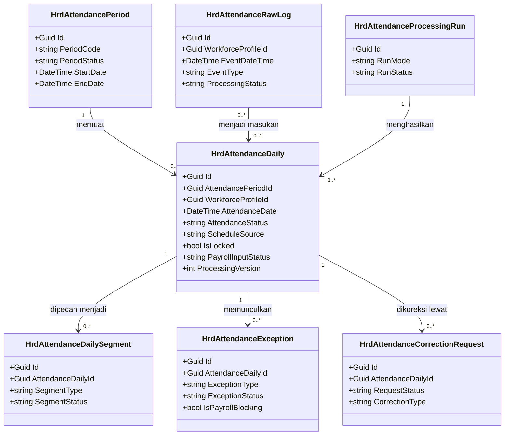

### 4.3 `BC-HR-05` — Cuti dan Saldo

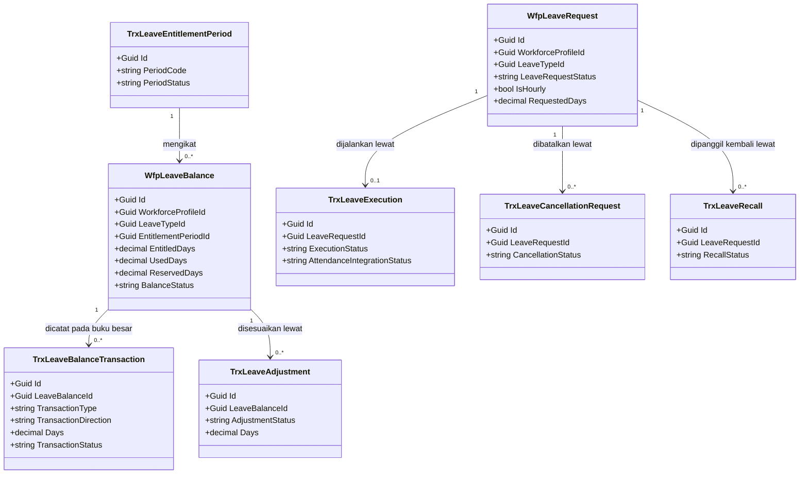

### 4.4 `BC-HR-06` — Lembur

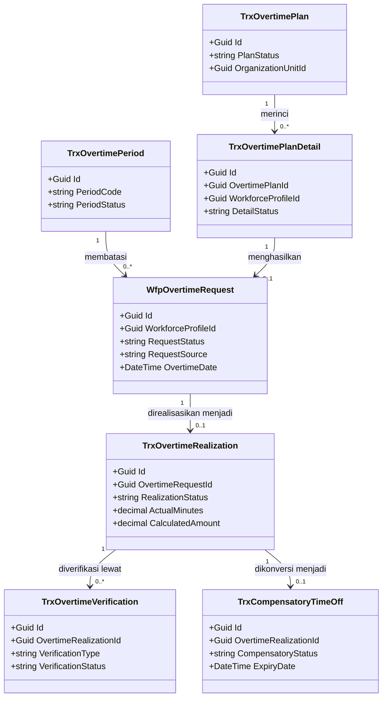

### 4.5 `BC-HR-03` — Penjadwalan Kerja

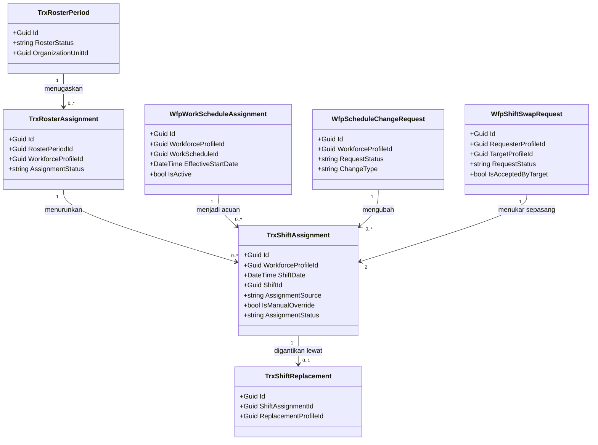

### 4.6 `BC-HR-07` — Persetujuan Bersama

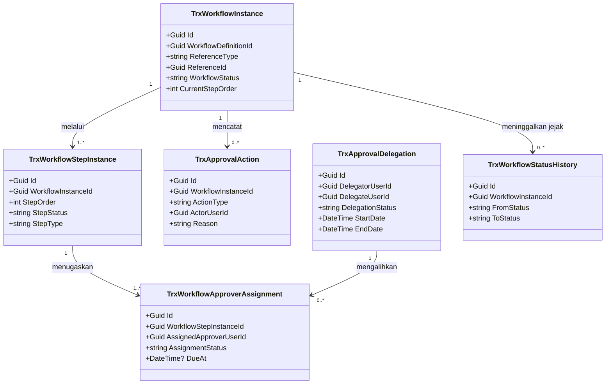

### 4.7 `BC-HR-08` dan `BC-HR-09` — Lifecycle dan Pengembangan Orang

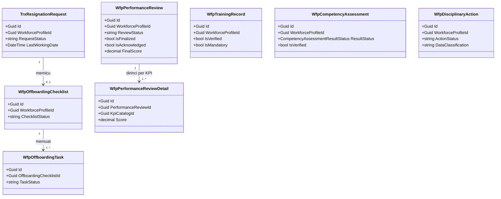

---

## 5. Penjelasan setiap class

Setiap class yang muncul pada diagram di atas dijelaskan di sini. Dua baris pertama — **Status**
dan **Lokasi file** — adalah yang paling dibutuhkan implementer dan paling sering terlupa.

Kolom **Status** memakai tiga nilai saja: `Baru`, `Diperbarui`, `Sudah ada`.

### 5.1 `MstWorkforceProfile`

| Aspek | Penjelasan |
| --- | --- |
| **Status** | `Sudah ada` (dengan penguatan invariant) |
| **Lokasi file** | `Areas/Corporate/HumanResource/MasterData/Workforce/Models/MstWorkforceProfile.cs` |
| Kategori | Master |
| Tanggung jawab utama | Menjadi identitas tunggal seseorang di mata modul HR (`HRD-DEC-046`, `HRD-DEC-051`). Baik pegawai tetap, dokter, maupun pengguna eksternal, semuanya memiliki tepat satu baris profil. Kunci identitas orang adalah nomor identitas resmi (NIK untuk WNI, nomor paspor untuk WNA). Satu profil dapat membawa multi-peran (misal: Dokter mitra sekaligus Pegawai struktural kepala instalasi). Seluruh berkas kepegawaian, penempatan, kehadiran, cuti, lembur, dan payroll menunjuk ke baris ini |
| Field penting | `WorkforceCode`, `OfficialIdNumber`, `EmployeeId`, `DoctorId`, `ExternalUserId`, `WorkforceTypeId`, `IsActive`, `PrimaryDepartmentId`, `PrimaryPositionId` |
| Navigation property dan relasi | Punya banyak `WfpOrganizationAssignment`, `WfpPositionAssignment`, `WfpManagerAssignment`, `WfpSalaryAssignment`, `HrdPersonnelActionOrder`, dan seluruh entity berkas `Wfp*` lainnya |
| Pemakaian dalam alur bisnis | Dibuat saat orang pertama kali terdaftar. Form master data Pegawai/Dokter/Pengguna Eksternal hanya mengisi penempatan awal saat pembuatan pertama (`MASTER_FORM_SETS_INITIAL_ONLY`). Sesudahnya, form master data dilarang mengubah unit atau jabatan (`NO_PLACEMENT_CHANGE_FROM_MASTER_FORM`). Kolom `PrimaryDepartmentId` dan `PrimaryPositionId` adalah cerminan sistem dari penempatan utama yang berlaku hari ini (`ASSIGNMENT_IS_SOURCE_OF_TRUTH`) |
| Catatan desain | Dilarang membuat entity profil/pegawai baru untuk keperluan kehadiran, cuti, atau lembur. Pencegahan profil yatim (`NO_ORPHAN_PROFILE`) wajib ditegakkan |
| Ekuivalen model lama | — |

### 5.2 `WfpOrganizationAssignment`

| Aspek | Penjelasan |
| --- | --- |
| **Status** | `Diperbarui` |
| **Lokasi file** | `Areas/Corporate/HumanResource/WorkforceCore/Models/WfpOrganizationAssignment.cs` |
| Kategori | Transaksi penempatan |
| Tanggung jawab utama | Menjadi satu-satunya sumber kebenaran penempatan unit organisasi pegawai per tanggal efektif (`HRD-DEC-047`). Menjaga invariant bahwa pada satu tanggal seorang pegawai aktif wajib memiliki tepat satu penempatan unit utama (`EXACTLY_ONE_PRIMARY_PER_DATE`, `NO_PRIMARY_GAP_WHILE_ACTIVE`). Penempatan rangkap/Plt diperbolehkan asal bertanda bukan-utama (`SECONDARY_ALLOWED`) |
| Field penting | `WorkforceProfileId`, `OrganizationUnitId`, `EffectiveStartDate`, `EffectiveEndDate`, `IsPrimary`, `ApprovalStatus`, `PersonnelActionOrderId`, `WorkflowInstanceId` |
| Navigation property dan relasi | Menunjuk ke `MstWorkforceProfile`, `MstOrganizationUnit`, opsional `HrdPersonnelActionOrder` dan `TrxWorkflowInstance` |
| Pemakaian dalam alur bisnis | Dihasilkan dari Dokumen Peristiwa SK (`HRD-DEC-048`), perubahan berdiri sendiri (`HRD-DEC-036`), atau Batch Data Awal (`HRD-DEC-054`). Saat penempatan utama baru berlaku, penempatan utama lama otomatis ditutup per sehari sebelum tanggal mulai baru (`NEW_PRIMARY_CLOSES_OLD`) |
| Catatan desain | Wajib memuat kolom persetujuan (`HRD-DEC-031`). Tidak boleh diedit atau dihapus secara langsung dari tabel lintas-pegawai (`HRD-DEC-055`) |

### 5.3 `WfpPositionAssignment`

| Aspek | Penjelasan |
| --- | --- |
| **Status** | `Diperbarui` |
| **Lokasi file** | `Areas/Corporate/HumanResource/WorkforceCore/Models/WfpPositionAssignment.cs` |
| Kategori | Transaksi penempatan |
| Tanggung jawab utama | Menjadi sumber kebenaran jabatan pegawai per tanggal efektif (`HRD-DEC-047`). Tepat satu jabatan utama per tanggal (`HRD-DEC-049`). Menolak catatan kembar persis pada tanggal beririsan (`NO_EXACT_DUPLICATE`) |
| Field penting | `WorkforceProfileId`, `PositionId`, `EffectiveStartDate`, `EffectiveEndDate`, `IsPrimary`, `ApprovalStatus`, `PersonnelActionOrderId`, `WorkflowInstanceId` |
| Navigation property dan relasi | Menunjuk ke `MstWorkforceProfile`, `MstPosition`, opsional `HrdPersonnelActionOrder` |
| Pemakaian dalam alur bisnis | Dihasilkan dari promosi/demosi/rotasi pada Dokumen Peristiwa SK atau perubahan jabatan tersendiri |
| Catatan desain | Berlaku surut hanya sampai periode kehadiran yang masih terbuka (`HRD-DEC-050`) |

### 5.4 `WfpManagerAssignment`

| Aspek | Penjelasan |
| --- | --- |
| **Status** | `Diperbarui` |
| **Lokasi file** | `Areas/Corporate/HumanResource/WorkforceCore/Models/WfpManagerAssignment.cs` |
| Kategori | Transaksi penempatan |
| Tanggung jawab utama | Menjadi sumber kebenaran relasi atasan langsung pegawai per tanggal efektif (`HRD-DEC-047`). Menentukan rute persetujuan bawahan (`RequesterManager`) dan hak lihat Employee 360 (`HRD-DEC-053`). Hanya atasan utama yang menerima rute persetujuan bawaan (`ONLY_PRIMARY_MANAGER_ROUTES_APPROVAL`) |
| Field penting | `WorkforceProfileId`, `ManagerWorkforceProfileId`, `EffectiveStartDate`, `EffectiveEndDate`, `IsPrimary`, `ApprovalStatus`, `PersonnelActionOrderId` |
| Navigation property dan relasi | Menunjuk ke `MstWorkforceProfile` (pegawai) dan `MstWorkforceProfile` (atasan) |
| Pemakaian dalam alur bisnis | Mengatur rantai komando operasional unit. Penugasan Plt tidak otomatis mengalihkan rute persetujuan bawaan tanpa delegasi alur resmi |

### 5.5 `WfpSalaryAssignment`

| Aspek | Penjelasan |
| --- | --- |
| **Status** | `Diperbarui` |
| **Lokasi file** | `Areas/Corporate/HumanResource/WorkforceCore/Models/WfpSalaryAssignment.cs` |
| Kategori | Transaksi remunerasi |
| Tanggung jawab utama | Menyimpan penetapan gaji pokok dan golongan/struktur gaji per tanggal efektif (`HRD-DEC-031`). Nominal gaji bersifat rahasia/sensitif (`HRD-DEC-033`, `HRD-DEC-037`) |
| Field penting | `WorkforceProfileId`, `BasicSalary` (Sensitif), `SalaryGradeId`, `SalaryStructureId`, `EffectiveStartDate`, `EffectiveEndDate`, `IsPrimary`, `ApprovalStatus`, `PersonnelActionOrderId` |
| Navigation property dan relasi | Menunjuk ke `MstWorkforceProfile`, `MstSalaryGrade`, `MstSalaryStructure` |
| Pemakaian dalam alur bisnis | Dihubungkan ke Dokumen SK bila timbul dari peristiwa kepegawaian, namun alur approval penetapannya tetap terpisah (`SALARY_STAYS_SEPARATE`) |
| Catatan kewenangan | Nominal gaji disembunyikan dari daftar lintas-pegawai dan Employee 360 atasan. Hanya pengguna dengan butir sensitif `ViewAmount` yang dapat melihatnya |

### 5.6 `HrdPersonnelActionOrder`

| Aspek | Penjelasan |
| --- | --- |
| **Status** | `Baru` |
| **Lokasi file** | `Areas/Corporate/HumanResource/WorkforceCore/Models/HrdPersonnelActionOrder.cs` |
| Kategori | Transaksi operasional (Dokumen Peristiwa / SK Kepegawaian) |
| Tanggung jawab utama | Mengelola satu peristiwa kepegawaian (Mutasi, Promosi, Rotasi, Demosi, Penugasan Sementara) sebagai satu kesatuan dokumen utuh (`HRD-DEC-048`). Memuat perubahan unit, jabatan, dan atasan dengan pasangan "dari" dan "ke". Disetujui atau ditolak secara utuh (`ALL_OR_NOTHING`). Menjaga rantai approval pola T8 (`HRD-DEC-056`) dengan syarat wajib unggah scan SK resmi bertandatangan (`SIGNED_SK_ATTACHMENT_REQUIRED`) sebelum diajukan |
| Field penting | `ActionOrderNumber`, `WorkforceProfileId`, `ActionCategory`, `EffectiveDate`, `OrderStatus`, `ReasonText`, `SignedDocumentPath`, `SignedDocumentFileName`, `TargetOrganizationUnitId`, `TargetPositionId`, `TargetManagerProfileId`, `LinkedSalaryAssignmentId`, `WorkflowInstanceId` |
| Navigation property dan relasi | Menunjuk `MstWorkforceProfile`, unit tujuan, jabatan tujuan, atasan tujuan, dan `TrxWorkflowInstance` |
| Pemakaian dalam alur bisnis | Dibuat HR Admin (`Draft`), diunggah scan SK, diajukan (`Submitted`), disetujui HR Manager (`Scheduled` atau langsung `Applied` jika retroaktif ke periode terbuka), lalu pada tanggal berlaku sistem menutup penempatan lama dan membuka penempatan baru serta mencatat satu baris riwayat kepegawaian. Pembatalan hanya diizinkan sebelum tanggal berlaku (`HRD-DEC-057`) |
| Catatan desain | Menggantikan pemisahan 5 tabel transaksi lama (`TrxEmployeeTransfer`, dll.) menjadi satu aggregate root yang padu sesuai konvensi canonical `Hrd*` (`HRD-DEC-019`) |

### 5.7 `TrxEmployeeProfileChangeRequest`

| Aspek | Penjelasan |
| --- | --- |
| **Status** | `Diperbarui` |
| **Lokasi file** | `Areas/Corporate/HumanResource/WorkforceCore/Models/TrxEmployeeProfileChangeRequest.cs` |
| Kategori | Transaksi administrasi |
| Tanggung jawab utama | Menampung permohonan perubahan data pribadi pegawai baik diajukan mandiri maupun atas nama pegawai oleh HR (`HRD-DEC-052`). Data sensitif (rekening bank, NIK, NPWP, tanggungan) dilarang diubah langsung (`SENSITIVE_NO_DIRECT_EDIT`), wajib lewat permohonan berbukti |
| Field penting | `WorkforceProfileId`, `RequestStatus`, `RequestCategory`, `IsOnBehalf`, `InitiatedByUserId`, `OnBehalfReason`, `OnBehalfNotifiedAt`, `EvidenceFilePath`, `SubmittedAt`, `AppliedAt` |
| Navigation property dan relasi | Punya banyak `TrxEmployeeProfileChangeDetail` dan `TrxEmployeeProfileChangeVerification` |
| Pemakaian dalam alur bisnis | Diajukan pegawai atau HR atas nama pegawai. Diverifikasi oleh petugas HR yang berbeda dari pembuat (`VERIFIER_MUST_DIFFER_FROM_CREATOR`). Setelah disetujui, diterapkan ke berkas profil pegawai (`Applied`) |
| Kelas QBE bila disentuh | `TOUCHED LEGACY` — prefix `Trx` diratchet bertahap per `HRD-DEC-019` saat disentuh task |

### 5.8 `HrdInitialPlacementBatch` dan `HrdInitialPlacementBatchRow`

| Aspek | Penjelasan |
| --- | --- |
| **Status** | `Baru` |
| **Lokasi file** | `Areas/Corporate/HumanResource/WorkforceCore/Models/HrdInitialPlacementBatch.cs` |
| Kategori | Batch administrasi data awal |
| Tanggung jawab utama | Menampung proses migrasi/input data awal penempatan kepegawaian bagi 55 pegawai existing yang belum memiliki jabatan, atasan, dan gaji (`HRD-DEC-054`). Batch divalidasi sistem terhadap invariant penempatan tunggal (`HRD-DEC-049`), disetujui sekali oleh HR Manager, dan setiap pegawai hanya boleh masuk batch satu kali seumur hidup (`ONCE_PER_EMPLOYEE`) |
| Field penting | `BatchNumber`, `BatchStatus`, `TotalRows`, `ValidatedRows`, `FailedRows`, `SubmittedByUserId`, `ApprovedByUserId`, `ApprovedAt` |
| Pemakaian dalam alur bisnis | HR Admin mengunduh template, mengisi data, mengunggah dan memvalidasi batch, lalu mengajukan approval. Setelah disetujui, sistem menerbitkan penempatan awal dan menandai jejak audit sebagai data awal baseline |

### 5.9 Controller dan Service Workforce Core

| Komponen | Status | Lokasi | Tanggung Jawab |
| --- | --- | --- | --- |
| `WorkforceCoreCrossEmployeeController` | `Diperbarui` | `Areas/Corporate/HumanResource/WorkforceCore/Controllers/` | Menyediakan 5 endpoint daftar pantau lintas-pegawai (organisasi, jabatan, atasan, riwayat, gaji tanpa nominal) beserta saringan dan pencarian (`HRD-DEC-012`, `HRD-DEC-055`) |
| `HrdPersonnelActionOrderController` | `Baru` | `Areas/Corporate/HumanResource/WorkforceCore/Controllers/` | Menangani siklus hidup Dokumen Peristiwa SK: pembuatan draft, unggah scan SK, pengajuan, approval/reject, pengajuan batal, dan eksekusi penempatan (`HRD-DEC-048`, `HRD-DEC-056`, `HRD-DEC-057`) |
| `Employee360Controller` | `Baru` | `Areas/Corporate/HumanResource/WorkforceCore/Controllers/` | Menyajikan profil komprehensif pegawai 360 dengan filter otorisasi ketat: tampilan lengkap untuk HR, tampilan terbatas profil kerja untuk Atasan Langsung bawahan aktif hari ini, dan penolakan 403 untuk bukan bawahan (`HRD-DEC-053`) |
| `EmployeeProfileChangeController` | `Diperbarui` | `Areas/Corporate/HumanResource/WorkforceCore/Controllers/` | Menangani transaksi permohonan perubahan data sisi HR: daftar permohonan, verifikasi, keputusan, apply, download bukti, dan endpoint pembuatan pengajuan atas nama pegawai (`HRD-DEC-052`, `HRD-DEC-093`) |
| `EmployeeProfileChangeSelfServiceController` | `Diperbarui` | `Areas/SelfServices/HumanResource/Controllers/` | Menangani portal Layanan Mandiri (ESS) untuk perubahan data profil: profil berjalan (`current-profile`), ringkasan statistik (`summary`), draf, unggah bukti pendukung (`evidence`), unduh bukti, pembatalan, dan submit ke workflow engine (`HRD-DEC-091`..`094`) |
| `InitialPlacementBatchController` | `Baru` | `Areas/Corporate/HumanResource/WorkforceCore/Controllers/` | Menangani unduh template, unggah, validasi baris, pengajuan, dan approval batch data awal penempatan (`HRD-DEC-054`) |

### 5.4 `HrdAttendanceRawLog`

| Aspek | Penjelasan |
| --- | --- |
| **Status** | `Sudah ada` |
| **Lokasi file** | `Areas/Corporate/HumanResource/AttendanceManagement/Models/HrdAttendanceRawLog.cs` |
| Kategori | Transaksi kehadiran |
| Tanggung jawab utama | Menyimpan rekaman mentah dari mesin absensi, aplikasi, atau impor. Ini adalah **fakta**, bukan hasil olahan |
| Field penting | `WorkforceProfileId`, `EventDateTime`, `EventType`, `SourceType`, `ProcessingStatus`, `DeviceId` |
| Navigation property dan relasi | Menjadi masukan bagi `HrdAttendanceDaily` |
| Pemakaian dalam alur bisnis | Masuk setiap kali pegawai menempelkan sidik jari, menekan tombol pada aplikasi, atau saat data diimpor dari mesin |
| Catatan desain | **Invariant yang paling penting di seluruh modul ini: baris di sini tidak pernah ditulis ulang oleh koreksi apa pun.** Koreksi kehadiran memutasi `HrdAttendanceDaily`, bukan rekaman mentah. Dibuktikan pada `PHASE 2A.1`. Setiap desain yang melanggar ini menghilangkan kemampuan menghitung ulang kehadiran dari nol |
| Ekuivalen model lama | `TrxAttendanceRawLog` — sudah diratchet lewat migration `20260819092733_ChangeNameTrxAttendanceToHrdAttendance` |

### 5.5 `HrdAttendanceDaily`

| Aspek | Penjelasan |
| --- | --- |
| **Status** | `Sudah ada` |
| **Lokasi file** | `Areas/Corporate/HumanResource/AttendanceManagement/Models/HrdAttendanceDaily.cs` |
| Kategori | Transaksi kehadiran |
| Tanggung jawab utama | Menyimpan hasil olahan satu hari kerja untuk satu pegawai, setelah jadwal, cuti, lembur, dan koreksi diperhitungkan. Inilah satuan yang dibaca payroll |
| Field penting | `AttendancePeriodId`, `WorkforceProfileId`, `AttendanceDate`, `AttendanceStatus`, `ScheduleSource`, `IsLate`, `LateMinutes`, `IsEarlyLeave`, `EarlyLeaveMinutes`, `IsLocked`, `PayrollInputStatus`, `ProcessingVersion` |
| Navigation property dan relasi | Milik `HrdAttendancePeriod`; punya banyak `HrdAttendanceDailySegment` dan `HrdAttendanceException` |
| Pemakaian dalam alur bisnis | Dihasilkan pemrosesan kehadiran, dilihat pegawai dan HR, dikoreksi lewat permohonan koreksi, lalu dikunci saat diserahkan ke payroll |
| Catatan desain | `ProcessingVersion` naik setiap pemrosesan ulang, sehingga selisih hasil dapat ditelusuri. `IsLocked = true` berarti hari itu sudah masuk snapshot payroll dan **tidak boleh** diubah tanpa `rollback` yang terotorisasi |
| Ekuivalen model lama | `TrxAttendanceDaily` — sudah diratchet |

### 5.6 `HrdAttendancePeriod`

| Aspek | Penjelasan |
| --- | --- |
| **Status** | `Sudah ada` |
| **Lokasi file** | `Areas/Corporate/HumanResource/AttendanceManagement/Models/HrdAttendancePeriod.cs` |
| Kategori | Transaksi kehadiran — penjaga periode |
| Tanggung jawab utama | Menjadi gerbang yang memutuskan kapan data kehadiran satu rentang tanggal boleh berubah dan kapan tidak |
| Field penting | `PeriodCode`, `PeriodStatus`, `StartDate`, `EndDate`, `ClosedAt`, `ClosedByUserId` |
| Navigation property dan relasi | Punya banyak `HrdAttendanceDaily` |
| Pemakaian dalam alur bisnis | Dibuka petugas payroll di awal periode, ditutup setelah seluruh pengecualian selesai, dibuka kembali hanya bila ada temuan |
| Catatan desain | Penutupan **ditolak** bila masih ada `HrdAttendanceException` dengan `IsPayrollBlocking` berstatus `Open`/`UnderReview`, atau masih ada permohonan koreksi aktif `[EXISTING]`. Pembukaan kembali hanya sah dari status `Closed`, dan ditolak bila ada hari yang sudah tertaut payroll `[EXISTING]` |
| Ekuivalen model lama | `TrxAttendancePeriod` — sudah diratchet |

### 5.7 `HrdAttendanceException`

| Aspek | Penjelasan |
| --- | --- |
| **Status** | **`Diperbarui`** |
| **Lokasi file** | `Areas/Corporate/HumanResource/AttendanceManagement/Models/HrdAttendanceException.cs` |
| Kategori | Transaksi kehadiran |
| Tanggung jawab utama | Menandai hal yang tidak wajar pada satu hari kerja — terlambat, pulang cepat, tidak absen masuk, tidak absen pulang, di luar area, dan seterusnya — agar petugas menanganinya sebelum periode ditutup |
| Field penting | `AttendanceDailyId`, `ExceptionType`, `ExceptionStatus`, `ExceptionSeverity`, `IsPayrollBlocking`, `ResolutionNote` |
| Navigation property dan relasi | Milik `HrdAttendanceDaily` |
| Pemakaian dalam alur bisnis | Dibuat otomatis saat pemrosesan; ditinjau HR atau atasan; ditutup lewat koreksi, pengabaian yang tercatat, atau penolakan |
| **Kolom yang berubah** | **Satu nilai baru ditambahkan pada kosakata `ExceptionType`: `OutOfScheduleWork`.** Tidak ada kolom baru pada tabel. Yang berubah adalah himpunan nilai yang sah untuk kolom `ExceptionType` yang sudah ada, ditambah kolom baru `ClassificationDecision` (`string(40)`, boleh kosong) dan `ClassifiedByUserId` (`Guid?`) serta `ClassifiedAt` (`DateTime?`) untuk menyimpan keputusan atasan atas pengecualian jenis ini |
| Catatan desain | `[DECISION]` `HRD-DEC-025`: **`ScheduleMismatch` tidak diperluas maknanya.** Ia tetap berarti *jadwal tidak dapat diselesaikan* (`SCHEDULE_UNRESOLVED`), bukan *kerja di luar jendela jadwal yang valid*. Aktivitas dokter di luar jadwal kerjanya memakai tipe **baru dan terpisah**. Nilai itu **tidak pernah** otomatis menjadi lembur — atasan yang memutuskan klasifikasinya, sejalan `HRD-DEC-013` |
| Ekuivalen model lama | `TrxAttendanceException` — sudah diratchet |

### 5.8 `HrdAttendanceCorrectionRequest`

| Aspek | Penjelasan |
| --- | --- |
| **Status** | **`Diperbarui`** |
| **Lokasi file** | `Areas/Corporate/HumanResource/AttendanceManagement/Models/HrdAttendanceCorrectionRequest.cs` |
| Kategori | Transaksi kehadiran |
| Tanggung jawab utama | Menampung permohonan pegawai untuk memperbaiki hasil olahan kehadirannya, beserta alasan dan buktinya |
| Field penting | `AttendanceDailyId`, `RequestStatus`, `CorrectionType`, `Reason`, `EvidenceFilePath`, `WorkflowInstanceId` |
| Navigation property dan relasi | Milik `HrdAttendanceDaily`; punya banyak `HrdAttendanceCorrectionDetail` dan `HrdAttendanceCorrectionApproval` |
| **Kolom yang berubah** | Empat kolom baru untuk mendukung permohonan atas nama pegawai (`HRD-DEC-028`): `InitiatedByUserId` (`Guid?`), `IsOnBehalf` (`bool`, bawaan `false`), `OnBehalfReason` (`string(500)`, boleh kosong), `OnBehalfNotifiedAt` (`DateTime?`) |
| Catatan desain | `[DECISION]` `HRD-DEC-022`: `Applied` adalah **terminal terhadap sinkronisasi workflow normal**. Endpoint `synchronize` **MUST NOT** menurunkan `Applied` kembali ke `Approved`. Keadaan hari ini melanggar ini dan tercatat sebagai `IMPLEMENTATION DEFECT / REPAIR`, bukan perilaku target. `[DECISION]` `HRD-DEC-028`: HR Admin boleh membuat permohonan atas nama pegawai bila pegawai tidak dapat mengakses layanan mandiri, dengan initiator, alasan, waktu, bukti bila perlu, notifikasi ke pegawai, dan jejak audit **wajib** |
| Ekuivalen model lama | `TrxAttendanceCorrectionRequest` — sudah diratchet |

### 5.9 `WfpLeaveBalance`

| Aspek | Penjelasan |
| --- | --- |
| **Status** | `Sudah ada` |
| **Lokasi file** | `Areas/Corporate/HumanResource/LeaveManagement/Models/WfpLeaveBalance.cs` |
| Kategori | Transaksi cuti — buku besar |
| Tanggung jawab utama | Menyimpan saldo cuti seorang pegawai untuk satu jenis cuti pada satu periode hak. Nilainya **selalu** merupakan hasil penjumlahan seluruh baris buku besar yang menunjuk ke sini |
| Field penting | `WorkforceProfileId`, `LeaveTypeId`, `EntitlementPeriodId`, `EntitledDays`, `UsedDays`, `ReservedDays`, `CarriedForwardDays`, `BalanceStatus` |
| Navigation property dan relasi | Punya banyak `TrxLeaveBalanceTransaction` dan `TrxLeaveAdjustment` |
| Pemakaian dalam alur bisnis | Dibaca saat pegawai mengajukan cuti; dipotong saat cuti mulai berjalan; dikembalikan saat cuti dibatalkan |
| Catatan desain | Satuan yang tersimpan adalah **pecahan hari**, bukan jam maupun menit. Cuti per jam dikonversi satu kali di titik kalkulasi. Saldo **MUST NOT** diubah tanpa satu baris `TrxLeaveBalanceTransaction` pasangannya di dalam transaksi yang sama |
| Ekuivalen model lama | — |

### 5.10 `WfpLeaveRequest`

| Aspek | Penjelasan |
| --- | --- |
| **Status** | `Sudah ada` |
| **Lokasi file** | `Areas/Corporate/HumanResource/LeaveManagement/Models/WfpLeaveRequest.cs` |
| Kategori | Transaksi cuti |
| Tanggung jawab utama | Menampung permohonan cuti seorang pegawai dari pengajuan sampai selesai dijalankan |
| Field penting | `WorkforceProfileId`, `LeaveTypeId`, `LeaveRequestStatus`, `StartDate`, `EndDate`, `IsHourly`, `IsHalfDay`, `RequestedMinutes`, `RequestedDays`, `CurrentApprovalStep`, `WorkflowInstanceId` |
| Navigation property dan relasi | Punya satu `TrxLeaveExecution`, banyak `TrxLeaveRequestAttachment`, `TrxLeaveCancellationRequest`, `TrxLeaveRecall` |
| Pemakaian dalam alur bisnis | Diajukan pegawai, disetujui atasan lewat mesin workflow, dijalankan sistem pada tanggal mulai, diselesaikan pada tanggal akhir |
| Catatan desain | Status domain adalah **`WaitingApproval` tunggal** sepanjang tingkatan persetujuan apa pun. Rantai bertingkat hidup di lapisan `MstWorkflowStep.StepOrder`, **bukan** sebagai status bernama. Komentar granular pada baris 89–92 model ini adalah **template yang disalin**, bukan desain — komentar identik ada pada `TrxExpenseClaim.cs`, entity yang tidak berhubungan. `HRD-Q-44` tertutup |
| Ekuivalen model lama | — |

### 5.11 `TrxLeaveBalanceTransaction`

| Aspek | Penjelasan |
| --- | --- |
| **Status** | `Sudah ada` |
| **Lokasi file** | `Areas/Corporate/HumanResource/LeaveManagement/Models/TrxLeaveBalanceTransaction.cs` |
| Kategori | Transaksi cuti — baris buku besar |
| Tanggung jawab utama | Mencatat setiap pergerakan saldo cuti sebagai satu baris yang tidak dapat diubah, sehingga selisih saldo selalu punya penjelasan |
| Field penting | `LeaveBalanceId`, `TransactionType`, `TransactionDirection`, `Days`, `TransactionStatus`, `ReferenceType`, `ReferenceId` |
| Navigation property dan relasi | Milik `WfpLeaveBalance` |
| Pemakaian dalam alur bisnis | Ditulis setiap kali saldo bertambah atau berkurang: pemberian hak, akrual bulanan, sisa yang dibawa ke periode berikutnya, reservasi, potongan, pengembalian karena pembatalan, penyesuaian manual, kedaluwarsa |
| Catatan desain | Baris yang sudah `Posted` **MUST NOT** diubah. Koreksi dilakukan dengan menulis baris pembalik bertipe `Reversal`, bukan dengan menyunting baris lama. Ini yang membuat buku besar dapat diaudit |
| Ekuivalen model lama | — |
| Kelas QBE bila disentuh | `TOUCHED LEGACY` |

### 5.12 `TrxLeaveExecution`

| Aspek | Penjelasan |
| --- | --- |
| **Status** | **`Diperbarui`** |
| **Lokasi file** | `Areas/Corporate/HumanResource/LeaveManagement/Models/TrxLeaveExecution.cs` |
| Kategori | Transaksi cuti |
| Tanggung jawab utama | Menjalankan cuti yang sudah disetujui: memotong saldo pada tanggal mulai, menandai hari-hari kehadiran sebagai cuti, dan menyelesaikannya pada tanggal akhir |
| Field penting | `LeaveRequestId`, `ExecutionStatus`, `AttendanceIntegrationStatus`, `ExecutedAt`, `CompletedAt` |
| Navigation property dan relasi | Milik `WfpLeaveRequest`; menulis `TrxLeaveAttendanceIntegration` dan `TrxLeaveBalanceTransaction` |
| **Kolom yang berubah** | Empat kolom baru untuk memenuhi `HRD-DEC-023`: `ReversalReason` (`string(500)`, boleh kosong), `ReversedByUserId` (`Guid?`), `ReversedAt` (`DateTime?`), `PayrollLockCheckedAt` (`DateTime?`) |
| Catatan desain | `[DECISION]` `HRD-DEC-023`: cuti `Completed` adalah **business-final untuk operasi normal**, tetapi pembalikan terkendali tetap sah. `Reverse` **wajib** punya permission khusus, alasan wajib, pelaku dan waktu, rekonsiliasi kehadiran, pembalikan saldo, dan guard periode payroll terkunci. **Bila payroll sudah terkunci, histori `Completed` MUST NOT dimutasi langsung** — pakai transaksi penyesuaian terpisah. Keadaan hari ini melanggar keenam syarat itu dan tercatat sebagai `IMPLEMENTATION DEFECT / REPAIR` |
| Ekuivalen model lama | — |
| Kelas QBE bila disentuh | `TOUCHED LEGACY` — menambah kolom adalah *material touch*, sehingga ratchet menjadi `HrdLeaveExecution` berlaku pada task yang sama |

### 5.13 `TrxLeaveRecall`

| Aspek | Penjelasan |
| --- | --- |
| **Status** | **`Diperbarui`** |
| **Lokasi file** | `Areas/Corporate/HumanResource/LeaveManagement/Models/TrxLeaveRecall.cs` |
| Kategori | Transaksi cuti |
| Tanggung jawab utama | Menampung pemanggilan kembali pegawai yang sedang cuti karena kebutuhan pelayanan |
| Field penting | `LeaveRequestId`, `RecallStatus`, `RecallDate`, `ReturnDate`, `Reason` |
| Navigation property dan relasi | Milik `WfpLeaveRequest` |
| **Kolom yang berubah** | Tiga kolom baru untuk `HRD-DEC-024`: `AcknowledgementOverrideReason` (`string(500)`, boleh kosong), `AcknowledgementOverrideByUserId` (`Guid?`), `AcknowledgementOverrideAt` (`DateTime?`) |
| Catatan desain | `[DECISION]` `HRD-DEC-024`: `Acknowledged` **bukan** prasyarat sebelum `Approved`. Urutan target: `WaitingApproval` → `Approved` → notifikasi dikirim → `Acknowledged` → `Applied`. HR Manager boleh melakukan *override* acknowledgement sebelum `Applied` dengan alasan, pelaku, waktu, dan jejak audit wajib. **Pegawai MUST NOT dapat memblokir keputusan organisasi selamanya hanya dengan tidak melakukan acknowledge** |
| Ekuivalen model lama | — |

### 5.14 `WfpOvertimeRequest`

| Aspek | Penjelasan |
| --- | --- |
| **Status** | `Sudah ada` |
| **Lokasi file** | `Areas/Corporate/HumanResource/OvertimeManagement/Models/WfpOvertimeRequest.cs` |
| Kategori | Transaksi lembur |
| Tanggung jawab utama | Menampung permohonan lembur dari pengajuan sampai penyerahan ke payroll |
| Field penting | `WorkforceProfileId`, `RequestStatus`, `RequestSource`, `OvertimeDate`, `PlannedStartAt`, `PlannedEndAt`, `OvertimeCategory`, `WorkflowInstanceId` |
| Navigation property dan relasi | Punya satu `TrxOvertimeRealization`; boleh berasal dari `TrxOvertimePlanDetail` |
| Pemakaian dalam alur bisnis | Diajukan pegawai atau diturunkan dari rencana atasan; disetujui; dikerjakan; direalisasikan; diverifikasi; diserahkan |
| Catatan desain | Lembur berjalan **lima tahap terpisah** — rencana, permohonan, realisasi, verifikasi, serah terima — dan kelimanya **MUST NOT** disatukan. Permohonan yang rentang waktunya bertumpuk ditolak dengan kode `REQUEST_OVERLAP` `[EXISTING]` |
| Ekuivalen model lama | — |

### 5.15 `TrxOvertimeRealization`

| Aspek | Penjelasan |
| --- | --- |
| **Status** | `Sudah ada` |
| **Lokasi file** | `Areas/Corporate/HumanResource/OvertimeManagement/Models/TrxOvertimeRealization.cs` |
| Kategori | Transaksi lembur |
| Tanggung jawab utama | Menyimpan lembur yang **benar-benar dikerjakan**, dihitung dari kehadiran nyata, bukan dari rencana |
| Field penting | `OvertimeRequestId`, `RealizationStatus`, `ActualStartAt`, `ActualEndAt`, `ActualMinutes`, `CalculatedAmount`, `AttendanceMatchStatus` |
| Navigation property dan relasi | Milik `WfpOvertimeRequest`; punya banyak `TrxOvertimeVerification` dan `TrxOvertimeRealizationDetail` |
| Pemakaian dalam alur bisnis | Dihitung setelah lembur selesai dikerjakan, dicocokkan dengan kehadiran, lalu diverifikasi berjenjang |
| Catatan desain | Nominal **selalu** berasal dari backend lewat `OvertimeRateResolverService`; frontend **MUST NOT** menghitung tarif. Penyerahan ke payroll diblokir kecuali `RealizationStatus == Verified` **dan** verifikasi aktif terbaru berstatus `Approved` `[EXISTING]` |
| Ekuivalen model lama | — |
| Kelas QBE bila disentuh | `TOUCHED LEGACY` |

### 5.16 `TrxShiftAssignment`

| Aspek | Penjelasan |
| --- | --- |
| **Status** | **`Diperbarui`** |
| **Lokasi file** | `Areas/Corporate/HumanResource/SchedulingManagement/Models/TrxShiftAssignment.cs` |
| Kategori | Transaksi penjadwalan |
| Tanggung jawab utama | Menyimpan shift yang ditugaskan kepada seorang pegawai pada satu tanggal. Inilah yang dibaca pemroses kehadiran untuk mengetahui jadwal hari itu |
| Field penting | `WorkforceProfileId`, `ShiftDate`, `ShiftId`, `WorkScheduleId`, `ScheduledStartAt`, `ScheduledEndAt`, `PlannedWorkMinutes`, `AssignmentSource`, `IsManualOverride`, `AssignmentStatus`, `IsActive` |
| Navigation property dan relasi | Boleh berasal dari `TrxRosterAssignment`; boleh diubah `WfpScheduleChangeRequest` dan `WfpShiftSwapRequest`; boleh digantikan `TrxShiftReplacement` |
| Pemakaian dalam alur bisnis | Ditulis saat roster diterbitkan atau saat tukar shift diterapkan; dibaca `AttendanceScheduleResolverService` setiap kali kehadiran diproses |
| **Kolom yang berubah** | Tidak ada kolom baru. Yang berubah adalah **statusnya sebagai entity yang memiliki API**: hari ini ia ditulis langsung dari lapisan service tanpa controller. Target `EXTEND` memberinya controller sendiri. Bila `EXTEND` ternyata menuntut kolom, kolom itu **wajib** disebutkan pada revisi dokumen ini lebih dulu, bukan ditambahkan saat implementasi |
| Catatan desain | Tukar shift yang `Applied` **benar-benar** menukar `ShiftDate`, `ShiftId`, `WorkScheduleId`, `ScheduledStartAt/EndAt`, dan `PlannedWorkMinutes` kedua baris, lalu menandai keduanya `AssignmentSource = "ShiftSwap"` dan `IsManualOverride = true` — dan pemroses kehadiran memungutnya `[EXISTING]`, dibuktikan `PHASE 2B.1`. Jangan merancang jalur kedua yang menduplikasi ini |
| Ekuivalen model lama | — |
| Kelas QBE bila disentuh | `TOUCHED LEGACY` — bila `EXTEND` menyentuh entity atau konfigurasi EF-nya, ratchet menjadi `HrdShiftAssignment` berlaku pada task yang sama |

### 5.17 `TrxRosterPeriod`

| Aspek | Penjelasan |
| --- | --- |
| **Status** | `Sudah ada` — **tanpa perilaku** |
| **Lokasi file** | `Areas/Corporate/HumanResource/SchedulingManagement/Models/TrxRosterPeriod.cs` |
| Kategori | Transaksi penjadwalan |
| Tanggung jawab utama | Menjadi wadah satu putaran penyusunan jadwal untuk satu unit pada satu rentang tanggal |
| Field penting | `OrganizationUnitId`, `RosterStatus`, `StartDate`, `EndDate`, `PublishedAt` |
| Navigation property dan relasi | Punya banyak `TrxRosterAssignment`, `TrxRosterPublication`, `TrxRosterApproval` |
| Pemakaian dalam alur bisnis | **Belum dipakai sama sekali.** Kosakata statusnya ada di model (`Draft`, `Validation`, `Submitted`, `Approved`, `Published`, `Locked`, `Closed`, `Cancelled`) tetapi **tidak ada satu pun controller atau service yang mengoperasikannya** `[EXISTING]` |
| Catatan desain | `[DECISION]` `HRD-DEC-026`: untuk rumah sakit 24 jam, roster adalah bagian target, **bukan** `DEFERRED`. Klasifikasi target adalah **`EXTEND` terhadap skema yang sudah ada** — model, konfigurasi EF, dan tabelnya sudah dibuat. **Larangan:** jangan membuat skema baru sebelum model existing diaudit, dan `HRD-Q-05` wajib terjawab lebih dulu bila perubahan destruktif ternyata diperlukan |
| Ekuivalen model lama | — |

### 5.18 `TrxWorkflowInstance`

| Aspek | Penjelasan |
| --- | --- |
| **Status** | **`Diperbarui`** |
| **Lokasi file** | `Areas/Corporate/HumanResource/WorkflowManagement/Models/TrxWorkflowInstance.cs` |
| Kategori | Transaksi persetujuan |
| Tanggung jawab utama | Menjadi mesin persetujuan bersama untuk seluruh jenis transaksi HR: cuti, lembur, koreksi kehadiran, tukar shift, ubah jadwal, perubahan data, pengunduran diri |
| Field penting | `WorkflowDefinitionId`, `ReferenceType`, `ReferenceId`, `WorkflowStatus`, `CurrentStepOrder`, `SubmittedAt`, `CompletedAt` |
| Navigation property dan relasi | Punya banyak `TrxWorkflowStepInstance`, `TrxApprovalAction`, `TrxWorkflowStatusHistory`, `TrxWorkflowComment`, `TrxWorkflowAttachment` |
| Pemakaian dalam alur bisnis | Dibuat saat transaksi diajukan; dimajukan setiap kali penyetuju memutuskan; ditutup saat seluruh langkah selesai |
| **Kolom yang berubah** | Tidak ada kolom baru pada entity ini. Perubahan `EXTEND` untuk `HRD-DEC-030` berada pada `TrxWorkflowApproverAssignment` — lihat 5.19 |
| Catatan desain | `[DECISION]` `HRD-DEC-018`: kotak masuk terpadu **hanya menyatukan pengalaman pengguna**. Workflow, policy, permission, validasi, SLA, dan eskalasi tetap **per jenis transaksi**. Instance ini **MUST NOT** memuat aturan bisnis domain mana pun. Yang boleh diseragamkan hanya bentuk baris ringkasan, cara memfilter, penanda status, dan cara berpindah ke detail |
| Ekuivalen model lama | — |
| Kelas QBE bila disentuh | `TOUCHED LEGACY` |

### 5.19 `TrxWorkflowApproverAssignment`

| Aspek | Penjelasan |
| --- | --- |
| **Status** | **`Diperbarui`** |
| **Lokasi file** | `Areas/Corporate/HumanResource/WorkflowManagement/Models/TrxWorkflowApproverAssignment.cs` |
| Kategori | Transaksi persetujuan |
| Tanggung jawab utama | Menugaskan satu langkah persetujuan kepada satu orang tertentu. Inilah baris yang muncul di kotak masuk seseorang |
| Field penting | `WorkflowStepInstanceId`, `AssignedApproverUserId`, `AssignmentStatus`, `DueAt`, `DecidedAt`, `DelegatedFromUserId` |
| Navigation property dan relasi | Milik `TrxWorkflowStepInstance`; boleh dialihkan `TrxApprovalDelegation` |
| Pemakaian dalam alur bisnis | Dibuat saat langkah menjadi aktif; diputuskan penyetuju; dialihkan bila ada delegasi aktif |
| **Kolom yang berubah** | Empat kolom baru untuk mesin pengingat dan eskalasi (`HRD-DEC-030`): `LastReminderSentAt` (`DateTime?`), `ReminderCount` (`int`, bawaan `0`), `EscalatedAt` (`DateTime?`), `EscalatedToUserId` (`Guid?`) |
| Catatan desain | Gate kewenangan yang **benar-benar berlaku** adalah `assignment.AssignedApproverUserId == actorContext.UserId`, bukan pemeriksaan peran `[EXISTING]`. `[DECISION]` `HRD-DEC-030`: `DueAt`, `ReminderAfterHours`, dan `EscalationAfterHours` **harus benar-benar dieksekusi** oleh pemrosesan terjadwal. `AutoApproveAfterHours` dan `AutoRejectAfterHours` **default mati**, hanya aktif bila definisi workflow transaksi itu secara eksplisit mengizinkan — **dilarang** diberlakukan otomatis ke seluruh transaksi HR |
| Ekuivalen model lama | — |
| Kelas QBE bila disentuh | `TOUCHED LEGACY` — menambah kolom adalah *material touch* |

### 5.20 `WfpPerformanceReview`

| Aspek | Penjelasan |
| --- | --- |
| **Status** | `Sudah ada` |
| **Lokasi file** | `Areas/Corporate/HumanResource/PerformanceManagement/Models/WfpPerformanceReview.cs` |
| Kategori | Transaksi pengembangan orang |
| Tanggung jawab utama | Menyimpan satu penilaian kinerja seorang pegawai untuk satu periode |
| Field penting | `WorkforceProfileId`, `PerformanceCycleId`, `ReviewStatus`, `IsFinalized`, `IsAcknowledged`, `FinalScore`, `OverallScore` |
| Navigation property dan relasi | Punya banyak `WfpPerformanceReviewDetail` |
| Pemakaian dalam alur bisnis | Dibuat saat siklus penilaian berjalan, diisi atasan per KPI, difinalkan, lalu diakui pegawai |
| Catatan desain | `Finalize` **mensyaratkan seluruh detail sudah berskor**, dan `Acknowledge` **mensyaratkan `IsFinalized`** — keduanya benar-benar dijaga kode `[EXISTING]`. Setelah `IsFinalized`, `Update`, `Status`, dan `Delete` ditolak, termasuk pada detailnya. Ini pola yang benar dan **layak ditiru** domain lain |
| Ekuivalen model lama | — |

### 5.21 `WfpDisciplinaryAction`

| Aspek | Penjelasan |
| --- | --- |
| **Status** | `Sudah ada` |
| **Lokasi file** | `Areas/Corporate/HumanResource/EmployeeRelationManagement/Models/WfpDisciplinaryAction.cs` |
| Kategori | Transaksi hubungan karyawan |
| Tanggung jawab utama | Menyimpan tindakan disiplin terhadap seorang pegawai beserta klasifikasi kerahasiaannya |
| Field penting | `WorkforceProfileId`, `ActionStatus`, `DataClassification`, `ViolationTypeId`, `SanctionTypeId`, `EffectiveDate` |
| Navigation property dan relasi | Menunjuk `MstViolationType`, `MstSanctionType`, `MstDisciplinaryActionType` |
| Pemakaian dalam alur bisnis | Dibuat HR, diproses sampai berlaku, diakui pegawai, boleh diajukan banding |
| Catatan desain | **Dua temuan yang tidak boleh disembunyikan.** Pertama, transisinya **lemah**: kode hanya memeriksa keanggotaan himpunan nilai, bukan urutan yang sah — status apa pun dapat berpindah ke status lain. Kedua, **swa-setuju mungkin terjadi**: pembuat tindakan dapat menyetujui tindakannya sendiri. Keduanya dicatat sebagai `[OPEN]` — `HRD-Q-51` dan `HRD-Q-52`, **bukan** diperbaiki diam-diam di dokumen ini. Nilai `DataClassification` `HighlyRestricted` ada, tetapi **tidak ada tingkatan izin khusus** yang menjaganya |
| Ekuivalen model lama | — |

### 5.22 `TrxResignationRequest`

| Aspek | Penjelasan |
| --- | --- |
| **Status** | `Sudah ada` |
| **Lokasi file** | `Areas/Corporate/HumanResource/LifecycleManagement/Models/TrxResignationRequest.cs` |
| Kategori | Transaksi lifecycle |
| Tanggung jawab utama | Menampung pengunduran diri pegawai dari pengajuan sampai serah terima selesai |
| Field penting | `WorkforceProfileId`, `RequestStatus`, `ResignationDate`, `LastWorkingDate`, `Reason`, `WorkflowInstanceId` |
| Navigation property dan relasi | Memicu `WfpOffboardingChecklist` |
| Pemakaian dalam alur bisnis | Satu-satunya alur lifecycle yang benar-benar matang hari ini: 1 dari 21 model yang operasional |
| Catatan desain | Serah terima **idempoten**, dijaga `RequestStatus == Approved` `[EXISTING]`. **Pencabutan akun aplikasi tidak otomatis** — source sendiri memuat peringatan eksplisit soal ini. Kontrak ke Identity `[OPEN]` — `HRD-DEP-003`. Tanggal terakhir bekerja **belum terhubung** ke kehadiran maupun payroll `[OPEN]` — `HRD-Q-50` |
| Ekuivalen model lama | — |
| Kelas QBE bila disentuh | `TOUCHED LEGACY` |

### 5.23 `TrxPayrollRun`

| Aspek | Penjelasan |
| --- | --- |
| **Status** | `Sudah ada` — **tanpa controller sama sekali** |
| **Lokasi file** | `Areas/Corporate/HumanResource/PayrollManagement/Models/TrxPayrollRun.cs` |
| Kategori | Transaksi payroll |
| Tanggung jawab utama | Menjadi wadah satu putaran penggajian untuk satu periode |
| Field penting | `PayrollPeriodId`, `RunStatus`, `IsLocked`, `CalculatedAt`, `SubmittedAt`, `ApprovedAt`, `PostedAt`, `ClosedAt` |
| Navigation property dan relasi | Punya banyak `TrxPayrollRunEmployee`, `TrxPayrollAttendanceInput`, `TrxPayrollOvertimeInput`, `TrxPayrollVariableInput`, `TrxPayrollApproval` |
| Pemakaian dalam alur bisnis | Dibaca ketiga jalur serah terima domain untuk **menolak** penulisan snapshot bila statusnya sudah terminal. Selain itu **tidak ada kode yang memajukan statusnya** `[EXISTING]` |
| Catatan desain | **`Payroll Executed` bukan `Employee Paid`.** Yang sudah berjalan hanyalah pengumpulan snapshot masukan dari tiga domain. Kalkulasi lintas domain menjadi angka gaji: `MISSING`. Persetujuan tingkat run: `MISSING`. Cara run benar-benar dimulai: `[OPEN]` — `HRD-Q-49`. **Bentuk serah terima ke Finance MUST NOT dirancang** sebelum `HRD-Q-10` dan `HRD-Q-11` dijawab |
| Ekuivalen model lama | — |

### 5.24 Service yang menjadi tulang punggung modul

Class diagram di atas menampilkan model. Bagian ini menjelaskan **service**, karena di sinilah
aturan bisnis sebenarnya tinggal. Aturan project: service tidak memakai interface, didaftarkan
`AddScoped<TService>()`, dan di-inject langsung ke constructor controller.

| Service | Status | Lokasi file | Fungsi utama | Dipanggil siapa | Membuka transaksi database |
| --- | --- | --- | --- | --- | :---: |
| `AttendanceProcessingService` | `Sudah ada` | `Areas/Corporate/HumanResource/AttendanceManagement/Services/AttendanceProcessingService.cs` | Mengolah rekaman mentah menjadi kehadiran harian, memanggil resolver jadwal, membangun segmen dan pengecualian | `AttendanceProcessingController`, `AttendanceSchedulerHostedService` | Ya — satu transaksi per pegawai per hari |
| `AttendanceScheduleResolverService` | `Sudah ada` | `.../AttendanceManagement/Services/AttendanceScheduleResolverService.cs` | Menentukan jadwal yang berlaku pada satu tanggal: roster, jadwal tetap, atau hasil tukar shift | `AttendanceProcessingService`, `AttendanceScheduleResolverController` | Tidak — hanya membaca |
| `AttendancePeriodService` | `Sudah ada` | `.../AttendanceManagement/Services/AttendancePeriodService.cs` | Membuka, menutup, membuka kembali, dan membatalkan periode; menegakkan guard penghalang penutupan | `AttendancePeriodController` | Ya |
| `AttendanceCorrectionService` | **`Diperbarui`** | `.../AttendanceManagement/Services/AttendanceCorrectionService.cs` | Mengelola permohonan koreksi beserta bukti; menerapkan koreksi yang disetujui | `AttendanceCorrectionController`, `AttendanceCorrectionSelfServiceController` | Ya |
| `AttendancePayrollHandoffService` | `Sudah ada` | `.../AttendanceManagement/Services/AttendancePayrollHandoffService.cs` | Menyiapkan, menjalankan, memperbaiki, dan membatalkan serah terima kehadiran ke payroll | `AttendancePayrollHandoffController` | Ya |
| `LeaveRequestService` | `Sudah ada` | `.../LeaveManagement/Services/LeaveRequestService.cs` | Membuat, mengubah, mengajukan, dan membatalkan permohonan cuti | `LeaveRequestController` (layanan mandiri) | Ya |
| `LeaveRequestCalculationService` | `Sudah ada` | `.../LeaveManagement/Services/LeaveRequestCalculationService.cs` | Menghitung jumlah hari yang dipotong, termasuk cuti per jam | `LeaveRequestService` | Tidak |
| `LeaveExecutionProcessorService` | **`Diperbarui`** | `.../LeaveManagement/Services/LeaveExecutionProcessorService.cs` | Menjalankan cuti pada tanggal mulai, menyelesaikannya pada tanggal akhir, dan membalikkannya bila perlu | `LeaveExecutionController`, `LeaveExecutionSchedulerHostedService` | Ya |
| `LeaveExecutionBalanceService` | `Sudah ada` | `.../LeaveManagement/Services/LeaveExecutionBalanceService.cs` | Satu-satunya tempat saldo cuti berubah karena eksekusi | `LeaveExecutionProcessorService` | Ikut transaksi pemanggil |
| `WorkflowService` | **`Diperbarui`** | `.../WorkflowManagement/Services/WorkflowService.cs` | Membuat instance, menentukan penyetuju, memajukan langkah, mencatat aksi | Seluruh service domain yang butuh persetujuan | Ya |
| `ApprovalInboxService` | `Sudah ada` | `.../WorkflowManagement/Services/ApprovalInboxService.cs` | Menjawab "apa yang menunggu persetujuan saya", lintas jenis transaksi | `ApprovalInboxController` | Tidak untuk baca; ya untuk keputusan |
| `ApprovalDelegationService` | `Sudah ada` | `.../WorkflowManagement/Services/ApprovalDelegationService.cs` | Mengelola delegasi persetujuan dan memindahkan tugas terbuka | `ApprovalDelegationController` | Ya |
| `ShiftSwapService` | `Sudah ada` | `.../SchedulingManagement/Services/ShiftSwapService.cs` | Mengelola tukar shift dua tahap dan menukar dua baris penugasan shift | `ShiftSwapController`, `ShiftSwapSelfServiceController` | Ya |
| `ScheduleChangeService` | `Sudah ada` | `.../SchedulingManagement/Services/ScheduleChangeService.cs` | Mengelola permohonan ubah jadwal dan menerapkannya | `ScheduleChangeController`, `ScheduleChangeSelfServiceController` | Ya |
| `ResignationRequestService` | `Sudah ada` | `.../LifecycleManagement/Services/ResignationRequestService.cs` | Mengelola pengunduran diri dari draft sampai serah terima | `ResignationController`, `ResignationSelfServiceController` | Ya |
| `EmployeeProfileChangeService` | `Sudah ada` | `.../WorkforceCore/Services/EmployeeProfileChangeService.cs` | Mengelola permohonan perubahan data pribadi beserta verifikasinya | `EmployeeProfileChangeController` dan versi layanan mandirinya | Ya |
| `OvertimePayrollHandoffService` | `Sudah ada` | `.../OvertimeManagement/Services/OvertimePayrollHandoffService.cs` | Menyerahkan realisasi lembur yang terverifikasi ke payroll | `OvertimePayrollHandoffController` | Ya |
| `HumanResourceContextService` | `Sudah ada` | `Shared/HumanResource/Services/HumanResourceContextService.cs` | Menurunkan identitas pegawai, unit, dan atasan dari pengguna yang sedang login | Seluruh controller layanan mandiri | Tidak |
| `WorkflowReminderEscalationService` | **`Baru`** | `.../WorkflowManagement/Services/WorkflowReminderEscalationService.cs` | Membaca `DueAt`, `ReminderAfterHours`, dan `EscalationAfterHours`, lalu benar-benar mengirim pengingat dan menaikkan eskalasi | `WorkflowReminderEscalationHostedService` | Ya |
| `WorkflowReminderEscalationHostedService` | **`Baru`** | `.../WorkflowManagement/Services/WorkflowReminderEscalationHostedService.cs` | Pemrosesan terjadwal yang memanggil service di atas pada interval yang dikonfigurasi | Runtime aplikasi | Tidak langsung |
| `AttendanceCorrectionOnBehalfService` | **`Baru`** | `.../AttendanceManagement/Services/AttendanceCorrectionOnBehalfService.cs` | Membuat permohonan koreksi atas nama pegawai lain oleh HR Admin, menyimpan initiator, alasan, waktu, dan memicu notifikasi | `AttendanceCorrectionController` | Ya |
| `WorkScheduleRetroactiveGuardService` | **`Baru`** | `.../SchedulingManagement/Services/WorkScheduleRetroactiveGuardService.cs` | Mendeteksi apakah perubahan jadwal bersifat berlaku surut atau menyentuh periode terkunci, lalu mengarahkannya ke jalur koreksi terkendali | `WfpWorkScheduleAssignmentController`, `ScheduleChangeService` | Tidak |

**Mengapa keempat service baru itu bukan karangan.** `WorkflowReminderEscalationService` dan
pasangan hosted service-nya lahir langsung dari `HRD-DEC-030`, yang mewajibkan field SLA
benar-benar dieksekusi. `AttendanceCorrectionOnBehalfService` lahir dari `HRD-DEC-028`.
`WorkScheduleRetroactiveGuardService` lahir dari `HRD-DEC-027` bagian kedua. Tidak satu pun
diturunkan dari nama layar, menu, atau task.

### 5.25 Controller yang menjadi permukaan modul

Tabel ini tidak mengulang seluruh 150 controller. Ia mencatat controller yang **berubah** atau
**baru**, karena itulah yang perlu direncanakan. Daftar lengkap permukaan API yang sudah ada
tinggal di [`contracts/api-contract.md`](./contracts/api-contract.md).

| Controller | Status | Lokasi file | Service yang dipakai | Atribut akses | Endpoint yang diurus |
| --- | --- | --- | --- | --- | --- |
| `AttendanceCorrectionController` | **`Diperbarui`** | `Areas/Corporate/HumanResource/AttendanceManagement/Controllers/AttendanceCorrectionController.cs` | `AttendanceCorrectionService`, `AttendanceCorrectionOnBehalfService` | `[Authorize]`, `[AccessController]`, `[AccessAction]`, `[AccessPermission("AttendanceCorrection", "...")]` | Menambah `POST /on-behalf`; memperketat `POST /{id}/workflow/synchronize` agar tidak menurunkan `Applied` |
| `AttendanceExceptionClassificationController` | **`Baru`** | `.../AttendanceManagement/Controllers/AttendanceExceptionClassificationController.cs` | `AttendanceProcessingService` | `[AccessPermission("AttendanceException", "Classify")]` | Menyediakan klasifikasi atasan atas pengecualian `OutOfScheduleWork` (`HRD-DEC-025`) |
| `LeaveExecutionController` | **`Diperbarui`** | `.../LeaveManagement/Controllers/LeaveExecutionController.cs` | `LeaveExecutionProcessorService` | `[AccessPermission("LeaveExecution", "Reverse")]` | `POST /{leaveRequestId}/reverse` diperketat: alasan wajib, guard periode payroll terkunci |
| `LeaveRecallController` | **`Diperbarui`** | `.../LeaveManagement/Controllers/LeaveRecallController.cs` | `LeaveRecallService` | `[AccessPermission("LeaveRecall", "OverrideAcknowledgement")]` | Menambah `POST /{id}/acknowledgement-override` (`HRD-DEC-024`) |
| `RosterPeriodController` | **`Baru`** | `.../SchedulingManagement/Controllers/RosterPeriodController.cs` | `RosterPeriodService` (baru) | `[AccessPermission("RosterPeriod", "...")]` | Siklus roster: susun, validasi, ajukan, setujui, terbitkan, kunci, tutup, batalkan |
| `RosterAssignmentController` | **`Baru`** | `.../SchedulingManagement/Controllers/RosterAssignmentController.cs` | `RosterAssignmentService` (baru) | `[AccessPermission("RosterAssignment", "...")]` | Penugasan pegawai ke roster beserta deteksi bentrok |
| `ShiftAssignmentController` | **`Baru`** | `.../SchedulingManagement/Controllers/ShiftAssignmentController.cs` | `ShiftAssignmentService` (baru) | `[AccessPermission("ShiftAssignment", "...")]` | Penugasan shift harian, sumber yang dibaca pemroses kehadiran |
| `ShiftReplacementController` | **`Baru`** | `.../SchedulingManagement/Controllers/ShiftReplacementController.cs` | `ShiftReplacementService` (baru) | `[AccessPermission("ShiftReplacement", "...")]` | Penggantian shift saat pegawai berhalangan |
| `EmergencyStaffingController` | **`Baru`** | `.../SchedulingManagement/Controllers/EmergencyStaffingController.cs` | `EmergencyStaffingService` (baru) | `[AccessPermission("EmergencyStaffing", "...")]` | Permintaan tenaga darurat |
| `OnCallAssignmentController` | **`Baru`** | `.../SchedulingManagement/Controllers/OnCallAssignmentController.cs` | `OnCallAssignmentService` (baru) | `[AccessPermission("OnCallAssignment", "...")]` | Penugasan siaga aktual, terpisah dari master jenis siaga |
| `WorkforceCoreCrossEmployeeController` | **`Baru`** | `.../WorkforceCore/Controllers/WorkforceCoreCrossEmployeeController.cs` | `WorkforceCoreCrossEmployeeQueryService` (baru) | `[AccessPermission("<Resource>", "ReadAll")]` per sumber daya | Enam daftar lintas-pegawai untuk `HRD-DEC-012` |
| `WfpWorkScheduleAssignmentController` | **`Diperbarui`** | `.../SchedulingManagement/Controllers/WfpWorkScheduleAssignmentController.cs` | `WorkScheduleRetroactiveGuardService` | **Perlu ditambahkan** — lihat catatan di bawah | Menambah guard berlaku surut (`HRD-DEC-027`) |
| Delapan controller master data pada `S0-B` | **`Diperbarui`** | `.../MasterData/**/Controllers/` | tidak berubah | tidak berubah | Menambah **satu route template kebab-case** pada action yang sama. **Dilarang** membuat controller, service, atau validasi kedua |

**Temuan yang harus dicatat, bukan diperbaiki diam-diam.** Audit endpoint pada baseline ini
menemukan dua controller yang **tidak memiliki `[AccessPermission]` pada action-nya**:
`WfpWorkScheduleAssignmentController` (8 endpoint) dan `AttendanceSelfServiceController`
(7 endpoint). Keduanya tetap memiliki `[Authorize]`, sehingga tidak terbuka tanpa autentikasi —
tetapi keduanya **tidak dijaga hak akses per aksi** seperti 148 controller lainnya. Ini dicatat
sebagai temuan untuk task implementasi terpisah, dan menjadi bagian dari
[`contracts/permission-audit-matrix.md`](./contracts/permission-audit-matrix.md) bagian
pengecualian. Dokumen ini **tidak** memperbaikinya.

---

## 6. Arsitektur folder

Pohon di bawah mengikuti [aturan struktur backend](../../../../QuilvianEngineeringSkills/Claude/.claude/skills/design-business-module/references/backend-structure-rules.md)
dan diverifikasi terhadap source, bukan ditebak. Status setiap berkas ditandai.

```text
Areas/Corporate/HumanResource/
├── MasterData/                                   # 65 controller, 618 endpoint — Sudah ada
│   ├── <SubKelompok>/Models/                     #   entity Mst* — Sudah ada, tidak diubah
│   ├── <SubKelompok>/Controllers/                #   delapan di antaranya Diperbarui (alias route S0-B)
│   ├── <SubKelompok>/DTOs/
│   └── EmployeeRelation/                         #   Catatan: empat controller domain ini
│                                                 #   tersimpan di Repositories/Configurations/ —
│                                                 #   utang teknis HRD-TF-004, jangan ditiru
├── WorkforceCore/
│   ├── Models/                                   # Wfp* dan Trx* — Sudah ada
│   ├── Controllers/                              # 14 controller — Sudah ada
│   │   └── WorkforceCoreCrossEmployeeController.cs   # Baru — HRD-DEC-012
│   ├── DTOs/                                     # Diperbarui — DTO daftar lintas-pegawai
│   └── Services/
│       ├── EmployeeProfileChangeService.cs       # Sudah ada
│       └── WorkforceCoreCrossEmployeeQueryService.cs # Baru
├── AttendanceManagement/
│   ├── Constants/AttendanceValueConstants.cs     # Diperbarui — nilai OutOfScheduleWork
│   ├── Models/                                   # seluruhnya Hrd* — sudah diratchet
│   ├── Controllers/                              # 9 controller — dua Diperbarui, satu Baru
│   ├── DTOs/                                     # Diperbarui
│   └── Services/                                 # 23 berkas — dua Diperbarui, satu Baru
├── LeaveManagement/
│   ├── Constants/                                # 5 berkas — Sudah ada
│   ├── Models/                                   # Wfp* dan Trx* — dua Diperbarui
│   ├── Controllers/                              # 12 controller — dua Diperbarui
│   ├── DTOs/
│   └── Services/                                 # 39 berkas — satu Diperbarui
├── OvertimeManagement/
│   ├── Contants/                                 # nama folder salah eja di source —
│   │                                             #   utang teknis, jangan ditiru, jangan
│   │                                             #   dirapikan diam-diam di tengah task lain
│   ├── Models/                                   # Sudah ada
│   ├── Controllers/                              # 9 controller — Sudah ada
│   └── Services/                                 # 31 berkas — Sudah ada
├── SchedulingManagement/
│   ├── Constants/                                # Sudah ada
│   ├── Models/                                   # 11 model — delapan tanpa API hari ini
│   ├── Controllers/                              # 3 Sudah ada + 5 Baru (HRD-DEC-026)
│   ├── DTOs/                                     # Diperbarui
│   └── Services/                                 # 7 Sudah ada + 6 Baru
├── WorkflowManagement/
│   ├── Models/                                   # satu Diperbarui
│   ├── Controllers/                              # 6 controller — Sudah ada
│   └── Services/                                 # 9 Sudah ada + 2 Baru (HRD-DEC-030)
├── LifecycleManagement/
│   ├── Constants/                                # Sudah ada
│   ├── Models/                                   # 21 model — hanya resign yang berperilaku
│   ├── Controllers/ResignationController.cs      # Sudah ada
│   └── Services/                                 # 5 berkas — Sudah ada
├── LearningAndDevelopment/                       # 13 model, 2 controller — Sudah ada
├── PerformanceManagement/                        # 11 model, 2 controller — Sudah ada
├── EmployeeRelationManagement/                   # 8 model, 1 controller — Sudah ada
├── PayrollManagement/                            # 19 model, 6 controller — Sudah ada
│                                                 #   TrxPayrollRun tanpa controller
├── CredentialingManagement/                      # BLOCKED — S-C1, tidak dirancang
├── OccupationalHealthManagement/                 # BLOCKED — S-C6, tidak dirancang
├── WorkforcePlanning/                            # BLOCKED — S-D1, tidak dirancang
├── RecruitmentManagement/                        # BLOCKED — S-D2, tidak dirancang
├── BenefitManagement/                            # BLOCKED — S-D3, tidak dirancang
├── HrServiceManagement/                          # BLOCKED — S-D4, tidak dirancang
├── BusinessTravelManagement/                     # DEFERRED — S-D5
├── ExpenseManagement/                            # DEFERRED — S-D5
└── WorkforceProfileManagement/Controllers/        # 1 controller ringkasan — Sudah ada

Areas/SelfServices/HumanResource/
├── Controllers/                                  # 13 controller — Sudah ada
├── DTOs/                                         # Sudah ada
└── Services/                                     # 4 berkas — Sudah ada

Shared/HumanResource/
└── Services/HumanResourceContextService.cs       # Sudah ada

Repositories/Configurations/Corporate/HumanResource/
├── <Domain>/<Entity>Configuration.cs             # 337 berkas, cocok satu per satu dengan model
│                                                 # Diperbarui: 6 berkas untuk kolom baru
└── MasterData/EmployeeRelation/                  # utang teknis HRD-TF-004:
    ├── Controllers/                              #   source aplikasi tersimpan di folder
    ├── DTOs/                                     #   konfigurasi. Tempat yang benar adalah
    └── Models/                                   #   Areas/Corporate/HumanResource/MasterData/
                                                  #   EmployeeRelation/. Jangan ditiru

Migrations/                                       # 1 migration membuat 279 tabel HR;
                                                  # 3 migration ratchet kehadiran ke Hrd*
```

### 6.1 Utang teknis yang tercatat, dan cara memperlakukannya

| Penyimpangan | Keadaan nyata | Pola standar | Perlakuan |
| --- | --- | --- | --- |
| Source aplikasi di dalam folder konfigurasi | `Repositories/Configurations/Corporate/HumanResource/MasterData/EmployeeRelation/` memuat `Controllers/`, `DTOs/`, dan `Models/` | Seluruhnya di `Areas/<Domain>/<SubDomain>/` | Perapian menjadi **task tersendiri** pada roadmap, digabungkan dengan `S0-B` karena keempat route-nya memang ikut berubah. **Jangan** dirapikan diam-diam di tengah task lain |
| Folder `Contants/` salah eja | `Areas/Corporate/HumanResource/OvertimeManagement/Contants/` | `Constants/` | Dicatat, tidak diperbaiki dari alur blueprint. Perbaikannya menyentuh namespace dan seluruh rujukannya |
| Empat gaya penamaan hidup bersama | `Hrd` 15, `Trx` 178, `Mst` 104, `Wfp` 40 | `Mst` untuk master, `Wfp` untuk keluarga workforce, `Hrd` untuk operasional baru | **Bukan** utang yang harus dilunasi. `HRD-DEC-019` menerimanya sebagai keadaan yang sah; hanya `Trx*` milik HR yang di-ratchet, itu pun hanya saat disentuh |
| Prefix `Wfp` belum terdaftar di registry | 40 entity memakai prefix tanpa baris registry | Setiap prefix punya baris registry | **Prasyarat `S0-A`.** Harus selesai sebelum entity HR baru mana pun dibuat, sesuai `QBE-MOD-002` |
| Dua controller tanpa `[AccessPermission]` per action | `WfpWorkScheduleAssignmentController`, `AttendanceSelfServiceController` | Seluruh action dijaga `[AccessPermission]` | Dicatat sebagai temuan; perbaikannya task tersendiri. Bukan celah autentikasi — keduanya tetap `[Authorize]` |

---

## 7. Status model dan dampak migration

Kolom **Kolom yang berubah** wajib terisi untuk setiap baris berstatus `Diperbarui`. Menulis
"diperbarui" tanpa merinci kolom membuat migration tidak dapat direncanakan.

### 7.1 Model yang berubah

| Model | Status | Schema | Kolom yang berubah | Index | Unique constraint | Perilaku hapus | Dampak migration |
| --- | --- | --- | --- | --- | --- | --- | --- |
| `HrdAttendanceException` | `Diperbarui` | `public` | **Tambah** `ClassificationDecision` `varchar(40)` boleh kosong; `ClassifiedByUserId` `uuid` boleh kosong; `ClassifiedAt` `timestamp` boleh kosong. Kosakata `ExceptionType` bertambah nilai `OutOfScheduleWork` — nilai string, **bukan** perubahan tipe kolom | Tambah index pada `(ExceptionType, ExceptionStatus)` untuk daftar pengecualian yang menunggu klasifikasi | Tidak ada | `Restrict` ke `HrdAttendanceDaily` — tidak berubah | Aditif. Dapat dijalankan tanpa mematikan layanan |
| `HrdAttendanceCorrectionRequest` | `Diperbarui` | `public` | **Tambah** `InitiatedByUserId` `uuid` boleh kosong; `IsOnBehalf` `boolean` wajib bawaan `false`; `OnBehalfReason` `varchar(500)` boleh kosong; `OnBehalfNotifiedAt` `timestamp` boleh kosong | Tambah index pada `(IsOnBehalf, RequestStatus)` | Tidak ada | `Restrict` ke `HrdAttendanceDaily` — tidak berubah | Aditif. Kolom `bool` diberi nilai bawaan, sehingga baris lama tidak perlu diisi ulang |
| `TrxLeaveExecution` | `Diperbarui` | `public` | **Tambah** `ReversalReason` `varchar(500)` boleh kosong; `PayrollLockCheckedAt` `timestamp` boleh kosong. **Koreksi:** `ReversedAt` dan `ReversedByUserId` semula ikut didaftar sebagai penambahan, padahal keduanya **sudah ada** di model dan configuration pada `e0ee42c`. Yang benar-benar baru hanya dua kolom | Tidak ada index baru | Tidak ada | `Restrict` ke `WfpLeaveRequest` — tidak berubah | Aditif |
| `TrxLeaveRecall` | `Diperbarui` | `public` | **Tambah** `AcknowledgementOverrideReason` `varchar(500)` boleh kosong; `AcknowledgementOverrideByUserId` `uuid` boleh kosong; `AcknowledgementOverrideAt` `timestamp` boleh kosong | Tidak ada index baru | Tidak ada | `Restrict` ke `WfpLeaveRequest` — tidak berubah | Aditif |
| `TrxWorkflowApproverAssignment` | `Diperbarui` | `public` | **Tambah** `LastReminderSentAt` `timestamp` boleh kosong; `ReminderCount` `integer` wajib bawaan `0`; `EscalatedAt` `timestamp` boleh kosong; `EscalatedToUserId` `uuid` boleh kosong | Tambah index pada `(AssignmentStatus, DueAt)` — dibaca pemroses pengingat setiap putaran | Tidak ada | `Restrict` ke `TrxWorkflowStepInstance` — tidak berubah | Aditif. Index perlu dibuat *concurrently* pada basis data besar |
| `TrxShiftAssignment` | `Diperbarui` | `public` | **Tidak ada kolom baru pada rancangan ini.** Yang berubah adalah keberadaan API-nya. Bila audit `EXTEND` kelak menemukan kolom yang benar-benar dibutuhkan, kolom itu **wajib** dicatat pada revisi dokumen ini lebih dulu | Tambah index pada `(WorkforceProfileId, ShiftDate, IsActive)` untuk resolusi jadwal | Pertimbangkan unique pada `(WorkforceProfileId, ShiftDate, IsActive)` — **ditahan** sampai audit data membuktikan tidak ada baris ganda hari ini | `Restrict` | Aditif untuk index. Unique constraint **BLOCKED** sampai data diaudit |

**Empat entity berikut ditambahkan `HRD-DEC-031`** — persetujuan wajib beserta pemisahan peran
untuk perubahan penempatan dan remunerasi. Sebelum keputusan itu, keempatnya berstatus
`Sudah ada` dan tidak disentuh.

| Model | Status | Schema | Kolom yang berubah | Index | Unique constraint | Perilaku hapus | Dampak migration |
| --- | --- | --- | --- | --- | --- | --- | --- |
| `WfpSalaryAssignment` | `Diperbarui` | `public` | **Tambah** `WorkflowDefinitionId` `uuid` boleh kosong; `WorkflowInstanceId` `uuid` boleh kosong; `ApprovalStatus` `varchar(30)` wajib bawaan `Draft`; `SubmittedByUserId` `uuid` boleh kosong; `SubmittedAt` `timestamp` boleh kosong; `RejectedByUserId` `uuid` boleh kosong; `RejectedAt` `timestamp` boleh kosong; `RejectionReason` `varchar(500)` boleh kosong. **Kolom `ApprovedByUserId` dan `ApprovedAt` sudah ada** dan tidak ditambahkan | Tambah index pada `(ApprovalStatus, EffectiveStartDate)` | Tidak ada | `Restrict` — tidak berubah | Aditif. `ApprovalStatus` diberi nilai bawaan sehingga baris lama tidak perlu diisi ulang |
| `WfpOrganizationAssignment` | `Diperbarui` | `public` | **Tambah** seluruh kolom persetujuan: `WorkflowDefinitionId`, `WorkflowInstanceId`, `ApprovalStatus` `varchar(30)` wajib bawaan `Draft`, `SubmittedByUserId`, `SubmittedAt`, `ApprovedByUserId`, `ApprovedAt`, `RejectedByUserId`, `RejectedAt`, `RejectionReason` `varchar(500)` | Tambah index pada `(ApprovalStatus, EffectiveStartDate)` | Tidak ada | `Restrict` | Aditif |
| `WfpPositionAssignment` | `Diperbarui` | `public` | **Tambah** kolom persetujuan yang sama dengan `WfpOrganizationAssignment` | Tambah index pada `(ApprovalStatus, EffectiveStartDate)` | Tidak ada | `Restrict` | Aditif |
| `WfpManagerAssignment` | `Diperbarui` | `public` | **Tambah** kolom persetujuan yang sama dengan `WfpOrganizationAssignment`. Kolom `CanApproveRequests` yang sudah ada **tidak** berubah artinya — ia menyatakan apakah atasan boleh menyetujui pengajuan **orang lain**, bukan persetujuan atas penetapan atasan itu sendiri | Tambah index pada `(ApprovalStatus, EffectiveStartDate)` | Tidak ada | `Restrict` | Aditif |

**Empat jenis transaksi, bukan satu** `[DECISION]` `HRD-DEC-036`. Keempat entity di atas memakai
kosakata status dan pola persetujuan awal yang sama, tetapi masing-masing memiliki definisi alur,
siklus versi konfigurasi, dan jejak audit sendiri. Membuat satu definisi bersama **MUST NOT**
dilakukan — perubahan kebijakan pada satu jenis transaksi tidak boleh menyeret ketiga lainnya.

**Peringatan yang mengikat keempat baris di atas.** Menambahkan kolom saja **tidak** memenuhi
`HRD-DEC-031`. Yang membuat keputusan itu berlaku adalah dua penjaga di tingkat aturan bisnis:

1. **Gerbang efektivitas** — penempatan **MUST NOT** berlaku sebelum `ApprovalStatus` bernilai
   disetujui. Hari ini tidak ada satu pun pemeriksaan seperti itu.
2. **Pemisahan peran** — penyetuju **MUST** berbeda dari pembuat. Hari ini endpoint persetujuan
   gaji memakai butir hak akses yang sama dengan buat dan ubah, sehingga swa-setuju mungkin
   terjadi.

Keduanya adalah pekerjaan implementasi yang **wajib** direncanakan bersama penambahan kolomnya,
bukan sesudahnya.

### 7.2 Model yang tidak berubah tetapi mendapat API baru

Kelompok ini adalah inti `HRD-DEC-026`. Skemanya **sudah ada** — model, konfigurasi EF, dan
tabelnya dibuat migration `20260726161839_initializeBigModulHRD2`. Yang belum ada adalah
perilakunya.

| Model | Status | Yang ditambahkan | Dampak migration |
| --- | --- | --- | --- |
| `TrxRosterPeriod` | `Sudah ada` | Controller, service, DTO | **Tidak ada migration.** Hanya API |
| `TrxRosterAssignment` | `Sudah ada` | Controller, service, DTO | Kemungkinan index pada `(RosterPeriodId, WorkforceProfileId)` |
| `TrxRosterPublication` | `Sudah ada` | Service, dipakai controller roster | Tidak ada |
| `TrxRosterApproval` | `Sudah ada` | Service, dipakai controller roster | Tidak ada |
| `TrxShiftReplacement` | `Sudah ada` | Controller, service, DTO | Tidak ada |
| `TrxEmergencyStaffingRequest` | `Sudah ada` | Controller, service, DTO | Tidak ada |
| `TrxOnCallAssignment` | `Sudah ada` | Controller, service, DTO | Kemungkinan index pada `(WorkforceProfileId, OnCallDate)` |

**Larangan yang mengikat kelompok ini** `[DECISION]` `HRD-DEC-026`: jangan membuat skema baru
sebelum model existing diaudit satu per satu, dan `HRD-Q-05` **wajib** terjawab lebih dulu bila
perubahan yang merusak data ternyata diperlukan.

### 7.3 Model yang tidak disentuh sama sekali

| Kelompok | Jumlah | Alasan |
| --- | ---: | --- |
| Seluruh `Mst*` HR | 104 | Master data sudah lengkap dan sudah dipakai frontend. Tidak ada kolom yang berubah pada rancangan ini |
| `Wfp*` selain yang disebut bagian 7.1 | 36 | Tidak disentuh, sehingga tidak berubah kelasnya. `Wfp` **tetap** `Wfp` |
| `CredentialingManagement` | 18 | `S-C1` `BLOCKED` |
| `OccupationalHealthManagement` | 10 | `S-C6` `BLOCKED` |
| Enam domain tanpa controller | 68 | `S-D1` s.d. `S-D5` `BLOCKED`/`DEFERRED` oleh `HRD-Q-05` |

### 7.4 Entity baru — daftar lengkap

| Entity | Prefix | Alasan prefix | Keputusan |
| --- | --- | --- | --- |
| **Tidak ada entity baru pada rancangan ini** | — | — | Seluruh kemampuan target dapat dipenuhi dengan `EXTEND` terhadap 337 model yang sudah ada, ditambah kolom yang dirinci bagian 7.1. `HRD-DEC-031` menambah kolom pada empat entity penempatan dan remunerasi, **tanpa** membuat tabel baru |

Satu kemampuan target **tidak** memiliki entity: **Early Leave Permission** (`HRD-DEC-029`).
Alasannya tegas dan disengaja — lihat bagian 9.

---

## 8. Rencana migration

### 8.1 Peringatan yang berlaku untuk seluruh bagian ini

Migration di bawah adalah **rencana**, bukan perintah kerja. Tidak ada satu pun yang boleh dibuat
maupun dijalankan dari alur blueprint ini. Wewenang membuat migration diberikan terpisah per task
lewat `/plan-module-delivery` lalu `/build-module-backend`, dan wewenang **menjalankannya** di
lingkungan bersama adalah wewenang terpisah lagi.

### 8.2 Urutan yang mengikat

| No | Migration | Isi | Tanpa mematikan layanan | Pengisian data lama | Langkah mundur bila gagal |
| ---: | --- | --- | :---: | --- | --- |
| 1 | `AddOutOfScheduleWorkClassificationToAttendanceException` | Tiga kolom klasifikasi pada `HrdAttendanceException`, ditambah index `(ExceptionType, ExceptionStatus)` | **Ya** | Tidak perlu. Ketiga kolom boleh kosong | `Down` menghapus ketiga kolom dan index. Tidak ada data yang hilang karena kolomnya baru |
| 2 | `AddOnBehalfFieldsToAttendanceCorrectionRequest` | Empat kolom on-behalf, index `(IsOnBehalf, RequestStatus)` | **Ya** | `IsOnBehalf` diisi `false` oleh nilai bawaan | `Down` menghapus keempat kolom dan index |
| 3 | `AddControlledReversalFieldsToLeaveExecution` | Empat kolom pembalikan terkendali | **Ya** | Tidak perlu | `Down` menghapus keempat kolom |
| 4 | `AddAcknowledgementOverrideFieldsToLeaveRecall` | Tiga kolom override acknowledgement | **Ya** | Tidak perlu | `Down` menghapus ketiga kolom |
| 5 | `AddReminderEscalationFieldsToWorkflowApproverAssignment` | Empat kolom pengingat dan eskalasi, index `(AssignmentStatus, DueAt)` | **Ya**, dengan catatan | `ReminderCount` diisi `0` oleh nilai bawaan | `Down` menghapus keempat kolom dan index |
| 6 | `AddSchedulingOperationalIndexes` | Index `(WorkforceProfileId, ShiftDate, IsActive)` pada `TrxShiftAssignment`; `(RosterPeriodId, WorkforceProfileId)` pada `TrxRosterAssignment`; `(WorkforceProfileId, OnCallDate)` pada `TrxOnCallAssignment` | **Ya**, dengan catatan | Tidak perlu | `Down` menghapus ketiga index |
| 7 | `AddPersonnelActionOrderAndAssignmentApprovalFields` | Tabel baru `HrdPersonnelActionOrder`, `HrdInitialPlacementBatch`, `HrdInitialPlacementBatchRow`; penambahan kolom persetujuan (`ApprovalStatus`, `PersonnelActionOrderId`, `SubmittedByUserId`, `ApprovedByUserId`, dll.) pada `WfpOrganizationAssignment`, `WfpPositionAssignment`, `WfpManagerAssignment`, `WfpSalaryAssignment`; penambahan kolom on-behalf (`IsOnBehalf`, `InitiatedByUserId`, `OnBehalfReason`) pada `TrxEmployeeProfileChangeRequest` | **Ya** | Nilai bawaan `ApprovalStatus = 'Approved'` untuk baris penempatan aktif lama; `IsOnBehalf = false` untuk permohonan lama | `Down` menghapus tabel baru dan kolom tambahan |

**Catatan pada nomor 5 dan 6.** Membuat index pada tabel besar mengunci tabel selama pembuatan
bila dijalankan biasa. Pada PostgreSQL, index dibuat `CONCURRENTLY` agar layanan tetap berjalan.
EF Core tidak menghasilkan bentuk itu secara bawaan, sehingga migration-nya perlu ditulis dengan
`migrationBuilder.Sql(...)` yang eksplisit. Ini **wajib** disebutkan pada task-nya, bukan
ditemukan saat produksi melambat.

### 8.3 Migration yang **tidak** dibuat, dan alasannya

| Yang tidak dibuat | Alasan |
| --- | --- |
| Rename massal `Trx*` menjadi `Hrd*` | `HRD-DEC-019` melarangnya. Ratchet hanya berlaku saat entity *materially touched*, dan cakupannya sebesar task yang sedang berjalan |
| Migration yang mengubah atau membuang tabel milik 67 entity tanpa API | `HRD-Q-05` belum terjawab. Audit source membuktikan aplikasi tidak dapat menulis ke sana, **tetapi tidak dapat membuktikan** tidak ada data yang masuk lewat impor manual atau migrasi V1 |
| `DROP` lalu `CREATE` untuk keperluan apa pun | `QBE-DB-002` melarangnya selama rename yang mempertahankan data masih aman |
| Penghapusan tabel `TrxLeaveRequestApproval` | Statusnya `LEGACY_UNUSED` di **lapisan kode**, dan itu **bukan** bukti tabelnya kosong. Penghapusan `BLOCKED` oleh `HRD-Q-05` |
| Unique constraint pada `(WorkforceProfileId, ShiftDate, IsActive)` | Bila data hari ini sudah memuat baris ganda, migration akan gagal di tengah dan layanan berhenti. Perlu audit data lebih dulu |

### 8.4 Ratchet penamaan yang menempel pada migration di atas

`[DECISION]` `HRD-DEC-019` — tiga dari enam migration di atas menyentuh entity `Trx*` milik HR,
sehingga ratchet **berlaku pada task yang sama**:

| Migration | Entity yang tersentuh | Menjadi | Aturan pelaksanaan |
| --- | --- | --- | --- |
| Nomor 3 | `TrxLeaveExecution` | `HrdLeaveExecution` | `QBE-NAM-003` — nama class, berkas, configuration, `DbSet`, dan tabel fisik dinormalkan **bersamaan** |
| Nomor 4 | `TrxLeaveRecall` | `HrdLeaveRecall` | Sama |
| Nomor 5 | `TrxWorkflowApproverAssignment` | `HrdWorkflowApproverAssignment` | Sama |

Sebelum setiap rename, `QBE-DB-001` mewajibkan audit foreign key, index, constraint, dependency,
dan riwayat migration yang menyentuh entity itu. `QBE-DB-002` melarang `DROP` lalu `CREATE`
selama rename yang mempertahankan data masih aman.

`TrxShiftAssignment` pada migration nomor 6 **hanya mendapat index**. Menambah index adalah
*material touch* menurut `HRD-DEC-019` bagian 16.5, sehingga ratchet berlaku juga di sana. Bila
pemilik arsitektur menilai ratchet tiga entity sekaligus terlalu besar untuk satu task, pemecahan
task adalah wewenang `/plan-module-delivery` — **bukan** alasan untuk melewati ratchet.

---

## 9. Yang sengaja tidak dibuat

Bagian ini mencegah orang berikutnya mengusulkan ulang hal yang sudah dipertimbangkan dan
ditolak. Setiap baris menyebut alasannya, bukan sekadar "tidak perlu".

| Yang ditolak | Alasan |
| --- | --- |
| `HrdEmployee` atau entity pegawai versi HR | `MstWorkforceProfile` sudah menjadi identitas tunggal. Membuat entity kedua akan memecah riwayat kehadiran dan payroll seorang pegawai menjadi dua |
| `HrdEarlyLeavePermission` sebagai entity baru pada pass ini | `[DECISION]` `HRD-DEC-029` sudah menetapkan bahwa Early Leave Permission **terpisah** dari Hourly Leave dan **tidak boleh** disatukan entity maupun state machine-nya. Tetapi nilai policy-nya — `deductible`, `non-deductible`, atau dikonversi — masih `[OPEN]` (`HRD-Q-47`). Membuat entity sekarang berarti memilih salah satu policy tanpa wewenang. Entity ini dibuat setelah `HRD-Q-47` dijawab |
| Entity ringkasan untuk kotak masuk terpadu | `ApprovalInboxService` sudah menjawab lintas domain dengan query. Membuat tabel ringkasan menciptakan sumber kebenaran kedua yang pasti melenceng dari yang pertama |
| State machine persetujuan universal yang menggantikan status domain | `[DECISION]` `HRD-DEC-018`. Assignment adalah lapisan **routing dan keputusan**, bukan pengganti status domain. Cuti tetap punya `LeaveRequestStatus`, lembur tetap punya `RequestStatus`, dan keduanya tetap berbeda |
| Salinan `MstPatient` atau entity pasien versi HR | Milik Patient Management. HR tidak memerlukannya sama sekali |
| Edit dan hapus inline pada tabel penempatan lintas-pegawai | Ditolak (`HRD-DEC-047`, `HRD-DEC-055`). Penempatan berlaku-efektif adalah catatan resmi. Perubahan wajib lewat Dokumen Peristiwa SK (`HRD-DEC-048`) atau alur perubahan penempatan berotorisasi (`HRD-DEC-036`) |
| Lima entity terpisah untuk mutasi, promosi, rotasi, demosi, penugasan sementara | Ditolak (`HRD-DEC-048`, `HRD-DEC-019`). Disatukan menjadi aggregate root terpadu `HrdPersonnelActionOrder` yang dapat mengikat perubahan unit, jabatan, dan atasan sekaligus dalam satu SK |
| Persetujuan swa-setuju pada Dokumen Peristiwa SK dan penempatan | Ditolak (`HRD-DEC-031`, `HRD-DEC-056`). Pembuat dokumen dilarang menyetujui dokumennya sendiri; alur wajib dialihkan ke penyetuju lebih tinggi bila personel terbatas |
| Pembatalan Dokumen SK yang sudah berstatus Berlaku | Ditolak (`HRD-DEC-057`). SK yang sudah berlaku historisnya tidak boleh dihapus/dibatalkan; pemulihan keadaan wajib melalui penerbitan Dokumen SK baru |
| Entity jadwal praktik dokter di dalam HR | `[DECISION]` `HRD-DEC-006`. Jadwal praktik milik Health Services dan dipakai untuk pendaftaran pasien. HR **bukan** sumber kebenarannya |
| Tabel akun aplikasi, role, atau permission versi HR | Milik Administrator/Identity. HR hanya mengirim permintaan buat dan cabut akses. Kontraknya `[OPEN]` — `HRD-DEP-003` |
| Tabel penyimpanan berkas fisik versi HR | Milik shared platform. HR menyimpan metadata dan rujukan path saja |
| Controller kedua untuk melayani route lama pada `S0-B` | `[DECISION]` `HRD-DEC-016` — **satu action, satu implementasi**. Alias hanya menambah route template pada action yang sama. Dua implementasi pasti berbeda perilakunya cepat atau lambat |
| Kolom `PlannedWorkMinutes` bawaan pada master untuk menggantikan fallback 480 menit | Fallback 480 menit memang konstanta hardcode dan memang bermasalah, tetapi menggantinya adalah **keputusan kebijakan** — `[OPEN]` `HRD-Q-48`. Memindahkannya ke master tanpa jawaban pemilik produk hanya memindahkan angka karangan dari kode ke basis data |
| Perbaikan swa-setuju pada tindakan disiplin | `[OPEN]` `HRD-Q-51`. Apakah pemisahan peran diperlukan adalah keputusan pemilik proses, bukan pilihan teknis |
| Tingkatan izin khusus untuk data `HighlyRestricted` | `[OPEN]` `HRD-Q-52`. Merancangnya sekarang berarti menetapkan siapa yang boleh membaca kasus kedisiplinan tanpa wewenang |
| Arsitektur untuk kredensial, kewenangan klinis, OPPE, FPPE | `S-C1` `BLOCKED`. Menetapkannya berarti mengarang batas kewenangan praktik dokter |
| Arsitektur untuk kesehatan kerja staf | `S-C6` `BLOCKED`. Menetapkannya berarti mengarang aturan akses data kesehatan pribadi |
| Penurunan ulang **model data** enam domain tanpa controller | `S-D1` s.d. `S-D5` `BLOCKED`/`DEFERRED` oleh `HRD-Q-05`. Istilah "ERD" pada `HRD-DEC-004` bermakna penurunan model data, **bukan** folder `erd/`; folder itu tidak dipakai kontrak keluaran terbaru |

---

## 10. Rencana data master awal

Modul dengan tabel master kosong tidak dapat dipakai sama sekali. Tabel ini menyebut **isi
minimum** setiap master yang dibutuhkan agar slice dalam cakupan dapat berjalan, beserta dari
mana nilainya berasal.

**Aturan yang mengikat:** nilai seperti jumlah hari cuti, tarif lembur, dan toleransi
keterlambatan **MUST** berasal dari master, dan **MUST NOT** di-hardcode di controller maupun
frontend. Angka-angkanya sendiri adalah kebijakan ketenagakerjaan rumah sakit — dokumen ini
menyebut **bentuk dan siapa yang mengisi**, bukan angkanya.

| Master | Isi minimum | Sumber nilai | Status hari ini |
| --- | --- | --- | --- |
| `MstWorkforceType` | Sekurang-kurangnya tiga: pegawai, dokter, pengguna eksternal | Kebijakan kepegawaian rumah sakit | Sudah ada di frontend, isi belum diverifikasi |
| `MstOrganizationUnit` | Seluruh unit kerja yang benar-benar ada, beserta induknya | Struktur organisasi rumah sakit yang berlaku | Sudah ada |
| `MstEmploymentStatus`, `MstEmploymentType`, `MstContractType` | Nilai yang benar-benar dipakai rumah sakit — tetap, kontrak, harian, dan seterusnya | Kebijakan kepegawaian | Sudah ada |
| `MstShift` | Seluruh shift yang benar-benar dijalankan beserta jam mulai dan jam selesai | Pola kerja unit masing-masing | Sudah ada |
| `MstWorkSchedule` | Sekurang-kurangnya satu jadwal bawaan | `DefaultWorkScheduleSeeder` mengisi `SCH-RSMMC-DEFAULT` saat aplikasi start `[EXISTING]` | **Sudah terisi otomatis**, dapat dimatikan lewat `SeedDefaultData:Enabled` |
| `MstWorkCalendar` | Kalender kerja beserta hari libur nasional untuk tahun berjalan | Kalender resmi ditambah kebijakan rumah sakit | Sudah ada, isi per tahun perlu diperbarui |
| `MstLeaveType` | Seluruh jenis cuti yang berlaku beserta penanda `AllowHourly` dan `AllowHalfDay` | Kebijakan ketenagakerjaan — `[OPEN]` `HRD-Q-06` | Struktur sudah ada, **nilai kebijakan belum diputuskan** |
| `MstLeaveEntitlementPolicy` | Hak cuti per jenis pegawai per jenis cuti | `[OPEN]` `HRD-Q-06` | Struktur sudah ada, nilai belum |
| `MstLeaveCarryForwardPolicy` | Aturan sisa cuti yang dibawa ke periode berikutnya beserta masa kedaluwarsanya | `[OPEN]` `HRD-Q-06`, `HRD-Q-31` | Struktur sudah ada, nilai belum |
| `MstLeaveAdjustmentReason` | Alasan penyesuaian saldo yang sah | Kebijakan HR | Sudah ada |
| `MstOvertimePolicy`, `MstOvertimeRate` | Kelayakan lembur dan tarif per jenis hari serta pita waktu | `[OPEN]` `HRD-Q-06` | Struktur sudah ada, nilai belum |
| `MstWorkflowDefinition` | Satu definisi per jenis transaksi: cuti, lembur, koreksi kehadiran, tukar shift, ubah jadwal, perubahan data, pengunduran diri | Kebijakan persetujuan rumah sakit | Struktur sudah ada. **Belum ditemukan seed untuk `LEAVE_REQUEST`** — tanpa isi ini, seluruh alur persetujuan tidak berjalan |
| `MstWorkflowStep` | Langkah per definisi beserta `StepOrder`, `ApproverSourceType`, `ApprovalMode`, `DueAt`, `ReminderAfterHours`, `EscalationAfterHours` | Kebijakan persetujuan rumah sakit | Struktur sudah ada, isi belum terbukti ada |
| `MstApprovalMatrix` | Matriks penyetuju per unit dan per jenis transaksi | Kebijakan persetujuan | Struktur sudah ada |
| `MstRejectionReason`, `MstRequestReason` | Alasan baku penolakan dan pengajuan | Kebijakan HR | Sudah ada |
| `MstPerformanceCycle`, `MstPerformanceTemplate`, `MstPerformanceRatingScale`, `MstKpiCatalog` | Siklus, template, skala, dan katalog KPI yang berlaku | Kebijakan manajemen kinerja | Sudah ada di frontend |
| `MstTrainingCatalog`, `MstTrainingCategory`, `MstMandatoryTrainingRule` | Katalog pelatihan, kategorinya, dan pelatihan wajib per peran beserta intervalnya | `[OPEN]` `HRD-Q-06` untuk intervalnya | Struktur sudah ada |
| `MstViolationType`, `MstSanctionType`, `MstDisciplinaryActionType`, `MstEmployeeRelationCaseType` | Jenis pelanggaran, sanksi, tindakan, dan kasus | Kebijakan kedisiplinan | Sudah ada |
| `MstPayrollPeriod`, `MstPayrollComponent`, `MstPayrollComponentCategory` | Periode gaji dan komponennya | Kebijakan penggajian | Sudah ada |
| `MstTransferReason`, `MstPromotionReason` | Alasan mutasi, rotasi, promosi, dan demosi | Kebijakan kepegawaian RS | Sudah ada di master data |
| `HrdInitialPlacementBatch` (Data Awal) | Penempatan awal unit, jabatan, dan atasan untuk 55 pegawai aktif existing yang belum memiliki relasi lengkap | SK pengangkatan/penempatan terakhir yang sebenarnya (`HRD-DEC-054`) | Rencana batch data awal; disetujui sekali oleh HR Manager |

**Temuan yang paling menentukan kesiapan rilis:** tanpa isi `MstWorkflowDefinition` dan
`MstWorkflowStep` untuk ketujuh jenis transaksi, **tidak satu pun alur persetujuan HR dapat
berjalan** — pegawai dapat mengajukan, tetapi tidak ada yang menerima tugas persetujuannya.
Pengisian master ini menjadi butir Definition of Done pada
[`04-prd-to-mvp.md`](./04-prd-to-mvp.md).

---

## 11. Autentikasi, hak akses, privasi, dan pencatatan

Rincian lengkapnya ada di
[`contracts/permission-audit-matrix.md`](./contracts/permission-audit-matrix.md). Bagian ini
hanya menyatakan bentuk arsitekturnya.

| Aspek | Bentuk yang berlaku |
| --- | --- |
| Autentikasi | `[Authorize]` pada kelas controller. **150 dari 150** controller HR memilikinya; tidak ada `[AllowAnonymous]` di seluruh area HR `[EXISTING]` |
| Hak akses per aksi | `[AccessController]` di kelas; `[AccessAction]` dan `[AccessPermission("Resource", "Action")]` di setiap endpoint. 148 dari 150 controller mengikuti pola ini |
| Kepemilikan layanan mandiri | Diturunkan dari pengguna yang terautentikasi lewat `HumanResourceContextService`, **bukan** dari identifier yang dikirim pemanggil. Ini pagar yang mencegah pegawai membaca data pegawai lain dengan menukar `id` di URL |
| Kewenangan persetujuan | Gate nyata adalah `assignment.AssignedApproverUserId == actorContext.UserId`. Peran seperti `Supervisor` dan `Manager` pada domain lembur **terbukti tidak terhubung** ke pemeriksaan identitas apa pun — hanya nilai default field `[EXISTING]` |
| Data sensitif | Gaji, rekam kesehatan kerja, dan kasus kedisiplinan. Kolom bertanda sensitif pada [`data/data-dictionary.md`](./data/data-dictionary.md) **MUST NOT** masuk payload logger |
| Pencatatan | Konvensi project: `GET` tidak dicatat; selain `GET` dicatat. Payload log hanya `EntityId`, controller, action, dan status |
| Masa simpan rekaman mentah kehadiran | `[OPEN]` — `HRD-Q-25`. Belum ada kebijakan retensi yang diputuskan |

---

## 11.1 Keamanan data gaji — `HRD-DEC-037` s.d. `HRD-DEC-040`

Seluruh butir di bawah adalah **kontrak sasaran**. Tidak satu pun sudah berjalan hari ini.

| Aspek | Sasaran | Keadaan sekarang |
| --- | --- | --- |
| Kewenangan konfigurasi kebijakan gaji | Hanya `HR Manager` | Belum ada pemisahan; master gaji dijaga butir hak akses umum |
| Bentuk konfigurasi | Berversi, bertanggal berlaku, dapat diaudit, riwayat tidak dihapus | `MstSalaryGrade` dan `MstSalaryStructure` **sudah punya** `EffectiveStartDate` dan `EffectiveEndDate`; yang belum ada adalah penjagaan riwayat dan audit perubahannya |
| Kepemilikan slip gaji | Diturunkan backend dari pengguna terautentikasi | **`MISSING`** — belum ada endpoint slip gaji layanan mandiri |
| Otentikasi bertingkat | `SALARY_SENSITIVE_SESSION`, bawaan 5 menit, memakai Identity canonical | **`MISSING`** |
| Audit `GET` sensitif | `SENSITIVE_GET_MUST_BE_AUDITED` | **`MISSING`** — konvensi sekarang tidak mencatat `GET` |
| `Cache-Control: no-store` | Pada seluruh response gaji sensitif | **`MISSING`** |
| Unduhan slip gaji | Endpoint terautentikasi, bukan URL statis | **`MISSING`** |

**Larangan arsitektur yang mengikat:** modul HR **MUST NOT** membuat pemverifikasi kata sandi
sendiri. Verifikasi memakai infrastruktur Identity canonical. Membuat pemverifikasi kedua berarti
membuat permukaan serangan kedua yang tidak ikut dirawat bersama yang pertama.

**Faktor penentu gaji** yang sah ada **empat**: Golongan, Level, Status kerja, dan
**Jenjang Pendidikan**. Istilah "masa studi" ditarik dan diganti "Jenjang Pendidikan" oleh
`HRD-DEC-041`. **Masa kerja BUKAN faktor kebijakan gaji pada MVP saat ini** — `HRD-DEC-045`
menggantikan `HRD-DEC-042`. Rinciannya pada bagian 11.2.

---

## 11.2 Model faktor kebijakan gaji — `HRD-DEC-041` s.d. `HRD-DEC-043`

Seluruhnya **kontrak sasaran**. Tidak ada tabel yang dibuat, dan tidak ada nilai kebijakan yang
ditetapkan.

### 11.2.1 Lima dimensi dan kecocokannya dengan source

| # | Dimensi | Sumber kebenaran | Verifikasi | Pemicu evaluasi | Sensitif | Cakupan source hari ini |
| ---: | --- | --- | --- | --- | :---: | --- |
| 1 | Golongan | `MstSalaryGrade.EmployeeGradeId`, `MstSalaryStructure.EmployeeCategoryId` | Perubahan lewat `T8` | Golongan berubah | Tidak | **`REUSE`** — lengkap |
| 2 | Level | `MstSalaryGrade.GradeLevel` | Sama | Level berubah | Tidak | **`REUSE`** — lengkap |
| 3 | Status kerja | `MstSalaryStructure.EmploymentTypeId`, `EmployeeCategoryId` | Sama | Status kerja berubah | Tidak | **`REUSE`** — lengkap |
| 4 | Jenjang pendidikan | `WfpEducation` yang `IsVerified` dan `IsHighestEducation` | **Wajib diverifikasi HR** | Pendidikan terverifikasi berubah | Tidak | **`REUSE` dengan dua celah** — lihat 11.2.2 |
| — | ~~Masa kerja~~ | — | — | — | — | **Dikeluarkan dari cakupan MVP saat ini** `HRD-DEC-045`. Lihat 11.2.3 |

### 11.2.2 Dimensi jenjang pendidikan — sudah ada, dua celah tercatat

| Yang sudah ada | Bukti |
| --- | --- |
| `WfpEducation.EducationLevel`, `IsHighestEducation` | `WorkforceCore/Models/WfpEducation.cs` |
| `IsVerified`, `VerifiedAt`, `VerifiedByUserId` | Sama, baris 46–48 |
| Bukti dokumen: `CertificateNumber`, `FilePath`, `FileContentType` | Sama, baris 37–43 |
| Endpoint verifikasi `PATCH /{id:guid}/verify` | `WfpEducationController.cs` baris 477 |

| Celah | Akibatnya | Klasifikasi |
| --- | --- | --- |
| Verifikasi dijaga `WorkforceEducation : Update` — butir **yang sama** dengan buat dan ubah | Pihak yang mencatat pendidikan juga dapat memverifikasinya. Invariant "hanya yang terverifikasi" tidak dijaga mesin | **`IMPLEMENTATION_WORK`** — butuh butir `WorkforceEducation : Verify` |
| `EducationLevel` berupa string bebas `varchar(100)` | `S1`, `S-1`, dan `Sarjana` menjadi tiga nilai berbeda yang tidak dapat dicocokkan kebijakan | **`IMPLEMENTATION_WORK`** — butuh kosakata terkendali |

### 11.2.3 Masa kerja — dikeluarkan dari cakupan MVP saat ini

`[DECISION]` `HRD-DEC-045`, menggantikan `HRD-DEC-042` untuk MVP saat ini.

**Masa kerja BUKAN faktor kebijakan gaji pada MVP saat ini.** Pemilik belum menetapkan bahwa masa
kerja — ambang mana pun, berkelanjutan, terakumulasi, maupun masa kerja sebelumnya yang diakui —
menghasilkan penyesuaian gaji.

**Yang MUST NOT ada pada kontrak sasaran MVP saat ini:** pita masa kerja untuk gaji; batas bawah
maupun batas atas masa kerja untuk gaji; penyesuaian gaji yang dipicu masa kerja; perhitungan gaji
berbasis masa kerja; dan pembentukan calon penyesuaian berbasis masa kerja.

Masa kerja **tetap boleh** menjadi informasi kepegawaian bila source memilikinya. Yang dilarang
adalah memakainya untuk **evaluasi kebijakan gaji**.

**Catatan audit yang dipertahankan.** Penelusuran sumber tanggal mulai bekerja tercatat pada
decision log bagian 29.3.1 — `MstWorkforceProfile` tidak punya tanggal dan tidak terhubung ke
`MstEmployee`; `WfpContractHistory` adalah kandidat terkuat secara semantik. Catatan itu
dipertahankan agar penelusuran yang sama tidak perlu diulang bila kebijakan masa kerja kelak
benar-benar ditetapkan. **Tidak satu pun dari kandidat itu dipilih sekarang**, dan `HRD-Q-56`
berstatus `DEFERRED / NOT_APPLICABLE_TO_CURRENT_MVP`.

Kebijakan gaji berbasis masa kerja di masa depan memerlukan **keputusan bisnis baru** dan
**tinjauan kontrak baru**.

### 11.2.4 Kebijakan gaji berversi

| Konsep logis yang dibutuhkan | Kegunaan |
| --- | --- |
| Identitas versi kebijakan | Penetapan gaji menunjuk versi yang menjadi dasarnya |
| Berlaku sejak, berlaku sampai — boleh terbuka | Rentang berlakunya |
| Status siklus hidup | Draf, akan datang, berlaku, digantikan |
| Pembuat, penyetuju atau pengaktif | Jejak tanggung jawab |
| Kriteria per dimensi | Golongan, level, status kerja, jenjang pendidikan |
| Rujukan aturan penyesuaian | Menunjuk bentuknya, **tanpa** nilainya |
| Riwayat versi lama | **Dipertahankan**, tidak ditimpa |

**Preseden yang sudah ada di repository ini.** `MstBenefitEligibilityRule` sudah memakai bentuk
yang hampir persis dibutuhkan: penyaring per dimensi (`EmployeeCategoryId`, `EmploymentTypeId`,
`EmployeeGradeId`, `SalaryGradeId`, dan cakupan organisasi), ditambah `RequireHrVerification` dan
`RequireManagerApproval`.

Preseden itu juga memuat `MinimumServiceMonths`. Kolom itu **tidak dipakai** kebijakan gaji MVP
saat ini — `HRD-DEC-045` mengeluarkan masa kerja dari cakupan. Ia disebut di sini hanya sebagai
bagian dari gambaran preseden, **bukan** sebagai kriteria yang diadopsi.

Yang belum ada padanya: dimensi jenjang pendidikan; identitas versi; dan rujukan aturan
penyesuaian.

**Konsekuensi:** entity kebijakan gaji **SHOULD** mengikuti bentuk `MstBenefitEligibilityRule`,
bukan menciptakan bentuk baru. Keputusan bentuk akhirnya milik revisi arsitektur berikutnya.

### 11.2.5 Larangan yang mengikat

| Larangan | Sebabnya |
| --- | --- |
| Aturan gaji **MUST NOT** ditulis sebagai percabangan di source | Aturan yang tersebar di kode tidak dapat diubah pemilik kebijakan, diberi versi, maupun diaudit |
| Dimensi baru **MUST NOT** ditambah perancang maupun implementer | Hanya lewat keputusan bisnis yang disetujui |
| Nilai kebijakan **MUST NOT** ditulis di blueprint | Ambang, persentase, dan nominal adalah konfigurasi HR Manager |
| Evaluasi kebijakan gaji **MUST NOT** menjadi mesin perhitungan payroll | Perhitungan payroll `POST-MVP` sesuai `HRD-DEC-035` |
| Perubahan faktor **MUST NOT** mengubah gaji efektif secara langsung | Hanya menghasilkan calon penyesuaian yang melewati tinjauan dan persetujuan `T8` |

---

## 12. Strategi test

`HRD-TF-007` mencatat kenyataan yang tidak nyaman: **tidak ada satu pun test untuk HR di kedua
repository**, sementara ada 1.343 endpoint dan 64 kelompok halaman. Rancangan ini tidak dapat
menutup seluruh lubang itu, tetapi dapat menetapkan di mana jaring pengaman pertama dipasang.

| Lapisan | Yang diuji | Prioritas | Alasan |
| --- | --- | --- | --- |
| Unit — service saldo cuti | Setiap perubahan saldo punya baris buku besar pasangannya; jumlah baris buku besar sama dengan saldo berjalan | **Tertinggi** | Saldo yang salah baru ketahuan berbulan-bulan kemudian, dan koreksinya menyentuh gaji |
| Unit — kalkulasi cuti per jam | Pembulatan empat angka di belakang koma; perilaku saat `PlannedWorkMinutes` tidak terselesaikan | Tinggi | Formula sudah terbukti, tetapi fallback 480 menit adalah konstanta yang bisa berubah |
| Unit — resolusi jadwal | Urutan prioritas sumber jadwal: roster terbit, roster terkonfirmasi, jadwal tetap, override manual | Tinggi | Salah urutan membuat kehadiran seluruh unit salah pada satu hari |
| Integrasi — penutupan periode kehadiran | Penutupan ditolak saat masih ada pengecualian pemblokir atau koreksi aktif | Tinggi | Ini guard yang melindungi payroll |
| Integrasi — idempotensi serah terima payroll | Menjalankan `execute` dua kali tidak menghasilkan dua snapshot | Tinggi | Sudah terbukti ada; test menjaganya tetap ada |
| Integrasi — tukar shift | Dua baris penugasan benar-benar tertukar **dan** status menjadi `Applied` dalam satu transaksi | Sedang | Kegagalan sebagian menghasilkan jadwal yang tidak konsisten |
| Integrasi — `Applied` terminal pada koreksi kehadiran | `synchronize` **tidak** menurunkan `Applied` | **Tertinggi** | Ini `IMPLEMENTATION DEFECT` yang sudah diketahui (`HRD-DEC-022`); test-nya ditulis bersamaan dengan perbaikannya |
| Integrasi — pembalikan cuti terkendali | `reverse` ditolak tanpa alasan, dan ditolak saat periode payroll terkunci | **Tertinggi** | Sama, `HRD-DEC-023` |
| Kontrak — bentuk response | Seluruh endpoint membungkus dengan `ApiResponse<T>`; list memakai `PagedResult<T>` | Sedang | Frontend saat ini menormalkan huruf besar-kecil field (`data.userId ?? data.UserId`), pertanda kontrak pernah berubah tanpa terdeteksi |

Repository backend memiliki dua project test, `QuilvianSystemBackend.Tests` dan
`QuilvianSystemBackend.BillingTests`. Test HR ditempatkan di project pertama.

---

## 13. Deployment dan langkah mundur

| Tahap | Isi | Langkah mundur |
| --- | --- | --- |
| 1 | Registry diperbarui: `Wfp` didaftarkan, `Hrd` ditegaskan sebagai prefix operasional canonical (`S0-A`) | Dokumentasi; dapat dikembalikan dengan menghapus barisnya |
| 2 | Alias route kebab-case ditambahkan pada delapan controller master data (`S0-B`) | Menghapus route template tambahan. **Tidak ada** konsumen yang rusak karena nama lama tetap hidup |
| 3 | Migration 1 sampai 6 dijalankan berurutan | Setiap migration punya `Down` yang menghapus kolom dan index yang ditambahkannya |
| 4 | Service dan controller baru diterbitkan | Endpoint baru; tidak ada endpoint lama yang berubah bentuknya |
| 5 | `WorkflowReminderEscalationHostedService` diaktifkan | **Dimatikan lewat konfigurasi**, mengikuti pola `SeedDefaultData:Enabled` yang sudah ada. Ini penting: mesin eskalasi yang salah konfigurasi dapat mengeskalasi ribuan tugas sekaligus |
| 6 | `AutoApproveAfterHours` dan `AutoRejectAfterHours` | **Default mati.** Hanya aktif bila definisi workflow transaksi itu secara eksplisit mengizinkan `[DECISION]` `HRD-DEC-030` |

---

## 14. Traceability

Setiap keputusan arsitektur pada dokumen ini menunjuk ke sumbernya. Baris tanpa sumber adalah
cacat, bukan kelalaian penulisan.

| Keputusan arsitektur | Sumber | Jenis |
| --- | --- | --- |
| Otoritas skema hybrid: domain berjalan dikunci, 67 entity tanpa API tidak diturunkan ulang pada pass ini | `HRD-DEC-004` + `HRD-Q-05` | Decision + Open Question |
| Batas payroll berhenti setelah `execute` | `HRD-DEC-009` | Decision |
| Kotak masuk terpadu hanya menyatukan pengalaman pengguna | `HRD-DEC-011`, `HRD-DEC-018` | Decision |
| Enam halaman daftar lintas-pegawai | `HRD-DEC-012` | Decision |
| Jam praktik di luar jadwal menjadi pengecualian yang menunggu keputusan atasan | `HRD-DEC-013` | Decision |
| Route canonical kebab-case dengan alias | `HRD-DEC-016` | Decision |
| Kebijakan penamaan `Mst`/`Wfp`/`Hrd`/`Trx` | `HRD-DEC-019` | Decision |
| Baseline implementasi canonical | `HRD-DEC-021` | Decision |
| `Applied` terminal pada koreksi kehadiran | `HRD-DEC-022` | Decision |
| Pembalikan cuti terkendali dengan enam syarat | `HRD-DEC-023` | Decision |
| `Acknowledged` bukan gate, override HR Manager sah | `HRD-DEC-024` | Decision |
| `OutOfScheduleWork` terpisah dari `ScheduleMismatch` | `HRD-DEC-025` | Decision |
| Roster dan penjadwalan operasional sebagai target `EXTEND` | `HRD-DEC-026` | Decision |
| Penempatan jadwal current/future tanpa approval; retroaktif lewat koreksi terkendali | `HRD-DEC-027` | Decision |
| Koreksi kehadiran atas nama pegawai | `HRD-DEC-028` | Decision |
| Early Leave Permission terpisah dari Hourly Leave | `HRD-DEC-029` | Decision |
| Mesin pengingat dan eskalasi sebagai target `EXTEND`, auto-approve default mati | `HRD-DEC-030` | Decision |
| Rekaman mentah kehadiran tidak pernah ditulis ulang | `flows/02-attendance.md`, audit `PHASE 2A.1` | Bukti source |
| Tukar shift benar-benar mengubah jadwal yang dibaca kehadiran | `flows/06-shift-change-swap.md`, audit `PHASE 2B.1` | Bukti source |
| Saldo cuti berubah hanya lewat buku besar | `flows/03-leave.md`, audit `PHASE 2A.1` | Bukti source |
| Lembur tidak dapat diserahkan sebelum realisasi terverifikasi | `flows/04-overtime.md`, audit `PHASE 2A.1` | Bukti source |
| Kalkulasi payroll lintas domain `MISSING` | `flows/10-payroll-processing-handoff.md` | Bukti source |
| Pencabutan akun aplikasi tidak otomatis | `flows/11-lifecycle-offboarding.md` | Bukti source |
| Transisi tindakan disiplin lemah dan swa-setuju mungkin terjadi | `flows/14-employee-relations-discipline.md` | Bukti source |
| Kemampuan yang dirancang berasal dari `HRD-CAP-01` s.d. `HRD-CAP-27` | `01-existing-capability-map.md` | Capability map |

### 14.1 Pertanyaan terbuka yang menyentuh arsitektur ini

| ID | Isi | Dampak bila belum dijawab | Memblokir arsitektur ini |
| --- | --- | --- | :---: |
| `HRD-Q-05` | Isi tabel 67 entity tanpa API | `S-D1` s.d. `S-D5` tidak dapat dirancang; unique constraint jadwal tidak dapat dipasang | Tidak untuk cakupan ini |
| `HRD-Q-06` | Dua puluh nilai kebijakan | Master data tidak dapat diisi; alur tetap dapat dirancang | Tidak |
| `HRD-Q-10`, `HRD-Q-11` | Bentuk serah terima payroll dan penolakan batch | Batas `S-B5` berhenti di `execute` | Tidak — batasnya sudah jelas |
| `HRD-Q-18` | Gaji berlaku surut ke periode tertutup | Perilaku retroaktif `WfpSalaryAssignment` tidak dapat difinalkan | Sebagian |
| `HRD-Q-19` | Persetujuan untuk penetapan gaji dan penempatan | Jalur persetujuan administrasi tidak dapat dirancang | Sebagian |
| `HRD-Q-20` | Siapa boleh membaca gaji pegawai lain | Hak akses daftar lintas-pegawai `S-A1` tidak dapat difinalkan | **Ya** untuk bagian gaji |
| `HRD-Q-23`, `HRD-Q-32` | Siapa berwenang membuka kembali periode | Mekanismenya sudah ada; pemetaan peran belum | Tidak |
| `HRD-Q-33` | Pemetaan peran lembur ke role aplikasi | Matriks kewenangan tidak lengkap | Sebagian |
| `HRD-Q-47` | Policy Early Leave Permission | Entity Early Leave Permission tidak dapat dibuat | **Ya** untuk kemampuan itu |
| `HRD-Q-48` | Fallback 480 menit | Nilai kebijakan cuti per jam | Tidak |
| `HRD-Q-49` | Bagaimana payroll run dimulai | Kalkulasi run-level tidak dapat dirancang | **Ya** untuk kalkulasi run |
| `HRD-Q-50` | Tanggal terakhir bekerja ke kehadiran dan payroll | Integrasi offboarding tidak dapat difinalkan | Sebagian |
| `HRD-Q-51`, `HRD-Q-52` | Swa-setuju dan tingkatan izin kedisiplinan | Perluasan `S-C5` tertahan | Tidak untuk pencatatan dasar |
| `HRD-Q-53` | Verifikasi bespoke versus mesin workflow generik | Penyeragaman `S-C2` dan `S-C3` tertahan | Tidak |

---

## 15. Yang sengaja tidak dikerjakan pada dokumen ini

1. Tidak ada satu baris source aplikasi, migration, entity, controller, service, konfigurasi
   Entity Framework, maupun database yang diubah di kedua repository.
2. Tidak ada arsitektur untuk `S-C1`, `S-C6`, `S-D1` s.d. `S-D5`.
3. Tidak ada bentuk data serah terima payroll ke Finance.
4. Tidak ada nilai kebijakan ketenagakerjaan yang dikarang: tidak ada jumlah hari cuti, tidak
   ada tarif lembur, tidak ada toleransi keterlambatan, tidak ada lama masa percobaan.
5. Tidak ada dokumen yang ditandai `approved`.
6. Tidak ada perbaikan atas cacat implementasi yang ditemukan. Ketiganya —
   `synchronize` menurunkan `Applied`, `reverse` tanpa guard, dan dua controller tanpa
   `[AccessPermission]` — dicatat sebagai temuan untuk task terpisah.

---

## 16. Slice `S-D1` — Perencanaan Tenaga Kerja (revision `3`, 3 November 2026)

| Field | Value |
| --- | --- |
| Status | `approved` — Pengguna (pemilik teknis dan produk, `HRD-DEC-015`), 2026-11-03. Jawaban pemilik: "Yang masih draft semua ya saya setujui", atas pertanyaan approval desain `S-D1` |
| Backend SHA saat bagian ini ditulis | `26066c76e69b021f68b63b31bde2258cd9d1bb74` (branch `MHamzah`) |
| Frontend SHA | `66b7e5600e1707e4153ca07981ddef054856c8c9` (branch `HamzahV2`) |
| `input_revision` — decision log | `00-interview-decisions.md` revision `17`, bagian 32 (`HRD-DEC-058` s.d. `HRD-DEC-072`) |
| `input_revision` — capability map | `01-existing-capability-map.md` revision `1.3`, bagian 15 (`HRD-CAP-48` s.d. `HRD-CAP-66`) |
| `input_revision` — prasyarat | `01-prerequisite-readiness.md` revision `3`, bagian 4 |
| Kesiapan requirement | Tidak memakai `requirement-completeness-gate`, mengikuti preseden modul HR: gerbang itu diwajibkan untuk slice klinis. `S-D1` administratif; nilai kebijakan klinis seperti rasio perawat **tidak** diputuskan di sini (`HRD-DEC-060` `CLINICAL_VALUES_NOT_DECIDED_HERE`) |
| Kesiapan arsitektur domain | `DOMAIN_ARCHITECTURE_NOT_RUN` — tidak ada batas klinis, billing pasien, maupun master bersama lintas modul yang perlu diselesaikan |
| Kompatibilitas | **Hanya penambahan.** 16 tabel baru; tidak ada tabel yang diubah atau dibuang pada slice ini |

Bagian ini menggantikan baris `S-D1` pada bagian 1.2 ("tidak dirancang"). Bagian lain dokumen ini
tidak berubah.

### 16.1 Bounded context dan ownership

| ID | Bounded context | Aggregate root | Invariant utama |
| --- | --- | --- | --- |
| `BC-HR-11` | Perencanaan Tenaga Kerja | `HrdStaffingStandard`, `HrdPositionFormation`, `HrdManpowerPlan`, `HrdHeadcountRequest`, `HrdStaffingGapSnapshot` | Standar berlaku hanya setelah disahkan `T9`, tepat satu versi per unit per tanggal; formasi berversi dan hanya lahir dari dokumen yang disetujui (`HRD-DEC-062`); dua permintaan tidak mengklaim kursi yang sama (`HRD-DEC-063`); kursi terpenuhi hanya oleh penempatan yang mulai berlaku dan cocok (`HRD-DEC-066`); potret gap tidak pernah berubah (`HRD-DEC-069`); biaya tidak pernah dari gaji riil (`HRD-DEC-065`) |

**Kenapa lima aggregate, bukan satu.** Kelimanya punya siklus hidup dan pemilik persetujuan sendiri:
standar disahkan `T9`; rencana `T10`; permintaan `T11`/`T12`; formasi tidak pernah disetujui
langsung karena ia **hasil** dokumen lain; potret tidak punya siklus sama sekali. Menggabungkannya
membuat satu persetujuan mengunci data yang bukan miliknya.

**Batas transaksi.**

| Kejadian | Yang ditulis dalam satu transaksi | Bila gagal |
| --- | --- | --- |
| Rencana, addendum, atau batch formasi awal disetujui | Status dokumen → `Approved`/`Applied`; versi formasi baru untuk setiap baris; penutupan versi lama (`EffectiveEndDate` = tanggal mulai baru − 1 hari); penandaan permintaan yang kini melebihi formasi | Seluruhnya batal; dokumen tetap pada langkah terakhir yang sah; tidak ada versi formasi setengah jadi |
| Permintaan diajukan | Status `Submitted`; potret gap pengajuan; dimulainya instance workflow | Seluruhnya batal; permintaan tetap `Draft` |
| Permintaan di luar formasi disetujui | Status `ReadyForRecruitment`; versi formasi baru | Seluruhnya batal |
| Pembatalan kursi disetujui | Kursi → `Cancelled`; versi formasi turun bila kursi lahir dari `T12` | Seluruhnya batal |
| Kursi ditautkan ke penempatan | Kursi → `Linked`; pemeriksaan kecocokan dan keunikan | Ditolak; kursi tetap `Open` |

Seluruh perubahan formasi untuk satu pasangan unit × jabatan diserialkan dengan
`pg_advisory_xact_lock(hashtext('HRD_WFP_FORMATION_<unit>_<jabatan>'))`, mengikuti pola
`EmployeeBenefitEnrollmentService.cs:726`. Pemeriksaan sisa kursi memakai kunci yang sama, sehingga
dua permintaan yang diajukan bersamaan tidak dapat sama-sama lolos (`NO_DOUBLE_CLAIM_ON_SEATS`).

**Concurrency.** Setiap tabel dokumen (`HrdStaffingStandard`, `HrdManpowerPlan`,
`HrdHeadcountRequest`, `HrdInitialFormationBatch`) memakai kolom `RowVersion` dengan
`IsConcurrencyToken()`, mengikuti `TrxEmployeeBenefitEnrollmentConfiguration`. Dua petugas yang
menyunting draf yang sama: penyimpanan kedua ditolak 409 dan diminta memuat ulang.

### 16.2 Tabel kepemilikan data `S-D1`

| Kelompok data | Modul pemilik | Dipakai `S-D1` | Dibuat ulang di `S-D1` |
| --- | --- | :---: | --- |
| Standar kebutuhan tenaga, skill mix, angka beban | HR — `S-D1` | Ya | **Ya, baru.** Model kandidat `MstStaffingStandard`, `MstStaffingRatio`, `MstShiftSkillRequirement` ditolak (bagian 16.10) |
| Formasi jabatan berversi | HR — `S-D1` | Ya | **Ya, baru.** `MstPositionHeadcountPlan` ditolak |
| Rencana tahunan dan addendum | HR — `S-D1` | Ya | **Ya, baru.** `TrxAnnualManpowerPlan`, `TrxManpowerPlanDetail` ditolak |
| Permintaan headcount dan kursinya | HR — `S-D1` | Ya | **Ya, baru.** `TrxHeadcountRequest` ditolak |
| Potret gap | HR — `S-D1` | Ya | **Ya, baru.** `TrxStaffingGapAnalysis` ditolak |
| Kebutuhan harian per shift dan alokasi orang ke shift | 06 Penjadwalan (`HRD-DEC-058`) | **Tidak** | **Tidak.** `TrxDailyStaffingRequirement` dan `TrxWorkforceAllocation` dibiarkan untuk desain Penjadwalan |
| Unit, jabatan, profesi, kompetensi, shift, grade gaji, jenis tenaga | 01 Master Data HR | Ya, baca | Tidak |
| Penempatan organisasi/jabatan, SK, profil workforce | 02 Workforce Core | Ya, baca | Tidak. Porsi kerja menjadi dependency 02 (`HRD-CAP-53`) |
| Cuti yang disetujui | 08 Cuti | Ya, baca | Tidak |
| Hasil kompetensi | 16 Learning & Competency | Ya, baca | Tidak |
| Pengunduran diri yang disetujui | 20 Lifecycle | Ya, baca | Tidak |
| Instance dan langkah persetujuan, matriks persetujuan | `BC-HR-07` Persetujuan Bersama | Ya | Tidak. Matriks diperluas pencocokannya (bagian 16.7) |
| Requisition, lowongan, kandidat | 04 Rekrutmen (`S-D2`, `BLOCKED`) | Tidak | Tidak. Diganti tautan manual (`HRD-DEC-066`) |
| Persyaratan berkas per jenis tenaga (`MstWorkforceRequirement`) | 01 Master Data HR | **Tidak** | Tidak. **MUST NOT** dipakai sebagai kebutuhan jumlah tenaga (`HRD-TF-023`) |
| Peran aplikasi | Administrator / Identity | Ya | Tidak. Finance / Anggaran, Direktur, Recruiter `MAPPING_REQUIRED` |

### 16.3 Class diagram

Diagram dipecah tiga agar masing-masing muat satu layar. Field lengkap ada di
`data/data-dictionary.md` bagian 8.

#### 16.3.1 Standar dan formasi


#### 16.3.2 Rencana tahunan dan potret gap

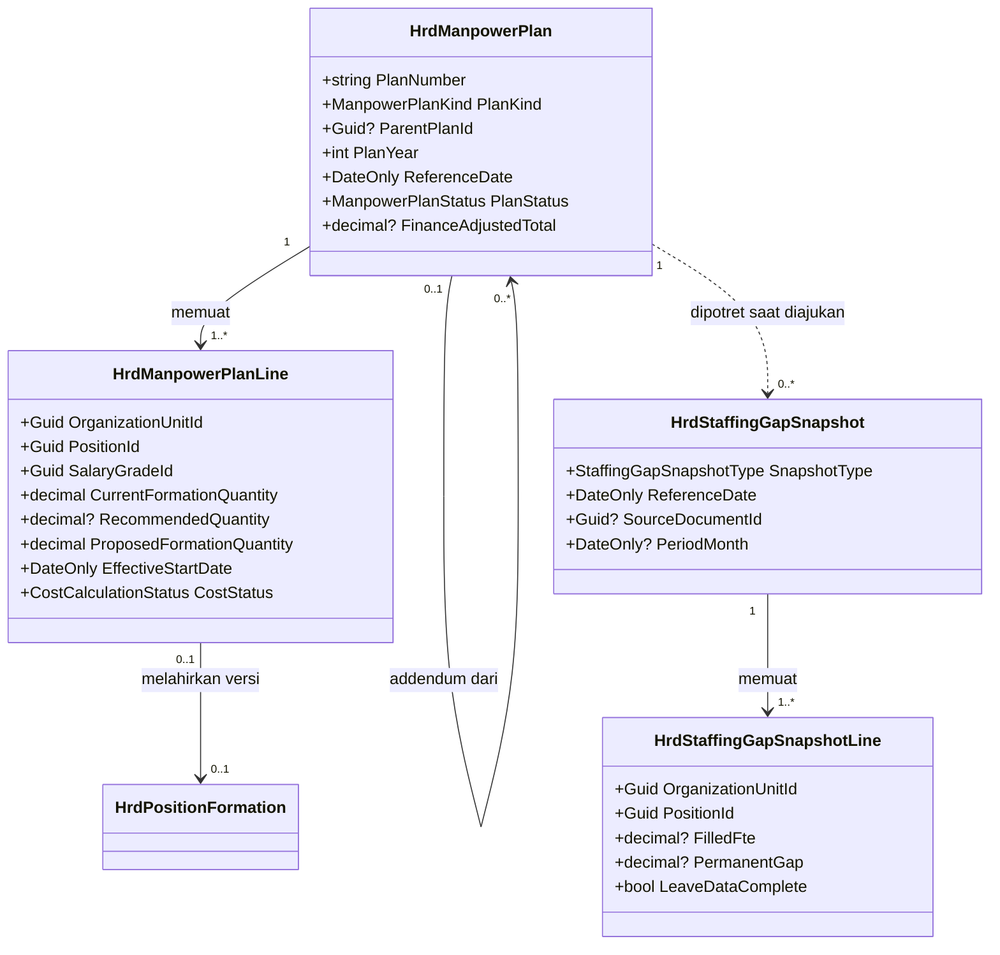

#### 16.3.3 Permintaan headcount dan pemenuhannya

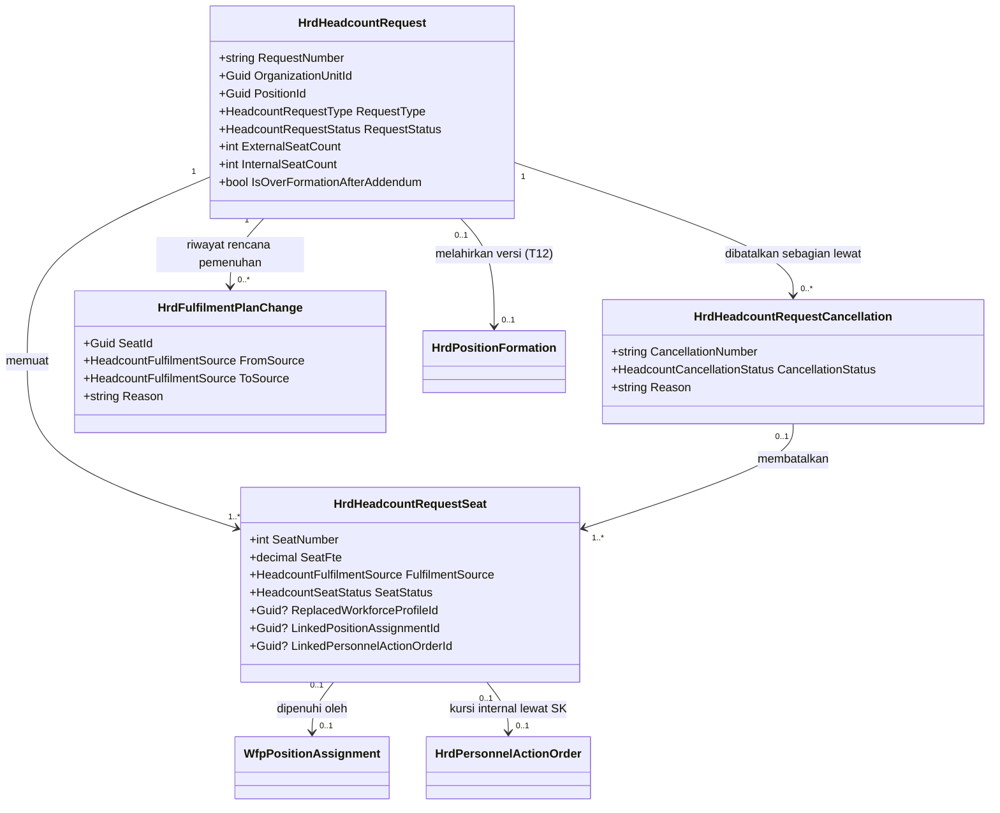

`WfpPositionAssignment` dan `HrdPersonnelActionOrder` milik Workforce Core; `S-D1` hanya
merujuknya.

### 16.4 Penjelasan setiap class

#### 16.4.1 `HrdStaffingStandard`, `HrdStaffingStandardLine`, `HrdStaffingSkillMixRule`

| Aspek | Penjelasan |
| --- | --- |
| **Status** | `Baru` (ketiganya) |
| **Lokasi file** | `Areas/Corporate/HumanResource/WorkforcePlanning/Models/HrdStaffingStandard.cs` — satu berkas memuat ketiga class, mengikuti pola `HrdInitialPlacementBatch.cs` yang memuat kelas barisnya |
| Kategori | Transaksi kebijakan berversi |
| Tanggung jawab utama | Menyimpan aturan "berapa tenaga yang dibutuhkan" satu unit, satu versi per periode. Setiap baris jabatan memilih satu metode: jumlah tetap/minimum, rasio terhadap beban, atau cakupan layanan (`HRD-DEC-060`). Aturan skill mix per shift ikut di dalam versi yang sama, karena Penjadwalan membacanya bersama-sama (`HRD-DEC-058` `WFP_OWNS_STANDARD`) |
| Field penting | Header: `StandardNumber`, `OrganizationUnitId`, `VersionNumber`, `EffectiveStartDate`, `EffectiveEndDate`, `StandardStatus`, `SupersedesStandardId`, `WorkflowInstanceId`. Baris: `PositionId`, `ProfessionId`, `CalculationMethod`, `MinimumHeadcount`, `RatioStaffQuantity`, `RatioWorkloadQuantity`, `WorkloadUnit`, `ShiftsPerDay`, `StaffPerShift`, `ServiceHoursPerDay`, `ReliefFactor`, `RoundingMethod`, `CountsOutsourced`. Skill mix: `ShiftId`, `ProfessionId`, `CompetencyId`, `MinimumCompetencyLevel`, `MinimumQualifiedHeadcount`, `IsMandatory` |
| Relasi | Menunjuk `MstHospitalSite`, `MstOrganizationUnit`, `MstPosition`, `MstProfession`, `MstShift`, `MstCompetency`; versi baru menunjuk versi yang digantikannya |
| Pemakaian dalam alur bisnis | HR Admin atau Kepala Unit menyusun draf → mengajukan → `T9` (HR Manager, lalu Direktur yang membawahi unit) → `Scheduled` atau langsung `Active` pada tanggal berlakunya → versi lama `Superseded` sehari sebelumnya |
| Catatan desain | Faktor cadangan dan cara pembulatan **wajib dipilih** pemilik standar; sistem tidak menetapkan nilai bawaan (`HRD-DEC-060`). Metode ABK dicadangkan sebagai nilai enum berikutnya tanpa perilaku. Standar yang belum `Active` **MUST NOT** dipakai hitungan gap maupun Penjadwalan |
| Ekuivalen model lama | `MstStaffingStandard`, `MstStaffingRatio`, `MstShiftSkillRequirement` — ditolak, bagian 16.10 |

#### 16.4.2 `HrdStaffingWorkloadInput`

| Aspek | Penjelasan |
| --- | --- |
| **Status** | `Baru` |
| **Lokasi file** | `Areas/Corporate/HumanResource/WorkforcePlanning/Models/HrdStaffingWorkloadInput.cs` |
| Kategori | Transaksi isian |
| Tanggung jawab utama | Menyimpan angka beban per unit × jabatan per periode, misalnya "rata-rata 7 pasien ICU terisi per hari, Januari–Maret 2027", beserta keterangan sumbernya (`HRD-DEC-060` `MANUAL_WORKLOAD_INPUT`) |
| Field penting | `OrganizationUnitId`, `PositionId`, `PeriodStartDate`, `PeriodEndDate`, `WorkloadValue`, `SourceNote` |
| Pemakaian dalam alur bisnis | Dipakai hitungan rekomendasi untuk baris bermetode rasio. Tidak melewati persetujuan karena hanya memengaruhi angka rekomendasi, bukan formasi |
| Catatan desain | Sengaja **tidak** menunjuk baris standar, agar isian tetap berlaku saat standar naik versi |
| Ekuivalen model lama | — |

#### 16.4.3 `HrdPositionFormation`

| Aspek | Penjelasan |
| --- | --- |
| **Status** | `Baru` |
| **Lokasi file** | `Areas/Corporate/HumanResource/WorkforcePlanning/Models/HrdPositionFormation.cs` |
| Kategori | Hasil berversi (bukan dokumen yang disetujui langsung) |
| Tanggung jawab utama | "Buku formasi berlaku": berapa kursi jabatan yang sah per unit × jabatan pada suatu tanggal (`HRD-DEC-062`). Setiap versi menyimpan dokumen sumber yang melahirkannya |
| Field penting | `OrganizationUnitId`, `PositionId`, `VersionNumber`, `FormationQuantity`, `EffectiveStartDate`, `EffectiveEndDate`, `SourceType`, `SourceDocumentId`, `SourceDocumentNumber`, `ApprovedByUserId`, `ApprovedAt`, `PreviousFormationId` |
| Pemakaian dalam alur bisnis | Dibuat **hanya** oleh `HrdPositionFormationService` saat batch awal, rencana, addendum, permintaan `T12`, atau pembatalan kursi `T12` disetujui. Tidak ada endpoint tulis |
| Catatan desain | `NO_DIRECT_FORMATION_EDIT`: kolom selain `EffectiveEndDate` tidak pernah diubah setelah ditulis. `FORMATION_CARRIES_FORWARD`: versi terakhir dibiarkan terbuka (`EffectiveEndDate` kosong) sampai digantikan |
| Ekuivalen model lama | `MstPositionHeadcountPlan` — ditolak |

#### 16.4.4 `HrdInitialFormationBatch` dan `HrdInitialFormationBatchRow`

| Aspek | Penjelasan |
| --- | --- |
| **Status** | `Baru` |
| **Lokasi file** | `Areas/Corporate/HumanResource/WorkforcePlanning/Models/HrdInitialFormationBatch.cs` |
| Kategori | Batch administrasi data awal |
| Tanggung jawab utama | Mengisi formasi versi 1 dari dokumen formasi resmi rumah sakit (`HRD-DEC-070`) |
| Field penting | Batch: `BatchNumber`, `HospitalSiteId`, `SourceDocumentReference`, `SourceDocumentPath`, `SourceDocumentFileName`, `BatchStatus`, `TotalRows`, `ValidRows`, `InvalidRows`, `WorkflowInstanceId`. Baris: `OrganizationUnitId`, `PositionId`, `FormationQuantity`, `EffectiveStartDate`, `IsValid`, `ValidationMessage`, `CreatedFormationId` |
| Pemakaian dalam alur bisnis | HR Admin mengunduh templat → mengisi → validasi → unggah scan dokumen → ajukan → `T10` → `Applied`: versi 1 lahir per baris |
| Catatan desain | **Tidak meniru** `HrdInitialPlacementBatch`: batch formasi **MUST** melewati persetujuan orang lain (`T10`), dan **MUST NOT** dapat diajukan selama `InvalidRows > 0` atau scan dokumen belum ada — dua cacat yang tercatat `HRD-TF-033` dan `HRD-TF-034` |
| Ekuivalen model lama | — |

#### 16.4.5 `HrdManpowerPlan` dan `HrdManpowerPlanLine`

| Aspek | Penjelasan |
| --- | --- |
| **Status** | `Baru` |
| **Lokasi file** | `Areas/Corporate/HumanResource/WorkforcePlanning/Models/HrdManpowerPlan.cs` |
| Kategori | Dokumen usulan |
| Tanggung jawab utama | Rencana kebutuhan tenaga tahunan **dan** addendumnya dalam satu bentuk; `PlanKind` membedakan keduanya (`HRD-DEC-062`, `HRD-DEC-068`). Baris menyimpan potret formasi saat ini, angka rekomendasi beserta rinciannya, angka usulan, alasan bila berbeda dari rekomendasi, tanggal berlaku, dan estimasi biaya dari gaji tengah grade |
| Field penting | Header: `PlanNumber`, `PlanKind`, `ParentPlanId`, `AddendumSequence`, `HospitalSiteId`, `PlanYear`, `PeriodStartDate`, `PeriodEndDate`, `ReferenceDate`, `PlanStatus`, `TotalEstimatedCost`, `FinanceAdjustedTotal`, `FinanceAdjustmentReason`. Baris: `OrganizationUnitId`, `PositionId`, `SalaryGradeId`, `CurrentFormationQuantity`, `RecommendedQuantity`, `RecommendationBreakdown`, `ProposedFormationQuantity`, `ChangeQuantity`, `DeviationReason`, `EffectiveStartDate`, `MonthlyRateSnapshot`, `MonthsInPeriod`, `EstimatedCost`, `IncrementalCost`, `CostStatus`, `CreatedFormationId` |
| Pemakaian dalam alur bisnis | HR Admin menyusun dari usulan unit → hitung ulang → ajukan (potret gap tersimpan) → `T10` (HR Manager, Finance, Direktur Utama) → `Approved`: versi formasi baru lahir per baris |
| Catatan desain | `APPROVED_PLAN_LOCKED`: tidak ada endpoint ubah untuk status `Approved`. Addendum **MUST** merujuk rencana induk berstatus `Approved` dan hanya memuat baris yang berubah. Biaya selalu dari `MstSalaryGrade.MidpointSalary` (`HRD-DEC-065`) |
| Ekuivalen model lama | `TrxAnnualManpowerPlan`, `TrxManpowerPlanDetail` — ditolak |

#### 16.4.6 `HrdHeadcountRequest`, `HrdHeadcountRequestSeat`, `HrdHeadcountRequestCancellation`, `HrdFulfilmentPlanChange`

| Aspek | Penjelasan |
| --- | --- |
| **Status** | `Baru` (keempatnya) |
| **Lokasi file** | `Areas/Corporate/HumanResource/WorkforcePlanning/Models/HrdHeadcountRequest.cs` (memuat `HrdHeadcountRequestSeat`); `HrdHeadcountRequestCancellation.cs`; `HrdFulfilmentPlanChange.cs` |
| Kategori | Dokumen permintaan beserta kursinya |
| Tanggung jawab utama | Satu permintaan untuk satu unit × jabatan, dipecah menjadi **kursi**. Setiap kursi punya porsi kerja, sumber pemenuhan (luar/internal), orang yang digantikan bila pengganti, dan tautan ke penempatan atau SK yang memenuhinya (`HRD-DEC-063`, `HRD-DEC-066`, `HRD-DEC-067`). Pembatalan kursi dan perubahan rencana pemenuhan tercatat sebagai baris tersendiri (`HRD-DEC-071`) |
| Field penting | Permintaan: `RequestNumber`, `OrganizationUnitId`, `PositionId`, `SalaryGradeId`, `RequestType`, `RequestStatus`, `RequiredStartDate`, `TemporaryEndDate`, `TemporaryReasonWorkforceProfileId`, `Justification`, `RequestedQuantity`, `ExternalSeatCount`, `InternalSeatCount`, `FormationVersionIdAtSubmission`, `RemainingSeatsAtSubmission`, `EstimatedCost`, `FinanceAdjustedCost`, `IsOverFormationAfterAddendum`, `IsOverdue`, `CreatedFormationId`. Kursi: `SeatNumber`, `SeatFte`, `FulfilmentSource`, `SeatStatus`, `ReplacedWorkforceProfileId`, `LinkedPositionAssignmentId`, `LinkedPersonnelActionOrderId`, `FulfilledAt`, `CancellationId` |
| Pemakaian dalam alur bisnis | Kepala Unit mengajukan → `T11` atau `T12` → `ReadyForRecruitment` → Recruiter melihat kursi luar; HR menyiapkan SK untuk kursi internal → kursi `Linked` → `Fulfilled` saat penempatannya mulai berlaku → permintaan `PartiallyFulfilled` lalu `Fulfilled` atau `Closed` |
| Catatan desain | Satu penempatan dan satu SK masing-masing hanya boleh menautkan satu kursi aktif (indeks unik terfilter). Kursi pecahan memakai `SeatFte` 0,10–1,00, sehingga sisa formasi 0,5 dapat diminta sebagai satu kursi paruh waktu — jawaban atas "pembulatan permintaan pecahan" yang ditinggalkan `HRD-DEC-063` |
| Ekuivalen model lama | `TrxHeadcountRequest` — ditolak |

#### 16.4.7 `HrdStaffingGapSnapshot` dan `HrdStaffingGapSnapshotLine`

| Aspek | Penjelasan |
| --- | --- |
| **Status** | `Baru` |
| **Lokasi file** | `Areas/Corporate/HumanResource/WorkforcePlanning/Models/HrdStaffingGapSnapshot.cs` |
| Kategori | Potret tidak dapat diubah |
| Tanggung jawab utama | Mengunci angka gap per unit × jabatan pada saat dokumen diajukan, atau pada akhir bulan, lengkap dengan lapisan `HRD-DEC-061` dan penanda kelengkapan data (`HRD-DEC-069`) |
| Field penting | Header: `SnapshotType`, `HospitalSiteId`, `ReferenceDate`, `SourceDocumentType`, `SourceDocumentId`, `PeriodMonth`, `TakenAt`, `ReconstructedAt`. Baris: `FormationQuantity`, `FilledFte`, `ToBeVacatedFte`, `TemporarilyUnavailableFte`, `NotYetCompetentFte`, `ConcurrentAssignmentCount`, `OutsourcedFte`, `PermanentGap`, `TemporaryGap`, `CompetencyGap`, `PlacementDataComplete`, `LeaveDataComplete`, `CompetencyDataComplete`, `WorkforceTypeDataComplete`, `ShortageSummaryCount` |
| Catatan desain | Tidak ada endpoint ubah maupun hapus (`SNAPSHOT_IMMUTABLE`). Potret susulan wajib berjenis `Reconstructed` (`MISSED_SNAPSHOT_NOT_FAKED`). Lapisan yang datanya belum ada disimpan `null`, bukan 0 |
| Ekuivalen model lama | `TrxStaffingGapAnalysis` — ditolak |

#### 16.4.8 `HrdWorkforcePlanningSetting`

| Aspek | Penjelasan |
| --- | --- |
| **Status** | `Baru` |
| **Lokasi file** | `Areas/Corporate/HumanResource/WorkforcePlanning/Models/HrdWorkforcePlanningSetting.cs` |
| Kategori | Pengaturan kebijakan per rumah sakit |
| Tanggung jawab utama | Menyimpan dua angka kebijakan yang sengaja tidak ditetapkan sistem: batas hari cuti yang dianggap "tidak tersedia sementara" (`HRD-DEC-061`) dan batas umur permintaan yang ditandai "lewat batas" (`HRD-DEC-071`) |
| Field penting | `HospitalSiteId` (unik), `LongLeaveThresholdDays`, `OverdueRequestThresholdDays`, `ChangeReason` |
| Catatan desain | Selama kosong, lapisan "tidak tersedia sementara" tampil "data belum tersedia" dan tanda "lewat batas" tidak pernah menyala. Hanya HR Manager yang mengubah |
| Ekuivalen model lama | — |

#### 16.4.9 Service

Seluruh service `Baru` berada di `Areas/Corporate/HumanResource/WorkforcePlanning/Services/`,
didaftarkan `AddScoped<T>()` di `Program.cs` dekat registrasi HR lain (pola baris 979).

| Service | Fungsi utama | Dipanggil oleh | Membuka transaksi |
| --- | --- | --- | :---: |
| `HrdStaffingStandardService` | Draf, versi, pengajuan `T9`, aktivasi, penggantian versi; baca standar berlaku per tanggal untuk Penjadwalan | `HrdStaffingStandardController`, scheduler, integrasi workflow | Ya |
| `HrdStaffingRecommendationService` | Menghitung angka rekomendasi per baris beserta rinciannya | Standard dan plan service | Tidak |
| `HrdStaffingWorkloadService` | Isian angka beban | `HrdStaffingWorkloadController` | Ya |
| `HrdPositionFormationService` | Satu-satunya penulis formasi: buat versi, tutup versi lama, baca formasi berlaku dan riwayat | Batch, plan, request service — **tidak** dipanggil controller untuk menulis | Ikut transaksi pemanggil |
| `HrdInitialFormationBatchService` | Templat, validasi, unggah dokumen, pengajuan `T10`, penerapan | `HrdInitialFormationBatchController`, integrasi workflow | Ya |
| `HrdManpowerPlanService` | Rencana dan addendum: hitung ulang, pengajuan `T10`, koreksi Finance, penerapan, penandaan permintaan yang melebihi formasi | `HrdManpowerPlanController`, integrasi workflow | Ya |
| `HrdHeadcountRequestService` | Permintaan: sisa kursi, pengajuan `T11`/`T12`, tarik kembali, antrean Recruiter, perubahan rencana pemenuhan, pembatalan `T13` | `HrdHeadcountRequestController`, integrasi workflow, scheduler | Ya |
| `HrdHeadcountFulfilmentService` | Tautkan dan lepas penempatan atau SK ke kursi; ubah kursi `Linked` → `Fulfilled` | `HrdHeadcountRequestController`, scheduler | Ya |
| `HrdStaffingGapCalculationService` | Menghitung lapisan dan tiga gap per unit × jabatan pada tanggal acuan, beserta penanda kelengkapan | Gap controller, snapshot service, plan dan request service | Tidak |
| `HrdStaffingGapSnapshotService` | Potret pengajuan, bulanan, dan rekonstruksi | Plan dan request service, scheduler | Ikut transaksi pemanggil |
| `HrdWorkforcePlanningCostService` | Tarif gaji tengah grade pada tanggal; hitung estimasi; penyamaran angka biaya bagi yang tidak berhak | Plan dan request service | Tidak |
| `HrdWorkforcePlanningWorkflowIntegrationService` | Memulai instance untuk lima jenis rujukan; menerima keputusan akhir dan meneruskannya ke service domain | Service domain; `WorkflowReferenceLifecycleService` | Ya |
| `HrdWorkforcePlanningSchedulerService` | Harian: aktivasi standar, kursi `Linked` → `Fulfilled`, kursi kembali `Open` bila SK batal, tanda "lewat batas". Akhir bulan: potret bulanan | `HrdWorkforcePlanningSchedulerHostedService` | Ya, per langkah |
| `HrdWorkforcePlanningSchedulerHostedService` | Pembungkus `BackgroundService`, didaftarkan `AddHostedService` dekat `Program.cs:1287` | Host aplikasi | — |
| `HrdWorkforcePlanningSettingService` | Baca dan ubah pengaturan | `HrdWorkforcePlanningSettingController` | Ya |

Nomor `StandardNumber`, `BatchNumber`, `PlanNumber`, `RequestNumber`, dan `CancellationNumber`
dialokasikan `Areas/Platform/NumberSeriesManagement/Services/NumberSeriesAllocator.cs` di luar
transaksi pemanggil, mengikuti `EmployeeBenefitEnrollmentService.cs:323-330` (`QBE-CODE-002`,
`QBE-CODE-003`). Controller tidak pernah membuat nomor.

**Service yang `Diperbarui`:**

| Service | Lokasi | Perubahan |
| --- | --- | --- |
| `WorkflowService` | `Areas/Corporate/HumanResource/WorkflowManagement/Services/WorkflowService.cs` | Pencocokan `MstApprovalMatrix` pada baris 1621 dan 1669 kini menelusuri unit induk lewat `ParentOrganizationUnitId` sampai baris cocok ditemukan (`HRD-DEC-072` `MATRIX_FOLLOWS_UNIT_ANCESTOR`). Baris unit yang lebih dekat menang atas baris unit induk. Tanpa perubahan perilaku bagi baris matriks yang sudah ada, karena saat ini matriks kosong |
| `WorkflowReferenceLifecycleService` | `.../WorkflowManagement/Services/WorkflowReferenceLifecycleService.cs` | Lima jenis rujukan baru didaftarkan: `WorkforceStaffingStandard`, `WorkforceInitialFormationBatch`, `WorkforceManpowerPlan`, `WorkforceHeadcountRequest`, `WorkforceHeadcountCancellation` |

**Yang dipakai ulang tanpa perubahan:** penolakan langkah tanpa penyetuju dan pembuangan pembuat dari
daftar penyetuju sudah ada di `WorkflowService.cs:534-556`. `UNRESOLVED_STEP_FAILS_CLOSED` dan
`APPROVER_MUST_DIFFER_FROM_CREATOR` cukup memakai perilaku itu, dengan syarat langkah `T9` s.d.
`T13` didefinisikan `AllowSelfApproval = false`.

#### 16.4.10 Controller

Seluruhnya `Baru`, di `Areas/Corporate/HumanResource/WorkforcePlanning/Controllers/`, memakai
`[AccessController]` di kelas dan `[AccessPermission(...)]` di setiap endpoint. Tidak satu pun
mengakses `ApplicationDbContext` langsung (`QBE-SVC-001`).

| Controller | Service yang dipakai | Grup Swagger | Endpoint yang diurus |
| --- | --- | --- | --- |
| `HrdStaffingStandardController` | `HrdStaffingStandardService`, `HrdStaffingRecommendationService` | `Corporate / Human Resource / Workforce Planning / Staffing Standard` | Daftar, detail, draf versi baru, ubah draf, ajukan, batalkan, rekomendasi, standar berlaku |
| `HrdStaffingWorkloadController` | `HrdStaffingWorkloadService` | `Corporate / Human Resource / Workforce Planning / Staffing Workload` | Daftar, buat, ubah |
| `HrdPositionFormationController` | `HrdPositionFormationService` | `Corporate / Human Resource / Workforce Planning / Position Formation` | Daftar berlaku, riwayat — **baca saja** |
| `HrdInitialFormationBatchController` | `HrdInitialFormationBatchService` | `Corporate / Human Resource / Workforce Planning / Initial Formation Batch` | Templat, validasi, buat, ubah, unggah dokumen, ajukan, batalkan, daftar, detail |
| `HrdManpowerPlanController` | `HrdManpowerPlanService` | `Corporate / Human Resource / Workforce Planning / Manpower Plan` | Daftar, detail, buat rencana, buat addendum, ubah, hitung ulang, ajukan, batalkan, koreksi Finance, potret |
| `HrdHeadcountRequestController` | `HrdHeadcountRequestService`, `HrdHeadcountFulfilmentService` | `Corporate / Human Resource / Workforce Planning / Headcount Request` | Daftar, detail, sisa kursi, buat, ubah, ajukan, tarik kembali, koreksi Finance, perubahan rencana pemenuhan, pembatalan, tautan pemenuhan |
| `HrdRecruitmentQueueController` | `HrdHeadcountRequestService` | `Corporate / Human Resource / Workforce Planning / Recruitment Queue` | Antrean kursi luar untuk Recruiter, tanpa kolom biaya |
| `HrdStaffingGapController` | `HrdStaffingGapCalculationService`, `HrdStaffingGapSnapshotService` | `Corporate / Human Resource / Workforce Planning / Staffing Gap` | Gap langsung, daftar potret, detail potret |
| `HrdWorkforcePlanningSettingController` | `HrdWorkforcePlanningSettingService` | `Corporate / Human Resource / Workforce Planning / Setting` | Baca, ubah |

Persetujuan **tidak** punya endpoint di controller domain. Seluruh keputusan `T9` s.d. `T13`
dijalankan lewat kotak masuk persetujuan yang sudah ada (`HRD-DEC-018`), lalu diteruskan ke domain
oleh `HrdWorkforcePlanningWorkflowIntegrationService`.

#### 16.4.11 DTO, enum, konstanta, dan configuration

| Jenis | Lokasi | Isi |
| --- | --- | --- |
| DTO | `Areas/Corporate/HumanResource/WorkforcePlanning/DTOs/` | `StaffingStandardDtos.cs`, `StaffingWorkloadDtos.cs`, `PositionFormationDtos.cs`, `InitialFormationBatchDtos.cs`, `ManpowerPlanDtos.cs`, `HeadcountRequestDtos.cs`, `StaffingGapDtos.cs`, `WorkforcePlanningSettingDtos.cs`. Bentuk request dan response per endpoint pada `contracts/api-contract.md` bagian 13 |
| Enum | `Areas/Corporate/HumanResource/WorkforcePlanning/Enums/` | Daftar pada tabel di bawah |
| Konstanta | `Areas/Corporate/HumanResource/WorkforcePlanning/Constants/WorkforcePlanningValueConstants.cs` | Lima jenis rujukan workflow, kunci number series, nama kunci advisory lock |
| Configuration | `Repositories/Configurations/Corporate/HumanResource/WorkforcePlanning/` | Satu berkas per tabel baru, `Hrd<Nama>Configuration.cs`; index, unique, dan `DeleteBehavior` pada `data/data-dictionary.md` bagian 8 |
| DbSet | `Repositories/ApplicationDbContext.cs` | 16 `DbSet` baru, jamak: `HrdStaffingStandards`, `HrdStaffingStandardLines`, dan seterusnya |

| Enum | Nilai | Bawaan |
| --- | --- | --- |
| `StaffingStandardStatus` | `Draft=1`, `Submitted=2`, `Returned=3`, `Rejected=4`, `Scheduled=5`, `Active=6`, `Superseded=7`, `Cancelled=8` | `Draft` |
| `StaffingCalculationMethod` | `FixedMinimum=1`, `WorkloadRatio=2`, `ServiceCoverage=3`, `WorkloadAnalysis=4` (dicadangkan, **tidak** dapat dipilih pada rilis ini) | — wajib dipilih |
| `StaffingRoundingMethod` | `Ceiling=1`, `Floor=2`, `Nearest=3`, `NoRounding=4` | — wajib dipilih |
| `PositionFormationSourceType` | `InitialBatch=1`, `ManpowerPlan=2`, `PlanAddendum=3`, `HeadcountRequest=4`, `HeadcountCancellation=5` | — |
| `InitialFormationBatchStatus` | `Draft=1`, `Submitted=2`, `Returned=3`, `Rejected=4`, `Applied=5`, `Cancelled=6` | `Draft` |
| `ManpowerPlanKind` | `AnnualPlan=1`, `Addendum=2` | — |
| `ManpowerPlanStatus` | `Draft=1`, `Submitted=2`, `Returned=3`, `Rejected=4`, `Approved=5`, `Cancelled=6` | `Draft` |
| `CostCalculationStatus` | `Calculated=1`, `RateUnavailable=2` | — |
| `HeadcountRequestType` | `Replacement=1`, `AdditionalWithinFormation=2`, `AdditionalBeyondFormation=3`, `Temporary=4` | — |
| `HeadcountRequestStatus` | `Draft=1`, `Submitted=2`, `Returned=3`, `Rejected=4`, `Withdrawn=5`, `ReadyForRecruitment=6`, `PartiallyFulfilled=7`, `Fulfilled=8`, `Closed=9` | `Draft` |
| `HeadcountSeatStatus` | `Open=1`, `Linked=2`, `Fulfilled=3`, `Frozen=4`, `Cancelled=5` | `Open` |
| `HeadcountFulfilmentSource` | `External=1`, `Internal=2` | — |
| `HeadcountCancellationStatus` | `Submitted=1`, `Approved=2`, `Rejected=3` | `Submitted` |
| `StaffingGapSnapshotType` | `Submission=1`, `Monthly=2`, `Reconstructed=3` | — |

Jenis `Project` dan `Seasonal` pada model kandidat **dilebur** ke `Temporary`: keduanya sama-sama
berakhir pada tanggal tertentu dan tidak mengubah formasi. Jawaban atas butir yang ditinggalkan
`HRD-DEC-063`.

### 16.5 Arsitektur folder

```text
Areas/Corporate/HumanResource/WorkforcePlanning/
├── Constants/
│   └── WorkforcePlanningValueConstants.cs              Baru
├── Controllers/                                       Baru — 9 controller pada 16.4.10
├── DTOs/                                              Baru — 8 berkas pada 16.4.11
├── Enums/                                             Baru — 14 enum pada 16.4.11
├── Models/
│   ├── HrdStaffingStandard.cs                         Baru (+ Line, SkillMixRule)
│   ├── HrdStaffingWorkloadInput.cs                    Baru
│   ├── HrdPositionFormation.cs                        Baru
│   ├── HrdInitialFormationBatch.cs                    Baru (+ Row)
│   ├── HrdManpowerPlan.cs                             Baru (+ Line)
│   ├── HrdHeadcountRequest.cs                         Baru (+ Seat)
│   ├── HrdHeadcountRequestCancellation.cs             Baru
│   ├── HrdFulfilmentPlanChange.cs                     Baru
│   ├── HrdStaffingGapSnapshot.cs                      Baru (+ Line)
│   ├── HrdWorkforcePlanningSetting.cs                 Baru
│   ├── MstPositionHeadcountPlan.cs                    Sudah ada — kandidat ditolak, tidak disentuh
│   ├── MstShiftSkillRequirement.cs                    Sudah ada — idem; masih dirujuk TrxShiftAssignment
│   ├── MstStaffingRatio.cs                            Sudah ada — idem
│   ├── MstStaffingStandard.cs                         Sudah ada — idem; masih dirujuk TrxDailyStaffingRequirement
│   ├── MstWorkforceRequirement.cs                     Sudah ada — milik master persyaratan berkas; utang teknis lokasi
│   ├── TrxAnnualManpowerPlan.cs                       Sudah ada — kandidat ditolak; masih dirujuk TrxJobRequisition
│   ├── TrxDailyStaffingRequirement.cs                 Sudah ada — milik desain Penjadwalan (HRD-DEC-058)
│   ├── TrxHeadcountRequest.cs                         Sudah ada — kandidat ditolak; masih dirujuk TrxJobRequisition
│   ├── TrxManpowerPlanDetail.cs                       Sudah ada — kandidat ditolak; masih dirujuk TrxJobRequisition
│   ├── TrxStaffingGapAnalysis.cs                      Sudah ada — kandidat ditolak
│   └── TrxWorkforceAllocation.cs                      Sudah ada — milik desain Penjadwalan (HRD-DEC-058)
└── Services/                                          Baru — 15 service pada 16.4.9

Repositories/Configurations/Corporate/HumanResource/WorkforcePlanning/
└── Hrd*Configuration.cs                               Baru — 16 berkas; konfigurasi kandidat lama tidak disentuh
```

**Utang teknis yang tercatat, tidak dirapikan diam-diam:**

| Penyimpangan | Keadaan | Penanganan |
| --- | --- | --- |
| `MstWorkforceRequirement` berada di folder `WorkforcePlanning`, bukan `MasterData` | Model master persyaratan berkas yang sudah dipakai layar | Pemindahan folder adalah task tersendiri dengan approval pemilik arsitektur backend; **MUST NOT** ikut task `S-D1` |
| Sepuluh model kandidat `Mst*`/`Trx*` tetap terdaftar sebagai `DbSet` | Tabel kosong, tidak dipakai `S-D1` | Dibuang lewat migration pembersihan terpisah, bagian 16.7 |

### 16.6 Status model dan dampak migration

| Model | Status | Kolom yang berubah | Dampak migration |
| --- | --- | --- | --- |
| 16 tabel `Hrd*` pada 16.4 | `Baru` | Seluruh kolom pada `data/data-dictionary.md` bagian 8 | Membuat tabel; tidak menyentuh data mana pun |
| `MstApprovalMatrix` | `Sudah ada` | Tidak ada | Tidak ada. Perluasan pencocokan hanya pada kode `WorkflowService` |
| `WfpPositionAssignment`, `WfpOrganizationAssignment`, `HrdPersonnelActionOrder` | `Sudah ada` | Tidak ada. Porsi kerja adalah dependency 02 (`HRD-CAP-53`), dirancang di Workforce Core | Tidak ada |
| `MstSalaryGrade`, `MstPosition`, `MstOrganizationUnit`, `MstShift`, `MstCompetency`, `MstProfession`, `MstHospitalSite` | `Sudah ada` | Tidak ada | Tidak ada; hanya dirujuk FK |
| Sepuluh model kandidat `WorkforcePlanning` | `Sudah ada` | Tidak ada pada slice ini | Tidak ada pada slice ini |

### 16.7 Rencana migration

**Peringatan:** blueprint tidak memberi wewenang membuat atau menjalankan migration. Rencana ini
adalah bahan task implementasi.

| Urutan | Migration | Isi | Tanpa downtime? | Pengisian data lama | Langkah mundur |
| ---: | --- | --- | :---: | --- | --- |
| 1 | `AddWorkforcePlanningCore` | Membuat 16 tabel `Hrd*` beserta index, unique, dan FK | **Ya** — hanya `CREATE TABLE` dan `CREATE INDEX` pada tabel baru yang kosong | Tidak ada; seluruh tabel lahir kosong | `Down()` membuang ke-16 tabel. Aman selama belum ada data; setelah ada data, mundur hanya lewat migration baru yang mempertahankan isi |
| — | `RetireWorkforcePlanningCandidateTables` | Membuang tabel kandidat yang ditolak | **Tidak dijadwalkan pada `S-D1`** | — | — |

**Kenapa pembersihan kandidat tidak ikut `S-D1`.** Lima dari sepuluh tabel kandidat masih dirujuk FK
milik slice lain: `TrxJobRequisition` (`S-D2`) merujuk `TrxAnnualManpowerPlan`,
`TrxManpowerPlanDetail`, dan `TrxHeadcountRequest`; `TrxShiftAssignment` dan
`TrxDailyStaffingRequirement` (Penjadwalan) merujuk `MstShiftSkillRequirement`, `MstStaffingStandard`,
dan `TrxStaffingGapAnalysis`. Membuangnya sekarang berarti mengubah tabel milik dua slice lain di
dalam task `S-D1`. Pembersihan dilakukan **setelah** desain `S-D2` dan Penjadwalan menetapkan nasib
FK itu, dalam satu migration yang:

1. **MUST** membuka setiap pembuangan tabel dengan blok `DO $$ … IF EXISTS (SELECT 1 FROM … ) THEN RAISE EXCEPTION … END IF; $$`, mengikuti `Migrations/20260902072756_DropTableMstBillingCategory.cs:36-42` (`HRD-DEC-059` `EMPTY_TABLE_GUARD`);
2. **MUST NOT** memakai `DROP … CASCADE` (`NO_GUARD_BYPASS`);
3. bila pengaman berhenti di lingkungan mana pun, `HRD-DEC-059` kembali `draft` dan `S-D1` kembali
   `BLOCKED` untuk pembersihan itu (`GUARD_FAILURE_REOPENS_DECISION`).

### 16.8 Rencana data master awal

Tanpa isian di bawah, `S-D1` tidak dapat dipakai sama sekali.

| Data | Isi minimum | Sumber nilai | Diisi lewat |
| --- | --- | --- | --- |
| Jabatan direktur | Sekurang-kurangnya "Direktur Utama" dan satu jabatan direktur per direktorat yang membawahi unit pemohon, misalnya "Direktur Pelayanan Medis" | Struktur organisasi rumah sakit | Master jabatan yang sudah ada |
| Penempatan pemegang jabatan direktur | Satu penempatan utama aktif per jabatan direktur | SK pengangkatan | Batch penempatan awal atau SK (`S-A1`) |
| Matriks persetujuan langkah Direktur | Satu baris per direktorat untuk `T9` dan `T12` dengan sumber penyetuju `Position`, ditambah satu baris `IsFallback` ke jabatan Direktur Utama (`HRD-DEC-072`) | Struktur organisasi | Master matriks persetujuan yang sudah ada |
| Definisi alur `T9` s.d. `T13` | Lima definisi beserta langkahnya sesuai `HRD-DEC-064` dan `HRD-DEC-071`; setiap langkah `AllowSelfApproval = false` | `HRD-DEC-064` | Master definisi workflow yang sudah ada |
| Number series | Lima kunci: standar, batch formasi, rencana, permintaan, pembatalan | Konvensi penomoran HR | Konfigurasi number series |
| Pengaturan perencanaan | Satu baris per rumah sakit: batas hari cuti panjang, batas umur permintaan | Kebijakan HR rumah sakit — **bukan** nilai sistem | Layar pengaturan, oleh HR Manager |
| Grade gaji | Gaji tengah terisi untuk setiap grade yang dipakai baris rencana dan permintaan | Struktur gaji rumah sakit | Master grade gaji yang sudah ada (5 baris di dev) |
| Pemetaan peran | Finance / Anggaran, Direktur, Recruiter ke peran aplikasi | Administrator | `HRD-DEC-032` — `MAPPING_REQUIRED` |

### 16.9 Hitungan yang dirancang

**Rekomendasi per baris standar** (`HrdStaffingRecommendationService`):

| Metode | Rumus | Contoh |
| --- | --- | --- |
| `FixedMinimum` | `MinimumHeadcount` | Farmasi: 4 → **4** |
| `WorkloadRatio` | `WorkloadValue ÷ RatioWorkloadQuantity × RatioStaffQuantity` per shift × `ShiftsPerDay` × `ReliefFactor`, lalu dibulatkan menurut `RoundingMethod` | ICU: 7 ÷ 1 × 1 = 7; 7 × 3 = 21; 21 × 1,5 = 31,5 → **32** bila `Ceiling` |
| `ServiceCoverage` | `ShiftsPerDay` × `StaffPerShift` × `ReliefFactor`, lalu dibulatkan | IGD: 3 × 2 = 6; 6 × 1,5 = 9 → **9** |

Rincian hitung disimpan sebagai teks pada `HrdManpowerPlanLine.RecommendationBreakdown` agar dapat
dibaca tanpa menghitung ulang. Bila angka beban periode itu belum diisi, rekomendasi baris rasio
kosong dan tampil "angka beban belum diisi".

**Lapisan tenaga tersedia dan tiga gap** (`HrdStaffingGapCalculationService`, `HRD-DEC-061`), per
unit × jabatan pada tanggal acuan `D`:

| Lapisan | Sumber | Aturan |
| --- | --- | --- |
| Terisi | `WfpOrganizationAssignment` dan `WfpPositionAssignment` utama yang aktif pada `D` | Jumlah porsi kerja; porsi kerja yang belum ada dihitung 1 |
| Akan kosong | Pengunduran diri `Approved` dengan hari kerja terakhir di dalam periode; penempatan utama yang `EffectiveEndDate`-nya di dalam periode; SK pindah keluar yang `Scheduled` | Bagian dari terisi |
| Tidak tersedia sementara | Cuti berstatus disetujui yang beririsan dengan periode dan lamanya ≥ `LongLeaveThresholdDays` | Kosong bila pengaturan belum diisi |
| Belum memenuhi kompetensi | Orang terisi yang tidak punya `WfpCompetencyAssessment` aktif untuk setiap kompetensi wajib pada skill mix standar berlaku | Kosong bila standar tidak punya skill mix wajib |
| Rangkap/Plt | Penempatan bukan utama di unit × jabatan itu | Informasi; tidak menambah terisi |
| Alih daya | Orang dengan kategori sumber tenaga alih daya | Kosong sampai master jenis tenaga diisi (dependency 01) |

| Gap | Rumus |
| --- | --- |
| Permanen | formasi berlaku − (terisi − akan kosong); ditambah alih daya hanya bila `CountsOutsourced = true` pada baris standar |
| Sementara | tidak tersedia sementara |
| Kompetensi | belum memenuhi kompetensi |

**Sisa kursi** (`HrdHeadcountRequestService`, `HRD-DEC-063` `REMAINING_SEATS`) = formasi berlaku −
(terisi − akan kosong) − jumlah `SeatFte` kursi `Open`/`Linked` pada permintaan lain untuk unit ×
jabatan yang sama yang berstatus `Submitted`, `ReadyForRecruitment`, atau `PartiallyFulfilled`.

### 16.10 Yang sengaja tidak dibuat

| Yang ditolak | Alasan |
| --- | --- |
| Memakai ulang `MstStaffingStandard`, `MstStaffingRatio`, `MstShiftSkillRequirement` | Prefix master untuk dokumen bersiklus persetujuan; rasio terpisah dari standar membuat satu versi tersebar di dua aggregate; tidak punya versi maupun rujukan `T9` |
| Memakai ulang `MstPositionHeadcountPlan` | Berprefix master tetapi bersiklus status, terikat `PlanYear`, tanpa versi dan dokumen sumber (`HRD-TF-027`) |
| Memakai ulang `TrxAnnualManpowerPlan` dan `TrxManpowerPlanDetail` | Tanpa konsep addendum; `Trx*` dilarang untuk `NEW CODE` (`QBE-NAM-001`) |
| Memakai ulang `TrxHeadcountRequest` | Tanpa kursi, rencana pemenuhan, maupun tautan pemenuhan |
| Memakai ulang `TrxStaffingGapAnalysis` | Tanpa lapisan `HRD-DEC-061` dan tanpa penanda kelengkapan |
| Me-rename kandidat `Trx*` menjadi `Hrd*` (ratchet) | Tiga di antaranya dirujuk `TrxJobRequisition`; rename memaksa menyentuh model `S-D2` yang masih `BLOCKED` |
| Kebutuhan harian dan alokasi per shift | Milik Penjadwalan (`HRD-DEC-058`) |
| Kolom "kepala unit" pada master unit | Ditolak `HRD-DEC-072`; direktur dibaca dari penempatan jabatan |
| Endpoint ubah atau hapus formasi | `NO_DIRECT_FORMATION_EDIT` |
| Endpoint ubah atau hapus potret | `SNAPSHOT_IMMUTABLE` |
| Endpoint persetujuan di controller domain | Persetujuan satu pintu lewat kotak masuk (`HRD-DEC-018`) |
| Kedaluwarsa otomatis permintaan | `NO_AUTO_EXPIRY` (`HRD-DEC-071`) |
| Penarikan otomatis angka beban dari data pasien | `HRD-DEP-005` `MISSING`; ditunda (`HRD-DEC-060`) |
| Metode Analisis Beban Kerja | Ditunda; nilai enum dicadangkan (`HRD-DEC-060` `ABK_LATER_SLICE`) |

### 16.11 Strategi test `S-D1`

Backend tidak memelihara proyek automated test (`rules/backend/TEST_POLICY.md`). Bukti verifikasi
tiap task: `dotnet build`, pemeriksaan QBE, dan uji API terhadap database dev mengikuti
`testing/acceptance-test-matrix.md` bagian 15. Uji yang paling penting dan paling mudah terlewat:
dua pengajuan bersamaan atas sisa kursi yang sama, potret yang tidak berubah sesudah data berubah,
dan pengaman tabel kosong pada migration pembersihan.

### 16.12 Traceability `S-D1`

| Keputusan | Dirancang pada |
| --- | --- |
| `HRD-DEC-058` | 16.2, 16.10 |
| `HRD-DEC-059` | 16.7 |
| `HRD-DEC-060` | 16.4.1, 16.4.2, 16.9 |
| `HRD-DEC-061` | 16.4.7, 16.4.8, 16.9 |
| `HRD-DEC-062` | 16.4.3, 16.4.5 |
| `HRD-DEC-063` | 16.4.6, 16.9 |
| `HRD-DEC-064`, `HRD-DEC-072` | 16.4.9 (`WorkflowService`), 16.8 |
| `HRD-DEC-065` | 16.4.5, 16.4.9 (`HrdWorkforcePlanningCostService`) |
| `HRD-DEC-066`, `HRD-DEC-067` | 16.4.6 |
| `HRD-DEC-068` | 16.4.5 |
| `HRD-DEC-069` | 16.4.7 |
| `HRD-DEC-070` | 16.4.4 |
| `HRD-DEC-071` | 16.4.6, 16.4.8 |


---

## 17. Desain Arsitektur Backend S-D2 — Rekrutmen dan Hiring (RecruitmentManagement)

### 17.1 Ringkasan dan Batas Tanggung Jawab

Arsitektur backend untuk Delivery Slice `S-D2` (Rekrutmen dan Hiring) diturunkan secara resmi dari keputusan bisnis
`HRD-DEC-073` s.d. `HRD-DEC-080`. Slice ini bertugas mengelola pengadaan tenaga kerja rumah sakit mulai dari penarikan
alokasi kursi dari `HeadcountRequest` (Sub-modul 03), penayangan lowongan, penampungan berkas pelamar, penapisan
dokumen profesi klinis (STR), wawancara HR dan asesmen klinis unit dengan hak veto klinis, penerbitan penawaran bersyarat,
pemeriksaan MCU pra-kerja dengan perlindungan privasi medis, persetujuan penawaran bertingkat, pengelolaan talent pool,
hingga serah terima kandidat ke Sub-modul 05 Onboarding.

| Aspek | Batas Tanggung Jawab |
| --- | --- |
| Hulu (Input) | Membaca `HeadcountRequest` yang disetujui (`HRD-DEC-073`); membaca master jabatan, unit, spesialisasi, dan `MstSalaryGrade` |
| Internal S-D2 | Requisition, Vacancy, Candidate, Application, Document, Screening, Evaluation, Offer, OfferApproval, McuCheck, TalentPool, HiringHandoff |
| Hilir (Output) | Menyerahkan draf `WorkforceProfile` berstatus `Pending Onboarding` ke Sub-modul 05; mengembalikan kursi ke status terpenuhi di Sub-modul 03 |
| Yang DILARANG | Membuat `WorkforceProfile` aktif sebelum offer accepted (`HRD-DEC-075`); menampilkan detail diagnosis medis MCU ke HR (`HRD-DEC-078`); menganulir veto klinis unit (`HRD-DEC-077`) |

### 17.2 Class Diagram Bounded Context RecruitmentManagement


### 17.3 Penjelasan Class & Tanggung Jawab

| Nama Class | Layer | Status | Lokasi File | Fungsi Utama |
| --- | --- | --- | --- | --- |
| `HrdJobRequisition` | Model | Baru | `Areas/Corporate/HumanResource/RecruitmentManagement/Models/` | Entitas permohonan pengadaan tenaga berbasis alokasi kursi luar `HeadcountRequest` |
| `HrdJobVacancy` | Model | Baru | `Areas/Corporate/HumanResource/RecruitmentManagement/Models/` | Entitas lowongan kerja publikasi dengan kuota, batas tanggal, dan kualifikasi profesi |
| `HrdCandidate` | Model | Baru | `Areas/Corporate/HumanResource/RecruitmentManagement/Models/` | Entitas identitas pelamar independen dengan validasi unik NIK/KTP |
| `HrdCandidateApplication` | Model | Baru | `Areas/Corporate/HumanResource/RecruitmentManagement/Models/` | Entitas pelacakan berkas lamaran per lowongan dan tahap siklus rekrutmen |
| `HrdCandidateDocument` | Model | Baru | `Areas/Corporate/HumanResource/RecruitmentManagement/Models/` | Entitas penyimpanan dan status verifikasi dokumen legalitas/profesi (STR, Ijazah, Pelatihan) |
| `HrdCandidateScreening` | Model | Baru | `Areas/Corporate/HumanResource/RecruitmentManagement/Models/` | Entitas rekam penapisan berkas administrasi dan gerbang otomatis STR aktif posisi klinis |
| `HrdCandidateEvaluation` | Model | Baru | `Areas/Corporate/HumanResource/RecruitmentManagement/Models/` | Entitas formulir penilaian wawancara HR dan uji klinis dengan hak veto mutlak |
| `HrdJobOffer` | Model | Baru | `Areas/Corporate/HumanResource/RecruitmentManagement/Models/` | Entitas surat penawaran kerja bersyarat dengan rincian remunerasi dan status respon |
| `HrdJobOfferApproval` | Model | Baru | `Areas/Corporate/HumanResource/RecruitmentManagement/Models/` | Entitas log persetujuan bertingkat (`T13` standar vs `T14` plafon gaji terlampaui) |
| `HrdPreEmploymentMedicalCheck` | Model | Baru | `Areas/Corporate/HumanResource/RecruitmentManagement/Models/` | Entitas kesimpulan kelaikan fisik kerja (Fit/Unfit) tanpa membocorkan rekam medis detail |
| `HrdTalentPool` | Model | Baru | `Areas/Corporate/HumanResource/RecruitmentManagement/Models/` | Entitas bank data kandidat cadangan berperingkat aktif 6 bulan untuk promosi cepat |
| `HrdCandidateHiringHandoff` | Model | Baru | `Areas/Corporate/HumanResource/RecruitmentManagement/Models/` | Entitas serah terima kandidat yang menerima tawaran ke Sub-modul 05 Onboarding |
| `JobRequisitionController` | Controller | Baru | `Areas/Corporate/HumanResource/RecruitmentManagement/Controllers/` | Endpoint API pengelolaan requisition dan penarikan alokasi kursi |
| `JobVacancyController` | Controller | Baru | `Areas/Corporate/HumanResource/RecruitmentManagement/Controllers/` | Endpoint API penayangan lowongan, syarat kualifikasi, dan penutupan kuota |
| `CandidateController` | Controller | Baru | `Areas/Corporate/HumanResource/RecruitmentManagement/Controllers/` | Endpoint API pendaftaran pelamar, unggah berkas, dan penapisan administrasi |
| `CandidateEvaluationController` | Controller | Baru | `Areas/Corporate/HumanResource/RecruitmentManagement/Controllers/` | Endpoint API penjadwalan evaluasi, input nilai HR, dan input uji klinis unit |
| `JobOfferController` | Controller | Baru | `Areas/Corporate/HumanResource/RecruitmentManagement/Controllers/` | Endpoint API draf penawaran kerja, persetujuan bertingkat, dan konfirmasi respon kandidat |
| `TalentPoolController` | Controller | Baru | `Areas/Corporate/HumanResource/RecruitmentManagement/Controllers/` | Endpoint API penelusuran kandidat cadangan dan aksi promosi cepat (*Fast-Track*) |
| `RecruitmentService` | Service | Baru | `Areas/Corporate/HumanResource/RecruitmentManagement/Services/` | Logika bisnis validasi kuota kursi, gerbang STR aktif, hak veto klinis, dan eskalasi offer |

### 17.4 Arsitektur Folder Backend

Pohon folder canonical untuk domain `RecruitmentManagement`:

```text
NewQuilvianSystemBackend/
├── Areas/Corporate/HumanResource/RecruitmentManagement/
│   ├── Controllers/
│   │   ├── JobRequisitionController.cs
│   │   ├── JobVacancyController.cs
│   │   ├── CandidateController.cs
│   │   ├── CandidateEvaluationController.cs
│   │   ├── JobOfferController.cs
│   │   └── TalentPoolController.cs
│   ├── Models/
│   │   ├── HrdJobRequisition.cs
│   │   ├── HrdJobVacancy.cs
│   │   ├── HrdCandidate.cs
│   │   ├── HrdCandidateApplication.cs
│   │   ├── HrdCandidateDocument.cs
│   │   ├── HrdCandidateScreening.cs
│   │   ├── HrdCandidateEvaluation.cs
│   │   ├── HrdJobOffer.cs
│   │   ├── HrdJobOfferApproval.cs
│   │   ├── HrdPreEmploymentMedicalCheck.cs
│   │   ├── HrdTalentPool.cs
│   │   └── HrdCandidateHiringHandoff.cs
│   ├── Services/
│   │   ├── IRecruitmentService.cs
│   │   ├── RecruitmentService.cs
│   │   ├── ICandidateEvaluationService.cs
│   │   └── CandidateEvaluationService.cs
│   └── DTOs/
│       ├── JobRequisitionDto.cs
│       ├── JobVacancyDto.cs
│       ├── CandidateApplicationDto.cs
│       ├── CandidateDocumentDto.cs
│       ├── CandidateEvaluationDto.cs
│       ├── JobOfferDto.cs
│       └── TalentPoolDto.cs
└── Repositories/Configurations/Corporate/HumanResource/RecruitmentManagement/
    ├── HrdJobRequisitionConfiguration.cs
    ├── HrdJobVacancyConfiguration.cs
    ├── HrdCandidateConfiguration.cs
    ├── HrdCandidateApplicationConfiguration.cs
    ├── HrdCandidateDocumentConfiguration.cs
    ├── HrdCandidateScreeningConfiguration.cs
    ├── HrdCandidateEvaluationConfiguration.cs
    ├── HrdJobOfferConfiguration.cs
    ├── HrdJobOfferApprovalConfiguration.cs
    ├── HrdPreEmploymentMedicalCheckConfiguration.cs
    ├── HrdTalentPoolConfiguration.cs
    └── HrdCandidateHiringHandoffConfiguration.cs
```

### 17.5 Status Model & Dampak Migration

Sesuai `HRD-DEC-074`, 20 model kandidat lama yang terbukti 0 baris dibuang dan digantikan oleh 12 entitas baru ber-prefix `Hrd`.

| Tabel Lama (Dibersihkan) | Status | Tindakan Migration |
| --- | --- | --- |
| `MstAssessmentMethod`, `MstCandidateStatus`, `MstInterviewTemplate`, `MstRecruitmentSource`, `MstRecruitmentStage` | Dibuang | Dibersihkan dengan pengaman `EMPTY_TABLE_GUARD` |
| `TrxJobRequisition`, `TrxJobRequisitionApproval`, `TrxJobVacancy` | Diganti | Digantikan oleh `HrdJobRequisition`, `HrdJobVacancy` |
| `TrxCandidate`, `TrxCandidateApplication`, `TrxCandidateDocument`, `TrxCandidateScreening` | Diganti | Digantikan oleh `HrdCandidate`, `HrdCandidateApplication`, `HrdCandidateDocument`, `HrdCandidateScreening` |
| `TrxCandidateAssessment`, `TrxCandidateInterview`, `TrxInterviewEvaluation` | Digabung | Digabung menjadi satu model seragam `HrdCandidateEvaluation` |
| `TrxJobOffer` | Diganti | Digantikan oleh `HrdJobOffer` dan `HrdJobOfferApproval` |
| `TrxPreEmploymentMedicalCheck` | Diganti | Digantikan oleh `HrdPreEmploymentMedicalCheck` |
| `TrxReferenceCheck`, `TrxBackgroundCheck` | Disederhanakan | Terintegrasi ke verifikasi berkas dan MCU |
| `TrxCandidateHiring` | Diganti | Digantikan oleh `HrdCandidateHiringHandoff` |

### 17.6 Rencana Migration & Penerapan EMPTY_TABLE_GUARD

Setiap file migration pembersihan 20 tabel lama **WAJIB** menyertakan blok pengaman SQL berikut:

```sql
DO $$
BEGIN
    IF EXISTS (SELECT 1 FROM public."TrxJobRequisition" LIMIT 1) THEN
        RAISE EXCEPTION 'MIGRATION ABORTED: Tabel TrxJobRequisition berisi data riil!';
    END IF;
    IF EXISTS (SELECT 1 FROM public."TrxCandidate" LIMIT 1) THEN
        RAISE EXCEPTION 'MIGRATION ABORTED: Tabel TrxCandidate berisi data riil!';
    END IF;
    -- Dilanjutkan untuk seluruh 20 tabel kandidat rekrutmen lama
END $$;

DROP TABLE IF EXISTS public."TrxCandidateHiring";
DROP TABLE IF EXISTS public."TrxJobOffer";
-- Diteruskan hingga 20 tabel lama terhapus bersih
```

### 17.7 Rencana Data Master Awal

| Master Data | Isi Minimum Awal | Sumber Nilai |
| --- | --- | --- |
| Sumber Rekrutmen (*Recruitment Source*) | `Career Portal RS`, `Job Portal Eksternal`, `Rujukan Karyawan (Referral)`, `Bursa Kerja Kampus / Poltekkes`, `Internal RS` | Standar HR |
| Kategori Dokumen (*Document Types*) | `KTP / Identitas`, `Ijazah Profesi`, `STR (Surat Tanda Registrasi)`, `Sertifikat BTCLS`, `Sertifikat ACLS/ATLS`, `Curriculum Vitae`, `Surat Keterangan Sehat` | Regulasi Kemenkes & RS |
| Skala Upah (*Salary Grade*) | Menggunakan data aktif `MstSalaryGrade` (5 baris di database dev) untuk validasi rentang plafon gaji penawaran | Sub-modul 01 |

### 17.8 Yang Sengaja Tidak Dibuat

1. **Pembuatan Profil Pegawai Dini**: Tidak membuat `WorkforceProfile` selama tahap wawancara/tes untuk mencegah mengotori tabel master pegawai (`HRD-DEC-075`).
2. **Detail Rekam Medis MCU di Modul Rekrutmen**: Tidak membuat tabel hasil lab/rontgen darah di modul rekrutmen; seluruh detail klinis tetap milik Sub-modul 18 K3RS (`HRD-DEC-078`).
3. **Penerbitan Kontrak Kerja / Surat Keputusan (SK)**: Pembuatan kontrak kerja resmi (PKWT/PKWTT) merupakan domain Sub-modul 05 Onboarding & Lifecycle.

### 17.9 Strategi Test & Verifikasi Backend

- **Kompilasi**: `dotnet build` tanpa error maupun warning baru.
- **Pemeriksaan Arsitektur QBE**: Skrip `Invoke-QbeConformanceCheck.ps1` memvalidasi kepemilikan prefix `Hrd` pada namespace `RecruitmentManagement`.
- **Pengujian Fungsional Database**:
  - Validasi bahwa requisition menolak alokasi melebihi kursi luar `HeadcountRequest`.
  - Validasi gerbang otomatis penolakan pelamar klinis tanpa STR aktif.
  - Validasi hak veto klinis: rekomendasi `NOT_RECOMMENDED` dari unit memblokir penerbitan offer.
  - Validasi eskalasi persetujuan offer jika gaji melebihi `MaximumSalary` dari `MstSalaryGrade`.

### 17.10 Traceability S-D2

| Keputusan Bisnis | Implementasi Arsitektur Backend |
| --- | --- |
| `HRD-DEC-073` | Bagian 17.1, 17.2 (`HrdJobRequisition.HeadcountRequestId`) |
| `HRD-DEC-074` | Bagian 17.5, 17.6 (`EMPTY_TABLE_GUARD` pada migration) |
| `HRD-DEC-075` | Bagian 17.2, 17.3 (`HrdCandidate.NationalIdNumber` deduplication & `HrdCandidateHiringHandoff`) |
| `HRD-DEC-076` | Bagian 17.2, 17.3 (`HrdCandidateScreening.HasValidStr` auto-reject) |
| `HRD-DEC-077` | Bagian 17.2, 17.3 (`HrdCandidateEvaluation.IsClinicalVeto`) |
| `HRD-DEC-078` | Bagian 17.2, 17.3 (`HrdJobOffer.OfferStatus = CONDITIONAL_ACCEPTED` & `HrdPreEmploymentMedicalCheck`) |
| `HRD-DEC-079` | Bagian 17.2, 17.3 (`HrdJobOffer.IsAboveGradeMax` & `HrdJobOfferApproval.ApprovalTier`) |
| `HRD-DEC-080` | Bagian 17.2, 17.3 (`HrdTalentPool` dengan status `ACTIVE` & retensi 6 bulan) |


---

## 18. Slice `S-C4-ONB` — Onboarding dan Kontrak Kerja, sub-modul 05 (revision `5`, 4 November 2026)

| Field | Value |
| --- | --- |
| Status | `approved` — Pengguna (pemilik teknis dan produk, `HRD-DEC-015`), 2026-11-04, beserta kelima pilihan desain (`HRD-DEC-096`). Jawaban pemilik: "setujui semua ya dan kerjakan" |
| Backend SHA saat bagian ini ditulis | `8b17b75a` (branch `MHamzah`) |
| Frontend SHA | `44990b3d3` (branch `HamzahV2`) |
| `input_revision` — decision log | `00-interview-decisions.md` revision `19`, bagian 34 (`HRD-DEC-081` s.d. `HRD-DEC-090`, `HRD-DEC-095`; fakta `HRD-TF-039` s.d. `HRD-TF-055`) |
| `input_revision` — capability map | `01-existing-capability-map.md` revision `1.3`. Baris `HRD-CAP-17` (`LifecycleManagement`) **basi**; fakta penggantinya diperiksa langsung pada HEAD dan dicatat sebagai `HRD-TF-039` s.d. `HRD-TF-048` |
| Impact scan | BE `e8d47c77` → `8b17b75a`, FE `cfa82fbb3` → `44990b3d3`: `NO_IMPACT` pada `LifecycleManagement`, `WorkforceCore`, dan `MasterData/Workforce` (decision log bagian 34.9) |
| Kesiapan requirement | Tidak memakai `requirement-completeness-gate`, mengikuti preseden modul HR (bagian 16): gerbang itu diwajibkan untuk slice klinis. Bagian klinis sub-modul 05 hanya **penanda dan bukti** — keputusan kompetensi tetap pada Kepala Unit (`HRD-DEC-087` `CLINICAL_DECISION_NOT_HRD`) dan aturan blokir kredensial tetap menunggu Komite Medik (`CREDENTIAL_WARNING_ONLY_UNTIL_14`). Tidak ada nilai kebijakan klinis yang diputuskan di sini |
| Kesiapan arsitektur domain | `DOMAIN_ARCHITECTURE_NOT_RUN` — tidak ada bounded context klinis, billing pasien, atau master bersama lintas modul yang dirancang ulang |
| Label slice | `S-C4-ONB` adalah **usulan kerja** untuk bagian sub-modul 05 dari `S-C4`. Bagian exit clearance tetap `S-C4`. Penamaan akhir milik `plan-module-delivery` |
| Kompatibilitas | 12 tabel baru; 5 tabel `Diperbarui` (2 master template, `WfpContractHistory` hanya penambahan kolom, `MstContractType`, `HrdJobOffer`); 6 tabel kandidat kosong dibuang dengan pengaman tabel kosong. **Satu perubahan perilaku yang memutus:** endpoint tulis riwayat kontrak sub-modul 02 berhenti menerima perubahan (bagian 18.4.11) |

Prinsip yang mengikat seluruh bagian ini adalah `HRD-DEC-081`: satu pengaju, HRD memutuskan dengan
**Setujui / Minta Revisi / Tolak**, tanpa persetujuan bertingkat; data yang sudah ada diisi otomatis;
bawaan untuk rumah sakit umum.

### 18.1 Bounded context dan ownership

| ID | Bounded context | Aggregate root | Invariant utama |
| --- | --- | --- | --- |
| `BC-HR-12` | Onboarding dan Kontrak Kerja | `HrdOnboardingCase`, `HrdProbation`, `HrdClinicalPreceptorship`, `HrdContractDecision`, `HrdContractCorrection`, `HrdInitialContractBatch` | Satu serah terima tepat satu kasus (`HRD-DEC-083`); kontrak sah hanya dengan scan bertanda tangan (`HRD-DEC-084`); masa percobaan hanya untuk PKWTT sejak bergabung, 3 bulan, lulus otomatis bila tidak dinilai (`HRD-DEC-085`, `HRD-DEC-089` butir 6); butir otomatis tidak dapat dicentang tangan (`HRD-DEC-086`); siap kerja hanya bila seluruh butir wajib selesai (`HRD-DEC-088`); total PKWT tidak melebihi 5 tahun dan tidak ada hasil otomatis atas kontrak (`HRD-DEC-089`); satu pegawai sekali masuk batch data awal (`HRD-DEC-090`) |

**Kenapa enam aggregate, bukan satu.** Keenamnya punya siklus hidup dan pengambil keputusan sendiri:
kasus onboarding diputus HRD lewat **Nyatakan Siap Kerja**; masa percobaan diputus lewat `T15`;
pendampingan klinis diputus Kepala Unit tanpa HRD; keputusan kontrak lewat `T16`; koreksi kontrak lewat
`T17`; batch data awal lewat `T18`. Menggabungkannya membuat satu persetujuan mengunci data yang bukan
miliknya.

**Kontrak kerja bukan aggregate baru.** Baris kontrak tetap disimpan di `WfpContractHistory` milik
sub-modul 02 (decision log bagian 31.3: "kontrak dicatat di sini, siklusnya diatur di 05"). Sub-modul 05
**MUST NOT** membuat tabel kontrak kedua. Penulisannya lewat satu service milik 02,
`WfpContractHistoryWriteService` (bagian 18.4.10), yang hanya dipanggil service 05.

**Batas transaksi.**

| Kejadian | Yang ditulis dalam satu transaksi | Bila gagal |
| --- | --- | --- |
| Serah terima dari 04 dijalankan | Status serah terima → `TransferredToOnboarding`; kasus onboarding beserta seluruh butirnya; draf kontrak pertama; permintaan akun | Seluruhnya batal; serah terima tetap `Generated` dan dapat diulang (`INT-HR-25`) |
| Kontrak pertama ditandai sudah ditandatangani | Kontrak → `Active`, `IsCurrent`; penempatan organisasi, jabatan, dan penetapan gaji awal (02); jenis kepegawaian, tanggal masuk, tanggal akhir kontrak pada `MstEmployee` (01); masa percobaan bila PKWTT; butir otomatis "kontrak sudah ditandatangani" | Seluruhnya batal; kontrak tetap `Draft`, berkas unggahan dihapus |
| Siap kerja dinyatakan | Kasus → `Completed`; status kepegawaian → Aktif; relasi atasan (02); pendampingan → `Accompanied`; permintaan akses kerja | Seluruhnya batal; kasus tetap `InProgress` |
| Batal bergabung | Kasus → `Cancelled`; status kepegawaian → batal bergabung; profil nonaktif; kontrak draf → `Cancelled`; serah terima → `Cancelled`; kursi kembali terbuka di 04; akun dinonaktifkan | Seluruhnya batal; kasus tetap `InProgress` |
| Keputusan `T15` atau `T16` disetujui | Status keputusan; untuk perpanjang/pegawai tetap: draf kontrak lanjutan; untuk tidak lulus/tidak diperpanjang: catatan pemisahan di 20 | Seluruhnya batal; keputusan tetap `Submitted` dan langkah inbox dapat diulang |
| Kontrak lanjutan ditandatangani | Kontrak baru → `Active`; bila tanggal mulainya hari ini atau sudah lewat, kontrak lama → `Completed` dan `IsCurrent` berpindah | Seluruhnya batal |
| Batch data awal disetujui | Satu baris `WfpContractHistory` per baris batch, salinan `MstEmployee`, status batch `Applied` | Seluruhnya batal; batch tetap `Submitted` |

Perubahan kontrak satu pegawai diserialkan dengan
`pg_advisory_xact_lock(hashtext('HRD_LIFECYCLE_CONTRACT_<workforceProfileId>'))`, mengikuti pola
`EmployeeBenefitEnrollmentService.cs:726`, sehingga penandatanganan kontrak lanjutan dan pekerjaan
scheduler harian tidak saling menimpa.

**Concurrency.** Setiap tabel dokumen baru memakai `RowVersion` (`Guid`, `IsConcurrencyToken()`),
mengikuti `HrdJobOffer`. `WfpContractHistory` mendapat kolom yang sama. Dua petugas yang menyimpan
dokumen yang sama: penyimpanan kedua ditolak `409` dan diminta memuat ulang.

### 18.2 Tabel kepemilikan data `S-C4-ONB`

| Kelompok data | Modul pemilik | Dipakai `S-C4-ONB` | Dibuat ulang di `S-C4-ONB` |
| --- | --- | :---: | --- |
| Kasus onboarding dan butir checklist | HR — `S-C4-ONB` | Ya | **Ya, baru.** `TrxEmployeeOnboarding`, `TrxEmployeeOnboardingTask`, `WfpOnboardingChecklist`, `WfpOnboardingTask` dibuang (bagian 18.10) |
| Template checklist | HR — `S-C4-ONB` | Ya | **Tidak.** `MstOnboardingTemplate` dan `MstOnboardingTemplateTask` dipakai dan `Diperbarui` |
| Masa percobaan dan penilaiannya | HR — `S-C4-ONB` | Ya | **Ya, baru.** `TrxProbationReview` dibuang |
| Pendampingan klinis | HR — `S-C4-ONB` | Ya | **Ya, baru.** Belum ada model kandidat |
| Keputusan perpanjang / pegawai tetap / tidak diperpanjang | HR — `S-C4-ONB` | Ya | **Ya, baru.** `TrxContractNonRenewal` dibuang |
| Koreksi kontrak, batch data awal kontrak, permintaan akses, pengaturan | HR — `S-C4-ONB` | Ya | **Ya, baru** |
| Baris kontrak kerja (riwayat kontrak) | 02 Workforce Core | Ya, tulis lewat service 02 | **Tidak.** `WfpContractHistory` `Diperbarui` (penambahan kolom) |
| Penempatan organisasi, jabatan, gaji, relasi atasan | 02 Workforce Core (`HRD-DEC-047`, `HRD-DEC-049`) | Ya, tulis lewat service 02 | Tidak |
| Status kepegawaian, jenis kepegawaian, tanggal masuk, tanggal akhir kontrak dan masa percobaan (`MstEmployee`) | 01 Master Data HR | Ya, tulis lewat service 01 | Tidak (`HRD-TF-055`) |
| Master jenis kontrak, jenis kepegawaian, status kepegawaian | 01 Master Data HR | Ya, baca | Tidak. `MstContractType` mendapat satu kolom (bagian 18.6) |
| Serah terima, tawaran, kelaikan MCU, requisition, lowongan | 04 Rekrutmen (`S-D2`) | Ya, baca | Tidak. `HrdJobOffer` mendapat dua kolom (`HRD-DEC-095`) |
| Sertifikat pelatihan wajib (`WfpCertification`) | `CredentialingManagement` (di source) | Ya, baca | Tidak. Catatan: `HRD-DEC-086` menyebut "sub-modul 16"; di source sertifikat bermasa berlaku tinggal di `CredentialingManagement` (bagian 18.9) |
| Kewenangan klinis (`WfpClinicalPrivilege`) | 14 — `BLOCKED` | Ya, baca untuk peringatan | Tidak |
| Catatan pemisahan dan exit clearance | 20 (`TrxEmployeeSeparation`, `TrxExitClearance`) | Ya, tulis lewat service 20 | Tidak (`HRD-TF-054`) |
| Akun login dan peran | Identity; pembuatan akun pegawai ada di 01 (`HRD-TF-053`) | Ya, lewat service 01 | Tidak. Peran kerja tetap diberikan Administrator (`HRD-DEP-003`) |
| Instance dan langkah persetujuan | `BC-HR-07` Persetujuan Bersama | Ya | Tidak. Empat jenis rujukan baru didaftarkan |
| Berkas scan | Shared — `WorkflowFileStorageService` (`HRD-DEP-006`) | Ya | Tidak. HR menyimpan path dan nama berkas saja |
| Jadwal dinas | 06 Penjadwalan | Tidak | Tidak. 06 membaca kesiapan dari 05 (`INT-HR-31`) |

### 18.3 Class diagram

Dipecah empat agar masing-masing muat satu layar. Field lengkap ada di `data/data-dictionary.md`
bagian 10.

#### 18.3.1 Kasus onboarding dan template

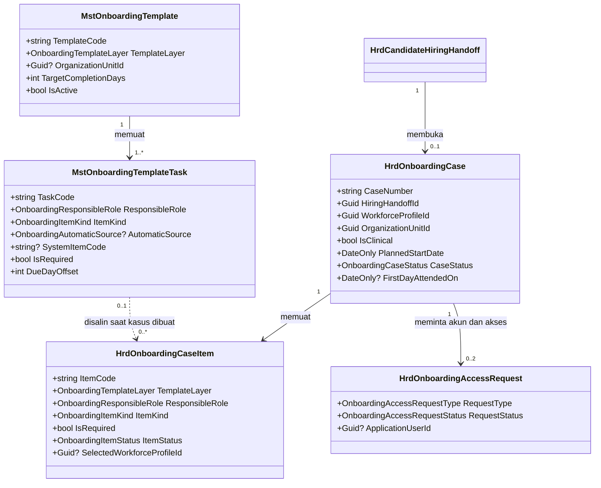

#### 18.3.2 Kontrak kerja dan keputusannya

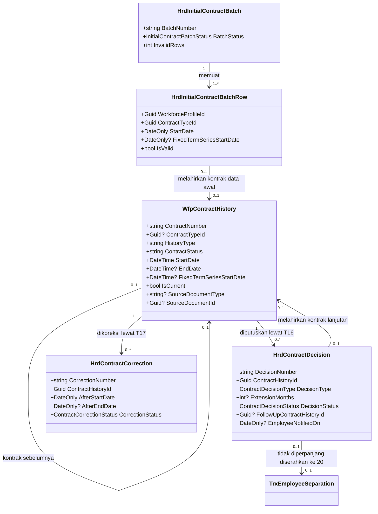

#### 18.3.3 Masa percobaan dan pendampingan klinis

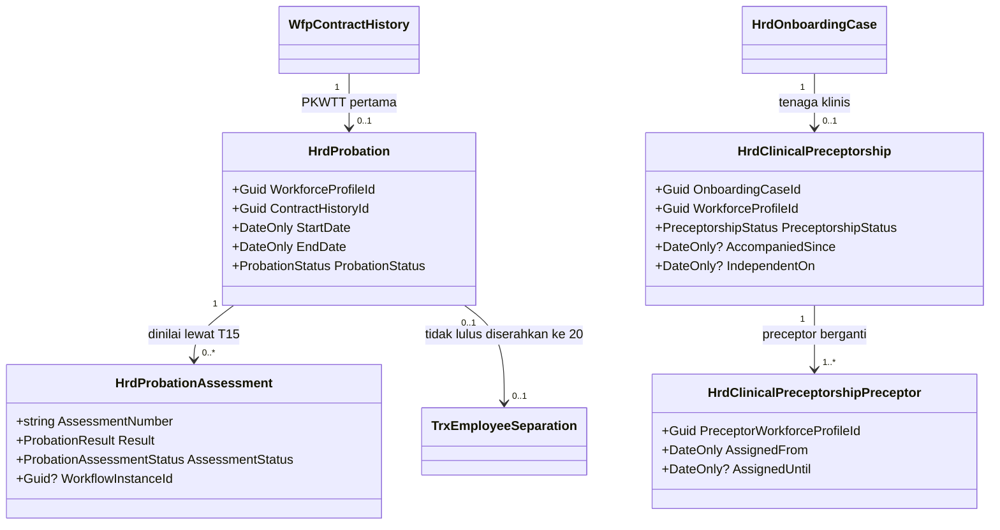

#### 18.3.4 Controller, service, dan service pemilik di modul lain


### 18.4 Penjelasan setiap class

#### 18.4.1 `HrdOnboardingCase`

| Aspek | Penjelasan |
| --- | --- |
| **Status** | `Baru` |
| **Lokasi file** | `Areas/Corporate/HumanResource/LifecycleManagement/Models/HrdOnboardingCase.cs` |
| Kategori | Transaksi |
| Tanggung jawab utama | Satu perjalanan pegawai baru dari serah terima rekrutmen sampai siap kerja atau batal bergabung. Memegang tanggal mulai rencana, unit dan jabatan tujuan, koordinator HRD, dan tanda hadir hari pertama |
| Field penting | `CaseNumber`, `HiringHandoffId` (unik), `WorkforceProfileId`, `HospitalSiteId`, `OrganizationUnitId`, `PositionId`, `IsClinical`, `PlannedStartDate`, `CoordinatorUserId`, `CaseStatus`, `FirstDayAttendedOn`, `ReadyForWorkAt`, `ReadyForWorkByUserId`, `CancelReason`, `CancelNote`, `HasGeneralTemplate`, `RowVersion` |
| Navigation property dan relasi | Milik satu `HrdCandidateHiringHandoff`; punya banyak `HrdOnboardingCaseItem`, nol atau satu `HrdClinicalPreceptorship`, nol sampai dua `HrdOnboardingAccessRequest` |
| Pemakaian dalam alur bisnis | Dibuat otomatis saat HR Manager menjalankan serah terima di 04 (`HRD-DEC-083`). Dibuka HRD dan Kepala Unit setiap hari sampai pegawai siap kerja |
| Catatan desain | Unit, jabatan, `IsClinical`, dan tanggal mulai **disalin** dari serah terima saat kasus dibuat agar penyaringan cakupan unit tidak perlu menelusuri rekrutmen. `HasGeneralTemplate = false` bila saat kasus dibuat belum ada Template Umum aktif; kasus tetap terbentuk dengan butir sistem saja dan menampilkan peringatan |
| Ekuivalen model lama | `TrxEmployeeOnboarding`, `WfpOnboardingChecklist` (dibuang) |

#### 18.4.2 `HrdOnboardingCaseItem`

| Aspek | Penjelasan |
| --- | --- |
| **Status** | `Baru` |
| **Lokasi file** | `Areas/Corporate/HumanResource/LifecycleManagement/Models/HrdOnboardingCaseItem.cs` |
| Kategori | Transaksi (anak kasus) |
| Tanggung jawab utama | Satu butir checklist milik satu pegawai, disalin dari template saat kasus dibuat. Menyimpan siapa yang mencentang, kapan, bukti, dan orang yang dipilih untuk butir pemilihan |
| Field penting | `OnboardingCaseId`, `TemplateLayer`, `SourceTemplateTaskId`, `ItemCode`, `ItemName`, `SystemItemCode`, `ResponsibleRole`, `ItemKind`, `AutomaticSource`, `CertificationTypeId`, `IsRequired`, `DueDayOffset`, `DueDate`, `ItemStatus`, `CompletedAt`, `CompletedByUserId`, `CompletionNote`, `SelectedWorkforceProfileId`, `EvidenceStoragePath`, `EvidenceFileName`, `AutomaticResultNote` |
| Navigation property dan relasi | Milik `HrdOnboardingCase`; menunjuk butir template asal bila ada; menunjuk profil yang dipilih (atasan langsung atau preceptor) |
| Pemakaian dalam alur bisnis | Dicentang HRD atau Kepala Unit sesuai `ResponsibleRole`; butir otomatis diisi sistem |
| Catatan desain | Urutan tampil memakai field semantik `TemplateLayer` lalu `DueDayOffset` lalu `ItemName`, **bukan** `SortOrder` (kontrak rekayasa backend baris 48). Perubahan template tidak mengubah butir yang sudah disalin (`HRD-DEC-086` `TEMPLATE_CHANGE_NOT_RETROACTIVE`) |
| Ekuivalen model lama | `TrxEmployeeOnboardingTask`, `WfpOnboardingTask` (dibuang) |

**Lima butir sistem** selalu ada pada kasus yang sesuai, tidak dapat dihapus dari template, dan selalu
wajib:

| `SystemItemCode` | Lapis | Jenis | Penanggung jawab | Selesai bila | Dasar |
| --- | --- | --- | --- | --- | --- |
| `FIRST_DAY_ATTENDANCE` | Umum | Manual | HRD | HRD mencatat pegawai hadir pada hari pertama | `HRD-DEC-083` butir 7, `HRD-DEC-088` butir 1 |
| `CONTRACT_SIGNED` | Umum | Otomatis | Sistem | Kontrak pertama berstatus `Active` | `HRD-DEC-084` butir 5 |
| `FITNESS_CLEARANCE` | Umum | Otomatis | Sistem | Kesimpulan MCU pada tawaran `Fit` atau `FitWithRestrictions` | `HRD-DEC-078`, `HRD-TF-050` |
| `DIRECT_SUPERVISOR_ASSIGNED` | Umum | Pemilihan orang | Kepala Unit | Kepala Unit memilih atasan langsung | Bagian 18.9.6 |
| `PRECEPTOR_ASSIGNED` | Klinis | Pemilihan orang | Kepala Unit | Kepala Unit memilih preceptor | `HRD-DEC-087` butir 2 |

#### 18.4.3 `MstOnboardingTemplate` dan `MstOnboardingTemplateTask`

| Aspek | Penjelasan |
| --- | --- |
| **Status** | `Diperbarui` — kolom yang dibuang dan ditambah dirinci pada bagian 18.6 |
| **Lokasi file** | `Areas/Corporate/HumanResource/LifecycleManagement/Models/MstOnboardingTemplate.cs`, `MstOnboardingTemplateTask.cs` |
| Kategori | Master |
| Tanggung jawab utama | Tiga lapis template (`HRD-DEC-086`): tepat satu Template Umum aktif, tepat satu Template Tambahan Tenaga Klinis aktif, dan nol atau satu Template Tambahan Unit aktif per unit |
| Field penting | Template: `TemplateCode`, `TemplateName`, `TemplateLayer`, `OrganizationUnitId`, `TargetCompletionDays`, `Version`, `IsActive`. Butir: `TaskCode`, `TaskName`, `TaskCategory`, `ResponsibleRole`, `ItemKind`, `AutomaticSource`, `CertificationTypeId`, `SystemItemCode`, `IsRequired`, `DueDayOffset`, `IsActive` |
| Navigation property dan relasi | Template punya banyak butir; butir otomatis jenis sertifikat menunjuk `MstCertificationType` |
| Pemakaian dalam alur bisnis | Disusun HRD sekali; dibaca saat kasus onboarding dibuat |
| Catatan desain | Prefix `Mst` tetap (`HRD-DEC-019`). **Utang teknis lokasi:** master berada di folder `LifecycleManagement/Models`, bukan `MasterData`; pemindahan folder adalah task tersendiri dan **MUST NOT** ikut task slice ini. `Version` naik setiap kali template disimpan, untuk jejak audit |
| Ekuivalen model lama | Model yang sama, dengan 15 kolom pembeda dan pengaturan yang tidak dipakai dibuang |

#### 18.4.4 `WfpContractHistory`

| Aspek | Penjelasan |
| --- | --- |
| **Status** | `Diperbarui` — **hanya penambahan kolom**; tidak ada kolom yang dibuang atau berubah tipe |
| **Lokasi file** | `Areas/Corporate/HumanResource/WorkforceCore/Models/WfpContractHistory.cs` (milik 02) |
| Kategori | Transaksi milik Workforce Core |
| Tanggung jawab utama | Satu baris per kontrak kerja pegawai. Perpanjangan dirantai lewat `PreviousContractHistoryId` dan `RenewalSequence` |
| Field penting (baru) | `SourceDocumentType`, `SourceDocumentId`, `FixedTermSeriesStartDate`, `DocumentFileName`, `DocumentContentType`, `SignedRecordedAt`, `SignedRecordedByUserId`, `RowVersion` |
| Nilai baru pada kolom teks yang sudah ada | `HistoryType`: tambah `InitialData` dan `Conversion`. `ContractStatus`: tambah `Completed` dan `LapsedWithoutDecision`. Nilai lama tetap dikenali saat dibaca |
| Navigation property dan relasi | Menunjuk profil, jenis kontrak, jenis kepegawaian; punya nol atau satu `HrdProbation`, banyak `HrdContractDecision` dan `HrdContractCorrection` |
| Pemakaian dalam alur bisnis | Ditulis **hanya** oleh `WfpContractHistoryWriteService`, yang dipanggil service 05 |
| Catatan desain | Indeks yang sudah ada dipakai apa adanya: nomor kontrak unik per pegawai, dan tepat satu kontrak `IsCurrent` per pegawai (`WfpContractHistoryConfiguration.cs:35-36`). `ProbationEndDate` diisi sistem dari `HrdProbation` dan tidak pernah diisi tangan |
| Ekuivalen model lama | — |

#### 18.4.5 `HrdProbation` dan `HrdProbationAssessment`

| Aspek | Penjelasan |
| --- | --- |
| **Status** | `Baru` |
| **Lokasi file** | `Areas/Corporate/HumanResource/LifecycleManagement/Models/HrdProbation.cs`, `HrdProbationAssessment.cs` |
| Kategori | Transaksi |
| Tanggung jawab utama | `HrdProbation`: satu masa percobaan per kontrak PKWTT pertama pegawai yang bergabung langsung sebagai PKWTT. `HrdProbationAssessment`: satu pengajuan hasil oleh atasan; pengajuan yang ditolak tetap tersimpan, dan atasan dapat membuat pengajuan baru |
| Field penting | Masa percobaan: `WorkforceProfileId`, `ContractHistoryId` (unik), `StartDate`, `EndDate`, `ReminderFromDate`, `ProbationStatus`, `ClosedAt`, `EmployeeSeparationId`. Penilaian: `AssessmentNumber`, `ProbationId`, `Result`, `ReasonText`, `Evidence*`, `AssessmentStatus`, `WorkflowInstanceId`, `SubmittedByUserId`, `DecidedByUserId`, `DecisionNote` |
| Navigation property dan relasi | Masa percobaan milik satu kontrak; punya banyak penilaian; bila tidak lulus menunjuk catatan pemisahan di 20 |
| Pemakaian dalam alur bisnis | Dibuat sistem saat kontrak PKWTT pertama ditandatangani; dinilai atasan lewat `T15` |
| Catatan desain | Tidak ada kolom skor dan tidak ada tanggal perpanjangan (`HRD-DEC-085` `SIMPLE_RESULT`, `THREE_MONTHS_FIXED`). Paling banyak satu penilaian berstatus `Submitted` atau `Returned` per masa percobaan |
| Ekuivalen model lama | `TrxProbationReview` (dibuang) |

#### 18.4.6 `HrdClinicalPreceptorship` dan `HrdClinicalPreceptorshipPreceptor`

| Aspek | Penjelasan |
| --- | --- |
| **Status** | `Baru` |
| **Lokasi file** | `Areas/Corporate/HumanResource/LifecycleManagement/Models/HrdClinicalPreceptorship.cs`, `HrdClinicalPreceptorshipPreceptor.cs` |
| Kategori | Transaksi |
| Tanggung jawab utama | Pendampingan klinis tenaga klinis baru, terpisah dari masa percobaan (`HRD-DEC-087`). Baris preceptor menyimpan siapa mendampingi dari tanggal berapa sampai tanggal berapa, sehingga pergantian preceptor tetap tertelusuri untuk akreditasi |
| Field penting | `OnboardingCaseId` (unik), `WorkforceProfileId`, `OrganizationUnitId`, `PreceptorshipStatus`, `AccompaniedSince`, `IndependentOn`, `DeclaredByUserId`, `Evidence*`, `AssessmentNote`; preceptor: `PreceptorWorkforceProfileId`, `AssignedFrom`, `AssignedUntil`, `AssignedByUserId`, `ChangeReason` |
| Navigation property dan relasi | Milik satu kasus onboarding; punya satu atau lebih baris preceptor; tepat satu baris tanpa `AssignedUntil` selama pendampingan berjalan |
| Pemakaian dalam alur bisnis | Lahir saat butir `PRECEPTOR_ASSIGNED` dicentang; menjadi `Accompanied` saat siap kerja; menjadi `Independent` saat Kepala Unit menekan **Siap Mandiri** |
| Catatan desain | **Tidak** masuk mesin persetujuan (`CLINICAL_DECISION_NOT_HRD`). HRD hanya membaca |
| Ekuivalen model lama | — |

#### 18.4.7 `HrdContractDecision` dan `HrdContractCorrection`

| Aspek | Penjelasan |
| --- | --- |
| **Status** | `Baru` |
| **Lokasi file** | `Areas/Corporate/HumanResource/LifecycleManagement/Models/HrdContractDecision.cs`, `HrdContractCorrection.cs` |
| Kategori | Transaksi |
| Tanggung jawab utama | Keputusan: satu dari tiga pilihan atas kontrak PKWT yang akan berakhir (`HRD-DEC-089` butir 2), diputus lewat `T16`. Koreksi: perbaikan isi kontrak yang sudah ditandatangani lewat `T17`; menyimpan nilai **sebelum** dan **sesudah** beserta scan perbaikan |
| Field penting | Keputusan: `DecisionNumber`, `ContractHistoryId`, `WorkforceProfileId`, `DecisionType`, `ExtensionMonths`, `ProposedStartDate`, `ProposedEndDate`, `ReasonText`, `DecisionStatus`, `WorkflowInstanceId`, `FollowUpContractHistoryId`, `EmployeeNotifiedOn`, `EmployeeSeparationId`. Koreksi: `CorrectionNumber`, `ContractHistoryId`, `Before*`, `After*`, `ReasonText`, `Evidence*`, `CorrectionStatus`, `WorkflowInstanceId`, `AppliedAt` |
| Navigation property dan relasi | Keduanya milik satu baris kontrak; keputusan yang disetujui menunjuk kontrak lanjutan atau catatan pemisahan |
| Pemakaian dalam alur bisnis | Keputusan diajukan atasan langsung atau Kepala Unit dari daftar Perlu Tindakan; koreksi diajukan petugas HRD |
| Catatan desain | Koreksi memperbarui baris kontrak **di tempat** dan menyimpan versi lama sebagai kolom `Before*` pada baris koreksi (`HRD-DEC-089` `CONTRACT_CORRECTION`: versi lama tetap tersimpan). Pilihan ini menjaga rantai perpanjangan dan hitungan 5 tahun tetap satu jalur |
| Ekuivalen model lama | `TrxContractNonRenewal` (dibuang) untuk keputusan tidak diperpanjang |

#### 18.4.8 `HrdInitialContractBatch` dan `HrdInitialContractBatchRow`

| Aspek | Penjelasan |
| --- | --- |
| **Status** | `Baru` |
| **Lokasi file** | `Areas/Corporate/HumanResource/LifecycleManagement/Models/HrdInitialContractBatch.cs`, `HrdInitialContractBatchRow.cs` |
| Kategori | Transaksi |
| Tanggung jawab utama | Data awal kontrak pegawai yang sudah bekerja sebelum sub-modul ini berjalan (`HRD-DEC-090`), disetujui sekali lewat `T18` |
| Field penting | Batch: `BatchNumber`, `HospitalSiteId`, `BatchStatus`, `TotalRows`, `ValidRows`, `InvalidRows`, `WorkflowInstanceId`, `AppliedAt`. Baris: `WorkforceProfileId`, `ContractTypeId`, `ContractNumber`, `StartDate`, `EndDate`, `FixedTermSeriesStartDate`, `IsValid`, `ValidationMessage`, `CreatedContractHistoryId` |
| Navigation property dan relasi | Batch punya banyak baris; baris yang diterapkan menunjuk kontrak yang lahir |
| Pemakaian dalam alur bisnis | Sekali saat sub-modul mulai dipakai; sesekali untuk pegawai yang tertinggal |
| Catatan desain | Mengikuti pola `HrdInitialPlacementBatch` (`HRD-DEC-054`). Scan kontrak lama boleh menyusul (`SCAN_MAY_FOLLOW_FOR_LEGACY`) |
| Ekuivalen model lama | — |

#### 18.4.9 `HrdOnboardingAccessRequest` dan `HrdEmploymentLifecycleSetting`

| Aspek | Penjelasan |
| --- | --- |
| **Status** | `Baru` |
| **Lokasi file** | `Areas/Corporate/HumanResource/LifecycleManagement/Models/HrdOnboardingAccessRequest.cs`, `HrdEmploymentLifecycleSetting.cs` |
| Kategori | Transaksi; pengaturan |
| Tanggung jawab utama | Permintaan akses: dua baris per kasus — `AccountCreation` (dikerjakan sistem lewat service 01) dan `WorkAccess` (dikerjakan Administrator/IT setelah siap kerja). Pengaturan: empat angka kebijakan per rumah sakit |
| Field penting | Permintaan: `OnboardingCaseId`, `WorkforceProfileId`, `RequestType`, `RequestStatus`, `ApplicationUserId`, `FailureMessage`, `SelfServiceActivatedAt`, `RequestedAt`, `CompletedAt`, `CompletedByUserId`, `CompletionNote`. Pengaturan: `HospitalSiteId` (unik), `ContractReminderDays`, `ContractEscalationDays`, `ProbationReminderDays`, `LateStartFlagDays` |
| Navigation property dan relasi | Permintaan milik kasus; pengaturan per site |
| Pemakaian dalam alur bisnis | Permintaan akun dibuat bersama kasus; akses kerja diminta saat siap kerja; pengaturan diubah HR Manager |
| Catatan desain | Pemberian peran tetap di layar peran yang sudah ada milik Administrator; sub-modul 05 **MUST NOT** memberi peran sendiri (`HRD-DEP-003`, `HRD-DEC-032`) |
| Ekuivalen model lama | `TrxAccessRevocation` milik 20 untuk sisi pencabutan — tidak disentuh |

#### 18.4.10 Service

Seluruh service `Baru` sub-modul 05 berada di
`Areas/Corporate/HumanResource/LifecycleManagement/Services/`, tanpa interface, didaftarkan
`AddScoped<T>()` di `Program.cs` dekat registrasi HR lain.

| Service | Fungsi utama | Dipanggil oleh | Membuka transaksi |
| --- | --- | --- | :---: |
| `HrdOnboardingCaseService` | Membuat kasus dari serah terima (idempoten per `HiringHandoffId`), menggabung tiga lapis template, mencatat hadir hari pertama, mencentang dan membatalkan centang butir, mengalihkan koordinator, menyatakan siap kerja, batal bergabung | `HrdOnboardingCaseController`; service serah terima 04 | Ya, kecuali saat dipanggil 04 — ikut transaksi pemanggil |
| `HrdOnboardingAutomaticItemService` | Menilai butir otomatis: kontrak sudah ditandatangani, kelaikan MCU, sertifikat pelatihan wajib | Case service, contract service, scheduler | Ikut transaksi pemanggil |
| `HrdOnboardingTemplateService` | Menyusun tiga lapis template dan menjaga butir sistem | `HrdOnboardingTemplateController` | Ya |
| `HrdEmploymentContractService` | Menyusun draf kontrak pertama dari tawaran (`HRD-DEC-084`, `HRD-DEC-095`), menandai sudah ditandatangani, menyusun draf kontrak lanjutan, unggah scan kontrak data awal, data cetak, hitungan 5 tahun | Controller kontrak; case service; decision service; batch service | Ya |
| `HrdContractDecisionService` | Mengajukan, mengubah, menarik keputusan; menerapkan keputusan yang disetujui; mencatat tanggal pemberitahuan | Controller kontrak; integrasi workflow | Ya |
| `HrdContractCorrectionService` | Mengajukan dan menerapkan koreksi kontrak | Controller kontrak; integrasi workflow | Ya |
| `HrdProbationService` | Membuat masa percobaan, pengajuan hasil, penerapan keputusan, lulus otomatis | Controller masa percobaan; contract service; integrasi workflow; scheduler | Ya |
| `HrdClinicalPreceptorshipService` | Membuat pendampingan dari butir preceptor, mengganti preceptor, menyatakan siap mandiri | Controller pendampingan; case service | Ya |
| `HrdInitialContractBatchService` | Templat, validasi, simpan, ajukan `T18`, terapkan | Controller batch; integrasi workflow | Ya |
| `HrdOnboardingAccessService` | Membuat akun lewat `EmployeeUserAccountService`, mengaktifkan akun layanan mandiri saat hadir hari pertama, meminta akses kerja, menandai selesai, mengulang yang gagal | Case service; controller permintaan akses | Ikut transaksi pemanggil, kecuali ulang dan tandai selesai |
| `HrdEmploymentReadinessReadService` | **Kontrak baca untuk sub-modul lain**: boleh dijadwalkan pada tanggal tertentu, penanda Didampingi beserta nama preceptor, peringatan kredensial, penahan jadwal kontrak | 06 Penjadwalan; controller daftar kerja | Tidak |
| `HrdLifecycleWorklistService` | Menyusun daftar Perlu Tindakan per peran dari kasus, kontrak, dan masa percobaan | `HrdLifecycleWorklistController` | Tidak |
| `HrdLifecycleAttachmentService` | Memeriksa jenis dan ukuran berkas, lalu menyimpan lewat `WorkflowFileStorageService` | Seluruh service yang menerima scan atau bukti | Tidak |
| `HrdEmploymentLifecycleWorkflowIntegrationService` | Memulai instance `T15` s.d. `T18`; menerima keputusan akhir dan meneruskannya ke service domain | Service domain; `WorkflowReferenceLifecycleService` | Ya |
| `HrdEmploymentLifecycleSchedulerService` | Harian: lulus otomatis masa percobaan, perpindahan `IsCurrent` pada tanggal mulai kontrak lanjutan, kontrak tidak diperpanjang → `Ended`, kontrak tanpa keputusan → `LapsedWithoutDecision`, penilaian ulang butir otomatis kasus berjalan | `HrdEmploymentLifecycleSchedulerHostedService` | Ya, per langkah |
| `HrdEmploymentLifecycleSchedulerHostedService` | Pembungkus `BackgroundService`, didaftarkan `AddHostedService` dekat registrasi scheduler HR lain | Host aplikasi | — |
| `HrdEmploymentLifecycleSettingService` | Baca dan ubah pengaturan | Controller pengaturan; service lain | Ya |

**Service di modul lain yang `Baru` atau `Diperbarui`:**

| Service | Lokasi | Status | Perubahan |
| --- | --- | --- | --- |
| `WfpContractHistoryWriteService` | `Areas/Corporate/HumanResource/WorkforceCore/Services/` | `Baru` | Satu-satunya penulis `WfpContractHistory`: buat draf, tandai ditandatangani, pindahkan `IsCurrent`, akhiri, tandai tanpa keputusan, terapkan koreksi, sisipkan baris data awal. Dipanggil hanya service 05 |
| `WfpNewHireAssignmentService` | `Areas/Corporate/HumanResource/WorkforceCore/Services/` | `Baru` | Membuat penempatan organisasi, penempatan jabatan, dan penetapan gaji awal saat kontrak pertama ditandatangani, berlaku sejak tanggal mulai kontrak; membuat relasi atasan saat siap kerja. Memakai aturan tumpang tindih `HRD-DEC-049` yang sama dengan `HrdInitialPlacementBatchService` |
| `EmployeeEmploymentRecordService` | `Areas/Corporate/HumanResource/MasterData/Workforce/Services/` | `Baru` | Menulis `EmploymentStatusId`, `EmploymentTypeId`, `JoinDate`, `ContractEndDate`, `ProbationEndDate` pada `MstEmployee` (atau `MstDoctor` untuk profil dokter) sebagai salinan dari kontrak dan masa percobaan |
| `EmployeeUserAccountService` | `Areas/Corporate/HumanResource/MasterData/Workforce/Services/` | `Baru` — **ekstraksi tanpa perubahan perilaku** | Logika pembuatan akun yang hari ini ada di `EmployeeController.cs:3555-3660` dipindah ke service agar dapat dipanggil 05. `EmployeeController` memanggil service ini; perilaku endpoint lamanya tidak berubah. Ditambah dua metode: aktifkan dan nonaktifkan akun |
| `ResignationLifecycleHandoffService` | `Areas/Corporate/HumanResource/LifecycleManagement/Services/` | `Diperbarui` | Metode baru `HandoffLifecycleSeparationAsync` untuk `SeparationType` `ContractNonRenewal` dan `ProbationFailed`: membuat `TrxEmployeeSeparation` berstatus disetujui beserta tanggal terakhir bekerja, lalu membuka exit clearance seperti jalur pengunduran diri. Jalur pengunduran diri tidak berubah |
| `WorkflowReferenceLifecycleService` | `Areas/Corporate/HumanResource/WorkflowManagement/Services/` | `Diperbarui` | Empat jenis rujukan baru: `WorkforceProbationAssessment` (`T15`), `WorkforceContractDecision` (`T16`), `WorkforceContractCorrection` (`T17`), `WorkforceInitialContractBatch` (`T18`) |
| Service serah terima rekrutmen (`BE-HRD-061`, `S-D2`) | `Areas/Corporate/HumanResource/RecruitmentManagement/Services/` | `Diperbarui` pada task 05 | Memanggil `HrdOnboardingCaseService.CreateFromHandoffAsync` di dalam transaksi serah terima (`INT-HR-25`) |
| Service tawaran rekrutmen (`S-D2`) | `.../RecruitmentManagement/Services/` | `Diperbarui` | Validasi jenis dan lama kontrak (`HRD-DEC-095`, `VR-ONB-50`, `VR-ONB-51`) |

**Yang dipakai ulang tanpa perubahan:** mesin persetujuan bersama (`WorkflowService`, termasuk
penolakan swa-setuju `WorkflowService.cs:534-556` bila langkah didefinisikan
`AllowSelfApproval = false`); `NumberSeriesAllocator` untuk seluruh nomor dokumen
(`QBE-CODE-002`, `QBE-CODE-003`) — dipanggil di luar transaksi pemanggil, controller tidak pernah
membuat nomor; `OrganizationAuthorizationProjectionService` untuk cakupan unit Kepala Unit;
`WorkflowFileStorageService` untuk berkas.

#### 18.4.11 Controller

Seluruhnya `Baru` kecuali yang disebut, di `Areas/Corporate/HumanResource/LifecycleManagement/Controllers/`,
memakai `[AccessController]` di kelas dan `[AccessPermission(...)]` di setiap endpoint. Tidak satu pun
mengakses `ApplicationDbContext` langsung (`QBE-SVC-001`). Route dasar
`api/v1/corporate/human-resource/lifecycle-management/...`, mengikuti `ExitClearanceController`.

| Controller | Service yang dipakai | Grup Swagger | Endpoint yang diurus |
| --- | --- | --- | --- |
| `HrdOnboardingCaseController` | `HrdOnboardingCaseService`, `HrdOnboardingAccessService` | `Corporate / Human Resource / Lifecycle Management / Onboarding Case` | Daftar, ringkasan, detail, hadir hari pertama, centang dan batal centang butir HRD, centang dan batal centang butir unit, alihkan koordinator, siap kerja, batal bergabung |
| `HrdOnboardingTemplateController` | `HrdOnboardingTemplateService` | `Corporate / Human Resource / Lifecycle Management / Onboarding Template` | Daftar, detail, buat, ubah, aktif/nonaktif |
| `HrdEmploymentContractController` | `HrdEmploymentContractService`, `HrdContractDecisionService`, `HrdContractCorrectionService` | `Corporate / Human Resource / Lifecycle Management / Employment Contract` | Daftar, detail, data cetak, tandai ditandatangani, unggah scan data awal, keputusan (ajukan, ubah, tarik, catat pemberitahuan), koreksi (ajukan, ubah, tarik) |
| `HrdProbationController` | `HrdProbationService` | `Corporate / Human Resource / Lifecycle Management / Probation` | Daftar, detail, ajukan hasil, ubah hasil yang dikembalikan, tarik |
| `HrdClinicalPreceptorshipController` | `HrdClinicalPreceptorshipService` | `Corporate / Human Resource / Lifecycle Management / Clinical Preceptorship` | Daftar, detail, ganti preceptor, siap mandiri |
| `HrdInitialContractBatchController` | `HrdInitialContractBatchService` | `Corporate / Human Resource / Lifecycle Management / Initial Contract Batch` | Templat, validasi, daftar, detail, buat, ubah, ajukan, batalkan |
| `HrdOnboardingAccessRequestController` | `HrdOnboardingAccessService` | `Corporate / Human Resource / Lifecycle Management / Onboarding Access Request` | Daftar, tandai selesai, ulang pembuatan akun |
| `HrdLifecycleWorklistController` | `HrdLifecycleWorklistService` | `Corporate / Human Resource / Lifecycle Management / Lifecycle Worklist` | Daftar Perlu Tindakan dan hitungannya |
| `HrdEmploymentLifecycleSettingController` | `HrdEmploymentLifecycleSettingService` | `Corporate / Human Resource / Lifecycle Management / Lifecycle Setting` | Baca, ubah |
| `WfpContractHistoryController` | — | `Corporate / Human Resource / Workforce Core / Contract History` | **`Diperbarui`.** Lima endpoint tulis (`POST`, `PUT`, `PATCH status`, `PATCH current`, `DELETE`) menjawab `409` `CONTRACT_MANAGED_BY_LIFECYCLE` (`VR-ONB-32`). Empat endpoint baca tidak berubah |
| `EmployeeController` | `EmployeeUserAccountService` (baru) | Tidak berubah | **`Diperbarui`.** Pembuatan akun memanggil service hasil ekstraksi. `PUT` menolak perubahan `EmploymentTypeId`, `EmploymentStatusId`, `JoinDate`, `ContractEndDate`, dan `ProbationEndDate` untuk pegawai yang kontraknya sudah dikelola 05 (`VR-ONB-33`) |

**Perubahan yang memutus — penilaian consumer.** Endpoint tulis riwayat kontrak 02 hari ini dipakai satu
consumer: tab riwayat kontrak pada `src/components/features/workforce/workforce-resource-editor.jsx`
(`HRD-TF-043`). Isi tabel 0 baris di dev (`HRD-TF-044`). Tab itu menjadi baca saja dengan tautan ke
layar Kontrak Kerja (`03-frontend-architecture.md` bagian 14). Endpoint dipertahankan dan menjawab
`409` beserta pesan, bukan dihapus, agar consumer lama mendapat penjelasan, bukan `404`.

Persetujuan **tidak** punya endpoint di controller domain. Keputusan `T15` s.d. `T18` lewat kotak
masuk persetujuan yang sudah ada (`HRD-DEC-018`).

#### 18.4.12 DTO, enum, konstanta, dan configuration

| Jenis | Lokasi | Isi |
| --- | --- | --- |
| DTO | `Areas/Corporate/HumanResource/LifecycleManagement/DTOs/` | `OnboardingCaseDtos.cs`, `OnboardingTemplateDtos.cs`, `EmploymentContractDtos.cs`, `ContractDecisionDtos.cs`, `ContractCorrectionDtos.cs`, `ProbationDtos.cs`, `ClinicalPreceptorshipDtos.cs`, `InitialContractBatchDtos.cs`, `OnboardingAccessRequestDtos.cs`, `LifecycleWorklistDtos.cs`, `LifecycleSettingDtos.cs`. Bentuk per endpoint pada `contracts/api-contract.md` bagian 15 |
| Enum | `Areas/Corporate/HumanResource/LifecycleManagement/Enums/` | Tabel di bawah. Disimpan sebagai integer (`HasConversion<int>()`) |
| Konstanta | `Areas/Corporate/HumanResource/LifecycleManagement/Constants/EmploymentLifecycleValueConstants.cs` | Lima `SystemItemCode`, empat jenis rujukan workflow, enam kunci number series, nilai baru `HistoryType` dan `ContractStatus`, nilai `SourceDocumentType`, kode `SeparationType` baru, nama kunci advisory lock |
| Configuration | `Repositories/Configurations/Corporate/HumanResource/LifecycleManagement/` | Satu berkas per tabel baru, `Hrd<Nama>Configuration.cs`; dua berkas template yang ada diperbarui. `WfpContractHistoryConfiguration.cs` (WorkforceCore), `MstContractTypeConfiguration` (MasterData), `HrdJobOfferConfiguration.cs` (RecruitmentManagement) diperbarui |
| DbSet | `Repositories/ApplicationDbContext.cs` | 12 `DbSet` baru, jamak: `HrdOnboardingCases`, `HrdOnboardingCaseItems`, dan seterusnya. Enam `DbSet` kandidat dibuang |

| Enum | Nilai | Bawaan |
| --- | --- | --- |
| `OnboardingCaseStatus` | `InProgress=1`, `Completed=2`, `Cancelled=3` | `InProgress` |
| `OnboardingCancelReason` | `NoShow=1`, `Withdrew=2`, `Other=3` | — wajib dipilih |
| `OnboardingTemplateLayer` | `General=1`, `Clinical=2`, `Unit=3` | — |
| `OnboardingResponsibleRole` | `Hrd=1`, `UnitHead=2`, `System=3` | — |
| `OnboardingItemKind` | `Manual=1`, `EvidenceRequired=2`, `Automatic=3`, `PersonSelection=4` | `Manual` |
| `OnboardingAutomaticSource` | `ContractSigned=1`, `FitnessClearance=2`, `MandatoryCertification=3` | — |
| `OnboardingItemStatus` | `Pending=1`, `Completed=2` | `Pending` |
| `OnboardingAccessRequestType` | `AccountCreation=1`, `WorkAccess=2` | — |
| `OnboardingAccessRequestStatus` | `Requested=1`, `Completed=2`, `Failed=3`, `Cancelled=4` | `Requested` |
| `ProbationStatus` | `Running=1`, `AwaitingDecision=2`, `Passed=3`, `PassedAutomatically=4`, `Failed=5` | `Running` |
| `ProbationResult` | `Pass=1`, `Fail=2` | — wajib dipilih |
| `ProbationAssessmentStatus` | `Submitted=1`, `Returned=2`, `Rejected=3`, `Approved=4`, `Withdrawn=5`, `ClosedOnExpiry=6` | `Submitted` |
| `PreceptorshipStatus` | `PreceptorAssigned=1`, `Accompanied=2`, `Independent=3`, `Cancelled=4` | `PreceptorAssigned` |
| `ContractDecisionType` | `Extend=1`, `ConvertToPermanent=2`, `NotRenew=3` | — wajib dipilih |
| `ContractDecisionStatus` | `Submitted=1`, `Returned=2`, `Rejected=3`, `Approved=4`, `Withdrawn=5` | `Submitted` |
| `ContractCorrectionStatus` | `Submitted=1`, `Returned=2`, `Rejected=3`, `Approved=4`, `Withdrawn=5` | `Submitted` |
| `InitialContractBatchStatus` | `Draft=1`, `Submitted=2`, `Returned=3`, `Rejected=4`, `Applied=5`, `Cancelled=6` | `Draft` |

Kolom teks `WfpContractHistory.ContractStatus` **tetap teks** agar nilai lama tidak berubah tipe;
nilai yang dipakai 05 adalah `Draft`, `Active`, `Completed`, `Ended`, `LapsedWithoutDecision`,
`Cancelled`.

### 18.5 Arsitektur folder

```text
Areas/Corporate/HumanResource/LifecycleManagement/
├── Constants/
│   ├── ResignationValueConstants.cs                    Sudah ada — tidak berubah
│   └── EmploymentLifecycleValueConstants.cs            Baru
├── Controllers/
│   ├── ExitClearanceController.cs                      Sudah ada — tidak berubah
│   ├── ResignationController.cs                        Sudah ada — tidak berubah
│   └── Hrd*Controller.cs                               Baru — 9 controller pada 18.4.11
├── DTOs/                                               Baru — 11 berkas pada 18.4.12 (2 berkas lama tidak berubah)
├── Enums/                                              Baru — 17 enum pada 18.4.12
├── Models/
│   ├── HrdOnboardingCase.cs                            Baru (+ CaseItem)
│   ├── HrdOnboardingAccessRequest.cs                   Baru
│   ├── HrdProbation.cs                                 Baru (+ Assessment)
│   ├── HrdClinicalPreceptorship.cs                     Baru (+ Preceptor)
│   ├── HrdContractDecision.cs                          Baru
│   ├── HrdContractCorrection.cs                        Baru
│   ├── HrdInitialContractBatch.cs                      Baru (+ Row)
│   ├── HrdEmploymentLifecycleSetting.cs                Baru
│   ├── MstOnboardingTemplate.cs                        Diperbarui — utang teknis lokasi (master di luar MasterData)
│   ├── MstOnboardingTemplateTask.cs                    Diperbarui — idem
│   ├── TrxEmployeeOnboarding.cs                        Dibuang
│   ├── TrxEmployeeOnboardingTask.cs                    Dibuang
│   ├── WfpOnboardingChecklist.cs                       Dibuang
│   ├── WfpOnboardingTask.cs                            Dibuang
│   ├── TrxProbationReview.cs                           Dibuang
│   ├── TrxContractNonRenewal.cs                        Dibuang
│   └── Trx*/Wfp*/Mst* offboarding, pemisahan, exit     Sudah ada — milik 20, tidak disentuh
└── Services/
    ├── ExitClearanceService.cs                         Sudah ada — tidak berubah
    ├── ResignationLifecycleHandoffService.cs           Diperbarui — satu metode baru
    ├── Resignation*Service.cs                          Sudah ada — tidak berubah
    └── Hrd*Service.cs                                  Baru — 17 service pada 18.4.10

Areas/Corporate/HumanResource/WorkforceCore/
├── Controllers/WfpContractHistoryController.cs         Diperbarui — endpoint tulis menjawab 409
├── Models/WfpContractHistory.cs                        Diperbarui — 8 kolom baru
└── Services/
    ├── WfpContractHistoryWriteService.cs               Baru
    └── WfpNewHireAssignmentService.cs                  Baru

Areas/Corporate/HumanResource/MasterData/Workforce/
├── Controllers/EmployeeController.cs                   Diperbarui — memanggil service akun; kunci 5 isian
├── Models/MstContractType.cs                           Diperbarui — 1 kolom baru
└── Services/
    ├── EmployeeUserAccountService.cs                   Baru — ekstraksi
    └── EmployeeEmploymentRecordService.cs              Baru

Areas/Corporate/HumanResource/RecruitmentManagement/Models/HrdJobOffer.cs   Diperbarui — 2 kolom baru (HRD-DEC-095)

Repositories/Configurations/Corporate/HumanResource/LifecycleManagement/
├── Hrd*Configuration.cs                                Baru — 12 berkas
├── MstOnboardingTemplateConfiguration.cs               Diperbarui
├── MstOnboardingTemplateTaskConfiguration.cs           Diperbarui
└── *Configuration.cs enam kandidat                     Dibuang bersama modelnya
```

**Utang teknis yang tercatat, tidak dirapikan diam-diam:**

| Penyimpangan | Keadaan | Penanganan |
| --- | --- | --- |
| `MstOnboardingTemplate` dan `MstOnboardingTemplateTask` berada di `LifecycleManagement/Models`, bukan `MasterData` | Master yang dipakai slice ini | Pemindahan folder adalah task tersendiri dengan approval pemilik arsitektur backend |
| Logika pembuatan akun ada di dalam `EmployeeController` (controller mengakses `UserManager` dan context langsung) | Dipakai master pegawai | Hanya diekstrak sebatas yang dibutuhkan 05; perapian controller lainnya **MUST NOT** ikut |
| `ResignationLifecycleHandoffService.GenerateNumber("SEP")` membuat nomor tanpa number series | Pola lama 20 | Metode baru memakai `NumberSeriesAllocator` untuk nomor pemisahan yang dibuatnya; metode lama tidak disentuh |

### 18.6 Status model dan dampak migration

| Model | Status | Kolom yang berubah | Dampak migration |
| --- | --- | --- | --- |
| 12 tabel `Hrd*` pada 18.4 | `Baru` | Seluruh kolom pada `data/data-dictionary.md` bagian 10 | Membuat tabel; tidak menyentuh data mana pun |
| `MstOnboardingTemplate` | `Diperbarui` | **Tambah:** `TemplateLayer` (`int`, wajib). **Buang:** `TemplateType`, `LegalEntityId`, `HospitalSiteId`, `DepartmentId`, `PositionId`, `WorkforceTypeId`, `EmployeeCategoryId`, `EmploymentTypeId`, `WorkflowDefinitionId`, `AutoCreateChecklist`, `RequiresProbationReview`, `ProbationReviewAfterDays`, `EffectiveStartDate`, `EffectiveEndDate`, `IsDefault`. **Indeks baru:** satu template aktif per lapis Umum dan Klinis; satu template aktif per unit untuk lapis Unit | Tabel 0 baris (`HRD-TF-047`); pengaman tabel kosong wajib (`HRD-DEC-090` butir 11) |
| `MstOnboardingTemplateTask` | `Diperbarui` | **Tambah:** `ResponsibleRole`, `ItemKind`, `AutomaticSource`, `CertificationTypeId`, `SystemItemCode`. **Buang:** `ResponsiblePartyType`, `ResponsibleOrganizationUnitId`, `ResponsiblePositionId`, `RequiresDocument`, `RequiresVerification`, `CompletionSource`, `SortOrder`. **Indeks:** unik (`OnboardingTemplateId`, `TaskCode`) | Tabel 0 baris; pengaman tabel kosong wajib |
| `WfpContractHistory` | `Diperbarui` | **Tambah saja:** `SourceDocumentType` (`varchar(50)`, null), `SourceDocumentId` (`uuid`, null), `FixedTermSeriesStartDate` (`timestamp`, null), `DocumentFileName` (`varchar(250)`, null), `DocumentContentType` (`varchar(150)`, null), `SignedRecordedAt` (`timestamp`, null), `SignedRecordedByUserId` (`uuid`, null), `RowVersion` (`uuid`, wajib, bawaan `gen_random_uuid()`) | Penambahan kolom boleh-null dan satu kolom berbawaan; **aman bagi data yang ada**. Tabel milik 02 ini **tidak** termasuk penutupan `HRD-Q-05` (`HRD-DEC-090` butir 10), sehingga tidak ada kolom yang dibuang |
| `MstContractType` | `Diperbarui` | **Tambah:** `EmploymentTypeId` (`uuid`, null, FK `MstEmploymentType`, `Restrict`) — jenis kepegawaian yang dipakai kontrak jenis ini | Penambahan kolom boleh-null; aman |
| `HrdJobOffer` | `Diperbarui` | **Tambah:** `ContractTypeId` (`uuid`, null di database, wajib di aturan service; FK `MstContractType`, `Restrict`), `ContractDurationMonths` (`int`, null) (`HRD-DEC-095`) | Penambahan kolom boleh-null; aman bagi baris uji `S-D2` yang mungkin sudah ada |
| `MstEmployee`, `MstDoctor` | `Sudah ada` | Tidak ada | Tidak ada; hanya aturan penulisan lima isian yang berubah |
| `WfpOrganizationAssignment`, `WfpPositionAssignment`, `WfpSalaryAssignment`, `WfpManagerAssignment` | `Sudah ada` | Tidak ada | Tidak ada |
| `TrxEmployeeSeparation` | `Sudah ada` | Tidak ada — nilai teks baru `ContractNonRenewal` dan `ProbationFailed` pada `SeparationType` | Tidak ada; bukan *material touch* menurut `HRD-DEC-019` karena kontrak persistence tidak berubah |
| `MstEmploymentStatus`, `MstEmploymentType`, `MstCertificationType` | `Sudah ada` | Tidak ada; hanya baris data (bagian 18.8) | Tidak ada |
| `TrxEmployeeOnboarding`, `TrxEmployeeOnboardingTask`, `WfpOnboardingChecklist`, `WfpOnboardingTask`, `TrxProbationReview`, `TrxContractNonRenewal` | Dibuang | Seluruh tabel | Dibuang dengan pengaman tabel kosong (bagian 18.7) |

### 18.7 Rencana migration

**Peringatan:** blueprint tidak memberi wewenang membuat atau menjalankan migration. Rencana ini
adalah bahan task implementasi.

| Urutan | Migration | Isi | Tanpa downtime? | Pengisian data lama | Langkah mundur |
| ---: | --- | --- | :---: | --- | --- |
| 1 | `AddOfferContractTerms` | Dua kolom pada `HrdJobOffer` (`HRD-DEC-095`) | **Ya** — hanya `ADD COLUMN` boleh-null | Tidak ada | `Down()` membuang kedua kolom |
| 2 | `RetireLifecycleOnboardingCandidateTables` | Membuang enam tabel kandidat: urutan `TrxProbationReview` → `TrxEmployeeOnboardingTask` → `TrxEmployeeOnboarding` → `WfpOnboardingTask` → `WfpOnboardingChecklist` → `TrxContractNonRenewal` | **Ya** — tabel tidak dipakai kode mana pun | Tidak ada; tabel kosong | Hanya lewat migration baru yang membuat ulang tabel; tidak ada data yang hilang karena pengaman |
| 3 | `ReshapeOnboardingTemplates` | Mengubah dua tabel template sesuai bagian 18.6 | **Ya** | Tidak ada; tabel kosong | `Down()` mengembalikan kolom lama tanpa isi |
| 4 | `AddEmploymentLifecycleCore` | Membuat 12 tabel `Hrd*`; menambah kolom `WfpContractHistory` dan `MstContractType` | **Ya** — `CREATE TABLE` dan `ADD COLUMN` boleh-null | `RowVersion` pada baris kontrak yang ada diisi bawaan | `Down()` membuang tabel dan kolom baru; aman selama belum ada data, setelah itu mundur hanya lewat migration baru |

**Pengaman tabel kosong (`HRD-DEC-090` butir 11–12).** Migration 2 dan 3 **MUST** membuka setiap
pembuangan tabel atau kolom dengan blok `DO $$ … IF EXISTS (SELECT 1 FROM public."<tabel>" LIMIT 1)
THEN RAISE EXCEPTION 'MIGRATION ABORTED: tabel <tabel> berisi % baris', … END IF; $$`, mengikuti
`Migrations/20260902072756_DropTableMstBillingCategory.cs:36-42`; **MUST NOT** memakai
`DROP … CASCADE`. Bila pengaman berhenti di lingkungan mana pun, `HRD-DEC-090` butir 10 kembali
`draft`.

**Urutan terhadap `S-D2`.** Pada HEAD `8b17b75a`, `TrxEmployeeOnboarding` dan
`WfpOnboardingChecklist` merujuk `TrxCandidateHiring`, yang dibuang pembersihan `S-D2` (bagian
17.5). Saat bagian ini ditulis, pembersihan itu **sedang dikerjakan di working tree dan belum
di-commit**: `TrxCandidateHiring` dihapus, navigasi `CandidateHiring` pada kedua model dipindah ke
`HrdCandidateHiringHandoff`, dan migration `20261104113000_AddRecruitmentManagementCoreAndRetireLegacy`
ditambahkan. Akibatnya:

1. bila pembersihan `S-D2` itu masuk lebih dulu, migration 2 di atas membuang kedua tabel yang kini
   merujuk `HrdCandidateHiringHandoff` — urutannya tidak lagi saling mengunci;
2. bila migration 2 masuk lebih dulu, pembersihan `S-D2` tidak perlu memindahkan rujukan kedua
   tabel itu lagi;
3. task implementasi `S-C4-ONB` **MUST** memeriksa ulang keadaan kedua model dan migration
   tersebut pada HEAD saat task dikerjakan, bukan memakai keadaan bagian ini.

### 18.8 Rencana data master awal

Tanpa isian di bawah, sub-modul 05 tidak dapat dipakai sama sekali.

| Data | Isi minimum | Sumber nilai | Diisi lewat |
| --- | --- | --- | --- |
| Jenis kontrak (`MstContractType`, 0 baris hari ini) | `PKWT` — wajib tanggal berakhir, dapat diperpanjang, **tanpa** masa percobaan, jenis kepegawaian "Kontrak"; `PKWTT` — tanpa tanggal berakhir, tidak diperpanjang, **dengan** masa percobaan, jenis kepegawaian "Tetap" | PP 35/2021; UU 13/2003 Pasal 60 | Master jenis kontrak yang sudah ada (`ContractTypeController`) |
| Jenis kepegawaian (`MstEmploymentType`, 1 baris `Legacy`) | "Kontrak" (`IsContractBased`, wajib tanggal akhir kontrak) dan "Tetap" (`IsPermanent`) | Kebijakan HR | Master yang sudah ada |
| Status kepegawaian (`MstEmploymentStatus`, 1 baris `Legacy`) | `PENDING_ONBOARDING` — belum aktif bekerja, **tidak** boleh dijadwalkan, layak payroll; `ACTIVE` — aktif, boleh dijadwalkan, layak payroll; `CANCELLED_JOIN` — batal bergabung, tidak boleh dijadwalkan, tidak layak payroll, status akhir | `HRD-DEC-075`, `HRD-DEC-088` | Master yang sudah ada (`EmploymentStatusController`) |
| Template Umum RS | Satu template aktif berisi butir sistem `FIRST_DAY_ATTENDANCE`, `CONTRACT_SIGNED`, `FITNESS_CLEARANCE`, `DIRECT_SUPERVISOR_ASSIGNED`, ditambah butir rumah sakit — contoh: orientasi umum (wajib bukti daftar hadir), ID card dan seragam, data rekening | SOP orientasi rumah sakit | Layar Template Onboarding |
| Template Tambahan Tenaga Klinis | Satu template aktif berisi butir sistem `PRECEPTOR_ASSIGNED`, ditambah butir sertifikat wajib — contoh: BLS/BTCLS berlaku | SOP keperawatan dan Komite | Layar Template Onboarding |
| Jenis sertifikat (`MstCertificationType`, 8 baris di dev) | Jenis yang dipakai butir otomatis sertifikat, misalnya BTCLS dan BLS | Master yang sudah ada | Tidak perlu diisi ulang bila sudah ada |
| Definisi alur `T15` s.d. `T18` | Empat definisi, masing-masing **satu langkah** berpenyetuju `SiteHr` dan `AllowSelfApproval = false` (`HRD-DEC-081`) | `HRD-DEC-081` | Master definisi workflow yang sudah ada |
| Number series | Enam kunci: kasus onboarding, kontrak kerja, penilaian masa percobaan, keputusan kontrak, koreksi kontrak, batch data awal kontrak | Konvensi penomoran HR | Konfigurasi number series |
| Pengaturan siklus | Satu baris per rumah sakit dengan bawaan 60 / 14 / 14 / 3 hari (bagian 18.9.5) | `HRD-DEC-085` butir 4, `HRD-DEC-089` butir 1 dan 8 — **nilai kebijakan, dapat diubah HR Manager** | Layar Pengaturan |
| Pemetaan peran | HR Admin, HR Manager, Kepala Unit, Administrator/IT ke peran aplikasi | Administrator | `HRD-DEC-032` — `MAPPING_REQUIRED` |

### 18.9 Hitungan dan aturan yang dirancang

#### 18.9.1 Tanggal kontrak

| Hitungan | Rumus | Contoh |
| --- | --- | --- |
| Tanggal berakhir kontrak pertama PKWT | tanggal mulai + lama kontrak (bulan) − 1 hari | Mulai 1 Februari 2027, 12 bulan → **31 Januari 2028** |
| Tanggal mulai kontrak lanjutan | tanggal berakhir kontrak sebelumnya + 1 hari | Berakhir 31 Januari 2028 → mulai **1 Februari 2028** |
| Tanggal berakhir perpanjangan | tanggal mulai lanjutan + bulan perpanjangan − 1 hari | Mulai 1 Februari 2028, 12 bulan → **31 Januari 2029** |

#### 18.9.2 Batas 5 tahun PKWT

`FixedTermSeriesStartDate` adalah tanggal mulai PKWT pertama dalam satu rangkaian PKWT yang tidak
terputus. Diisi sistem pada kontrak PKWT pertama (sama dengan tanggal mulainya), diwariskan ke setiap
perpanjangan, dan diisi dari batch untuk data awal (`HRD-DEC-090` `FIRST_PKWT_DATE_REQUIRED`).

Total PKWT = tanggal berakhir yang diusulkan − `FixedTermSeriesStartDate` + 1 hari. Perpanjangan
ditolak bila totalnya lebih dari 5 tahun (`VR-ONB-36`).

**Contoh.** Budi: PKWT pertama mulai 1 April 2024. Kontrak berjalan berakhir 31 Maret 2027 (total 3
tahun). Perpanjangan 24 bulan → berakhir 31 Maret 2029 → total 5 tahun → **diterima**. Perpanjangan
30 bulan → berakhir 30 September 2029 → total 5 tahun 6 bulan → **ditolak**; pilihan yang tersisa
Angkat jadi Pegawai Tetap atau Tidak Diperpanjang.

#### 18.9.3 Masa percobaan

| Hitungan | Rumus | Contoh |
| --- | --- | --- |
| Berlaku untuk | Kontrak pertama pegawai **dan** jenis kontraknya `IsProbationApplicable = true` **dan** `HistoryType = Initial` | Andi PKWTT sejak bergabung → ada; Rina PKWT → tidak ada; Rina diangkat PKWTT (`HistoryType = Conversion`) → tidak ada |
| Tanggal akhir | tanggal mulai kontrak + 3 bulan − 1 hari | Mulai 1 Februari 2027 → **30 April 2027** |
| Muncul di Perlu Tindakan atasan | tanggal akhir − `ProbationReminderDays` | 30 April − 14 hari → **16 April 2027** |
| Lulus otomatis | Scheduler pada hari sesudah tanggal akhir, bila belum ada hasil yang disetujui | 1 Mei 2027 dini hari → `PassedAutomatically` |

#### 18.9.4 Kontrak tanpa keputusan

Pada hari sesudah tanggal berakhir, scheduler memeriksa setiap kontrak PKWT `Active` yang tanggal
berakhirnya sudah lewat:

| Keadaan | Hasil |
| --- | --- |
| Ada keputusan Tidak Diperpanjang yang disetujui | Kontrak → `Ended` |
| Ada kontrak lanjutan yang sudah ditandatangani | Kontrak lama → `Completed`; kontrak lanjutan menjadi `IsCurrent` |
| Selain itu | Kontrak → `LapsedWithoutDecision`; jadwal sesudah tanggal berakhir ditahan (18.9.7) |

#### 18.9.5 Daftar Perlu Tindakan

Pengingat dirancang sebagai **daftar Perlu Tindakan**, bukan pesan terkirim, karena repository tidak
punya layanan notifikasi (`HRD-TF-052`).

| Butir daftar | Tampil bagi | Muncul sejak | Hilang bila |
| --- | --- | --- | --- |
| Kontrak akan berakhir | Atasan langsung, Kepala Unit, HRD | tanggal berakhir − `ContractReminderDays` (bawaan 60) | Ada keputusan disetujui |
| Kontrak perlu eskalasi | HR Manager | tanggal berakhir − `ContractEscalationDays` (bawaan 14), belum ada keputusan disetujui | Ada keputusan disetujui |
| Kontrak berakhir tanpa keputusan | HRD, HR Manager | Status `LapsedWithoutDecision` | Kontrak lanjutan ditandatangani atau Tidak Diperpanjang disetujui |
| Masa percobaan perlu dinilai | Atasan langsung, Kepala Unit | `ReminderFromDate` | Hasil disetujui atau lulus otomatis |
| Pemberitahuan tidak diperpanjang belum dicatat | HRD | Keputusan Tidak Diperpanjang disetujui | Tanggal pemberitahuan dicatat |
| Kontrak pertama belum ditandatangani | HRD | Kasus onboarding berjalan, kontrak `Draft` | Kontrak `Active` atau kasus batal |
| Pegawai baru terlambat mulai | HRD | Hari ini > tanggal mulai rencana + `LateStartFlagDays` (bawaan 3), belum hadir hari pertama | Hadir dicatat atau Batal Bergabung |
| Scan kontrak data awal belum diunggah | HRD | Kontrak `InitialData` tanpa `DocumentPath` | Scan diunggah |
| Kontrak belum tercatat | HRD | Pegawai aktif tanpa satu pun baris kontrak | Pegawai masuk batch data awal |

#### 18.9.6 Atasan langsung pegawai baru

Pegawai baru tanpa relasi atasan tidak dapat mengajukan cuti (`T1` memakai `RequesterManager`) dan
masa percobaannya tidak punya penilai (`HRD-DEC-085` butir 4). Desain menjawab butir yang
ditinggalkan `HRD-DEC-088` dengan butir sistem `DIRECT_SUPERVISOR_ASSIGNED`:

1. Kepala Unit memilih atasan langsung pada checklist.
2. Relasi atasan (`WfpManagerAssignment`) dibuat saat HRD menyatakan siap kerja, berlaku sejak tanggal
   mulai kontrak, dengan pencatat = Kepala Unit dan penyetuju = petugas HRD yang menyatakan siap kerja.
3. Bila keduanya orang yang sama, siap kerja ditolak (`VR-ONB-12`), sesuai `HRD-DEC-031`.

**Penempatan dan gaji awal** dibuat saat kontrak pertama ditandatangani, dari tawaran yang sudah
disetujui berjenjang (`HRD-DEC-079`, `HRD-DEC-095`). Rantai tawaran itulah persetujuan
`HRD-DEC-031` untuk penempatan dan gaji pertama; tidak ada persetujuan kedua (`HRD-DEC-084`
`NO_SECOND_APPROVAL`). Jejak audit penempatan dan gaji menyimpan nomor tawaran sebagai rujukan
persetujuannya.

#### 18.9.7 Kesiapan dijadwalkan (`HrdEmploymentReadinessReadService`)

Untuk satu pegawai pada tanggal `D`:

| Urutan | Pemeriksaan | Hasil bila kena |
| ---: | --- | --- |
| 1 | Status kepegawaian `IsSchedulable = false` (misalnya `PENDING_ONBOARDING`) | `NotReady` — "belum siap kerja" |
| 2 | Kontrak berjalan PKWT berakhir sebelum `D`, dan tidak ada kontrak bertanda tangan yang mencakup `D` | `ContractHold` — "kontrak berakhir tanpa kontrak lanjutan" |
| 3 | Tidak ada satu pun baris kontrak | `Eligible`, dengan penanda "kontrak belum tercatat" (`HRD-DEC-090` butir 8) |
| 4 | Selain itu | `Eligible` |

Setiap hasil membawa dua penanda informatif: **Didampingi** beserta nama preceptor
(`HRD-DEC-087` butir 4), dan **peringatan kredensial** bila tenaga klinis belum punya
`WfpClinicalPrivilege` aktif (`CREDENTIAL_WARNING_ONLY_UNTIL_14`). Kedua penanda **tidak** menahan
jadwal.

#### 18.9.8 Butir otomatis

| Sumber | Tercentang bila | Diperiksa |
| --- | --- | --- |
| `ContractSigned` | Kontrak pertama berstatus `Active` | Saat kontrak ditandai sudah ditandatangani |
| `FitnessClearance` | Kesimpulan MCU tawaran `Fit` atau `FitWithRestrictions` | Saat kasus dibuat |
| `MandatoryCertification` | Ada `WfpCertification` milik pegawai dengan jenis yang sama, terverifikasi, dan berlaku sampai sesudah hari ini atau seumur hidup | Saat kasus dibuat, setiap hari oleh scheduler, dan sesaat sebelum siap kerja |

`HRD-DEC-086` menyebut status pelatihan wajib "dibaca dari sub-modul 16". Di source, sertifikat
bermasa berlaku seperti BLS/BTCLS disimpan `WfpCertification` di `CredentialingManagement`,
sedangkan `WfpTrainingRecord` (`LearningAndDevelopment`) tidak menyimpan masa berlaku. Desain membaca
`WfpCertification` karena hanya tabel itu yang dapat menjawab "masih berlaku atau tidak". Maksud
keputusan — butir terisi dari data sistem, bukan diketik — tidak berubah.

### 18.10 Yang sengaja tidak dibuat

| Yang ditolak | Alasan |
| --- | --- |
| Memakai ulang `TrxEmployeeOnboarding` atau `WfpOnboardingChecklist` | Dua struktur kembar (`HRD-TF-040`); keduanya merujuk `TrxCandidateHiring` yang sudah digantikan; `WfpOnboardingChecklist` menyimpan hitungan butir sebagai kolom yang dapat basi; `TrxEmployeeOnboarding` membawa `ProbationEndDate` yang menyatukan onboarding dengan masa percobaan |
| Ratchet `TrxEmployeeOnboarding` → `Hrd*` | Bentuknya berubah terlalu banyak; mengikuti preseden `S-D1` dan `S-D2`, model kandidat kosong dibuang dan entity baru diturunkan dari keputusan |
| Memakai ulang `TrxProbationReview` | Membawa skor berbobot dan tanggal perpanjangan yang ditolak `HRD-DEC-085` |
| Memakai ulang `TrxContractNonRenewal` | Hanya mengenal satu dari tiga keputusan kontrak |
| Tabel kontrak kerja kedua di `LifecycleManagement` | Kontrak sudah dimiliki 02 (`WfpContractHistory`) |
| Kolom skor penilaian masa percobaan dan tombol perpanjangan masa percobaan | `HRD-DEC-085` `SIMPLE_RESULT`, `THREE_MONTHS_FIXED` |
| Verifikasi orang kedua per butir checklist | `HRD-DEC-086` `NO_PER_ITEM_VERIFICATION` |
| Template per jabatan, site, atau entitas hukum | `HRD-DEC-086` `THREE_TEMPLATE_LAYERS`, `HRD-DEC-081` butir 6 |
| Persetujuan HRD atas **Siap Mandiri** | `HRD-DEC-087` `CLINICAL_DECISION_NOT_HRD` |
| Blokir kredensial | `HRD-DEC-005` masih `draft`; hanya peringatan |
| Perpanjangan kontrak otomatis atau pengeluaran pegawai otomatis | `HRD-DEC-089` `NO_AUTOMATIC_OUTCOME` |
| Layanan notifikasi surel/push | Tidak ada di repository (`HRD-TF-052`); pengingat lewat daftar Perlu Tindakan |
| Pemberian peran kerja oleh 05 | Wewenang Administrator (`HRD-DEP-003`, `HRD-DEC-032`) |
| SK pengangkatan untuk pegawai baru | Kontrak bertanda tangan sudah menjadi dokumen sahnya; penempatan pertama disetujui lewat tawaran (18.9.6) |
| Endpoint persetujuan di controller domain | Persetujuan satu pintu lewat kotak masuk (`HRD-DEC-018`) |
| Penghitungan uang kompensasi PKWT | Milik 10 Payroll; 05 hanya menyediakan tanggal dan jenis pemisahan |
| Layar "Kontrak Saya" bagi pegawai | Tidak diminta pada pass ini; dapat diusulkan di `S-A2` s.d. `S-A6` |

### 18.11 Strategi test `S-C4-ONB`

Backend tidak memelihara proyek automated test (`rules/backend/TEST_POLICY.md`). Bukti verifikasi tiap
task: `dotnet build`, pemeriksaan QBE, dan uji API terhadap database dev mengikuti
`testing/acceptance-test-matrix.md` bagian 17. Uji yang paling penting dan paling mudah terlewat:

1. serah terima yang dijalankan dua kali tetap menghasilkan satu kasus;
2. penandatanganan kontrak yang gagal di tengah tidak meninggalkan penempatan atau gaji setengah jadi;
3. masa percobaan yang lewat tanpa keputusan berubah menjadi lulus otomatis tepat sehari sesudah
   tanggal akhirnya, dan pengajuan Tidak Lulus yang tertunda tidak dapat disetujui lagi;
4. kontrak PKWT tanpa keputusan menahan jadwal sesudah tanggal berakhirnya;
5. pengaman tabel kosong menghentikan migration bila tabel kandidat diisi satu baris uji;
6. endpoint tulis riwayat kontrak 02 menjawab `409` dengan pesan yang terbaca.

### 18.12 Traceability `S-C4-ONB`

| Keputusan | Dirancang pada |
| --- | --- |
| `HRD-DEC-081` | 18.1, 18.4.10 (`T15` s.d. `T18` satu langkah), 18.8 |
| `HRD-DEC-082` | 18.2, 18.4.10 (`ResignationLifecycleHandoffService`) |
| `HRD-DEC-083` | 18.1, 18.4.1, 18.4.2 |
| `HRD-DEC-084`, `HRD-DEC-095` | 18.4.4, 18.4.10 (`HrdEmploymentContractService`), 18.6 (`HrdJobOffer`), 18.9.1, 18.9.6 |
| `HRD-DEC-085` | 18.4.5, 18.9.3 |
| `HRD-DEC-086` | 18.4.2, 18.4.3, 18.9.8 |
| `HRD-DEC-087` | 18.4.6, 18.9.7 |
| `HRD-DEC-088` | 18.4.9, 18.4.10 (`HrdOnboardingAccessService`), 18.9.6 |
| `HRD-DEC-089` | 18.4.7, 18.9.2, 18.9.4, 18.9.5, 18.9.7 |
| `HRD-DEC-090` | 18.4.8, 18.7 |


---

## 19. Slice `S-B4` — Penjadwalan, Roster, dan On-Call, sub-modul 06 (revision `6`, 4 November 2026)

| Field | Value |
| --- | --- |
| Status | `draft` — Siap diajukan untuk approval pengguna |
| Backend SHA saat bagian ini ditulis | `38e892b0` (branch `MHamzah`) |
| Frontend SHA | `44990b3d3` (branch `HamzahV2`) |
| `input_revision` — decision log | `00-interview-decisions.md` revision `20`, bagian 36 (`HRD-DEC-097` s.d. `HRD-DEC-103`, `HRD-ASM-05` s.d. `HRD-ASM-14`, fakta `HRD-TF-050` s.d. `HRD-TF-057`) |
| `input_revision` — capability map | `01-existing-capability-map.md` revision `1.3`. Baris `HRD-CAP-09` (`SchedulingManagement`) **diperbarui penuh** oleh pass ini |
| Kesiapan requirement | Mengikuti preseden modul HR: gerbang requirement diwajibkan untuk clinical slice; sub-modul 06 beroperasi di atas penanda siap kerja, preceptor, dan kualifikasi yang sudah disepakati di sub-modul 05 (`HRD-DEC-087`, `HRD-DEC-088`) dan master shift |
| Kesiapan arsitektur domain | `DOMAIN_ARCHITECTURE_NOT_RUN` — tidak membuat bounded context klinis atau billing pasien baru; menggunakan titik integrasi read-only ke Lab (`LAB-DEC-111`), Kehadiran (07), Lembur (09), dan Payroll (10) |
| Label slice | `S-B4` — Penjadwalan, Roster, dan On-Call |
| Kompatibilitas | 1 tabel baru (`HrdSchedulingSetting`); 4 tabel `Diperbarui` (`TrxRosterPeriod`, `TrxShiftAssignment`, `TrxShiftReplacement`, `TrxOnCallAssignment`); 2 tabel master awal diisi (`MstShiftPattern`, `MstOnCallType`); 2 tabel ditunda (`TrxEmergencyStaffingRequest`, `TrxRosterApproval` — `HRD-DEC-097`, `HRD-DEC-098`) |

Prinsip yang mengikat seluruh bagian ini:
1. `UNIT_HEAD_COMPOSES_AND_PUBLISHES`: Kepala unit menyusun dan menerbitkan roster unitnya sendiri tanpa persetujuan berjenjang sebelum terbit (`HRD-DEC-098`).
2. `FAIL_SAFE_SAFETY`: Blokir hanya hal yang mustahil secara fisik atau melanggar hukum/kebijakan sah (`B1`–`B7`), sisanya peringatan dengan konfirmasi alasan tertulis (`W1`–`W7`) (`HRD-DEC-099`, `HRD-DEC-100`).
3. `OVERRIDE_PRESERVES_PUBLISHED`: Perubahan setelah terbit tidak boleh menurunkan status periode ke `Draft`; perubahan dicatat dengan audit trail lengkap dan notifikasi otomatis (`HRD-DEC-101`).
4. `MUTABLE_WINDOW_3_DAYS`: Koreksi mundur mandiri dibatasi 3 hari kalender ke belakang; penutupan periode oleh HRD Payroll mengunci jadwal secara mutlak (`Closed`) (`HRD-DEC-102`).
5. `LAB_CONTRACT_PRESERVED`: Status siaga aktif diselaraskan dengan kontrak `LAB-DEC-111` agar dokter konfirmator lab hasil kritis tidak hilang saat dipanggil (`HRD-DEC-103`).

### 19.1 Bounded context dan ownership

| ID | Bounded context | Aggregate root | Tanggung jawab utama | Pemilik modul |
| --- | --- | --- | --- | --- |
| `BC-SCH-01` | Roster Period & Planning | `TrxRosterPeriod` | Periode roster per unit, daftar penugasan staf, validasi bentrok, cuti, siap kerja, kuota minimal, dan penerbitan roster | Corporate HR (Sub-modul 06) |
| `BC-SCH-02` | Shift Assignment & Override | `TrxShiftAssignment` | Penugasan shift harian per pegawai, penggantian shift mendadak (`TrxShiftReplacement`), riwayat perubahan, dan koreksi mundur | Corporate HR (Sub-modul 06) |
| `BC-SCH-03` | On-Call & Emergency Activation | `TrxOnCallAssignment` | Penugasan siaga dokter dan staf penunjang, pencatatan pemanggilan (*call-in*), pemenuhan SLA waktu respon, dan integrasi Lab/Payroll | Corporate HR (Sub-modul 06) & Pelayanan Medis |
| `BC-SCH-04` | Scheduling Governance & Rules | `HrdSchedulingSetting` | Setelan jeda istirahat minimal, batas hari kerja berturut-turut, toleransi koreksi mundur, dan eskalasi aturan peringatan | Corporate HR (Sub-modul 06 / HR Admin) |

### 19.2 Tabel kepemilikan data `S-B4`

| Tabel | Bounded context | Status | Modul pemilik | Dipakai S-B4 | Catatan kepemilikan |
| --- | --- | --- | --- | --- | --- |
| `TrxRosterPeriod` | `BC-SCH-01` | `Diperbarui` | HumanResource (06) | Ya | Tambah kolom tracking publish & closed, perbaiki status vocabulary |
| `TrxRosterAssignment` | `BC-SCH-01` | `Sudah ada` | HumanResource (06) | Ya | Pemetaan staf eligible ke periode roster unit |
| `TrxShiftAssignment` | `BC-SCH-02` | `Diperbarui` | HumanResource (06) | Ya | Tambah flag didampingi, preceptor, override reason, original employee |
| `TrxShiftReplacement` | `BC-SCH-02` | `Diperbarui` | HumanResource (06) | Ya | Penggantian shift darurat dengan validasi B1-B7 dan alasan wajib |
| `TrxOnCallAssignment` | `BC-SCH-03` | `Diperbarui` | HumanResource (06) | Ya | Status diselaraskan dengan Lab, tambah tracking call-in dan SLA |
| `HrdSchedulingSetting` | `BC-SCH-04` | `Baru` | HumanResource (06) | Ya | Menyimpan batas istirahat 11 jam, hari berturut-turut, toleransi 3 hari |
| `TrxRosterPublication` | `BC-SCH-01` | `Sudah ada` | HumanResource (06) | Ya | Jejak audit penerbitan roster bulanan |
| `TrxRosterApproval` | `BC-SCH-01` | `Sudah ada` | HumanResource (06) | **Ditunda** | Ditunda pada rilis pertama sesuai `HRD-DEC-098`, schema tetap ada |
| `TrxEmergencyStaffingRequest` | `BC-SCH-01` | `Sudah ada` | HumanResource (06) | **Ditunda** | Ditunda pada rilis pertama sesuai `HRD-DEC-097`, schema tetap ada |
| `MstShift` | Master Data | `Sudah ada` | HumanResource (01) | Ya (Read-only) | Master definisi jam shift (Pagi, Siang, Malam, Lepas Jaga) |
| `MstShiftPattern` | Master Data | `Sudah ada` | HumanResource (01) | Ya (Read-only) | Pola shift berulang (misal P-S-M-L-L) untuk percepatan penyusunan |
| `MstOnCallType` | Master Data | `Sudah ada` | HumanResource (01) | Ya (Read-only) | Jenis siaga dan target SLA respon menit (Cito Bedah, Lab Hasil Kritis) |
| `MstWorkforceProfile` | WorkforceCore | `Sudah ada` | HumanResource (02) | Ya (Read-only) | Profil pegawai, status keaktifan, dan status kesiapan kerja |
| `HrdClinicalPreceptorship` | Lifecycle | `Sudah ada` | HumanResource (05) | Ya (Read-only) | Penanda status Didampingi dan nama preceptor (`HRD-DEC-087`) |

### 19.3 Class diagram

#### 19.3.1 Roster Period dan Shift Assignment (`BC-SCH-01`, `BC-SCH-02`)

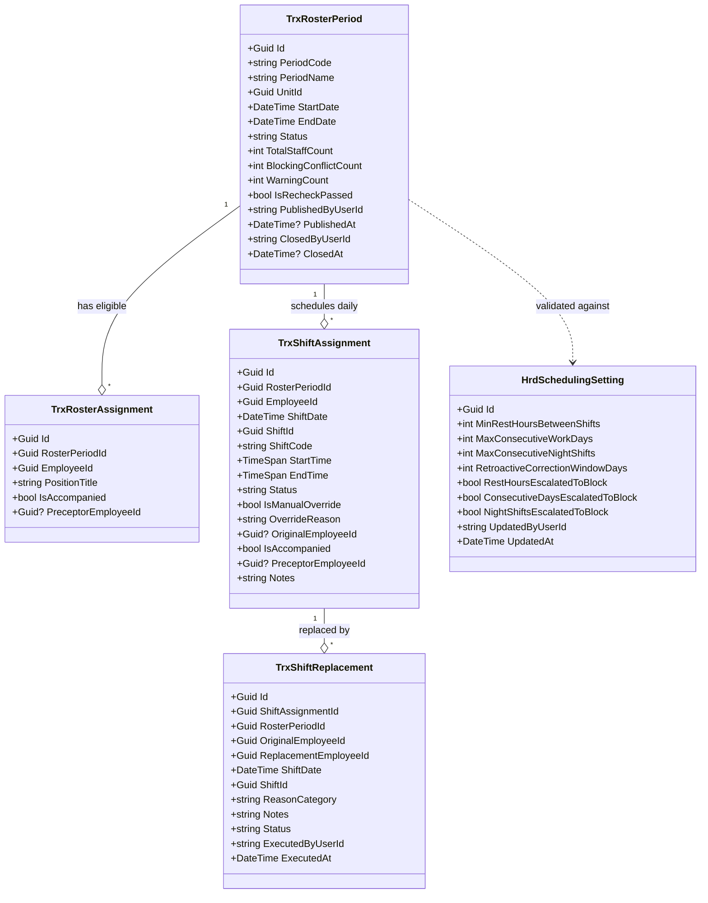

#### 19.3.2 On-Call, Call-in, dan Integrasi Lab (`BC-SCH-03`)

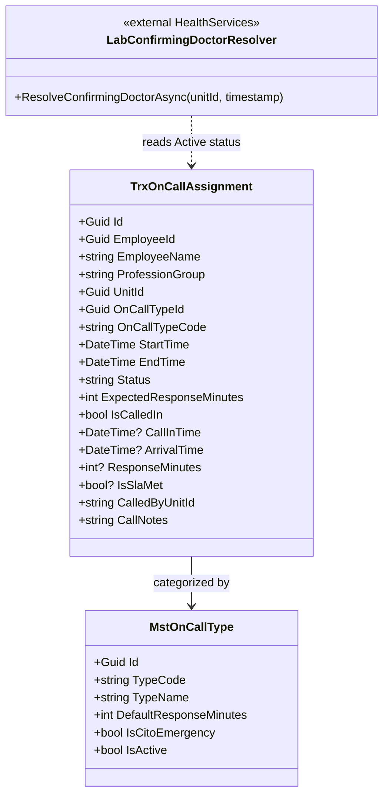

### 19.4 Penjelasan setiap class

#### 19.4.1 Model

| Class | Status | Lokasi file | Tanggung jawab |
| --- | --- | --- | --- |
| `TrxRosterPeriod` | `Diperbarui` | `Areas/Corporate/HumanResource/SchedulingManagement/Models/TrxRosterPeriod.cs` | Entity aggregate root untuk periode roster bulanan per unit. Ditambahkan kolom tracking `PublishedByUserId`, `PublishedAt`, `ClosedByUserId`, `ClosedAt`, dan normalisasi status (`Draft`, `Validation`, `Published`, `Closed`) |
| `TrxShiftAssignment` | `Diperbarui` | `Areas/Corporate/HumanResource/SchedulingManagement/Models/TrxShiftAssignment.cs` | Entity penugasan shift individual per hari. Ditambahkan kolom `IsManualOverride`, `OverrideReason`, `OriginalEmployeeId`, `IsAccompanied`, `PreceptorEmployeeId` |
| `TrxShiftReplacement` | `Diperbarui` | `Areas/Corporate/HumanResource/SchedulingManagement/Models/TrxShiftReplacement.cs` | Entity mutasi penggantian staf pada shift terbit (`HRD-DEC-101`). Menyimpan pegawai asal, pengganti, alasan, dan waktu eksekusi langsung |
| `TrxOnCallAssignment` | `Diperbarui` | `Areas/Corporate/HumanResource/SchedulingManagement/Models/TrxOnCallAssignment.cs` | Entity penugasan siaga (*on-call*). Ditambahkan field pemanggilan: `IsCalledIn`, `CallInTime`, `ArrivalTime`, `ResponseMinutes`, `ExpectedResponseMinutes`, `IsSlaMet`, `CalledByUnitId`, dan penyelarasan status `Active` (`HRD-DEC-103`) |
| `HrdSchedulingSetting` | `Baru` | `Areas/Corporate/HumanResource/SchedulingManagement/Models/HrdSchedulingSetting.cs` | Entity konfigurasi parameter penjadwalan korporat: jeda istirahat (default 11 jam), batas hari berurutan, toleransi koreksi mundur (default 3 hari), dan toggle eskalasi ke blocking |
| `TrxEmergencyStaffingRequest` | `Sudah ada` | `Areas/Corporate/HumanResource/SchedulingManagement/Models/TrxEmergencyStaffingRequest.cs` | Dipertahankan dalam skema EF Core tetapi ditandai **Ditunda pada rilis pertama** (`HRD-DEC-097`) |
| `TrxRosterApproval` | `Sudah ada` | `Areas/Corporate/HumanResource/SchedulingManagement/Models/TrxRosterApproval.cs` | Dipertahankan dalam skema EF Core tetapi ditandai **Ditunda pada rilis pertama** (`HRD-DEC-098`) |

#### 19.4.2 Service

| Service | Status | Lokasi file | Fungsi utama |
| --- | --- | --- | --- |
| `RosterPeriodService` | `Diperbarui` | `Areas/Corporate/HumanResource/SchedulingManagement/Services/RosterPeriodService.cs` | Mengelola siklus hidup roster: buat periode (kode unik aman konkurensi), populate staf eligible unit otomatis, salin periode lalu, terapkan pola shift, validasi komprehensif (`B1`–`B7` dan `W1`–`W7`), penerbitan dengan validasi ulang otomatis (`HRD-DEC-098`), serta penutupan periode mutlak oleh HRD (`HRD-DEC-102`) |
| `ShiftReplacementService` | `Diperbarui` | `Areas/Corporate/HumanResource/SchedulingManagement/Services/ShiftReplacementService.cs` | Mengeksekusi **Ganti Petugas** langsung pada roster terbit tanpa merusak status `Published` (`HRD-DEC-101`), memvalidasi pengganti terhadap aturan keselamatan, dan mengirim event notifikasi |
| `OnCallAssignmentService` | `Diperbarui` | `Areas/Corporate/HumanResource/SchedulingManagement/Services/OnCallAssignmentService.cs` | Mengelola jadwal siaga dokter & staf, mencatat pemanggilan (*call-in*), mengukur pemenuhan SLA respon menit, menyelaraskan status `Active` dengan Lab resolver (`HRD-DEC-103`), dan meneruskan data kompensasi ke Payroll |
| `SchedulingSettingService` | `Baru` | `Areas/Corporate/HumanResource/SchedulingManagement/Services/SchedulingSettingService.cs` | Membaca dan memperbarui parameter aturan kerja korporat (`HrdSchedulingSetting`), menghapus hardcode angka 11 jam |

#### 19.4.3 Controller

| Controller | Status | Lokasi file | Tanggung jawab |
| --- | --- | --- | --- |
| `RosterPeriodController` | `Diperbarui` | `Areas/Corporate/HumanResource/SchedulingManagement/Controllers/RosterPeriodController.cs` | Endpoint CRUD periode roster, validasi, terbitkan, tutup periode, salin periode, dan terapkan pola |
| `ShiftReplacementController` | `Diperbarui` | `Areas/Corporate/HumanResource/SchedulingManagement/Controllers/ShiftReplacementController.cs` | Endpoint eksekusi penggantian shift langsung dan riwayat mutasi shift |
| `OnCallAssignmentController` | `Diperbarui` | `Areas/Corporate/HumanResource/SchedulingManagement/Controllers/OnCallAssignmentController.cs` | Endpoint jadwal siaga, aktivasi siaga, pencatatan pemanggilan (*call-in*), dan pencatatan kedatangan dokter |
| `SchedulingSettingController` | `Baru` | `Areas/Corporate/HumanResource/SchedulingManagement/Controllers/SchedulingSettingController.cs` | Endpoint konfigurasi kebijakan waktu kerja dan aturan validasi jadwal oleh HR Admin |

### 19.5 Arsitektur folder backend

```text
NewQuilvianSystemBackend/Areas/Corporate/HumanResource/SchedulingManagement/
├── Constants/
│   ├── SchedulingRequestValueConstants.cs          [Sudah ada]
│   └── SchedulingValidationRuleCodes.cs            [Baru - Kode B1-B7 dan W1-W7]
├── Controllers/
│   ├── OnCallAssignmentController.cs               [Diperbarui - Endpoint Call-in & SLA]
│   ├── RosterPeriodController.cs                   [Diperbarui - Recheck publish & Close lock]
│   ├── ScheduleChangeController.cs                 [Sudah ada]
│   ├── SchedulingSettingController.cs              [Baru - Pengaturan waktu kerja HRD]
│   ├── ShiftReplacementController.cs               [Diperbarui - Ganti petugas langsung]
│   ├── ShiftSwapController.cs                      [Sudah ada]
│   └── WfpWorkScheduleAssignmentController.cs       [Sudah ada]
├── DTOs/
│   ├── OnCallSchedulingDtos.cs                     [Diperbarui - DTO CallInRequest & SLA]
│   ├── RosterSchedulingDtos.cs                     [Diperbarui - DTO ValidationResult & Reason]
│   ├── SchedulingSettingDtos.cs                    [Baru - DTO Get/Update Setting]
│   └── ShiftReplacementDtos.cs                     [Diperbarui - DTO ExecuteReplacement]
├── Models/
│   ├── HrdSchedulingSetting.cs                     [Baru - Model setelan penjadwalan]
│   ├── TrxEmergencyStaffingRequest.cs              [Sudah ada - Ditunda rilis pertama]
│   ├── TrxOnCallAssignment.cs                      [Diperbarui - Field CallIn & SLA]
│   ├── TrxRosterApproval.cs                        [Sudah ada - Ditunda rilis pertama]
│   ├── TrxRosterAssignment.cs                      [Sudah ada]
│   ├── TrxRosterPeriod.cs                          [Diperbarui - Field publish & closed]
│   ├── TrxRosterPublication.cs                     [Sudah ada]
│   ├── TrxShiftAssignment.cs                       [Diperbarui - Field override & preceptor]
│   └── TrxShiftReplacement.cs                      [Diperbarui - Field eksekusi & alasan]
└── Services/
    ├── OnCallAssignmentService.cs                  [Diperbarui - Status kontrak Lab & SLA]
    ├── RosterPeriodService.cs                      [Diperbarui - Validasi B1-B7/W1-W7]
    ├── SchedulingSettingService.cs                 [Baru - Service baca/tulis setelan]
    └── ShiftReplacementService.cs                  [Diperbarui - Eksekusi override langsung]
```

### 19.6 Status model dan dampak migration

| Model | Status | Kolom yang ditambah / diubah | Dampak migration |
| --- | --- | --- | --- |
| `HrdSchedulingSetting` | `Baru` | Seluruh kolom: `Id`, `MinRestHoursBetweenShifts`, `MaxConsecutiveWorkDays`, `MaxConsecutiveNightShifts`, `RetroactiveCorrectionWindowDays`, `RestHoursEscalatedToBlock`, `ConsecutiveDaysEscalatedToBlock`, `NightShiftsEscalatedToBlock`, kolom audit | Migration create table `HrdSchedulingSettings` |
| `TrxRosterPeriod` | `Diperbarui` | Tambah kolom: `PublishedByUserId` (nvarchar 450 null), `PublishedAt` (datetime null), `ClosedByUserId` (nvarchar 450 null), `ClosedAt` (datetime null), `IsRecheckPassed` (bool default false) | Migration add columns ke `TrxRosterPeriods` |
| `TrxShiftAssignment` | `Diperbarui` | Tambah kolom: `IsManualOverride` (bool default false), `OverrideReason` (nvarchar 500 null), `OriginalEmployeeId` (guid null FK), `IsAccompanied` (bool default false), `PreceptorEmployeeId` (guid null FK) | Migration add columns ke `TrxShiftAssignments` |
| `TrxShiftReplacement` | `Diperbarui` | Tambah kolom: `ReasonCategory` (nvarchar 100 not null), `Notes` (nvarchar 500 null), `ExecutedByUserId` (nvarchar 450 not null), `ExecutedAt` (datetime not null) | Migration add columns ke `TrxShiftReplacements` |
| `TrxOnCallAssignment` | `Diperbarui` | Tambah kolom: `ExpectedResponseMinutes` (int default 30), `IsCalledIn` (bool default false), `CallInTime` (datetime null), `ArrivalTime` (datetime null), `ResponseMinutes` (int null), `IsSlaMet` (bool null), `CalledByUnitId` (guid null), `CallNotes` (nvarchar 500 null) | Migration add columns ke `TrxOnCallAssignments` |

### 19.7 Rencana migration

1. **Nama Migration:** `AddSchedulingSettingsAndHardenRosterSliceB4`
2. **Sifat Migration:** Non-breaking / additive only. Seluruh penambahan kolom bersifat `nullable` atau memiliki nilai bawaan (*default value*), sehingga tidak mengganggu data dev yang sudah ada.
3. **Seed Data:** Menambahkan 1 baris default `HrdSchedulingSetting` (jeda minimal 11 jam, hari berturut-turut 6 hari, toleransi mundur 3 hari).

### 19.8 Rencana data master awal

| Tabel | Kebutuhan baris awal | Contoh isi awal |
| --- | --- | --- |
| `HrdSchedulingSetting` | 1 baris korporat | `MinRestHoursBetweenShifts = 11`, `MaxConsecutiveWorkDays = 6`, `MaxConsecutiveNightShifts = 2`, `RetroactiveCorrectionWindowDays = 3` |
| `MstOnCallType` | Minimal 3 jenis siaga RS | (1) `ONCALL-CITO` — Siaga Cito Tindakan Medis Darurat (SLA 30 menit, Cito = true)<br>(2) `ONCALL-LAB` — Siaga Konfirmasi Hasil Kritis Laboratorium (SLA 30 menit, Cito = true)<br>(3) `ONCALL-SPES` — Siaga Konsultasi Spesialis Standby (SLA 60 menit, Cito = false) |
| `MstShiftPattern` | Minimal 2 pola shift lazim | (1) `POLA-3SHIFT-A` — Pagi, Siang, Malam, Libur, Libur<br>(2) `POLA-ICU-B` — Siang, Malam, Lepas Jaga, Libur, Pagi |

### 19.9 Hitungan dan aturan bisnis yang dirancang

#### 19.9.1 Validasi Pemeriksaan Per Pegawai (`HRD-DEC-099`)
Sistem menjalankan evaluasi otomatis:
- **Pemeriksaan Memblokir (`BLOCKING` / `B1`–`B6`):**
  - `B1`: Tabrakan jam dua shift pada hari/rentang yang sama.
  - `B2`: Pegawai memiliki cuti sehari penuh yang berstatus disetujui (`B2`).
  - `B3`: Pegawai tidak memiliki penempatan aktif di unit tersebut pada tanggal shift.
  - `B4`: Pegawai belum dinyatakan siap kerja oleh HRD (`HRD-DEC-088`).
  - `B5`: Tanggal shift berada sesudah tanggal akhir kontrak kerja yang belum diputuskan perpanjangannya (`HRD-DEC-089`).
  - `B6`: Status kesiapan kerja tidak dapat dibaca dari sistem (`INT-HR-31`, gagal tertutup).
- **Pemeriksaan Peringatan dengan Alasan (`WARNING` / `W1`–`W5`):**
  - `W1`: Jeda istirahat antar shift < `MinRestHoursBetweenShifts` (default 11 jam).
  - `W2`: Hari kerja berturut-turut tanpa hari libur > `MaxConsecutiveWorkDays` (default 6 hari).
  - `W3`: Shift malam berturut-turut > `MaxConsecutiveNightShifts` (default 2 malam).
  - `W4`: Terdapat pengajuan cuti yang masih berstatus pending pada tanggal shift.
  - `W5`: STR, SIP, atau kredensial kedaluwarsa pada tanggal shift (`HRD-DEC-005`).

#### 19.9.2 Validasi Kelayakan Shift & Skill Mix (`HRD-DEC-100`)
- `B7` (`BLOCKING`): Pegawai bertanda **Didampingi** (`HRD-DEC-087`) dijadwalkan pada shift yang tidak memiliki satupun perawat berstatus **Mandiri**. Ditolak demi keselamatan pasien.
- `W6` (`WARNING`): Jumlah tenaga pada shift kurang dari kuota target unit. Wajib memilih alasan (`Kekurangan tenaga`, `Volume pasien/BOR rendah`, atau `Lainnya`).
- `W7` (`WARNING`): Kebutuhan kualifikasi khusus shift (misal: perawat penanggung jawab / sertifikasi ICU) tidak terpenuhi. Wajib memilih alasan konfirmasi.

#### 19.9.3 Penggantian Shift & Mutasi Setelah Terbit (`HRD-DEC-101`)
- Kepala unit dapat langsung menunjuk pengganti (*Ganti Petugas*) pada roster terbit.
- Perubahan langsung efektif (*directly effective*) tanpa approval Kepala Bidang.
- Pengganti wajib lolos validasi `B1`–`B7`.
- Alasan perubahan wajib dicatat (`Sakit Mendadak`, `Izin/Keluarga`, `Lonjakan Pasien`, `Lainnya`).
- Status roster tetap **`Published`** dan tidak pernah turun ke `Draft`.
- Notifikasi otomatis dikirim ke pegawai diganti, pengganti, dan Kepala Bidang (*FYI*).

#### 19.9.4 Koreksi Mundur & Penguncian Mutlak (`HRD-DEC-102`)
- Koreksi mundur tanggal yang sudah lewat diizinkan mandiri bagi Kepala Unit maksimal **3 hari kalender ke belakang** (`today - shift_date <= 3`).
- Koreksi mundur otomatis memicu rekalkulasi kehadiran harian di modul 07.
- Koreksi > 3 hari ke belakang terkunci bagi Kepala Unit dan memerlukan bantuan verifikasi HRD.
- Roster periode ditutup (**`Closed`**) oleh HRD/Payroll Officer saat cut-off penggajian.
- Periode berstatus `Closed` berstatus **terkunci mutlak (*read-only*)** tanpa pengecualian.

#### 19.9.5 Siklus Status Siaga & Penyelarasan Kontrak Lab (`HRD-DEC-103`)
- Kosakata status siaga: `Scheduled` → `Confirmed` → `Active` → `Completed`.
- Memperbaiki bug `HRD-TF-053`: saat siaga dipanggil (*call-in*), status penugasan tetap **`Active`** (bukan `Activated`), sehingga `LabConfirmingDoctorResolver` (`LAB-DEC-111`) tetap mengenali dokter siaga sebagai konfirmator sah hasil kritis laboratorium.
- Pemanggilan mencatat `CallInTime`, `ArrivalTime`, selisih waktu `ResponseMinutes`, dan memvalidasi `IsSlaMet = (ResponseMinutes <= ExpectedResponseMinutes)`.
- Jam standby otomatis diintegrasikan ke tunjangan siaga Payroll (10), dan pemanggilan fisik otomatis menjadi tiket tugas panggil cito di modul Lembur (09) dan Payroll (10).

### 19.10 Yang sengaja tidak dibuat pada rilis pertama `S-B4`

| Fitur / Komponen | Alasan | Penanganan selama MVP |
| --- | --- | --- |
| `TrxEmergencyStaffingRequest` | `HRD-DEC-097` — Kebutuhan darurat ditutup langsung oleh Kepala Unit | Kepala Unit menggunakan fitur **Ganti Petugas** atau rencana lembur modul 09 |
| `TrxRosterApproval` | `HRD-DEC-098` — Tidak ada persetujuan sebelum terbit | Kepala Unit menerbitkan langsung; Kepala Bidang menerima tembusan notifikasi dan hak pantau |
| Setelan aturan kerja berbeda per masing-masing unit | `HRD-ASM-10` — Satu kebijakan korporat rumah sakit untuk kesederhanaan rilis pertama | Menggunakan nilai default korporat pada `HrdSchedulingSetting` |

### 19.11 Traceability keputusan

| Keputusan | Bab / Bagian Arsitektur Backend |
| --- | --- |
| `HRD-DEC-097` | 19.1, 19.2, 19.10 (`TrxEmergencyStaffingRequest` ditunda) |
| `HRD-DEC-098` | 19.1, 19.4.2 (`RosterPeriodService.PublishAsync`), 19.10 (`TrxRosterApproval` ditunda) |
| `HRD-DEC-099` | 19.4.1 (`HrdSchedulingSetting`), 19.4.2, 19.9.1 (Pemeriksaan `B1`–`B6` dan `W1`–`W5`) |
| `HRD-DEC-100` | 19.4.1 (`TrxShiftAssignment.IsAccompanied`), 19.9.2 (Pemeriksaan `B7`, `W6`, `W7`) |
| `HRD-DEC-101` | 19.4.1 (`TrxShiftReplacement`), 19.4.2 (`ShiftReplacementService`), 19.9.3 |
| `HRD-DEC-102` | 19.4.1 (`TrxRosterPeriod.ClosedAt`), 19.4.2, 19.9.4 (Koreksi mundur 3 hari & Close lock) |
| `HRD-DEC-103` | 19.3.2, 19.4.1 (`TrxOnCallAssignment`), 19.4.2 (`OnCallAssignmentService`), 19.9.5 |


---

## 20. Slice `S-B1` — Administrasi Kehadiran dan Presensi Staf Rumah Sakit (Sub-modul 07, `last_changed_in` `v11`, 4 November 2026)

Bagian ini merancang arsitektur backend target untuk **Slice `S-B1` — Administrasi Kehadiran dan Presensi Staf Rumah Sakit 24/7**, menyerap keputusan interview `HRD-DEC-028` (koreksi on-behalf), `HRD-DEC-029` (tiga peran waktu & early leave), `HRD-DEC-104` s.d. `HRD-DEC-109`, serta asumsi `HRD-ASM-15` s.d. `HRD-ASM-18`.

### 20.1 Tabel Kepemilikan Data (Data Ownership Matrix)

| Kelompok Data | Modul Pemilik | Dipakai di `S-B1`? | Dibuat Ulang? | Keterangan & Entitas |
| --- | --- | :---: | :---: | --- |
| Rekaman Mentah Biometrik | `AttendanceManagement` | Ya | Tidak (REUSE) | `HrdAttendanceRawLog` — *immutable*, mencatat `EventAt`, `DeviceId`, `PunchType`, `SourceType` (Fingerprint/Face/Mobile/API). |
| Kehadiran Harian Olahan | `AttendanceManagement` | Ya | Tidak (EXTEND) | `HrdAttendanceDaily` — membawa `ShiftDate`, `CheckInAt`, `CheckOutAt`, `EffectiveWorkMinutes`, `LateMinutes`, `EarlyLeaveMinutes`, `Status`. |
| Pengecualian Kehadiran | `AttendanceManagement` | Ya | Tidak (EXTEND) | `HrdAttendanceException` — mencatat keterlambatan, pulang cepat, lupa tap, atau mangkir. |
| Koreksi Kehadiran | `AttendanceManagement` | Ya | Tidak (EXTEND) | `HrdAttendanceCorrection` — mendukung pengajuan mandiri ESS dan kuasa HR *on-behalf* (`HRD-DEC-028`). |
| Izin Pulang Cepat | `AttendanceManagement` | Ya | **Baru (NEW)** | `HrdEarlyLeavePermission` — izin administratif resmi *non-deductible* (`HRD-DEC-107`). |
| Surat Tugas Dinas Luar | `AttendanceManagement` | Ya | **Baru (NEW)** | `HrdOfficialDutyRequest` — penugasan ambulans rujukan, kurir lab, pelatihan, home care (`HRD-DEC-109`). |
| Konfigurasi Kebijakan Presensi | `AttendanceManagement` | Ya | **Baru (NEW)** | `HrdAttendanceSetting` — parameter toleransi keterlambatan (`GracePeriod`), toleransi koreksi (`HRD-DEC-105`). |
| Roster & Shift Harian | `SchedulingManagement` (`S-B4`) | Ya | Tidak (READ ONLY) | `TrxRosterPeriod`, `TrxShiftAssignment` — acuan jadwal resmi untuk pencocokan jam shift. |
| Master Karyawan & Penempatan | `WorkforceCore` (`S-A1`) | Ya | Tidak (READ ONLY) | `MstWorkforceProfile`, `WfpEmploymentPlacement` — verifikasi keaktifan staf. |
| Serah Terima Payroll | `PayrollManagement` (`S-B5`) | Ya | Tidak (INTEGRASI) | `TrxAttendancePayrollHandoff` — eksekusi transfer data bersih dan mekanisme *rollback* (`HRD-DEC-108`). |

### 20.2 Diagram Kelas Bounded Context Attendance Management (Mermaid)

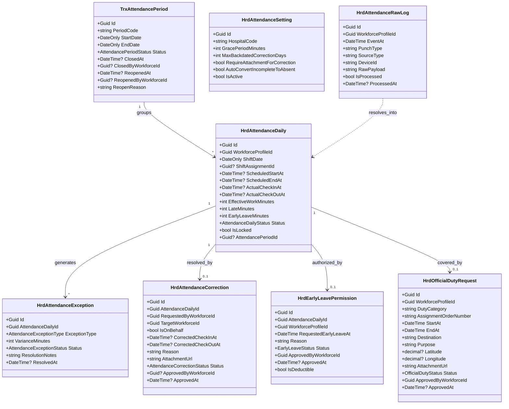

### 20.3 Rincian Class, Service, dan Tanggung Jawab

| Nama Komponen | Tipe | Lokasi File | Status | Fungsi Utama |
| --- | :---: | --- | :---: | --- |
| `HrdEarlyLeavePermission` | Model | `Areas/Corporate/HumanResource/AttendanceManagement/Models/` | Baru | Entitas perizinan pulang cepat administratif non-deductible (`HRD-DEC-107`). |
| `HrdOfficialDutyRequest` | Model | `Areas/Corporate/HumanResource/AttendanceManagement/Models/` | Baru | Entitas surat tugas dinas luar (ambulans, kurir, pelatihan, home care `HRD-DEC-109`). |
| `HrdAttendanceSetting` | Model | `Areas/Corporate/HumanResource/AttendanceManagement/Models/` | Baru | Entitas pengaturan toleransi keterlambatan dan kebijakan penutupan periode (`HRD-DEC-105`). |
| `HrdAttendanceDaily` | Model | `Areas/Corporate/HumanResource/AttendanceManagement/Models/` | Diperbarui | Penambahan kolom relasi `EarlyLeavePermissionId`, `OfficialDutyRequestId`, dan status `IncompletePunch`. |
| `HrdScheduleResolverService` | Service | `Areas/Corporate/HumanResource/AttendanceManagement/Services/` | Diperbarui | Mesin pencocok log mentah ke shift roster terbit, menangani shift malam lintas hari (`HRD-DEC-104`). |
| `HrdAttendanceCalculationEngine` | Service | `Areas/Corporate/HumanResource/AttendanceManagement/Services/` | Diperbarui | Perhitungan menit kerja, evaluasi toleransi keterlambatan grace period (`HRD-DEC-105`), deteksi 1 tap (`HRD-DEC-106`). |
| `HrdAttendanceCorrectionService` | Service | `Areas/Corporate/HumanResource/AttendanceManagement/Services/` | Diperbarui | Pengajuan & persetujuan koreksi mandiri dan kuasa HR on-behalf (`HRD-DEC-028`). |
| `HrdEarlyLeavePermissionService` | Service | `Areas/Corporate/HumanResource/AttendanceManagement/Services/` | Baru | Pengelolaan izin pulang cepat administratif, approval atasan, dan penandaan waiver pengecualian. |
| `HrdOfficialDutyService` | Service | `Areas/Corporate/HumanResource/AttendanceManagement/Services/` | Baru | Pengelolaan surat tugas dinas luar, verifikasi koordinat GPS/foto, dan penandaan status `OnDuty`. |
| `HrdAttendancePeriodService` | Service | `Areas/Corporate/HumanResource/AttendanceManagement/Services/` | Diperbarui | Penutupan periode presensi (guard penolakan bila ada pending `HRD-DEC-108`) dan buka kembali darurat (rollback payroll). |
| `AttendancePeriodController` | Controller | `Areas/Corporate/HumanResource/AttendanceManagement/Controllers/` | Diperbarui | Endpoint close dan reopen periode terhubung dengan pemeriksaan guard dan rollback payroll. |
| `EarlyLeavePermissionController` | Controller | `Areas/Corporate/HumanResource/AttendanceManagement/Controllers/` | Baru | Endpoint RESTful untuk pengajuan, approval, dan query izin pulang cepat. |
| `OfficialDutyController` | Controller | `Areas/Corporate/HumanResource/AttendanceManagement/Controllers/` | Baru | Endpoint RESTful untuk permohonan dinas luar dan approval atasan. |
| `AttendanceSettingController` | Controller | `Areas/Corporate/HumanResource/AttendanceManagement/Controllers/` | Baru | Endpoint RESTful konfigurasi parameter presensi rumah sakit. |

### 20.4 Aturan Bisnis Inti Backend (`ATT-B1` s.d. `ATT-B7` & `ATT-W1` s.d. `ATT-W6`)

#### Aturan Pemblokir / Penolakan (Blocking Rules)
* **`ATT-B1` — Immutability Raw Log:** Rekaman mentah presensi (`HrdAttendanceRawLog`) tidak dapat diubah (*update*) atau dihapus (*delete*) melalui endpoint mana pun. Koreksi kesalahan data wajib melalui entitas `HrdAttendanceCorrection`.
* **`ATT-B2` — Penguncian Periode Closed:** Seluruh operasi tulis (*create*, *update*, *delete*) pada `HrdAttendanceDaily`, koreksi, maupun perizinan yang menyentuh tanggal di dalam periode berstatus `Closed` ditolak dengan kode `409 Conflict`.
* **`ATT-B3` — Penolakan Tutup Periode Bila Ada Koreksi Pending (`HRD-DEC-108`):** Permintaan `CloseAttendancePeriod` ditolak dengan kode `409 Conflict` bila masih terdapat `HrdAttendanceCorrection` berstatus `Submitted` / `PendingApproval`.
* **`ATT-B4` — Pembatasan Otorisasi Buka Kembali Periode:** Aksi `ReopenAttendancePeriod` ditolak dengan kode `403 Forbidden` bila aktor tidak memiliki wewenang `AttendancePeriod : Reopen` (khusus HR Manager / Kadiv SDM) atau bila alasan pembukaan kembali kosong.
* **`ATT-B5` — Anti-Self-Approval Koreksi On-Behalf:** Petugas HR yang mengajukan koreksi presensi atas nama pegawai (`IsOnBehalf = true`) dilarang bertindak sebagai penyetuju (*approver*); persetujuan wajib dilakukan oleh atasan langsung pegawai yang bersangkutan.
* **`ATT-B6` — Validasi Rentang Jam Dinas Luar:** Permohonan dinas luar ditolak bila `EndAt <= StartAt` atau bila tanggal penugasan telah melewati batas cut-off periode `Closed`.
* **`ATT-B7` — Penolakan Koreksi Mundur Melewati Batas Toleransi:** Permohonan koreksi presensi ditolak bila tanggal shift yang dikoreksi melebihi `MaxBackdatedCorrectionDays` (default 3 hari kalender ke belakang) tanpa otorisasi khusus HR Manager.

#### Aturan Peringatan & Evaluasi Logika (Warning / Logical Evaluation Rules)
* **`ATT-W1` — Evaluasi Toleransi Keterlambatan Grace Period (`HRD-DEC-105`):** Kedatangan di dalam batas `GracePeriodMinutes` menghasilkan `LateMinutes = 0` dan `Status = Present`. Kedatangan di atas batas toleransi menghasilkan `LateMinutes = ActualCheckIn - ScheduledStart` dan `Status = Late`.
* **`ATT-W2` — Shift Malam Lintas Hari (`HRD-DEC-104`):** Log tap masuk malam (hari H) dan log tap keluar pagi (hari H+1) dipasangkan secara utuh ke penugasan shift hari H (`ShiftDate = Hari H`).
* **`ATT-W3` — Deteksi Lupa Tap & Konversi Otomatis (`HRD-DEC-106`):** Catatan presensi dengan 1 tap tunggal diberi status sementara `IncompletePunch`. Saat periode ditutup, sisa `IncompletePunch` yang belum dikoreksi otomatis dikonversi menjadi `Absent` (Mangkir).
* **`ATT-W4` — Izin Pulang Cepat Non-Deductible (`HRD-DEC-107`):** Izin pulang cepat yang disetujui atasan menghasilkan penandaan `Waived` pada pengecualian `EarlyLeave`, jam kerja dihitung hingga tap-out aktual, dan tidak memotong kuota cuti tahunan.
* **`ATT-W5` — Rollback Serah Terima Payroll Saat Reopen (`HRD-DEC-108`):** Pembukaan kembali periode tertutup otomatis mengeksekusi `AttendancePayrollHandoff.Rollback` bila serah terima payroll telah berstatus `Executed`.
* **`ATT-W6` — Pengakuan Jam Kerja Dinas Luar (`HRD-DEC-109`):** Permohonan dinas luar yang disetujui menghasilkan status `OnDuty` dan jam kerja dihitung penuh setara hadir kerja (`Present`) untuk kalkulasi payroll.

### 20.5 Rencana Migrasi Database EF Core

1. **Nama Migration:** `AddAttendanceOperationalExtensionsAndSettings`
2. **Perubahan Skema:**
   * Penambahan tabel baru `hrd_attendance_settings` (konfigurasi toleransi keterlambatan, hari koreksi mundur).
   * Penambahan tabel baru `hrd_early_leave_permissions` (tabel transaksi izin pulang cepat administratif).
   * Penambahan tabel baru `hrd_official_duty_requests` (tabel transaksi surat tugas dinas luar, koordinat GPS, foto bukti).
   * Penambahan kolom nullable pada `hrd_attendance_dailies`: `early_leave_permission_id` (Guid?, FK), `official_duty_request_id` (Guid?, FK), `incomplete_punch_reason` (string, max 500).
   * Penambahan nilai enum pada `AttendanceDailyStatus`: `IncompletePunch`, `OnDuty`.
3. **Sifat Migration:** Bersifat *additive* (tanpa downtime, tanpa penghapusan kolom existing).
4. **Seeder Bawaan:** `DefaultAttendanceSettingSeeder` mengisi 1 baris konfigurasi default RS (`GracePeriodMinutes = 10`, `MaxBackdatedCorrectionDays = 3`, `RequireAttachmentForCorrection = true`, `AutoConvertIncompleteToAbsent = true`).

### 20.6 Yang Sengaja Tidak Dibuat

* **Tabel Perangkat Keras / Driver Fingerprint:** Sistem tidak menyimpan data firmware/driver mesin fisik. Komunikasi data dilakukan via file log/REST API Ingestion standard.
* **Tabel Potongan Denda Keterlambatan Finansial:** Logika pemotongan uang makan atau denda nominal rupiah adalah wewenang penuh Sub-Modul 10 (Payroll) dan Sub-Modul 09 (Overtime), bukan dihitung di modul presensi.
* **Approval Berjenjang Khusus On-Behalf:** Koreksi yang diajukan HR atas nama pegawai tidak membuat alur persetujuan baru; persetujuan tetap mengikuti atasan langsung pegawai yang bersangkutan per `HRD-DEC-028`.


---

## 21. Slice `S-B2` — Administrasi Cuti & Izin Pegawai Rumah Sakit (Sub-modul 08, `last_changed_in` `v12`, 4 November 2026)

Bagian ini merancang arsitektur backend target untuk **Slice `S-B2` — Administrasi Cuti & Izin Pegawai Rumah Sakit**, menyerap keputusan interview `HRD-DEC-023` (koreksi terkontrol), `HRD-DEC-024` (pemanggilan kembali), `HRD-DEC-110` (hak cuti 12 hari & carry-forward max 6 hari s.d. 30 Juni), `HRD-DEC-111` (safe staffing coverage warning), `HRD-DEC-112` (cuti sakit & privasi dokter), `HRD-DEC-113` (leave recall darurat & pemulihan saldo), `HRD-DEC-114` (rekonsiliasi retrospektif payroll), `HRD-DEC-115` (penguncian immutabilitas /reverse HRD-Q-35), serta asumsi rekayasa `HRD-ASM-19` s.d. `HRD-ASM-22`.

### 21.1 Tabel Kepemilikan Data (Data Ownership Matrix)

| Kelompok Data | Modul Pemilik | Dipakai di `S-B2`? | Dibuat Ulang? | Keterangan & Entitas |
| --- | --- | :---: | :---: | --- |
| Buku Besar Mutasi Saldo Cuti | `LeaveManagement` | Ya | **Baru (NEW)** | `TrxLeaveBalanceLedger` — mencatat mutasi saldo atomik (`Entitlement`, `CarryForward`, `Taken`, `CancellationRestore`, `RecallRestore`, `Forfeiture`, `Adjustment`). |
| Pemanggilan Kembali Cuti Darurat | `LeaveManagement` | Ya | **Baru (NEW)** | `TrxLeaveRecallRequest` — inisiasi Kepala Ruangan saat KLB/bencana, verifikasi HR Manager, pemulihan saldo otomatis (`HRD-DEC-113`). |
| Penyesuaian Saldo Audit HR | `LeaveManagement` | Ya | Tidak (REUSE/EXTEND) | `TrxLeaveAdjustment` — satu-satunya pintu koreksi saldo historis resmi pasca-tutup periode payroll (`HRD-DEC-115`). |
| Permohonan Cuti & Izin | `LeaveManagement` | Ya | Tidak (EXTEND) | `WfpLeaveRequest` / `TrxLeaveRequest` — ditambahkan indikator peringatan kuota shift (`CoverageWarning`), flag privasi surat dokter K3RS, dan flag immutabilitas payroll. |
| Master Jenis Cuti & Izin | `LeaveManagement` | Ya | Tidak (REUSE) | `MstLeaveType` — master jenis cuti (Tahunan, Sakit, Melahirkan, Ibadah, Cuti Bersama, Alasan Penting) beserta aturan pemotongan saldo. |
| Lampiran Dokumen Surat Sakit | `LeaveManagement` | Ya | Tidak (EXTEND) | `TrxLeaveRequestAttachment` — berkas surat dokter ber-SIP resmi dengan hak akses terbatas (masking diagnosa K3RS per `HRD-DEC-112`). |
| Roster & Jadwal Shift Staf | `SchedulingManagement` (`S-B4`) | Ya | Tidak (READ ONLY) | `TrxShiftAssignment`, `TrxRosterPeriod` — query evaluasi rasio ketersediaan staf (*Safe Staffing Coverage* `HRD-DEC-111`). |
| Rekonsiliasi & Integrasi Payroll | `PayrollManagement` (`S-B5`) | Ya | Tidak (INTEGRASI) | `TrxLeavePayrollHandoff` — sinkronisasi penyesuaian retrospektif cuti pending yang disetujui terlambat (`HRD-DEC-114`). |

### 21.2 Diagram Kelas Bounded Context Leave Management (Mermaid)

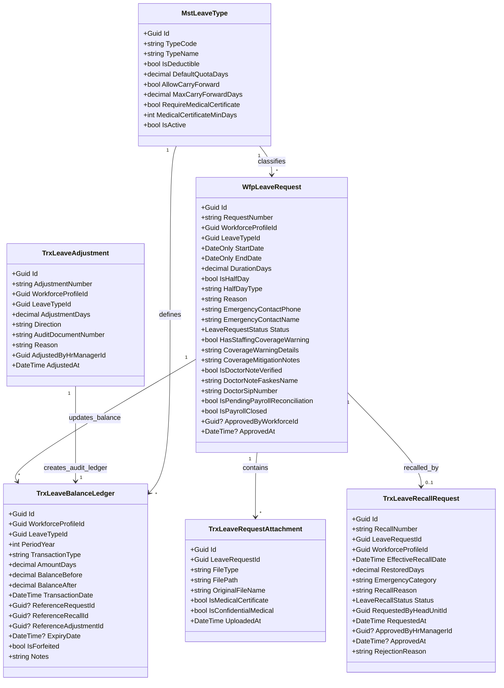

### 21.3 Rincian Class, Service, dan Tanggung Jawab

| Nama Komponen | Tipe | Lokasi File | Status | Fungsi Utama |
| --- | :---: | --- | :---: | --- |
| `TrxLeaveBalanceLedger` | Model | `Areas/Corporate/HumanResource/LeaveManagement/Models/` | Baru | Entitas buku besar (*balance ledger*) untuk pencatatan mutasi kredit/debit saldo cuti secara atomik (`HRD-DEC-110`). |
| `TrxLeaveRecallRequest` | Model | `Areas/Corporate/HumanResource/LeaveManagement/Models/` | Baru | Entitas pemanggilan kembali cuti darurat berjenjang (Kepala Unit -> HR Manager) dan pemulihan saldo otomatis (`HRD-DEC-113`). |
| `WfpLeaveRequest` | Model | `Areas/Corporate/HumanResource/LeaveManagement/Models/` | Diperbarui | Ditambahkan kolom coverage warning, catatan mitigasi, metadata verifikasi surat dokter, dan penanda kunci payroll (`HRD-DEC-111`, `HRD-DEC-115`). |
| `TrxLeaveAdjustment` | Model | `Areas/Corporate/HumanResource/LeaveManagement/Models/` | Diperbarui | Entitas penyesuaian saldo resmi dengan kewajiban nomor dokumen audit (`HRD-DEC-115`). |
| `LeaveBalanceLedgerService` | Service | `Areas/Corporate/HumanResource/LeaveManagement/Services/` | Baru | Menghitung sisa saldo aktif, memvalidasi kecukupan saldo cuti, memposting transaksi akrual 12 hari, dan mengeksekusi hangus carry-forward pasca 30 Juni (`HRD-DEC-110`). |
| `SafeStaffingCoverageGuard` | Service | `Areas/Corporate/HumanResource/LeaveManagement/Services/` | Baru | Memeriksa ketersediaan tenaga unit 24/7 ke jadwal dinas `S-B4`, menghasilkan indikator peringatan kuota (*Coverage Warning*) pada Approval Inbox (`HRD-DEC-111`). |
| `MedicalCertificateVerificationService` | Service | `Areas/Corporate/HumanResource/LeaveManagement/Services/` | Baru | Memvalidasi keabsahan surat keterangan sakit dokter ber-SIP (>= 2 hari) dan mengelola hak akses masking privasi diagnosa medis pegawai (`HRD-DEC-112`). |
| `LeaveRecallWorkflowService` | Service | `Areas/Corporate/HumanResource/LeaveManagement/Services/` | Baru | Mengatur alur pemanggilan dinas darurat, otorisasi HR Manager, posting `RecallRestore` pada ledger, dan pemulihan jadwal di Roster 06 (`HRD-DEC-113`). |
| `LeavePayrollReconciliationService` | Service | `Areas/Corporate/HumanResource/LeaveManagement/Services/` | Baru | Menangani cuti pending saat cut-off payroll, menyusun snapshot rekonsiliasi retrospektif bulan berikutnya, dan mengunci cuti `Completed` dari /reverse (`HRD-DEC-114`, `HRD-DEC-115`). |
| `LeaveExecutionProcessorService` | Service | `Areas/Corporate/HumanResource/LeaveManagement/Services/` | Diperbarui | Refaktor guard keamanan: menolak `/reverse` jika status `Completed` atau periode payroll telah `Closed` (menutup celah `HRD-Q-35`). |
| `LeaveBalanceLedgerController` | Controller | `Areas/Corporate/HumanResource/LeaveManagement/Controllers/` | Baru | Endpoint RESTful saldo real-time, riwayat buku besar pegawai, dan penjadwalan carry-forward. |
| `LeaveRequestWorkflowController` | Controller | `Areas/Corporate/HumanResource/LeaveManagement/Controllers/` | Diperbarui | Endpoint pengajuan mandiri ESS (half-day 0.5 hari), persetujuan atasan dengan indikator coverage warning, dan pre-leave cancellation. |
| `LeaveRecallController` | Controller | `Areas/Corporate/HumanResource/LeaveManagement/Controllers/` | Diperbarui | Endpoint inisiasi recall oleh Kepala Unit dan persetujuan eksekusi oleh HR Manager. |
| `LeaveAdjustmentController` | Controller | `Areas/Corporate/HumanResource/LeaveManagement/Controllers/` | Diperbarui | Endpoint penyesuaian saldo resmi HR berdokumen audit resmi. |
| `LeaveFinalReconciliationController` | Controller | `Areas/Corporate/HumanResource/LeaveManagement/Controllers/` | Diperbarui | Endpoint penutupan periode cuti payroll dan handoff rekonsiliasi retrospektif. |

### 21.4 Arsitektur Folder Backend

```text
NewQuilvianSystemBackend/Areas/Corporate/HumanResource/LeaveManagement/
├── Constants/
│   ├── LeaveBalanceTransactionTypeConstants.cs     [Baru - Tipe Entitlement, CarryForward, dll]
│   ├── LeaveRecallValueConstants.cs                [Baru - Status workflow recall]
│   ├── LeaveStaffingCoverageWarningConstants.cs    [Baru - Ambang batas rasio aman]
│   └── LeaveValueConstants.cs                      [Sudah ada]
├── Controllers/
│   ├── LeaveAdjustmentController.cs                [Diperbarui - Wajib nomor dokumen audit]
│   ├── LeaveBalanceLedgerController.cs             [Baru - Endpoint buku besar mutasi saldo]
│   ├── LeaveCalendarController.cs                  [Sudah ada]
│   ├── LeaveCarryForwardController.cs              [Diperbarui - Batas 6 hari & cut-off 30 Juni]
│   ├── LeaveExecutionController.cs                 [Diperbarui - Guard reverse immutability 409]
│   ├── LeaveFinalReconciliationController.cs       [Diperbarui - Rekonsiliasi retrospektif payroll]
│   ├── LeaveRecallController.cs                    [Diperbarui - Alur recall Kepala Unit & HR]
│   └── LeaveRequestWorkflowController.cs           [Diperbarui - Coverage warning & privasi sakit]
├── DTOs/
│   ├── LeaveAdjustmentDtos.cs                      [Diperbarui]
│   ├── LeaveBalanceLedgerDtos.cs                   [Baru - DTO riwayat mutasi saldo ledger]
│   ├── LeaveRecallDtos.cs                          [Baru - DTO inisiasi & persetujuan recall]
│   ├── LeaveReconciliationDtos.cs                  [Baru - DTO snapshot payroll retrospektif]
│   ├── LeaveRequestApprovalWithCoverageDto.cs      [Baru - DTO payload approval berindikator kuota]
│   └── LeaveRequestDtos.cs                         [Diperbarui - Field half-day & medical check]
├── Models/
│   ├── MstLeaveType.cs                             [Sudah ada - Master jenis cuti]
│   ├── TrxLeaveAdjustment.cs                       [Diperbarui - Dokumen audit nomor]
│   ├── TrxLeaveBalanceLedger.cs                    [Baru - Entitas ledger mutasi saldo]
│   ├── TrxLeaveRecallRequest.cs                    [Baru - Entitas permohonan recall darurat]
│   ├── TrxLeaveRequestAttachment.cs                [Diperbarui - Penanda surat sakit K3RS]
│   └── WfpLeaveRequest.cs                          [Diperbarui - Field coverage warning & payroll lock]
└── Services/
    ├── LeaveAdjustmentService.cs                   [Diperbarui - Posting audit ledger]
    ├── LeaveBalanceLedgerService.cs                [Baru - Kalkulasi saldo & carry-forward]
    ├── LeaveExecutionBalanceService.cs             [Diperbarui - Penyesuaian pemulihan saldo]
    ├── LeaveExecutionProcessorService.cs           [Diperbarui - Guard status reverse HTTP 409]
    ├── LeaveFinalReconciliationService.cs          [Diperbarui - Logika retrospektif payroll]
    ├── LeavePayrollIntegrationService.cs           [Diperbarui - Serah terima snapshot]
    ├── LeaveRecallWorkflowService.cs               [Baru - Mesin workflow pemanggilan dinas]
    ├── LeaveRequestWorkflowLifecycleService.cs     [Diperbarui - Notifikasi & approval flow]
    ├── MedicalCertificateVerificationService.cs    [Baru - Masking diagnosa medis K3RS]
    └── SafeStaffingCoverageGuard.cs                [Baru - Engine validasi ketersediaan staf]
```

### 21.5 Status Model dan Dampak Migration

| Model | Status | Kolom yang Ditambah / Diubah | Dampak Migration |
| --- | :---: | --- | --- |
| `TrxLeaveBalanceLedger` | `Baru` | Seluruh kolom: `Id`, `WorkforceProfileId`, `LeaveTypeId`, `PeriodYear`, `TransactionType`, `AmountDays`, `BalanceBefore`, `BalanceAfter`, `TransactionDate`, `ReferenceRequestId`, `ReferenceRecallId`, `ReferenceAdjustmentId`, `ExpiryDate`, `IsForfeited`, `Notes`, kolom audit | Migration create table `trx_leave_balance_ledgers` |
| `TrxLeaveRecallRequest` | `Baru` | Seluruh kolom: `Id`, `RecallNumber`, `LeaveRequestId`, `WorkforceProfileId`, `EffectiveRecallDate`, `RestoredDays`, `EmergencyCategory`, `RecallReason`, `Status`, `RequestedByHeadUnitId`, `RequestedAt`, `ApprovedByHrManagerId`, `ApprovedAt`, `RejectionReason`, kolom audit | Migration create table `trx_leave_recall_requests` |
| `WfpLeaveRequest` | `Diperbarui` | Tambah kolom: `HasStaffingCoverageWarning` (bool default false), `CoverageWarningDetails` (text null), `CoverageMitigationNotes` (varchar 500 null), `IsDoctorNoteVerified` (bool default false), `DoctorNoteFaskesName` (varchar 255 null), `DoctorSipNumber` (varchar 100 null), `IsPendingPayrollReconciliation` (bool default false), `IsPayrollClosed` (bool default false) | Migration add columns ke `wfp_leave_requests` |
| `TrxLeaveAdjustment` | `Diperbarui` | Tambah kolom: `AuditDocumentNumber` (varchar 100 not null), `AdjustedByHrManagerId` (uuid not null) | Migration add columns ke `trx_leave_adjustments` |
| `TrxLeaveRequestAttachment` | `Diperbarui` | Tambah kolom: `IsMedicalCertificate` (bool default false), `IsConfidentialMedical` (bool default true) | Migration add columns ke `trx_leave_request_attachments` |

### 21.6 Rencana Migration EF Core

1. **Nama Migration:** `AddLeaveLedgerCoverageWarningAndRecallExtensions`
2. **Perubahan Skema:**
   * Pembuatan tabel `trx_leave_balance_ledgers` dengan foreign key ke `mst_workforce_profiles` dan `mst_leave_types`.
   * Pembuatan tabel `trx_leave_recall_requests` dengan foreign key ke `wfp_leave_requests` dan `mst_workforce_profiles`.
   * Penambahan kolom toleransi coverage warning dan privasi surat sakit pada `wfp_leave_requests`.
   * Penambahan kolom nomor dokumen audit pada `trx_leave_adjustments`.
3. **Sifat Migration:** Bersifat *non-breaking* / *additive only*. Seluruh kolom baru bersifat nullable atau memiliki nilai bawaan.
4. **Data Seeder:** Memastikan master data `MstLeaveType` terisi dengan konfigurasi hak dasar RS (Tahunan 12 hari, Sakit, Bersama, Melahirkan).

### 21.7 Rencana Data Master Awal

| Tabel | Kebutuhan Baris Awal | Contoh Isi Awal |
| --- | --- | --- |
| `MstLeaveType` | Minimal 6 jenis cuti/izin standar RS | (1) `CUTI-TAHUNAN` — Cuti Tahunan (12 hari, deduct = true, max carry-forward 6 hari, expire 30 Juni)<br>(2) `CUTI-SAKIT` — Cuti Sakit (deduct = false, min surat dokter = 2 hari)<br>(3) `CUTI-BERSAMA` — Cuti Bersama Pemerintah (deduct = true per `HRD-ASM-19`)<br>(4) `CUTI-MELAHIRKAN` — Cuti Melahirkan (90 hari, deduct = false)<br>(5) `CUTI-IBADAH` — Cuti Ibadah Keagamaan / Haji / Umroh (deduct = false, lampiran wajib)<br>(6) `IZIN-PENTING` — Izin Alasan Penting / Menikah / Berduka (deduct = false, 2–3 hari) |

### 21.8 Hitungan dan Aturan Bisnis Inti Backend (`LEV-B1` s.d. `LEV-B8` & `LEV-W1` s.d. `LEV-W6`)

#### Aturan Pemblokir / Penolakan (Blocking Rules)
* **`LEV-B1` — Saldo Tidak Mencukupi untuk Cuti Potong Saldo:** Pengajuan cuti jenis potong saldo (*deductible*) ditolak otomatis bila `DurationDays > CurrentAvailableBalance`.
* **`LEV-B2` — Tabrakan dengan Jadwal Shift Aktif Terbit Tanpa Pengganti / Pembatalan:** Pengajuan cuti ditolak jika pada rentang tanggal tersebut pegawai telah terdaftar dinas shift pada Roster Terbit (`S-B4`) dan belum diajukan permohonan penggantian tugas dinas.
* **`LEV-B3` — Kewajiban Surat Dokter Sakit $\ge 2$ Hari (`HRD-DEC-112`):** Pengajuan cuti sakit 2 hari kerja berturut-turut atau lebih ditolak tanpa unggah berkas Surat Keterangan Sakit resmi dokter.
* **`LEV-B4` — Penguncian Immutabilitas Cuti Selesai / Payroll Closed (`HRD-DEC-115`):** Pemanggilan endpoint pembatalan biasa `POST /{leaveRequestId}/reverse` ditolak dengan kode `409 Conflict` bila permohonan cuti telah berstatus `Completed` atau telah dikunci dalam periode penutupan payroll (`IsPayrollClosed = true`). Menutup celah `HRD-Q-35`.
* **`LEV-B5` — Otorisasi Persetujuan Recall Darurat (`HRD-DEC-113`):** Eksekusi pemanggilan kembali dinas darurat (*Leave Recall*) ditolak dengan kode `403 Forbidden` bila aktor yang menyetujui bukan HR Manager (`HRD-DEC-024` / `HRD-Q-36`).
* **`LEV-B6` — Penolakan Koreksi Saldo Tanpa Dokumen Audit (`HRD-DEC-115`):** Permintaan `POST /adjustments` ditolak dengan kode `400 Bad Request` bila nomor dokumen audit (*AuditDocumentNumber*) atau alasan tertulis tidak diisi.
* **`LEV-B7` — Batas Maksimal Cuti Berurutan 12 Hari (`HRD-ASM-22`):** Pengajuan cuti tahunan berturut-turut > 12 hari kerja ditolak oleh sistem, kecuali disertai otorisasi dispensasi khusus Direktur RS.
* **`LEV-B8` — Batas Maksimal Carry-Forward 6 Hari (`HRD-DEC-110`):** Scheduler akhir tahun membatasi pemindahan sisa saldo cuti maksimal 6 hari kerja; sisa kuota di atas 6 hari otomatis dicatat sebagai transaksi `Forfeiture` (Hangus).

#### Aturan Peringatan & Evaluasi Logika (Warning / Logical Evaluation Rules)
* **`LEV-W1` — Peringatan Kuota Pelayanan Staf Unit (*Safe Staffing Coverage Warning* `HRD-DEC-111`):** Jika permohonan cuti staf klinis menyebabkan jumlah perawat/staf aktif pada shift tertentu berada di bawah ambang batas minimal unit, kotak masuk approval Kepala Unit memunculkan banner peringatan kuota layanan. Kepala Unit dapat menyetujui dengan memilih opsi `Approve with Mitigation` serta mencatat nama perawat pengganti.
* **`LEV-W2` — Batas Kedaluwarsa Saldo Carry-Forward 30 Juni (`HRD-DEC-110`):** Seluruh sisa saldo cuti bawaan tahun sebelumnya yang belum digunakan hingga pukul 23:59:59 WIB tanggal 30 Juni otomatis dihanguskan oleh scheduler dan dibukukan dengan transaksi `CarryForwardForfeiture`.
* **`LEV-W3` — Masking Privasi Diagnosa Medis K3RS (`HRD-DEC-112`):** Atasan langsung hanya dapat melihat durasi istirahat, nama faskes, dan nomor SIP dokter. Diagnosa ICD-10 dan berkas rekam medis klinis dimaskir dari atasan langsung dan hanya dapat diakses oleh Dokter Pemeriksa K3RS / HR Admin Medis.
* **`LEV-W4` — Pemulihan Saldo Otomatis Pasca Recall Disetujui (`HRD-DEC-113`):** Persetujuan leave recall oleh HR Manager secara otomatis memposting transaksi kredit `RecallRestore` pada buku besar saldo cuti sebesar sisa hari cuti yang belum dijalankan, dan mengirimkan event pemulihan shift ke Sub-Modul 06 (`INT-HR-46`).
* **`LEV-W5` — Rekonsiliasi Retrospektif Cuti Menggantung saat Cut-Off Payroll (`HRD-DEC-114`):** Permohonan cuti yang masih berstatus `WaitingApproval` saat cut-off payroll tidak memotong gaji pegawai; jika baru disetujui pasca-cut-off, sistem otomatis menandai `IsPendingPayrollReconciliation = true` untuk diperhitungkan pada payroll periode berikutnya.
* **`LEV-W6` — Cuti Setengah Hari 0.5 Hari Kerja (`HRD-ASM-20`):** Cuti setengah hari mendebit buku besar sebesar tepat 0.5 hari kerja dan mengharuskan staf memilih sesi (Pagi atau Siang/Sore).

### 21.9 Yang Sengaja Tidak Dibuat pada Rilis Pertama `S-B2`

| Fitur / Komponen | Alasan | Penanganan selama MVP |
| --- | --- | --- |
| Konversi Sisa Cuti Menjadi Uang Tunai (*Leave Encashment*) | Kebijakan RS melarang uangkan cuti tahunan demi kesehatan mental staf dan keselamatan pasien | Sisa cuti hangus per 30 Juni (`HRD-DEC-110`) |
| Pengajuan Cuti Utang (*Negative Leave Balance*) | Menghindari risiko piutang hari kerja saat pegawai resign mendadak | Pengajuan cuti melebihi saldo ditolak keras oleh `LEV-B1` |
| Akses Diagnosa Medis Karyawan oleh Atasan Langsung | Melanggar kerahasiaan medis pasien/staf (UU PDP 27/2022 & K3RS per `HRD-DEC-112`) | Hanya durasi istirahat dan status verifikasi surat dokter yang ditampilkan |
| Endpoint Pembatalan Terbuka `/reverse` Tanpa Guard | Merupakan celah keamanan audit (`HRD-Q-35`) yang ditutup oleh `HRD-DEC-115` | Cuti selesai hanya dapat dikoreksi melalui `LeaveAdjustmentController` berdokumen audit |

### 21.10 Traceability Keputusan ke Arsitektur Backend

| Keputusan / Asumsi | Bagian Desain Backend |
| --- | --- |
| `HRD-DEC-110` | 21.1, 21.2 (`TrxLeaveBalanceLedger`), 21.3 (`LeaveBalanceLedgerService`), 21.7, 21.8 (`LEV-B8`, `LEV-W2`) |
| `HRD-DEC-111` | 21.1, 21.2 (`WfpLeaveRequest`), 21.3 (`SafeStaffingCoverageGuard`), 21.8 (`LEV-W1`) |
| `HRD-DEC-112` | 21.1, 21.2 (`TrxLeaveRequestAttachment`), 21.3 (`MedicalCertificateVerificationService`), 21.8 (`LEV-B3`, `LEV-W3`) |
| `HRD-DEC-113` | 21.1, 21.2 (`TrxLeaveRecallRequest`), 21.3 (`LeaveRecallWorkflowService`), 21.8 (`LEV-B5`, `LEV-W4`) |
| `HRD-DEC-114` | 21.1, 21.3 (`LeavePayrollReconciliationService`), 21.8 (`LEV-W5`) |
| `HRD-DEC-115` (`HRD-Q-35`) | 21.1, 21.3 (`LeaveExecutionProcessorService`), 21.8 (`LEV-B4`, `LEV-B6`), 21.9 |
| `HRD-ASM-19` | 21.7 (`MstLeaveType.CUTI-BERSAMA` deductible) |
| `HRD-ASM-20` | 21.2 (`WfpLeaveRequest.IsHalfDay`), 21.8 (`LEV-W6`) |
| `HRD-ASM-21` | 21.3 (`LeaveRequestWorkflowController` pre-leave cancel restore 100%) |
| `HRD-ASM-22` | 21.8 (`LEV-B7` batas maksimal 12 hari berurutan) |
