# Human Resource — Matriks Perpindahan Status

| Field | Value |
| --- | --- |
| Blueprint ID | `HRD-BP-001` |
| Dokumen | `contracts/state-transition-matrix.md` |
| `contract_version` | `v6` |
| `last_changed_in` | `v7` — bagian 11 (`S-D1`) ditambahkan 3 November 2026; bagian lain tidak berubah sejak `v6` |
| Status | `draft` — **belum** `approved` |
| Owner | Technical owner (`HRD-DEC-015`) |
| `approved_by` / `approved_at` | **Hanya bagian 11** (`S-D1` Perencanaan Tenaga Kerja): `approved` oleh Pengguna — pemilik teknis dan produk (`HRD-DEC-015`) — pada 2026-11-03. Bagian lain dokumen ini **belum** disetujui, sehingga status dokumen tetap `draft` |
| `input_revision` | `00-interview-decisions.md` revision `16` (`HRD-DEC-046` s.d. `HRD-DEC-057`); `flows/` 15 berkas |
| `input_hash` — decision log | `26da64e129b0c34a17b67b0a41f47986b1aedae92a600077d936b0741eb574ee` |
| Backend SHA | `e0ee42c752a5f92c5b1663ff88bef07a5859f79f` |
| Dampak kompatibilitas | Tidak ada nilai status yang dihapus. Satu nilai baru ditambahkan pada kosakata jenis pengecualian kehadiran |

---

## 0. Cara membaca dokumen ini

Dokumen ini adalah **satu-satunya** tempat daftar lengkap perpindahan status hidup di seluruh
blueprint HR. Flowchart pada `flowcharts/` menggambar urutan langkah petugas dan **MUST NOT**
menyalin isi dokumen ini.

### 0.1 Dua hal yang sering tertukar, dan akibatnya mahal

| Istilah | Artinya | Cara membuktikannya |
| --- | --- | --- |
| **Kosakata status** | Nilai statusnya benar-benar ada di kode | Ditemukan pada konstanta atau enum |
| **Perpindahan yang dijaga** | Ada kode yang benar-benar memeriksa status asal sebelum mengizinkan tindakan | Ditemukan guard yang membandingkan status **sekarang** |

Sebuah nilai status yang ada **bukan berarti** perpindahannya dijaga. Beberapa baris pada
dokumen ini punya kosakata yang jelas tetapi perpindahannya **tidak dijaga sama sekali** — dan
itu ditulis apa adanya, bukan disembunyikan.

### 0.2 Penanda yang dipakai

| Penanda | Artinya |
| --- | --- |
| `[EXISTING]` | Perpindahan ini benar-benar dijaga kode pada baseline saat ini |
| `[VOCAB]` | Nilai statusnya ada, tetapi **tidak ada** kode yang menjaga perpindahannya |
| `[DECISION]` | Perpindahan target yang ditetapkan `HRD-DEC-xxx`, belum tentu sudah ada di kode |
| `[DEFECT]` | Perpindahan yang **terjadi hari ini** tetapi **bertentangan** dengan keputusan target |
| `[OPEN]` | Belum ada keputusan pihak berwenang |

---

## 1. Kehadiran

### 1.1 Periode kehadiran — `AttendancePeriodStatus`

Nilai: `Open`, `Closing`, `Closed`, `Reopened`, `Cancelled`.

| Dari status | Tindakan | Ke status | Siapa yang boleh | Syarat | Bila dilanggar |
| --- | --- | --- | --- | --- | --- |
| `Open` atau `Reopened` | Mulai tutup | `Closing` | Pemegang `AttendancePeriod : Close` | Tidak ada pengecualian pemblokir berstatus `Open`/`UnderReview`; tidak ada permohonan koreksi yang masih berjalan | Ditolak `409`. Petugas melihat daftar penghalangnya lewat `close-preview` `[EXISTING]` |
| `Closing` | Selesai tutup | `Closed` | Sistem, bagian dari alur tutup yang sama | Seluruh hari dalam periode sudah terproses | Periode tetap `Closing`; petugas menjalankan ulang `[EXISTING]` |
| `Closed` | Buka kembali | `Reopened` | Pemegang `AttendancePeriod : Reopen` | Statusnya **harus** `Closed`; tidak ada hari yang sudah tertaut payroll; tidak ada pekerjaan terjadwal yang berjalan | Ditolak `409` dengan pesan bahwa hanya periode `Closed` yang dapat dibuka kembali `[EXISTING]` |
| `Reopened` | Tutup lagi | `Closing` lalu `Closed` | Pemegang `AttendancePeriod : Close` | Sama dengan baris pertama | Sama `[EXISTING]` |
| `Open` atau `Closing` | Batalkan | `Cancelled` | Pemegang `AttendancePeriod : Cancel` | Periode belum `Closed` | Ditolak `409` `[EXISTING]` |

**Perpindahan yang tidak sah dan harus ditolak:**

| Dari | Ke | Alasan ditolak |
| --- | --- | --- |
| `Closed` | `Open` | Satu-satunya jalan kembali adalah `Reopened`, yang meninggalkan jejak bahwa periode pernah ditutup `[EXISTING]` |
| `Closed` | `Cancelled` | Periode yang sudah ditutup dan datanya sudah dipakai payroll tidak dapat dibatalkan begitu saja `[EXISTING]` |
| `Cancelled` | mana pun | Keadaan akhir `[EXISTING]` |
| `Open` | `Closed` langsung tanpa `Closing` | Tahap `Closing` adalah tempat pemeriksaan penghalang berjalan `[EXISTING]` |

**Siapa yang seharusnya memegang `AttendancePeriod : Reopen`** masih `[OPEN]` — `HRD-Q-23`.
Mekanismenya sudah ada; pemetaan perannya belum.

### 1.2 Pemrosesan kehadiran — `AttendanceProcessingStatus`

Nilai: `Pending`, `Processing`, `Processed`, `ReprocessRequired`, `Skipped`, `Error`.

| Dari status | Tindakan | Ke status | Siapa yang boleh | Syarat | Bila dilanggar |
| --- | --- | --- | --- | --- | --- |
| `Pending` | Mulai proses | `Processing` | Sistem | — | `[EXISTING]` |
| `Processing` | Selesai | `Processed` | Sistem | Seluruh langkah pengolahan berhasil | `[EXISTING]` |
| `Processing` | Gagal | `Error` | Sistem | — | `[EXISTING]` |
| `Error` | Tandai perlu ulang | `ReprocessRequired` | Sistem atau petugas | — | `[EXISTING]` |
| `ReprocessRequired` | Proses ulang | `Processing` | Pemegang `AttendanceProcessing : Update` | Periode masih dapat disunting | `[EXISTING]` |
| mana pun | Lewati | `Skipped` | Sistem | Hari itu memang tidak perlu diproses, misalnya pegawai belum aktif | `[EXISTING]` |

### 1.3 Kehadiran harian — `AttendanceStatus`

Nilai: `Unprocessed`, `Present`, `Absent`, `Late`, `EarlyLeave`, `Incomplete`, `Holiday`,
`RestDay`, `Leave`, `BusinessTrip`, `Remote`.

**Ini bukan state machine.** Nilainya adalah **hasil hitung** pemrosesan, bukan status yang
berpindah karena tindakan orang. Satu hari dapat berpindah dari `Late` menjadi `Present` bila
koreksi disetujui — tetapi itu terjadi karena **dihitung ulang**, bukan karena ada tindakan
"ubah status".

**Konsekuensi yang mengikat desain:** tidak boleh ada endpoint yang menyunting `AttendanceStatus`
langsung. Perubahannya selalu melalui koreksi lalu pemrosesan ulang `[EXISTING]`.

### 1.4 Pengecualian kehadiran — `AttendanceExceptionStatus`

Nilai: `Open`, `UnderReview`, `Corrected`, `Waived`, `Rejected`, `Closed`.

| Dari status | Tindakan | Ke status | Siapa yang boleh | Syarat | Bila dilanggar |
| --- | --- | --- | --- | --- | --- |
| `Open` | Mulai tinjau | `UnderReview` | HR atau atasan | — | `[VOCAB]` — nilai ada, guard per-edge belum diverifikasi |
| `UnderReview` | Diperbaiki lewat koreksi | `Corrected` | Sistem, saat koreksi diterapkan | Permohonan koreksi berstatus `Applied` | `[EXISTING]` |
| `Open` atau `UnderReview` | Abaikan dengan alasan tercatat | `Waived` | HR atau atasan | Alasan wajib diisi | `[VOCAB]` |
| `Open` atau `UnderReview` | Tolak | `Rejected` | HR atau atasan | Alasan wajib diisi | `[VOCAB]` |
| `Corrected`, `Waived`, atau `Rejected` | Tutup | `Closed` | Sistem | — | `[VOCAB]` |

**Aturan yang benar-benar dijaga:** pengecualian dengan penanda pemblokir payroll yang masih
berstatus `Open` atau `UnderReview` **menghalangi penutupan periode** `[EXISTING]`. Inilah yang
membuat status pengecualian penting, bukan sekadar catatan.

### 1.5 Jenis pengecualian — `AttendanceExceptionType`

Nilai yang ada: `Late`, `EarlyLeave`, `MissingCheckIn`, `MissingCheckOut`, `Absent`,
`OutsideGeofence`, `DuplicatePunch`, `ScheduleMismatch`, `ScheduleConflict`,
`ExcessiveWorkHours`, `Unknown`.

**Nilai baru yang ditambahkan desain target:** `OutOfScheduleWork` `[DECISION]` `HRD-DEC-025`.

| Aspek | Isi |
| --- | --- |
| Apa artinya | Pegawai — biasanya dokter — benar-benar bekerja di luar jadwal kerjanya yang sah |
| Apa **bukan** artinya | Bukan `ScheduleMismatch`. `ScheduleMismatch` berarti *jadwal tidak dapat diselesaikan*, bukan *bekerja di luar jendela jadwal yang sudah ada* |
| Alur setelahnya | Menunggu klasifikasi atasan. Atasan menentukan salah satu: lembur, koreksi jadwal, tercatat tanpa kompensasi, atau klasifikasi resmi lain |
| Yang dilarang | **Tidak pernah** otomatis menjadi lembur `[DECISION]` `HRD-DEC-013` |
| Keadaan hari ini | `MISSING` — nilai ini belum ada di kode, dan tidak ada jalur yang mendeteksinya |

**Perpindahan klasifikasi target:**

| Dari status | Tindakan | Ke status | Siapa yang boleh | Syarat | Bila dilanggar |
| --- | --- | --- | --- | --- | --- |
| `Open` | Klasifikasikan sebagai lembur | `Corrected` beserta rujukan ke permohonan lembur | Pemegang `AttendanceException : Classify` | Jenis pengecualiannya `OutOfScheduleWork` | Ditolak `422` `[DECISION]` |
| `Open` | Klasifikasikan sebagai koreksi jadwal | `Corrected` beserta rujukan ke permohonan ubah jadwal | Pemegang `AttendanceException : Classify` | Sama | Ditolak `422` `[DECISION]` |
| `Open` | Klasifikasikan sebagai tercatat tanpa kompensasi | `Waived` | Pemegang `AttendanceException : Classify` | Alasan wajib diisi | Ditolak `422` `[DECISION]` |

### 1.6 Permohonan koreksi kehadiran — `CorrectionRequestStatus`

Nilai: `Draft`, `Submitted`, `UnderReview`, `NeedRevision`, `Approved`, `PartiallyApproved`,
`Rejected`, `Applied`, `Cancelled`.

| Dari status | Tindakan | Ke status | Siapa yang boleh | Syarat | Bila dilanggar |
| --- | --- | --- | --- | --- | --- |
| `Draft` | Ajukan | `Submitted` | Pegawai pemilik data | Alasan wajib diisi | Ditolak `400` `[EXISTING]` |
| `Submitted` | Mulai tinjau | `UnderReview` | Penyetuju yang ditugaskan | — | `[EXISTING]` |
| `UnderReview` | Minta perbaikan | `NeedRevision` | Penyetuju yang ditugaskan | Alasan wajib diisi | `[EXISTING]` |
| `NeedRevision` | Ajukan lagi | `Submitted` | Pegawai pemilik data | — | `[EXISTING]` |
| `UnderReview` | Setujui seluruhnya | `Approved` | Penyetuju yang ditugaskan | — | `[EXISTING]` |
| `UnderReview` | Setujui sebagian | `PartiallyApproved` | Penyetuju yang ditugaskan | Sekurang-kurangnya satu rincian disetujui | `[EXISTING]` |
| `UnderReview` | Tolak | `Rejected` | Penyetuju yang ditugaskan | Alasan wajib diisi | `[EXISTING]` |
| `Approved` atau `PartiallyApproved` | Terapkan | `Applied` | Pemegang `AttendanceCorrection : Apply` | Periode kehadiran masih dapat disunting | Ditolak `409` `[EXISTING]` |
| `Draft` atau `Submitted` | Batalkan | `Cancelled` | Pegawai pemilik data | — | `[EXISTING]` |

**Perpindahan yang tidak sah dan harus ditolak** `[DECISION]` `HRD-DEC-022`:

| Dari | Ke | Alasan ditolak |
| --- | --- | --- |
| `Applied` | `Approved` | `Applied` adalah **terminal terhadap sinkronisasi workflow normal**. Menurunkannya membuat penerapan berjalan dua kali dan memutasi ulang kehadiran harian |
| `Applied` | `PartiallyApproved` atau status sebelumnya mana pun | Sama |
| `Rejected` | mana pun | Keadaan akhir. Perbaikan dilakukan lewat permohonan baru |
| `Cancelled` | mana pun | Keadaan akhir |

> **`[DEFECT]` yang harus dicatat, bukan disembunyikan.** Pada baseline saat ini, endpoint
> `POST /correction-requests/{id}/workflow/synchronize` **dapat** menurunkan permohonan
> berstatus `Applied` kembali ke `Approved`, karena ia menulis status hasil pemetaan **tanpa
> memeriksa status sekarang**. Akibatnya penerapan berjalan ulang, kehadiran harian dimutasi
> ulang, pengecualian ditutup ulang, dan nomor versi pemrosesan naik. Ini bertentangan dengan
> `HRD-DEC-022` dan tercatat sebagai `IMPLEMENTATION DEFECT / REPAIR`.

**Jalur perbaikan yang sah setelah `Applied`** `[DECISION]` `HRD-DEC-022`:

1. Permohonan koreksi **baru** terhadap hari yang sama — sudah tersedia `[EXISTING]`;
2. Aksi perbaikan eksplisit yang terotorisasi dan punya jejak audit tersendiri — `MISSING`.

### 1.7 Rekaman mentah kehadiran — `RawLogProcessingStatus`

Nilai: `Pending`, `Matched`, `Processed`, `Duplicate`, `Rejected`, `Error`.

| Dari status | Tindakan | Ke status | Siapa yang boleh | Syarat | Bila dilanggar |
| --- | --- | --- | --- | --- | --- |
| `Pending` | Cocokkan dengan pegawai dan jadwal | `Matched` | Sistem | Pegawai dan tanggalnya dikenali | `[EXISTING]` |
| `Matched` | Masukkan ke hasil olahan | `Processed` | Sistem | — | `[EXISTING]` |
| `Pending` | Deteksi rekaman kembar | `Duplicate` | Sistem | Ada rekaman lain dengan pegawai, waktu, dan jenis yang sama | `[EXISTING]` |
| `Pending` | Tolak | `Rejected` | Sistem | Pegawai tidak dikenali atau waktunya tidak masuk akal | `[EXISTING]` |
| `Pending` atau `Matched` | Gagal | `Error` | Sistem | — | `[EXISTING]` |
| `Error` atau `Rejected` | Coba lagi | `Pending` | Pemegang `AttendanceRawLog : Update` | — | `[EXISTING]` |

**Invariant yang paling penting di seluruh modul ini:** **isi rekaman mentah tidak pernah
berubah.** Yang berubah hanya status pemrosesannya. Koreksi kehadiran memutasi hasil olahan,
**bukan** rekaman mentah `[EXISTING]`.

---

## 2. Cuti

### 2.1 Permohonan cuti — `LeaveRequestValueConstants.Status`

Nilai: `Draft`, `Submitted`, `WaitingApproval`, `NeedRevision`, `Approved`, `Rejected`,
`Cancelled`, `Taken`, `Completed`, `Recalled`, `Expired`.

| Dari status | Tindakan | Ke status | Siapa yang boleh | Syarat | Bila dilanggar |
| --- | --- | --- | --- | --- | --- |
| `Draft` | Ajukan | `Submitted` | Pegawai pemohon | Saldo mencukupi; jenis cuti berlaku; tanggal tidak bertabrakan | Ditolak `422` beserta alasannya `[EXISTING]` |
| `Submitted` | Masuk antrean persetujuan | `WaitingApproval` | Sistem | Jalur persetujuan berhasil dibentuk | Ditolak; pengajuan kembali `Draft` `[EXISTING]` |
| `WaitingApproval` | Setujui | `Approved` | Penyetuju yang ditugaskan | Pelakunya adalah penyetuju yang ditugaskan | Ditolak `403` `[EXISTING]` |
| `WaitingApproval` | Tolak | `Rejected` | Penyetuju yang ditugaskan | Alasan wajib diisi | Ditolak `400` `[EXISTING]` |
| `WaitingApproval` | Minta perbaikan | `NeedRevision` | Penyetuju yang ditugaskan | Alasan wajib diisi | Ditolak `400` `[EXISTING]` |
| `NeedRevision` | Ajukan lagi | `Submitted` | Pegawai pemohon | — | `[EXISTING]` |
| `WaitingApproval` | Lewat batas waktu | `Expired` | Sistem | Batas waktu terlampaui | `[EXISTING]` — nilainya ada; **berapa lama** batas waktunya `[OPEN]` `HRD-Q-26` |
| `Approved` | Cuti mulai berjalan | `Taken` | Sistem | Tanggal mulai tiba; eksekusi berhasil memotong saldo | Eksekusi ditandai gagal dan diulang `[EXISTING]` |
| `Taken` | Cuti selesai | `Completed` | Sistem | Tanggal selesai lewat | `[EXISTING]` |
| `Taken` | Dipanggil kembali | `Recalled` | HR Manager lewat alur pemanggilan kembali | Pemanggilan kembali sudah disetujui | `[EXISTING]` |
| `Draft`, `Submitted`, `WaitingApproval`, `Approved` | Batalkan | `Cancelled` | Pegawai pemohon, lewat alur pembatalan | — | `[EXISTING]` |

**Catatan penting tentang tingkatan persetujuan.** Status domain adalah **`WaitingApproval`
tunggal** sepanjang berapa pun tingkat persetujuan yang dikonfigurasi. Rantai bertingkat hidup di
lapisan langkah workflow, **bukan** sebagai status bernama. Komentar pada model yang menyebut
`WaitingSupervisorApproval`, `WaitingManagerApproval`, dan `WaitingHrVerification` adalah
**template yang disalin**, bukan implementasi — komentar identik ditemukan pada entity klaim
biaya yang sama sekali tidak berhubungan. `HRD-Q-44` tertutup.

**Perpindahan yang tidak sah dan harus ditolak:**

| Dari | Ke | Alasan ditolak |
| --- | --- | --- |
| `Rejected` | mana pun | Keadaan akhir. Pegawai mengajukan permohonan baru |
| `Expired` | mana pun | Keadaan akhir |
| `Draft` | `Approved` langsung | Melewati antrean persetujuan berarti tidak ada penyetuju yang pernah memutuskan |
| `Completed` | `Cancelled` atau `Taken` **lewat operasi normal** | `[DECISION]` `HRD-DEC-023` — `Completed` adalah business-final untuk operasi normal |

> **`[DEFECT]` yang harus dicatat.** Pada baseline saat ini, `POST /leave/executions/{id}/reverse`
> **tidak punya guard status apa pun** di controller. Satu-satunya yang memblokir adalah eksekusi
> yang sudah berstatus `Reversed`. Akibatnya cuti berstatus `Completed` **dapat** dibalik menjadi
> `Cancelled` (pembalikan penuh) atau kembali ke `Taken` (pembalikan sebagian). Ini jalur kode
> nyata yang dapat dijangkau, bukan dugaan.

**Pembalikan terkendali yang sah** `[DECISION]` `HRD-DEC-023` — enam syarat yang **wajib**
dipenuhi:

| No | Syarat | Keadaan hari ini |
| ---: | --- | --- |
| 1 | Permission khusus untuk membalikkan | `MISSING` |
| 2 | Alasan wajib diisi | `MISSING` |
| 3 | Pelaku dan waktu tercatat | `MISSING` |
| 4 | Rekonsiliasi kehadiran dijalankan | Sebagian `[EXISTING]` |
| 5 | Saldo dibalikkan atau dihitung ulang | `[EXISTING]` |
| 6 | Periode payroll diperiksa; bila terkunci, histori `Completed` **MUST NOT** dimutasi langsung — pakai transaksi penyesuaian terpisah | `MISSING` |

### 2.2 Eksekusi cuti — `LeaveExecutionValueConstants.ExecutionStatus`

Nilai: `Scheduled`, `Active`, `Completed`, `Failed`, `Cancelled`, `Reversed`.

| Dari status | Tindakan | Ke status | Siapa yang boleh | Syarat | Bila dilanggar |
| --- | --- | --- | --- | --- | --- |
| — | Buat jadwal eksekusi | `Scheduled` | Sistem | Permohonan cuti `Approved` | `[EXISTING]` |
| `Scheduled` | Jalankan pada tanggal mulai | `Active` | Sistem | Saldo berhasil dipotong; hari-hari kehadiran ditandai cuti | Menjadi `Failed` `[EXISTING]` |
| `Active` | Selesaikan pada tanggal akhir | `Completed` | Sistem | — | `[EXISTING]` |
| `Scheduled` atau `Active` | Gagal | `Failed` | Sistem | — | `[EXISTING]` |
| `Failed` | Ulangi | `Scheduled` | Pemegang `LeaveExecution : Retry` | — | `[EXISTING]` |
| `Active` atau `Completed` | Balikkan terkendali | `Reversed` | Pemegang `LeaveExecution : Reverse` | Enam syarat `HRD-DEC-023` terpenuhi | Ditolak `422` `[DECISION]` — keadaan hari ini tidak menegakkannya |
| `Scheduled` atau `Active` | Batalkan | `Cancelled` | Sistem, lewat alur pembatalan cuti | Pembatalan sudah disetujui | `[EXISTING]` |

**Perpindahan yang tidak sah:** `Reversed` adalah keadaan akhir. Eksekusi yang sudah dibalik
tidak dapat dijalankan ulang; yang sah adalah permohonan cuti baru `[EXISTING]`.

### 2.3 Buku besar saldo cuti — `TransactionStatus`

Nilai: `Draft`, `Posted`, `Reversed`, `Cancelled`.

| Dari status | Tindakan | Ke status | Siapa yang boleh | Syarat | Bila dilanggar |
| --- | --- | --- | --- | --- | --- |
| `Draft` | Masukkan ke saldo | `Posted` | Sistem | Berada di dalam transaksi database yang sama dengan perubahan saldo | `[EXISTING]` |
| `Posted` | Balikkan | `Reversed` | Sistem | Baris pembalik dibuat; baris asli **tidak** disunting | `[EXISTING]` |
| `Draft` | Batalkan | `Cancelled` | Sistem | — | `[EXISTING]` |

**Invariant yang mengikat seluruh domain cuti:** baris buku besar yang sudah `Posted`
**MUST NOT** diubah. Koreksi dilakukan dengan **menulis baris pembalik**, bukan menyunting baris
lama. Ini yang membuat saldo dapat diaudit — setiap selisih punya penjelasan berupa baris.

**Contoh berangka supaya jelas.** Seorang pegawai punya saldo 12 hari. Ia mengambil cuti 3 hari,
sehingga tertulis satu baris `Deduction` sebesar 3 hari dan saldo menjadi 9. Ternyata cuti itu
dibatalkan. Yang **benar** adalah menulis baris baru bertipe `CancellationRestore` sebesar 3
hari, sehingga saldo kembali 12 dan buku besarnya memuat tiga baris: pemberian hak 12, potongan
3, pengembalian 3. Yang **salah** adalah menghapus baris potongan itu — saldo memang kembali 12,
tetapi tidak ada lagi jejak bahwa cuti itu pernah diambil dan dibatalkan.

### 2.4 Pembatalan cuti — `CancellationStatus`

Nilai: `Draft`, `Submitted`, `WaitingApproval`, `NeedRevision`, `Approved`, `Rejected`,
`Cancelled`, `Applied`, `Failed`.

| Dari status | Tindakan | Ke status | Siapa yang boleh | Syarat | Bila dilanggar |
| --- | --- | --- | --- | --- | --- |
| `Draft` | Ajukan | `Submitted` | Pegawai pemilik cuti | Cuti belum `Completed` | `[EXISTING]` |
| `Submitted` | Masuk antrean persetujuan | `WaitingApproval` | Sistem | — | `[EXISTING]` |
| `WaitingApproval` | Setujui | `Approved` | Penyetuju yang ditugaskan | — | `[EXISTING]` |
| `WaitingApproval` | Tolak | `Rejected` | Penyetuju yang ditugaskan | Alasan wajib diisi | `[EXISTING]` |
| `WaitingApproval` | Minta perbaikan | `NeedRevision` | Penyetuju yang ditugaskan | Alasan wajib diisi | `[EXISTING]` |
| `Approved` | Terapkan | `Applied` | Pemegang `LeaveCancellation : Apply` | Saldo berhasil dikembalikan | Menjadi `Failed` `[EXISTING]` |
| `Approved` | Gagal diterapkan | `Failed` | Sistem | — | `[EXISTING]` |

**Aturan pengembalian saldo yang perlu diketahui pengguna.** Bila pembatalan terjadi **setelah**
tanggal mulai cuti, saldo **tidak** dikembalikan penuh — yang dikembalikan hanya sisa hari yang
belum terlewat, dihitung per hari kalender `[EXISTING]`.

**Contoh berangka.** Seorang pegawai mengambil cuti 5 hari mulai 1 September. Pada 3 September ia
membatalkan sisanya. Dua hari sudah terlewat, sehingga yang dikembalikan ke saldo adalah 3 hari,
bukan 5.

### 2.5 Pemanggilan kembali dari cuti — `RecallStatus`

Nilai: `Draft`, `Submitted`, `WaitingApproval`, `NeedRevision`, `Acknowledged`, `Approved`,
`Rejected`, `Applied`, `Cancelled`, `Failed`.

| Dari status | Tindakan | Ke status | Siapa yang boleh | Syarat | Bila dilanggar |
| --- | --- | --- | --- | --- | --- |
| `Draft` | Ajukan | `Submitted` | HR atau atasan | Alasan wajib diisi | `[EXISTING]` |
| `Submitted` | Masuk antrean persetujuan | `WaitingApproval` | Sistem | — | `[EXISTING]` |
| `WaitingApproval` | Setujui | `Approved` | Penyetuju yang ditugaskan | **Tidak** mensyaratkan `Acknowledged` lebih dulu | `[DECISION]` `HRD-DEC-024` — sudah sejalan dengan kode |
| `WaitingApproval` | Tolak | `Rejected` | Penyetuju yang ditugaskan | Alasan wajib diisi | `[EXISTING]` |
| `Approved` | Pegawai mengonfirmasi pemberitahuan | `Acknowledged` | Pegawai yang dipanggil | Notifikasi sudah terkirim | `[DECISION]` — mekanisme notifikasinya `[OPEN]`/belum diverifikasi |
| `Approved` | HR Manager menandai pemberitahuan tersampaikan | `Acknowledged` | Pemegang `LeaveRecall : OverrideAcknowledgement` | Alasan, pelaku, waktu, dan jejak audit **wajib** | `[DECISION]` `HRD-DEC-024` — `MISSING` di kode |
| `Acknowledged` | Terapkan | `Applied` | Pemegang `LeaveRecall : Apply` | Cuti dipotong sesuai hari yang batal diambil | Menjadi `Failed` `[EXISTING]` |

**Aturan yang mengikat** `[DECISION]` `HRD-DEC-024`: `Acknowledged` adalah **bukti pegawai
menerima pemberitahuan**, bukan syarat sebelum organisasi memutuskan. **Pegawai MUST NOT dapat
memblokir keputusan pemanggilan kembali selamanya hanya dengan tidak mengonfirmasi.**

**Perpindahan yang tidak sah:** `WaitingApproval` → `Acknowledged` langsung. Konfirmasi hanya
bermakna setelah ada keputusan yang dikonfirmasi.

### 2.6 Penyesuaian saldo cuti — `AdjustmentStatus`

Nilai: `Draft`, `Submitted`, `UnderReview`, `NeedRevision`, `Approved`, `Rejected`, `Posted`,
`Reversed`, `Cancelled`.

| Dari status | Tindakan | Ke status | Siapa yang boleh | Syarat | Bila dilanggar |
| --- | --- | --- | --- | --- | --- |
| `Draft` | Ajukan | `Submitted` | HR | Alasan dan jumlah wajib diisi | `[EXISTING]` |
| `Submitted` | Tinjau | `UnderReview` | Penyetuju yang ditugaskan | — | `[EXISTING]` |
| `UnderReview` | Setujui | `Approved` | Penyetuju yang ditugaskan | — | `[EXISTING]` |
| `UnderReview` | Tolak | `Rejected` | Penyetuju yang ditugaskan | Alasan wajib diisi | `[EXISTING]` |
| `UnderReview` | Minta perbaikan | `NeedRevision` | Penyetuju yang ditugaskan | Alasan wajib diisi | `[EXISTING]` |
| `Approved` | Masukkan ke buku besar | `Posted` | Pemegang `LeaveAdjustment : Post` | Saldo tujuan tidak terkunci | Ditolak `409` `[EXISTING]` |
| `Posted` | Balikkan | `Reversed` | Pemegang `LeaveAdjustment : Reverse` | Baris pembalik dibuat | `[EXISTING]` |
| `Draft` atau `Submitted` | Batalkan | `Cancelled` | HR pembuat | — | `[EXISTING]` |

**Apakah penyesuaian saldo wajib melewati persetujuan** masih `[OPEN]` — `HRD-Q-27`. Jalur
`submit` dan `prepare-workflow` sudah ada, tetapi kewajiban memakainya belum diputuskan pemilik
produk. Ini penting karena penyesuaian saldo **mengubah hak pegawai**.

### 2.7 Proses berkala cuti — `BatchRunStatus`

Berlaku untuk akrual dan sisa cuti yang dibawa ke periode berikutnya.

Nilai: `Draft`, `Queued`, `Running`, `Completed`, `CompletedWithErrors`, `Failed`, `Cancelled`,
`Reversed`.

| Dari status | Tindakan | Ke status | Siapa yang boleh | Syarat | Bila dilanggar |
| --- | --- | --- | --- | --- | --- |
| `Draft` | Antrikan | `Queued` | Pemegang `<Run> : Create` | Pratinjau sudah dijalankan | `[EXISTING]` |
| `Queued` | Jalankan | `Running` | Sistem | — | `[EXISTING]` |
| `Running` | Selesai tanpa kesalahan | `Completed` | Sistem | — | `[EXISTING]` |
| `Running` | Selesai dengan sebagian kesalahan | `CompletedWithErrors` | Sistem | — | `[EXISTING]` |
| `Running` | Gagal seluruhnya | `Failed` | Sistem | — | `[EXISTING]` |
| `Failed` atau `CompletedWithErrors` | Ulangi | `Queued` | Pemegang `<Run> : Retry` | — | `[EXISTING]` |
| `Completed` atau `CompletedWithErrors` | Balikkan | `Reversed` | Pemegang `<Run> : Reverse` | Baris pembalik dibuat untuk setiap baris buku besar | `[EXISTING]` |
| `Draft` atau `Queued` | Batalkan | `Cancelled` | Pemegang `<Run> : Cancel` | Proses belum berjalan | `[EXISTING]` |

---

## 3. Lembur

### 3.1 Rencana lembur — `PlanStatus`

Nilai: `Draft`, `Validated`, `Published`, `PartiallyConverted`, `Converted`, `Cancelled`,
`Closed`.

| Dari status | Tindakan | Ke status | Siapa yang boleh | Syarat | Bila dilanggar |
| --- | --- | --- | --- | --- | --- |
| `Draft` | Validasi | `Validated` | Pemegang `OvertimePlan : Validate` | Seluruh baris rencana lolos pemeriksaan | Ditolak beserta daftar masalahnya `[EXISTING]` |
| `Validated` | Terbitkan | `Published` | Pemegang `OvertimePlan : Publish` | — | `[EXISTING]` |
| `Published` | Turunkan sebagian menjadi permohonan | `PartiallyConverted` | Pemegang `OvertimePlan : GenerateRequest` | Sekurang-kurangnya satu baris berhasil diturunkan | `[EXISTING]` |
| `Published` atau `PartiallyConverted` | Turunkan seluruhnya | `Converted` | Pemegang `OvertimePlan : GenerateRequest` | Seluruh baris berhasil diturunkan | `[EXISTING]` |
| `Converted` | Tutup | `Closed` | Sistem atau petugas | — | `[EXISTING]` |
| Mana pun sebelum `Converted` | Batalkan | `Cancelled` | Pemegang `OvertimePlan : Cancel` | — | `[EXISTING]` |

### 3.2 Permohonan lembur — `RequestStatus`

Nilai: `Draft`, `Submitted`, `NeedRevision`, `ApprovedForWork`, `Rejected`, `InProgress`,
`WaitingRealization`, `WaitingVerification`, `Realized`, `PostedToPayroll`, `Cancelled`.

| Dari status | Tindakan | Ke status | Siapa yang boleh | Syarat | Bila dilanggar |
| --- | --- | --- | --- | --- | --- |
| `Draft` | Ajukan | `Submitted` | Pegawai atau sistem dari rencana | Rentang waktu **tidak** bertumpuk dengan permohonan lain | Ditolak `409` dengan penanda `REQUEST_OVERLAP` `[EXISTING]` |
| `Submitted` | Setujui untuk dikerjakan | `ApprovedForWork` | Penyetuju yang ditugaskan | — | `[EXISTING]` |
| `Submitted` | Tolak | `Rejected` | Penyetuju yang ditugaskan | Alasan wajib diisi | `[EXISTING]` |
| `Submitted` | Minta perbaikan | `NeedRevision` | Penyetuju yang ditugaskan | Alasan wajib diisi | `[EXISTING]` |
| `NeedRevision` | Ajukan lagi | `Submitted` | Pegawai pemohon | — | `[EXISTING]` |
| `ApprovedForWork` | Lembur berjalan | `InProgress` | Sistem | Waktu mulai tiba | `[EXISTING]` |
| `InProgress` | Selesai dikerjakan | `WaitingRealization` | Sistem | Waktu selesai lewat | `[EXISTING]` |
| `WaitingRealization` | Realisasi dihitung | `WaitingVerification` | Pemegang `OvertimeRealization : Calculate` | Kehadiran hari itu tersedia dan cocok | Ditolak beserta penanda alasannya `[EXISTING]` |
| `WaitingVerification` | Verifikasi disetujui | `Realized` | Pemegang `OvertimeVerification : Approve` | — | `[EXISTING]` |
| `Realized` | Serahkan ke payroll | `PostedToPayroll` | Pemegang `OvertimePayrollHandoff : Post` | Realisasi berstatus `Verified` **dan** verifikasi aktif terbaru `Approved` | Ditolak `409` `[EXISTING]` |
| Sebelum `Realized` | Batalkan | `Cancelled` | Pegawai atau atasan | — | `[EXISTING]` |

**Perpindahan yang tidak sah dan harus ditolak:**

| Dari | Ke | Alasan ditolak |
| --- | --- | --- |
| `WaitingRealization` | `PostedToPayroll` | Melewati verifikasi. Lembur yang belum diverifikasi **MUST NOT** ikut serah terima payroll `[EXISTING]` |
| `Rejected` | mana pun | Keadaan akhir |
| `PostedToPayroll` | `Realized` **lewat operasi biasa** | Hanya sah lewat `rollback` yang terotorisasi `[EXISTING]` |

**Jalur koreksi setelah diserahkan ke payroll.** Berbeda dari dugaan awal, koreksi **tidak**
selalu memerlukan pembukaan periode penuh. Tersedia `POST .../realizations/{id}/rollback` yang
mengembalikan realisasi ke `Verified` dan permohonan ke `Realized`, dijaga pemeriksaan kunci
payroll dan keterbukaan periode `[EXISTING]`.

### 3.3 Realisasi lembur — `RealizationStatus`

Nilai: `Draft`, `WaitingVerification`, `NeedRevision`, `Verified`, `Rejected`, `PostedToPayroll`,
`Cancelled`.

Urutan pokoknya `Draft` → `WaitingVerification` → `Verified` → `PostedToPayroll`. Dapat menjadi
`NeedRevision`, `Rejected`, atau `Cancelled` `[EXISTING]`.

### 3.4 Verifikasi lembur — `VerificationStatus`

Nilai: `NotStarted`, `Pending`, `Approved`, `Rejected`, `NeedRevision`, `Skipped`.

| Dari status | Tindakan | Ke status | Siapa yang boleh | Syarat | Bila dilanggar |
| --- | --- | --- | --- | --- | --- |
| `NotStarted` | Mulai | `Pending` | Pemegang `OvertimeVerification : Start` | — | `[EXISTING]` |
| `Pending` | Setujui | `Approved` | Pemegang `OvertimeVerification : Approve` | — | `[EXISTING]` |
| `Pending` | Tolak | `Rejected` | Pemegang `OvertimeVerification : Reject` | Alasan wajib diisi | `[EXISTING]` |
| `Pending` | Minta perbaikan | `NeedRevision` | Pemegang `OvertimeVerification : NeedRevision` | Alasan wajib diisi | `[EXISTING]` |
| `NotStarted` atau `Pending` | Lewati | `Skipped` | — | **`[OPEN]`** — dalam keadaan apa verifikasi boleh dilewati belum diputuskan | `HRD-Q-30` |

### 3.5 Periode lembur — `PeriodStatus`

Nilai: `Open`, `Closing`, `Closed`, `Reopened`, `Cancelled`. Strukturnya **sama persis** dengan
periode kehadiran.

| Dari status | Tindakan | Ke status | Siapa yang boleh | Syarat | Bila dilanggar |
| --- | --- | --- | --- | --- | --- |
| `Closed` atau `Closing` | Buka kembali | `Reopened` | Pemegang `OvertimePeriod : Reopen` | Statusnya **harus** `Closed` atau `Closing` | Ditolak `409` `[EXISTING]` |

**Perpindahan yang tidak sah:** `Open`, `Reopened`, dan `Cancelled` **tidak** dapat dibuka
kembali `[EXISTING]`.

**Siapa yang seharusnya memegang `OvertimePeriod : Reopen`** masih `[OPEN]` — `HRD-Q-32`.

### 3.6 Cuti pengganti dari lembur — `CompensatoryStatus`

Nilai: `Pending`, `Available`, `PartiallyUsed`, `Used`, `Expired`, `Cancelled`.

Urutan pokoknya `Pending` → `Available` → `PartiallyUsed` → `Used`. Dapat menjadi `Expired` atau
`Cancelled` `[EXISTING]`.

**Berapa lama cuti pengganti berlaku sebelum kedaluwarsa, dan apakah dapat diperpanjang,** masih
`[OPEN]` — `HRD-Q-31`.

---

## 4. Penjadwalan Kerja

### 4.1 Penempatan jadwal kerja — `WfpWorkScheduleAssignment`

**Tidak ada state machine.** Satu-satunya yang berubah adalah penanda aktif atau tidak aktif
lewat `PATCH {id}/status` `[EXISTING]`.

**Guard target yang belum ada** `[DECISION]` `HRD-DEC-027`:

| Keadaan | Perlakuan target | Keadaan hari ini |
| --- | --- | --- |
| Penempatan untuk tanggal sekarang atau yang akan datang, pada periode yang masih dapat disunting | **Tidak** memerlukan persetujuan tambahan; audit trail tetap wajib | Sudah sejalan `[EXISTING]` |
| Perubahan yang berlaku surut | **Wajib** lewat koreksi terkendali, tidak boleh disunting langsung | **`MISSING`** — tidak ada guard yang mendeteksinya |
| Perubahan yang menyentuh periode kehadiran atau payroll yang sudah diproses atau terkunci | **Wajib** lewat koreksi terkendali | **`MISSING`** |

**Larangan yang mengikat:** jangan membuat persetujuan untuk setiap suntingan kecil. Itu akan
membebani pekerjaan HR sehari-hari tanpa menambah pengendalian yang berarti.

### 4.2 Permohonan ubah jadwal — `ScheduleChangeStatus`

Nilai: `Draft`, `Submitted`, `UnderReview`, `NeedRevision`, `Approved`, `Rejected`, `Cancelled`,
`Applied`.

| Dari status | Tindakan | Ke status | Siapa yang boleh | Syarat | Bila dilanggar |
| --- | --- | --- | --- | --- | --- |
| `Draft` | Ajukan | `Submitted` | Pegawai pemohon | Pratinjau lolos pemeriksaan | Ditolak `[EXISTING]` |
| `Submitted` atau `UnderReview` | Sinkronkan dari mesin persetujuan | `Approved`, `Rejected`, atau `NeedRevision` | Sistem | Mengikuti keputusan penyetuju | `[EXISTING]` |
| `Approved` | Terapkan | `Applied` | Sistem, otomatis saat persetujuan selesai | Jadwal tujuan tersedia | `[EXISTING]` |
| `Draft` atau `Submitted` | Batalkan | `Cancelled` | Pegawai pemohon | — | `[EXISTING]` |

### 4.3 Permohonan tukar shift — `ShiftSwapStatus`

Nilai: `Draft`, `PendingTarget`, `TargetAccepted`, `TargetRejected`, `PendingApproval`,
`NeedRevision`, `Approved`, `Rejected`, `Cancelled`, `Applied`.

| Dari status | Tindakan | Ke status | Siapa yang boleh | Syarat | Bila dilanggar |
| --- | --- | --- | --- | --- | --- |
| `Draft` | Kirim ke rekan yang dituju | `PendingTarget` | Pegawai pemohon | Pratinjau lolos pemeriksaan aturan istirahat | Ditolak `[EXISTING]` |
| `PendingTarget` | Rekan menerima | `TargetAccepted` | **Pegawai yang dituju**, bukan pemohon | Statusnya **harus** `PendingTarget` | Ditolak `409` `[EXISTING]` |
| `PendingTarget` | Rekan menolak | `TargetRejected` | Pegawai yang dituju | Sama | `[EXISTING]` |
| `TargetAccepted` | Teruskan ke persetujuan atasan | `PendingApproval` | Sistem, atas pemicu pemohon | Penanda diterima rekan **harus** bernilai benar | Ditolak `409` — **tidak dapat dilewati** `[EXISTING]` |
| `PendingApproval` | Sinkronkan dari mesin persetujuan | `Approved`, `Rejected`, atau `NeedRevision` | Sistem | — | `[EXISTING]` |
| `Approved` | Terapkan | `Applied` | Sistem | Kedua baris penugasan shift benar-benar tertukar di dalam transaksi yang sama | Seluruhnya dibatalkan `[EXISTING]` |

**Perpindahan yang tidak sah dan harus ditolak:**

| Dari | Ke | Alasan ditolak |
| --- | --- | --- |
| `PendingTarget` | `PendingApproval` | Melewati persetujuan rekan. Guard eksplisit menolaknya `[EXISTING]` |
| `TargetRejected` | mana pun | **Keadaan akhir yang tidak pernah mencapai persetujuan atasan.** Ini bukan asumsi — dibuktikan guard `[EXISTING]` |
| `Draft` | `Approved` | Melewati kedua tahap |

**Apa yang benar-benar terjadi saat `Applied`.** Sistem memuat kedua baris penugasan shift —
milik pemohon dan milik rekan — lalu saling menukar tanggal, shift, jadwal kerja, jam terjadwal,
dan menit kerja terencana; menandai keduanya bersumber tukar shift dan merupakan penimpaan
manual; baru kemudian mengubah status permohonan menjadi `Applied`. Seluruhnya di dalam **satu
transaksi database** `[EXISTING]`.

Pemroses kehadiran **benar-benar membaca hasil pertukaran itu**, sehingga hari yang ditukar
dihitung sesuai jadwal barunya `[EXISTING]` — dibuktikan pada `PHASE 2B.1`.

### 4.4 Roster, shift harian, dan siaga

Ketiganya punya kosakata status yang lengkap di model, tetapi **tidak satu pun perpindahannya
dijaga kode** karena tidak ada controller maupun service yang mengoperasikannya.

| Entity | Kosakata status | Perpindahan |
| --- | --- | --- |
| Periode roster | `Draft`, `Validation`, `Submitted`, `Approved`, `Published`, `Locked`, `Closed`, `Cancelled` | `[VOCAB]` — **tidak ada** |
| Penugasan roster per pegawai | `Draft`, `Validated`, `Approved`, `Published`, `Cancelled` | `[VOCAB]` — **tidak ada** |
| Penugasan shift harian | `Draft`, `Validated`, `Published`, `Confirmed`, `Completed`, `Cancelled`, `Replaced` | `[VOCAB]` — **tidak ada** |
| Penugasan siaga | `Scheduled`, `Confirmed`, `Activated`, `Completed`, `Cancelled` | `[VOCAB]` — **tidak ada** |

**Perpindahan target** `[DECISION]` `HRD-DEC-026` — inilah yang dibangun oleh `EXTEND`:

| Dari status | Tindakan | Ke status | Siapa yang boleh | Syarat |
| --- | --- | --- | --- | --- |
| `Draft` | Periksa kecukupan tenaga dan bentrok | `Validation` | Pemegang `RosterPeriod : Validate` | — |
| `Validation` | Ajukan | `Submitted` | Pemegang `RosterPeriod : Submit` | Tidak ada bentrok yang belum diselesaikan |
| `Submitted` | Setujui | `Approved` | Penyetuju yang ditugaskan | — |
| `Approved` | Terbitkan | `Published` | Pemegang `RosterPeriod : Publish` | Penugasan shift harian terbentuk untuk seluruh pegawai |
| `Published` | Kunci | `Locked` | Pemegang `RosterPeriod : Lock` | Periode kehadiran terkait sudah dibuka |
| `Locked` | Tutup | `Closed` | Pemegang `RosterPeriod : Close` | Periode kehadiran terkait sudah ditutup |
| Mana pun sebelum `Published` | Batalkan | `Cancelled` | Pemegang `RosterPeriod : Cancel` | — |

**Perpindahan yang tidak sah pada rancangan target:**

| Dari | Ke | Alasan ditolak |
| --- | --- | --- |
| `Draft` | `Published` | Melewati pemeriksaan kecukupan tenaga. Roster yang terbit dengan hari kosong berarti ada shift tanpa petugas |
| `Published` | `Draft` | Roster yang sudah terbit sudah menjadi jadwal yang berlaku dan sudah dibaca kehadiran. Perubahan sesudahnya lewat penggantian shift atau ubah jadwal, bukan menarik kembali roster |
| `Closed` | mana pun | Keadaan akhir |

---

## 5. Persetujuan Bersama

### 5.1 Instance persetujuan — `WorkflowStatus`

Nilai: `Draft`, `Submitted`, `InProgress`, `RevisionRequested`, `Returned`, `Approved`,
`Rejected`, `Cancelled`, `Withdrawn`, `Completed`.

| Dari status | Tindakan | Ke status | Siapa yang boleh | Syarat | Bila dilanggar |
| --- | --- | --- | --- | --- | --- |
| `Draft` | Ajukan | `Submitted` | Pemohon transaksi | Jalur persetujuan berhasil dibentuk dari definisi workflow | Ditolak `[EXISTING]` |
| `Submitted` | Langkah pertama menjadi aktif | `InProgress` | Sistem | Sekurang-kurangnya satu penyetuju berhasil ditentukan | Ditolak; instance kembali `Draft` `[EXISTING]` |
| `InProgress` | Seluruh langkah disetujui | `Approved` lalu `Completed` | Sistem | — | `[EXISTING]` |
| `InProgress` | Satu langkah menolak | `Rejected` | Sistem | Alasan wajib diisi | `[EXISTING]` |
| `InProgress` | Satu langkah meminta perbaikan | `RevisionRequested` | Sistem | Alasan wajib diisi | `[EXISTING]` |
| `InProgress` | Satu langkah mengembalikan | `Returned` | Sistem | Alasan wajib diisi | `[EXISTING]` |
| `Draft` atau `Submitted` | Tarik kembali | `Withdrawn` | Pemohon transaksi | Belum ada keputusan | `[EXISTING]` |
| Mana pun sebelum `Completed` | Batalkan | `Cancelled` | Pemegang `WorkflowInstance : Cancel` | — | `[EXISTING]` |

### 5.2 Tugas persetujuan per orang — `AssignmentStatus`

Nilai: `Pending`, `Available`, `InProgress`, `Approved`, `Rejected`, `RevisionRequested`,
`Returned`, `Delegated`, `Skipped`, `Cancelled`, `Completed`.

| Dari status | Tindakan | Ke status | Siapa yang boleh | Syarat | Bila dilanggar |
| --- | --- | --- | --- | --- | --- |
| `Pending` | Langkahnya menjadi giliran | `Available` | Sistem | Langkah sebelumnya selesai | `[EXISTING]` |
| `Available` | Setujui | `Approved` | **Hanya** penyetuju yang ditugaskan | Pelakunya sama dengan penyetuju yang ditugaskan | Ditolak `403` `[EXISTING]` |
| `Available` | Tolak | `Rejected` | Hanya penyetuju yang ditugaskan | Alasan wajib diisi | `[EXISTING]` |
| `Available` | Minta perbaikan | `RevisionRequested` | Hanya penyetuju yang ditugaskan | Alasan wajib diisi | `[EXISTING]` |
| `Available` | Kembalikan ke langkah sebelumnya | `Returned` | Hanya penyetuju yang ditugaskan | Alasan wajib diisi | `[EXISTING]` |
| `Available` | Dialihkan ke penerima delegasi | `Delegated` | Sistem | Ada delegasi aktif dari penyetuju itu | `[EXISTING]` |
| `Available` | Lewati | `Skipped` | Sistem | Aturan langkah mengizinkan | `[EXISTING]` |
| `Available` | Setujui otomatis karena batas waktu | `Approved` | Sistem | **Hanya** bila definisi workflow transaksi itu secara eksplisit mengizinkan | `[DECISION]` `HRD-DEC-030` — **default mati**, dan `MISSING` di kode |

**Gate kewenangan yang benar-benar berlaku:** setiap aksi memeriksa bahwa pelakunya adalah
penyetuju yang ditugaskan pada baris itu `[EXISTING]`. Memiliki butir hak akses **tidak** cukup.

**Perpindahan yang tidak sah:**

| Dari | Ke | Alasan ditolak |
| --- | --- | --- |
| `Pending` | `Approved` | Belum gilirannya. Persetujuan berurutan akan kehilangan artinya |
| `Approved` | `Available` | Keputusan yang sudah diambil tidak dicabut dengan mengembalikan tugasnya; yang sah adalah pembatalan instance atau permohonan baru |

### 5.3 Delegasi persetujuan — `DelegationStatus`

Nilai: `Draft`, `Submitted`, `Approved`, `Active`, `Expired`, `Revoked`, `Cancelled`.

| Dari status | Tindakan | Ke status | Siapa yang boleh | Syarat | Bila dilanggar |
| --- | --- | --- | --- | --- | --- |
| `Draft` | Ajukan | `Submitted` | Pemberi delegasi | Rentang tanggal dan penerima wajib diisi | `[EXISTING]` |
| `Submitted` | Setujui | `Approved` lalu `Active` | **Bukan** pemberi delegasi, **bukan** pula penerimanya | Guard eksplisit melarang keduanya menyetujui delegasinya sendiri | Ditolak `[EXISTING]` |
| `Active` | Alihkan tugas terbuka | tugas berpindah penyetuju | Sistem | — | `[EXISTING]` |
| `Active` | Cabut | `Revoked` | Pemberi delegasi | Tugas terbuka dikembalikan ke penyetuju semula | `[EXISTING]` |
| `Active` | Lewat masa berlaku | `Expired` | Sistem | Tanggal akhir terlewat | `[VOCAB]` — nilainya ada; **siapa atau apa yang menjalankan pemeriksaan kedaluwarsa** belum diverifikasi |
| `Draft` atau `Submitted` | Batalkan | `Cancelled` | Pemberi delegasi | — | `[EXISTING]` |

**Pola yang layak ditiru.** Larangan menyetujui delegasi sendiri adalah **pemisahan peran yang
benar**, dan sudah ada di kode. Bandingkan dengan tindakan disiplin pada bagian 7.1, yang justru
memperbolehkan swa-setuju.

---

## 5a. Sesi Gaji Sensitif — `SALARY_SENSITIVE_SESSION` `HRD-DEC-038`

Nilai: `None`, `Active`, `Expired`, `Revoked`.

Ini **bukan** status yang tersimpan pada tabel domain. Ia keadaan otorisasi berumur pendek yang
menjaga pembacaan data gaji. Dicatat di sini karena flowchart dan kontrak lain merujuknya.

| Dari status | Tindakan | Ke status | Siapa yang boleh | Syarat | Bila dilanggar |
| --- | --- | --- | --- | --- | --- |
| `None` | Konfirmasi kata sandi | `Active` | Pengguna yang sedang masuk | Kata sandi terverifikasi lewat mekanisme Identity **canonical** | Ditolak `401`; sesi tetap `None` `[DECISION]` |
| `Active` | Batas waktu terlampaui | `Expired` | Sistem | Bawaan **5 menit** sejak diterbitkan | Data gaji tidak lagi dapat dibaca `[DECISION]` |
| `Active` | Pengguna keluar | `Revoked` | Sistem | — | `[DECISION]` |
| `Active` | Sesi otentikasi utama tidak sah | `Revoked` | Sistem | — | `[DECISION]` |
| `Active` | Akun dinonaktifkan | `Revoked` | Sistem | — | `[DECISION]` |
| `Active` | Keadaan kata sandi atau keamanan berubah | `Revoked` | Sistem | — | `[DECISION]` |
| `Expired` atau `Revoked` | Konfirmasi kata sandi lagi | `Active` | Pengguna yang sedang masuk | Sama seperti baris pertama | `[DECISION]` |

**Perpindahan yang tidak sah dan harus ditolak:**

| Dari | Ke | Alasan ditolak |
| --- | --- | --- |
| `None` | `Active` tanpa verifikasi kata sandi | Meniadakan seluruh gunanya otentikasi bertingkat |
| `Expired` | `Active` dengan memperpanjang otomatis | Perpanjangan otomatis membuat batas lima menit tidak berarti |
| `Revoked` | `Active` tanpa otentikasi utama yang sah kembali | Sesi sensitif **MUST NOT** hidup lebih lama daripada sesi utamanya |

**Keadaan hari ini: `MISSING`.** Kosakata ini belum ada di kode, dan tidak ada satu pun jalur yang
menegakkannya. Ini `IMPLEMENTATION_WORK` turunan `HRD-DEC-038`.

---

## 6. Administrasi Kepegawaian

### 6.0 Dokumen Peristiwa Kepegawaian (SK Mutasi/Promosi/Rotasi/Demosi) — `HrdPersonnelActionOrder` (`HRD-DEC-048`, `HRD-DEC-056`, `HRD-DEC-057`)

Nilai status: `Draft`, `PendingApproval` (Menunggu persetujuan), `Scheduled` (Dijadwalkan), `Applied` (Berlaku), `Rejected` (Ditolak), `Cancelled` (Dibatalkan).

| Dari status | Tindakan | Ke status | Siapa yang boleh | Syarat | Bila dilanggar |
| --- | --- | --- | --- | --- | --- |
| `Draft` | Ajukan untuk persetujuan | `PendingApproval` | HR Admin pembuat | Nomor SK dan berkas scan SK resmi bertandatangan wajib terunggah (`HRD-DEC-056`); tanggal efektif memenuhi aturan periode terbuka (`HRD-DEC-050`) | Ditolak 400 jika scan SK belum ada; ditolak 409 jika tanggal efektif pada periode tertutup `[DECISION]` |
| `PendingApproval` | Setujui (tanggal di masa depan) | `Scheduled` | HR Manager / `CorporateHr` | **Penyetuju MUST berbeda dari pembuat SK** (`HRD-DEC-031`, `HRD-DEC-056`); periode kehadiran masih terbuka saat persetujuan | Ditolak 403 bila pembuat menyetujui sendiri; ditolak 409 bila periode kehadiran sudah tertutup `[DECISION]` |
| `PendingApproval` | Setujui (berlaku surut) | `Applied` | HR Manager / `CorporateHr` | Tanggal efektif sudah lewat tetapi masih berada dalam periode kehadiran yang terbuka (`HRD-DEC-050`); alasan surut terisi | Ditolak 409 bila periode tertutup `[DECISION]` |
| `PendingApproval` | Tolak | `Rejected` | HR Manager / `CorporateHr` | Penyetuju berbeda dari pembuat; alasan penolakan wajib diisi | Ditolak 400 bila alasan kosong; ditolak 403 bila swa-tolak |
| `Scheduled` | Tanggal efektif tiba | `Applied` | Sistem (job terjadwal) | Tanggal server mencapai `EffectiveDate`. Sistem menutup penempatan lama per H-1 dan membuka penempatan baru (`HRD-DEC-048`, `HRD-DEC-049`) | Tercatat di log eksekusi sistem `[DECISION]` |
| `Scheduled` | Ajukan pembatalan | `Cancelled` | Diajukan HR Admin; disetujui HR Manager | Hanya boleh dibatalkan sebelum tanggal berlaku tiba (`HRD-DEC-057`); alasan pembatalan wajib diisi; penyetuju batal != pengaju batal | Ditolak bila tanggal berlaku sudah tiba `[DECISION]` |
| `Applied` | Batalkan | — **DITOLAK KERAS** | — | Dokumen yang sudah berlaku **MUST NOT** dibatalkan (`HRD-DEC-057`). Pemulihan keadaan wajib menerbitkan Dokumen SK baru | Ditolak 409 `[DECISION]` |

**Perpindahan yang tidak sah dan harus ditolak (`HRD-DEC-048`, `HRD-DEC-056`, `HRD-DEC-057`):**

| Dari | Ke | Alasan ditolak |
| --- | --- | --- |
| `Draft` | `Scheduled` atau `Applied` langsung | Melewati persetujuan pejabat berwenang meniadakan pemisahan peran |
| `PendingApproval` | `Scheduled` oleh pembuat sendiri | Pelanggaran fatal pemisahan peran (`APPROVER_MUST_DIFFER_FROM_CREATOR`) |
| `Draft` | `PendingApproval` tanpa lampiran scan SK | Scan SK resmi bertandatangan adalah syarat legal mutasi/promosi (`HRD-DEC-056`) |
| `Applied` | `Cancelled` | Pembatalan hanya sah sebelum tanggal berlaku. Setelah berlaku, buat SK baru (`HRD-DEC-057`) |
| `Rejected` atau `Cancelled` | mana pun | Keadaan akhir. Perubahan baru memerlukan pembuatan dokumen SK baru |

### 6.1 Permohonan perubahan data pegawai — `EmployeeProfileChangeService.RequestStatuses`

Nilai: `Draft`, `Submitted`, `UnderVerification`, `NeedRevision`, `Approved`, `Rejected`,
`Cancelled`, `Applied`.

**Peringatan yang menghindarkan kesalahan mahal.** Kosakata ini **berbeda tipe** dari kosakata
cuti, walau sebagian nama nilainya kebetulan sama. Ia adalah field teks biasa yang divalidasi
daftar tertutup di dalam service, **bukan** konstanta cuti. Perbedaannya: kosakata ini punya
`UnderVerification` dan `Applied`, dan **tidak punya** `WaitingApproval`, `Taken`, `Recalled`,
maupun `Expired`.

| Dari status | Tindakan | Ke status | Siapa yang boleh | Syarat | Bila dilanggar |
| --- | --- | --- | --- | --- | --- |
| `Draft` | Ajukan mandiri | `Submitted` | Pegawai pemilik data | Sekurang-kurangnya satu rincian perubahan diisi; bukti wajib untuk data sensitif (`HRD-DEC-052`) | Ditolak 400 bila bukti kosong pada data sensitif `[DECISION]` |
| `Draft` | Ajukan atas nama pegawai | `Submitted` | HR Admin atas nama pegawai | Alasan pengajuan atas nama wajib diisi; berkas bukti wajib untuk data sensitif (`HRD-DEC-052`) | Ditolak 400 bila alasan atas nama atau bukti kosong `[DECISION]` |
| `Submitted` | Mulai verifikasi | `UnderVerification` | Pemegang `EmployeeProfileChange : Update` | — | `[VOCAB]` |
| `UnderVerification` | Setujui | `Approved` | Pemegang `EmployeeProfileChange : Update` | Seluruh verifikasi yang wajib sudah diputuskan | `[VOCAB]` |
| `UnderVerification` | Minta perbaikan | `NeedRevision` | Pemegang `EmployeeProfileChange : Update` | Alasan wajib diisi | `[VOCAB]` |
| `UnderVerification` | Tolak | `Rejected` | Pemegang `EmployeeProfileChange : Update` | Alasan wajib diisi | `[VOCAB]` |
| `Approved` | Terapkan ke profil | `Applied` | Pemegang `EmployeeProfileChange : Update` | — | `[EXISTING]` — nilai `Applied` terbukti terpisah dari `Approved`, menunjukkan penerapan adalah langkah tersendiri |

**Kewenangan "atasan atau HR" pada baris di atas belum diverifikasi.** Jangan menyimpulkannya
dari pola domain lain.

### 6.1a Perubahan penempatan dan remunerasi — `ApprovalStatus` `HRD-DEC-031`

Nilai: `Draft`, `Submitted`, `UnderReview`, `NeedRevision`, `Approved`, `Rejected`, `Cancelled`.

Berlaku pada empat jenis transaksi yang **terpisah** `[DECISION]` `HRD-DEC-036`:

| Jenis transaksi | Entity | Definisi alur |
| --- | --- | --- |
| Perubahan penetapan gaji | `WfpSalaryAssignment` | Sendiri |
| Perubahan penempatan organisasi | `WfpOrganizationAssignment` | Sendiri |
| Perubahan penempatan jabatan | `WfpPositionAssignment` | Sendiri |
| Perubahan penetapan atasan | `WfpManagerAssignment` | Sendiri |

**Keempatnya memakai kosakata status yang sama dan pola persetujuan awal yang sama, tetapi
MUST NOT memakai satu definisi alur bersama.** Perubahan kebijakan pada satu jenis transaksi
**MUST NOT** menyeret ketiga jenis lainnya. Penggunaan ulang konfigurasi langkah atau template
diperbolehkan bila mesin workflow memang memungkinkannya tanpa membuat definisi yang sama.

| Dari status | Tindakan | Ke status | Siapa yang boleh | Syarat | Bila dilanggar |
| --- | --- | --- | --- | --- | --- |
| `Draft` | Ajukan | `Submitted` | HR Admin pembuat | Isian lengkap; tanggal berlaku terisi | Ditolak `400` `[DECISION]` |
| `Submitted` | Mulai tinjau | `UnderReview` | Pemegang butir `: Approve` | **Peninjau MUST berbeda dari pembuat** | Ditolak `403` `[DECISION]` |
| `UnderReview` | Minta perbaikan | `NeedRevision` | Pemegang butir `: Approve` | Alasan wajib diisi | Ditolak `400` `[DECISION]` |
| `NeedRevision` | Ajukan lagi | `Submitted` | HR Admin pembuat | — | `[DECISION]` |
| `UnderReview` | Setujui | `Approved` | Pemegang butir `: Approve` | **Penyetuju MUST berbeda dari pembuat** | Ditolak `403` `[DECISION]` |
| `Submitted` | Selesaikan penyetuju saat pemrakarsa sama dengan calon penyetuju | tetap `Submitted`, ditugaskan ulang | Sistem | Penyelesaian ke penyetuju tingkat lebih tinggi yang berwenang sesuai konfigurasi | Tugas tertahan dan muncul di daftar pengawasan HR. **MUST NOT** menjadi swa-setuju `[DECISION]` `HRD-DEC-036` |
| `UnderReview` | Tolak | `Rejected` | Pemegang butir `: Approve` | Alasan wajib diisi | Ditolak `400` `[DECISION]` |
| `Draft` atau `Submitted` | Batalkan | `Cancelled` | HR Admin pembuat | — | `[DECISION]` |

**Perpindahan yang tidak sah dan harus ditolak** `[DECISION]` `HRD-DEC-031`:

| Dari | Ke | Alasan ditolak |
| --- | --- | --- |
| `Draft` | `Approved` langsung | Melewati pengajuan dan peninjauan berarti meniadakan pemisahan peran |
| mana pun | `Approved` oleh pembuatnya sendiri | Inti `APPROVER_MUST_DIFFER_FROM_CREATOR`. **Tidak ada pengecualian**, termasuk ketika unit hanya punya satu petugas |
| `Rejected` | mana pun | Keadaan akhir. Perbaikan lewat pengajuan baru |
| `Cancelled` | mana pun | Keadaan akhir |

**Gerbang efektivitas yang mengikat.** Penempatan **MUST NOT** berlaku efektif selama
`ApprovalStatus` belum bernilai `Approved`. Menyimpan barisnya saja tidak membuatnya berlaku.

**Keadaan hari ini:** seluruh perpindahan di atas berstatus **`MISSING`**. Kosakata statusnya
belum ada, dan tidak ada satu pun penjaga yang menegakkannya. Ini `IMPLEMENTATION_WORK` turunan
`HRD-DEC-031`, bukan perilaku yang sudah berjalan.

### 6.1b Versi kebijakan gaji — `SalaryPolicyStatus` `HRD-DEC-043`

Nilai: `Draft`, `Scheduled`, `Active`, `Superseded`, `Cancelled`.

| Dari status | Tindakan | Ke status | Siapa yang boleh | Syarat | Bila dilanggar |
| --- | --- | --- | --- | --- | --- |
| `Draft` | Jadwalkan | `Scheduled` | `HR Manager` | Tanggal berlaku terisi dan belum lewat | Ditolak `400` `[DECISION]` |
| `Scheduled` | Tanggal berlaku tiba | `Active` | Sistem | Tidak ada versi lain yang aktif pada cakupan dan tanggal yang sama | `[DECISION]` |
| `Active` | Versi baru berlaku | `Superseded` | Sistem | Versi penerus sudah `Active` | `[DECISION]` |
| `Draft` atau `Scheduled` | Batalkan | `Cancelled` | `HR Manager` | Belum pernah `Active` | Ditolak `409` `[DECISION]` |

**Perpindahan yang tidak sah dan harus ditolak:**

| Dari | Ke | Alasan ditolak |
| --- | --- | --- |
| `Active` | `Draft` | Kebijakan yang pernah berlaku **MUST NOT** disunting menjadi draf. Perbaikan lewat versi baru |
| `Superseded` | mana pun | Keadaan akhir. Riwayat **MUST NOT** dihidupkan ulang |
| `Active` | dihapus | Riwayat versi **MUST NOT** dihapus; tanpa itu, pertanyaan "kenapa gaji berubah saat itu" tidak terjawab |

### 6.1c Calon penyesuaian gaji — `SalaryAdjustmentCandidateStatus` `HRD-DEC-043`

Nilai: `Detected`, `UnderReview`, `Accepted`, `Dismissed`, `Superseded`.

| Dari status | Tindakan | Ke status | Siapa yang boleh | Syarat | Bila dilanggar |
| --- | --- | --- | --- | --- | --- |
| — | Perubahan faktor terdeteksi | `Detected` | Sistem | Faktor pegawai berubah — golongan, level, status kerja, atau **jenjang pendidikan terverifikasi** — dan kebijakan yang berlaku menghasilkan rekomendasi. **Masa kerja bukan pemicu** pada MVP saat ini, `HRD-DEC-045` | `[DECISION]` |
| `Detected` | Tinjau | `UnderReview` | HR Admin atau `HR Manager` | — | `[DECISION]` |
| `UnderReview` | Terima menjadi usulan penetapan gaji | `Accepted` | HR Admin atau `HR Manager` | Membentuk pengajuan `T8`, **bukan** mengubah gaji | Ditolak `409` bila mencoba mengubah gaji langsung `[DECISION]` |
| `UnderReview` | Abaikan | `Dismissed` | HR Admin atau `HR Manager` | Alasan wajib diisi | Ditolak `400` `[DECISION]` |
| `Detected` atau `UnderReview` | Faktor berubah lagi | `Superseded` | Sistem | Calon baru terbentuk | `[DECISION]` |

**Invariant yang paling penting pada kedua tabel ini:** calon penyesuaian **MUST NOT** mengubah
gaji efektif. Ia hanya dapat membentuk pengajuan `T8`, yang tetap tunduk pada
`APPROVER_MUST_DIFFER_FROM_CREATOR`. Pihak yang menerima calon **MUST NOT** menjadi penyetuju
akhir penetapan gaji itu ketika pemisahan peran menuntutnya.

**Keadaan hari ini: `MISSING`.** Kedua kosakata belum ada di kode. `IMPLEMENTATION_WORK` turunan
`HRD-DEC-043`.

### 6.2 Verifikasi perubahan data — `VerificationStatuses`

Nilai: `Pending`, `Verified`, `Rejected`, `NeedRevision`.

### 6.3 Penempatan dan penetapan gaji

Catatan penempatan dan penetapan gaji berlaku per tanggal efektif (`HRD-DEC-047`) setelah status persetujuannya disetujui (`HRD-DEC-031`).

- **Jalur persetujuan** (`HRD-Q-19` tertutup lewat `HRD-DEC-031`, `HRD-DEC-048`, `HRD-DEC-056`): wajib mengikuti rantai persetujuan pola T8; pembuat dilarang menyetujui pengajuannya sendiri.
- **Berlaku surut** (`HRD-Q-18` tertutup lewat `HRD-DEC-050`): tanggal efektif berlaku surut hanya diterima jika masih berada di dalam periode kehadiran yang masih terbuka. Pengajuan ditolak sistem jika periode kehadiran sudah ditutup.

### 6.4 Batch Data Awal Penempatan Kepegawaian — `HrdInitialPlacementBatch` (`HRD-DEC-054`)

Nilai status: `Draft`, `Validated`, `Submitted`, `Approved`, `Rejected`.

| Dari status | Tindakan | Ke status | Siapa yang boleh | Syarat | Bila dilanggar |
| --- | --- | --- | --- | --- | --- |
| `Draft` | Validasi berkas baris | `Validated` | Sistem / HR Admin | Seluruh baris lolos aturan: tepat 1 unit utama, tanpa duplikat, tanpa lubang, pegawai belum pernah masuk batch (`ONCE_PER_EMPLOYEE`) | Status tetap `Draft`; daftar baris salah ditampilkan untuk diperbaiki |
| `Validated` | Ajukan batch | `Submitted` | HR Admin pengunggah | `FailedRows == 0` | Ditolak 400 bila masih ada baris gagal validasi |
| `Submitted` | Setujui sekali | `Approved` | HR Manager / `CorporateHr` | **Penyetuju MUST berbeda dari pengunggah** (`HRD-DEC-031`). Persetujuan berlaku untuk seluruh baris | Ditolak 403 bila disetujui pembuatnya sendiri |
| `Submitted` | Tolak batch | `Rejected` | HR Manager / `CorporateHr` | Alasan penolakan wajib diisi | Ditolak 400 bila alasan kosong |

---

## 7. Pengembangan Orang dan Lifecycle

### 7.1 Tindakan disiplin — `WfpDisciplinaryAction.ActionStatus`

Nilai: `Draft`, `Issued`, `UnderReview`, `Approved`, `Rejected`, `Effective`, `Completed`,
`Cancelled`.

| Aspek | Keadaan sebenarnya |
| --- | --- |
| Kosakata | `[EXISTING]` — himpunan tertutup di dalam controller, **bukan** enum resmi |
| Perpindahan | **`[VOCAB]` — hanya keanggotaan himpunan yang diperiksa, bukan urutan.** Status apa pun dalam himpunan dapat berpindah ke status lain dalam himpunan yang sama, tanpa guard urutan |
| Penilaian | Ini **transisi lemah**, didokumentasikan apa adanya. Ia **bukan** state machine penuh, dan tidak boleh dianggap begitu |

**Urutan yang seharusnya berlaku, sebagai usulan target — belum diputuskan:**

`Draft` → `Issued` → `UnderReview` → `Approved` → `Effective` → `Completed`, dengan `Rejected`
dan `Cancelled` sebagai keadaan akhir.

**Temuan yang harus diselesaikan sebelum kemampuan ini diperluas:**

| Temuan | Dampak | Pemilik |
| --- | --- | --- |
| **Pembuat tindakan dapat menyetujui tindakannya sendiri** | Tidak ada pemisahan peran pada keputusan yang menyangkut nasib seorang pegawai | `[OPEN]` `HRD-Q-51` — pemilik proses |
| Data bertanda paling rahasia **tidak** punya tingkatan izin khusus | Kasus kedisiplinan dapat dibaca siapa pun yang memegang izin baca umum | `[OPEN]` `HRD-Q-52` — pemilik keamanan |

Status banding: `Submitted`, `UnderReview`, `Accepted`, `Rejected`, `Withdrawn`. Perpindahannya
juga `[VOCAB]`.

### 7.2 Kasus, keputusan, dan investigasi kedisiplinan

Kosakata statusnya ada di model, tetapi **lebih lemah lagi**: field teks bebas **tanpa daftar
tertutup sama sekali**. Perpindahan: **tidak ada** — tidak ada controller `[VOCAB]`.

### 7.3 Penilaian kinerja — `WfpPerformanceReview`

Kosakata tahap: `Draft`, `SelfAssessment`, `ManagerAssessment`, `Calibration`, `Finalized`,
`Acknowledged`, `Cancelled`.

| Dari keadaan | Tindakan | Ke keadaan | Siapa yang boleh | Syarat | Bila dilanggar |
| --- | --- | --- | --- | --- | --- |
| Skor belum lengkap | Finalkan | Ditandai final | Pemegang `PerformanceReview : Update` | **Seluruh rincian sudah berskor** | Ditolak `[EXISTING]` — guard nyata |
| Ditandai final | Ubah, ubah tahap, atau hapus | — | — | **Ditolak**, termasuk pada rinciannya | Ditolak `[EXISTING]` |
| Ditandai final | Akui | Ditandai diakui | Pegawai yang dinilai | **Harus** sudah final lebih dulu | Ditolak `[EXISTING]` |
| Ditandai diakui | mana pun | — | — | **Tidak ada** perpindahan lanjutan yang ditemukan | `[OPEN]`/`MISSING` |

**Pola yang layak ditiru.** Guard finalkan dan akui pada domain ini **benar-benar dijaga kode** —
berbeda dari `Acknowledged` pada pemanggilan kembali cuti yang ternyata tidak dijaga. Domain lain
yang butuh pola serupa sebaiknya meniru bentuk ini.

**Catatan tentang tahap siklus penilaian.** Siklus punya kosakata `Draft`, `Open`, `GoalSetting`,
`MidReview`, `FinalReview`, `Calibration`, `Completed`, `Closed`, `Cancelled`, tetapi
**tidak ada guard urutan** — endpoint ubah tahap menerima nilai apa pun. Satu-satunya pemeriksaan
nyata pada jalur penilaian adalah penanda aktif, bukan tahapnya `[VOCAB]`.

### 7.4 Rekaman pelatihan dan asesmen kompetensi

| Entity | Bentuk status | Perpindahan |
| --- | --- | --- |
| Rekaman pelatihan | Penanda **sudah diverifikasi** bernilai benar atau salah | `[EXISTING]` — dari belum menjadi sudah; **tidak ditemukan** jalur mundur |
| Asesmen kompetensi | Hasil asesmen: `Unknown`, `NotAssessed`, `Passed`, `Failed`, `NeedTraining`, `Expired`, `Waived`, ditambah penanda sudah diverifikasi | `[EXISTING]` untuk penanda verifikasi; hasil asesmen dapat disunting |

**Yang perlu diketahui.** Keduanya adalah **pencatatan pasca-kejadian**, bukan siklus pendaftaran
sampai kelulusan. Sebelas entity rencana pelatihan formal punya kosakata status di model tetapi
**tidak ada controller** yang mengoperasikannya `[VOCAB]`.

**Apakah verifikasi bespoke ini seharusnya disatukan dengan mesin persetujuan generik** masih
`[OPEN]` — `HRD-Q-53`.

### 7.5 Pengunduran diri — `ResignationValueConstants.Status`

Nilai: `Draft`, `Submitted`, `UnderReview`, `NeedRevision`, `Approved`, `Rejected`, `Cancelled`,
`HandoffCompleted`.

| Dari status | Tindakan | Ke status | Siapa yang boleh | Syarat | Bila dilanggar |
| --- | --- | --- | --- | --- | --- |
| `Draft` | Ajukan | `Submitted` | Pegawai pemohon | Tanggal terakhir bekerja dan alasan wajib diisi | Ditolak `[EXISTING]` — guard nyata |
| `Submitted` | Tinjau | `UnderReview` | Sistem, lewat mesin persetujuan | — | `[EXISTING]` |
| `UnderReview` | Setujui, tolak, atau minta perbaikan | `Approved`, `Rejected`, `NeedRevision` | Penyetuju yang ditugaskan | Mengikuti keputusan pada mesin persetujuan | `[EXISTING]` |
| `Approved` | Jalankan serah terima | `HandoffCompleted` | Pemegang `ResignationRequest : Update` | Statusnya **harus** `Approved`; idempoten | Ditolak `409` `[EXISTING]` |
| `Draft`, `Submitted`, atau `UnderReview` | Batalkan | `Cancelled` | Pegawai pemohon | Belum disetujui | Ditolak `[EXISTING]` |

**Ini satu-satunya alur lifecycle yang benar-benar matang** — 1 dari 21 model yang operasional.

**Yang perlu diketahui setelah `HandoffCompleted`:**

| Hal | Keadaan |
| --- | --- |
| Daftar periksa offboarding dibuat | `[EXISTING]` — dibuat **satu kali** |
| Status tugas offboarding dimutakhirkan sesudahnya | **`MISSING`** — tidak ada kode yang memutakhirkannya |
| Akun aplikasi dicabut | **`MISSING`** — tidak otomatis. Source sendiri memuat peringatan eksplisit soal ini. Kontrak ke Identity `[OPEN]` `HRD-DEP-003` |
| Tanggal terakhir bekerja diteruskan ke kehadiran dan payroll | **`MISSING`** `[OPEN]` `HRD-Q-50` |

### 7.6 Onboarding, masa percobaan, pemberhentian, pensiun, non-perpanjangan kontrak

Kosakata statusnya ada di model untuk seluruhnya. **Perpindahan: tidak ada** untuk semuanya —
tidak ada controller maupun service yang mengoperasikan salah satu pun `[VOCAB]`.

---

## 8. Payroll sisi HR

### 8.1 Putaran payroll — `TrxPayrollRun.RunStatus`

Nilai: `Draft`, `CollectingInput`, `Calculating`, `Review`, `WaitingApproval`, `Approved`,
`PaymentProcessing`, `Paid`, `Posted`, `Closed`, `Cancelled`, `Reversed`.

**Kenyataan yang harus dibaca sebelum apa pun dirancang di atasnya:**

| Dari status | Ke status | Keadaan |
| --- | --- | --- |
| `Draft` | `CollectingInput` | `[VOCAB]` — **tidak ada kode yang menuliskannya** |
| `CollectingInput` | `Calculating` | `[VOCAB]` |
| `Calculating` | `Review` | `[VOCAB]` — dan **tidak ada service kalkulasi** sama sekali |
| `Review` | `WaitingApproval` | `[VOCAB]` |
| `WaitingApproval` | `Approved` | `[VOCAB]` — dan **tidak ada service persetujuan** |
| `Approved`, `Paid`, `Posted`, `Closed`, `Cancelled` | — | **`[EXISTING]`** — status-status ini **dibaca** untuk **memblokir** penulisan snapshot baru. Inilah satu-satunya bagian yang benar-benar ditegakkan kode |

**Kesimpulan yang tidak boleh dilewat: `Payroll Executed` bukan `Employee Paid`.** Yang benar-benar
berjalan hari ini hanyalah pengumpulan snapshot masukan dari tiga domain. Kalkulasi lintas domain
menjadi angka gaji `MISSING`; persetujuan tingkat putaran `MISSING`; dan **bagaimana putaran
payroll benar-benar dimulai** masih `[OPEN]` — `HRD-Q-49`.

### 8.2 Snapshot masukan payroll — status yang benar-benar ditulis

| Snapshot | Status yang ditulis | Provenance |
| --- | --- | --- |
| Kehadiran harian | Ditandai terkunci; status masukan payroll menjadi `Processed` | `[EXISTING]` |
| Realisasi lembur | `RealizationStatus` menjadi `PostedToPayroll` | `[EXISTING]` |
| Cuti | Baris masukan variabel dibuat atau dimutakhirkan per permohonan | `[EXISTING]` |

**Ketiganya memeriksa status putaran payroll sebelum menulis, dan menolak bila sudah terminal**
`[EXISTING]`.

**Idempotensi.** Menjalankan serah terima dua kali untuk data yang sama **tidak** menghasilkan
dua snapshot: kehadiran memakai penanda hasil idempoten, lembur memakai kunci idempotensi, dan
cuti memeriksa baris yang sudah ada `[EXISTING]`.

### 8.3 Batas yang tidak boleh dilewati

`[DECISION]` `HRD-DEC-009`: setelah serah terima dijalankan, **tanggung jawab HR selesai**.
Bentuk data yang diterima Finance `[OPEN]` `HRD-Q-10`; perilaku bila Finance menolak satu batch
`[OPEN]` `HRD-Q-11`. Tidak ada perpindahan status yang boleh dirancang melewati batas ini.

---

## 9. Ringkasan perpindahan yang **tidak** dijaga hari ini

Tabel ini adalah daftar pekerjaan pengerasan, disusun berdasarkan besar akibatnya.

| No | Perpindahan | Keadaan | Akibat bila dibiarkan | Sumber |
| ---: | --- | --- | --- | --- |
| 1 | Koreksi kehadiran `Applied` → `Approved` lewat sinkronisasi | `[DEFECT]` | Kehadiran harian dimutasi ulang; angka yang sudah diserahkan ke payroll berubah tanpa jejak yang jelas | `HRD-DEC-022` |
| 2 | Cuti `Completed` → `Cancelled` atau `Taken` lewat pembalikan tanpa syarat | `[DEFECT]` | Saldo dan kehadiran berubah tanpa alasan tercatat, bahkan setelah payroll terkunci | `HRD-DEC-023` |
| 3 | Jadwal kerja berlaku surut disunting langsung | `MISSING` | Kehadiran pada periode yang sudah diproses dihitung ulang dengan jadwal yang berbeda | `HRD-DEC-027` |
| 4 | Tindakan disiplin berpindah status tanpa urutan, dan dapat disetujui pembuatnya | `[VOCAB]` + `[OPEN]` | Keputusan yang menyangkut nasib pegawai tidak punya pemisahan peran | `HRD-Q-51` |
| 5 | Tahap siklus penilaian kinerja berpindah tanpa urutan | `[VOCAB]` | Siklus dapat melompat ke tahap akhir tanpa melewati penilaian | — |
| 6 | Batas waktu dan eskalasi tidak pernah dijalankan | `MISSING` | Pengajuan menggantung tanpa batas; tidak ada yang mengingatkan penyetuju | `HRD-DEC-030` |
| 7 | Roster, shift harian, penggantian, tenaga darurat, dan siaga | `[VOCAB]` | Tidak ada mesin penjadwalan operasional sama sekali untuk rumah sakit 24 jam | `HRD-DEC-026` |
| 8 | Onboarding, masa percobaan, pemberhentian, pensiun | `[VOCAB]` | Hanya pengunduran diri yang punya alur; keluar-masuk pegawai lainnya dikerjakan di luar sistem | — |
| 9 | Kedaluwarsa delegasi persetujuan | `[VOCAB]` | Delegasi yang sudah lewat masa berlakunya mungkin masih aktif | — |
| 10 | Persetujuan perubahan penempatan dan remunerasi | `MISSING` | Perubahan gaji dan penempatan berlaku tanpa persetujuan, dan pembuatnya dapat menyetujui sendiri | `HRD-DEC-031` |
| 11 | Nominal gaji terbuka pada daftar lintas pegawai | `MISSING` | Butir sensitif nominal belum ada, sehingga butir baca umum sudah cukup untuk melihat nominal | `HRD-DEC-033` |

---

## 10. Traceability

| Kelompok status | Decision ID | Flow |
| --- | --- | --- |
| Periode kehadiran, pengecualian, koreksi | `HRD-DEC-022`, `HRD-DEC-025`, `HRD-DEC-028` | `flows/02-attendance.md`, `flows/07-attendance-correction.md` |
| Permohonan cuti, eksekusi, pembatalan, pemanggilan kembali | `HRD-DEC-023`, `HRD-DEC-024` | `flows/03-leave.md` |
| Rencana, permohonan, realisasi, verifikasi, periode lembur | — | `flows/04-overtime.md` |
| Penempatan jadwal, roster, shift harian | `HRD-DEC-026`, `HRD-DEC-027` | `flows/05-work-scheduling.md` |
| Ubah jadwal dan tukar shift | — | `flows/06-shift-change-swap.md` |
| Instance, tugas, dan delegasi persetujuan | `HRD-DEC-011`, `HRD-DEC-018`, `HRD-DEC-030` | `flows/09-unified-approval.md` |
| Perubahan data pegawai, penempatan, penetapan gaji | `HRD-DEC-012` | `flows/01-employee-administration.md` |
| Putaran payroll dan snapshot masukan | `HRD-DEC-009` | `flows/10-payroll-processing-handoff.md` |
| Pengunduran diri dan offboarding | — | `flows/11-lifecycle-offboarding.md` |
| Pelatihan dan kompetensi | — | `flows/12-competency-training.md` |
| Penilaian kinerja | — | `flows/13-performance-management.md` |
| Tindakan disiplin | — | `flows/14-employee-relations-discipline.md` |

Status untuk kredensial, kewenangan klinis, kesehatan kerja staf, perencanaan tenaga kerja,
rekrutmen, benefit, tiket HR, perjalanan dinas, dan reimbursement **tidak** ditulis di sini.
Seluruhnya `BLOCKED` atau `DEFERRED`.

---

## 11. Perencanaan Tenaga Kerja — `S-D1` (`last_changed_in` `v7`, 3 November 2026)

Seluruh transisi di bawah **belum ada di kode**. Nama status sama persis dengan enum pada
`02-backend-architecture.md` 16.4.11 dan dipakai apa adanya pada `flowcharts/`. Keputusan dari
kotak masuk persetujuan diteruskan ke domain oleh `HrdWorkforcePlanningWorkflowIntegrationService`;
setiap langkah `AllowSelfApproval = false`, sehingga pembuat tidak pernah muncul sebagai penyetuju
(`WorkflowService.cs:543-556`).

### 11.1 Standar kebutuhan tenaga — `HrdStaffingStandard` (`T9`)

Nilai status: `Draft`, `Submitted`, `Returned`, `Rejected`, `Scheduled`, `Active`, `Superseded`, `Cancelled`.

| Dari status | Tindakan | Ke status | Siapa yang boleh | Syarat | Bila dilanggar |
| --- | --- | --- | --- | --- | --- |
| — | Buat draf versi baru | `Draft` | HR Admin atau Kepala Unit | Tidak ada draf lain yang terbuka untuk unit itu | `409` |
| `Draft`, `Returned` | Ajukan | `Submitted` | Pembuat | Minimal satu baris; setiap baris lengkap untuk metodenya; faktor cadangan dan pembulatan dipilih; tanggal berlaku ≥ hari ini; penyetuju langkah 2 dapat ditemukan | `422`; `400` bila penyetuju tidak ditemukan |
| `Submitted` | Setujui langkah terakhir, tanggal berlaku di masa depan | `Scheduled` | Direktur yang membawahi unit (`HRD-DEC-072`) | Langkah 1 HR Manager sudah disetujui | — |
| `Submitted` | Setujui langkah terakhir, tanggal berlaku hari ini | `Active` | Sama | Sama; versi aktif sebelumnya menjadi `Superseded` | — |
| `Scheduled` | Tanggal berlaku tiba | `Active` | Sistem | Versi aktif sebelumnya menjadi `Superseded` dengan `EffectiveEndDate` H-1 | Dicatat log scheduler |
| `Active` | Versi penggantinya aktif | `Superseded` | Sistem | — | — |
| `Submitted` | Kembalikan | `Returned` | Penyetuju langkah mana pun | Alasan wajib | `400` |
| `Submitted` | Tolak | `Rejected` | Penyetuju langkah mana pun | Alasan wajib | `400` |
| `Draft`, `Returned` | Batalkan | `Cancelled` | Pembuat atau HR Manager | — | — |

**Perpindahan yang tidak sah:**

| Dari | Ke | Alasan ditolak |
| --- | --- | --- |
| `Draft` | `Active` | Standar tanpa pengesahan `T9` **MUST NOT** dipakai hitungan maupun Penjadwalan |
| `Active`, `Scheduled`, `Superseded` | diubah isinya | Versi yang sudah disahkan dikunci; perubahan = versi baru |
| `Superseded` | `Active` | Versi lama tidak dihidupkan kembali; buat versi baru |
| `Submitted` | `Scheduled` oleh pembuatnya sendiri | `APPROVER_MUST_DIFFER_FROM_CREATOR` |

### 11.2 Batch formasi awal — `HrdInitialFormationBatch` (`T10`)

Nilai status: `Draft`, `Submitted`, `Returned`, `Rejected`, `Applied`, `Cancelled`.

| Dari status | Tindakan | Ke status | Siapa yang boleh | Syarat | Bila dilanggar |
| --- | --- | --- | --- | --- | --- |
| `Draft`, `Returned` | Ajukan | `Submitted` | HR Admin pembuat | `InvalidRows = 0`; scan dokumen sumber terunggah; tidak ada baris unit × jabatan yang sudah punya formasi atau sudah ada di batch lain yang belum `Rejected`/`Cancelled` | `422` |
| `Submitted` | Setujui langkah terakhir | `Applied` | Direktur Utama | HR Manager dan Finance sudah menyetujui; versi 1 formasi lahir untuk setiap baris dalam satu transaksi | Seluruhnya batal bila satu baris gagal |
| `Submitted` | Kembalikan / Tolak | `Returned` / `Rejected` | Penyetuju langkah mana pun | Alasan wajib | `400` |
| `Draft`, `Returned` | Batalkan | `Cancelled` | Pembuat | — | — |

**Tidak sah:** `Draft` → `Applied` tanpa `T10` (cacat `HRD-TF-033` yang tidak boleh ditiru);
`Submitted` dengan baris tidak valid (cacat `HRD-TF-034`); `Applied` → apa pun — koreksi lewat addendum.

### 11.3 Rencana tahunan dan addendum — `HrdManpowerPlan` (`T10`)

Nilai status: `Draft`, `Submitted`, `Returned`, `Rejected`, `Approved`, `Cancelled`.

| Dari status | Tindakan | Ke status | Siapa yang boleh | Syarat | Bila dilanggar |
| --- | --- | --- | --- | --- | --- |
| — | Buat rencana tahunan | `Draft` | HR Admin | Belum ada rencana tahunan aktif untuk rumah sakit dan tahun yang sama | `409` |
| — | Buat addendum | `Draft` | HR Admin | Rencana induk berstatus `Approved` | `422` |
| `Draft`, `Returned` | Hitung ulang | tetap | HR Admin | — | — |
| `Draft`, `Returned` | Ajukan | `Submitted` | HR Admin pembuat | Setiap baris punya grade; baris yang usulannya berbeda dari rekomendasi punya alasan; addendum memuat sekurang-kurangnya satu baris; potret gap tersimpan | `422` |
| `Submitted` | Koreksi Finance | tetap `Submitted` | Penyetuju langkah Finance yang sedang aktif | Alasan wajib; angka awal tetap tersimpan | `403` bila bukan penyetuju langkah aktif |
| `Submitted` | Setujui langkah Finance | tetap `Submitted` | Finance | Tidak ada baris "tarif belum tersedia" tanpa koreksi Finance (`FINANCE_ADJUSTMENT`) | `422` |
| `Submitted` | Setujui langkah terakhir | `Approved` | Direktur Utama | Versi formasi baru per baris; permintaan berjalan yang kini melebihi formasi ditandai | Seluruhnya batal bila satu baris gagal |
| `Submitted` | Kembalikan / Tolak | `Returned` / `Rejected` | Penyetuju langkah mana pun | Alasan wajib | `400` |
| `Draft`, `Returned` | Batalkan | `Cancelled` | Pembuat | — | — |

**Tidak sah:** `Approved` → diubah atau dibuka kembali (`APPROVED_PLAN_LOCKED`); addendum dari
rencana yang belum `Approved`; `Approved` → `Cancelled`.

### 11.4 Permintaan headcount — `HrdHeadcountRequest` (`T11`, `T12`)

Nilai status: `Draft`, `Submitted`, `Returned`, `Rejected`, `Withdrawn`, `ReadyForRecruitment`, `PartiallyFulfilled`, `Fulfilled`, `Closed`.

| Dari status | Tindakan | Ke status | Siapa yang boleh | Syarat | Bila dilanggar |
| --- | --- | --- | --- | --- | --- |
| `Draft`, `Returned` | Ajukan | `Submitted` | Kepala Unit pembuat | Jumlah kursi luar + internal = jumlah kursi; kursi pengganti merujuk orang berstatus akan kosong atau sudah keluar; jenis dalam formasi tidak melebihi sisa kursi; jenis sementara punya alasan dan tanggal akhir; jenis di luar formasi punya alasan; potret gap tersimpan. Rantai `T11` untuk `Replacement`, `AdditionalWithinFormation`, `Temporary`; `T12` untuk `AdditionalBeyondFormation` | `422` |
| `Submitted` | Setujui langkah terakhir `T11` | `ReadyForRecruitment` | HR Manager | Sisa kursi diperiksa ulang (`RECHECK_ON_FINAL_APPROVAL`) | `409`; permintaan otomatis menjadi `Returned` agar Kepala Unit menyesuaikan jumlah (`VR-WFP-23`) |
| `Submitted` | Setujui langkah terakhir `T12` | `ReadyForRecruitment` | Direktur yang membawahi unit | Versi formasi baru lahir dalam transaksi yang sama | Seluruhnya batal bila gagal |
| `Submitted` | Kembalikan / Tolak | `Returned` / `Rejected` | Penyetuju langkah mana pun | Alasan wajib | `400` |
| `Draft`, `Submitted`, `Returned` | Tarik kembali | `Withdrawn` | Pembuat | Belum ada persetujuan terakhir | `409` bila sudah `ReadyForRecruitment` |
| `ReadyForRecruitment` | Kursi pertama terpenuhi, masih ada kursi `Open`/`Linked`/`Frozen` | `PartiallyFulfilled` | Sistem | — | — |
| `ReadyForRecruitment`, `PartiallyFulfilled` | Seluruh kursi `Fulfilled` | `Fulfilled` | Sistem | — | — |
| `ReadyForRecruitment`, `PartiallyFulfilled` | Seluruh kursi `Fulfilled` atau `Cancelled`, sekurang-kurangnya satu `Cancelled` | `Closed` | Sistem | — | — |

**Tidak sah:** `Draft` → `ReadyForRecruitment` tanpa persetujuan; `ReadyForRecruitment` →
`Withdrawn` (gunakan pembatalan kursi `T13`); `Fulfilled`/`Closed` → apa pun; jenis permintaan
diubah sesudah diajukan.

### 11.5 Kursi permintaan — `HrdHeadcountRequestSeat`

Nilai status: `Open`, `Linked`, `Fulfilled`, `Frozen`, `Cancelled`.

| Dari status | Tindakan | Ke status | Siapa yang boleh | Syarat | Bila dilanggar |
| --- | --- | --- | --- | --- | --- |
| `Open` | Tautkan penempatan atau SK | `Linked` | HR Admin atau Recruiter | Permintaan `ReadyForRecruitment`/`PartiallyFulfilled`; unit dan jabatan cocok; penempatan utama; penempatan/SK belum menautkan kursi lain; kursi internal hanya ke SK, kursi luar ke penempatan | `422`; `409` bila sudah dipakai kursi lain |
| `Linked` | Tanggal mulai penempatan tiba | `Fulfilled` | Sistem | Penempatan aktif pada tanggal itu | — |
| `Linked` | Lepas tautan | `Open` | HR Admin atau Recruiter | Penempatan belum berlaku | `409` |
| `Linked` | SK yang ditautkan dibatalkan | `Open` | Sistem | SK berstatus `Cancelled` | — |
| `Open`, `Linked` | Permintaan menjadi melebihi formasi setelah addendum | `Frozen` | Sistem | Kursi itu di luar formasi baru | — |
| `Frozen` | Persetujuan `T12` baru menambah formasi | `Open` | Sistem | — | — |
| `Open`, `Frozen` | Pembatalan `T13` disetujui | `Cancelled` | HR Manager lewat kotak masuk | Tidak ada lowongan terbuka untuk kursi itu (`CLOSE_VACANCY_FIRST`) | `409` |

**Tidak sah:** `Fulfilled` → `Cancelled` atau `Open` (`ONLY_UNFILLED_SEATS`); `Fulfilled` → ubah
sumber pemenuhan (`PLAN_CHANGE_RESPECTS_FULFILLED`); `Frozen` muncul di antrean Recruiter.

### 11.6 Pembatalan kursi — `HrdHeadcountRequestCancellation` (`T13`)

Nilai status: `Submitted`, `Approved`, `Rejected`.

| Dari status | Tindakan | Ke status | Siapa yang boleh | Syarat | Bila dilanggar |
| --- | --- | --- | --- | --- | --- |
| — | Ajukan pembatalan | `Submitted` | Kepala Unit atau HR | Kursi yang dipilih `Open` atau `Frozen`; alasan wajib | `422` |
| `Submitted` | Setujui | `Approved` | HR Manager, bukan pengaju | Kursi → `Cancelled`; bila permintaan berasal dari `T12`, versi formasi turun sebanyak porsi kursi yang dibatalkan (`T12_CANCEL_REDUCES_FORMATION`) | Seluruhnya batal bila gagal |
| `Submitted` | Tolak | `Rejected` | HR Manager | Alasan wajib; kursi kembali tanpa tanda pembatalan | `400` |

### 11.7 Formasi, potret, dan pengaturan

| Entity | Transisi yang sah | Yang tidak sah |
| --- | --- | --- |
| `HrdPositionFormation` | Ditulis sekali oleh sistem; `EffectiveEndDate` diisi saat versi baru lahir | Setiap pengubahan nilai lain, penghapusan, atau penulisan oleh pengguna (`NO_DIRECT_FORMATION_EDIT`) |
| `HrdStaffingGapSnapshot` | Ditulis sekali | Setiap pengubahan atau penghapusan (`SNAPSHOT_IMMUTABLE`); menulis potret `Monthly` untuk bulan lampau — wajib `Reconstructed` (`MISSED_SNAPSHOT_NOT_FAKED`) |
| `HrdWorkforcePlanningSetting` | Diubah HR Manager dengan alasan | Diubah peran lain |

### 11.8 Penandaan otomatis yang tidak mengubah status

| Penanda | Menyala ketika | Padam ketika |
| --- | --- | --- |
| `IsOverFormationAfterAddendum` | Addendum atau rencana disetujui dan kursi permintaan berjalan kini melebihi formasi | Kursi berlebih dibatalkan atau `T12` baru disetujui |
| `IsOverdue` | Permintaan `ReadyForRecruitment`/`PartiallyFulfilled` melewati `OverdueRequestThresholdDays` sejak siap direkrut | Permintaan `Fulfilled` atau `Closed`. **Tidak** membatalkan apa pun (`NO_AUTO_EXPIRY`) |

---

## 12. Rekrutmen dan Hiring — `S-D2` (`last_changed_in` `v8`, 3 November 2026)

Seluruh transisi status pada bagian ini diturunkan langsung dari `00-interview-decisions.md` bagian 33 (`HRD-DEC-073` s.d. `HRD-DEC-080`).

### 12.1 Transisi Siklus Requisition (`HrdJobRequisition`)

| Dari Status | Aksi | Ke Status | Aktor Berwenang | Syarat & Validasi | Bila Melanggar |
| --- | --- | --- | --- | --- | --- |
| — | Buat Requisition | `DRAFT` | HR Recruiter | Menunjuk `HeadcountRequestId` aktif yang memiliki sisa kuota kursi luar > 0 (`HRD-DEC-073`) | `422 Unprocessable` |
| `DRAFT` | Ajukan Requisition | `SUBMITTED` | HR Recruiter | Kuota kursi diminta <= sisa alokasi formasi luar | `400 Bad Request` |
| `SUBMITTED` | Setujui Requisition | `APPROVED` | HR Manager | Penyetuju bukan pembuat | `403 Forbidden` |
| `APPROVED` | Semua kursi terpenuhi | `FULFILLED` | Sistem | `FulfilledSeats == RequestedSeats` melalui penyerahan onboarding | Dicatat audit log |
| `APPROVED` | Batalkan kursi | `CANCELLED` | HR Manager | Lowongan terkait wajib berstatus `CLOSED` lebih dulu (`HRD-DEC-071`) | `409 Conflict` |

### 12.2 Transisi Lowongan Kerja (`HrdJobVacancy`)

| Dari Status | Aksi | Ke Status | Aktor Berwenang | Syarat & Validasi | Bila Melanggar |
| --- | --- | --- | --- | --- | --- |
| — | Buat Lowongan | `DRAFT` | HR Recruiter | Requisition induk berstatus `APPROVED` | `400 Bad Request` |
| `DRAFT` | Publikasikan | `PUBLISHED` | HR Recruiter | Tanggal penutupan >= tanggal publikasi | `422 Unprocessable` |
| `PUBLISHED` | Kuota kursi terpenuhi | `CLOSED` | Sistem / HR | Seluruh kursi terpenuhi atau tanggal penutupan terlewati | Dicatat scheduler |
| `DRAFT`, `PUBLISHED` | Batalkan Lowongan | `CANCELLED` | HR Manager | Pelamar aktif diberi notifikasi pembatalan | `400 Bad Request` |

### 12.3 Transisi Berkas Lamaran (`HrdCandidateApplication`)

| Dari Status | Aksi | Ke Status | Aktor Berwenang | Syarat & Validasi | Bila Melanggar |
| --- | --- | --- | --- | --- | --- |
| — | Submit Lamaran | `APPLIED` | Pelamar / HR | NIK KTP valid dan berkas wajib terunggah | `422 Unprocessable` |
| `APPLIED` | Penapisan Berkas | `SCREENING` | Sistem / HR | Dokumen terverifikasi | — |
| `SCREENING` | Lolos Administrasi | `ASSESSMENT` | HR Recruiter | Posisi klinis: nomor STR aktif & belum kadaluwarsa (`HRD-DEC-076`) | `422 Auto-Reject` bila STR mati |
| `SCREENING` | Gagal Administrasi | `REJECTED` | Sistem / HR | STR kadaluwarsa atau ijazah tidak sesuai | — |
| `ASSESSMENT` | Lolos Evaluasi | `OFFER_STAGE` | HR & Unit | Rekomendasi HR = RECOMMENDED dan Unit != NOT_RECOMMENDED (`HRD-DEC-077`) | `403 Veto Mutlak` bila Unit menolak |
| `ASSESSMENT` | Veto Unit Klinis | `REJECTED` | Sistem | Unit memberi nilai `NOT_RECOMMENDED` | `Kunci Otomatis` |
| `ASSESSMENT` | Kuota Penuh (Cadangan) | `TALENT_POOL` | Sistem | Lolos uji klinis tetapi kuota habis (`HRD-DEC-080`) | Otomatis masuk Talent Pool |
| `OFFER_STAGE` | Offer Definitif | `HIRED` | HR Manager | MCU kelaikan fisik = `FIT` (`HRD-DEC-078`) | — |

### 12.4 Transisi Surat Penawaran Kerja (`HrdJobOffer`)

| Dari Status | Aksi | Ke Status | Aktor Berwenang | Syarat & Validasi | Bila Melanggar |
| --- | --- | --- | --- | --- | --- |
| — | Buat Draf Offer | `DRAFT` | HR Recruiter | Kandidat berstatus `OFFER_STAGE` | `400 Bad Request` |
| `DRAFT` | Ajukan Persetujuan | `PENDING_APPROVAL` | HR Recruiter | Paket upah tervalidasi terhadap master `SalaryGrade` | `422 Unprocessable` |
| `PENDING_APPROVAL` | Standar Disetujui | `APPROVED` | Kepala Unit & HR | Upah <= plafon grade maksimum (Rantai `T13`) | `403 Forbidden` |
| `PENDING_APPROVAL` | Eskalasi Disetujui | `APPROVED` | Finance & Dirut | Upah > plafon grade maksimum (Rantai `T14`) (`HRD-DEC-079`) | `403 Wajib Dirut` |
| `APPROVED` | Kirim ke Pelamar | `SENT` | HR Recruiter | Klausul syarat kelaikan MCU tercantum jelas | — |
| `SENT` | Pelamar Setuju Bersyarat | `CONDITIONAL_ACCEPTED` | Pelamar | Menandatangani kesepakatan gaji bersyarat MCU | Menjadwalkan MCU |
| `SENT` | Pelamar Menolak | `REJECTED` | Pelamar | Kursi kembali dibuka; memicu notifikasi Talent Pool | — |
| `CONDITIONAL_ACCEPTED` | MCU Pra-Kerja FIT | `FINAL_ACCEPTED` | Tim MCU / K3RS | Dokter K3RS menginput status kelaikan `FIT` (`HRD-DEC-078`) | — |
| `CONDITIONAL_ACCEPTED` | MCU Pra-Kerja UNFIT | `RESCINDED` | Sistem | Hasil MCU permanen unfit; offer otomatis batal demi hukum | `Batal Otomatis` |

### 12.5 Transisi Talent Pool (`HrdTalentPool`)

| Dari Status | Aksi | Ke Status | Aktor Berwenang | Syarat & Validasi |
| --- | --- | --- | --- | --- |
| — | Masuk Talent Pool | `ACTIVE` | Sistem | Pelamar lolos uji klinis tapi kuota habis; masa aktif 6 bulan (`HRD-DEC-080`) |
| `ACTIVE` | Promosi Cepat Kursi Batal | `PROMOTED` | HR Recruiter | Kursi requisition lowongan terkait kembali terbuka (*Offer Rejected / No-Show*) |
| `ACTIVE` | Masa Berlaku Habis | `EXPIRED` | Sistem | Tanggal hari ini > `ExpiryDate` (6 bulan terlampaui) |

### 12.6 Transisi Ilegal yang Ditolak Keras (*Fail-Closed Invariants*)

1. **`ILLEGAL_CLINICAL_SCREENING_PASS`**: Mengubah status lamaran posisi klinis ke `ASSESSMENT` tanpa nomor STR yang sah atau dengan tanggal STR kadaluwarsa $
ightarrow$ **Ditolak Keras (422 Unprocessable)**.
2. **`ILLEGAL_OVERRIDE_CLINICAL_VETO`**: Mengubah status pelamar ke `OFFER_STAGE` bila formulir evaluasi Kepala Unit berisi rekomendasi `NOT_RECOMMENDED` $
ightarrow$ **Ditolak Keras (403 Forbidden - Veto Mutlak Pasien Safety)**.
3. **`ILLEGAL_OFFER_WITHOUT_DIRUT`**: Mengirim surat penawaran dengan nilai gaji di atas plafon grade tanpa persetujuan Direktur Utama $
ightarrow$ **Ditolak Keras (403 Forbidden)**.
4. **`ILLEGAL_FINAL_HIRE_WITHOUT_FIT_MCU`**: Melakukan serah terima onboarding sebelum status kelaikan MCU dari tim dokter K3RS bernilai `FIT` $
ightarrow$ **Ditolak Keras (422 Unprocessable)**.

---

## 13. Onboarding dan Kontrak Kerja — `S-C4-ONB` (`last_changed_in` `v9`, 4 November 2026)

Status `approved` — Pengguna (pemilik teknis dan produk, `HRD-DEC-015`), 2026-11-04, beserta kelima pilihan desain (`HRD-DEC-096`). Jawaban pemilik: "setujui semua ya dan kerjakan". Seluruh perpindahan di bawah **belum ditegakkan di kode**. Nama status sama persis
dengan enum pada `02-backend-architecture.md` 18.4.12; nama bisnisnya ditulis di kolom keterangan
flowchart. Kolom "Bila dilanggar" menyebut kode dan aturan validasi.

### 13.1 Kasus onboarding — `HrdOnboardingCase.CaseStatus`

| Dari status | Tindakan | Ke status | Siapa yang boleh | Syarat | Bila dilanggar |
| --- | --- | --- | --- | --- | --- |
| — | Serahkan ke Onboarding (di 04) | `InProgress` | HR Manager lewat 04 | Tawaran `FinalAccepted`, kelaikan `Fit`/`FitWithRestrictions`, profil `PENDING_ONBOARDING` | `422` `VR-ONB-02`; serah terima kedua mengembalikan kasus yang sama (`VR-ONB-01`) |
| `InProgress` | Nyatakan Siap Kerja | `Completed` | Petugas HRD (`DeclareReady`) | Seluruh butir wajib `Completed`; penyetuju berbeda dari pemilih atasan langsung | `422` `VR-ONB-11`, `VR-ONB-12` |
| `InProgress` | Batal Bergabung | `Cancelled` | Petugas HRD (`CancelJoin`) | `FirstDayAttendedOn` kosong; alasan dan catatan diisi | `422` `VR-ONB-13`; `400` `VR-ONB-14` |
| `Completed` | apa pun | — | — | — | `422` `VR-ONB-16`: kasus selesai tidak dapat diubah. Keluarnya pegawai lewat pengunduran diri (20) |
| `Cancelled` | apa pun | — | — | — | `422` `VR-ONB-16`. Pegawai yang kembali melamar melalui rekrutmen ulang (`HRD-DEC-075`) |
| `InProgress` | Batal Bergabung sesudah hadir hari pertama | — | — | — | `422` `VR-ONB-13` |

### 13.2 Butir checklist — `HrdOnboardingCaseItem.ItemStatus`

| Dari status | Tindakan | Ke status | Siapa yang boleh | Syarat | Bila dilanggar |
| --- | --- | --- | --- | --- | --- |
| `Pending` | Centang butir HRD | `Completed` | Petugas HRD | Kasus `InProgress`; `ResponsibleRole = Hrd`; bukti ada bila wajib bukti | `422` `VR-ONB-03`, `VR-ONB-05` |
| `Pending` | Centang butir unit | `Completed` | Kepala Unit dalam cakupan | Kasus `InProgress`; `ResponsibleRole = UnitHead`; orang terpilih sah untuk butir pemilihan | `404` `VR-ONB-04`; `422` `VR-ONB-07`, `VR-ONB-08` |
| `Pending` | Pemeriksaan otomatis terpenuhi | `Completed` | Sistem | Sumber otomatis terpenuhi (`02-backend-architecture.md` 18.9.8) | — |
| `Completed` | Pemeriksaan otomatis tidak lagi terpenuhi (sertifikat kedaluwarsa sebelum siap kerja) | `Pending` | Sistem | Kasus masih `InProgress` | — |
| `Completed` | Batal centang | `Pending` | Penanggung jawab butir | Kasus `InProgress`; butir bukan otomatis; untuk `FIRST_DAY_ATTENDANCE` hanya selama kontrak pertama `Draft`; untuk `PRECEPTOR_ASSIGNED` pendampingan ikut kembali kosong | `422` `VR-ONB-10` |
| apa pun | Centang tangan butir otomatis | — | — | — | `422` `VR-ONB-06` |

### 13.3 Kontrak kerja — `WfpContractHistory.ContractStatus`

| Dari status | Tindakan | Ke status | Siapa yang boleh | Syarat | Bila dilanggar |
| --- | --- | --- | --- | --- | --- |
| — | Kasus onboarding terbentuk | `Draft` (`HistoryType = Initial`) | Sistem | Tawaran memuat jenis dan lama kontrak (`HRD-DEC-095`) | Serah terima batal |
| — | Keputusan Perpanjang atau Pegawai Tetap disetujui | `Draft` (`Renewal` / `Conversion`) | Sistem | `T16` disetujui | — |
| — | Batch data awal diterapkan | `Active` (`InitialData`) | Sistem | `T18` disetujui | — |
| `Draft` | Tandai Sudah Ditandatangani | `Active` | Petugas HRD (`MarkSigned`) | Scan diunggah | `422` `VR-ONB-30` |
| `Draft` (`Initial`) | Tawaran direvisi di 04 | `Cancelled`; draf baru `Draft` | Sistem | Revisi tawaran disetujui | — |
| `Draft` (`Initial`) | Batal Bergabung | `Cancelled` | Sistem | `VR-ONB-13` terpenuhi | — |
| `Active` | Tanggal mulai kontrak lanjutan tiba | `Completed`; lanjutan menjadi `IsCurrent` | Sistem (scheduler) | Kontrak lanjutan `Active` | — |
| `Active` | Tanggal berakhir lewat, Tidak Diperpanjang disetujui | `Ended` | Sistem (scheduler) | — | — |
| `Active` | Tanggal berakhir lewat tanpa lanjutan bertanda tangan | `LapsedWithoutDecision` | Sistem (scheduler) | Tidak ada Tidak Diperpanjang yang disetujui | — |
| `LapsedWithoutDecision` | Kontrak lanjutan ditandatangani | `Completed`; lanjutan `Active` dan `IsCurrent` | Petugas HRD | `T16` disetujui lebih dulu | — |
| `LapsedWithoutDecision` | Tidak Diperpanjang disetujui | `Ended` | Sistem | — | — |
| `Active` | Koreksi disetujui | `Active` (isi diperbarui) | Petugas HRD lain lewat `T17` | `VR-ONB-41` s.d. `VR-ONB-44` | — |
| `Active`, `Draft`, `LapsedWithoutDecision` | Ubah langsung lewat endpoint 02 | — | — | — | `409` `VR-ONB-32` |
| apa pun | Diperpanjang otomatis atau diakhiri otomatis tanpa keputusan | — | — | — | Tidak ada jalurnya (`NO_AUTOMATIC_OUTCOME`) |

### 13.4 Masa percobaan — `HrdProbation.ProbationStatus`

| Dari status | Tindakan | Ke status | Siapa yang boleh | Syarat | Bila dilanggar |
| --- | --- | --- | --- | --- | --- |
| — | Kontrak PKWTT pertama ditandatangani | `Running` | Sistem | `IsProbationApplicable`, `HistoryType = Initial` | Tidak dibuat untuk PKWT maupun `Conversion` |
| `Running` | Ajukan hasil | `AwaitingDecision` | Atasan langsung atau Kepala Unit | Sebelum `EndDate`; tidak ada penilaian terbuka | `422` `VR-ONB-55`; `409` `VR-ONB-56` |
| `AwaitingDecision` | Minta Revisi atau Tolak di kotak masuk | `Running` | Petugas HRD | — | — |
| `AwaitingDecision` | Setujui hasil Lulus | `Passed` | Petugas HRD bukan pengaju | Paling lambat `EndDate` | `422` `VR-ONB-58` |
| `AwaitingDecision` | Setujui hasil Tidak Lulus | `Failed`; serah terima ke 20 | Petugas HRD bukan pengaju | Paling lambat `EndDate` | `422` `VR-ONB-58` |
| `Running`, `AwaitingDecision` | Hari sesudah `EndDate` tanpa hasil disetujui | `PassedAutomatically` | Sistem | — | — |
| `Passed`, `PassedAutomatically`, `Failed` | apa pun | — | — | — | `422` |
| apa pun | Perpanjang masa percobaan | — | — | — | `405` `VR-ONB-59` |

### 13.5 Penilaian masa percobaan — `HrdProbationAssessment.AssessmentStatus`

| Dari status | Tindakan | Ke status | Siapa yang boleh | Syarat | Bila dilanggar |
| --- | --- | --- | --- | --- | --- |
| — | Ajukan | `Submitted` | Atasan langsung atau Kepala Unit | `VR-ONB-55` s.d. `VR-ONB-57` | `400`/`409`/`422` |
| `Submitted` | Minta Revisi | `Returned` | Petugas HRD | Catatan revisi wajib | `400` |
| `Returned` | Ubah dan ajukan ulang | `Submitted` | Pengaju | Sebelum `EndDate` | `422` `VR-ONB-55` |
| `Submitted` | Tolak | `Rejected` | Petugas HRD | Alasan wajib | `400` |
| `Submitted` | Setujui | `Approved` | Petugas HRD bukan pengaju | Sebelum atau pada `EndDate` | `422` `VR-ONB-58` |
| `Submitted`, `Returned` | Tarik | `Withdrawn` | Pengaju | — | — |
| `Submitted`, `Returned` | Masa percobaan lulus otomatis | `ClosedOnExpiry` | Sistem | — | Instance workflow ikut dibatalkan |

### 13.6 Keputusan kontrak dan koreksi kontrak — `ContractDecisionStatus`, `ContractCorrectionStatus`

| Dari status | Tindakan | Ke status | Siapa yang boleh | Syarat | Bila dilanggar |
| --- | --- | --- | --- | --- | --- |
| — | Ajukan keputusan | `Submitted` | Atasan langsung atau Kepala Unit | Kontrak PKWT `Active`/`LapsedWithoutDecision`; tidak ada keputusan terbuka; batas 5 tahun | `422` `VR-ONB-35`, `VR-ONB-36`; `409` `VR-ONB-37` |
| — | Ajukan koreksi | `Submitted` | Petugas HRD (`RequestCorrection`) | Kontrak `Active`; scan dan alasan; tidak ada koreksi terbuka | `400`/`422` `VR-ONB-41` s.d. `VR-ONB-44`; `409` `VR-ONB-43` |
| `Submitted` | Minta Revisi | `Returned` | Petugas HRD | — | — |
| `Returned` | Ubah dan ajukan ulang | `Submitted` | Pengaju | Aturan pengajuan diperiksa ulang | Sama dengan pengajuan |
| `Submitted` | Tolak | `Rejected` | Petugas HRD | Alasan wajib | — |
| `Submitted` | Setujui | `Approved` | Petugas HRD bukan pengaju (`AllowSelfApproval = false`) | — | Ditolak mesin persetujuan |
| `Submitted`, `Returned` | Tarik | `Withdrawn` | Pengaju | — | — |
| `Approved` | apa pun selain catat pemberitahuan | — | — | — | `422` |

### 13.7 Pendampingan klinis — `HrdClinicalPreceptorship.PreceptorshipStatus`

| Dari status | Tindakan | Ke status | Siapa yang boleh | Syarat | Bila dilanggar |
| --- | --- | --- | --- | --- | --- |
| — | Butir `PRECEPTOR_ASSIGNED` dicentang | `PreceptorAssigned` | Kepala Unit dalam cakupan | Preceptor sah (`VR-ONB-08`) | `422` |
| `PreceptorAssigned` | Butir dibatalkan centangnya | dihapus-tandai | Kepala Unit | Kasus `InProgress` | — |
| `PreceptorAssigned` | Siap kerja dinyatakan | `Accompanied` | Sistem | — | — |
| `PreceptorAssigned` | Batal bergabung | `Cancelled` | Sistem | — | — |
| `PreceptorAssigned`, `Accompanied` | Ganti preceptor | tetap | Kepala Unit | Preceptor sah; alasan wajib | `400`/`422` `VR-ONB-62` |
| `Accompanied` | Siap Mandiri | `Independent` | Kepala Unit | Lampiran wajib | `422` `VR-ONB-60` |
| `PreceptorAssigned`, `Independent` | Siap Mandiri | — | — | — | `422` `VR-ONB-61` |

### 13.8 Batch data awal kontrak — `HrdInitialContractBatch.BatchStatus`

| Dari status | Tindakan | Ke status | Siapa yang boleh | Syarat | Bila dilanggar |
| --- | --- | --- | --- | --- | --- |
| — | Simpan | `Draft` | Petugas HRD | — | — |
| `Draft`, `Returned` | Ajukan | `Submitted` | Petugas HRD | `InvalidRows = 0` | `422` `VR-ONB-69` |
| `Submitted` | Minta Revisi | `Returned` | Petugas HRD lain | — | — |
| `Submitted` | Tolak | `Rejected` | Petugas HRD lain | — | — |
| `Submitted` | Setujui | `Applied` | Petugas HRD lain | Pemeriksaan ulang baris lolos pada saat diterapkan | Ditolak; batch tetap `Submitted` dengan pesan per baris |
| `Draft`, `Returned` | Batalkan | `Cancelled` | Petugas HRD | — | — |

### 13.9 Status kepegawaian pegawai baru — `MstEmployee.EmploymentStatusId`

| Dari status | Tindakan | Ke status | Siapa yang boleh | Syarat | Bila dilanggar |
| --- | --- | --- | --- | --- | --- |
| — | Serah terima 04 | `PENDING_ONBOARDING` | Sistem (04) | `HRD-DEC-075` | — |
| `PENDING_ONBOARDING` | Nyatakan Siap Kerja | `ACTIVE` | Petugas HRD | `VR-ONB-11`, `VR-ONB-12` | `422` |
| `PENDING_ONBOARDING` | Batal Bergabung | `CANCELLED_JOIN` | Petugas HRD | `VR-ONB-13` | `422` |
| `PENDING_ONBOARDING` | Diubah lewat form master pegawai | — | — | — | `409` `VR-ONB-33` |

---

## 14. Matriks Transisi Status Slice `S-B4` — Penjadwalan, Roster, dan On-Call (`last_changed_in` `v10`, 4 November 2026)

| Field | Value |
| --- | --- |
| Status | `draft` — Siap diajukan untuk approval pengguna |
| `contract_version` | `v10` |
| `input_revision` — decision log | `00-interview-decisions.md` revision `20`, bagian 36 (`HRD-DEC-097` s.d. `HRD-DEC-103`) |
| Tanggal | 2026-11-04 |

### 14.1 Status Periode Roster — `TrxRosterPeriod.Status`

| Dari status | Tindakan | Ke status | Siapa yang boleh | Syarat | Bila dilanggar |
| --- | --- | --- | --- | --- | --- |
| — | Buat Roster Periode | `Draft` | Kepala Unit / HR Scheduling | Unit bertipe shift bergiliran (`HRD-DEC-097`) | `422` bila unit jam kantor |
| `Draft` | Periksa Jadwal | `Validation` | Kepala Unit | Minimal 1 shift terisi | `400` bila kotak kosong semua |
| `Draft`, `Validation` | Terbitkan Roster | `Published` | Kepala Unit | Validasi ulang lolos: `BlockingConflictCount == 0` dan seluruh `WarningCount` terisi alasan (`HRD-DEC-098`) | `422` ditolak jika ada `B1`–`B7` atau ada `W` tanpa alasan |
| `Published` | Tambah/Ganti Shift | `Published` | Kepala Unit | Validasi pengganti lolos `B1`–`B7` dan alasan wajib (`HRD-DEC-101`) | Status **MUST NOT** turun ke `Draft` (`HRD-TF-052` b); ditolak bila `B` |
| `Published` | Tutup Periode (*Close*) | `Closed` | Tim Payroll HRD | Periode berstatus `Published` dan tanggal akhir telah terlewati (`HRD-DEC-102`) | `422` bila status masih `Draft` (`HRD-TF-052` d) |
| `Draft` | Tutup Periode | — | — | Dilarang keras menutup periode yang belum terbit | `400` status `Draft` tidak boleh ditutup |
| `Closed` | Koreksi / Tambah Shift | — | — | Periode berstatus terkunci mutlak (*read-only*) | `403` / `409` periode terkunci mutlak |

### 14.2 Status Penugasan Shift — `TrxShiftAssignment.Status`

| Dari status | Tindakan | Ke status | Siapa yang boleh | Syarat | Bila dilanggar |
| --- | --- | --- | --- | --- | --- |
| `Draft` | Roster Diterbitkan | `Published` | Sistem (otomatis saat terbit) | Periode roster menjadi `Published` | — |
| `Published` | Ganti Petugas Mendadak | `Published` | Kepala Unit | Staf pengganti lolos validasi `B1`–`B7`, alasan terisi; set `IsManualOverride = true` | `422` bila pengganti cuti/bentrok |
| `Published` | Hapus / Bebastugas Shift | `Cancelled` | Kepala Unit | Alasan penghapusan shift wajib | `400` bila tanpa alasan |
| `Published` | Jam Shift Berakhir | `Completed` | Sistem (otomatis modul 07) | Waktu shift selesai dan tap kehadiran terverifikasi | — |

### 14.3 Status Penugasan Siaga (On-Call) — `TrxOnCallAssignment.Status`

Menutup bug kontrak Lab `HRD-TF-053` dan `LAB-DEC-111` (`HRD-DEC-103`).

| Dari status | Tindakan | Ke status | Siapa yang boleh | Syarat | Bila dilanggar |
| --- | --- | --- | --- | --- | --- |
| — | Buat Jadwal Siaga | `Scheduled` | Kepala Unit (staf) / Pelayanan Medis (dokter) | Jam mulai < jam selesai; staf tidak cuti dan tidak bentrok | `422` bila jam tidak valid |
| `Scheduled` | Konfirmasi Siaga | `Confirmed` | Dokter / Staf Siaga | Mengonfirmasi kesiapan siaga dari akun | — |
| `Scheduled`, `Confirmed` | Jam Siaga Dimulai | `Active` | Sistem (otomatis berbasis waktu) | Waktu sekarang berada dalam rentang `StartTime` s.d. `EndTime` | — |
| `Active` | Pemanggilan Cito (*Call-In*) | `Active` | Unit Pemanggil (Lab/IGD/OK) | Status **tetap `Active`** agar dibaca `LabConfirmingDoctorResolver`; atribut call-in dicatat | `400` bila jam panggilan tidak valid |
| `Active` | Jam Siaga Berakhir | `Completed` | Sistem (otomatis berbasis waktu) | Waktu sekarang melewati `EndTime` | — |
| `Scheduled`, `Confirmed` | Batalkan Penugasan | `Cancelled` | Kepala Unit / Pelayanan Medis | Alasan pembatalan siaga wajib | `400` bila tanpa alasan |

### 14.4 Status Penggantian Shift — `TrxShiftReplacement.Status`

| Dari status | Tindakan | Ke status | Siapa yang boleh | Syarat | Bila dilanggar |
| --- | --- | --- | --- | --- | --- |
| — | Konfirmasi Ganti Petugas | `Applied` | Kepala Unit | Staf pengganti lolos evaluasi `B1`–`B7` (`HRD-DEC-101`) | Langsung aktif; `422` bila bentrok |
| `Applied` | Pembatalan Penggantian | `Reverted` | Kepala Unit | Dibuat transaksi pemulihan baru ke staf asal (`HRD-ASM-12`) | Jejak audit mutasi tetap utuh |

---

## 15. Bagian `S-B1` — Matriks Transisi Status Kehadiran dan Presensi Staf Rumah Sakit (Sub-modul 07, `last_changed_in` `v11`, 4 November 2026)

### 15.1 Siklus Hidup Kehadiran Harian (`AttendanceDailyStatus`)

| Status Awal | Aksi / Peristiwa | Status Akhir | Aktor / Pemicu | Kondisi & Validasi |
| --- | --- | --- | --- | --- |
| `Scheduled` | Tap masuk tepat waktu (<= toleransi) & tap pulang valid | `Present` | Sistem (Schedule Resolver) | Seluruh tap biometrik valid dan jam kerja terpenuhi (`HRD-DEC-105`) |
| `Scheduled` | Tap masuk melebihi batas toleransi keterlambatan | `Late` | Sistem (Schedule Resolver) | `ActualCheckIn > ScheduledStart + GracePeriod` (`HRD-DEC-105`) |
| `Scheduled` | Hanya ada 1 tap tunggal (masuk saja / pulang saja) | `IncompletePunch` | Sistem (Schedule Resolver) | Status sementara; memicu notifikasi pengingat ke ESS (`HRD-DEC-106`) |
| `IncompletePunch`| Permohonan koreksi presensi disetujui atasan | `Present` | Atasan Langsung / HR | Jam masuk/pulang riil tervalidasi dan jam kerja sah dihitung |
| `IncompletePunch`| Periode presensi ditutup tanpa ada koreksi | `Absent` | Sistem (Period Close Guard) | Otomatis mangkir tanpa jam kerja terhitung (`HRD-DEC-106`) |
| `Scheduled` | Tidak ada tap masuk maupun pulang sama sekali | `Absent` | Sistem (Schedule Resolver) | Pegawai tidak hadir tanpa surat izin yang sah |
| `Scheduled` | Surat tugas dinas luar disetujui atasan | `OnDuty` | Atasan Langsung | Penugasan ambulans, kurir lab, workshop, atau home care (`HRD-DEC-109`) |

### 15.2 Siklus Hidup Izin Pulang Cepat (`EarlyLeavePermissionStatus`)

| Status Awal | Aksi / Peristiwa | Status Akhir | Aktor / Pemicu | Kondisi & Validasi |
| --- | --- | --- | --- | --- |
| — | Pegawai mengisi formulir izin pulang darurat | `Draft` | Pegawai pemohon | Alasan mendesak dan rencana jam keluar terisi |
| `Draft` | Pegawai menekan Kirim Permohonan | `Submitted` | Pegawai pemohon | Masuk ke antrean persetujuan atasan langsung |
| `Submitted` | Atasan langsung menyetujui izin | `Approved` | Atasan Langsung | Pengecualian pulang cepat berstatus `Waived` tanpa potong cuti (`HRD-DEC-107`) |
| `Submitted` | Atasan langsung menolak izin | `Rejected` | Atasan Langsung | Wajib mengisi alasan penolakan; pegawai wajib dinas penuh |

### 15.3 Siklus Hidup Periode Presensi Bulanan (`AttendancePeriodStatus`)

| Status Awal | Aksi / Peristiwa | Status Akhir | Aktor / Pemicu | Kondisi & Validasi |
| --- | --- | --- | --- | --- |
| `Open` | HR Officer mengeksekusi tutup buku bulanan | `Closed` | HR Attendance Officer | Wajib tidak ada koreksi pending (`HRD-DEC-108`); sisa 1 tap jadi Absent |
| `Closed` | HR Manager membuka kembali periode darurat | `Reopened` | HR Manager / Kadiv HR | Wajib alasan audit; memicu rollback serah terima payroll bila sudah Executed |
| `Reopened` | HR Officer menutup kembali pasca-koreksi darurat | `Closed` | HR Attendance Officer | Data terkunci kembali dan siap diserahterimakan ulang ke payroll |

---

## 16. Bagian `S-B2` — Matriks Transisi Status Cuti & Izin Pegawai Rumah Sakit (Sub-modul 08, `last_changed_in` `v12`, 4 November 2026)

Bagian ini mendefinisikan aturan siklus hidup, kondisi pemicu, aktor berwenang, dan larangan transisi ilegal untuk entitas **Cuti & Izin Pegawai Rumah Sakit**, mencakup siklus permohonan cuti, siklus pemanggilan darurat (*Leave Recall*), dan penutupan periode payroll.

### 16.1 Matriks Transisi Status Permohonan Cuti (`LeaveRequestStatus`)

| Status Awal | Status Tujuan | Pemicu / Aksi | Aktor | Kondisi & Validasi | Efek Samping Terhadap Saldo / Ledger |
| --- | --- | --- | --- | --- | --- |
| `Draft` | `WaitingApproval` | `SubmitRequest` | Pegawai (ESS) | Saldo mencukupi (`LEV-B1`), shift di roster tidak bentrok (`LEV-B2`), surat dokter valid jika $\ge 2$ hari (`LEV-B3`) | Memesan kuota saldo (*reserved*) pada ledger |
| `WaitingApproval` | `Approved` | `ApproveRequest` | Atasan Langsung | Disetujui atasan; jika ada warning kuota, wajib mengisi catatan mitigasi (`HRD-DEC-111`) | Mengonversi kuota terpesan menjadi debit pemotongan tetap (`Taken`) |
| `WaitingApproval` | `Rejected` | `RejectRequest` | Atasan Langsung | Atasan menolak dengan alasan operasional yang sah | Melepaskan kuota saldo yang terpesan (saldo utuh) |
| `WaitingApproval` | `NeedRevision` | `RequestRevision` | Atasan Langsung | Atasan meminta pegawai menyesuaikan tanggal permohonan | Kuota tetap terpesan sementara sampai pegawai merespon |
| `WaitingApproval` | `Cancelled` | `CancelRequest` | Pegawai (ESS) | Pegawai membatalkan permohonan yang belum sempat diproses atasan | Melepaskan kuota saldo terpesan (saldo utuh) |
| `NeedRevision` | `WaitingApproval` | `ResubmitRequest` | Pegawai (ESS) | Pegawai memperbaiki tanggal dan mengirim ulang | Menyesuaikan perhitungan hari kerja efektif |
| `NeedRevision` | `Cancelled` | `CancelRequest` | Pegawai (ESS) | Pegawai membatalkan pengajuan daripada merevisi | Melepaskan kuota saldo terpesan |
| `Approved` | `Active` | `StartLeave` | Sistem (Scheduler) | Tanggal mulai cuti telah tiba (pukul 00:00:00 WIB) | Status dinas di presensi harian otomatis ditandai `OnLeave` |
| `Approved` | `Cancelled` | `PreLeaveCancel` | Pegawai (ESS) & Atasan | Permohonan dibatalkan sebelum tanggal mulai berjalan (`HRD-ASM-21`) | Memposting mutasi kredit `CancellationRestore` (+100% hari cuti) |
| `Active` | `Completed` | `CompleteLeave` | Sistem (Scheduler) | Tanggal selesai cuti telah berakhir | Memvalidasi kepulangan staf; cuti siap direkonsiliasi payroll |
| `Active` | `Recalled` | `ExecuteRecall` | HR Manager | Pemanggilan dinas darurat RS disetujui (`HRD-DEC-113`) | Memposting mutasi kredit `RecallRestore` (+sisa hari cuti batal dinikmati) |
| `Completed` | **ILLEGAL** (`Reversed`) | `ReverseLeave` via `/reverse` | Siapapun | **DITOLAK KERAS (HTTP 409 Conflict)** per `HRD-DEC-115` menutup celah `HRD-Q-35` | Tidak ada perubahan; pembalikan langsung dilarang |
| `Completed` | `Completed` | `AdjustBalance` via Adjustment | HR Manager | Koreksi historis resmi dengan nomor SK audit audit trail (`HRD-DEC-115`) | Memposting penyesuaian resmi pada `TrxLeaveAdjustment` |

### 16.2 Matriks Transisi Status Pemanggilan Kembali Darurat (`LeaveRecallStatus`)

| Status Awal | Status Tujuan | Pemicu / Aksi | Aktor | Kondisi & Validasi | Efek Samping Sistem |
| --- | --- | --- | --- | --- | --- |
| — | `RequestedByHeadUnit` | `InitiateRecall` | Kepala Ruangan | Cuti berstatus `Active`; kondisi darurat KLB/bencana/ICU (`HRD-DEC-113`) | Menerbitkan nomor tiket usulan recall |
| `RequestedByHeadUnit` | `ApprovedByHrManager` | `ApproveRecall` | HR Manager | Verifikasi kelayakan darurat oleh HR Manager (`HRD-DEC-024` / `HRD-Q-36`) | Tiket disetujui, siap dieksekusi sistem |
| `RequestedByHeadUnit` | `Rejected` | `RejectRecall` | HR Manager | Ditolak HR jika darurat dapat ditangani sumber daya lain | Tiket ditutup; pegawai melanjutkan cuti normal |
| `ApprovedByHrManager` | `Executed` | `ExecuteRestore` | Sistem | Transaksi atomik restore saldo dan update roster | 1. Posting `RecallRestore` pada ledger. 2. Status shift di Roster 06 berubah aktif. 3. Status cuti induk menjadi `Recalled`. |

### 16.3 Matriks Transisi Status Rekonsiliasi Akhir Cuti (`LeaveReconciliationStatus`)

| Status Awal | Status Tujuan | Pemicu / Aksi | Aktor | Kondisi & Validasi | Efek Samping Sistem |
| --- | --- | --- | --- | --- | --- |
| `Open` | `Reconciled` | `RunReconciliation` | HR Leave Officer | Evaluasi seluruh cuti bulan berjalan; cuti pending ditandai retrospektif | Mengunci seluruh cuti yang selesai dalam periode tersebut |
| `Reconciled` | `PayrollClosed` | `CloseLeavePeriod` | HR Payroll Officer | Serah terima data ke payroll tuntas; periode penggajian dikunci | Mengunci mutlak seluruh permohonan (`IsPayrollClosed = true`) |

---

## 17. Bagian `S-B3` — Matriks Transisi Status Administrasi Lembur Pegawai Rumah Sakit (Sub-modul 09, `last_changed_in` `v13`, 4 November 2026)

Bagian ini mendefinisikan aturan siklus hidup, kondisi pemicu, aktor berwenang, dan larangan transisi ilegal untuk entitas **Lembur Pegawai Rumah Sakit**, mencakup siklus SPKL rencana, realisasi darurat cito, verifikasi biometrik, saldo CTO, dan periode penggajian.

### 17.1 Matriks Transisi Status SPKL Pra-Dinas (`OvertimePlanStatus`)

| Status Awal | Status Tujuan | Pemicu / Aksi | Aktor | Kondisi & Validasi | Efek Samping Sistem |
| --- | --- | --- | --- | --- | --- |
| `Draft` | `WaitingApproval` | `SubmitPlan` | Staf / Ka. Ruangan | Jam mulai > waktu submit (`OT-B1`); kuota PP 35 aman (`OT-B4`) | Mengirimkan notifikasi ke kotak masuk approver |
| `WaitingApproval` | `Approved` | `ApprovePlan` | Kepala Ruangan | Memvalidasi kebutuhan riil operasional unit (`HRD-DEC-120`) | Menandai rencana siap dinas (`ApprovedForWork`) |
| `WaitingApproval` | `Rejected` | `RejectPlan` | Kepala Ruangan | Ditolak dengan alasan operasional sah | Pengajuan dihentikan; notifikasi alasan dikirim ke pemohon |
| `WaitingApproval` | `Cancelled` | `CancelPlan` | Staf Pemohon | Membatalkan rencana sebelum dinas disetujui | Tiket SPKL ditutup |
| `Approved` | `Cancelled` | `PreWorkCancel` | Staf / Atasan | Pembatalan lembur sebelum jam mulai dinas tiba | Status dinas dibatalkan; kuota mingguan dipulihkan |
| `Approved` | `Realized` | `RealizeOvertime` | Pegawai Pelaksana | Pekerjaan dinas selesai; pegawai mengisi realisasi | Membuka rekaman `TrxOvertimeRealization` |
| `Approved` | **ILLEGAL** (`Modified`) | `EditPlanTime` | Siapapun | **DITOLAK KERAS**; perubahan jam wajib membuat SPKL baru | Integritas rencana terproteksi |

### 17.2 Matriks Transisi Status Klaim Realisasi Lembur (`OvertimeRealizationStatus`)

| Status Awal | Status Tujuan | Pemicu / Aksi | Aktor | Kondisi & Validasi | Efek Samping Sistem |
| --- | --- | --- | --- | --- | --- |
| `Draft` | `WaitingUnitApproval` | `SubmitRealization` | Pegawai Pelaksana | Jika cito medis, wajib nomor RM & <= H+1 kerja (`OT-B2`, `OT-B3`) | Masuk kotak masuk persetujuan Kepala Ruangan |
| `WaitingUnitApproval` | `WaitingMedicalDirectorEscalation` | `EscalateToDirector` | Sistem | Klaim cito melebihi kuota 4 jam/hari atau 18 jam/minggu | Dialihkan ke kotak masuk Direktur Pelayanan Medik |
| `WaitingUnitApproval` | `PendingVerification` | `ApproveRealization` | Kepala Ruangan | Tindakan lembur divalidasi sah oleh unit | Masuk antrean verifikasi presensi biometrik Sub-modul 07 |
| `WaitingMedicalDirectorEscalation` | `PendingVerification` | `ApproveEscalation` | Direktur Medis | Otorisasi dispensasi darurat keselamatan pasien disetujui | Tercatat audit dispensasi; lanjut ke verifikasi biometrik |
| `WaitingMedicalDirectorEscalation` | `Rejected` | `RejectEscalation` | Direktur Medis | Tindakan darurat dinilai tidak sah / elektif | Klaim ditolak mutlak dari kompensasi |
| `PendingVerification` | `ApprovedForPayroll` | `CompleteVerification` | Sistem / HR Admin | Tap biometrik cocok (`AutoVerified`) atau manual adjust sah | Jam lembur sah terkunci; siap handoff / posting CTO |
| `PendingVerification` | `Rejected` | `RejectDiscrepancy` | HR Admin | Bukti fisik absensi dinilai fiktif setelah investigasi | Klaim ditolak dari rekonsiliasi payroll |

### 17.3 Matriks Transisi Status Verifikasi Presensi Biometrik (`OvertimeVerificationStatus`)

| Status Awal | Status Tujuan | Pemicu / Aksi | Aktor | Kondisi & Validasi | Efek Samping Sistem |
| --- | --- | --- | --- | --- | --- |
| `PendingVerification` | `AutoVerified` | `RunBiometricCheck` | Engine Sistem | Tap mesin ada & deviasi <= 30 menit dari form SPKL | Menghitung durasi sah berdasar *min-duration rule* |
| `PendingVerification` | `FlaggedDiscrepancy`| `RunBiometricCheck` | Engine Sistem | Deviasi > 30 menit atau tap mesin tidak ditemukan | Menahan klaim dari payroll; masuk antrean investigasi HR |
| `FlaggedDiscrepancy` | `ManuallyAdjusted` | `ResolveDiscrepancy`| HR Admin | Bukti logbook fisik ruangan sah terunggah | Memperbarui `VerifiedPayableMinutes` sah berdasar bukti |
| `FlaggedDiscrepancy` | `RejectedDiscrepancy`| `RejectDiscrepancy`| HR Admin | Pegawai tidak dapat membuktikan kehadiran fisik dinas | Jam lembur bernilai 0 menit; status ditolak |

### 17.4 Matriks Transisi Status Saldo Cuti Pengganti (`CompensatoryTimeOffStatus`)

| Status Awal | Status Tujuan | Pemicu / Aksi | Aktor | Kondisi & Validasi | Efek Samping Sistem |
| --- | --- | --- | --- | --- | --- |
| — | `Active` | `GrantCto` | Sistem | SPKL disetujui dengan pilihan opsi CTO (`HRD-DEC-118`) | Memposting mutasi kredit ke `TrxLeaveBalanceLedger` (08) |
| `Active` | `PartiallyUsed` | `TakeCtoLeave` | Pegawai & Cuti 08 | Pegawai mengambil cuti jenis CTO sebagian durasi | Mengurangi `RemainingHours` pada tiket CTO |
| `Active` | `FullyUsed` | `TakeCtoLeave` | Pegawai & Cuti 08 | Seluruh sisa jam CTO telah habis digunakan dinas | Tiket CTO ditandai selesai |
| `Active` | `Expired` | `ExpireCtoRunner` | Background Scheduler | Tanggal saat ini > `ExpiryDate` (H+90 hari kalender) | Sisa jam hangus mutlak tanpa ganti rugi uang tunai |

### 17.5 Matriks Transisi Status Periode Penggajian Lembur (`OvertimePeriodStatus`)

| Status Awal | Status Tujuan | Pemicu / Aksi | Aktor | Kondisi & Validasi | Efek Samping Sistem |
| --- | --- | --- | --- | --- | --- |
| `Open` | `CutoffLocked` | `LockCutoff` | HR Payroll / Scheduler| Tanggal cut-off bulanan (tgl 20) tiba (`HRD-DEC-121`) | Mengunci snapshot immutable; klaim pending diberi status retrospektif |
| `CutoffLocked` | `Reconciled` | `RunReconciliation` | HR Payroll Officer | Seluruh klaim siap bayar & rapel lampau direkapitulasi | Berkas rekap lembur siap serah terima |
| `Reconciled` | `Closed` | `ExecuteHandoff` | HR Payroll Officer | Serah terima data ke modul 10 Payroll sukses | Status periode ditutup mutlak (`Closed`); dilarang modifikasi |

---

## 18. Bagian `S-B5` — Matriks Transisi Status Penggajian Pegawai Rumah Sakit (Sub-modul 10, `last_changed_in` `v14`, 5 November 2026)

Bagian ini mendefinisikan aturan siklus hidup, kondisi pemicu, aktor berwenang, serta larangan transisi ilegal untuk entitas **Penggajian Pegawai Rumah Sakit**, mencakup siklus payroll run, penanganan variansi anomali, serah terima berkas ke Finance, dan rilis slip gaji mandiri ESS.

### 18.1 Matriks Transisi Status Siklus Payroll (`PayrollRunStatus`)

| Status Awal | Status Tujuan | Pemicu / Aksi | Aktor Berwenang | Kondisi & Validasi | Efek Samping Sistem |
| :--- | :--- | :--- | :--- | :--- | :--- |
| `None` | `Draft` | `InitializeRun` | Payroll Officer | Periode Sub-07, 08, 09 berstatus `Closed/Reconciled` (`PAY-B1`) | Membuat rekaman `TrxPayrollRun` dan snapshot input waktu kerja |
| `Draft` | `Calculating` | `ExecuteCalculation` | Payroll Officer | Snapshot masukan lengkap | Memulai kalkulasi agregat formula pendapatan dan potongan |
| `Calculating` | `Review` | `CalculationCompleted`| Mesin Sistem | Pipeline perhitungan selesai 100% | Evaluasi deviasi Net Pay vs bulan lalu; terbitkan `VarianceAlert` |
| `Review` | `WaitingHrReview` | `SubmitForReview` | Payroll Officer | Seluruh `VarianceAlert` telah memiliki catatan justifikasi (`PAY-B3`) | Status dialihkan ke kotak masuk HR Manager; draf dikunci dari edit |
| `WaitingHrReview` | `WaitingFinalApproval`| `ApproveHrReview` | HR Manager | Audit administratif sampling selesai; *anti-self-approval* (`PAY-B4`)| Dialihkan ke kotak masuk Direktur SDM & Keuangan |
| `WaitingHrReview` | `Draft` | `RequestRevision` | HR Manager | Ditemukan kekeliruan perhitungan atau penugasan komponen | Status dikembalikan ke Draf; Payroll Officer menerima notifikasi revisi |
| `WaitingFinalApproval`| `ApprovedFinal` | `AuthorizeFinal` | Direktur SDM / Keuangan| Otorisasi penguncian permanen; *anti-self-approval* (`PAY-B4`)| Transaksi dikunci permanen (`IsLocked = true`); angka immutable |
| `WaitingFinalApproval`| `Draft` | `RejectFinal` | Direktur SDM / Keuangan| Direksi menolak angka beban penggajian | Dikembalikan ke draf untuk rekonsiliasi ulang |
| `ApprovedFinal` | `HandoffReady` | `GenerateHandoff` | Sistem | Paket serah terima ber-checksum SHA-256 berhasil dibentuk | Terbit rekaman `TrxPayrollHandoffBatch`; berkas dikirim ke Finance |
| `HandoffReady` | `NeedCorrection` | `FinanceRejectionCallback`| Departemen Keuangan| Finance menolak batch resmi dengan alasan tertulis (`PAY-B7`) | Kunci data dibuka terkendali; audit trail rollback dicatat |
| `NeedCorrection`| `Calculating` | `Recalculate` | Payroll Officer | Data rekening/komponen telah diperbaiki | Menghitung ulang dan memulai alur persetujuan dari awal |
| `HandoffReady` | `Closed` | `PaymentConfirmed` | Departemen Keuangan| Finance mengonfirmasi seluruh transfer perbankan selesai | Run ditutup permanen; memicu rilis slip gaji digital ke portal ESS |
| `ApprovedFinal` | **ILLEGAL** (`Draft`)| `DirectUnlock` | Siapapun | **DITOLAK KERAS**; pembukaan kunci tanpa penolakan Finance dilarang | Integritas audit kepatuhan GCG terproteksi |

### 18.2 Matriks Transisi Status Deteksi Variansi Anomali (`VarianceAlertStatus`)

| Status Awal | Status Tujuan | Pemicu / Aksi | Aktor Berwenang | Kondisi & Validasi | Efek Samping Sistem |
| :--- | :--- | :--- | :--- | :--- | :--- |
| `None` | `Unresolved` | `DetectVariance` | Mesin Sistem | Deviasi gaji bersih $\ge 20\%$ atau selisih $\ge$ Rp 2.000.000 | Baris pegawai ditandai badge kuning/merah; pengajuan run terkunci |
| `Unresolved` | `Justified` | `SaveJustification` | Payroll Officer | Input teks alasan formal minimal 15 karakter | Rekaman justifikasi tersimpan; flag terselesaikan sementara |
| `Justified` | `Approved` | `ApproveReview` | HR Manager | HR Manager memvalidasi bukti lembur cito/potongan sah | Status variansi resmi disetujui untuk audit |
| `Justified` | `Unresolved` | `RejectJustification`| HR Manager | Alasan tidak memadai atau bukti belum valid | Payroll Officer wajib melengkapi bukti atau mengoreksi data asal |

### 18.3 Matriks Transisi Status Berkas Serah Terima Finance (`FinanceHandoffStatus`)

| Status Awal | Status Tujuan | Pemicu / Aksi | Aktor Berwenang | Kondisi & Validasi | Efek Samping Sistem |
| :--- | :--- | :--- | :--- | :--- | :--- |
| `PendingHandoff` | `Dispatched` | `DispatchBatch` | Sistem / HR Officer | Run berstatus `ApprovedFinal` & checksum SHA-256 valid | Berkas terenkripsi diserahkan ke sistem Keuangan |
| `Dispatched` | `AcknowledgedByFinance`| `AcknowledgeReceipt`| Staf Finance | Finance menerima berkas dan memeriksa rekening bank | Notifikasi tanda terima tercatat pada dasbor handoff |
| `Dispatched` / `Acknowledged` | `PaymentConfirmed` | `ConfirmPaymentSuccess`| Kasir / Treasury Finance| Transfer kliring bank sukses diselesaikan | Memicu pembukaan rilis slip gaji ESS (`HRD-DEC-127`) |
| `Dispatched` / `Acknowledged` | `RejectedByFinance` | `RejectBatch` | Manajer Finance | Kendala likuiditas kas atau kesalahan fatal rekening bank | Status run diturunkan ke `NeedCorrection` untuk rollback terkendali |

### 18.4 Matriks Transisi Status Slip Gaji Mandiri ESS (`PayslipStatus`)

| Status Awal | Status Tujuan | Pemicu / Aksi | Aktor Berwenang | Kondisi & Validasi | Efek Samping Sistem |
| :--- | :--- | :--- | :--- | :--- | :--- |
| `None` | `Draft` | `GeneratePayslipRecords`| Mesin Sistem | Perhitungan gaji run selesai | Rekaman slip gaji terbuat di database (belum terlihat di ESS) |
| `Draft` | `Published` | `LockFinalRun` | Sistem | Run berstatus `ApprovedFinal` | Rincian angka slip gaji terkunci permanen |
| `Published` | `ReleasedToEss` | `TriggerRelease` | Sistem / Penjadwal | Tanggal sistem $\ge 25$ atau status `PaymentConfirmed` | Slip gaji aktif di ESS pegawai berstatus siap buka dengan PIN |
| `ReleasedToEss` | `TemporarilyLocked`| `FailPinThreeTimes` | Sistem Keamanan | Pegawai salah input PIN $\ge 3$ kali berturut-turut | Akses menu slip gaji dibekukan selama 30 menit demi keamanan |
| `TemporarilyLocked`| `ReleasedToEss` | `ResetPin` / `Timeout`| Pegawai / Sistem | Masa penalti 30 menit berakhir atau reset PIN sukses | Pegawai dapat mencoba kembali verifikasi PIN |
| `ReleasedToEss` | `Archived` | `AnnualArchive` | Sistem | Periode tahun kalender telah ditutup resmi | Dokumen slip gaji dipindahkan ke arsip historis |

## 19. Bagian `S-B6` — Matriks Transisi Status Restitusi & Pemotongan Penggajian Pegawai Rumah Sakit (Sub-modul 11, `last_changed_in` `v15`, 5 November 2026)

Bagian ini mendefinisikan matriks transisi status siklus hidup untuk **Sub-modul 11 (Restitution & Payroll Deduction Integration — Slice `S-B6`)**, mengunci seluruh status legal, aktor pengubah, pra-kondisi, transisi ilegal terlarang, serta konsekuensi integritas pada penggajian dan kasir rumah sakit.

---

### 19.1 Matriks Status Klaim Restitusi Pegawai (`RestitutionClaimStatus`)

Entitas: `trx_employee_restitution_claims`  
Status Legal: `Draft`, `Submitted`, `SupervisorApproved`, `HrReviewed`, `Approved`, `Rejected`, `QueuedForPayroll`, `ProcessedInPayroll`, `VoucherIssued`, `DisbursedViaCashier`, `Closed`

| Status Asal | Status Tujuan | Aktor Pelaksana | Aksi / Trigger Pemicu | Pra-Kondisi yang Wajib Terpenuhi | Efek Samping / Mutasi Data Sistem |
| :--- | :--- | :--- | :--- | :--- | :--- |
| `[None]` | `Draft` | Pegawai di ESS | Klik *"Klaim Baru"* di ESS | Pegawai aktif, masa kerja memenuhi syarat golongan | Sistem membuat baris draf klaim kosong |
| `Draft` | `Submitted` | Pegawai di ESS | Klik *"Submit Klaim"* | Dokumen kuitansi asli terunggah, sisa kuota mencukupi | Sistem mengunci kuota berjalan, kirim notifikasi ke Atasan |
| `Submitted` | `SupervisorApproved` | Atasan Langsung | Klik *"Setujui"* di ESS Task | Atasan bukan diri pemohon (*Anti-Self-Approval*) | Notifikasi dialihkan ke antrean verifikasi HR C&B |
| `Submitted` | `Rejected` | Atasan Langsung | Klik *"Tolak"* di ESS Task | Wajib mengisi alasan penolakan tertulis | Saldo plafon yang dikunci dikembalikan utuh ke pegawai |
| `SupervisorApproved` | `HrReviewed` | HR C&B Officer | Verifikasi Nota & Approval | Nota kuitansi asli fisik/scan legalisir sah terbukti valid | Berkas siap diajukan ke meja Manajer SDM |
| `SupervisorApproved` | `Rejected` | HR C&B Officer | Tolak Verifikasi Nota | Kuitansi palsu, buram, atau tidak berstempel | Berkas ditolak, alasan tercatat permanen di audit log |
| `HrReviewed` | `Approved` | Manajer SDM | Otorisasi Akhir Manajer | Kuota anggaran departemen dan plafon grade valid | Status sah `Approved`, siap dialirkan ke kanal pencairan |
| `HrReviewed` | `Rejected` | Manajer SDM | Penolakan Akhir | Alasan tertulis manajer diisi | Klaim gugur, pegawai menerima pemberitahuan resmi |
| `Approved` | `QueuedForPayroll` | Sistem Penggajian | Siklus Bulanan Normal | Klaim non-cito, tgl approved $\le$ tgl 20 bulan berjalan | Menerbitkan entitas `TrxPayrollRestitution` untuk slip gaji tgl 25 |
| `Approved` | `VoucherIssued` | Direktur Medis / SDM | Klik *"Terbitkan Voucher Cito"* | Berkas ber-tag `IsCitoEmergency == true` (nakes IGD cito) | Menerbitkan entitas `TrxCashierDisbursementVoucher` ber-token |
| `QueuedForPayroll` | `ProcessedInPayroll` | Payroll Calculation Engine | Eksekusi Penggajian Bulanan | Payroll Run berjalan mengikutsertakan komponen restitusi | Komponen masuk slip gaji sebagai tunjangan non-pajak |
| `ProcessedInPayroll` | `Closed` | Payroll Final Handoff | Gaji Ditransfer (tgl 25) | Handoff ke Finance berstatus disahkan (*Approved*) | Siklus klaim ditutup permanen (*Closed*) |
| `VoucherIssued` | `DisbursedViaCashier`| Petugas Kasir RS 24/7 | Validasi QR & Serahkan Kas | Token valid di kasir, waktu belum lewat 48 jam | **Flag DisbursedViaCashier terkunci mutlak dari payroll tgl 25** |
| `VoucherIssued` | `Expired` | Cron Job Sistem Kasir | Waktu > 48 jam sejak terbit | Voucher belum divalidasi kasir dalam 48 jam | Voucher hangus, klaim dikembalikan ke antrean approval normal |
| `DisbursedViaCashier` | `Closed` | Sistem Kasir RS | Berkas Tanda Terima Kasir | Uang tunai diserahkan dan nomor kuitansi kasir tercatat | Siklus klaim ditutup permanen (*Closed*) |

#### Transisi Ilegal yang Dilarang Keras (`RestitutionClaimStatus`):
1. **`Draft` $
ightarrow$ `Approved`:** Dilarang keras memintas jenjang persetujuan atasan dan verifikasi HR C&B.
2. **`DisbursedViaCashier` $
ightarrow$ `QueuedForPayroll`:** **FATAL FINANSIAL.** Klaim yang telah dicairkan tunai di kasir RS haram dimasukkan ke antrean slip gaji bulanan karena akan menimbulkan kerugian rumah sakit berupa pencairan dana ganda.
3. **`ProcessedInPayroll` $
ightarrow$ `VoucherIssued`:** **FATAL FINANSIAL.** Komponen yang sudah masuk slip gaji bulanan dilarang diterbitkan voucher kasir cito.
4. **`Rejected` $
ightarrow$ `Approved`:** Berkas klaim yang ditolak tidak boleh diaktifkan langsung; pemohon wajib membuat tiket draf baru dengan bukti perbaikan.

---

### 19.2 Matriks Status Jadwal Angsuran Pemotongan (`DeductionScheduleStatus`)

Entitas: `trx_payroll_deduction_schedules`  
Status Legal: `Active`, `Paused`, `Completed`, `Cancelled`, `ClearedAtSeparation`

| Status Asal | Status Tujuan | Aktor Pelaksana | Aksi / Trigger Pemicu | Pra-Kondisi yang Wajib Terpenuhi | Efek Samping / Mutasi Data Sistem |
| :--- | :--- | :--- | :--- | :--- | :--- |
| `[None]` | `Active` | Finance Sync (`INT-HR-55`) | Penarikan Data Cicilan H-3 | Kontrak pinjaman sah di Finance atau memo ganti rugi | Jadwal aktif terbaca oleh mesin pemotongan tgl 20 |
| `Active` | `Paused` | HR Payroll Manager | Klik *"Jeda Cicilan"* | Memo resmi penundaan akibat force majeure/bencana | Cicilan tidak ditagihkan pada periode bulan berjalan |
| `Paused` | `Active` | HR Payroll Manager | Klik *"Lanjutkan Cicilan"* | Masa jeda berakhir | Cicilan kembali aktif masuk antrean pemotongan bulanan |
| `Active` | `Completed` | Payroll Calculation Engine | Angsuran Terakhir Terpotong | Nilai `RemainingPrincipal <= 0` | Jadwal selesai, kirim notifikasi pelunasan ke Finance |
| `Active` | `ClearedAtSeparation`| Exit Clearance Sub-20 | Pegawai Mengundurkan Diri / PHK | Formulir penutupan akhir kerja terbit | Seluruh sisa pokok dikonsolidasikan ke slip penutupan |
| `Active` | `Cancelled` | Petugas Finance | Pembatalan Kontrak Pinjaman | Memo pembatalan sah dari Departemen Keuangan | Jadwal dimatikan permanen |

---

### 19.3 Matriks Status Eksekusi Pemotongan Periode (`DeductionItemStatus`)

Entitas: `trx_payroll_deduction_items`  
Status Legal: `Pending`, `DeductedInFull`, `PartiallyDeducted`, `DeferredDueToSalaryCap`, `Cancelled`

| Status Asal | Status Tujuan | Aktor Pelaksana | Aksi / Trigger Pemicu | Pra-Kondisi yang Wajib Terpenuhi | Efek Samping / Mutasi Data Sistem |
| :--- | :--- | :--- | :--- | :--- | :--- |
| `[None]` | `Pending` | Mesin Penggajian (tgl 20) | Inisiasi Komponen Potongan | Jadwal cicilan berstatus `Active` | Baris kalkulasi siap diuji terhadap plafon 50% |
| `Pending` | `DeductedInFull` | Payroll Engine | Eksekusi Potong Penuh | Akumulasi potongan $\le$ 50% dari Gross Pay | Tagihan dipotong penuh pada slip gaji berjalan |
| `Pending` | `PartiallyDeducted` | Payroll Engine | Eksekusi Pemangkasan Parsial | Prioritas tagihan menyerap sisa kuota 50% terakhir | Sebagian terpotong di slip, sisanya masuk `deferred_amount` |
| `Pending` | `DeferredDueToSalaryCap` | Payroll Engine | Penundaan Penuh Tagihan | Sisa kuota batas 50% habis oleh prioritas lebih tinggi | Tagihan tidak dipotong, dijadwalkan ulang ke bulan depan |
| `Pending` | `Cancelled` | Payroll Engine | Pembatalan Siklus Payroll | Siklus penggajian dibatalkan/di-rollback | Nilai pemotongan dibatalkan dan tidak memotong gaji |

---

### 19.4 Matriks Status Voucher Kasir Cito Darurat (`CashierVoucherStatus`)

Entitas: `trx_cashier_disbursement_vouchers`  
Status Legal: `Issued`, `ClaimedAtCashier`, `DisbursedViaCashier`, `Expired`, `Cancelled`

| Status Asal | Status Tujuan | Aktor Pelaksana | Aksi / Trigger Pemicu | Pra-Kondisi yang Wajib Terpenuhi | Efek Samping / Mutasi Data Sistem |
| :--- | :--- | :--- | :--- | :--- | :--- |
| `[None]` | `Issued` | Direktur Medis / SDM | Klik *"Terbitkan Voucher Cito"* | Klaim darurat medis nakes telah diotorisasi | Voucher aktif dengan masa berlaku 48 jam & token SHA-256 |
| `Issued` | `ClaimedAtCashier` | Petugas Kasir RS | Petugas Kasir Scan QR Code | Token valid di sistem kasir, waktu belum kedaluwarsa | Layar kasir menampilkan data nominal dan nama penerima |
| `ClaimedAtCashier` | `DisbursedViaCashier` | Petugas Kasir RS | Kasir Serahkan Uang Tunai | Uang tunai diserahkan, bukti kuitansi kasir dicetak | Status sah disbursed, flag klaim dikunci permanen |
| `Issued` | `Expired` | Cron Job Otomatis | Waktu Melewati 48 Jam | Voucher tidak diklaim di loket kasir dalam 48 jam | Voucher hangus, klaim darurat dialihkan ke prosedur normal |
| `Issued` | `Cancelled` | Pejabat Penerbit Voucher | Klik *"Batalkan Voucher"* | Ditemukan kekeliruan data sebelum dicairkan di kasir | Voucher dinonaktifkan di sistem kasir |

---

## 20. Matriks Transisi Status Sub-Modul 12 (Slice S-D3 Benefit Management)

Bagian ini mendefinisikan matriks perpindahan status (*state-transition matrix*) untuk siklus kepesertaan asuransi pegawai, verifikasi tanggungan keluarga inti, penyelesaian klaim koordinasi manfaat (COB), dan mutasi buku besar plafon internal RS pada **Sub-Modul 12 (Benefit Management — Slice `S-D3`)**.

---

### 20.1 Transisi Status Kepesertaan Asuransi (`EnrollmentStatus`)

Enum: `Draft`, `PendingActivation`, `Active`, `Suspended`, `Terminated`.

| Status Awal | Status Tujuan | Event / Trigger | Prasyarat (Pre-conditions) | Dampak Sistem (Post-conditions) | Hak Akses |
| :--- | :--- | :--- | :--- | :--- | :--- |
| `[None]` | `Draft` | Pegawai baru terdaftar di HRD | Data NIP terbentuk di Sub-Modul 02 | Record kepesertaan dibuat dalam status persiapan | `System` |
| `Draft` | `Active` | Event H+0 Onboarding (`S-C4-ONB`) | Khusus program BPJS Ketenagakerjaan (JKK & JKM) | Jaminan perlindungan risiko kecelakaan kerja nakes aktif | `System` |
| `Draft` | `PendingActivation` | Penahanan masa percobaan 3 bulan | Paket BPJS Kesehatan, Asuransi Swasta, Plafon RS | Fasilitas kesehatan komersial ditahan selama evaluasi | `System` |
| `PendingActivation` | `Active` | Event `OnProbationPassed` Sub-05 | Staf dinyatakan lulus evaluasi masa percobaan 3 bulan | Paket kesehatan aktif penuh, generate alokasi saldo plafon | `HR_Benefit_Enrollment:Manage` |
| `Active` | `Suspended` | Pegawai Cuti di Luar Tanggungan | SK Cuti Tidak Berbayar disetujui (Sub-08) | Penonaktifan sementara hak klaim & subsidi RS | `HR_Benefit_Enrollment:Manage` |
| `Suspended` | `Active` | Pegawai Kembali Aktif Bertugas | SK Reaktivasi Kepegawaian terbit | Pemulihan hak manfaat dan sisa plafon berjalan | `HR_Benefit_Enrollment:Manage` |
| `Active` / `Suspended` | `Terminated` | Tanggal Efektif Keluar (Resign/PHK)| `EffectiveTerminationDate` tercapai via Sub-20 | Blokir permanen seluruh fasilitas, terbitkan surat mutasi BPJS | `System / ExitClearance` |

**Transisi Ilegal:**
- `Terminated` -> `Active` (DILARANG: Pegawai yang telah keluar tidak boleh diaktifkan kembali secara langsung; wajib melalui proses onboarding baru jika bergabung kembali).
- `PendingActivation` -> `Active` tanpa bukti kelulusan masa percobaan (`ProbationPassed`).

---

### 20.2 Transisi Status Verifikasi Tanggungan Keluarga (`DependentVerificationStatus`)

Enum: `Draft`, `Submitted`, `Verified`, `Rejected`, `ExpiredAgeLimit`.

| Status Awal | Status Tujuan | Event / Trigger | Prasyarat (Pre-conditions) | Dampak Sistem (Post-conditions) | Hak Akses |
| :--- | :--- | :--- | :--- | :--- | :--- |
| `[None]` | `Draft` | Pegawai menginput data anggota keluarga | Paket benefit pegawai berstatus `Active` | Draft tersimpan di ESS mandiri pegawai | `ESS_Benefit:ManageFamily` |
| `Draft` | `Submitted` | Submit pendaftaran dari ESS | Lampiran KK & Akta Nikah/Lahir lengkap terunggah | Masuk antrean verifikasi fisik HR Benefit Officer | `ESS_Benefit:ManageFamily` |
| `Submitted` | `Verified` | Persetujuan oleh HR Benefit Officer | NIK valid, data sesuai KK asli, kuota memenuhi | Tanggungan aktif dan berhak menerima subsidi kesehatan | `HR_Benefit_Dependent:Verify` |
| `Submitted` | `Rejected` | Penolakan oleh HR Benefit Officer | Dokumen buram, NIK tidak cocok, atau kuota habis | Status ditolak dengan catatan alasan perbaikan di ESS | `HR_Benefit_Dependent:Verify` |
| `Rejected` | `Submitted` | Pegawai mengunggah perbaikan dokumen | Dokumen revisi diunggah ulang | Pengajuan masuk kembali ke antrean verifikasi HR | `ESS_Benefit:ManageFamily` |
| `Verified` | `ExpiredAgeLimit`| Anak genap berusia 21 th / 25 th | Lewat 31 Agustus tanpa surat kuliah mahasiswa aktif | Hak pertanggungan anak otomatis dinonaktifkan oleh cron job | `System (Cron Job)` |

**Transisi Ilegal:**
- `ExpiredAgeLimit` -> `Verified` tanpa pengunggahan Surat Keterangan Mahasiswa Aktif dekanat kampus yang valid (`student_verification_letter_path`).
- Submit pendaftaran tanggungan yang melanggar batas maksimal kuota 1 pasangan atau 3 anak.

---

### 20.3 Transisi Status Klaim Koordinasi Manfaat COB (`BenefitClaimStatus`)

Enum: `Draft`, `Submitted`, `UnderVerification`, `Approved`, `Rejected`, `Settled`, `Cancelled`.

| Status Awal | Status Tujuan | Event / Trigger | Prasyarat (Pre-conditions) | Dampak Sistem (Post-conditions) | Hak Akses |
| :--- | :--- | :--- | :--- | :--- | :--- |
| `[None]` | `Draft` | Pegawai membuka form klaim COB di ESS | Pasien nakes/tanggungan telah selesai perawatan | Form klaim disiapkan | `ESS_Benefit:SubmitClaim` |
| `Draft` | `Submitted` | Pegawai men-submit pengajuan klaim | Nomor SEP BPJS terisi valid, dokumen kwitansi terlampir | Notifikasi klaim baru masuk ke meja kerja C&B | `ESS_Benefit:SubmitClaim` |
| `Submitted` | `UnderVerification`| HR Benefit Officer mulai audit klaim | Dokumen fisik dan digital mulai diperiksa | Status dikunci agar tidak diubah sepihak oleh pegawai | `HR_Benefit_Claim:View` |
| `UnderVerification`| `Approved` | Verifikasi selesai & klaim disetujui | Biaya sesuai polis asuransi sekunder & indikasi medis | Nominal santunan disetujui, siap proses transfer | `HR_Benefit_Claim:Settle` |
| `UnderVerification`| `Rejected` | Klaim ditolak verifikator | Obat kosmetik non-medis atau tanpa nomor SEP BPJS | Klaim digugurkan dengan penjelasan penolakan | `HR_Benefit_Claim:Settle` |
| `Approved` | `Settled` | Pembayaran santunan ditransfer / cair | Kuitansi pelunasan tagihan selisih terbit | Klaim tuntas (*Closed*), ekses dialihkan ke Sub-11 bila ada | `HR_Benefit_Claim:Settle` |
| `Draft` / `Submitted`| `Cancelled` | Pembatalan pengajuan oleh pegawai | Belum masuk tahap verifikasi HR | Pengajuan ditarik dari antrean | `ESS_Benefit:SubmitClaim` |

**Transisi Ilegal:**
- `Submitted` -> `Approved` tanpa melalui verifikasi keabsahan nomor SEP BPJS Kesehatan (`sep_bpjs_number`).
- `Settled` -> `Draft` atau `Cancelled` (Klaim yang telah dibayarkan santunannya tidak boleh dibatalkan secara sepihak).

---

## 21. Matriks Transisi Status Sub-Modul 13 (Slice S-D4 HR Service Management & Request — Layanan Administrasi, Helpdesk SDM & Penerbitan Dokumen Kepegawaian RS)

Bagian ini mendefinisikan seluruh matriks transisi status (*state-transition matrix*), aturan alur hidup (*lifecycle*), prasyarat (*pre-conditions*), dampak sistem (*post-conditions*), serta larangan transisi ilegal (*illegal transitions*) untuk agregat utama **Sub-Modul 13 (Slice `S-D4`)**.

---

### 21.1 Transisi Status Tiket Layanan SDM (`HrServiceRequestStatus`)

Enum: `Draft`, `Submitted`, `InReview`, `WaitingStaffResponse`, `Approved`, `Rejected`, `InProgress`, `Resolved`, `Closed`, `Cancelled`.

| Status Awal | Status Tujuan | Event / Trigger | Prasyarat (Pre-conditions) | Dampak Sistem (Post-conditions) | Hak Akses |
| :--- | :--- | :--- | :--- | :--- | :--- |
| `[None]` | `Draft` | Pegawai membuka form tiket di ESS | Staf aktif di `mst_workforce_profiles` | Form inisiasi tiket disiapkan | `ESS_Service:CreateRequest` |
| `Draft` | `Submitted` | Staf men-submit tiket permohonan | Form lengkap & berkas wajib terunggah | Timer SLA mulai berjalan, tiket masuk antrean analis | `ESS_Service:CreateRequest` |
| `Submitted` | `InReview` | Analis HR mengklaim tiket | Analis memiliki wewenang kategori layanan | Status berpindah ke meja kerja analis terpilih | `HR_Service_Ticket:Process` |
| `InReview` | `WaitingStaffResponse` | Analis meminta kelengkapan berkas | Berkas lampiran kurang lengkap atau buram | Timer SLA ditangguhkan (*paused*), staf menerima notif | `HR_Service_Ticket:Process` |
| `WaitingStaffResponse` | `InReview` | Staf mengunggah berkas revisi | Staf mengirim balasan klarifikasi di ESS | Timer SLA kembali berjalan (*resumed*) | `ESS_Service:CreateRequest` |
| `InReview` | `Approved` | Analis menyetujui permohonan | Berkas sah & memenuhi ketentuan SOP | Tiket diteruskan ke pemutakhiran data atau draf surat | `HR_Service_Ticket:Process` |
| `InReview` | `Rejected` | Analis menolak permohonan | Pengajuan tidak berdasar atau melanggar aturan | Alasan penolakan dicatat, tiket berakhir | `HR_Service_Ticket:Process` |
| `Approved` | `InProgress` | Eksekusi tindak lanjut permohonan | Butuh proses lanjutan (cetak surat / sinkronisasi DB) | Menandakan proses sedang berjalan di sistem | `HR_Service_Ticket:Process` |
| `InProgress` | `Resolved` | Pekerjaan selesai tuntas | Surat terbit atau data profil ter-update | Notifikasi tiket selesai terkirim ke staf pemohon | `HR_Service_Ticket:Process` |
| `Resolved` | `Closed` | Staf mengonfirmasi / auto-close 7 hari | Tiket telah berstatus Resolved | Tiket diarsipkan secara permanen | `ESS_Service:CreateRequest` / `System` |
| `Draft` / `Submitted` | `Cancelled` | Staf membatalkan permohonan | Tiket belum mulai diproses oleh analis HR | Tiket ditarik dari antrean operasional | `ESS_Service:CreateRequest` |

**Transisi Ilegal:**
- `Draft` -> `Resolved` langsung tanpa melalui status `Submitted` dan `InReview`.
- `Closed` -> `InReview` (Tiket yang telah ditutup tidak dapat dibuka kembali; staf wajib membuat tiket baru).
- `Submitted` -> `Resolved` tanpa pencatatan ringkasan resolusi resmi (`resolution_summary`).

---

### 21.2 Transisi Status Pemantauan SLA Tiket (`HrServiceSlaStatus`)

Enum: `WithinSla`, `Warning75`, `Overdue`, `Escalated`.

| Status Awal | Status Tujuan | Event / Trigger | Prasyarat (Pre-conditions) | Dampak Sistem (Post-conditions) | Hak Akses |
| :--- | :--- | :--- | :--- | :--- | :--- |
| `[None]` | `WithinSla` | Tiket disubmit dan timer SLA aktif | Tiket berstatus `Submitted` | Deadline jam kerja dihitung dan dikunci | `System (SLA Engine)` |
| `WithinSla` | `Warning75` | Timer mencapai 75% target durasi SLA | Tiket belum berstatus `Resolved` atau `Closed` | Alert kuning dikirim ke Supervisor HRD | `System (Monitoring Worker)` |
| `WithinSla` / `Warning75` | `Overdue` | Timer melewati 100% target durasi SLA | Tiket belum terselesaikan saat deadline tiba | Tiket ditandai merah, KPI helpdesk berkurang | `System (Monitoring Worker)` |
| `Overdue` | `Escalated` | Tiket overdue tidak direspons dalam 2 jam | Berstatus Overdue tanpa pergerakan analis | Notifikasi eskalasi dikirim ke Manajer SDM | `System (Monitoring Worker)` |
| `Warning75` / `Overdue` | `WithinSla` | Status tiket diubah ke `WaitingStaffResponse` | Klarifikasi resmi diminta ke staf pemohon | Timer dipause dan status SLA di-hold | `HR_Service_Ticket:Process` |

**Transisi Ilegal:**
- `Overdue` -> `WithinSla` secara manual tanpa adanya penangguhan waktu sah melalui status klarifikasi (`WaitingStaffResponse`).
- Reset timer SLA saat re-assign tiket ke analis lain (Deadline awal wajib tetap dipertahankan).

---

### 21.3 Transisi Status Persetujuan Surat Resmi (`DocumentApprovalStatus`)

Enum: `Submitted`, `CbApproved`, `Authorized`, `Rejected`.

| Status Awal | Status Tujuan | Event / Trigger | Prasyarat (Pre-conditions) | Dampak Sistem (Post-conditions) | Hak Akses |
| :--- | :--- | :--- | :--- | :--- | :--- |
| `[None]` | `Submitted` | Draf surat resmi digenerate dari tiket | Data profil pemohon valid | Draf surat masuk antrean persetujuan | `System (Document Engine)` |
| `Submitted` | `CbApproved` | Supervisor C&B menyetujui draf gaji | Khusus surat finansial (`is_financial_sensitive`) | Nilai gaji final Sub-10 diverifikasi akurat | `HR_Document:Issue` |
| `Submitted` / `CbApproved` | `Authorized` | Pejabat berwenang menandatangani draf | Dokumen telah memenuhi syarat otorisasi | Nomor seri gapless diterbitkan & QR di-generate | `HR_Document:Issue` |
| `Submitted` / `CbApproved` | `Rejected` | Pejabat menolak draf surat | Terdapat kesalahan tujuan surat atau format | Draf dibatalkan dengan catatan revisi | `HR_Document:Issue` |

**Transisi Ilegal:**
- `Submitted` -> `Authorized` untuk dokumen finansial tanpa melalui persetujuan Supervisor C&B (`CbApproved`).
- Otorisasi mandiri oleh pejabat yang bersangkutan terhadap surat atas nama dirinya sendiri (*Anti-Self-Approval*).

---

### 21.4 Transisi Status Dokumen Resmi Terbit (`OfficialDocumentIssuanceStatus`)

Enum: `Active`, `Expired`, `Revoked`.

| Status Awal | Status Tujuan | Event / Trigger | Prasyarat (Pre-conditions) | Dampak Sistem (Post-conditions) | Hak Akses |
| :--- | :--- | :--- | :--- | :--- | :--- |
| `[None]` | `Active` | Dokumen resmi diterbitkan (Status: Issued) | Ditandatangani digital & nomor seri diterbitkan | Dokumen sah, QR publik aktif, tersimpan di e-Dossier | `HR_Document:Issue` |
| `Active` | `Expired` | Tanggal kalender melewati `valid_until_date` | Masa berlaku 90 hari habis | Portal publik menampilkan status Expired | `System (Daily Job)` |
| `Active` / `Expired` | `Revoked` | Perintah pencabutan oleh Manajer SDM / Legal | Terdapat Nomor BAP dan alasan pembatalan sah | Dokumen dicabut, portal publik menampilkan banner merah | `HR_Document:Revoke` |

**Transisi Ilegal:**
- `Revoked` -> `Active` (Dokumen yang telah dicabut keabsahannya tidak boleh diaktifkan kembali).
- Penghapusan fisik berkas dokumen status `Active` atau `Revoked` dari basis data (*Hard Delete prohibited*).

---

## 22. Matriks Transisi Status Sub-Modul 14 (Slice `S-C1` Credentialing, License & Clinical Privilege)

Bagian ini mendefinisikan seluruh matriks transisi status (*state transition matrix*), kondisi prasyarat (*pre-conditions*), dan dampak sistem (*post-conditions*) untuk entitas kredensialing tenaga medis, lisensi legalitas STR/SIP, penerbitan dokumen sah SPK-RKK oleh Direktur Utama, serta kewenangan klinis aktif pada **Sub-Modul 14 (Slice `S-C1`)**.

---

### 22.1 Transisi Status Berkas Kredensial (`CredentialingApplicationStatus`)

Enum: `Draft`, `Submitted`, `UnderPsv`, `PeerReview`, `PlenaryReview`, `Approved`, `Rejected`, `Cancelled`.

| Status Awal | Status Tujuan | Event / Trigger | Prasyarat (Pre-conditions) | Dampak Sistem (Post-conditions) | Hak Akses |
| :--- | :--- | :--- | :--- | :--- | :--- |
| `[None]` | `Draft` | Nakes membuka form permohonan kredensial | Staf klinis terdaftar di `mst_workforce_profiles` | Form wizard inisiasi disiapkan dengan auto-lock komite profesi | `Credential_Application:Create` |
| `Draft` | `Submitted` | Nakes men-submit berkas permohonan | Nomor STR & SIP terisi, file ijazah & sertifikat terunggah (`VR-CRD-01`) | Berkas masuk antrean sekretariat komite, nomor aplikasi gapless terbit | `Credential_Application:Create` |
| `Submitted` | `UnderPsv` | Petugas mengambil berkas untuk verifikasi | Staf sekretariat mengunci berkas | Status berkas berubah, timer verifikasi PSV aktif | `Credential_Verification:Execute` |
| `UnderPsv` | `PeerReview` | Petugas menyelesaikan verifikasi PSV Kemenkes | `is_psv_verified = true`, URL bukti PSV tersimpan (`VR-CRD-02`) | Berkas didisposisikan ke panel Mitra Bestari (min 2 reviewer) | `Committee_Review:Assign` |
| `UnderPsv` | `Rejected` | Hasil PSV menyatakan dokumen palsu / tidak sah | Bukti verifikasi KKI/SatuSehat tidak valid | Berkas ditolak permanen, peringatan fraud dikirim ke Direktur Medis | `Credential_Verification:Execute` |
| `PeerReview` | `PlenaryReview` | Seluruh reviewer menyerahkan rekomendasi | Minimal 2 reviewer menyelesaikan asesmen portofolio (`HRD-ASM-44`) | Berkas diagendakan dalam jadwal Sidang Pleno Komite | `Peer_Review:Assess` |
| `PlenaryReview` | `Approved` | Sidang pleno komite menyetujui rekomendasi | Berita acara sidang ditandatangani Ketua Komite | Draf SPK dan lampiran RKK digenerate sistem | `Committee_Review:Approve` |
| `PlenaryReview` | `Rejected` | Sidang pleno menolak permohonan klinis | Alasan klinis objektif dicatat dalam risalah sidang | Notifikasi penolakan & saran pembinaan dikirimkan ke nakes | `Committee_Review:Approve` |

---

### 22.2 Transisi Status Lisensi STR & SIP (`CredentialLicenseStatus`)

Enum: `PendingPsv`, `Active`, `ExpiringSoon`, `Expired`, `Revoked`.

| Status Awal | Status Tujuan | Event / Trigger | Prasyarat (Pre-conditions) | Dampak Sistem (Post-conditions) | Hak Akses |
| :--- | :--- | :--- | :--- | :--- | :--- |
| `[None]` | `PendingPsv` | Nakes mendaftarkan STR / SIP baru | Nomor lisensi dan instansi penerbit diinput | Berkas menunggu audit keabsahan primer staf kredensialing | `Credential_License:Create` |
| `PendingPsv` | `Active` | Staf kredensialing memverifikasi PSV KKI | Hasil cek portal SatuSehat SDMK valid & terverifikasi | Lisensi aktif; scheduler radar pemantau SIP didaftarkan | `Credential_Verification:Execute` |
| `Active` | `ExpiringSoon` | Background worker mendeteksi H-90 kedaluwarsa | Sisa masa berlaku SIP <= 90 hari | Radar peringatan kuning dikirim via email, WA, dan ESS | `System_Scheduler` |
| `ExpiringSoon` | `Active` | Nakes mengunggah perpanjangan SIP sah baru | SIP baru diverifikasi keabsahannya oleh staf | Timer kedaluwarsa diperbarui 5 tahun ke depan | `Credential_Verification:Execute` |
| `ExpiringSoon` | `Expired` | Jam 00:00 tanggal jatuh tempo tercapai (H-0) | Belum ada SIP perpanjangan terverifikasi | Fail-closed: Akun SIMRS dinonaktifkan & jadwal Sub-06 diblokir (`CRD-B2`) | `System_Scheduler` |
| `Active` / `ExpiringSoon` | `Revoked` | Dinas Kesehatan mencabut izin praktik dokter | Surat resmi pencabutan SIP dari Dinkes diterima | Lisensi dinonaktifkan permanen, seluruh wewenang klinis dicabut | `Credential_License:Revoke` |

---

### 22.3 Transisi Status Dokumen Sah SPK-RKK (`SpkRkkIssuanceStatus`)

Enum: `Draft`, `PendingParaf`, `PendingDirectorSignature`, `Active`, `ExpiringSoon`, `Expired`, `Suspended`, `Revoked`.

| Status Awal | Status Tujuan | Event / Trigger | Prasyarat (Pre-conditions) | Dampak Sistem (Post-conditions) | Hak Akses |
| :--- | :--- | :--- | :--- | :--- | :--- |
| `[None]` | `Draft` | Sistem meng-generate draf pasca-pleno komite | Rekomendasi Ketua Komite sah berstatus disetujui | Format template SPK/RKK terisi butir kewenangan klinis | `Spk_Rkk:Create` |
| `Draft` | `PendingParaf` | Sekretariat mengajukan draf ke Direktur Medis | Seluruh butir Level 3 memiliki nama supervisor terdaftar | Dokumen masuk meja review Direktur Pelayanan Medik | `Spk_Rkk:Create` |
| `PendingParaf` | `PendingDirectorSignature` | Direktur Pelayanan membubuhkan paraf | Telaah kesesuaian kebutuhan operasional RS disetujui | Dokumen masuk meja otorisasi Direktur Utama RS | `Spk_Rkk:ParafDirector` |
| `PendingDirectorSignature` | `Active` | Direktur Utama membubuhkan e-Sign sah | Kredensial digital e-Sign Direktur Utama tervalidasi | SPK-RKK resmi aktif, QR Code terbit, arsip otomatis ke e-Dossier | `Spk_Rkk:SignDirector` |
| `Active` | `ExpiringSoon` | Worker mendeteksi H-90 masa berlaku 3 tahun | Sisa masa berlaku SPK <= 90 hari | Radar rekredensialing kuning aktif, draf rekredensialing dibuat H-60 | `System_Scheduler` |
| `ExpiringSoon` | `Suspended` | Tanggal jatuh tempo 3 tahun tercapai tanpa SPK baru | Proses rekredensialing belum rampung pada H-0 | Seluruh wewenang klinis mandiri ditangguhkan, order wajib supervisi | `System_Scheduler` |
| `Active` / `Suspended` | `Revoked` | Komite Medik menjatuhkan sanksi disiplin etik berat | BAP pencabutan kewenangan ditandatangani Dirut | Dokumen SPK dicabut, barcode verifikasi publik menampilkan status REVOKED | `Spk_Rkk:RevokeDirector` |

---

### 22.4 Transisi Status Kewenangan Klinis Aktif (`ClinicalPrivilegeStatus`)

Enum: `GrantedIndependent`, `GrantedSupervised`, `Suspended`, `Revoked`.

| Status Awal | Status Tujuan | Event / Trigger | Prasyarat (Pre-conditions) | Dampak Sistem (Post-conditions) | Hak Akses |
| :--- | :--- | :--- | :--- | :--- | :--- |
| `[None]` | `GrantedIndependent` | SPK resmi disahkan Dirut dengan Level 4 | Butir tindakan disetujui mandiri oleh pleno & Dirut | Diizinkan eksekusi order mandiri di SIMRS tanpa co-signature | `Spk_Rkk:SignDirector` |
| `[None]` | `GrantedSupervised` | SPK resmi disahkan Dirut dengan Level 3 | Dokter supervisor terdaftar di database | Order di SIMRS memerlukan co-signature supervisor dalam 24 jam | `Spk_Rkk:SignDirector` |
| `GrantedIndependent` | `Suspended` | SIP kedaluwarsa atau masa SPK 3 tahun habis | Trigger event `OnSipExpired` atau `OnSpkExpired` | Dokter tidak dapat melakukan order tindakan mandiri di SIMRS | `System_Scheduler` |
| `Suspended` | `GrantedIndependent` | SPK baru hasil rekredensialing diterbitkan | Berkas rekredensialing disahkan kembali oleh Dirut | Hak pelayanan mandiri dipulihkan seketika pada SIMRS | `Spk_Rkk:SignDirector` |

---

## 23. Matriks Transisi Status Sub-Modul 15: OPPE, FPPE & Recredentialing (`S-C1-OPPE`)

### 23.1 Transisi Status Siklus Periode OPPE (`OppeEvaluationPeriodStatus`)

Enum: `Draft`, `Active`, `EvaluationClosed`, `Finalized`, `Cancelled`.

| Status Awal | Status Tujuan | Event / Trigger | Prasyarat (Pre-conditions) | Dampak Sistem (Post-conditions) | Hak Akses |
| :--- | :--- | :--- | :--- | :--- | :--- |
| `[None]` | `Draft` | Sekretariat Komite Medik membuat periode OPPE baru | Tahun dan siklus (Semester 1, Semester 2, Tahunan) diisi valid | Matriks indikator KSM dan bobot default (60:40) dipetakan | `Oppe_Period:Manage` |
| `Draft` | `Active` | Ketua Subkomite Mutu Profesi membuka periode evaluasi | Matriks indikator KSM lengkap dengan target ambang batas | Jadwal background sync SIMRS dijadwalkan; form peer review dibuka | `Oppe_Period:Manage` |
| `Active` | `EvaluationClosed` | Batas akhir waktu entri penilaian sejawat tercapai | Jadwal cutoff periode berakhir atau ditutup manual oleh admin | Entri baru peer review dikunci (*read-only*); kalkulator komposit dijalankan | `Oppe_Period:Manage` |
| `EvaluationClosed` | `Finalized` | Sidang Subkomite Mutu Profesi mengesahkan seluruh rapor | Seluruh rapor dokter berstatus `Completed` atau terverifikasi | Status periode dikunci permanen (`is_locked = TRUE`), rapor siap disinkronkan ke recredentialing | `Oppe_Period:Manage` |
| `Draft` / `Active` | `Cancelled` | Pembatalan darurat periode oleh Direksi / Komite Medik | Alasan pembatalan resmi tercatat dalam sistem | Seluruh draf evaluasi dibatalkan, logbook diarsipkan | `Oppe_Period:Manage` |

---

### 23.2 Transisi Status Rapor Individu OPPE Dokter (`OppeStaffEvaluationStatus`)

Enum: `Draft`, `InReview`, `Completed`, `Acknowledged`, `Disputed`.

| Status Awal | Status Tujuan | Event / Trigger | Prasyarat (Pre-conditions) | Dampak Sistem (Post-conditions) | Hak Akses |
| :--- | :--- | :--- | :--- | :--- | :--- |
| `[None]` | `Draft` | Background worker menginisiasi rapor seluruh dokter aktif | Periode OPPE berstatus `Active` | Berkas rapor terbentuk dengan target indikator spesifik KSM | `System_Worker` |
| `Draft` | `InReview` | Integrasi SIMRS menarik data kuantitatif / Peer review masuk | Data indikator SIMRS terisi & penugasan peer review terkirim | Sistem menghitung skor parsial sementara; alert dini menyala jika di bawah target | `System_Worker` / `Oppe_Evaluation:Calculate` |
| `InReview` | `Completed` | Subkomite Mutu menyetujui komposit 60% SIMRS + 40% Peer | Seluruh indikator terisi dan skor komposit terhitung | Rapor resmi terbit, notifikasi dikirim ke portal dokter untuk dibaca | `Oppe_Evaluation:Finalize` |
| `Completed` | `Acknowledged` | Dokter menekan konfirmasi baca di portal mandiri | Dokter telah meninjau rincian nilai dan catatan komite | Rapor tercatat sah telah diketahui nakes, siap menjadi arsip e-Dossier | `Staff:SelfPortal` |
| `Completed` | `Disputed` | Dokter mengajukan sanggahan nilai indikator tertentu | Diajukan dalam tempo maksimal 7 hari kalender pasca-terbit | Berkas masuk daftar klarifikasi Subkomite Mutu Profesi | `Staff:SelfPortal` |
| `Disputed` | `Completed` | Klarifikasi selesai dikaji bersama Ketua KSM | Berita acara penyesuaian/penetapan ulang nilai disetujui | Nilai komposit diperbarui, status dikembalikan ke Completed | `Oppe_Evaluation:Finalize` |

---

### 23.3 Transisi Status Penugasan FPPE Terarah (`FppeEngagementStatus`)

Enum: `Initiated`, `InProgress`, `Extended`, `UnderReview`, `Concluded`, `Aborted`.

| Status Awal | Status Tujuan | Event / Trigger | Prasyarat (Pre-conditions) | Dampak Sistem (Post-conditions) | Hak Akses |
| :--- | :--- | :--- | :--- | :--- | :--- |
| `[None]` | `Initiated` | Pemicu kritis terdeteksi (sentinel, komplikasi > 2 SD, staf baru) | Insiden terverifikasi atau nakes baru selesai kredensialing awal | Penugasan FPPE terbentuk; draf proctoring logbook disiapkan | `Fppe_Engagement:Create` |
| `Initiated` | `InProgress` | Ketua Komite Medik menetapkan Dokter Proctor pendamping | Surat tugas proctor diterbitkan dengan target kasus (10 / 5) | Akses entri logbook kasus dibuka bagi dokter & proctor | `Fppe_Engagement:Create` |
| `InProgress` | `Extended` | Masa observasi habis namun target kasus belum cukup | Evaluasi proctor merekomendasikan penambahan durasi observasi | Durasi diperpanjang maksimal 3 bulan; target kasus disesuaikan | `Fppe_Engagement:Create` |
| `InProgress` / `Extended` | `UnderReview` | Target kasus klinis tercapai & seluruh logbook diverifikasi proctor | Logbook kasus lengkap dan diverifikasi proctor | Jadwal sidang pleno Subkomite Mutu Profesi diagendakan | `System_Worker` / `Fppe_CaseLog:Verify` |
| `UnderReview` | `Concluded` | Sidang pleno mengesahkan vonis akhir FPPE | Berita acara putusan sidang ditandatangani Ketua Komite | Putusan FPPE mengupdate status RKK tenaga medis (Lolos/Supervisi/Cabut) | `Fppe_Conclusion:Approve` |
| `Initiated` / `InProgress` | `Aborted` | Investigasi kasus menemukan dokter tidak bersalah / mutasi | Keputusan resmi Ketua Komite Medik dengan justifikasi | Penugasan FPPE ditutup tanpa catatan pelanggaran | `Fppe_Engagement:Create` |

---

### 23.4 Klasifikasi Tier Kelayakan Rekredensialing (`RecredentialingEligibilityTier`)

Enum: `GreenFastTrack`, `YellowClarificationReview`, `RedPlenaryInvestigation`.

| Klasifikasi Tier | Kriteria Ambang Batas Komposit & Insiden | Prosedur Sidang Rekredensialing | Dampak Terhadap Wewenang Klinis SIMRS |
| :--- | :--- | :--- | :--- |
| **Tier Hijau** (*Fast-Track*) | Skor komposit 3 tahun >= 80.0 DAN nol (0) insiden sentinel | Rekomendasi perpanjangan instan tanpa wawancara mendalam | Perpanjangan SPK/RKK wewenang Level 4 Mandiri disahkan otomatis |
| **Tier Kuning** (*Clarification*) | Skor komposit 3 tahun 65.0 s.d. 79.9 ATAU keterlambatan EMR > 20% | Wawancara klarifikasi oleh KSM & penandatanganan komitmen perbaikan | Perpanjangan bersyarat dengan audit kepatuhan per 6 bulan |
| **Tier Merah** (*Plenary Investigation*) | Skor komposit 3 tahun < 65.0 ATAU pernah gagal FPPE / etik | Sidang investigasi khusus pleno Komite Medik lengkap | Penurunan wewenang ke Level 3 Supervisi atau pencabutan wewenang |

## 24. Matriks Transisi Status Sub-Modul 16: Learning, Training & Competency (Slice S-C2)

Matriks transisi status ini mengatur siklus hidup entitas operasional pembelajaran, sertifikasi kompetensi klinis nakes, kontrol rencana kerja tahunan diklat, dan akta ikatan dinas retensi tenaga kerja rumah sakit.

### 24.1 Siklus Hidup Rencana Diklat Tahunan (`TrainingPlanStatus`)

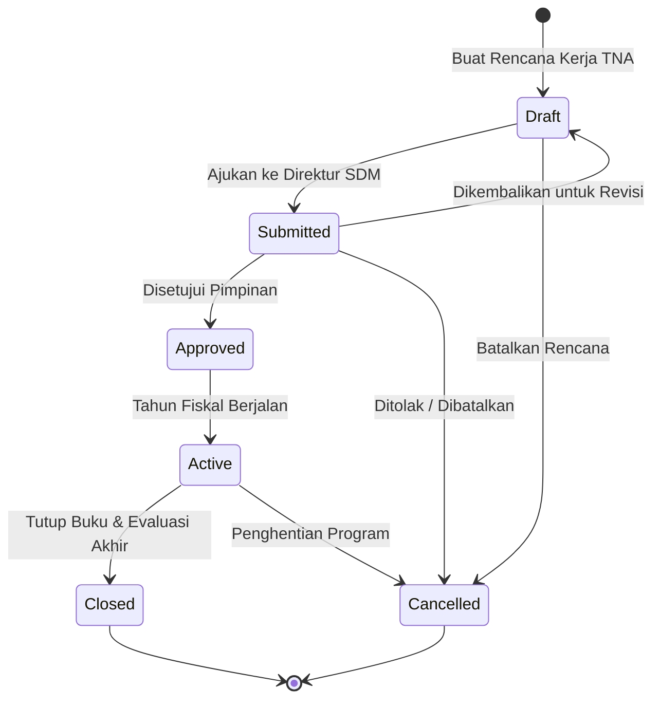

| Status Asal | Status Tujuan | Pemicu (Trigger) / Aksi | Kondisi & Aturan Bisnis | Hak Akses |
| :--- | :--- | :--- | :--- | :--- |
| `[*]` | `Draft` | Pembuatan draf rencana kerja tahunan diklat | Tim Diklat menginput usulan program pelatihan dan estimasi biaya per departemen. | `Training_Plan:Create` |
| `Draft` | `Submitted` | Pengajuan dokumen rencana kerja | Seluruh rincian program dan estimasi anggaran telah lengkap diisi (`VR-TRN-13`). | `Training_Plan:Create` |
| `Submitted` | `Approved` | Pengesahan oleh Direktur / Manajer SDM | Verifikasi kelayakan alokasi pagu terhadap rencana kerja rumah sakit (`VR-TRN-14`). | `Training_Plan:Approve` |
| `Submitted` | `Draft` | Pengembalian berkas pengusulan | Terdapat ketidaksesuaian estimasi biaya atau target pelatihan yang perlu direvisi. | `Training_Plan:Approve` |
| `Approved` | `Active` | Awal tahun anggaran fiskal | Tahun berjalan aktif, sesi-sesi pelatihan turunan program dapat dijadwalkan. | `Training_Plan:Manage` |
| `Active` | `Closed` | Akhir tahun anggaran berjalan | Seluruh sesi telah selesai dan realisasi anggaran final telah diaudit. | `Training_Plan:Manage` |
| `Draft` / `Submitted` / `Active` | `Cancelled` | Pembatalan rencana kerja tahunan | Pembatalan resmi akibat restrukturisasi atau keputusan direksi. | `Training_Plan:Approve` |

---

### 24.2 Siklus Hidup Sesi Kelas & Workshop Pelatihan (`TrainingSessionStatus`)

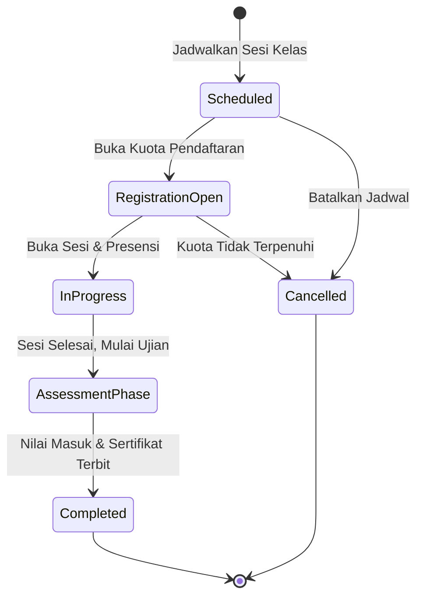

| Status Asal | Status Tujuan | Pemicu (Trigger) / Aksi | Kondisi & Aturan Bisnis | Hak Akses |
| :--- | :--- | :--- | :--- | :--- |
| `[*]` | `Scheduled` | Penyusunan jadwal sesi pelatihan | Diklat menetapkan judul, tanggal, kuota, instruktur, dan tempat/link virtual. | `Training_Session:Manage` |
| `Scheduled` | `RegistrationOpen` | Pembukaan periode pendaftaran peserta | Tanggal pendaftaran aktif, form ESS staf dan penugasan atasan dibuka (`VR-TRN-07`). | `Training_Session:Manage` |
| `RegistrationOpen` | `InProgress` | Hari pelaksanaan materi dimulai | Tanggal mulai tercapai, kuota minimal terpenuhi, absensi presensi dibuka. | `Training_Session:Manage` |
| `InProgress` | `AssessmentPhase` | Penyampaian materi diklat selesai | Seluruh hari sesi terlaksana, peserta memenuhi syarat kehadiran masuk ke ujian (`VR-TRN-03`). | `Training_Session:Manage` |
| `AssessmentPhase` | `Completed` | Penilaian selesai & sertifikat diterbitkan | Seluruh peserta tuntas dinilai (post-test teori & simulasi OSCE klinis). | `Training_Session:Manage` |
| `Scheduled` / `RegistrationOpen` | `Cancelled` | Pembatalan penyelenggaraan sesi | Kuota minimal peserta tidak tercapai atau kendala force majeure instruktur. | `Training_Session:Manage` |

---

### 24.3 Siklus Hidup Pendaftaran Peserta Diklat (`TrainingEnrollmentStatus`)

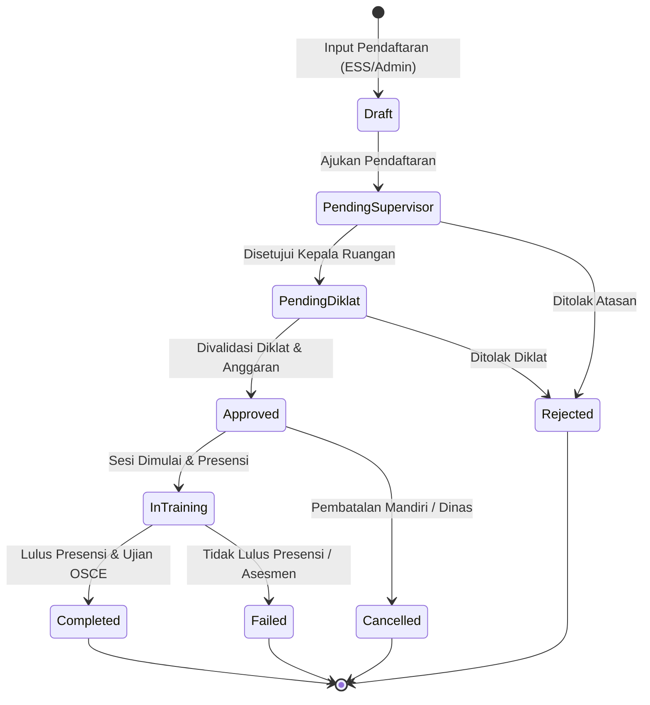

| Status Asal | Status Tujuan | Pemicu (Trigger) / Aksi | Kondisi & Aturan Bisnis | Hak Akses |
| :--- | :--- | :--- | :--- | :--- |
| `[*]` | `Draft` | Pengisian form registrasi diklat | Staf mengentri pengajuan diklat via ESS atau staf Diklat menugaskan via radar. | `Training_Enrollment:Submit` |
| `Draft` | `PendingSupervisor` | Penyerahan berkas pendaftaran | Staf mengajukan dispensasi dinas ke atasan langsung/kepala ruangan. | `Training_Enrollment:Submit` |
| `PendingSupervisor` | `PendingDiklat` | Persetujuan atasan langsung | Atasan menyetujui jadwal dispensasi tidak mengganggu kontinuitas dinas unit. | `Training_Enrollment:Approve` |
| `PendingDiklat` | `Approved` | Verifikasi tim Diklat | Diklat memvalidasi kecukupan sisa pagu anggaran dan ketersediaan kuota kelas (`VR-TRN-15`). | `Training_Enrollment:Approve` |
| `PendingSupervisor` / `PendingDiklat` | `Rejected` | Penolakan pendaftaran | Alasan penolakan dicatat (anggaran habis, jadwal bentrok kritis dinas, dsb). | `Training_Enrollment:Approve` |
| `Approved` | `InTraining` | Check-in pertama sesi pelatihan | Peserta hadir dan mencatatkan presensi absensi pada hari pertama kelas. | `Training_Session:Manage` |
| `InTraining` | `Completed` | Kelulusan evaluasi komprehensif | Kehadiran >= 80% (umum) / 100% (klinis) DAN lulus teori (>=75) serta OSCE (>=80) (`VR-TRN-04`). | `Training_Assessment:Grade` |
| `InTraining` | `Failed` | Gagal evaluasi / absen melampaui batas | Kehadiran kurang dari ambang atau gagal remedial teori dan OSCE. | `Training_Assessment:Grade` |
| `Approved` | `Cancelled` | Pembatalan keikutsertaan | Pembatalan diajukan sebelum sesi dimulai karena rotasi darurat dinas. | `Training_Enrollment:Submit` |

---

### 24.4 Siklus Hidup Sertifikat Kompetensi & Radar Kedaluwarsa (`TrainingCertificateStatus`)

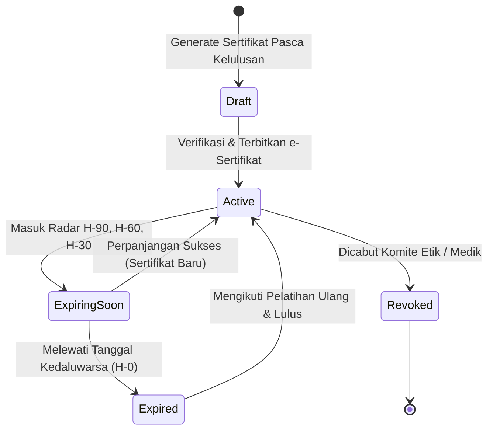

| Status Asal | Status Tujuan | Pemicu (Trigger) / Aksi | Kondisi & Aturan Bisnis | Hak Akses |
| :--- | :--- | :--- | :--- | :--- |
| `[*]` | `Draft` | Kelulusan asesmen peserta diklat | Sistem men-generate draft sertifikat dengan nomor seri resmi unik. | `Training_Certificate:Issue` |
| `Draft` | `Active` | Pengesahan & penerbitan sertifikat | Tanda tangan digital pejabat Diklat dibubuhkan, auto-arsip ke e-Dossier Sub-02 (`INT-HR-72`). | `Training_Certificate:Issue` |
| `Active` | `ExpiringSoon` | Evaluasi worker radar harian | Tanggal kedaluwarsa berada dalam rentang <= 90 hari sebelum habis tempo (`TRN-W1`). | Sistem / Worker |
| `ExpiringSoon` | `Active` | Perpanjangan diklat tepat waktu | Pegawai telah menyelesaikan kelas penyegaran dan sertifikat baru diterbitkan. | `Training_Certificate:Issue` |
| `ExpiringSoon` | `Expired` | Tanggal hari ini > tanggal kedaluwarsa | Sertifikat mati; memicu status Overdue dan pengamanan jadwal shift *buddy system* (`INT-HR-79`). | Sistem / Worker |
| `Expired` | `Active` | Staf mengikuti retifikasi/pelatihan ulang | Staf lulus pelatihan penyegaran dan sertifikat baru diaktifkan. | `Training_Certificate:Issue` |
| `Active` | `Revoked` | Pencabutan izin kompetensi khusus | Komite Medik / Keperawatan mencabut sertifikat akibat malpraktik / pelanggaran disiplin. | `Training_Mandatory:Manage` |

---

### 24.5 Siklus Hidup Perjanjian Ikatan Dinas & Retensi Pegawai (`TrainingBondStatus`)

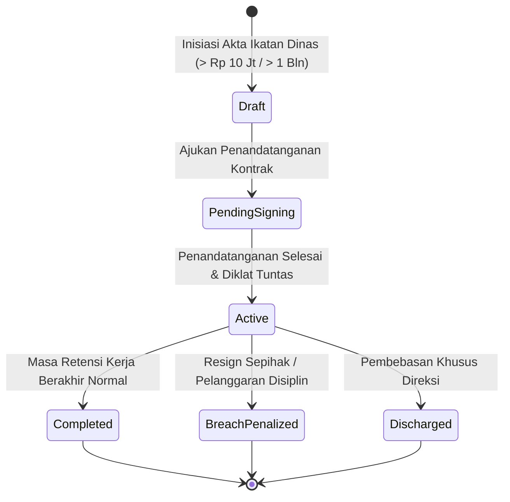

| Status Asal | Status Tujuan | Pemicu (Trigger) / Aksi | Kondisi & Aturan Bisnis | Hak Akses |
| :--- | :--- | :--- | :--- | :--- |
| `[*]` | `Draft` | Deteksi pendaftaran diklat berbiaya tinggi | Biaya pelatihan > Rp 10.000.000 atau durasi > 30 hari kalender (`VR-TRN-16`). | `Training_Bond:Manage` |
| `Draft` | `PendingSigning` | Pengajuan draf akta ke staf dan direksi | Dokumen klausul masa retensi (12 - 36 bulan) dan formula denda dicantumkan. | `Training_Bond:Manage` |
| `PendingSigning` | `Active` | Penandatanganan meterai & diklat selesai | Berkas PDF akta ditandatangani dan diunggah; masa retensi resmi berjalan sejak tanggal selesai diklat. | `Training_Bond:Manage` |
| `Active` | `Completed` | Masa retensi terpenuhi penuh | Staf setia mengabdi hingga tanggal `end_date` tanpa pemutusan hubungan kerja. | Sistem / Worker |
| `Active` | `BreachPenalized` | Pegawai mengundurkan diri sepihak | Staf mengajukan resign sebelum ikatan selesai; tagihan penalti ganti rugi diterbitkan otomatis (`VR-TRN-17`). | `Training_Bond:Manage` |
| `Active` | `Discharged` | Pelepasan ikatan dinas khusus | Kebijakan direksi atas pertimbangan kemanusiaan (misal cacat permanen, sakit kritis menahun). | `Training_Bond:Manage` |

## 25. Matriks Transisi Status Sub-Modul 17: Performance Management & Clinical Career (Slice S-C3)

Matriks transisi status ini mengatur siklus hidup entitas operasional penilaian kinerja pegawai rumah sakit, evaluasi berjenjang tiga tingkat, sidang pleno kalibrasi, program pembinaan kinerja PIP 60 hari, jenjang karier klinis perawat/nakes, serta sengketa sanggah banding nilai.

### 25.1 Siklus Hidup Periode Kinerja (`PerformanceCycleStatus`)

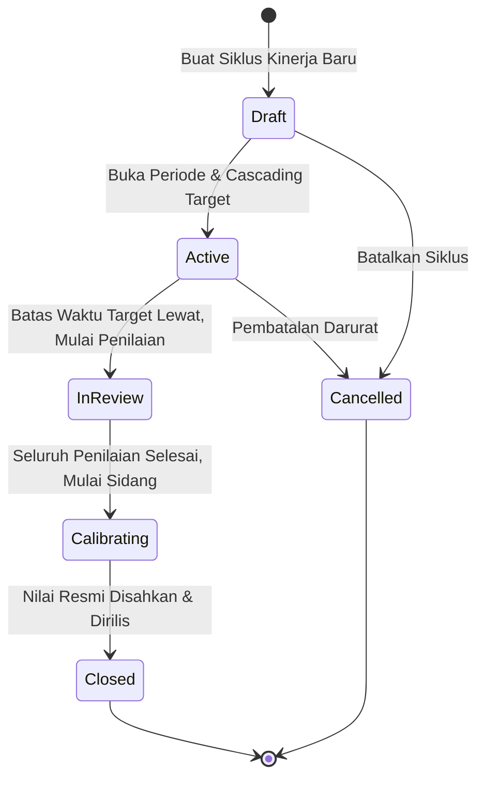

| Status Asal | Status Tujuan | Pemicu (Trigger) / Aksi | Kondisi & Aturan Bisnis | Hak Akses |
| :--- | :--- | :--- | :--- | :--- |
| `[*]` | `Draft` | Pembuatan draf siklus evaluasi kerja | HR Performance menetapkan tahun evaluasi dan tanggal tenggat waktu (`VR-PRF-01`). | `Performance_Cycle:Manage` |
| `Draft` | `Active` | Pembukaan resmi periode kinerja | Tanggal mulai tercapai, sasaran target instalasi siap di-cascading ke staf. | `Performance_Cycle:Manage` |
| `Active` | `InReview` | Akhir periode kerja yang dinilai | Portal pengisian lembar evaluasi (self & manager) resmi dibuka. | Sistem / Worker |
| `InReview` | `Calibrating` | Tenggat waktu atasan kedua selesai | Seluruh berkas review terkumpul, matriks kurva lonceng sebaran nilai digenerate. | Sistem / Worker |
| `Calibrating` | `Closed` | Pengesahan sidang pleno kalibrasi | Direktur SDM menutup sidang pleno, skor akhir dikunci dan dirilis ke ESS (`VR-PRF-06`). | `Performance_Calibration:Manage` |
| `Draft` / `Active` | `Cancelled` | Pembatalan siklus kerja | Pembatalan resmi akibat bencana darurat atau restrukturisasi total institusi. | `Performance_Cycle:Manage` |

---

### 25.2 Siklus Hidup Lembar Rapor Evaluasi Kinerja Pegawai (`PerformanceAppraisalStatus`)

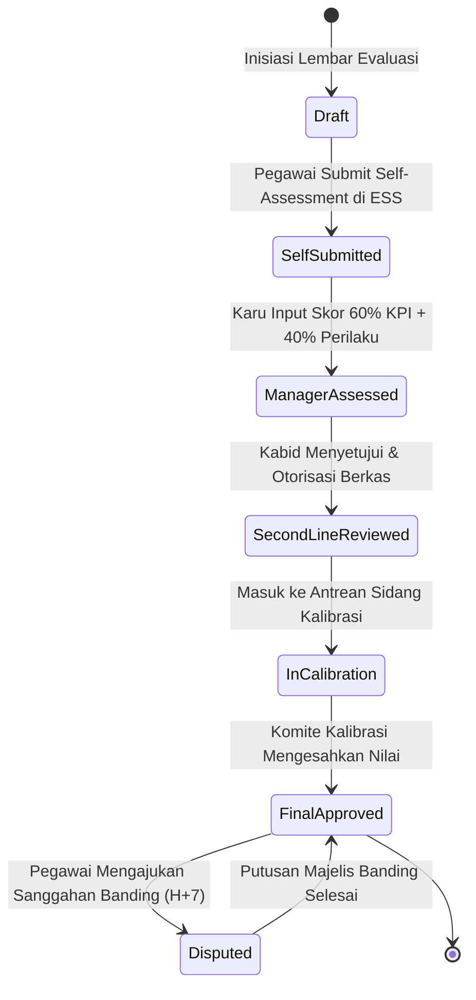

| Status Asal | Status Tujuan | Pemicu (Trigger) / Aksi | Kondisi & Aturan Bisnis | Hak Akses |
| :--- | :--- | :--- | :--- | :--- |
| `[*]` | `Draft` | Pembukaan fase penilaian siklus | Sistem men-generate lembar kerja evaluasi untuk seluruh pegawai aktif unit. | Sistem / Worker |
| `Draft` | `SelfSubmitted` | Pegawai menyerahkan evaluasi mandiri | Pegawai mengisi refleksi diri dan mengunggah dokumen bukti di ESS. | `Performance_Appraisal:SelfAssess` |
| `SelfSubmitted` | `ManagerAssessed` | Penilaian oleh atasan langsung (Karu) | Karu mengisi seluruh butir nilai 60% KPI dan 40% Core Values BerAKHLAK (`VR-PRF-03`). | `Performance_Appraisal:ManagerAssess` |
| `ManagerAssessed` | `SecondLineReviewed` | Penelaahan oleh atasan kedua (Kabid) | Kabid memeriksa konsistensi skor antar ruangan dan menyetujui berkas (`VR-PRF-04`). | `Performance_Appraisal:SecondLineReview` |
| `SecondLineReviewed`| `InCalibration` | Sidang kalibrasi dibuka | Seluruh berkas unit dikompilasi ke dalam matriks sebaran nilai komite. | Sistem / Worker |
| `InCalibration` | `FinalApproved` | Komite kalibrasi mengesahkan skor | Skor akhir komposit ditetapkan (dengan/tanpa override notes) dan dirilis ke ESS. | `Performance_Calibration:Manage` |
| `FinalApproved` | `Disputed` | Pengajuan sanggah banding oleh pegawai | Pegawai mengajukan sanggahan resmi dalam rentang maksimal 7 hari kalender (`VR-PRF-12`). | `Performance_Dispute:Submit` |
| `Disputed` | `FinalApproved` | Penetapan putusan sidang banding | Direktur SDM menerbitkan putusan final dan skor akhir diperbarui (`VR-PRF-13`). | `Performance_Dispute:Manage` |

---

### 25.3 Siklus Hidup Program Peningkatan Kinerja (`PerformancePipStatus`)

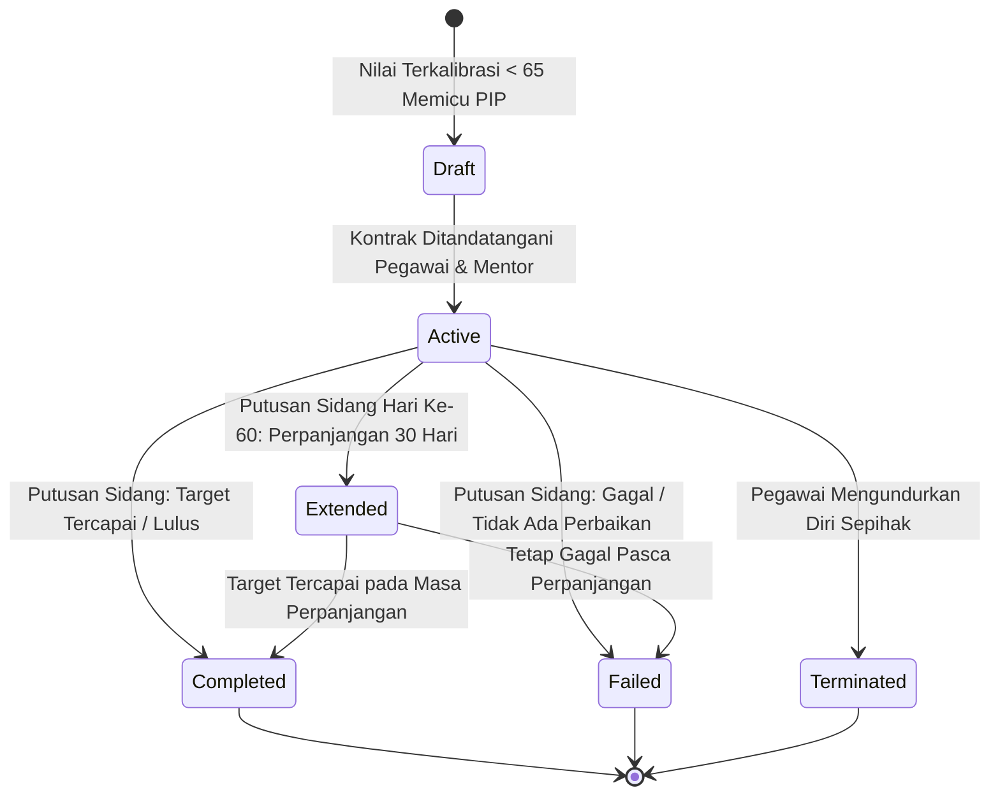

| Status Asal | Status Tujuan | Pemicu (Trigger) / Aksi | Kondisi & Aturan Bisnis | Hak Akses |
| :--- | :--- | :--- | :--- | :--- |
| `[*]` | `Draft` | Deteksi skor akhir < 65.00 | Sistem menerbitkan draf kontrak pembinaan formal PIP 60 hari kalender (`VR-PRF-08`). | Sistem / Worker |
| `Draft` | `Active` | Penandatanganan kontrak komitmen | Pegawai, atasan, dan mentor menyetujui target perbaikan; masa 60 hari berjalan. | `Performance_Pip:Manage` |
| `Active` | `Completed` | Evaluasi akhir hari ke-60 lulus | Staf membuktikan pencapaian target perbaikan; status kinerja kembali normal. | `Performance_Pip:Manage` |
| `Active` | `Extended` | Evaluasi hari ke-60: perpanjangan | Tren perbaikan positif parsial, komite memberi tambahan waktu maks 30 hari (`VR-PRF-10`). | `Performance_Pip:Manage` |
| `Extended` | `Completed` | Evaluasi pasca perpanjangan lulus | Staf menuntaskan target pada masa 30 hari tambahan; status normal kembali. | `Performance_Pip:Manage` |
| `Active` / `Extended` | `Failed` | Evaluasi akhir tidak memenuhi target | Staf gagal menunjukkan perbaikan; berkas dieskalasi ke HR Legal / Komite Etik. | `Performance_Pip:Manage` |
| `Active` | `Terminated` | Pengunduran diri saat PIP | Pegawai mengundurkan diri sepihak sebelum masa pembinaan 60 hari selesai. | `Performance_Pip:Manage` |

---

### 25.4 Siklus Hidup Review Jenjang Karier Klinis Nakes (`ClinicalLadderStatus`)

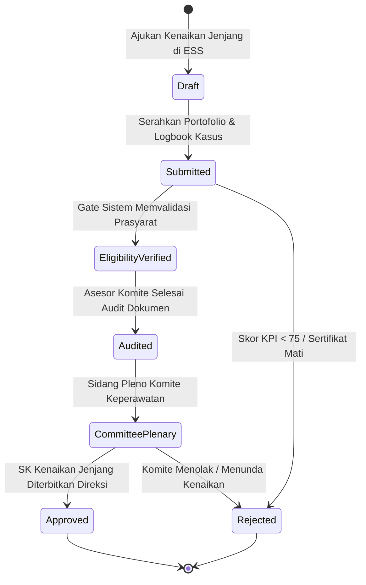

| Status Asal | Status Tujuan | Pemicu (Trigger) / Aksi | Kondisi & Aturan Bisnis | Hak Akses |
| :--- | :--- | :--- | :--- | :--- |
| `[*]` | `Draft` | Nakes membuat draf pengajuan jenjang | Nakes memilih jenjang target (misal PK II ke PK III) di portal ESS. | `Clinical_Career:Apply` |
| `Draft` | `Submitted` | Pengunggahan logbook kasus klinis | Nakes melampirkan portofolio tindakan mandiri dan sertifikat pendukung. | `Clinical_Career:Apply` |
| `Submitted` | `EligibilityVerified`| Validasi otomatis service gate | Skor kinerja >= 75, sertifikat kompetensi Sub-16 aktif, bebas sentinel Sub-15 (`VR-PRF-14`).| Sistem / Gate |
| `Submitted` | `Rejected` | Kegagalan gate prasyarat sistem | Skor kinerja < 75 atau sertifikat kritis expired; pengajuan ditolak seketika (*fail-closed*).| Sistem / Gate |
| `EligibilityVerified`| `Audited` | Audit portofolio oleh asesor klinis | Asesor memverifikasi kecukupan kuota kasus tindakan mandiri perawat. | `Clinical_Career:Manage` |
| `Audited` | `CommitteePlenary` | Sidang pleno Komite Keperawatan | Komite membahas kelayakan etika dan kompetensi klinis nakes pemohon. | `Clinical_Career:Manage` |
| `CommitteePlenary` | `Approved` | Pengesahan SK Direktur Utama | SK Penetapan Jenjang Klinis terbit; otomatis mutasi level Sub-02 dan RKK Sub-14 (`INT-HR-83`).| `Clinical_Career:Manage` |
| `CommitteePlenary` | `Rejected` | Putusan penundaan / penolakan komite | Rekomendasi penundaan 6 bulan atau retensi jenjang berjalan dengan pembinaan. | `Clinical_Career:Manage` |

---

### 25.5 Siklus Hidup Sengketa Sanggah Banding Nilai Kinerja (`AppraisalDisputeStatus`)

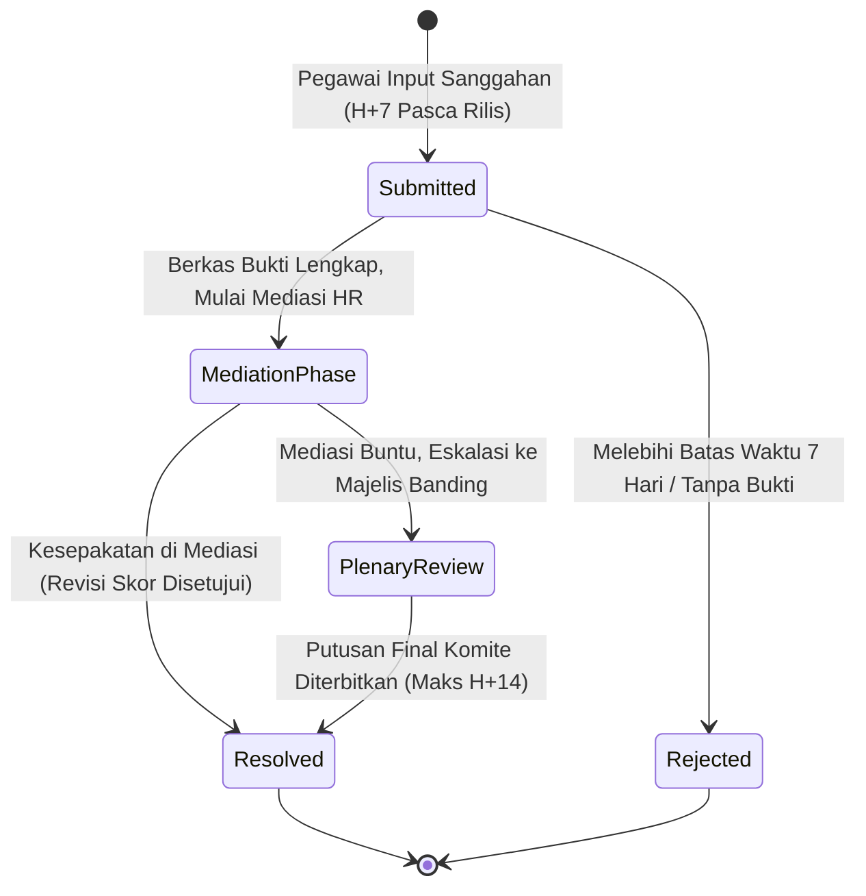

| Status Asal | Status Tujuan | Pemicu (Trigger) / Aksi | Kondisi & Aturan Bisnis | Hak Akses |
| :--- | :--- | :--- | :--- | :--- |
| `[*]` | `Submitted` | Pengajuan sanggahan oleh pegawai | Pegawai mengentri keberatan dan melampirkan berkas bukti pembanding di ESS (`VR-PRF-12`). | `Performance_Dispute:Submit` |
| `Submitted` | `Rejected` | Penolakan pendaftaran sanggahan | Diajukan melampaui batas H+7 atau tidak melampaui bukti dokumen pembanding. | `Performance_Dispute:Manage` |
| `Submitted` | `MediationPhase` | Penerimaan berkas oleh HRD | Tim HR Performance menjadwalkan klarifikasi tertutup antara penilai dan pemohon. | `Performance_Dispute:Manage` |
| `MediationPhase` | `Resolved` | Kesepakatan mediasi damai | Penilai dan pemohon sepakat koreksi skor; berita acara mediasi disahkan HRD. | `Performance_Dispute:Manage` |
| `MediationPhase` | `PlenaryReview` | Ketidaksepakatan di mediasi | Sengketa berlanjut dan dieskalasi ke Komite Kalibrasi / Direktur SDM. | `Performance_Dispute:Manage` |
| `PlenaryReview` | `Resolved` | Putusan final majelis banding | Putusan final diterbitkan dalam batas waktu 14 hari kalender; sengketa ditutup resmi (`VR-PRF-13`). | `Performance_Dispute:Manage` |

---

## 26. Matriks Transisi Status Sub-Modul 18: Hubungan Industrial & Terminasi (Slice `S-C5`)

### 26.1 Siklus Hidup Laporan Kasus Disiplin (`DisciplinaryCaseStatus`)

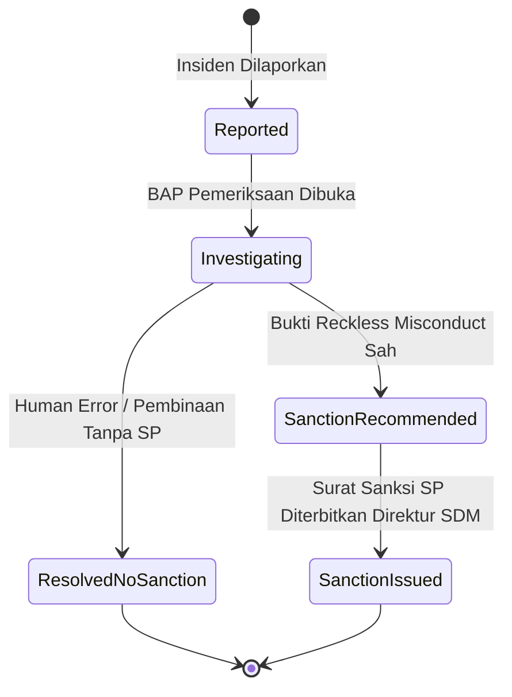

| Status Awal | Event / Aksi Pemicu | Status Tujuan | Syarat Transisi (Guard Conditions) | Wewenang Aktor |
|---|---|---|---|---|
| `Reported` | Buka Berkas Pemeriksaan | `Investigating` | Nomor BAP terbit; tim pemeriksa ditunjuk | HR Legal / Supervisor |
| `Investigating` | Rekomendasikan Pembinaan | `ResolvedNoSanction` | Klasifikasi Just Culture = `HumanError`; diarahkan ke Diklat Sub-16 | Tim Pemeriksa BAP |
| `Investigating` | Tetapkan Dugaan Pelanggaran | `SanctionRecommended` | Bukti Reckless Misconduct sah; nomor audit KMKP ada jika kasus klinis | Tim Pemeriksa BAP |
| `SanctionRecommended` | Sahkan Penerbitan Sanksi | `SanctionIssued` | Ditandatangani Direktur SDM; `ValidUntil = IssuedDate + 6 Months` | Direktur SDM |

---

### 26.2 Siklus Hidup Surat Peringatan (`DisciplinarySanctionStatus`)

| Status Awal | Event / Aksi Pemicu | Status Tujuan | Syarat Transisi (Guard Conditions) | Wewenang Aktor |
|---|---|---|---|---|
| `Active` | Masa Berlaku Berakhir | `Expired` | Mencapai `ValidUntil` (6 bulan kalender); tidak ada pelanggaran baru | `SpExpirationWorker` (`EMP-W1`) |
| `Active` | Banding Dikabulkan | `RevokedOnAppeal` | Putusan sidang sanggah banding Direksi menyatakan sanksi gugur | Direktur Utama / Komite Etik |
| `Active` | Pelanggaran Berulang | `Escalated` | Pegawai melakukan pelanggaran baru sebelum 6 bulan; naik ke SP lebih tinggi | Direktur SDM |

---

### 26.3 Siklus Hidup Skorsing Masa Investigasi (`DisciplinarySuspensionStatus`)

| Status Awal | Event / Aksi Pemicu | Status Tujuan | Syarat Transisi (Guard Conditions) | Wewenang Aktor |
|---|---|---|---|---|
| `[*] ` | Surat Penetapan Skorsing | `Active` | Dugaan pelanggaran berat; hak upah 100% aktif; akses SSO SIMRS dicabut | Direktur Utama |
| `Active` | Rehabilitasi Pegawai | `CompletedReinstated` | Hasil investigasi membuktikan staf tidak bersalah; akun SIMRS diaktifkan lagi | Direktur Utama |
| `Active` | Putusan Pemutusan Kerja | `EscalatedToTermination` | BAP membuktikan pelanggaran berat; berkas dialihkan ke pemutusan hubungan kerja | Direktur Utama |

---

### 26.4 Siklus Hidup Pengaduan Keluhan & Whistleblowing (`GrievanceTicketStatus`)

| Status Awal | Event / Aksi Pemicu | Status Tujuan | Syarat Transisi (Guard Conditions) | Wewenang Aktor |
|---|---|---|---|---|
| `Submitted` | Verifikasi Tiket | `UnderReview` | Diterima oleh Supervisor atau Tim Kepatuhan (jika whistleblower) | Supervisor / Tim Kepatuhan |
| `UnderReview` | Jadwalkan Klarifikasi | `MediationScheduled` | Para pihak dipanggil untuk mediasi dalam batas SLA 14 hari kerja | Mediasi HR |
| `MediationScheduled`| Capai Kesepakatan | `Resolved` | Berita acara mediasi ditandatangani kedua belah pihak | Mediasi HR |
| `UnderReview` | Perselisihan Buntu | `EscalatedToBipartite` | Mediasi internal gagal; dinaikkan ke forum perundingan Bipartit resmi | Manajer SDM |
| `Resolved` | Penutupan Kasus | `Closed` | Rekomendasi perbaikan terlaksana penuh | Staf Pelapor / HR |

---

### 26.5 Siklus Hidup Pemutusan Hubungan Kerja (`EmployeeSeparationStatus`)

| Status Awal | Event / Aksi Pemicu | Status Tujuan | Syarat Transisi (Guard Conditions) | Wewenang Aktor |
|---|---|---|---|---|
| `Initiated` | Validasi Perhitungan Hak | `CalculationApproved` | Lembar pesangon PP 35/2021 disahkan Direktur Keuangan | Direktur Keuangan |
| `CalculationApproved`| Buka Kliring Aset | `ClearanceInProgress` | Berkas exit clearance 5 departemen diinisiasi | HR Offboarding |
| `ClearanceInProgress`| Kliring Lengkap & Payroll Unlock | `FinalizedCompleted` | Seluruh 5 unit berstatus `Approved`; rilis gaji akhir terbuka di Sub-10 | Direktur SDM |
| `Initiated` / `ClearanceInProgress` | Pembatalan Pengunduran Diri | `Cancelled` | Permohonan pembatalan disetujui Direktur SDM sebelum tanggal efektif | Direktur SDM |

---

### 26.6 Siklus Hidup Proses Exit Clearance (`ExitClearanceProcessStatus`)

| Status Awal | Event / Aksi Pemicu | Status Tujuan | Syarat Transisi (Guard Conditions) | Wewenang Aktor |
|---|---|---|---|---|
| `InProgress` | Terdeteksi Tanggungan Tertunda | `BlockedOutstanding` | H-1 efektif masih ada alat medis, laptop, atau utang yang belum diselesaikan | `ExitClearanceReminderWorker` |
| `InProgress` / `BlockedOutstanding`| Seluruh Unit Menyetujui | `Completed` | 5 unit kerja (Unit, Aset, Farmasi, Keuangan, IT) menyetujui secara digital | Sistem / Head of HR |

---

## 27. Sub-Modul 19: Occupational Health & Staff Safety (K3RS & Medical Check-Up) — Slice `S-C6`

### 27.1 Siklus Hidup Penilaian Kelayakan Kerja Staf (`FitnessToWorkStatus`)

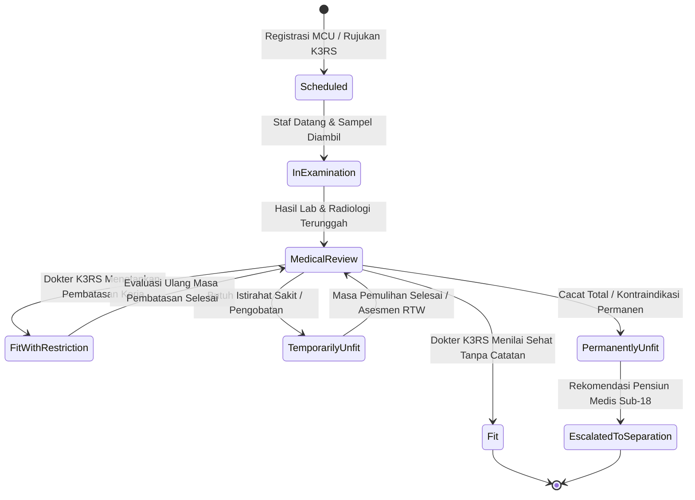

| Status Awal | Event / Aksi Pemicu | Status Tujuan | Syarat Transisi (Guard Conditions) | Wewenang Aktor |
|---|---|---|---|---|
| `[*] ` | Registrasi MCU / Pemeriksaan | `Scheduled` | Pegawai terdaftar dalam jadwal pemeriksaan berkala atau rujukan insiden | Staf Admin K3RS |
| `Scheduled` | Kehadiran Staf & Input Klinis | `InExamination` | Pegawai hadir, tanda vital dicatat, sampel lab/rontgen diambil | Perawat K3RS |
| `InExamination`| Seluruh Hasil Penunjang Masuk | `MedicalReview` | Seluruh hasil lab serologi, rontgen, spirometri, audiometri terunggah lengkap | Dokter K3RS |
| `MedicalReview`| Putusan Sehat Penuh | `Fit` | Tidak ditemukan kontraindikasi medis terhadap profil risiko ruangan kerja | Dokter K3RS Bersertifikat |
| `MedicalReview`| Putusan Sehat dengan Catatan | `FitWithRestriction` | Ditemukan batasan fisik/medis; dokumen pembatasan tugas wajib diterbitkan | Dokter K3RS Bersertifikat |
| `MedicalReview`| Putusan Tidak Laik Sementara | `TemporarilyUnfit` | Staf menderita penyakit menular aktif atau cedera akut yang butuh pemulihan | Dokter K3RS Bersertifikat |
| `MedicalReview`| Putusan Tidak Laik Permanen | `PermanentlyUnfit` | Kondisi fisik/kognitif permanen yang membahayakan keselamatan pasien/diri | Komite Medis K3RS |
| `FitWithRestriction` / `TemporarilyUnfit` | Asesmen Kembali Bekerja (RTW) | `MedicalReview` | Staf menjalani evaluasi ulang pasca masa pemulihan atau masa restriksi | Dokter K3RS Bersertifikat |
| `PermanentlyUnfit` | Rekomendasi Pensiun Dini Medis | `EscalatedToSeparation` | Asesmen permanen disahkan; diteruskan ke Sub-18 PHK pasal uzur medis | Direktur SDM & K3RS |

---

### 27.2 Siklus Hidup Pembatasan Tugas Medis Staf (`WorkRestrictionStatus`)

| Status Awal | Event / Aksi Pemicu | Status Tujuan | Syarat Transisi (Guard Conditions) | Wewenang Aktor |
|---|---|---|---|---|
| `[*] ` | Penerbitan Surat Pembatasan | `Active` | Ditandatangani Dokter K3RS; hard-stop terpasang otomatis ke roster Sub-06 | Dokter K3RS Bersertifikat |
| `Active` | Masa Berlaku Berakhir Normal | `Expired` | Tanggal akhir pembatasan terlewati tanpa permohonan perpanjangan | Worker `OHS-W2` |
| `Active` | Evaluasi Lanjutan & Perpanjangan | `Extended` | Asesmen klinis ulang menyatakan kondisi belum pulih sempurna | Dokter K3RS Bersertifikat |
| `Active` | Pemulihan Dini & Pencabutan | `RevokedEarly` | Staf pulih lebih cepat dari perkiraan; surat pencabutan diterbitkan | Dokter K3RS Bersertifikat |
| `Active` / `Extended` | Asesmen Kembali Kerja Penuh (RTW) | `CompletedCleared` | Uji kelaikan RTW lulus; seluruh gembok restriksi roster Sub-06 dilepas | Dokter K3RS Bersertifikat |

---

### 27.3 Siklus Hidup Tanggap Darurat Tertusuk Jarum & Pajanan Okupasional (`NeedleStickIncidentStatus`)

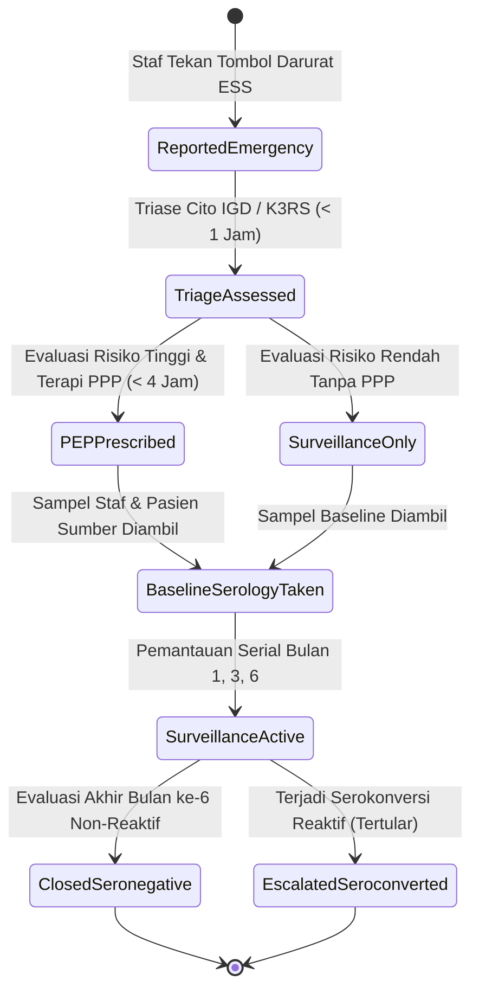

| Status Awal | Event / Aksi Pemicu | Status Tujuan | Syarat Transisi (Guard Conditions) | Wewenang Aktor |
|---|---|---|---|---|
| `[*] ` | Laporan Tombol Darurat ESS | `ReportedEmergency` | Dilaporkan staf via ESS; sirene notifikasi cito terkirim ke K3RS & PPI | Staf Medis Terpajan |
| `ReportedEmergency` | Triase Medis Cito Darurat | `TriageAssessed` | Staf diperiksa di IGD/K3RS dalam batas SLA < 1 jam sejak laporan | Dokter Jaga IGD / K3RS |
| `TriageAssessed`| Peresepan Profilaksis Pasca Pajanan | `PEPPrescribed` | Pajanan darah pasien sumber HIV/HBV; obat ARV/HBIG diberikan < 4 jam | Dokter K3RS & Farmasi |
| `TriageAssessed`| Pajanan Risiko Rendah (Tanpa PPP) | `SurveillanceOnly` | Jarum steril / jarum bersih tanpa darah pasien infeksius | Dokter K3RS |
| `PEPPrescribed` / `SurveillanceOnly` | Pengambilan Darah Baseline | `BaselineSerologyTaken` | Darah staf (HBsAg, Anti-HBs, Anti-HCV, Anti-HIV) & pasien sumber diambil | Analis Lab & K3RS |
| `BaselineSerologyTaken` | Inisiasi Protokol Pemantauan Serial | `SurveillanceActive` | Jadwal reminder otomatis bulan ke-1, ke-3, dan ke-6 terbit di kalender ESS | Worker `OHS-W1` |
| `SurveillanceActive` | Pemantauan 6 Bulan Bersih | `ClosedSeronegative` | Hasil serologi bulan ke-6 terbukti non-reaktif (staf dinyatakan sembuh) | Dokter K3RS & PPI |
| `SurveillanceActive` | Terjadi Serokonversi Reaktif | `EscalatedSeroconverted` | Hasil lab berubah menjadi reaktif; dialihkan ke pengobatan penyakit kerja PAK | Komite Medis K3RS |

---

### 27.4 Siklus Hidup Pelaksanaan MCU Staf (`MedicalExaminationStatus`)

| Status Awal | Event / Aksi Pemicu | Status Tujuan | Syarat Transisi (Guard Conditions) | Wewenang Aktor |
|---|---|---|---|---|
| `Scheduled` | Konfirmasi Registrasi Staf | `RegisteredArrived` | Staf tiba di lokasi pemeriksaan K3RS; barcode pemeriksaan dicetak | Staf Admin K3RS |
| `RegisteredArrived` | Pengambilan Sampel & Radiologi | `SampleCollected` | Darah, urine, dahak diambil; rontgen/audiometri selesai dilaksanakan | Tenaga Medis MCU |
| `SampleCollected` | Hasil Penunjang Terbit | `ResultsUploaded` | Seluruh hasil LIS/PACS terunggah ke berkas terenkripsi | Analis Lab / Radiografer |
| `ResultsUploaded` | Telaah Rekomendasi Dokter K3RS | `DoctorReview` | Dokter K3RS menyusun kesimpulan kelaikan dan anjuran kesehatan | Dokter K3RS |
| `DoctorReview` | Pengesahan & Publikasi Status | `CompletedPublished` | Sertifikat kelaikan kerja dirilis ke HR; berkas medis terkunci AES-256 | Dokter K3RS Bersertifikat |
| `Scheduled` | Staf Tidak Hadir MCU | `NoShowExpired` | Tanggal pemeriksaan terlewati tanpa kehadiran staf; SP peringatan MCU terbit | Worker `OHS-W4` |

---

### 27.5 Siklus Hidup Penanganan Kecelakaan Kerja & Klaim JKK BPJS (`OccupationalInjuryStatus`)

| Status Awal | Event / Aksi Pemicu | Status Tujuan | Syarat Transisi (Guard Conditions) | Wewenang Aktor |
|---|---|---|---|---|
| `[*] ` | Laporan Insiden Kecelakaan Kerja | `Reported` | Laporan KAK dibuat; detail TKP, saksi, dan kondisi korban terdata | Staf Korban / Atasan |
| `Reported` | Investigasi K3RS & Verifikasi TKP | `Investigating` | Tim K3RS melakukan olah TKP, analisis akar masalah (RCA), dan susun CAPA | Tim K3RS RS |
| `Investigating`| Pelaporan BPJS Ketenagakerjaan Tahap I | `BPJSClaimStage1Submitted`| Formulir JKK Tahap I terkirim ke portal BPJS dalam batas waktu < 2x24 jam | Petugas Klaim HR K3RS |
| `BPJSClaimStage1Submitted` | Perawatan Medis & Rehabilitasi | `MedicalTreatmentOngoing` | Korban menjalani rawat inap/jalan; pemantauan hari kerja hilang (LTI) | Tim Medis & K3RS |
| `MedicalTreatmentOngoing` | Asesmen Kesiapan Bekerja Kembali | `ReturnToWorkAssessed` | Dokter K3RS menerbitkan sertifikat RTW kelaikan kerja kembali bertugas | Dokter K3RS |
| `ReturnToWorkAssessed` | Pengajuan Klaim Akhir Tahap II | `BPJSClaimStage2Finalized` | Kuitansi pengobatan, surat sembuh/cacat diserahkan ke BPJS Ketenagakerjaan | Petugas Klaim HR K3RS |
| `BPJSClaimStage2Finalized` | Penutupan Kasus Kecelakaan | `Closed` | Pembayaran klaim JKK BPJS diterima; laporan akhir K3RS diarsipkan | Manajer SDM & K3RS |

---

## 28. Sub-Modul 21: Employee Self-Service (ESS) & Unified Approval Inbox (V2 Hardening) — Slice `S-A7-V2`

### 28.1 Siklus Hidup Tiket Permohonan Terpadu (`WorkflowInstanceStatus`)

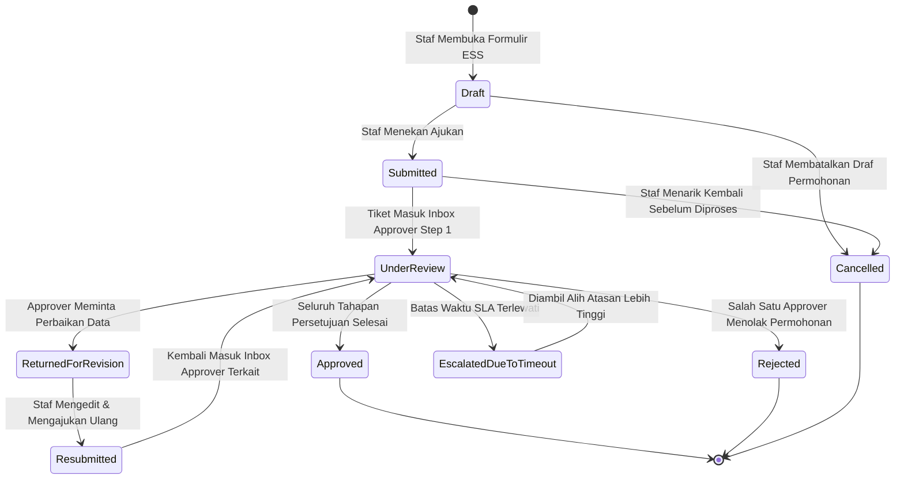

| Status Awal | Event / Aksi Pemicu | Status Tujuan | Syarat Transisi (Guard Conditions) | Wewenang Aktor |
|---|---|---|---|---|
| `[*] ` | Buka Formulir ESS | `Draft` | Pengisian data awal permohonan mandiri di portal ESS | Staf Pemohon |
| `Draft` | Kirim Permohonan Resmi | `Submitted` | Seluruh data wajib terisi; matriks alur persetujuan terbentuk | Staf Pemohon |
| `Submitted` | Penugasan Tiket ke Approver | `UnderReview` | Tiket berhasil masuk ke antrean inbox approver tahapan aktif | Workflow Engine |
| `UnderReview` | Permintaan Klarifikasi / Koreksi | `ReturnedForRevision` | Approver memberikan catatan revisi minimal 10 karakter | Approver Ditugaskan |
| `ReturnedForRevision` | Perbaikan & Kirim Ulang | `Resubmitted` | Staf memperbarui data atau mengunggah lampiran pengganti | Staf Pemohon |
| `Resubmitted`| Penugasan Ulang ke Approver | `UnderReview` | Tiket kembali ke inbox approver yang meminta revisi | Workflow Engine |
| `UnderReview` | Persetujuan Tahapan Terakhir | `Approved` | Seluruh step approver menyetujui; memicu eksekusi domain hilir | Approver Final |
| `UnderReview` | Penolakan Permohonan | `Rejected` | Approver menolak disertai alasan penolakan wajib minimal 15 karakter | Approver Ditugaskan |
| `Submitted` / `Draft` | Pembatalan Mandiri | `Cancelled` | Permohonan ditarik oleh pemohon sebelum keputusan diambil | Staf Pemohon |
| `UnderReview` | Batas Waktu SLA Terlewati | `EscalatedDueToTimeout` | Tiket belum direspon melewati batas `SlaDeadline` | Worker `WF-W1` |
| `EscalatedDueToTimeout` | Ambil Alih Wewenang | `UnderReview` | Atasan tingkat di atasnya menerima wewenang eskalasi | Atasan Tingkat Atas |

---

### 28.2 Siklus Hidup Tahapan Persetujuan Berjenjang (`WorkflowStepStatus`)

| Status Awal | Event / Aksi Pemicu | Status Tujuan | Syarat Transisi (Guard Conditions) | Wewenang Aktor |
|---|---|---|---|---|
| `[*] ` | Inisiasi Step | `Pending` | Tahapan menunggu penyelesaian dari tahapan sebelumnya | Workflow Engine |
| `Pending` | Tahapan Sebelumnya Lolos | `InReview` | Tahapan menjadi aktif dan masuk ke inbox approver terkait | Workflow Engine |
| `InReview` | Keputusan Persetujuan | `Approved` | Approver sah menekan setuju dengan verifikasi PIN | Approver / Plh |
| `InReview` | Keputusan Penolakan | `Rejected` | Approver menolak; tahapan berikutnya otomatis dibatalkan | Approver / Plh |
| `InReview` | Pemohon Self-Approval | `SkippedSelfApproval` | Pemohon adalah approver definitif; step dialihkan ke atasan | Engine `WF-B2` |

---

### 28.3 Siklus Hidup Pendelegasian Wewenang / Plh (`ApprovalDelegationStatus`)

| Status Awal | Event / Aksi Pemicu | Status Tujuan | Syarat Transisi (Guard Conditions) | Wewenang Aktor |
|---|---|---|---|---|
| `[*] ` | Registrasi Surat Kuasa Plh | `Scheduled` | Didaftarkan sebelum tanggal `StartDate` tiba | Pejabat Definitif |
| `Scheduled` / `[*] ` | Tanggal Mulai Berlaku | `Active` | Tanggal hari ini `>= StartDate` dan `<= EndDate` | Worker `WF-W2` |
| `Active` | Tanggal Akhir Terlewati | `Expired` | Tanggal hari ini `> EndDate`; hak wewenang Plh dicabut otomatis | Worker `WF-W2` |
| `Active` / `Scheduled` | Pencabutan Dini Wewenang | `RevokedEarly` | Pejabat definitif kembali aktif lebih cepat dari rencana | Pejabat Definitif |

---

## 29. Matriks Transisi Status Sub-Modul 13: Perjalanan Dinas & Manajemen Biaya Operasional (Business Travel & Expense Management) — Slice `S-D5`

### 29.1 Siklus Hidup Permohonan SPPD (`BusinessTravelStatus`)

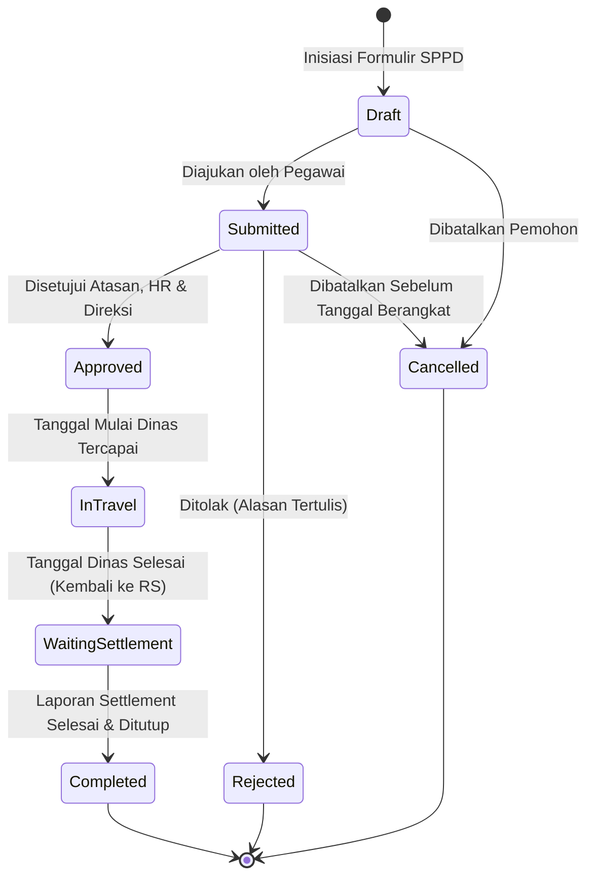

### 29.2 Siklus Hidup Uang Muka Kerja (`TravelAdvanceStatus`)

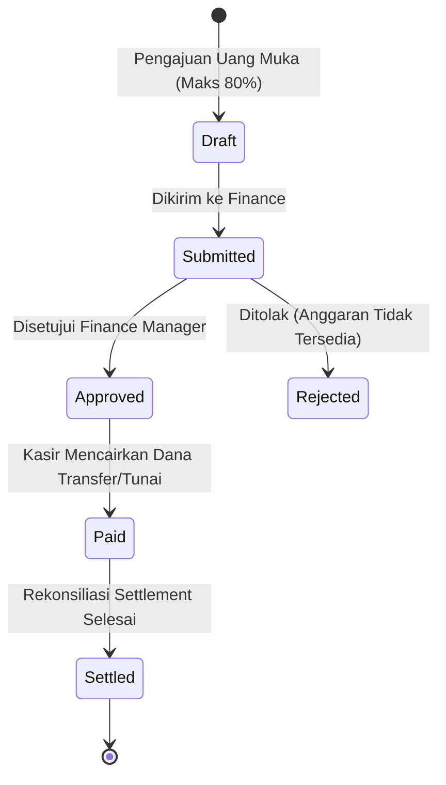

### 29.3 Siklus Hidup Pertanggungjawaban Biaya (`TravelSettlementStatus`)

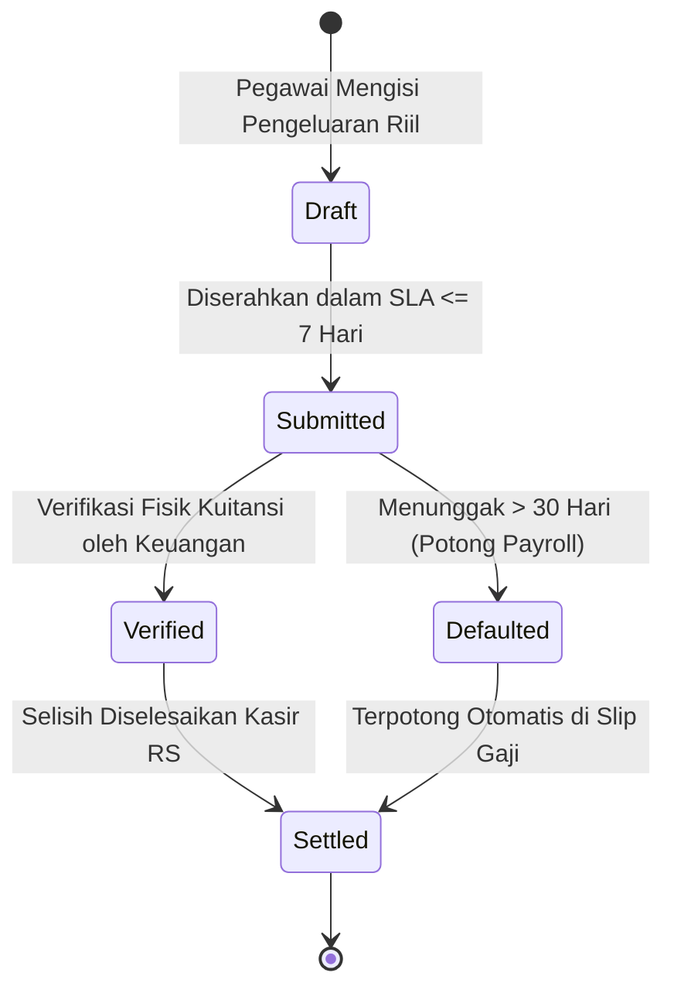

### 29.4 Siklus Hidup Klaim Pengeluaran Non-Trip (`ExpenseClaimStatus`)

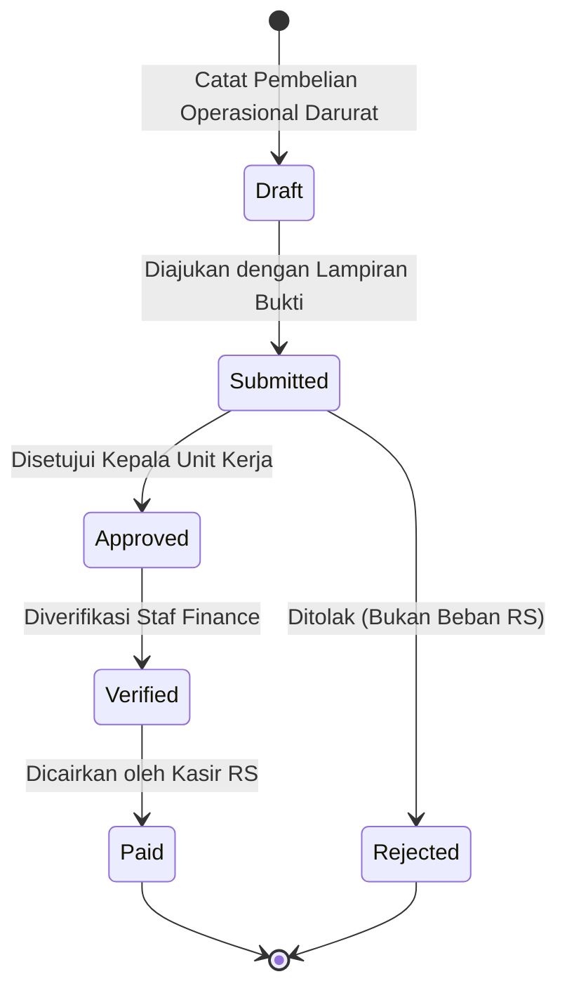

---

## 30. Matriks Transisi Status Amandemen `S-B4`/`S-B1` (`A52`, kontrak `v26`, 12 November 2026)

| Field | Nilai |
| --- | --- |
| `contract_version` | `v26` — `approved` (pengguna, 12 November 2026) |
| Owner | Pengguna (`HRD-DEC-015`) |
| `input_revision` | `00-interview-decisions.md` revision `37`; `02-backend-architecture.md` bagian 35 |

### 30.1 Roster terbit — perubahan sesudah terbit (`HRD-DEC-194`, `195`, `199`, `217`)

| Dari status | Tindakan | Ke status | Siapa yang boleh | Syarat | Bila dilanggar |
| --- | --- | --- | --- | --- | --- |
| `Published` | Ganti Petugas / tambah shift / hapus shift / koreksi mundur | `Published` (tetap) | Kepala Unit dalam cakupan kelola, atau `ManageAllUnits` | Lolos `B1`–`B8`; alasan untuk `W1`–`W7`; koreksi mundur ≤ `RetroactiveCorrectionWindowDays` | 422 (pemeriksaan) / 403 (cakupan) / 409 (diubah orang lain) |
| `Published` | Tindakan yang sama | `Draft` | **Tidak sah** | — | Tidak boleh terjadi; perilaku lama `RosterPeriodService.cs:391` diperbaiki |
| `Draft` | Terbitkan | `Published` | Kepala Unit | Lolos pemeriksaan ulang | 422 |
| `Draft` | Ajukan persetujuan | `InReview` | **Tidak sah** — status tidak ada (`HRD-DEC-194`) | — | Tidak ada endpoint |
| `Closed` | Ubah apa pun / buka kembali | — | **Tidak sah** (`HRD-DEC-199`) | — | 403 |

### 30.2 Catatan panggilan siaga — `HrdOnCallCall.CallStatus` (`HRD-DEC-198`, `204`, `205`)

| Dari status | Tindakan | Ke status | Siapa yang boleh | Syarat | Bila dilanggar |
| --- | --- | --- | --- | --- | --- |
| — | Catat panggilan | `Sent` | Unit pemanggil, Kepala Unit, Admin HRD | Penugasan `Active`; yang dipanggil = siaga utama atau cadangan penugasan itu | 422 |
| `Sent` | Catat bersedia | `Accepted` | Sama | `RowVersion` cocok | 409 |
| `Sent` | Catat tidak bisa | `Declined` | Sama | Alasan wajib | 400 |
| `Sent` | Tandai kedaluwarsa | `Expired` | Sama | `sekarang − CalledAt ≥ AnswerTimeoutMinutes` | 422 "Batas jawab belum lewat" |
| `Accepted` | Catat tiba | `Completed` | Sama | `ArrivedAt ≥ CalledAt` | 400 |
| `Declined`, `Expired`, `Completed` | Ubah status apa pun | — | **Tidak sah** | — | 409 |
| `Sent` | Langsung `Completed` | — | **Tidak sah** — wajib `Accepted` lebih dulu | — | 409 |

Status `TrxOnCallAssignment.AssignmentStatus` **tidak berubah** pada seluruh transisi di atas.

### 30.3 Dispensasi — `HrdAttendanceDispensation.Status` (`HRD-DEC-200`, `HRD-ASM-76`)

| Dari status | Tindakan | Ke status | Siapa yang boleh | Syarat | Bila dilanggar |
| --- | --- | --- | --- | --- | --- |
| — | Ajukan / catat atas nama | `Submitted` | Pegawai (diri sendiri), Kepala Unit (pegawai unitnya) | Tanggal ≥ hari ini − `MaxBackdatedCorrectionDays`; periode kehadiran belum ditutup; atasan langsung ditemukan | 422 / 403 |
| `Submitted` | Setujui | `Approved` | Hanya `ApproverWorkforceProfileId` | Penyetuju ≠ pegawai | 403 |
| `Submitted` | Tolak | `Rejected` | Hanya penyetuju | Alasan wajib | 400 / 403 |
| `Submitted` | Batalkan | `Cancelled` | Pengaju | — | 403 |
| `Approved`, `Rejected`, `Cancelled` | Tindakan apa pun | — | **Tidak sah** | — | 409 |
| Apa pun | Tindakan apa pun sesudah periode kehadiran ditutup | — | **Tidak sah** | — | 403 |

### 30.4 Tugas belajar — `HrdStudyAssignment.Status` (`HRD-DEC-201`)

| Dari status | Tindakan | Ke status | Siapa yang boleh | Syarat | Bila dilanggar |
| --- | --- | --- | --- | --- | --- |
| — | Catat | `Active` | Admin HRD | Tidak tumpang tindih dengan tugas belajar `Active` lain | 422 |
| `Active` | Ubah tanggal | `Active` | Admin HRD | Alasan wajib; tetap tidak tumpang tindih | 400 / 422 |
| `Active` | Batalkan | `Cancelled` | Admin HRD | Alasan wajib | 400 |
| `Cancelled` | Tindakan apa pun | — | **Tidak sah** | — | 409 |

### 30.5 Kejadian gangguan mesin — `HrdAttendanceDeviceIncident.Status` (`HRD-DEC-202`)

| Dari status | Tindakan | Ke status | Siapa yang boleh | Syarat | Bila dilanggar |
| --- | --- | --- | --- | --- | --- |
| — | Catat | `Active` | Petugas IT, Admin HRD | Mesin terdaftar; `EndAt > StartAt` | 400 / 404 |
| `Active` | Batalkan | `Cancelled` | Petugas IT, Admin HRD | Alasan wajib | 400 |
| `Cancelled` | Dirujuk koreksi baru | — | **Tidak sah** | — | 422 |

### 30.6 Status harian kehadiran (`HRD-DEC-197`, `207`, `210`, `216`)

| Dari status | Pemicu | Ke status | Siapa | Syarat |
| --- | --- | --- | --- | --- |
| `NotYetPresent` | Jam selesai shift lewat tanpa scan | `NoScan` | Pemrosesan | — |
| `NotYetPresent` / `NoScan` | Scan masuk dalam jendela (termasuk scan terlambat dari mesin) | `IncompletePunch` / `Present` / `Late` | Pemrosesan | — |
| `IncompletePunch`, `Incomplete`, `NoScan` | HRD menutup periode | `Absent` | Penutupan periode | Selalu, tanpa syarat setelan |
| `NoScan` / `IncompletePunch` | Koreksi disetujui sebelum tutup | Status hasil hitung ulang | Pemrosesan | — |
| apa pun | Pegawai sumber jadwal roster pada hari libur | Tidak menjadi `Holiday` | — | **Tidak sah** sejak `HRD-DEC-210` |
| `NoScan` | Sebelum tutup periode | `Absent` | **Tidak sah** | — |

### 30.7 Log mesin — `HrdAttendanceRawLog.ProcessingStatus` (`HRD-DEC-212`)

| Dari status | Pemicu | Ke status | Siapa | Syarat |
| --- | --- | --- | --- | --- |
| — | Scan dari mesin tak terdaftar/nonaktif | `AwaitingDeviceRegistration` | Penerima log | — |
| `AwaitingDeviceRegistration` | Mesin didaftarkan/diaktifkan | `Pending` | `AttendanceRawLogService` | Identitas mesin cocok |
| `AwaitingDeviceRegistration` | Pemrosesan harian | — | **Tidak sah** — tidak diproses | — |
