# Buku Panduan Sistem Modul HRD Quilvian V2 — Edisi Diperluas

## Acuan Proses Bisnis Rumah Sakit untuk Developer

---

## Metadata Dokumen

| Field | Nilai |
|---|---|
| Judul | Buku Panduan Sistem Modul HRD Quilvian V2 — Edisi Diperluas |
| Modul | Sumber Daya Manusia / Human Resource |
| Sistem | Quilvian Hospital Information System V2 |
| Tujuan | Membantu developer memahami bisnis proses HRD rumah sakit sebelum mengimplementasikan fitur |
| Frontend Evidence | `DevBenari/QuilvianSystemFrontendDev` branch `HamzahV2` |
| Backend Evidence | `DevBenari/NewQuilvianSystemBackend` branch `MHamzah` |
| Dokumen Awal | `Penjelasan_Sistem_dan_Sub_Modul_HRD_Rumah_Sakit.md` |
| Edisi | 29 Oktober 2026 — diperluas dengan praktik rumah sakit, benchmark publik, flowchart, pengaruh bisnis, dan referensi regulasi terkini |
| Status | Business & Implementation Reference |

> **Tujuan buku ini:** developer harus memahami **mengapa** sebuah fitur HRD diperlukan, **siapa** yang menjalankan proses, **kapan** proses dimulai, **apa keputusan bisnisnya**, **data apa yang berubah**, **modul apa yang terdampak**, dan **apa risiko bila implementasi salah**.

---

# 1. Cara Menggunakan Buku Ini

Buku ini tidak dimaksudkan sebagai dokumentasi endpoint atau skema database. Ia adalah **buku bisnis proses**. Source code Quilvian dipakai untuk memahami fondasi implementasi yang sudah ada, sedangkan regulasi dan benchmark rumah sakit publik dipakai untuk memperjelas konteks operasional.

Setiap sub-modul mempunyai bagian:

1. **Penjelasan untuk developer** — definisi dalam bahasa sederhana.
2. **Bagaimana berlaku di rumah sakit** — proses nyata yang perlu dipahami.
3. **Aktor** — role yang terlibat.
4. **Alur proses bisnis** — urutan end-to-end.
5. **Flowchart Mermaid**.
6. **Contoh kasus rumah sakit**.
7. **Pengaruh pada bisnis rumah sakit**.
8. **Yang harus dipahami developer**.
9. **Benchmark rumah sakit / referensi praktik publik**.
10. **Regulasi/standar relevan**.
11. **Status source Quilvian** — existing/partial/extend/new.

## 1.1 Arti “benchmark rumah sakit” pada buku ini

Nama rumah sakit yang disebut **bukan berarti sistem internal rumah sakit tersebut identik dengan desain Quilvian**. Informasi internal HR biasanya tidak dipublikasikan. Benchmark hanya digunakan bila ada bukti publik seperti annual report, sustainability report, halaman karir, LMS/diklat, atau halaman akreditasi.

Gunakan benchmark untuk memahami **praktik yang benar-benar dilakukan di industri rumah sakit**, bukan untuk menyalin desain internal yang tidak diketahui.

## 1.2 Pembaruan regulasi penting per 2026

Dokumen lama masih menyebut Permenkes 755/2011 (Komite Medik) dan Permenkes 49/2013 (Komite Keperawatan). **Keduanya sudah dicabut oleh Permenkes 6 Tahun 2026 tentang Rumah Sakit.** Oleh karena itu, tata kelola komite, kredensial, penugasan klinis, pemeliharaan mutu profesi, etika/disiplin dan pengembangan profesional pada buku ini menggunakan Permenkes 6/2026 serta Standar Akreditasi Rumah Sakit 2024 sebagai baseline terkini.

---

# 2. Mengapa HRD Rumah Sakit Berbeda dari HRD Perusahaan Umum?

Rumah sakit menjalankan pelayanan 24/7 dan banyak keputusan HR langsung memengaruhi keselamatan pasien. HRD karena itu bukan hanya administrasi pegawai, tetapi juga **governance tenaga klinis**.

Developer perlu memahami lima lapisan berikut:

- **Employment** — apakah orang bekerja untuk RS, dengan kontrak apa, di unit mana, kepada siapa melapor.
- **Availability** — kapan ia dijadwalkan dan apakah hadir.
- **Competency** — apakah ia mempunyai kemampuan yang dibutuhkan role/unit.
- **Credential & Privilege** — apakah tenaga klinis sah dan diberi kewenangan melakukan layanan tertentu.
- **Compensation & Welfare** — bagaimana hak gaji, benefit, cuti, lembur dan keselamatan kerjanya dikelola.

Kesalahan desain HRD dapat menghasilkan masalah seperti:

- pegawai yang sudah resign masih mempunyai akses EMR;
- perawat yang sedang cuti tetap muncul pada roster;
- dokter dengan privilege expired tetap bisa dijadwalkan untuk prosedur;
- attendance shift malam dianggap dua hari yang berbeda;
- payroll menerima overtime yang belum diverifikasi;
- HR melihat diagnosis MCU staf yang seharusnya confidential.

---

# 3. Peta Besar 22 Sub-Modul HRD

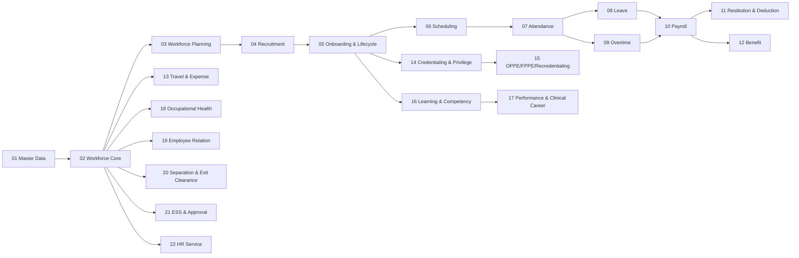

---

# 01. Master Data HR

**Domain source Quilvian:** `MasterData`  
**Status source:** `TERSEDIA — REUSE + HARDEN`

## Penjelasan untuk developer

Master Data HR adalah kamus bersama yang dipakai semua proses HRD. Di rumah sakit, master data bukan hanya daftar jabatan dan departemen. Ia juga harus memuat struktur pelayanan, profesi klinis, spesialisasi, kompetensi, jenis lisensi, jenis sertifikasi, pola kerja, shift, kebijakan cuti, komponen payroll, benefit, jenis tindakan disiplin, dan berbagai referensi lain yang dipakai lintas proses.

Developer harus melihat master data sebagai **sumber aturan dan referensi**, bukan sebagai halaman CRUD biasa. Bila master salah, efeknya menjalar ke roster, payroll, credentialing, laporan SDM, bahkan kontrol siapa yang boleh memberikan pelayanan klinis.

## Bagaimana sub-modul ini berlaku di rumah sakit

- Rumah sakit biasanya memiliki struktur organisasi yang berlapis: direktorat/departemen, instalasi, unit, ruang, profesi, serta layanan klinis. Master organisasi harus mampu merepresentasikan struktur tersebut tanpa menaruh nama unit sebagai teks bebas di transaksi.
- Profesi klinis perlu dibedakan dari jabatan organisasi. Seorang dokter spesialis dapat berprofesi sebagai dokter, mempunyai spesialisasi tertentu, sekaligus memegang jabatan struktural.
- Shift, jenis cuti, jenis lembur, jenis lisensi dan komponen remunerasi sebaiknya configurable karena kebijakan dapat berbeda antar-rumah sakit dan berubah dari waktu ke waktu.
- Data master yang pernah dipakai transaksi sebaiknya dinonaktifkan/effective-dated, bukan dihapus sehingga histori tetap dapat direkonstruksi.

## Aktor utama

- HR Administrator
- HR Manager
- Owner kebijakan unit
- System Administrator dengan kewenangan terbatas

## Alur proses bisnis

1. Pemilik proses mengusulkan master atau perubahan kebijakan.
2. HR/administrator memeriksa apakah referensi serupa sudah ada.
3. Data dibuat dengan kode, nama, parent, effective date, status dan parameter kebijakan.
4. Sistem memvalidasi duplikasi dan relasi.
5. Master diaktifkan dan tersedia untuk transaksi.
6. Jika tidak lagi dipakai, master dinonaktifkan tanpa merusak histori.

## Flowchart

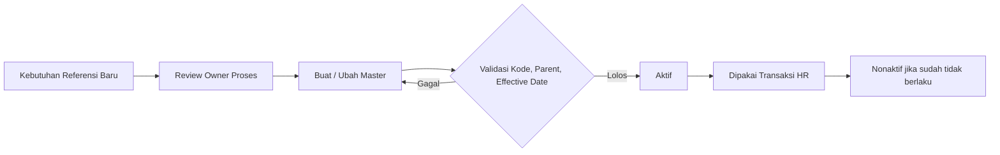

## Contoh kasus rumah sakit

Rumah sakit membuka Cath Lab baru. HR tidak cukup hanya membuat teks “Cath Lab”. Sistem perlu membuat unit organisasi, lokasi kerja, cost center, kebutuhan jabatan, profesi yang dapat ditempatkan, shift/on-call yang berlaku, dan hubungan approval. Setelah itu barulah pegawai dapat ditempatkan dan dijadwalkan secara konsisten.

## Pengaruh pada bisnis rumah sakit

- Mengurangi duplikasi dan inkonsistensi data.
- Memudahkan perubahan kebijakan tanpa hardcode.
- Membuat laporan SDM lintas unit dapat dipercaya.
- Menjadi fondasi audit karena histori referensi tetap dapat ditelusuri.

## Yang harus dipahami developer

- Pisahkan master referensi dari transaksi.
- Gunakan kode unik, status aktif, effective date bila relevan.
- Jangan menaruh unit/jabatan/jenis lisensi sebagai string bebas pada transaksi.
- Gunakan soft-delete/nonaktif bila data pernah digunakan.

## Benchmark rumah sakit / referensi praktik publik

- **Siloam Hospitals** — Laporan 2024 menyebut ekosistem HR terintegrasi dan HR Information System; ini menunjukkan kebutuhan referensi SDM yang konsisten pada jaringan rumah sakit besar.  
  Referensi: [RS-08](https://mysiloam-api.siloamhospitals.com/storage-down/file-web-cms/17459502701625876.pdf) — Siloam Hospitals — Annual Report 2024 (Human Capital, recruitment, HRIS, L&D).
- **RS MMC** — Profil publik menunjukkan struktur layanan multispecialty/cluster dan akreditasi paripurna; ini relevan sebagai benchmark kompleksitas master organisasi/layanan, bukan bukti desain database internal.  
  Referensi: [RS-03](https://mmchospital.co.id/profil-kami) — RS Metropolitan Medical Centre — Profil Rumah Sakit.

> **Catatan benchmark:** contoh rumah sakit di atas hanya menunjukkan praktik/tema yang dapat diverifikasi dari sumber publik. Detail SOP dan aplikasi internal mereka tidak diasumsikan sama dengan Quilvian.

## Regulasi / standar yang relevan

- [REG-03](https://jdih.kemkes.go.id/documents/peraturan-menteri-kesehatan-nomor-6-tahun-2026) — Permenkes 6 Tahun 2026 — Rumah Sakit
- [REG-02](https://jdih.kemkes.go.id/documents/peraturan-menteri-kesehatan-nomor-13-tahun-2025) — Permenkes 13 Tahun 2025 — Pengelolaan Sumber Daya Manusia Kesehatan
- [REG-01](https://jdih.kemkes.go.id/documents/keputusan-menteri-kesehatan-nomor-hk0107menkes15962024) — KMK HK.01.07/MENKES/1596/2024 — Standar Akreditasi Rumah Sakit

---

# 02. Workforce Core & Employee 360

**Domain source Quilvian:** `WorkforceCore`  
**Status source:** `TERSEDIA — REUSE + HARDEN`

## Penjelasan untuk developer

Workforce Core adalah **buku induk tenaga kerja**. Satu orang harus mempunyai satu identitas workforce yang menjadi penghubung seluruh histori kepegawaian. Employee 360 berarti HR dapat melihat kondisi tenaga kerja secara utuh tanpa mencari data di banyak aplikasi.

Di rumah sakit, identitas workforce harus cukup fleksibel untuk dokter, perawat, tenaga kesehatan lain, pegawai administrasi, tenaga alih daya, tenaga paruh waktu, dan profesional tertentu. Status “orang bekerja di RS” tidak selalu identik dengan “karyawan payroll”.

## Bagaimana sub-modul ini berlaku di rumah sakit

- Satu pegawai dapat berpindah unit, jabatan, atasan dan grade tanpa membuat profil orang baru.
- Dokter dapat mempunyai workforce profile walaupun pola kompensasinya berbeda dari pegawai tetap.
- Riwayat pendidikan, keluarga, rekening, kontrak, dokumen dan penempatan harus terhubung ke identitas yang sama.
- Informasi sensitif seperti kesehatan kerja dan disiplin harus direferensikan dengan kontrol akses, bukan dibuka ke semua HR user.

## Aktor utama

- HR Kepegawaian
- Pegawai melalui ESS untuk data tertentu
- Manager sebagai viewer terbatas
- Payroll/Credentialing/L&D sebagai konsumen data

## Alur proses bisnis

1. Candidate yang diterima atau tenaga existing memperoleh WorkforceProfile.
2. HR mengisi identitas dasar dan employment relationship.
3. Sistem membuat assignment organisasi, posisi dan manager yang berlaku efektif.
4. Dokumen, pendidikan, keluarga, rekening dan histori kontrak ditautkan.
5. Domain lain menggunakan WorkforceProfileId yang sama.
6. Perubahan disimpan sebagai history/effective-dated record.

## Flowchart

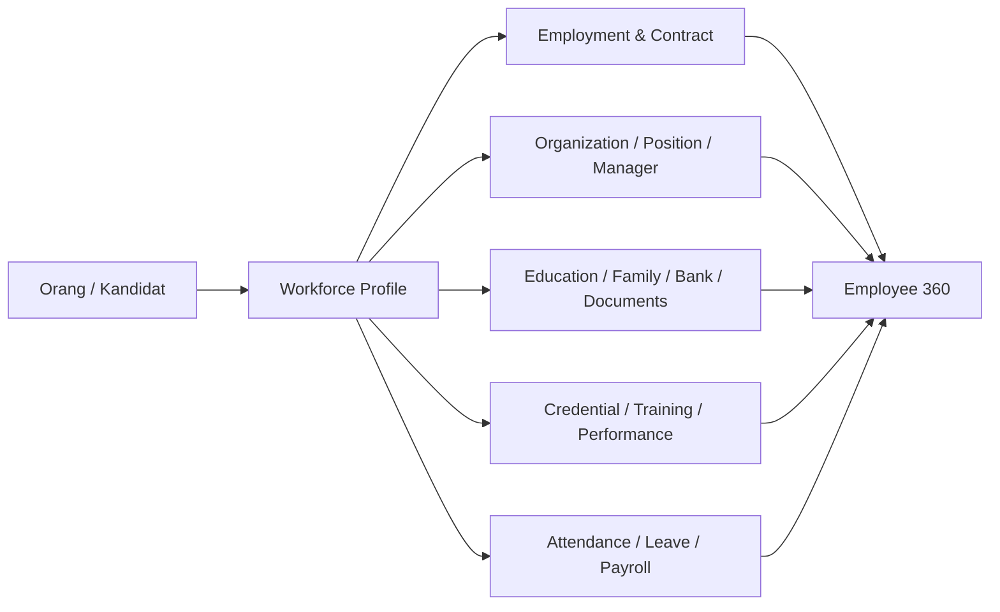

## Contoh kasus rumah sakit

Perawat Rina dipindahkan dari Rawat Inap ke ICU dan naik jabatan menjadi Ketua Tim. Identitasnya tidak berubah. Yang berubah adalah assignment unit, posisi, manager, competency requirement, roster dan allowance yang berlaku mulai tanggal efektif.

## Pengaruh pada bisnis rumah sakit

- Mencegah duplicate employee.
- Membuat audit histori mutasi dan promosi lebih mudah.
- Menjadi single source of truth untuk integrasi HR.
- Mengurangi risiko payroll/approval memakai identitas yang salah.

## Yang harus dipahami developer

- Jangan membuat profile baru saat pegawai mutasi.
- Assignment harus effective-dated dan overlap harus divalidasi.
- Pisahkan person/workforce identity dari employment/payroll eligibility.
- Gunakan RBAC untuk salary, bank, health dan disciplinary data.

## Benchmark rumah sakit / referensi praktik publik

- **Siloam Hospitals** — Annual Report 2024 menampilkan demografi karyawan dan penggunaan HR Information System; cocok sebagai benchmark pengelolaan workforce skala besar.  
  Referensi: [RS-08](https://mysiloam-api.siloamhospitals.com/storage-down/file-web-cms/17459502701625876.pdf) — Siloam Hospitals — Annual Report 2024 (Human Capital, recruitment, HRIS, L&D).

> **Catatan benchmark:** contoh rumah sakit di atas hanya menunjukkan praktik/tema yang dapat diverifikasi dari sumber publik. Detail SOP dan aplikasi internal mereka tidak diasumsikan sama dengan Quilvian.

## Regulasi / standar yang relevan

- [REG-02](https://jdih.kemkes.go.id/documents/peraturan-menteri-kesehatan-nomor-13-tahun-2025) — Permenkes 13 Tahun 2025 — Pengelolaan Sumber Daya Manusia Kesehatan
- [REG-03](https://jdih.kemkes.go.id/documents/peraturan-menteri-kesehatan-nomor-6-tahun-2026) — Permenkes 6 Tahun 2026 — Rumah Sakit
- [REG-01](https://jdih.kemkes.go.id/documents/keputusan-menteri-kesehatan-nomor-hk0107menkes15962024) — KMK HK.01.07/MENKES/1596/2024 — Standar Akreditasi Rumah Sakit

---

# 03. Workforce Planning & Staffing

**Domain source Quilvian:** `WorkforcePlanning`  
**Status source:** `PARTIAL — EXTEND_EXISTING`

## Penjelasan untuk developer

Workforce Planning menjawab pertanyaan: **berapa orang yang dibutuhkan, dengan kompetensi apa, di unit mana, dan kapan mereka dibutuhkan?** Pada rumah sakit, jawaban tidak cukup dari jumlah tempat tidur saja. Kebutuhan dipengaruhi workload, jam layanan, tingkat ketergantungan pasien, jenis pelayanan, skill mix, on-call coverage, serta standar minimum internal/eksternal yang berlaku.

Perencanaan tahunan dan kebutuhan operasional harian perlu dibedakan. Annual manpower plan digunakan untuk anggaran dan rekrutmen. Daily/shift staffing dipakai memastikan pelayanan hari ini aman.

## Bagaimana sub-modul ini berlaku di rumah sakit

- Kepala unit mengusulkan kebutuhan jumlah dan kualifikasi berdasarkan beban kerja dan service plan.
- HR membandingkan kebutuhan dengan tenaga aktif, vacancy, cuti panjang, turnover dan kompetensi.
- Untuk unit kritis seperti ICU, IGD atau kamar operasi, jumlah saja tidak cukup; sistem perlu skill mix dan kompetensi/credential.
- Gap yang disetujui menjadi headcount request dan dapat diteruskan ke recruitment.

## Aktor utama

- Kepala Unit/Kepala Ruangan
- HR Workforce Planning
- Direktur terkait
- Finance/Budget untuk headcount cost

## Alur proses bisnis

1. Tetapkan service demand dan staffing standard.
2. Hitung tenaga tersedia per profesi/kompetensi.
3. Sistem menghasilkan staffing gap.
4. Unit mengajukan manpower/headcount request.
5. Approval manajemen dan budget dilakukan.
6. Approved headcount diteruskan ke recruitment.
7. Setelah hiring, posisi terisi dan gap diperbarui.

## Flowchart

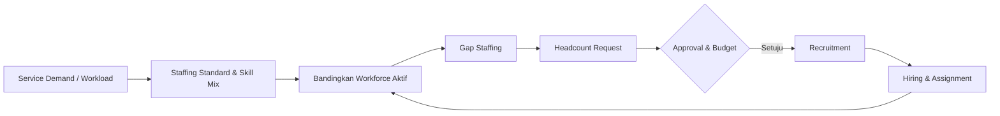

## Contoh kasus rumah sakit

ICU membuka enam bed tambahan. Sistem tidak langsung menyimpulkan “butuh enam perawat”. Kepala unit memasukkan workload/coverage, HR melihat perawat ICU aktif, kompetensi, cuti dan vacancy. Gap disetujui sebagai empat headcount baru dan dua redistribusi internal.

## Pengaruh pada bisnis rumah sakit

- Mengurangi understaffing dan overstaffing.
- Menghubungkan kebutuhan layanan dengan anggaran SDM.
- Mendukung patient safety melalui skill mix.
- Membuat rekrutmen berbasis kebutuhan, bukan permintaan informal.

## Yang harus dipahami developer

- Jangan hardcode satu formula bed-to-staff untuk seluruh unit.
- Sediakan metode configurable: ABK/workload, minimum staffing, acuity/skill mix, hospital policy.
- Pisahkan annual manpower plan dengan daily staffing requirement.
- Approved gap harus dapat ditelusuri sampai requisition dan hiring.

## Benchmark rumah sakit / referensi praktik publik

- **Siloam Hospitals** — Annual Report 2024 menyatakan perusahaan menganalisis kebutuhan tenaga untuk posisi klinis dan non-klinis sebelum perekrutan.  
  Referensi: [RS-08](https://mysiloam-api.siloamhospitals.com/storage-down/file-web-cms/17459502701625876.pdf) — Siloam Hospitals — Annual Report 2024 (Human Capital, recruitment, HRIS, L&D).
- **Mayapada Hospital** — Laporan 2024 memuat pengembangan Human Capital dan pelatihan strategic budgeting for Human Capital sebagai benchmark perencanaan SDM dan biaya.  
  Referensi: [RS-12](https://mayapadahospital.com/file/investor/SRAJ_Laporan-Tahunan_2024_LKA.pdf) — Mayapada Hospital — Annual Report 2024 (Human Capital development).

> **Catatan benchmark:** contoh rumah sakit di atas hanya menunjukkan praktik/tema yang dapat diverifikasi dari sumber publik. Detail SOP dan aplikasi internal mereka tidak diasumsikan sama dengan Quilvian.

## Regulasi / standar yang relevan

- [REG-02](https://jdih.kemkes.go.id/documents/peraturan-menteri-kesehatan-nomor-13-tahun-2025) — Permenkes 13 Tahun 2025 — Pengelolaan Sumber Daya Manusia Kesehatan
- [REG-01](https://jdih.kemkes.go.id/documents/keputusan-menteri-kesehatan-nomor-hk0107menkes15962024) — KMK HK.01.07/MENKES/1596/2024 — Standar Akreditasi Rumah Sakit

---

# 04. Recruitment & Hiring

**Domain source Quilvian:** `RecruitmentManagement`  
**Status source:** `PARTIAL — EXTEND_EXISTING`

## Penjelasan untuk developer

Recruitment bukan hanya menerima CV. Di rumah sakit, sistem harus memastikan kandidat sesuai kebutuhan posisi, mempunyai pendidikan dan dokumen profesi yang relevan, lolos evaluasi kompetensi, medical check bila diwajibkan, serta melalui jalur approval yang seragam.

Untuk tenaga klinis, **diterima sebagai pegawai belum otomatis berarti boleh memberikan tindakan klinis**. Setelah hiring masih ada onboarding, competency, credentialing dan clinical privilege.

## Bagaimana sub-modul ini berlaku di rumah sakit

- Requisition seharusnya berasal dari headcount yang sudah disetujui.
- Seleksi administrasi memeriksa pendidikan, pengalaman, registrasi/lisensi dan dokumen profesi.
- Hiring manager/unit ikut menilai kompetensi kandidat, bukan HR sendirian.
- Pre-employment medical examination dapat menjadi salah satu gate sesuai kebijakan dan risiko pekerjaan.
- Accepted candidate dikonversi menjadi workforce tanpa membuat identitas ganda.

## Aktor utama

- Recruiter/HR
- Hiring Manager/Kepala Unit
- Asesor profesi bila diperlukan
- Occupational Health
- Candidate

## Alur proses bisnis

1. Approved headcount/requisition dibuat.
2. Vacancy dipublikasikan dan kandidat melamar.
3. Screening administrasi dan dokumen profesi.
4. Assessment/interview/kompetensi dilakukan.
5. Reference/background check bila diperlukan.
6. Pre-employment medical check sesuai policy.
7. Job offer disetujui dan dikirim.
8. Candidate accepted dikonversi ke hiring dan onboarding.

## Flowchart

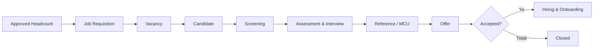

## Contoh kasus rumah sakit

RS membutuhkan perawat IGD. Kandidat harus sesuai pendidikan, mempunyai STR aktif dan sertifikat yang ditetapkan rumah sakit, lolos assessment/interview dan MCU. Setelah menerima offer, kandidat masuk onboarding dan belum otomatis ditempatkan mandiri di IGD sampai orientasi/kompetensi selesai.

## Pengaruh pada bisnis rumah sakit

- Menurunkan risiko salah rekrut.
- Membuat proses seragam dan auditable.
- Mempercepat time-to-fill dengan pipeline yang terukur.
- Menghubungkan rekrutmen dengan kebutuhan unit dan readiness klinis.

## Yang harus dipahami developer

- Candidate, application, assessment, interview, offer dan hiring adalah objek berbeda.
- Jangan membuat WorkforceProfile aktif sebelum status hiring memenuhi gate yang disepakati.
- Simpan evidence verification dan decision history.
- Clinical role harus dapat mengalir ke credentialing setelah hiring.

## Benchmark rumah sakit / referensi praktik publik

- **Siloam Hospitals** — Annual Report 2024 menjelaskan alur publik: pencarian kandidat, interview HC dan Hiring Manager, seleksi, job offer, medical test, lalu administrasi.  
  Referensi: [RS-08](https://mysiloam-api.siloamhospitals.com/storage-down/file-web-cms/17459502701625876.pdf) — Siloam Hospitals — Annual Report 2024 (Human Capital, recruitment, HRIS, L&D).
- **RS MMC** — Halaman karir publik mensyaratkan STR aktif; posisi perawat juga meminta S1 Ners, BTCLS dan kesediaan bekerja shift.  
  Referensi: [RS-01](https://mmchospital.co.id/karir) — RS Metropolitan Medical Centre — Karir/Job Vacancy.

> **Catatan benchmark:** contoh rumah sakit di atas hanya menunjukkan praktik/tema yang dapat diverifikasi dari sumber publik. Detail SOP dan aplikasi internal mereka tidak diasumsikan sama dengan Quilvian.

## Regulasi / standar yang relevan

- [REG-01](https://jdih.kemkes.go.id/documents/keputusan-menteri-kesehatan-nomor-hk0107menkes15962024) — KMK HK.01.07/MENKES/1596/2024 — Standar Akreditasi Rumah Sakit
- [REG-02](https://jdih.kemkes.go.id/documents/peraturan-menteri-kesehatan-nomor-13-tahun-2025) — Permenkes 13 Tahun 2025 — Pengelolaan Sumber Daya Manusia Kesehatan
- [REG-03](https://jdih.kemkes.go.id/documents/peraturan-menteri-kesehatan-nomor-6-tahun-2026) — Permenkes 6 Tahun 2026 — Rumah Sakit

---

# 05. Onboarding, Contract & Employment Lifecycle

**Domain source Quilvian:** `LifecycleManagement / WorkforceCore`  
**Status source:** `PARTIAL — EXTEND_EXISTING`

## Penjelasan untuk developer

Onboarding adalah proses menjadikan orang yang sudah direkrut benar-benar siap bekerja di lingkungan rumah sakit. Isinya bukan hanya tanda tangan kontrak, tetapi orientasi rumah sakit, orientasi unit, kebijakan keselamatan, PPI, akses sistem, penempatan, mandatory training, serta pendampingan klinis bila diperlukan.

Developer harus memisahkan **probation ketenagakerjaan** dari **orientasi/preceptorship klinis**. PKWT dan PKWTT tidak boleh diperlakukan identik. Sistem harus membaca contract type dan policy sebelum membuat probation.

## Bagaimana sub-modul ini berlaku di rumah sakit

- Pegawai baru menerima kontrak/status kerja yang jelas.
- Orientasi umum mencakup budaya, patient safety, PPI, K3RS, code of conduct dan sistem penting.
- Orientasi unit memperkenalkan SOP, equipment, escalation, job description dan risiko unit.
- Tenaga klinis dapat menjalani preceptorship/pendampingan sebelum bekerja mandiri.
- Access provisioning harus sejalan dengan role dan dapat dicabut saat status berubah.

## Aktor utama

- HR Onboarding
- Atasan/Kepala Unit
- Preceptor/Mentor
- IT/Identity Admin
- L&D
- Occupational Health/Credentialing bila relevant

## Alur proses bisnis

1. Candidate accepted menjadi hired workforce.
2. Contract/employment type ditetapkan.
3. Onboarding case dan checklist dibuat.
4. Orientasi rumah sakit diselesaikan.
5. Orientasi unit dan mandatory training diselesaikan.
6. Assignment, manager dan akses sistem diaktifkan.
7. Jika applicable, probation employment review dilakukan.
8. Jika clinical, preceptorship/competency/credential gate diselesaikan.
9. Pegawai dinyatakan ready-for-work.

## Flowchart

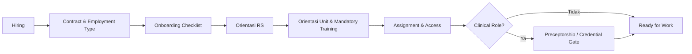

## Contoh kasus rumah sakit

Perawat baru dengan kontrak PKWT mengikuti orientasi rumah sakit dan preceptorship di ICU. Sistem tidak boleh otomatis membuat “masa percobaan PKWT” hanya karena ada `ProbationEndDate`; preceptorship adalah kesiapan klinis, bukan probation ketenagakerjaan.

## Pengaruh pada bisnis rumah sakit

- Mengurangi kesalahan staf baru akibat belum memahami SOP.
- Memastikan akses sistem sesuai status dan role.
- Membuat bukti orientasi tersedia untuk audit/akreditasi.
- Mempercepat time-to-productivity tanpa mengorbankan patient safety.

## Yang harus dipahami developer

- Contract type harus mengontrol probation applicability.
- Pisahkan EmploymentProbation dan ClinicalOrientation/Preceptorship.
- Checklist onboarding harus configurable per role/unit.
- Ready-for-work harus berupa hasil gate, bukan sekadar tanggal mulai kerja.

## Benchmark rumah sakit / referensi praktik publik

- **RSCM** — LMS publik memuat orientasi untuk pegawai, PPDS, tenaga alih daya, tenant dan peserta lain; ini contoh bahwa orientasi berbeda menurut kategori workforce.  
  Referensi: [RS-04](https://diklat.rscm.co.id/lms/?lang=id) — RSCM — Learning Management System / Pelatihan Pegawai.
- **Siloam Hospitals** — Laporan publik menyebut hospital/department orientation dan competency testing sebagai bagian pengembangan staf klinis.  
  Referensi: [RS-08](https://mysiloam-api.siloamhospitals.com/storage-down/file-web-cms/17459502701625876.pdf) — Siloam Hospitals — Annual Report 2024 (Human Capital, recruitment, HRIS, L&D).

> **Catatan benchmark:** contoh rumah sakit di atas hanya menunjukkan praktik/tema yang dapat diverifikasi dari sumber publik. Detail SOP dan aplikasi internal mereka tidak diasumsikan sama dengan Quilvian.

## Regulasi / standar yang relevan

- [REG-04](https://peraturan.bpk.go.id/Details/161904/pp-no-35-tahun-2021) — PP 35 Tahun 2021 — PKWT, Alih Daya, Waktu Kerja, Lembur, PHK
- [REG-02](https://jdih.kemkes.go.id/documents/peraturan-menteri-kesehatan-nomor-13-tahun-2025) — Permenkes 13 Tahun 2025 — Pengelolaan Sumber Daya Manusia Kesehatan
- [REG-03](https://jdih.kemkes.go.id/documents/peraturan-menteri-kesehatan-nomor-6-tahun-2026) — Permenkes 6 Tahun 2026 — Rumah Sakit
- [REG-01](https://jdih.kemkes.go.id/documents/keputusan-menteri-kesehatan-nomor-hk0107menkes15962024) — KMK HK.01.07/MENKES/1596/2024 — Standar Akreditasi Rumah Sakit

---

# 06. Scheduling, Roster & On-Call

**Domain source Quilvian:** `SchedulingManagement`  
**Status source:** `PARTIAL END-TO-END — REUSE + HARDEN`

## Penjelasan untuk developer

Scheduling mengubah workforce yang tersedia menjadi orang yang benar-benar hadir pada waktu yang dibutuhkan layanan. Rumah sakit tidak boleh hanya membuat kalender kerja; roster harus memperhatikan unit, profesi, kompetensi, credential, cuti, fatigue/rest, on-call coverage dan kebutuhan skill mix.

On-call juga bukan sekadar shift biasa. Ia mempunyai tipe, periode siaga, response requirement, activation/call-in, dan kemungkinan kompensasi yang berbeda.

## Bagaimana sub-modul ini berlaku di rumah sakit

- Kepala ruangan biasanya menyusun roster berdasarkan kebutuhan unit dan daftar staf eligible.
- Roster draft perlu divalidasi sebelum publish: bentrok, cuti, overtime, skill mix, license/credential dan coverage.
- Setelah publish, perubahan harus melalui swap/replacement/change request, bukan edit diam-diam.
- Unit tertentu menggunakan on-call untuk menjaga coverage layanan darurat atau prosedur khusus.

## Aktor utama

- Kepala Ruang/Unit
- Manager Pelayanan
- Pegawai
- HR Scheduling
- Credentialing sebagai provider eligibility

## Alur proses bisnis

1. Buat roster period.
2. Tarik staf eligible pada unit dan periode.
3. Susun shift/on-call assignments.
4. Validasi conflict, rest, leave, credential dan skill mix.
5. Review/approval sesuai policy.
6. Publish roster.
7. Perubahan setelah publish melalui swap/replacement/change request.
8. Close/lock periode sesuai kebijakan.

## Flowchart

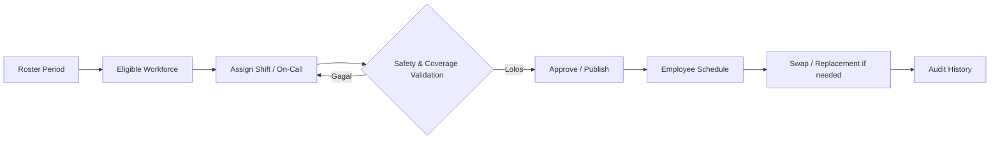

## Contoh kasus rumah sakit

Jadwal malam ICU membutuhkan minimal kombinasi kompetensi tertentu. Sistem tidak cukup melihat tiga nama perawat. Bila perawat senior yang eligible sedang cuti dan dua perawat lain belum memenuhi kompetensi ICU, roster harus memunculkan gap dan meminta replacement sebelum publish.

## Pengaruh pada bisnis rumah sakit

- Menjaga kontinuitas layanan 24/7.
- Mengurangi fatigue dan konflik jadwal.
- Memastikan skill mix dan credential sesuai.
- Menjadi source schedule untuk attendance dan overtime.

## Yang harus dipahami developer

- Jam shift dan response SLA on-call harus configurable.
- Published roster tidak boleh diedit tanpa audit.
- Eligibility sebaiknya memeriksa assignment, leave, competency, license/credential sesuai kebutuhan.
- Jangan campur roster period dengan attendance actual.

## Benchmark rumah sakit / referensi praktik publik

- **RS MMC** — Vacancy publik untuk tenaga klinis menyebut kesiapan bekerja shift; ini menunjukkan shift sebagai kebutuhan operasional nyata pada rumah sakit swasta besar.  
  Referensi: [RS-01](https://mmchospital.co.id/karir) — RS Metropolitan Medical Centre — Karir/Job Vacancy.
- **Siloam Hospitals** — Laporan 2022 memuat allowance on-call dan jaga malam, yang menunjukkan skema kerja on-call/night duty nyata dalam operasi rumah sakit.  
  Referensi: [RS-10](https://mysiloam-api.siloamhospitals.com/storage-down/laporan-tahunan/laporan-tahunan-17083175849635124.pdf) — Siloam Hospitals — Annual Report 2022 (benefit, allowance, industrial relations).

> **Catatan benchmark:** contoh rumah sakit di atas hanya menunjukkan praktik/tema yang dapat diverifikasi dari sumber publik. Detail SOP dan aplikasi internal mereka tidak diasumsikan sama dengan Quilvian.

## Regulasi / standar yang relevan

- [REG-04](https://peraturan.bpk.go.id/Details/161904/pp-no-35-tahun-2021) — PP 35 Tahun 2021 — PKWT, Alih Daya, Waktu Kerja, Lembur, PHK
- [REG-01](https://jdih.kemkes.go.id/documents/keputusan-menteri-kesehatan-nomor-hk0107menkes15962024) — KMK HK.01.07/MENKES/1596/2024 — Standar Akreditasi Rumah Sakit
- [REG-02](https://jdih.kemkes.go.id/documents/peraturan-menteri-kesehatan-nomor-13-tahun-2025) — Permenkes 13 Tahun 2025 — Pengelolaan Sumber Daya Manusia Kesehatan

---

# 07. Attendance Management

**Domain source Quilvian:** `AttendanceManagement`  
**Status source:** `TERSEDIA KUAT — CONTRACT & PROCESS HARDENING`

## Penjelasan untuk developer

Attendance adalah bukti kehadiran aktual dan hasil interpretasi terhadap jadwal. Raw log dari mesin, mobile atau input lain tidak sama dengan attendance daily. Sistem perlu mencocokkan log dengan roster, menangani shift lintas hari, keterlambatan, pulang cepat, missing punch, dinas luar, dan correction.

Prinsip penting: **raw log adalah evidence dan tidak boleh diam-diam diubah**. Koreksi seharusnya menghasilkan request/adjustment yang memiliki alasan, approver dan histori.

## Bagaimana sub-modul ini berlaku di rumah sakit

- Data masuk dapat berasal dari biometric/device atau kanal yang diizinkan.
- Schedule resolver menentukan pegawai seharusnya masuk kapan berdasarkan roster aktif.
- Attendance engine menghasilkan present/late/early leave/absence/exception.
- Pegawai atau HR dapat mengajukan correction untuk kondisi sah.
- Periode ditutup sebelum payroll sehingga data tidak berubah tanpa controlled reopen/reversal.

## Aktor utama

- Pegawai
- HR Attendance Officer
- Manager/Approver
- Payroll sebagai downstream consumer

## Alur proses bisnis

1. Terima raw attendance log.
2. Cari roster/schedule yang berlaku.
3. Proses menjadi attendance daily dan exception.
4. Jika exception salah/ada kondisi khusus, buat correction.
5. Approval dan recalculation dilakukan.
6. HR merekonsiliasi periode.
7. Period close.
8. Handoff ke payroll.

## Flowchart

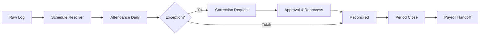

## Contoh kasus rumah sakit

Perawat dinas malam tap masuk 20:55 dan tap pulang 07:10. Sistem harus mengaitkan dua tanggal tersebut ke satu shift malam yang sama, bukan menganggapnya dua hari kerja terpisah. Jika mesin keluar bermasalah, correction tidak menghapus raw log masuk.

## Pengaruh pada bisnis rumah sakit

- Meningkatkan akurasi payroll dan disiplin.
- Mengurangi manipulasi presensi.
- Memberikan evidence untuk audit.
- Mendukung analisis staffing dan fatigue.

## Yang harus dipahami developer

- Simpan raw log immutable.
- Pastikan timezone konsisten dengan site rumah sakit.
- Support overnight shift.
- Period close harus mencegah update biasa; gunakan controlled reopen/correction.

## Benchmark rumah sakit / referensi praktik publik

- **Siloam Hospitals** — Siloam secara publik menyebut HR information ecosystem yang terintegrasi. Detail mesin/algoritme attendance tidak dipublikasikan, sehingga benchmark ini hanya pada tata kelola digital HR, bukan implementasi presensi spesifik.  
  Referensi: [RS-08](https://mysiloam-api.siloamhospitals.com/storage-down/file-web-cms/17459502701625876.pdf) — Siloam Hospitals — Annual Report 2024 (Human Capital, recruitment, HRIS, L&D).

> **Catatan benchmark:** contoh rumah sakit di atas hanya menunjukkan praktik/tema yang dapat diverifikasi dari sumber publik. Detail SOP dan aplikasi internal mereka tidak diasumsikan sama dengan Quilvian.

## Regulasi / standar yang relevan

- [REG-04](https://peraturan.bpk.go.id/Details/161904/pp-no-35-tahun-2021) — PP 35 Tahun 2021 — PKWT, Alih Daya, Waktu Kerja, Lembur, PHK
- [REG-05](https://peraturan.bpk.go.id/Details/339037/pp-no-49-tahun-2025) — PP 36 Tahun 2021 tentang Pengupahan, terakhir diubah PP 49 Tahun 2025

---

# 08. Leave & Permission Management

**Domain source Quilvian:** `LeaveManagement`  
**Status source:** `TERSEDIA KUAT — REUSE + HARDEN`

## Penjelasan untuk developer

Leave Management mengelola **hak, saldo, permohonan dan dampaknya ke jadwal pelayanan**. Pada rumah sakit, approval cuti tidak boleh hanya melihat “saldo cukup”; unit harus tetap mampu menjaga coverage. Karena itu leave berhubungan erat dengan roster dan manager approval.

Saldo sebaiknya dibentuk dari ledger transaksi: entitlement, accrual, carry forward, usage, adjustment dan reversal. Ini jauh lebih aman daripada satu angka saldo yang bisa diedit.

## Bagaimana sub-modul ini berlaku di rumah sakit

- HR membentuk entitlement sesuai policy dan status kerja.
- Pegawai melihat balance dan mengajukan leave melalui ESS.
- Sistem memeriksa saldo, tanggal, overlap dan staffing impact.
- Atasan memutuskan approve/reject/revision sesuai kewenangan.
- Approved leave memengaruhi roster/attendance dan balance ledger.
- Cancellation/recall harus menghasilkan reversal yang dapat diaudit.

## Aktor utama

- Pegawai
- Atasan langsung/Kepala Unit
- HR Leave Administrator
- Scheduling/Payroll downstream

## Alur proses bisnis

1. Entitlement/accrual membentuk saldo.
2. Pegawai membuat request.
3. Validasi saldo, overlap dan attachment bila perlu.
4. Check staffing/coverage.
5. Manager approval.
6. Approved leave dieksekusi ke schedule/attendance.
7. Balance transaction diposting.
8. Cancellation/recall menghasilkan reversal.

## Flowchart

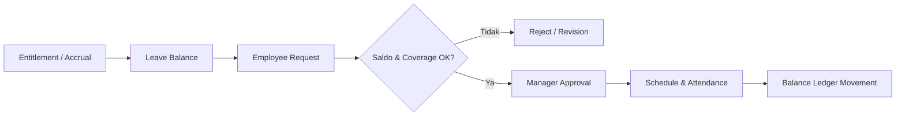

## Contoh kasus rumah sakit

Dua perawat ICU mengajukan cuti pada minggu yang sama. Keduanya punya saldo. Sistem tetap harus memberi informasi coverage agar manager tidak menyetujui dua cuti sekaligus bila skill mix unit menjadi tidak aman.

## Pengaruh pada bisnis rumah sakit

- Menjamin hak pegawai sekaligus menjaga continuity of care.
- Saldo lebih transparan dan auditable.
- Mengurangi konflik antara HR dan unit.
- Mengurangi koreksi payroll akibat cuti tidak sinkron.

## Yang harus dipahami developer

- Gunakan ledger, bukan mutable balance tunggal.
- Cuti approved harus berintegrasi dengan schedule/attendance.
- Policy dapat berbeda menurut employment type/tenure.
- Cancellation dan recall harus mempertahankan histori.

## Benchmark rumah sakit / referensi praktik publik

- **Siloam Hospitals** — Laporan 2022 menyebut paid leave sebagai salah satu fasilitas/manfaat pegawai. Detail approval internal tidak dipublikasikan.  
  Referensi: [RS-10](https://mysiloam-api.siloamhospitals.com/storage-down/laporan-tahunan/laporan-tahunan-17083175849635124.pdf) — Siloam Hospitals — Annual Report 2022 (benefit, allowance, industrial relations).

> **Catatan benchmark:** contoh rumah sakit di atas hanya menunjukkan praktik/tema yang dapat diverifikasi dari sumber publik. Detail SOP dan aplikasi internal mereka tidak diasumsikan sama dengan Quilvian.

## Regulasi / standar yang relevan

- [REG-04](https://peraturan.bpk.go.id/Details/161904/pp-no-35-tahun-2021) — PP 35 Tahun 2021 — PKWT, Alih Daya, Waktu Kerja, Lembur, PHK
- [REG-05](https://peraturan.bpk.go.id/Details/339037/pp-no-49-tahun-2025) — PP 36 Tahun 2021 tentang Pengupahan, terakhir diubah PP 49 Tahun 2025

---

# 09. Overtime Management

**Domain source Quilvian:** `OvertimeManagement`  
**Status source:** `TERSEDIA KUAT — REUSE + HARDEN`

## Penjelasan untuk developer

Overtime memastikan pekerjaan tambahan dilakukan secara sah, terkontrol dan dapat dibuktikan. Rumah sakit membutuhkan dua pola besar: lembur terencana dan lembur tidak terencana/darurat klinis. Dalam situasi cito, patient safety lebih dulu; administrasi dapat dilakukan sebagai post-claim tetapi tetap membutuhkan evidence dan approval.

Perhitungan upah lembur harus mengikuti jenis hari, durasi, dan kebijakan yang berlaku. Jangan membuat satu rumus universal untuk seluruh skenario.

## Bagaimana sub-modul ini berlaku di rumah sakit

- Pre-overtime dibuat sebelum kerja tambahan bila kebutuhan dapat diprediksi.
- Cito/post-overtime digunakan ketika pelayanan tidak dapat dihentikan hanya karena shift selesai.
- Realisasi dibandingkan dengan attendance/schedule dan evidence tugas.
- HR melakukan verification/reconciliation sebelum payroll handoff.
- Compensatory leave dapat menjadi alternatif bila policy memperbolehkan.

## Aktor utama

- Pegawai
- Kepala Unit
- HR Overtime/Payroll
- Payroll

## Alur proses bisnis

1. Buat overtime plan/request atau cito claim.
2. Manager approval/pre-authorization bila applicable.
3. Pegawai melakukan pekerjaan.
4. Sistem mencatat realization dan evidence.
5. HR verifikasi dengan attendance/schedule.
6. Reconciliation menghitung payable hours/comp time.
7. Handoff ke payroll.

## Flowchart

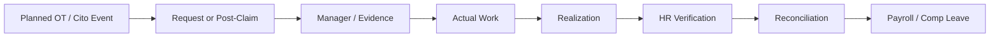

## Contoh kasus rumah sakit

Tim operasi masih menangani kasus cito saat jadwal dinas selesai. Mereka tidak perlu menghentikan tindakan untuk membuat form lembur. Setelah kasus selesai, claim dibuat, diverifikasi terhadap attendance dan catatan layanan, lalu masuk reconciliation.

## Pengaruh pada bisnis rumah sakit

- Mencegah lembur fiktif.
- Menjaga fairness kompensasi.
- Mendukung patient safety pada kasus cito.
- Membuat biaya tenaga kerja lebih terkendali.

## Yang harus dipahami developer

- Bedakan Plan, Realization, Verification, Reconciliation dan Payroll Handoff.
- Tarif/rumus harus policy-driven dan mempertimbangkan jenis hari.
- Attendance adalah evidence, bukan satu-satunya penentu.
- Support post-overtime untuk emergency dengan reason wajib.

## Benchmark rumah sakit / referensi praktik publik

- **Siloam Hospitals** — Laporan 2022 menyebut lembur dan fasilitas makan lembur sebagai komponen tunjangan tidak tetap.  
  Referensi: [RS-10](https://mysiloam-api.siloamhospitals.com/storage-down/laporan-tahunan/laporan-tahunan-17083175849635124.pdf) — Siloam Hospitals — Annual Report 2022 (benefit, allowance, industrial relations).

> **Catatan benchmark:** contoh rumah sakit di atas hanya menunjukkan praktik/tema yang dapat diverifikasi dari sumber publik. Detail SOP dan aplikasi internal mereka tidak diasumsikan sama dengan Quilvian.

## Regulasi / standar yang relevan

- [REG-04](https://peraturan.bpk.go.id/Details/161904/pp-no-35-tahun-2021) — PP 35 Tahun 2021 — PKWT, Alih Daya, Waktu Kerja, Lembur, PHK
- [REG-05](https://peraturan.bpk.go.id/Details/339037/pp-no-49-tahun-2025) — PP 36 Tahun 2021 tentang Pengupahan, terakhir diubah PP 49 Tahun 2025

---

# 10. Payroll Management

**Domain source Quilvian:** `PayrollManagement`  
**Status source:** `PARTIAL — PERLU END-TO-END COMPLETION`

## Penjelasan untuk developer

Payroll adalah proses mengubah data employment, salary, attendance, overtime, allowance, deduction, tax dan benefit menjadi hak bayar pegawai. Di rumah sakit, payroll juga sering menerima komponen khusus: shift malam, on-call, profesi, unit berisiko, jasa tertentu, dan variable input.

Payroll harus diperlakukan sebagai **financially controlled process**: ada period, input freeze, calculation, variance check, approval, finalization, payslip dan handoff pembayaran. Setelah final, perubahan tidak boleh dilakukan dengan edit biasa.

## Bagaimana sub-modul ini berlaku di rumah sakit

- Salary assignment berasal dari grade/contract/kebijakan yang sah.
- Input attendance/overtime sebaiknya sudah closed/reconciled.
- Mesin payroll menghitung earning, deduction, tax dan contribution.
- Payroll officer melakukan preview dan variance review.
- Approver memfinalisasi sesuai segregation of duties.
- Payslip dibuat dan payment file/handoff diteruskan ke Finance/bank.
- Kesalahan setelah final menggunakan adjustment/reversal/restatement sesuai kebijakan.

## Aktor utama

- Payroll Officer
- HR Manager/Approver
- Finance/Treasury
- Pegawai sebagai penerima payslip

## Alur proses bisnis

1. Buka payroll period.
2. Freeze/import input yang telah direkonsiliasi.
3. Calculate payroll.
4. Review anomaly/variance.
5. Approve payroll run.
6. Finalize.
7. Generate payslip.
8. Handoff payment/accounting.
9. Adjustment/reversal bila diperlukan.

## Flowchart

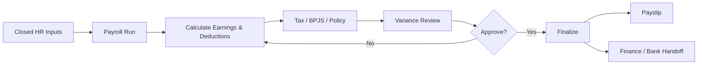

## Contoh kasus rumah sakit

Perawat menerima gaji pokok, tunjangan profesi, night-shift allowance dan overtime. Attendance yang belum direkonsiliasi tidak boleh diam-diam masuk. Payroll preview menunjukkan overtime naik 80% dibanding bulan lalu, sehingga officer melakukan review sebelum final.

## Pengaruh pada bisnis rumah sakit

- Menjaga kepercayaan pegawai.
- Mengurangi koreksi pembayaran dan risiko hukum.
- Meningkatkan kontrol biaya tenaga kerja.
- Menyediakan audit trail dari komponen gaji kembali ke sumbernya.

## Yang harus dipahami developer

- Gunakan payroll period dan payroll run immutable setelah final.
- Segregation of duties: creator tidak selalu approver.
- Simpan source reference tiap komponen.
- Tax/rate jangan hardcode di UI.
- Finance menjadi owner settlement/accounting bila boundary sistem demikian.

## Benchmark rumah sakit / referensi praktik publik

- **Siloam Hospitals** — Laporan 2022 mempublikasikan komponen tunjangan tetap/tidak tetap termasuk profesi, overtime, on-call dan night guard.  
  Referensi: [RS-10](https://mysiloam-api.siloamhospitals.com/storage-down/laporan-tahunan/laporan-tahunan-17083175849635124.pdf) — Siloam Hospitals — Annual Report 2022 (benefit, allowance, industrial relations).
- **Mayapada Hospital** — Annual Report 2022 mencatat topik “Sistem Remunerasi Rumah Sakit” dan “Kriteria Kebijakan dan Sistem Remunerasi Efektif” sebagai bagian peningkatan kompetensi tata kelola.  
  Referensi: [RS-14](https://dev-worktrees.mayapadahospital.com/public/file/investor/SRAJ_Laporan-Tahunan_2022.pdf) — Mayapada Hospital — Annual Report 2022 (hospital remuneration & performance topics).

> **Catatan benchmark:** contoh rumah sakit di atas hanya menunjukkan praktik/tema yang dapat diverifikasi dari sumber publik. Detail SOP dan aplikasi internal mereka tidak diasumsikan sama dengan Quilvian.

## Regulasi / standar yang relevan

- [REG-05](https://peraturan.bpk.go.id/Details/339037/pp-no-49-tahun-2025) — PP 36 Tahun 2021 tentang Pengupahan, terakhir diubah PP 49 Tahun 2025
- [REG-08](https://peraturan.bpk.go.id/Details/286951/pmk-no-168-tahun-2023) — PMK 168 Tahun 2023 — Pemotongan PPh 21/26
- [REG-04](https://peraturan.bpk.go.id/Details/161904/pp-no-35-tahun-2021) — PP 35 Tahun 2021 — PKWT, Alih Daya, Waktu Kerja, Lembur, PHK

---

# 11. Restitution & Payroll Deduction Integration

**Domain source Quilvian:** `PayrollManagement / Finance Integration`  
**Status source:** `TERSEDIA CORE — HARDEN INTEGRATION`

## Penjelasan untuk developer

Sub-modul ini menangani koreksi/penambahan/pengurangan yang tidak seharusnya disisipkan sebagai edit manual pada payroll final. Contohnya penggantian biaya tertentu, restitusi salah potong, atau cicilan kewajiban pegawai kepada rumah sakit.

Prinsip bisnisnya adalah **traceable adjustment**: setiap rupiah harus punya sumber, alasan, approval, periode posting dan hubungan dengan Finance bila menyangkut receivable.

## Bagaimana sub-modul ini berlaku di rumah sakit

- Restitusi dibuat dari transaksi yang mempunyai bukti dan approval.
- Cicilan dipotong berdasarkan outstanding receivable/schedule yang diakui Finance.
- Payroll hanya memposting deduction pada periode yang sah.
- Jika salah potong, koreksi dilakukan melalui restitution/adjustment, bukan mengubah histori payroll lama.

## Aktor utama

- Payroll Officer
- Finance AR
- Approver
- Pegawai untuk transparansi

## Alur proses bisnis

1. Sumber adjustment/receivable terbentuk.
2. Validasi eligibility dan outstanding.
3. Buat payroll adjustment/deduction schedule.
4. Posting ke payroll run periode terkait.
5. Final payroll mengurangi/menambah net pay.
6. Finance menerima settlement movement.
7. Jika salah, buat restitution/reversal berikutnya.

## Flowchart

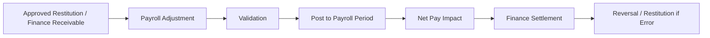

## Contoh kasus rumah sakit

Pegawai mempunyai cicilan piutang rumah sakit Rp500.000 per bulan. Finance adalah source of truth outstanding. Payroll hanya mengambil cicilan periode ini. Bila potongan ternyata salah, payroll berikutnya membuat restitution dengan reference ke transaksi salah potong.

## Pengaruh pada bisnis rumah sakit

- Mencegah outstanding ganda antara HR dan Finance.
- Memudahkan rekonsiliasi.
- Mengurangi edit payroll manual.
- Meningkatkan transparansi bagi pegawai.

## Yang harus dipahami developer

- Jangan duplikasi outstanding receivable di HR.
- Gunakan idempotent handoff dan source transaction id.
- Final payroll tidak diedit; gunakan adjustment/reversal.
- Pastikan potongan memiliki legal/policy basis.

## Benchmark rumah sakit / referensi praktik publik

- **Siloam Hospitals** — Laporan 2022 menyebut sarana koperasi/simpan pinjam dan fasilitas bantuan pegawai; publik tidak menjelaskan mekanisme payroll deduction, sehingga digunakan hanya sebagai benchmark adanya kewajiban finansial pegawai yang perlu tata kelola.  
  Referensi: [RS-10](https://mysiloam-api.siloamhospitals.com/storage-down/laporan-tahunan/laporan-tahunan-17083175849635124.pdf) — Siloam Hospitals — Annual Report 2022 (benefit, allowance, industrial relations).

> **Catatan benchmark:** contoh rumah sakit di atas hanya menunjukkan praktik/tema yang dapat diverifikasi dari sumber publik. Detail SOP dan aplikasi internal mereka tidak diasumsikan sama dengan Quilvian.

## Regulasi / standar yang relevan

- [REG-05](https://peraturan.bpk.go.id/Details/339037/pp-no-49-tahun-2025) — PP 36 Tahun 2021 tentang Pengupahan, terakhir diubah PP 49 Tahun 2025
- [REG-04](https://peraturan.bpk.go.id/Details/161904/pp-no-35-tahun-2021) — PP 35 Tahun 2021 — PKWT, Alih Daya, Waktu Kerja, Lembur, PHK

---

# 12. Benefit Management

**Domain source Quilvian:** `BenefitManagement`  
**Status source:** `TERSEDIA CORE — EXTEND CLAIM/INTEGRATION`

## Penjelasan untuk developer

Benefit adalah hak non-gaji yang diberikan berdasarkan eligibility: BPJS, asuransi, fasilitas kesehatan internal, plafon perawatan staf/keluarga, bantuan tertentu, dan benefit lain sesuai kebijakan rumah sakit. Yang paling penting bukan hanya daftar benefit, tetapi **siapa eligible, kapan aktif, siapa tanggungan yang sah, berapa plafon, bagaimana pemakaian tercatat, dan siapa yang membayar**.

## Bagaimana sub-modul ini berlaku di rumah sakit

- Plan mendefinisikan benefit dan eligibility.
- Employee enrollment mengaktifkan plan untuk workforce tertentu.
- Dependent/family member diverifikasi sebelum memperoleh hak.
- Jika benefit dipakai untuk berobat di RS sendiri, Registration/Billing perlu mengecek coverage.
- Pemakaian harus mengurangi balance/plafon melalui movement ledger.
- Claim eksternal bila ada diproses dengan evidence dan settlement.

## Aktor utama

- HR Benefit Officer
- Pegawai
- Finance
- Registration/Billing
- Insurance/BPJS administrator

## Alur proses bisnis

1. Define plan & eligibility.
2. Enroll employee.
3. Verify dependents.
4. Activate benefit.
5. Service/claim occurs.
6. Validate coverage.
7. Record utilization/balance movement.
8. Settlement/claim processing.
9. Renew/end enrollment sesuai policy.

## Flowchart

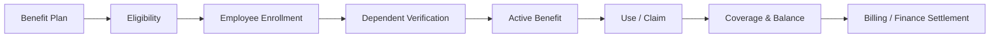

## Contoh kasus rumah sakit

Anak pegawai berobat di rumah sakit tempat orang tuanya bekerja. Registration mencari workforce/dependent yang verified, Billing memperoleh coverage plan, lalu pemakaian benefit mengurangi plafon tanpa petugas memasukkan diskon manual.

## Pengaruh pada bisnis rumah sakit

- Meningkatkan employee welfare dan retention.
- Mengurangi penyalahgunaan benefit.
- Membuat biaya benefit dapat diprediksi.
- Mengintegrasikan HR dengan Billing/Finance.

## Yang harus dipahami developer

- Pisahkan plan, enrollment, dependent dan utilization.
- Gunakan movement ledger untuk plafon.
- Eligibility harus effective-dated.
- JKN/BPJS dan benefit internal adalah konsep berbeda.

## Benchmark rumah sakit / referensi praktik publik

- **Siloam Hospitals** — Laporan 2022 mempublikasikan health maintenance, pemeriksaan kesehatan berkala, paid leave, BPJS kesehatan/ketenagakerjaan dan fasilitas lain sebagai benefit pegawai.  
  Referensi: [RS-10](https://mysiloam-api.siloamhospitals.com/storage-down/laporan-tahunan/laporan-tahunan-17083175849635124.pdf) — Siloam Hospitals — Annual Report 2022 (benefit, allowance, industrial relations).

> **Catatan benchmark:** contoh rumah sakit di atas hanya menunjukkan praktik/tema yang dapat diverifikasi dari sumber publik. Detail SOP dan aplikasi internal mereka tidak diasumsikan sama dengan Quilvian.

## Regulasi / standar yang relevan

- [REG-09](https://peraturan.bpk.go.id/Details/285181/perpres-no-59-tahun-2024) — Perpres 82 Tahun 2018 tentang Jaminan Kesehatan, terakhir diubah Perpres 59 Tahun 2024
- [REG-05](https://peraturan.bpk.go.id/Details/339037/pp-no-49-tahun-2025) — PP 36 Tahun 2021 tentang Pengupahan, terakhir diubah PP 49 Tahun 2025
- [REG-02](https://jdih.kemkes.go.id/documents/peraturan-menteri-kesehatan-nomor-13-tahun-2025) — Permenkes 13 Tahun 2025 — Pengelolaan Sumber Daya Manusia Kesehatan

---

# 13. Business Travel & Expense

**Domain source Quilvian:** `BusinessTravelManagement / ExpenseManagement`  
**Status source:** `PARTIAL — PERSISTENCE FOUNDATION`

## Penjelasan untuk developer

Perjalanan dinas rumah sakit dapat terkait pelatihan, pendampingan cabang, akreditasi, seminar, tugas klinis atau manajemen. Sistem perlu memisahkan **approval tugas**, **uang muka**, **pengeluaran aktual**, **evidence kuitansi**, dan **settlement**. Expense tanpa trip juga dapat ada untuk biaya yang memang menjadi hak/reimbursement.

## Bagaimana sub-modul ini berlaku di rumah sakit

- Pegawai mengajukan perjalanan dengan tujuan, tanggal, kegiatan dan estimasi biaya.
- Atasan/owner budget menyetujui sebelum tiket/advance.
- Finance dapat memberikan advance.
- Setelah perjalanan, pegawai mengunggah receipt dan actual expense.
- Sistem membandingkan advance vs actual lalu menyelesaikan selisih.

## Aktor utama

- Pegawai
- Manager
- HR/GA
- Finance/AP/Treasury

## Alur proses bisnis

1. Travel request dibuat.
2. Approval dan budget check.
3. Advance/booking bila perlu.
4. Trip dilaksanakan.
5. Expense claim & receipts dibuat.
6. Verification.
7. Settlement selisih.
8. Close trip.

## Flowchart

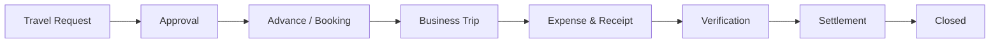

## Contoh kasus rumah sakit

Tim akreditasi dikirim ke pelatihan luar kota. Sebelum berangkat ada surat tugas dan budget. Setelah pulang, tiket/hotel dibandingkan dengan advance. Selisih kurang dibayar, selisih lebih dikembalikan.

## Pengaruh pada bisnis rumah sakit

- Mengontrol biaya perjalanan.
- Memperjelas pertanggungjawaban.
- Mengurangi reimbursement tanpa evidence.
- Menghubungkan HR assignment dengan Finance.

## Yang harus dipahami developer

- Pisahkan request, advance, expense dan settlement.
- Simpan receipt/attachment secara aman.
- Ownership pembayaran bisa di Finance; HR cukup menjadi workflow/employee context.
- Support cancellation dan partial settlement.

## Benchmark rumah sakit / referensi praktik publik

- **Siloam Hospitals** — Laporan 2022 memasukkan perjalanan dinas dan pendidikan sebagai komponen fasilitas/tunjangan karyawan.  
  Referensi: [RS-10](https://mysiloam-api.siloamhospitals.com/storage-down/laporan-tahunan/laporan-tahunan-17083175849635124.pdf) — Siloam Hospitals — Annual Report 2022 (benefit, allowance, industrial relations).

> **Catatan benchmark:** contoh rumah sakit di atas hanya menunjukkan praktik/tema yang dapat diverifikasi dari sumber publik. Detail SOP dan aplikasi internal mereka tidak diasumsikan sama dengan Quilvian.

## Regulasi / standar yang relevan

- [REG-05](https://peraturan.bpk.go.id/Details/339037/pp-no-49-tahun-2025) — PP 36 Tahun 2021 tentang Pengupahan, terakhir diubah PP 49 Tahun 2025

---

# 14. Credentialing, License & Clinical Privilege

**Domain source Quilvian:** `CredentialingManagement`  
**Status source:** `PARTIAL — MODEL KUAT, WORKFLOW PERLU DITUTUP`

## Penjelasan untuk developer

Credentialing menjawab dua pertanyaan yang berbeda: **apakah orang ini benar mempunyai kualifikasi/profesi yang sah?** dan **tindakan klinis apa yang rumah sakit izinkan ia lakukan?**

License/credential membuktikan identitas profesional. Clinical privilege memberi kewenangan spesifik di rumah sakit. Seorang dokter boleh mempunyai STR/SIP aktif tetapi belum tentu memperoleh semua privilege. Sebaliknya, privilege harus dapat dibatasi, disupervisi, ditangguhkan atau dicabut berdasarkan proses yang sah.

## Bagaimana sub-modul ini berlaku di rumah sakit

- Workforce clinical mengajukan credential package.
- Rumah sakit melakukan primary-source verification terhadap dokumen yang wajib diverifikasi.
- Reviewer/committee menilai kesesuaian profesi, spesialisasi, competency dan experience.
- Clinical privilege diajukan per scope/procedure/service.
- Assessment menghasilkan independent/supervised/restricted recommendation.
- Authority menetapkan SPK/RKK atau bentuk penugasan klinis sesuai tata kelola.
- Status privilege memengaruhi scheduling/service gate bila diintegrasikan.

## Aktor utama

- Tenaga Medis/Tenaga Kesehatan
- Credentialing Officer
- Komite/Reviewer profesi sesuai tata kelola RS
- Pimpinan Rumah Sakit
- Clinical unit

## Alur proses bisnis

1. Credential Application.
2. Document Collection.
3. Primary Source Verification.
4. Committee/Professional Review.
5. Credential Decision.
6. Privilege Request.
7. Assessment & Recommendation.
8. Approval / SPK-RKK.
9. Active / Supervised / Restricted / Suspended.

## Flowchart

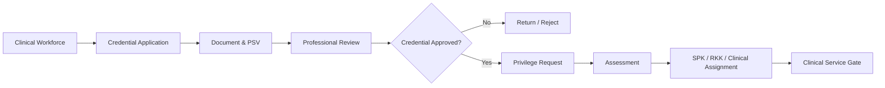

## Contoh kasus rumah sakit

Dokter spesialis mendapatkan SIP aktif tetapi meminta privilege prosedur intervensi baru. Sistem harus memverifikasi training/experience yang relevan, melakukan assessment dan mungkin memberi privilege dengan supervisi terlebih dahulu. Jadi “SIP aktif” tidak otomatis berarti semua prosedur boleh.

## Pengaruh pada bisnis rumah sakit

- Melindungi patient safety.
- Mengurangi risiko tenaga bekerja di luar kewenangan.
- Mendukung akreditasi dan governance profesi.
- Membuat unit klinis dapat mengecek privilege aktif secara sistematis.

## Yang harus dipahami developer

- Pisahkan Credential/License dari ClinicalPrivilege.
- Privilege harus effective-dated dan dapat suspend/revoke.
- Verification evidence dan reviewer decision harus tersimpan.
- Clinical service gate harus mempunyai emergency override policy + audit jika rumah sakit mengizinkan.
- Gunakan Permenkes 6/2026 sebagai baseline tata kelola terkini; Permenkes 755/2011 dan 49/2013 sudah dicabut.

## Benchmark rumah sakit / referensi praktik publik

- **RSCM** — RSCM secara publik menyelenggarakan pelatihan kredensial tenaga kesehatan dan menjelaskan proses memperoleh, memverifikasi, dan menilai kualifikasi praktisi.  
  Referensi: [RS-05](https://diklat.rscm.co.id/?id=858&page=pelatihan.detail) — RSCM — Pelatihan Kredensial Tenaga Kesehatan.
- **RS MMC** — Vacancy klinis publik mensyaratkan STR aktif; sebagai rumah sakit paripurna, MMC relevan sebagai benchmark kebutuhan workforce clinical governance, tetapi detail internal privilege tidak dipublikasikan.  
  Referensi: [RS-01](https://mmchospital.co.id/karir) — RS Metropolitan Medical Centre — Karir/Job Vacancy.

> **Catatan benchmark:** contoh rumah sakit di atas hanya menunjukkan praktik/tema yang dapat diverifikasi dari sumber publik. Detail SOP dan aplikasi internal mereka tidak diasumsikan sama dengan Quilvian.

## Regulasi / standar yang relevan

- [REG-03](https://jdih.kemkes.go.id/documents/peraturan-menteri-kesehatan-nomor-6-tahun-2026) — Permenkes 6 Tahun 2026 — Rumah Sakit
- [REG-01](https://jdih.kemkes.go.id/documents/keputusan-menteri-kesehatan-nomor-hk0107menkes15962024) — KMK HK.01.07/MENKES/1596/2024 — Standar Akreditasi Rumah Sakit
- [REG-02](https://jdih.kemkes.go.id/documents/peraturan-menteri-kesehatan-nomor-13-tahun-2025) — Permenkes 13 Tahun 2025 — Pengelolaan Sumber Daya Manusia Kesehatan

---

# 15. OPPE, FPPE & Recredentialing

**Domain source Quilvian:** `CredentialingManagement + Performance/Quality Integration`  
**Status source:** `NEW + EXTEND_EXISTING — P0`

## Penjelasan untuk developer

Credentialing tidak berhenti ketika SPK/RKK terbit. Rumah sakit harus terus mengevaluasi mutu praktik profesional. **OPPE** adalah evaluasi berkelanjutan menggunakan data praktik; **FPPE** adalah evaluasi terfokus ketika ada trigger tertentu atau saat privilege baru memerlukan pengawasan. Hasilnya menjadi input rekredensial dan keputusan privilege.

Developer harus memahami bahwa OPPE berbeda dari KPI HR biasa. KPI menilai kinerja organisasi/pegawai secara umum; OPPE berfokus pada mutu dan keamanan praktik profesional tenaga medis.

## Bagaimana sub-modul ini berlaku di rumah sakit

- Tetapkan evaluation cycle dan metric set per specialty/privilege.
- Ambil evidence klinis yang relevan: volume, outcome, complication, documentation, behavior, quality indicator, complaint atau audit profesi.
- Reviewer mengkaji data secara objektif dan membuat conclusion.
- Trigger tertentu membuat FPPE dengan supervisor/proctor dan scope yang jelas.
- Recredentialing menggabungkan credential terkini, OPPE, FPPE, status kesehatan yang relevan, dan keputusan komite.
- Privilege dapat diperpanjang, ditambah, dibatasi atau dihentikan.

## Aktor utama

- Tenaga Medis
- Kepala Unit/Kelompok Staf Medis
- Komite/Reviewer Mutu Profesi
- Credentialing
- Quality/Safety

## Alur proses bisnis

1. Collect OPPE data.
2. Periodic professional review.
3. Identify concern/new privilege if any.
4. FPPE bila trigger.
5. Recredential package dibuat saat due.
6. Committee review.
7. Renew/modify/restrict privilege.
8. Update SPK/RKK and file.

## Flowchart

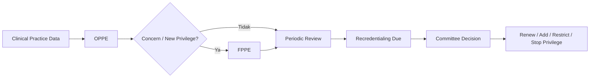

## Contoh kasus rumah sakit

Dokter bedah mempunyai OPPE stabil selama dua tahun, tetapi tahun ketiga terdapat peningkatan komplikasi prosedur tertentu. Sistem menampilkan trend dan evidence. Komite dapat memutuskan FPPE terfokus untuk prosedur tersebut sebelum recredentialing, tanpa otomatis mencabut seluruh privilege dokter.

## Pengaruh pada bisnis rumah sakit

- Menjaga mutu klinis setelah credentialing.
- Mendukung keputusan privilege berbasis data.
- Membuat rekredensial tidak sekadar checklist dokumen.
- Mendukung just culture dan patient safety.

## Yang harus dipahami developer

- OPPE metric harus specialty/privilege-specific, bukan satu template universal.
- Pisahkan OPPE, FPPE dan HR performance review.
- Source clinical data harus dapat ditelusuri.
- Standar akreditasi 2024 menyebut OPPE dan rekredensial paling sedikit setiap tiga tahun untuk tenaga medis; implementasi policy harus mengikuti aturan RS dan regulasi berlaku.

## Benchmark rumah sakit / referensi praktik publik

- **RSCM** — Agenda Diklat RSCM memuat Pelatihan Penilaian Kinerja Kualitatif Staf Medis serta workshop audit klinis; relevan sebagai benchmark capability professional-practice evaluation.  
  Referensi: [RS-06](https://diklat.rscm.co.id/agenda) — RSCM — Agenda Pendidikan dan Pelatihan.

> **Catatan benchmark:** contoh rumah sakit di atas hanya menunjukkan praktik/tema yang dapat diverifikasi dari sumber publik. Detail SOP dan aplikasi internal mereka tidak diasumsikan sama dengan Quilvian.

## Regulasi / standar yang relevan

- [REG-01](https://jdih.kemkes.go.id/documents/keputusan-menteri-kesehatan-nomor-hk0107menkes15962024) — KMK HK.01.07/MENKES/1596/2024 — Standar Akreditasi Rumah Sakit
- [REG-03](https://jdih.kemkes.go.id/documents/peraturan-menteri-kesehatan-nomor-6-tahun-2026) — Permenkes 6 Tahun 2026 — Rumah Sakit

---

# 16. Learning, Training & Competency

**Domain source Quilvian:** `LearningAndDevelopment`  
**Status source:** `PARTIAL — EXTEND_EXISTING`

## Penjelasan untuk developer

Learning & Development memastikan pegawai tidak hanya memiliki ijazah, tetapi terus mempunyai kompetensi yang dibutuhkan role/unit. Rumah sakit mempunyai mandatory training umum dan training klinis khusus unit. Sistem harus mampu menjawab: **siapa wajib mengikuti apa, kapan terakhir lulus, kapan expired, apa hasil assessment, dan apakah gap kompetensi masih ada?**

## Bagaimana sub-modul ini berlaku di rumah sakit

- Role/unit menentukan competency requirement.
- Training Needs Analysis dibuat dari gap, perubahan layanan, regulasi, insiden atau kebutuhan pengembangan.
- Employee di-enroll ke session/training.
- Attendance dan assessment direkam.
- Certificate/competency status diperbarui dengan validity/expiry.
- Overdue training memunculkan reminder dan bila kritis dapat memengaruhi eligibility kerja sesuai policy.

## Aktor utama

- L&D/Diklat
- Kepala Unit
- Trainer/Assessor
- Pegawai
- Credentialing bila training menjadi prerequisite privilege

## Alur proses bisnis

1. Map role competency.
2. Assess employee competency.
3. Identify gap.
4. Create training plan/session.
5. Enroll & attend.
6. Assessment/result.
7. Certificate/competency update.
8. Expiry monitoring & retraining.

## Flowchart

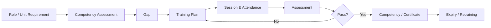

## Contoh kasus rumah sakit

Perawat ICU wajib mempunyai kompetensi ventilator, BHD/BHL dan infection prevention sesuai policy. Sertifikat BHD masih berlaku tetapi competency ventilator belum pernah dinilai. Sistem tidak boleh menampilkan status “semua kompetensi lengkap” hanya karena ada satu sertifikat.

## Pengaruh pada bisnis rumah sakit

- Meningkatkan keselamatan dan kualitas pelayanan.
- Membantu unit memastikan staf eligible.
- Membentuk evidence akreditasi otomatis.
- Mengurangi sertifikat expired yang baru diketahui saat audit.

## Yang harus dipahami developer

- Pisahkan training attendance dari competency achieved.
- Certificate dapat expire, competency juga dapat memerlukan reassessment.
- Requirement harus configurable per role/unit.
- Training tertentu dapat menjadi prerequisite credential/privilege.

## Benchmark rumah sakit / referensi praktik publik

- **RSCM** — LMS publik RSCM memuat BHD/BHL, PPI, workplace violence, K3RS, orientasi, resersertifikasi POCT, perioperatif, triase dan banyak pelatihan unit/profesi.  
  Referensi: [RS-04](https://diklat.rscm.co.id/lms/?lang=id) — RSCM — Learning Management System / Pelatihan Pegawai.
- **RSUP Dr. Sardjito** — Agenda pelatihan 2026 memuat manajemen ruang rawat, keperawatan kardiovaskular, tata kelola klinis keperawatan, dialisis, perioperatif dan lain-lain.  
  Referensi: [RS-07](https://diklat.sardjito.co.id/agenda/kalender_agenda_setahun) — RSUP Dr. Sardjito — Agenda Pelatihan 2026.
- **Siloam Hospitals** — Siloam Training Center melakukan Learning Needs Analysis dan 173 program pelatihan untuk 9.206 karyawan pada 2024.  
  Referensi: [RS-09](https://mysiloam-api.siloamhospitals.com/storage-down/file-web-cms/17466054825895820.pdf) — Siloam Hospitals — Sustainability Report 2024 (performance management, training).

> **Catatan benchmark:** contoh rumah sakit di atas hanya menunjukkan praktik/tema yang dapat diverifikasi dari sumber publik. Detail SOP dan aplikasi internal mereka tidak diasumsikan sama dengan Quilvian.

## Regulasi / standar yang relevan

- [REG-02](https://jdih.kemkes.go.id/documents/peraturan-menteri-kesehatan-nomor-13-tahun-2025) — Permenkes 13 Tahun 2025 — Pengelolaan Sumber Daya Manusia Kesehatan
- [REG-01](https://jdih.kemkes.go.id/documents/keputusan-menteri-kesehatan-nomor-hk0107menkes15962024) — KMK HK.01.07/MENKES/1596/2024 — Standar Akreditasi Rumah Sakit
- [REG-03](https://jdih.kemkes.go.id/documents/peraturan-menteri-kesehatan-nomor-6-tahun-2026) — Permenkes 6 Tahun 2026 — Rumah Sakit

---

# 17. Performance Management & Clinical Career

**Domain source Quilvian:** `PerformanceManagement`  
**Status source:** `PARTIAL — EXTEND_EXISTING`

## Penjelasan untuk developer

Performance Management menilai pencapaian tujuan kerja pegawai. Siklusnya biasanya mencakup goal/KPI, check-in, self assessment, manager assessment, calibration, final review dan improvement plan. Untuk tenaga klinis, performance umum tetap berbeda dari OPPE.

Clinical Career, khususnya jenjang karier perawat, menggabungkan pengalaman, kompetensi, evaluasi, pendidikan dan kewenangan untuk menentukan level praktik yang sesuai.

## Bagaimana sub-modul ini berlaku di rumah sakit

- Organisasi menetapkan KPI/goal sesuai strategi dan unit.
- Pegawai dan manager melakukan check-in berkala, bukan hanya penilaian akhir tahun.
- Final review dapat melalui calibration agar penilaian lebih konsisten.
- PIP digunakan bila kinerja perlu diperbaiki.
- Clinical ladder menggunakan competency/experience/evidence, bukan hanya nilai KPI.

## Aktor utama

- Pegawai
- Manager/Kepala Unit
- HR Performance
- Komite/Keperawatan untuk clinical career

## Alur proses bisnis

1. Set performance cycle.
2. Set goals/KPI.
3. Periodic check-in and evidence.
4. Self/manager assessment.
5. Calibration.
6. Final rating.
7. Development/PIP/reward decision.
8. Clinical career review bila applicable.

## Flowchart

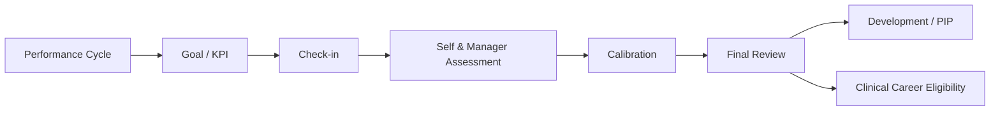

## Contoh kasus rumah sakit

Perawat mempunyai KPI kehadiran dan service quality yang baik, tetapi belum memenuhi kompetensi klinis untuk naik level. Sistem tidak boleh menaikkan clinical ladder hanya berdasarkan skor KPI; career review harus memeriksa competency dan requirement profesi.

## Pengaruh pada bisnis rumah sakit

- Menyelaraskan kinerja individu dengan target rumah sakit.
- Mendorong feedback berkala.
- Membantu pengembangan dan talent retention.
- Menjaga kenaikan jenjang klinis berbasis kompetensi.

## Yang harus dipahami developer

- Performance review ≠ OPPE.
- Support goal, check-in, self assessment, manager assessment, calibration, final review.
- Clinical ladder harus punya requirement version/effective date.
- Jangan hardcode PK I–V bila policy perlu dikonfigurasi, tetapi sistem dapat menyediakan struktur level.

## Benchmark rumah sakit / referensi praktik publik

- **Siloam Hospitals** — Sustainability Report 2024 menjelaskan performance management seluruh karyawan menggunakan BSC dan KPI; Annual Report 2024 menyebut HRIS mendukung input KPI, mid-year feedback dan year-end assessment.  
  Referensi: [RS-09](https://mysiloam-api.siloamhospitals.com/storage-down/file-web-cms/17466054825895820.pdf) — Siloam Hospitals — Sustainability Report 2024 (performance management, training).
- **RSCM** — Agenda pelatihan memuat penilaian kinerja kualitatif staf medis sebagai benchmark professional performance.  
  Referensi: [RS-06](https://diklat.rscm.co.id/agenda) — RSCM — Agenda Pendidikan dan Pelatihan.

> **Catatan benchmark:** contoh rumah sakit di atas hanya menunjukkan praktik/tema yang dapat diverifikasi dari sumber publik. Detail SOP dan aplikasi internal mereka tidak diasumsikan sama dengan Quilvian.

## Regulasi / standar yang relevan

- [REG-07](https://jdih.kemkes.go.id/documents/peraturan-menteri-kesehatan-nomor-40-tahun-2017) — Permenkes 40 Tahun 2017 — Pengembangan Jenjang Karir Profesional Perawat Klinis
- [REG-01](https://jdih.kemkes.go.id/documents/keputusan-menteri-kesehatan-nomor-hk0107menkes15962024) — KMK HK.01.07/MENKES/1596/2024 — Standar Akreditasi Rumah Sakit
- [REG-03](https://jdih.kemkes.go.id/documents/peraturan-menteri-kesehatan-nomor-6-tahun-2026) — Permenkes 6 Tahun 2026 — Rumah Sakit

---

# 18. Occupational Health & Staff Safety

**Domain source Quilvian:** `OccupationalHealthManagement`  
**Status source:** `PARTIAL — MODEL KUAT, OPERASIONALISASI DIPERLUKAN`

## Penjelasan untuk developer

Occupational Health melindungi pekerja rumah sakit dari risiko yang muncul karena pekerjaannya: pajanan darah/cairan tubuh, infeksi, radiasi, bahan kimia, cedera ergonomi, needle stick, kekerasan di tempat kerja, dan risiko lain. Sistem bukan sekadar tempat menyimpan hasil MCU, tetapi mengelola **surveillance → incident/exposure → follow-up → fitness to work → restriction → return to work**.

Data kesehatan staf bersifat sensitif. HR tidak perlu melihat diagnosis lengkap untuk mengambil keputusan administratif; cukup informasi fitness/restriction yang memang relevan.

## Bagaimana sub-modul ini berlaku di rumah sakit

- Risk profile role/unit menentukan surveillance/vaccination requirement.
- MCU/periodic exam dilakukan sesuai kebijakan dan risiko.
- Exposure/needle-stick dilaporkan segera dan mengikuti clinical follow-up.
- Work restriction dapat diterbitkan sementara.
- Return-to-work assessment dilakukan sebelum pegawai kembali ke tugas tertentu.
- Aggregate compliance dashboard dapat dibaca HR/K3 tanpa membuka clinical detail.

## Aktor utama

- Occupational Health/K3RS
- PPI
- Pegawai
- Manager
- HR sebagai recipient summary terbatas

## Alur proses bisnis

1. Define occupational risk.
2. Health surveillance/vaccination.
3. Incident/exposure if occurs.
4. Clinical assessment & follow-up.
5. Fitness to work decision.
6. Restriction if needed.
7. Return-to-work assessment.
8. Close episode & aggregate reporting.

## Flowchart

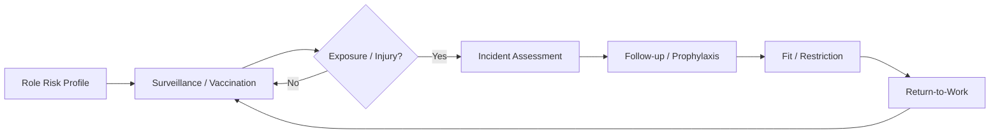

## Contoh kasus rumah sakit

Perawat tertusuk jarum setelah tindakan. Sistem membuat exposure episode, mencatat follow-up medis pada role terbatas, dan HR hanya melihat status “fit with temporary restriction” bila memang diperlukan. Diagnosis/lab detail tidak tampil di layar HR umum.

## Pengaruh pada bisnis rumah sakit

- Melindungi kesehatan tenaga kerja.
- Mengurangi downtime dan risiko penularan.
- Mendukung compliance K3RS.
- Menjaga kerahasiaan data medis staf.

## Yang harus dipahami developer

- Pisahkan health record detail dan HR-visible fitness summary.
- Role-based access wajib.
- Exposure incident harus time-sensitive dan punya follow-up schedule.
- Support vaccination, surveillance, restriction dan return-to-work.

## Benchmark rumah sakit / referensi praktik publik

- **Siloam Hospitals** — Sustainability Report 2019 menjelaskan SMK3RS dan Komite K3 pada setiap rumah sakit.  
  Referensi: [RS-11](https://mysiloam-api.siloamhospitals.com/public-asset/website-cms/website-cms-16291141323345877.pdf) — Siloam Hospitals — Sustainability Report 2019 (SMK3RS/OHS).
- **RSCM** — LMS 2026 memuat pelatihan workplace violence, safe patient handling dan JCI-K3RS; ini contoh area staff safety yang nyata.  
  Referensi: [RS-04](https://diklat.rscm.co.id/lms/?lang=id) — RSCM — Learning Management System / Pelatihan Pegawai.

> **Catatan benchmark:** contoh rumah sakit di atas hanya menunjukkan praktik/tema yang dapat diverifikasi dari sumber publik. Detail SOP dan aplikasi internal mereka tidak diasumsikan sama dengan Quilvian.

## Regulasi / standar yang relevan

- [REG-06](https://peraturan.bpk.go.id/Details/114482/permenkes-no-66-tahun-2016) — Permenkes 66 Tahun 2016 — Keselamatan dan Kesehatan Kerja Rumah Sakit
- [REG-03](https://jdih.kemkes.go.id/documents/peraturan-menteri-kesehatan-nomor-6-tahun-2026) — Permenkes 6 Tahun 2026 — Rumah Sakit
- [REG-01](https://jdih.kemkes.go.id/documents/keputusan-menteri-kesehatan-nomor-hk0107menkes15962024) — KMK HK.01.07/MENKES/1596/2024 — Standar Akreditasi Rumah Sakit

---

# 19. Employee Relation & Discipline

**Domain source Quilvian:** `EmployeeRelationManagement`  
**Status source:** `PARTIAL — EXTEND_EXISTING`

## Penjelasan untuk developer

Employee Relations mengelola hubungan kerja, grievance, investigasi, pelanggaran, keputusan disiplin dan recognition. Pada rumah sakit, domain ini harus berhati-hati karena insiden keselamatan pasien tidak boleh otomatis diterjemahkan menjadi kesalahan individu. Diperlukan mekanisme investigasi dan **just culture** untuk membedakan human error, system issue, at-risk behavior dan misconduct.

## Bagaimana sub-modul ini berlaku di rumah sakit

- Laporan atau grievance diterima dan diklasifikasikan.
- Investigation case dibuka bila perlu dan evidence dikumpulkan.
- Pegawai diberi kesempatan memberikan respon.
- Decision dibuat berdasarkan policy, fakta dan kewenangan.
- Sanction bila applicable mempunyai level, effective date dan history.
- Clinical incident tetap dapat ditangani melalui patient safety/RCA sebelum employee discipline bila diperlukan.

## Aktor utama

- HR Employee Relation/HRBP
- Manager
- Pegawai
- Legal/Etik/Quality sesuai kasus

## Alur proses bisnis

1. Case intake.
2. Triage/classification.
3. Investigation & evidence.
4. Employee response.
5. Decision/recommendation.
6. Approval.
7. Sanction/recognition/closure.
8. Appeal/review bila policy menyediakan.

## Flowchart

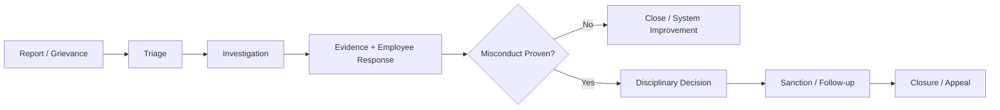

## Contoh kasus rumah sakit

Terjadi medication incident. Quality melakukan incident analysis. Jika akar masalah adalah desain proses, kasus tidak boleh otomatis menghasilkan SP staf. Jika ditemukan intentional policy violation, barulah HR discipline workflow berjalan dengan evidence dan hak klarifikasi.

## Pengaruh pada bisnis rumah sakit

- Mendorong budaya adil dan keselamatan.
- Mengurangi risiko keputusan disiplin tanpa bukti.
- Meningkatkan konsistensi HR policy.
- Mendukung hubungan industrial yang sehat.

## Yang harus dipahami developer

- Pisahkan PatientSafetyIncident dari EmployeeDisciplinaryCase.
- Simpan evidence dan decision reason.
- Confidential access wajib.
- Sanction lifecycle dan appeal harus configurable.

## Benchmark rumah sakit / referensi praktik publik

- **Siloam Hospitals** — Annual Report 2022 memuat tata kelola hubungan industrial dan mekanisme aspirasi pegawai melalui ikatan keluarga karyawan. Detail disiplin internal tidak dipublikasikan.  
  Referensi: [RS-10](https://mysiloam-api.siloamhospitals.com/storage-down/laporan-tahunan/laporan-tahunan-17083175849635124.pdf) — Siloam Hospitals — Annual Report 2022 (benefit, allowance, industrial relations).
- **RSCM** — LMS/agenda publik memuat code of conduct dan workshop etik/disiplin dokter sebagai benchmark governance perilaku profesional.  
  Referensi: [RS-04](https://diklat.rscm.co.id/lms/?lang=id) — RSCM — Learning Management System / Pelatihan Pegawai.

> **Catatan benchmark:** contoh rumah sakit di atas hanya menunjukkan praktik/tema yang dapat diverifikasi dari sumber publik. Detail SOP dan aplikasi internal mereka tidak diasumsikan sama dengan Quilvian.

## Regulasi / standar yang relevan

- [REG-04](https://peraturan.bpk.go.id/Details/161904/pp-no-35-tahun-2021) — PP 35 Tahun 2021 — PKWT, Alih Daya, Waktu Kerja, Lembur, PHK
- [REG-03](https://jdih.kemkes.go.id/documents/peraturan-menteri-kesehatan-nomor-6-tahun-2026) — Permenkes 6 Tahun 2026 — Rumah Sakit
- [REG-01](https://jdih.kemkes.go.id/documents/keputusan-menteri-kesehatan-nomor-hk0107menkes15962024) — KMK HK.01.07/MENKES/1596/2024 — Standar Akreditasi Rumah Sakit

---

# 20. Separation, Exit Clearance & Offboarding

**Domain source Quilvian:** `LifecycleManagement / ExitClearance`  
**Status source:** `TERSEDIA CORE — EXTEND FULL LIFECYCLE`

## Penjelasan untuk developer

Separation adalah akhir hubungan kerja atau hubungan workforce, sedangkan exit clearance memastikan seluruh konsekuensi bisnis benar-benar selesai: tugas diserahterimakan, payroll final, piutang, aset, akses IT, dokumen klinis, credential/privilege dan dokumen kepegawaian.

Developer harus melihat offboarding sebagai **cross-module closure**, bukan hanya mengubah `IsActive=false`.

## Bagaimana sub-modul ini berlaku di rumah sakit

- Separation dapat berasal dari resignation, retirement, termination, non-renewal atau alasan lain yang sah.
- Effective last working date harus jelas.
- Final payroll menghitung hak/kewajiban yang belum selesai.
- Finance memverifikasi receivable/outstanding.
- Aset dan access harus dikembalikan/dicabut.
- Untuk clinical workforce, privilege/scheduling eligibility harus berakhir sesuai tanggal efektif.
- Employment certificate/paklaring diterbitkan bila applicable.

## Aktor utama

- Pegawai
- HR Lifecycle
- Manager
- Payroll
- Finance
- IT/Identity
- Asset/Logistics
- Credentialing/Clinical unit

## Alur proses bisnis

1. Separation request/decision.
2. Approval & effective date.
3. Create exit-clearance checklist.
4. Final payroll/leave/receivable reconciliation.
5. Asset return.
6. IT access revocation.
7. Credential/privilege closure.
8. Exit interview & documents.
9. Mark workforce separated while preserving history.

## Flowchart

```mermaid
flowchart LR
 A[Resign / Retirement / Termination] --> B[Separation Decision]
 B --> C[Exit Clearance]
 C --> D[Payroll & Finance]
 C --> E[Asset]
 C --> F[IT Access]
 C --> G[Clinical Privilege]
 D & E & F & G --> H{All Cleared?}
 H -- No --> C
 H -- Yes --> I[Separated / Certificate]
```

## Contoh kasus rumah sakit

Dokter resign efektif akhir bulan. Sebelum inactive, Finance harus menyelesaikan outstanding, IT menjadwalkan revocation, unit memastikan dokumentasi klinis selesai, dan credentialing menutup privilege pada tanggal efektif. Histori dokter tetap tersedia untuk audit.

## Pengaruh pada bisnis rumah sakit

- Mengurangi akses sistem yang tertinggal.
- Mengurangi kehilangan aset/piutang.
- Menjaga continuity of care dan dokumentasi klinis.
- Membuat final settlement lebih akurat.

## Yang harus dipahami developer

- Jangan menonaktifkan user terlalu dini bila masih perlu menyelesaikan kewajiban, tetapi jadwalkan revocation dengan kontrol.
- Separation status ≠ exit clearance completed.
- Preserve history setelah offboarding.
- Cross-module checklist dan status harus auditable.

## Benchmark rumah sakit / referensi praktik publik

- **Siloam Hospitals** — Publikasi perusahaan menunjukkan tata kelola employment/benefit/industrial relations skala besar, tetapi detail exit clearance internal tidak dipublikasikan; benchmark utama submodul ini tetap proses enterprise + regulasi ketenagakerjaan.  
  Referensi: [RS-10](https://mysiloam-api.siloamhospitals.com/storage-down/laporan-tahunan/laporan-tahunan-17083175849635124.pdf) — Siloam Hospitals — Annual Report 2022 (benefit, allowance, industrial relations).

> **Catatan benchmark:** contoh rumah sakit di atas hanya menunjukkan praktik/tema yang dapat diverifikasi dari sumber publik. Detail SOP dan aplikasi internal mereka tidak diasumsikan sama dengan Quilvian.

## Regulasi / standar yang relevan

- [REG-04](https://peraturan.bpk.go.id/Details/161904/pp-no-35-tahun-2021) — PP 35 Tahun 2021 — PKWT, Alih Daya, Waktu Kerja, Lembur, PHK
- [REG-05](https://peraturan.bpk.go.id/Details/339037/pp-no-49-tahun-2025) — PP 36 Tahun 2021 tentang Pengupahan, terakhir diubah PP 49 Tahun 2025

---

# 21. Employee Self-Service & Unified Approval Inbox

**Domain source Quilvian:** `SelfServices + WorkflowManagement`  
**Status source:** `TERSEDIA CORE — NAVIGATION & CONTRACT HARDENING`

## Penjelasan untuk developer

Employee Self-Service (ESS) adalah pintu pegawai untuk mengakses hak dan kewajibannya tanpa bergantung pada petugas HR. Unified Approval Inbox adalah pintu atasan untuk memproses berbagai request lintas HR dalam satu tempat. Tujuannya bukan sekadar kenyamanan UI, tetapi membuat **workflow, SLA, delegation, reason dan audit** konsisten.

Di rumah sakit, manager sering berpindah antara kegiatan klinis dan manajerial. Approval yang tersebar di banyak menu meningkatkan risiko request terlambat dan staffing tidak segera diperbarui.

## Bagaimana sub-modul ini berlaku di rumah sakit

- Pegawai melihat profil, schedule, attendance, leave balance, overtime, benefit, payslip dan dokumen sesuai hak akses.
- Request dibuat dari ESS dan otomatis resolve approver berdasarkan manager/approval matrix.
- Approval Inbox menampilkan pending, due/overdue, delegated request dan context yang cukup untuk mengambil keputusan.
- Approve/reject/revision menghasilkan status history dan downstream action.
- Delegation dibutuhkan saat approver cuti/tidak aktif.

## Aktor utama

- Pegawai
- Manager/Approver
- HR sebagai process owner
- Workflow engine

## Alur proses bisnis

1. Employee opens ESS.
2. Create request.
3. Resolve approval matrix/manager.
4. Workflow assignment masuk Approval Inbox.
5. Approver review.
6. Approve/reject/revision.
7. Downstream domain executes decision.
8. Employee receives status/history.

## Flowchart

```mermaid
flowchart LR
 A[Employee ESS] --> B[Request]
 B --> C[Workflow Engine]
 C --> D[Approval Inbox]
 D --> E{Decision}
 E -- Approve --> F[Domain Execution]
 E -- Revision --> A
 E -- Reject --> G[Closed]
 F --> H[Employee Notification / History]
```

## Contoh kasus rumah sakit

Perawat mengajukan tukar shift. Request tidak dikirim ke nama manager yang di-hardcode. Sistem membaca active manager assignment/approval matrix. Jika manager sedang delegasi, request masuk ke delegate. Setelah approve, roster berubah melalui proses resmi.

## Pengaruh pada bisnis rumah sakit

- Mengurangi formulir manual.
- Mempercepat approval dan update operasional.
- Memberikan transparency request status.
- Mengurangi approval berbeda-beda antar-modul.

## Yang harus dipahami developer

- Satu workflow engine untuk request HR yang applicable.
- Approval harus context-aware dan mencegah self-approval bila policy melarang.
- Delegation, SLA, comment dan attachment harus reusable.
- FE route existing perlu dimaterialisasi ke navigation dengan permission yang benar.

## Benchmark rumah sakit / referensi praktik publik

- **Siloam Hospitals** — Annual Report 2024 menyebut ekosistem HR terintegrasi dan HRIS; detail ESS/Approval Inbox internal tidak dipublikasikan sehingga benchmark hanya pada digital HR governance.  
  Referensi: [RS-08](https://mysiloam-api.siloamhospitals.com/storage-down/file-web-cms/17459502701625876.pdf) — Siloam Hospitals — Annual Report 2024 (Human Capital, recruitment, HRIS, L&D).

> **Catatan benchmark:** contoh rumah sakit di atas hanya menunjukkan praktik/tema yang dapat diverifikasi dari sumber publik. Detail SOP dan aplikasi internal mereka tidak diasumsikan sama dengan Quilvian.

## Regulasi / standar yang relevan

- [REG-02](https://jdih.kemkes.go.id/documents/peraturan-menteri-kesehatan-nomor-13-tahun-2025) — Permenkes 13 Tahun 2025 — Pengelolaan Sumber Daya Manusia Kesehatan
- [REG-03](https://jdih.kemkes.go.id/documents/peraturan-menteri-kesehatan-nomor-6-tahun-2026) — Permenkes 6 Tahun 2026 — Rumah Sakit

---

# 22. HR Service & Employee Document Service

**Domain source Quilvian:** `HrServiceManagement`  
**Status source:** `PARTIAL — PERSISTENCE FOUNDATION`

## Penjelasan untuk developer

HR Service mengubah permintaan administratif pegawai menjadi tiket layanan yang dapat dilacak. Ini berbeda dari approval transaksi seperti cuti. Contohnya permintaan surat keterangan kerja, salary certificate, dokumen kepegawaian, koreksi data tertentu atau konsultasi administrasi.

Tujuannya adalah membuat HR bekerja seperti service desk: setiap permintaan mempunyai kategori, SLA, assignee, komunikasi, attachment, output document dan status.

## Bagaimana sub-modul ini berlaku di rumah sakit

- Employee memilih service category/type.
- Sistem menentukan data/attachment wajib.
- Request masuk ke queue HR yang tepat.
- Officer dapat meminta revisi atau melengkapi data.
- Jika perlu approval, request menghubungkan WorkflowManagement.
- Output document diterbitkan dengan version/reference.
- Service ditutup setelah delivered/acknowledged.

## Aktor utama

- Pegawai
- HR Service Officer
- HR Manager/Approver bila needed
- Document issuer

## Alur proses bisnis

1. Employee creates HR service request.
2. Validate category & required data.
3. Assign queue/officer.
4. Process / request revision.
5. Approval if applicable.
6. Generate/issue document.
7. Deliver to employee.
8. Close with SLA history.

## Flowchart

```mermaid
flowchart LR
 A[Employee Request] --> B[HR Service Type]
 B --> C[Queue / Assignment]
 C --> D[Processing]
 D --> E{Need Approval?}
 E -- Yes --> F[Workflow Approval]
 E -- No --> G[Issue Document]
 F --> G
 G --> H[Delivery]
 H --> I[Closed + SLA]
```

## Contoh kasus rumah sakit

Pegawai meminta surat keterangan kerja untuk pengajuan kredit. Sistem otomatis mengambil data employee/workforce yang aktif, HR memverifikasi, dokumen diterbitkan dengan nomor dan issuer, lalu permintaan ditutup. Pegawai tidak perlu mengirim chat informal ke HR.

## Pengaruh pada bisnis rumah sakit

- Mengurangi pekerjaan administratif lewat chat/email.
- Membuat SLA HR terukur.
- Menyediakan histori layanan pegawai.
- Memastikan dokumen dikeluarkan dari data yang konsisten.

## Yang harus dipahami developer

- Pisahkan HR service ticket dari leave/overtime transaction.
- Document issuance perlu number/version/issuer.
- Attachment dan document sensitif harus authorization-aware.
- Support comment/revision/SLA/assignment.

## Benchmark rumah sakit / referensi praktik publik

- **Siloam Hospitals** — Benchmark publik menunjukkan pengelolaan HR secara terintegrasi pada organisasi rumah sakit besar; detail HR service desk internal tidak dipublikasikan. Submodul ini terutama diturunkan dari kebutuhan operasional enterprise dan evidence source Quilvian.  
  Referensi: [RS-08](https://mysiloam-api.siloamhospitals.com/storage-down/file-web-cms/17459502701625876.pdf) — Siloam Hospitals — Annual Report 2024 (Human Capital, recruitment, HRIS, L&D).

> **Catatan benchmark:** contoh rumah sakit di atas hanya menunjukkan praktik/tema yang dapat diverifikasi dari sumber publik. Detail SOP dan aplikasi internal mereka tidak diasumsikan sama dengan Quilvian.

## Regulasi / standar yang relevan

- [REG-02](https://jdih.kemkes.go.id/documents/peraturan-menteri-kesehatan-nomor-13-tahun-2025) — Permenkes 13 Tahun 2025 — Pengelolaan Sumber Daya Manusia Kesehatan
- [REG-03](https://jdih.kemkes.go.id/documents/peraturan-menteri-kesehatan-nomor-6-tahun-2026) — Permenkes 6 Tahun 2026 — Rumah Sakit

---

# 4. Golden Flow Lintas Sub-Modul

## 4.1 Plan-to-Hire-to-Ready

```mermaid
flowchart LR
 A[Workforce Planning] --> B[Headcount Approved]
 B --> C[Recruitment]
 C --> D[Hiring]
 D --> E[Contract & Workforce Profile]
 E --> F[Onboarding]
 F --> G[Training / MCU]
 G --> H{Clinical?}
 H -- No --> I[Ready for Work]
 H -- Yes --> J[Credential & Privilege]
 J --> I
```

Developer harus dapat menelusuri kebutuhan tenaga sampai orang yang mengisi posisi. Jangan membuat Recruitment terpisah dari Workforce Planning dan jangan menganggap Hiring sebagai akhir kesiapan tenaga klinis.

## 4.2 Time-to-Pay

```mermaid
flowchart LR
 A[Roster] --> B[Attendance]
 B --> C[Attendance Correction]
 A --> D[Leave]
 A --> E[Overtime]
 B & C & D & E --> F[Reconciliation]
 F --> G[Payroll Run]
 G --> H[Approval & Finalization]
 H --> I[Payslip]
 H --> J[Finance Handoff]
```

## 4.3 Credential-to-Practice

```mermaid
flowchart LR
 A[Clinical Workforce] --> B[Credential Verification]
 B --> C[Clinical Privilege]
 C --> D[SPK / RKK / Assignment]
 D --> E[Clinical Practice]
 E --> F[OPPE]
 F --> G{Focused Review Needed?}
 G -- Yes --> H[FPPE]
 G -- No --> I[Recredentialing]
 H --> I
 I --> J[Renew / Modify / Restrict Privilege]
```

## 4.4 Exposure-to-Return-to-Work

```mermaid
flowchart LR
 A[Exposure / Injury] --> B[Immediate Assessment]
 B --> C[Follow-up / Treatment]
 C --> D[Fitness Assessment]
 D --> E{Restriction?}
 E -- Yes --> F[Work Restriction]
 E -- No --> G[Fit]
 F --> H[Return-to-Work Assessment]
 H --> G
```

## 4.5 Separation-to-Closure

```mermaid
flowchart LR
 A[Separation Decision] --> B[Final Working Date]
 B --> C[Exit Clearance]
 C --> D[Payroll / Finance]
 C --> E[Asset]
 C --> F[IT Access]
 C --> G[Clinical Privilege]
 D & E & F & G --> H[Complete]
 H --> I[Separated Workforce]
```

---

# 5. Hubungan Modul HRD dengan Modul Rumah Sakit Lain

| HRD Sub-Modul | Integrasi Utama | Mengapa Penting |
|---|---|---|
| Workforce Planning | Finance/Budget, Clinical unit | kebutuhan tenaga harus punya biaya dan service demand |
| Recruitment | Occupational Health, Credentialing | kandidat klinis perlu medical/credential gates |
| Scheduling | Leave, Credentialing, Clinical unit | staf yang dijadwalkan harus available dan eligible |
| Attendance | Scheduling, Payroll | actual attendance perlu expected schedule |
| Leave | Scheduling, Attendance, Payroll | approved leave mengubah coverage dan attendance |
| Overtime | Attendance, Payroll | payable overtime harus verified |
| Payroll | Finance | HR menghitung hak, Finance melakukan settlement/accounting sesuai boundary |
| Benefit | Registration, Billing, Finance | benefit kesehatan pegawai memengaruhi coverage biaya layanan |
| Credentialing | Clinical module | privilege perlu dipakai sebagai service eligibility reference |
| OPPE/FPPE | Quality, Medical Record, Clinical module | evaluasi membutuhkan evidence klinis |
| Occupational Health | K3RS/PPI | exposure dan surveillance adalah proses kesehatan kerja |
| Exit Clearance | Finance, IT, Asset, Clinical | offboarding harus menutup semua kewajiban dan akses |

---

# 6. Prinsip Desain untuk Developer

## 6.1 One Workforce Identity

Semua sub-modul harus mengacu ke identitas workforce yang sama. Jangan membuat employee identity baru pada Leave, Payroll, Credentialing atau Training.

## 6.2 Effective-Dated History

Organization assignment, position, manager, contract, salary, privilege dan policy yang mempunyai histori harus mempunyai masa berlaku. Edit data masa lalu tidak boleh membuat audit history hilang.

## 6.3 Raw Evidence Tidak Dihapus Diam-diam

Attendance raw log, approval history, credential verification, payroll final, dan investigation evidence adalah sumber audit. Correction dilakukan melalui transaksi koreksi/reversal, bukan destructive update.

## 6.4 Policy-Driven, Bukan Hardcode

Jam shift, allowance, SLA on-call, jenis approval, expiry reminder, staffing rule dan benefit eligibility dapat berbeda antar-RS. Letakkan pada konfigurasi/master/policy yang tepat.

## 6.5 Segregation of Duties

Contoh:

- pembuat payroll run tidak otomatis menjadi final approver;
- HR umum tidak boleh melihat detail MCU;
- credentialing reviewer tidak boleh memutuskan application miliknya sendiri;
- employee tidak boleh self-approve request bila policy melarang.

## 6.6 Audit First

Minimal simpan actor, timestamp, object, action, reason, workflow reference dan change summary untuk transaksi sensitif.

---

# 7. Catatan Khusus tentang Source Quilvian

Berdasarkan inspeksi `HamzahV2` dan `MHamzah`, backend HRD saat ini lebih luas daripada UI yang sudah dimaterialisasi pada navigation. Banyak entity/model sudah ada untuk Workforce Planning, Recruitment, Lifecycle, Credentialing, Occupational Health, Business Travel, Expense, Payroll dan HR Service, tetapi sebagian belum mempunyai workflow FE-BE lengkap.

Prinsip implementasi yang dipakai:

1. **REUSE** entity/domain existing yang sudah sesuai.
2. **EXTEND** service/controller/workflow/UI bila persistence sudah ada namun use case belum lengkap.
3. **NEW** hanya untuk capability yang benar-benar belum ada, misalnya OPPE/FPPE eksplisit bila audit source memang belum menemukan model/workflow yang memadai.
4. Jangan membuat duplicate table hanya karena page atau endpoint belum ada.

## Contract gate FE–BE

Sebagian service frontend operasional menggunakan prefix `/v1/hr/...`, sedangkan controller backend yang telah diperiksa banyak memakai `/api/v1/corporate/human-resource/...`. Sebelum go-live, lakukan inventory endpoint, cek apakah ada API gateway/rewrite pada deployment, lalu contract-test. Jangan menganggap kedua namespace otomatis sama.

---

# 8. Daftar Referensi Utama

## Regulasi / Standar

- **REG-01** — [KMK HK.01.07/MENKES/1596/2024 — Standar Akreditasi Rumah Sakit](https://jdih.kemkes.go.id/documents/keputusan-menteri-kesehatan-nomor-hk0107menkes15962024)
- **REG-02** — [Permenkes 13 Tahun 2025 — Pengelolaan Sumber Daya Manusia Kesehatan](https://jdih.kemkes.go.id/documents/peraturan-menteri-kesehatan-nomor-13-tahun-2025)
- **REG-03** — [Permenkes 6 Tahun 2026 — Rumah Sakit](https://jdih.kemkes.go.id/documents/peraturan-menteri-kesehatan-nomor-6-tahun-2026)
- **REG-04** — [PP 35 Tahun 2021 — PKWT, Alih Daya, Waktu Kerja, Lembur, PHK](https://peraturan.bpk.go.id/Details/161904/pp-no-35-tahun-2021)
- **REG-05** — [PP 36 Tahun 2021 tentang Pengupahan, terakhir diubah PP 49 Tahun 2025](https://peraturan.bpk.go.id/Details/339037/pp-no-49-tahun-2025)
- **REG-06** — [Permenkes 66 Tahun 2016 — Keselamatan dan Kesehatan Kerja Rumah Sakit](https://peraturan.bpk.go.id/Details/114482/permenkes-no-66-tahun-2016)
- **REG-07** — [Permenkes 40 Tahun 2017 — Pengembangan Jenjang Karir Profesional Perawat Klinis](https://jdih.kemkes.go.id/documents/peraturan-menteri-kesehatan-nomor-40-tahun-2017)
- **REG-08** — [PMK 168 Tahun 2023 — Pemotongan PPh 21/26](https://peraturan.bpk.go.id/Details/286951/pmk-no-168-tahun-2023)
- **REG-09** — [Perpres 82 Tahun 2018 tentang Jaminan Kesehatan, terakhir diubah Perpres 59 Tahun 2024](https://peraturan.bpk.go.id/Details/285181/perpres-no-59-tahun-2024)

## Benchmark Rumah Sakit / Sumber Publik

- **RS-01** — [RS Metropolitan Medical Centre — Karir/Job Vacancy](https://mmchospital.co.id/karir)
- **RS-02** — [RS Metropolitan Medical Centre — Sertifikasi dan Akreditasi](https://mmchospital.co.id/sertifikasi-akreditasi)
- **RS-03** — [RS Metropolitan Medical Centre — Profil Rumah Sakit](https://mmchospital.co.id/profil-kami)
- **RS-04** — [RSCM — Learning Management System / Pelatihan Pegawai](https://diklat.rscm.co.id/lms/?lang=id)
- **RS-05** — [RSCM — Pelatihan Kredensial Tenaga Kesehatan](https://diklat.rscm.co.id/?id=858&page=pelatihan.detail)
- **RS-06** — [RSCM — Agenda Pendidikan dan Pelatihan](https://diklat.rscm.co.id/agenda)
- **RS-07** — [RSUP Dr. Sardjito — Agenda Pelatihan 2026](https://diklat.sardjito.co.id/agenda/kalender_agenda_setahun)
- **RS-08** — [Siloam Hospitals — Annual Report 2024 (Human Capital, recruitment, HRIS, L&D)](https://mysiloam-api.siloamhospitals.com/storage-down/file-web-cms/17459502701625876.pdf)
- **RS-09** — [Siloam Hospitals — Sustainability Report 2024 (performance management, training)](https://mysiloam-api.siloamhospitals.com/storage-down/file-web-cms/17466054825895820.pdf)
- **RS-10** — [Siloam Hospitals — Annual Report 2022 (benefit, allowance, industrial relations)](https://mysiloam-api.siloamhospitals.com/storage-down/laporan-tahunan/laporan-tahunan-17083175849635124.pdf)
- **RS-11** — [Siloam Hospitals — Sustainability Report 2019 (SMK3RS/OHS)](https://mysiloam-api.siloamhospitals.com/public-asset/website-cms/website-cms-16291141323345877.pdf)
- **RS-12** — [Mayapada Hospital — Annual Report 2024 (Human Capital development)](https://mayapadahospital.com/file/investor/SRAJ_Laporan-Tahunan_2024_LKA.pdf)
- **RS-13** — [Mayapada Hospital — Sustainability Report 2024 (Developing Our People)](https://mayapadahospital.com/file/investor/MAYAPADA_SR2024_Final_lowres.pdf)
- **RS-14** — [Mayapada Hospital — Annual Report 2022 (hospital remuneration & performance topics)](https://dev-worktrees.mayapadahospital.com/public/file/investor/SRAJ_Laporan-Tahunan_2022.pdf)


---

# 9. Penutup

Bagi developer, indikator bahwa HRD sudah dipahami bukan ketika semua tabel dapat dibuat, tetapi ketika developer dapat menjelaskan hubungan sebab-akibat berikut:

> **Kebutuhan tenaga** menghasilkan **rekrutmen**; rekrutmen menghasilkan **workforce**; workforce harus **siap secara administratif, kompetensi dan klinis**; workforce yang siap baru dapat **dijadwalkan**; jadwal dibandingkan dengan **kehadiran**; kehadiran, cuti dan lembur menjadi input **payroll**; sepanjang bekerja pegawai dipantau melalui **kompetensi, performance, credential, health dan employee relation**; saat keluar seluruh hak, kewajiban, akses, aset dan kewenangan klinis harus **ditutup secara terkontrol**.

Jika alur itu dapat ditelusuri end-to-end dan diaudit, Modul HRD Quilvian telah bergerak dari sekadar aplikasi administrasi menjadi **platform tata kelola tenaga kerja rumah sakit**.
