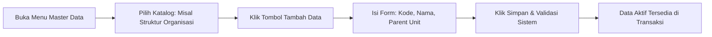

# Panduan Pengguna — Sub-Modul 01: Master Data HR

## 1. Informasi Modul

| Field | Keterangan |
| --- | --- |
| Nama Sub-Modul | Master Data HR (Data Induk Kepegawaian) |
| Sasaran Pengguna | HR Superadmin & Tim Tata Kelola Sistem |
| Lokasi Menu Sidebar | **Sumber Daya Manusia $\rightarrow$ Master Data** |
| Alamat URL Utama | `http://localhost:3000/hr/master-data/organization` `http://localhost:3000/hr/master-data/job-level` `http://localhost:3000/hr/master-data/shift-group` *(dan 62 katalog master data lainnya)* |

---

## 2. Kapan & Mengapa Modul Ini Digunakan?

Master Data adalah kamus acuan utama rumah sakit. Modul ini digunakan saat:
1. Rumah sakit mendirikan unit atau instalasi baru (misalnya membuka "Instalasi Kedokteran Nuklir").
2. Menetapkan jenis shift dinas baru (misal shift darurat bencana alam).
3. Mengatur kebijakan tunjangan baru atau memperbarui plafon kuota cuti.

---

## 3. Langkah-Langkah Penggunaan Layar

### Langkah 1: Membuka Daftar Master Data
1. Buka sidebar kiri $\rightarrow$ Klik menu **Sumber Daya Manusia**.
2. Klik sub-menu **Master Data**. Anda akan melihat 62 kelompok master data yang dikelompokkan rapi (Organisasi, Jabatan, Shift, Cuti, Payroll, dll.).
3. Pilih salah satu katalog, misalnya **Struktur Organisasi** (`/hr/master-data/organization`).

### Langkah 2: Menambah Data Induk Baru
1. Di pojok kanan atas tabel, klik tombol **"Tambah Data"**.
2. Jendela formulir (*modal dialog*) akan terbuka.
3. Masukkan field yang diwajibkan:
   - **Kode Unit**: Contoh `UNT-ICU-02` *(wajib unik, tidak boleh sama dengan unit lain)*.
   - **Nama Unit**: Contoh `ICU Isolasi Tekanan Negatif`.
   - **Unit Induk (Parent)**: Pilih `Direktorat Pelayanan Medik`.
4. Klik tombol **Simpan**.

### Langkah 3: Mengubah atau Menonaktifkan Data
1. Pada tabel data, gunakan kolom pencarian untuk menemukan unit yang ingin disunting.
2. Klik tombol **Aksi $\rightarrow$ Edit** untuk memperbarui nama atau parameter.
3. Jika unit sudah tidak digunakan lagi, ubah statusnya menjadi **Tidak Aktif (*Inactive*)**. Data lama tidak akan terhapus dari riwayat transaksi terdahulu.

---

## 4. Skenario Latihan Mandiri untuk Klien

* **Skenario Normal (Happy Path)**:
  - Coba tambahkan satu kelompok shift baru di menu **Master Data $\rightarrow$ Shift Group** (`/hr/master-data/shift-group`).
  - Masukkan Kode: `SHF-EMG`, Nama: `Shift Siaga Krisis Bencana`, Jam Masuk: `06:00`, Jam Keluar: `18:00`.
  - Simpan dan pastikan baris baru muncul di tabel dengan badge hijau `Aktif`.
* **Skenario Uji Validasi (Negative Testing)**:
  - Ulangi langkah di atas dengan memasukkan Kode `SHF-EMG` yang sama persis.
  - Sistem akan menolak penyimpanan dan menampilkan peringatan: *"Kode shift sudah digunakan, gunakan kode lain."*

---

## 5. Dampak pada Modul Lain

* Data unit organisasi yang Anda buat di sini otomatis menjadi pilihan penempatan di **Sub-Modul 02 (Workforce Core)**.
* Kelompok shift yang Anda buat di sini otomatis menjadi pilihan dinas di **Sub-Modul 06 (Penjadwalan Roster)**.
