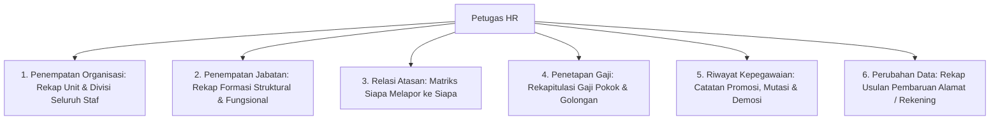

# Panduan Pengguna — Sub-Modul 02: Workforce Core (Administrasi Kepegawaian)

## 1. Informasi Modul

| Field | Keterangan |
| --- | --- |
| Nama Sub-Modul | Administrasi Profil Kepegawaian Lintas-Pegawai (Workforce Core) |
| Sasaran Pengguna | Staf Personalia & HR Administrator |
| Lokasi Menu Sidebar | **Sumber Daya Manusia $\rightarrow$ Administrasi Kepegawaian** |
| Alamat URL | • `http://localhost:3000/hr/workforce-core/organization-assignments` • `http://localhost:3000/hr/workforce-core/position-assignments` • `http://localhost:3000/hr/workforce-core/manager-assignments` • `http://localhost:3000/hr/workforce-core/salary-assignments` • `http://localhost:3000/hr/workforce-core/employment-histories` • `http://localhost:3000/hr/workforce-core/employee-profile-changes` |

---

## 2. Kapan & Mengapa Modul Ini Digunakan?

Sebelumnya petugas HR harus membuka profil karyawan satu per satu untuk melihat gaji atau penempatan unit. Modul ini menyediakan **6 Layar Rekapitulasi Lintas-Pegawai** agar tim HR dapat memantau mutasi, formasi jabatan, atasan langsung, dan penetapan gaji pokok seluruh karyawan rumah sakit dalam satu tabel besar.

---

## 3. Penjelasan 6 Layar Utama & Cara Menggunakannya

### 1. Layar Penempatan Organisasi (`/organization-assignments`)
* **Fungsi**: Memantau di unit/ruangan mana setiap pegawai ditugaskan.
* **Cara Cek**: Buka halaman, ketik nama ruangan (misal: "Instalasi Gawat Darurat") di kotak pencarian. Tabel akan menyaring daftar seluruh dokter dan perawat yang bertugas di ruangan tersebut.

### 2. Layar Penempatan Jabatan (`/position-assignments`)
* **Fungsi**: Memastikan setiap staf memiliki jabatan fungsional medis (Perawat Pelaksana, Dokter Penanggung Jawab Pasien / DPJP) atau struktural (Kepala Ruangan, Manajer).
* **Fitur**: Membedakan jabatan utama dengan jabatan rangkap.

### 3. Layar Relasi Atasan (`/manager-assignments`)
* **Fungsi**: Menentukan siapa atasan langsung seorang staf.
* **Penting**: Pengaturan di layar ini yang menentukan ke mana permohonan cuti dan lembur staf akan terkirim di **Kotak Masuk Persetujuan (*Approval Inbox*)**.

### 4. Layar Penetapan Gaji Pokok (`/salary-assignments`)
* **Fungsi**: Menampilkan rekapitulasi gaji dasar staf berdasarkan golongan, tingkat pendidikan, dan jenjang karier klinis.

### 5. Layar Riwayat Kepegawaian (`/employment-histories`)
* **Fungsi**: Rekam jejak perjalanan karier staf dari awal masuk, tanggal pengangkatan karyawan tetap, mutasi unit, hingga promosi.

### 6. Layar Perubahan Data Karyawan (`/employee-profile-changes`)
* **Fungsi**: Rekapitulasi permohonan staf yang mengusulkan perubahan nomor rekening bank, perubahan alamat domisili, atau pembaruan status pernikahan.

---

## 4. Skenario Latihan Mandiri untuk Klien

1. Buka halaman **Relasi Atasan** (`/hr/workforce-core/manager-assignments`).
2. Cari nama perawat, misalnya *"Ners Budi"*.
3. Periksa kolom **Atasan Langsung**: Pastikan nama Kepala Ruangannya sudah terdaftar dengan benar. Jika kolom ini kosong, pengajuan cuti Ners Budi nantinya tidak akan memiliki penyetuju.

---

## 5. Dampak pada Modul Lain

* Penempatan atasan di modul ini langsung menghubungkan alur pengajuan ke **Sub-Modul 21 (Approval Inbox)**.
* Penetapan gaji pokok di modul ini menjadi angka dasar kalkulasi di **Sub-Modul 10 (Penggajian Payroll)**.
