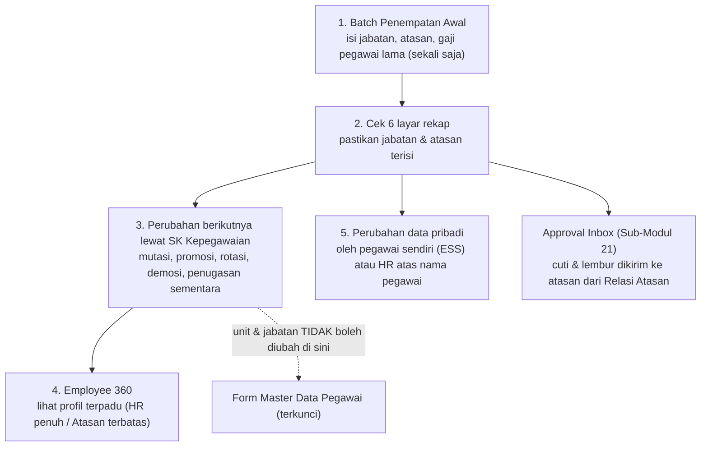
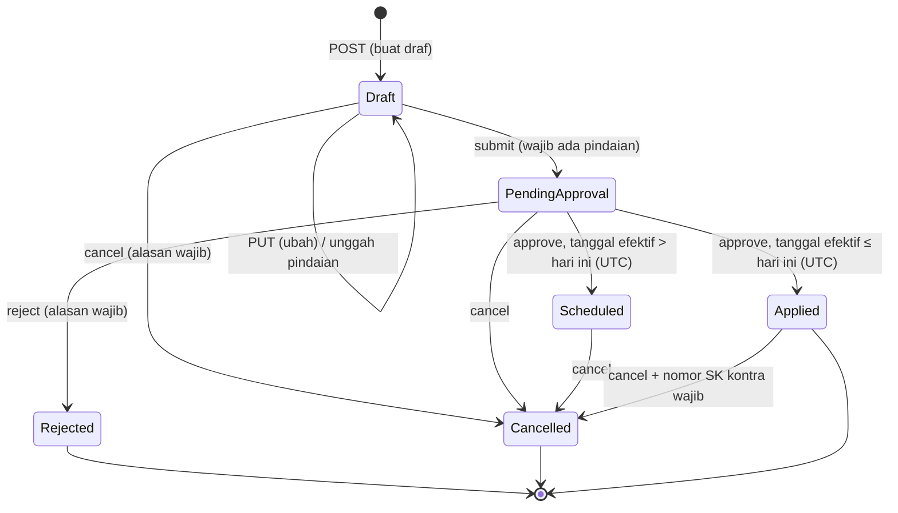

# Panduan Pengguna & Developer — Sub-Modul 02: Workforce Core (Administrasi Kepegawaian)

> **Diperbarui 3 November 2026; direvisi lagi pada hari yang sama setelah PLAN-REPAIR-HRD-002** (tampilan enam layar dibangun ulang dengan base component, KI-01 dan KI-03 diperbaiki, menu SK dan Batch ditambahkan ke sidebar). Isi panduan ini diambil langsung dari source code, bukan dari roadmap:
> backend `NewQuilvianSystemBackend` HEAD `26066c76`, frontend `QuilvianSystemFrontendDev` HEAD `66b7e5600`, pengecekan read-only database dev `QuilvianNewDevHamzah`, dan `dotnet build` backend (0 error, 415 warning).
> Bila roadmap dan panduan ini berbeda (misalnya soal alamat endpoint), **yang benar adalah source code**, dan panduan ini mengikuti source code.

## 1. Informasi Modul

| Field | Keterangan |
| --- | --- |
| Nama Sub-Modul | Administrasi Kepegawaian Lintas-Pegawai (Workforce Core) |
| Sasaran Pengguna | Staf Personalia, HR Administrator, Atasan Langsung (khusus Employee 360), dan **developer** yang menguji atau mengintegrasikan modul ini |
| Lokasi Menu Sidebar | **Sumber Daya Manusia → Administrasi Kepegawaian**: 6 layar rekap, **Dokumen SK Kepegawaian**, dan **Batch Data Awal**. Employee 360 dibuka dari tombol "Lihat Employee 360" di Rincian SK; Pengajuan Atas Nama dibuka lewat URL |
| Folder Backend | `Areas/Corporate/HumanResource/WorkforceCore/` |
| Folder Frontend | `src/app/hr/workforce-core/`, `src/components/view/hr/workforce-core/`, `src/lib/services/hr/` |
| Swagger | `https://localhost:7184/swagger` → dokumen **"03 - Corporate"** → tag `Corporate / Human Resource / Workforce Core / ...` |

---

## 2. Status Implementasi (Ringkas)

**Jawaban singkatnya:** ya, Workforce Core sudah diterapkan di backend dan frontend, dan migration database-nya sudah masuk ke DB dev. Tapi **tidak semua fitur bisa dipakai dari layar web**, karena beberapa layar frontend memanggil alamat atau format data yang tidak sama dengan backend. Fitur yang bermasalah di UI tetap bisa dipakai lewat API (Swagger/Postman/curl), dan caranya dijelaskan di bagian 5.

| Fitur | Backend | Frontend | Bisa dipakai dari layar web? |
| --- | :---: | :---: | --- |
| 6 layar rekap lintas-pegawai | ✅ | ✅ | **Ya.** Kolom jabatan & atasan masih kosong sampai Batch Penempatan Awal dijalankan |
| SK Kepegawaian: buat draf, unggah pindaian, ajukan, setujui | ✅ | ✅ | **Ya** |
| SK Kepegawaian: tolak & batalkan | ✅ | ✅ | **Ya** (diperbaiki 3 Nov 2026, PLAN-REPAIR-HRD-002). Membatalkan SK yang sudah `Applied` tetap lewat API karena butuh nomor SK kontra |
| Employee 360 (profil terpadu) | ✅ | ✅ | **Ya** (diperbaiki 3 Nov 2026, PLAN-REPAIR-HRD-002) |
| Batch Penempatan Awal (baseline pegawai eksisting) | ✅ (ada celah) | ⚠️ | **Tidak.** URL & kontrak di frontend salah ([KI-02](#ki-02)). Lewat API bisa, dengan aturan di [5.4](#54-batch-penempatan-awal-initial-placement-batch) |
| Perubahan profil atas nama pegawai (On-Behalf) | ⚠️ | ⚠️ | **Tidak.** Format kiriman frontend salah ([KI-04](#ki-04)); drafnya juga tidak bisa diajukan lewat endpoint mana pun ([KI-05](#ki-05)) |
| Penguncian unit/jabatan di form Master Data Pegawai | ✅ | ✅ | **Ya** |

**Kondisi database dev `QuilvianNewDevHamzah` (3 Nov 2026):**

| Data | Jumlah | Artinya bagi developer |
| --- | ---: | --- |
| Migration `20261102085741_AddPersonnelActionOrderAndAssignmentApprovalFields` | tercatat | Tabel `HrdPersonnelActionOrder`, `HrdPersonnelActionOrderAttachment`, `HrdInitialPlacementBatch`, `HrdInitialPlacementBatchRow` sudah ada |
| SK Kepegawaian & batch | 0 | Belum pernah dipakai, jadi tidak ada data contoh |
| Profil tenaga kerja (`MstWorkforceProfile`) | 55 | — |
| Penempatan organisasi utama aktif | 41 | 14 profil belum punya unit, sehingga **tidak muncul** di template batch |
| Penempatan jabatan utama aktif | 0 | Layar Penempatan Jabatan kosong |
| Relasi atasan utama aktif | 0 | Layar Relasi Atasan kosong, Approval Inbox belum punya penyetuju, Employee 360 mode Atasan belum bisa diuji |
| Penetapan gaji utama aktif | 0 | SK yang hanya mengubah gaji akan bermasalah ([KI-09](#ki-09)) |
| Periode presensi berstatus `Closed` | 0 | Aturan "SK retroaktif ditolak pada periode tertutup" belum bisa diuji tanpa menutup periode lebih dulu |

---

## 3. Peta Fitur, Alamat Layar, dan Endpoint

Semua endpoint diawali `https://localhost:7184` (atau `http://localhost:5107`). Frontend memanggilnya lewat `InstanceAxios` dengan `baseURL = NEXT_PUBLIC_API_QUILVIAN`.

| Fitur | Layar frontend (canonical) | Alias layar | Endpoint backend (sumber kebenaran) |
| --- | --- | --- | --- |
| Rekap penempatan organisasi | `/hr/workforce-core/organization-assignments` | — | `GET /api/v1/corporate/human-resource/workforce-core/organization-assignments` |
| Rekap penempatan jabatan | `/hr/workforce-core/position-assignments` | — | `GET .../workforce-core/position-assignments` |
| Rekap relasi atasan | `/hr/workforce-core/manager-assignments` | — | `GET .../workforce-core/manager-assignments` |
| Rekap riwayat kepegawaian | `/hr/workforce-core/employment-histories` | — | `GET .../workforce-core/employment-histories` |
| Rekap penetapan gaji | `/hr/workforce-core/salary-assignments` | — | `GET .../workforce-core/salary-assignments` dan `GET .../salary-assignments/{id}/amount` |
| Rekap perubahan data pegawai | `/hr/workforce-core/employee-profile-changes` | — | `GET /api/v1/corporate/human-resource/employee-profile-changes` |
| SK Kepegawaian, daftar | `/hr/workforce-core/personnel-actions` | `/hr/personnel-action-orders` | `GET /api/v1/corporate/human-resource/personnel-action-orders` |
| SK Kepegawaian, buat | `/hr/workforce-core/personnel-actions/create` | — | `POST /api/v1/corporate/human-resource/personnel-action-orders` |
| SK Kepegawaian, detail & aksi | `/hr/workforce-core/personnel-actions/{id}` | — | `.../personnel-action-orders/{id}` dan sub-aksinya |
| Employee 360 | `/hr/workforce-core/employee-360/{workforceProfileId}` | `/hr/employee-360/{id}` | `GET /api/v1/corporate/human-resource/workforce-profiles/{workforceProfileId}/employee-360` |
| Batch Penempatan Awal | `/hr/workforce-core/initial-batches` | `/hr/initial-placement-batch` | `/api/v1/corporate/human-resource/workforce-core/initial-batches` |
| Perubahan profil On-Behalf | `/hr/workforce-core/employee-profile-changes/create-on-behalf` | `.../employee-profile-changes/on-behalf` | `POST /api/v1/corporate/human-resource/employee-profile-changes/on-behalf` |
| Kunci unit/jabatan pegawai | Form edit Master Data Pegawai | — | `PUT /api/v1/corporate/human-resource/master-data/employees/{id}` |

> **Catatan untuk pembaca roadmap:** `backend-roadmap.md` (BE-HRD-025 s.d. 027) menulis route `.../workforce-core/personnel-action-orders`, `.../workforce-core/employee-360/{id}`, dan `.../initial-placement-batches`. Route itu **tidak ada** di source. Pakai route pada tabel di atas.

---

## 4. Persiapan Developer

### 4.1 Menjalankan aplikasi

```powershell
# Backend (https://localhost:7184 dan http://localhost:5107)
cd "c:\Users\Admin\Documents\Quilvian\Qulvian\NewQuilvianSystemBackend"
dotnet run

# Frontend (http://localhost:3000)
cd "c:\Users\Admin\Documents\Quilvian\Qulvian\QuilvianSystemFrontendDev"
npm run dev
```

Migration sudah diterapkan di DB dev. Untuk database lain, jalankan `dotnet ef database update` agar migration `AddPersonnelActionOrderAndAssignmentApprovalFields` ikut masuk.

### 4.2 Autentikasi untuk uji API

1. Login: `POST /api/v1/auth/login` dengan body `{ "email": "...", "password": "..." }`.
2. Backend menyimpan JWT di **cookie**. Swagger UI dan browser otomatis memakai cookie itu. Postman/curl bisa memakai cookie yang sama, atau mengirim header `Authorization: Bearer <token>`.
3. Layar login frontend butuh izin lokasi (geolocation) dari browser.

### 4.3 Hak akses (permission) yang dibutuhkan

Pemeriksaan hak akses memakai `[AccessPermission("<Controller>", "<Aksi>")]`. Peran yang dipakai menguji harus memiliki kombinasi berikut:

| Fitur | Permission | Dipakai untuk |
| --- | --- | --- |
| Rekap lintas-pegawai | `WfpOrganizationAssignment.ReadAll`, `WfpPositionAssignment.ReadAll`, `WfpManagerAssignment.ReadAll`, `WfpEmploymentHistory.ReadAll`, `WfpSalaryAssignment.ReadAll` | Membuka 5 layar rekap |
| Nominal gaji | `WfpSalaryAssignment.ViewAmount` | Membaca nominal gaji satu baris (`/salary-assignments/{id}/amount`) |
| SK Kepegawaian | `HrdPersonnelActionOrder.Read` | Daftar, detail, ringkasan, unduh lampiran |
| | `HrdPersonnelActionOrder.Create` | Membuat draf |
| | `HrdPersonnelActionOrder.Update` | Ubah draf, unggah pindaian, ajukan, **setujui**, tolak, batalkan |
| Employee 360 | `HrdEmployee360.Read` | Wajib untuk HR **maupun** Atasan Langsung |
| Batch Penempatan Awal | `HrdInitialPlacementBatch.Read` / `.Create` / `.Update` | Template & validasi / buat batch / eksekusi |
| Perubahan profil | `EmployeeProfileChange.Read` / `.Create` / `.Update` | Rekap / On-Behalf / verifikasi |
| Master Data Pegawai | `Employee.Update` | Mengedit data induk pegawai |

> **Penting:** aksi *setujui* SK memakai permission yang sama dengan *ubah* (`Update`). Pemisahan tugas (pembuat ≠ penyetuju) **tidak** dijaga oleh RBAC, tetapi oleh service (lihat [5.2](#52-sk-kepegawaian-personnel-action-order)). Untuk menguji alur persetujuan, siapkan **dua akun HR berbeda**.

---

## 5. Cara Menggunakan Setiap Fitur

### Urutan pemakaian yang benar

Di rumah sakit, data penempatan pegawai lama perlu dirapikan sekali di awal. Sesudah itu, setiap perpindahan dilakukan lewat SK. Ikuti urutan ini, karena layar lain bergantung pada data yang dihasilkan langkah sebelumnya:



---

### 5.1 Enam Layar Rekap Lintas-Pegawai

Gunanya: HR bisa melihat penempatan seluruh pegawai dalam satu tabel, tanpa membuka profil satu per satu. Keenam layar ini hanya untuk membaca data.

| Layar | Isi | Filter khusus (query string) |
| --- | --- | --- |
| Penempatan Organisasi | Unit/departemen tiap pegawai | `departmentId`, `positionId`, `organizationUnitId`, `assignmentType`, `isPrimary`, `isManagerialAssignment` |
| Penempatan Jabatan | Jabatan utama dan rangkap | `positionId`, `departmentId`, `jobLevelId`, `assignmentType`, `isPrimary` |
| Relasi Atasan | Siapa melapor ke siapa | `managerProfileId`, `departmentId`, `managerType`, `isPrimaryManager`, `canApproveRequests` |
| Riwayat Kepegawaian | Catatan karier | `historyType`, `departmentId`, `positionId` |
| Penetapan Gaji | Struktur & golongan gaji | `salaryStructureId`, `salaryGradeId`, `paymentFrequency`, `currencyCode`, `isPrimary`, `isApproved` |
| Perubahan Data Pegawai | Permohonan perubahan profil | lihat `GET .../employee-profile-changes/filters/metadata` |

Filter umum untuk semua layar rekap: `startDate`, `endDate`, `customPeriod`, `workforceProfileId`, `isActive`, `search`, `sortBy`, `sortDirection`, `pageNumber` (default 1), `pageSize` (default 25). Respons berbentuk `ApiResponse<PagedResult<T>>`.

**Nominal gaji tidak ditampilkan di rekap** (keputusan `HRD-DEC-033`). Layar hanya menampilkan struktur, golongan, dan masa berlaku. Nominal dibaca per baris lewat `GET .../workforce-core/salary-assignments/{id}/amount`, dan hanya untuk pemilik permission `ViewAmount`.

**Contoh di rumah sakit:** Kepala Ruangan IGD mengeluh pengajuan cuti perawatnya tidak sampai ke dirinya. HR membuka **Relasi Atasan**, mencari nama perawat tersebut, lalu memeriksa kolom atasan langsung. Kalau kolom itu kosong, cuti perawat tersebut tidak punya penyetuju di Approval Inbox. Isi relasinya lewat Batch Penempatan Awal (untuk pegawai lama) atau SK (untuk perpindahan).

---

### 5.2 SK Kepegawaian (Personnel Action Order)

Gunanya: semua perubahan unit, jabatan, atasan, dan gaji pokok wajib lewat Surat Keputusan. Dengan begitu riwayat penempatan selalu punya dasar dokumen fisik bertanda tangan, dan bisa diaudit.

#### Siklus status



Nomor SK dibuat otomatis dengan format `SK-RSMMC-yyyyMMdd-0001`.

#### Langkah dari layar web

1. Buka `/hr/workforce-core/personnel-actions`, lalu klik **Buat SK**.
2. Isi form. Pegawai, unit, departemen, jabatan, dan atasan dipilih dari **daftar pilihan bercari** (ketik nama). Daftar pegawai baru memuat pegawai yang punya data karyawan; dokter belum termasuk (ISSUE-HRD-002 `T7`). Untuk pegawai yang tidak muncul, buat SK lewat API dengan UUID dari [6.1](#61-mencari-uuid-untuk-mengisi-form).
3. Simpan. Anda diarahkan ke halaman detail SK yang berstatus `Draft`.
4. Di halaman detail, unggah pindaian SK fisik yang sudah ditandatangani (PDF/JPG/JPEG/PNG, maks. 10 MB).
5. Klik **Ajukan**. Status berubah menjadi `PendingApproval`.
6. **Logout, lalu login dengan akun HR lain**, buka SK yang sama, dan klik **Setujui**.
7. **Tolak SK** dan **Batalkan SK** membuka dialog yang mewajibkan alasan. Selama status Draf, scan SK yang salah dapat diganti, dan setiap lampiran dapat diunduh.

#### Endpoint

Base: `/api/v1/corporate/human-resource/personnel-action-orders`

| Method | Path | Body | Keterangan |
| --- | --- | --- | --- |
| GET | `/filters/metadata` | — | Daftar `actionCategories` dan `orderStatuses` |
| GET | `/summary` | — | Jumlah SK per status |
| GET | `/` | query: `pageNumber`, `pageSize` (maks. 100), `actionCategory`, `orderStatus`, `organizationUnitId`, `startDate`, `endDate`, `search` | Daftar berpaging. `search` mencari di nomor SK, nama, kode profil, alasan |
| GET | `/{id}` | — | Detail + lampiran |
| POST | `/` | `CreatePersonnelActionOrderRequest` | Buat draf, membalas **201** |
| PUT | `/{id}` | `UpdatePersonnelActionOrderRequest` | Hanya untuk status `Draft` |
| POST | `/{id}/attachments` | `multipart/form-data`, field `file` | Simpan ke `Uploads/PersonnelActionOrders/{id}/` |
| GET | `/{id}/attachments/{attachmentId}` | — | Unduh berkas |
| POST | `/{id}/submit` | — | `Draft` → `PendingApproval` |
| POST | `/{id}/approve` | — | `PendingApproval` → `Applied` / `Scheduled` |
| POST | `/{id}/reject` | `{ "reason": "..." }` | `PendingApproval` → `Rejected` |
| POST | `/{id}/cancel` | `{ "reason": "...", "counterOrderNumber": "..." }` | `counterOrderNumber` wajib bila status `Applied` |
| POST | `/{id}/cancel-request` | sama dengan `cancel` | Alias dari `cancel` |

**Contoh body buat draf** (mutasi perawat dari Rawat Inap ke IGD):

```json
{
  "workforceProfileId": "<uuid perawat>",
  "actionCategory": "Mutation",
  "effectiveDate": "2026-11-03",
  "reasonText": "Mutasi perawat pelaksana ke IGD untuk memenuhi rasio perawat-pasien shift malam",
  "targetOrganizationUnitId": "<uuid unit IGD>",
  "targetDepartmentId": "<uuid departemen keperawatan>",
  "targetPositionId": "<uuid jabatan Perawat Pelaksana>",
  "targetManagerProfileId": "<uuid Kepala Ruangan IGD>",
  "targetBaseSalary": null,
  "notes": "SK Direktur No. 123/SK/DIR/XI/2026"
}
```

Nilai `actionCategory`: `Mutation`, `Promotion`, `Rotation`, `Demotion`, `TemporaryAssignment`. Backend belum memvalidasi nilai ini, jadi kirim persis salah satunya. Field target yang tidak berubah cukup diisi `null`.

#### Aturan yang dijaga backend

| Kapan | Aturan | Pesan bila dilanggar |
| --- | --- | --- |
| Buat draf | `workforceProfileId` wajib ada dan valid | "Pegawai target wajib dipilih." / "Data pegawai target tidak ditemukan." |
| Ubah draf | Hanya untuk status `Draft` | "SK berstatus '...' tidak dapat diubah lagi." |
| Ajukan | Wajib sudah ada pindaian bertanda tangan (`HRD-DEC-056`) | "Pengajuan persetujuan SK ditolak: Berkas fisik hasil pindai (scan) bertanda tangan wajib diunggah terlebih dahulu..." |
| Setujui | Penyetuju ≠ pengaju (`HRD-DEC-031`) | "Persetujuan SK ditolak: Petugas pembuat draf SK dilarang menyetujui dokumen yang dibuatnya sendiri..." |
| Setujui | Tanggal efektif yang sudah lewat tidak boleh jatuh di periode presensi `Closed` (`HRD-DEC-050`) | "Permohonan mutasi retroaktif ditolak: Tanggal efektif (...) jatuh pada periode absensi yang sudah ditutup (...)" |
| Batalkan SK `Applied` | Wajib `counterOrderNumber` (`HRD-DEC-057`) | "SK yang sudah berstatus 'Applied' hanya dapat dibatalkan melalui penerbitan SK Pembatalan / Kontra resmi..." |
| Unggah | Ekstensi `.pdf/.jpg/.jpeg/.png`, ukuran maks. 10 MB | "Format berkas tidak diizinkan..." / "Ukuran berkas melebihi batas maksimum 10 MB." |

#### Apa yang terjadi saat SK menjadi `Applied`

Dalam satu transaksi database, untuk setiap field target yang terisi:

| Field target terisi | Efek |
| --- | --- |
| `targetOrganizationUnitId` atau `targetDepartmentId` | `WfpOrganizationAssignment` utama yang aktif ditutup (`EffectiveEndDate` = tanggal efektif − 1, `IsActive = false`), lalu dibuat baris baru dengan `PersonnelActionOrderId` |
| `targetPositionId` | Sama, pada `WfpPositionAssignment` (`AssignmentType = Substantive`) |
| `targetManagerProfileId` | Sama, pada `WfpManagerAssignment` (`ManagerType = Direct`, `CanApproveRequests = true`). Relasi ini yang dipakai Approval Inbox |
| `targetBaseSalary` | Sama, pada `WfpSalaryAssignment`. Struktur & golongan gaji disalin dari penetapan lama |

Membatalkan SK `Applied` **hanya mengubah statusnya menjadi `Cancelled`**. Penempatan yang sudah dibuat **tidak dikembalikan**. Pengembaliannya harus lewat SK kontra yang baru.

#### Tips pengujian

- Perbandingan tanggal memakai **UTC**. Antara pukul 00.00–07.00 WIB, "hari ini" di server masih tanggal kemarin. SK bertanggal hari ini (WIB) akan menjadi `Scheduled`, dan tidak akan pernah diterapkan ([KI-06](#ki-06)). Untuk uji `Applied`, pakai tanggal kemarin atau uji setelah pukul 07.00 WIB.
- Isi **unit, departemen, dan jabatan sekaligus** pada SK mutasi ([KI-09](#ki-09)).

---

### 5.3 Employee 360 (Profil Terpadu Pegawai)

Gunanya: satu halaman berisi identitas, penempatan saat ini, atasan, riwayat SK, riwayat penempatan, dan sertifikasi pegawai. Isi halaman bergantung pada siapa yang membukanya.

**API:** `GET /api/v1/corporate/human-resource/workforce-profiles/{workforceProfileId}/employee-360`

| Pembuka | Syarat | `viewMode` | Data rahasia |
| --- | --- | --- | --- |
| HR | Peran `SuperAdmin`/`Admin`, **atau** permission `HrdPersonnelActionOrder.Read`, **atau** `HrdEmployee360.ReadFull` | `HR` | Ditampilkan: gaji pokok, golongan, rekening bank, NIK, tanggal lahir, golongan darah, keluarga, sanksi disiplin |
| Atasan Langsung | Relasi atasan utama yang **aktif hari ini** terhadap pegawai tersebut | `DirectManager` | `confidentialFinancialProfile` dan `confidentialPersonalAndDiscipline` bernilai `null` (`HRD-DEC-053`) |
| Selain itu | — | — | **403**: "Akses ditolak. Profil 360 hanya dapat diakses oleh HR Administrator atau Atasan Langsung aktif." |

Kedua jenis pembuka tetap wajib punya `HrdEmployee360.Read`.

**Contoh di rumah sakit:** Kepala Ruangan ICU boleh melihat jabatan, riwayat mutasi, dan masa berlaku sertifikat BHD perawatnya. Ia tidak boleh melihat gaji atau NIK perawat tersebut. Direktur SDM (HR) boleh melihat semuanya.

**Cara menguji mode Atasan:** relasi atasan di DB dev masih 0 baris, jadi buat dulu satu relasi lewat batch atau SK (isi `targetManagerProfileId`). Setelah itu, login dengan akun yang `WorkforceProfileId`-nya sama dengan atasan tersebut.

Layar `/hr/workforce-core/employee-360/{id}` sudah memuat data (KI-01 diperbaiki 3 Nov 2026).

---

### 5.4 Batch Penempatan Awal (Initial Placement Batch)

Gunanya: pegawai lama sudah bekerja sebelum sistem ini ada. Mereka perlu diberi data jabatan, atasan, dan gaji awal satu kali, tanpa menerbitkan SK satu per satu.

**Base:** `/api/v1/corporate/human-resource/workforce-core/initial-batches`

| Langkah | Method & Path | Body | Hasil |
| --- | --- | --- | --- |
| 1. Ambil template | `GET /template` | — | Satu baris untuk setiap pegawai yang **sudah punya unit organisasi aktif** (41 orang di DB dev). Baris yang sudah punya jabatan aktif ditandai `isValid: false` |
| 2. Validasi | `POST /validate` | **array baris** (bukan id batch) | `isAllValid`, `validCount`, `invalidCount`, `validationErrors[]` |
| 3. Buat batch | `POST /` | `{ "batchName": "...", "rows": [ ... ] }` | Status `Validated` bila semua baris valid, `Draft` bila ada yang tidak valid. Nomor `BATCH-INIT-yyyyMMdd-0001` |
| 4. Periksa | `GET /{id}` | — | Detail + status tiap baris |
| 5. Eksekusi | `POST /{id}/execute` | — | Membuat penempatan jabatan, atasan, dan gaji dalam satu transaksi. Status `Executed`, tidak bisa dijalankan ulang |
| Riwayat | `GET /?page=1&pageSize=10` | — | Daftar batch |

**Contoh satu baris:**

```json
{
  "workforceProfileId": "<uuid pegawai>",
  "organizationUnitId": "<uuid unit, salin dari template>",
  "departmentId": "<uuid departemen, salin dari template>",
  "positionId": "<uuid jabatan>",
  "managerWorkforceProfileId": "<uuid atasan atau null>",
  "salaryGradeId": null,
  "baseSalary": 6500000,
  "effectiveStartDate": "2026-01-01"
}
```

Aturan validasi: pegawai, jabatan, dan atasan harus ada; pegawai tidak boleh menjadi atasan dirinya sendiri; tanggal mulai wajib diisi.

**Wajib dipatuhi** karena backend belum menjaganya sendiri ([KI-07](#ki-07)):

1. Jalankan `POST /validate` dan pastikan `isAllValid = true` sebelum membuat batch.
2. Jalankan `execute` hanya bila `batchStatus = "Validated"`.
3. Satu pegawai hanya boleh muncul sekali dalam satu batch.

Catatan lain:

- Batch **tidak membuat penempatan organisasi**. Unit pegawai diambil dari data yang sudah ada.
- Gaji hanya dibuat bila `baseSalary > 0` dan DB punya minimal satu `MstSalaryStructure` aktif. Bila `salaryGradeId` kosong, sistem memakai golongan aktif pertama yang ditemukan.
- Layar `/hr/workforce-core/initial-batches` belum bisa dipakai ([KI-02](#ki-02)).

---

### 5.5 Perubahan Profil Atas Nama Pegawai (On-Behalf)

Gunanya: ada pegawai yang tidak bisa mengajukan sendiri lewat ESS, misalnya sedang dirawat atau terkendala akun. HR lalu mengajukan perubahan data pribadinya, dengan alasan kuasa dan bukti berkas. Petugas HR yang mengajukan tidak boleh memverifikasi atau menyetujui pengajuannya sendiri.

**API:** `POST /api/v1/corporate/human-resource/employee-profile-changes/on-behalf`, format **`multipart/form-data`**:

| Field form | Wajib | Contoh |
| --- | :---: | --- |
| `WorkforceProfileId` | ✅ | uuid pegawai |
| `RequestCategory` | ✅ | `Profile`, `PersonalData`, `Contact`, `Address`, `Identity`, `EmergencyContact` |
| `OnBehalfReason` | ✅ | "Pegawai sedang rawat inap, pengajuan diwakilkan HR" |
| `RequestReasonText`, `Description`, `RequestReasonId`, `WorkflowDefinitionId` | — | |
| `Details[0].TargetEntityName` | ✅ | `MstEmployee` |
| `Details[0].FieldGroup` | ✅ | `Contact` |
| `Details[0].FieldName` | ✅ | `WhatsAppNumber` |
| `Details[0].NewValue` | — | `081234567890` |
| `EvidenceFile` | — | surat kuasa (`.pdf/.jpg/.jpeg/.png`) |

Daftar field yang boleh diubah ada di `GET .../employee-profile-changes/filters/metadata` → `allowedFields`. Isinya: nama, data pribadi, identitas, kontak, alamat, dan kontak darurat. **Nomor rekening bank tidak termasuk.**

Aturan backend:

- Satu pegawai hanya boleh punya satu permohonan terbuka (`Draft`/`Submitted`/`UnderVerification`/`NeedRevision`/`Approved`). Bila sudah ada, backend membalas 409.
- Petugas HR pembuat permohonan On-Behalf ditolak (403) saat memberi keputusan verifikasi atas permohonan itu (`POST .../{id}/verifications/{verificationId}/decision`, `HRD-DEC-052`). Persetujuan akhir tidak dilakukan dari controller ini: endpoint `approve`/`reject`/`request-revision` membalas 409 dan mengarahkan ke Workflow Engine / Approval Inbox.

> ⚠️ **Jangan membuat permohonan On-Behalf untuk pegawai sungguhan di DB bersama.** Drafnya tidak bisa diajukan lewat endpoint mana pun, dan selama draf itu ada, pegawai tersebut juga tidak bisa mengajukan perubahan profil sendiri lewat ESS ([KI-05](#ki-05)).

---

### 5.6 Penguncian Unit & Jabatan di Master Data Pegawai

Di form edit Master Data Pegawai, field departemen, jabatan, dan unit organisasi **dikunci (read-only)**, dan form menampilkan pesan bahwa perubahan harus lewat SK. Backend juga menolak `PUT /api/v1/corporate/human-resource/master-data/employees/{id}` bila `primaryDepartmentId` atau `primaryPositionId` berbeda dari data tersimpan. Pesannya:

> "Perubahan Unit Organisasi atau Jabatan Utama tidak dapat dilakukan langsung melalui Master Data Pegawai. Perubahan struktur kepegawaian wajib diajukan melalui Surat Keputusan (SK) Kepegawaian (Personnel Action Order)."

Saat membuat pegawai baru (mode create), field tersebut tetap bisa diisi.

---

## 6. Resep Pengujian Cepat

### 6.1 Mencari UUID untuk mengisi form

Sejak 3 Nov 2026 form SK di layar tidak lagi meminta UUID. UUID tetap dibutuhkan saat menguji lewat API, atau untuk pegawai yang belum muncul di daftar pilihan. Ada dua cara mendapatkannya:

- **Lewat API:** buka rekap `GET .../workforce-core/organization-assignments`. Setiap baris memuat `workforceProfileId`, unit, departemen, dan jabatan.
- **Lewat SQL (read-only):**

```sql
SELECT "Id", "ProfileCode", "DisplayName" FROM "MstWorkforceProfile" WHERE NOT "IsDelete" ORDER BY "ProfileCode";
SELECT "Id", "UnitName"       FROM "MstOrganizationUnit" WHERE NOT "IsDelete";
SELECT "Id", "DepartmentName" FROM "MstDepartment"       WHERE NOT "IsDelete";
SELECT "Id", "PositionName"   FROM "MstPosition"         WHERE NOT "IsDelete";
```

### 6.2 Skenario uji SK ujung-ke-ujung (lewat API)

1. **Akun HR-A:** `POST /personnel-action-orders` dengan body seperti di 5.2 dan `effectiveDate` = kemarin. Hasilnya 201, status `Draft`.
2. **HR-A:** `POST /{id}/submit` sebelum mengunggah berkas. Hasil yang diharapkan: **400** dengan pesan wajib pindaian.
3. **HR-A:** `POST /{id}/attachments` dengan `file=@SK.pdf`, lalu `POST /{id}/submit`. Status menjadi `PendingApproval`.
4. **HR-A:** `POST /{id}/approve`. Hasil yang diharapkan: **400** karena larangan menyetujui sendiri.
5. **Akun HR-B:** `POST /{id}/approve`. Status menjadi `Applied`.
6. Cek layar **Penempatan Jabatan** dan **Relasi Atasan**. Harus muncul baris baru yang merujuk nomor SK.
7. **HR-B:** `POST /{id}/cancel` dengan `{ "reason": "uji" }`. Hasil yang diharapkan: **400** karena SK kontra wajib. Ulangi dengan `"counterOrderNumber": "SK-KONTRA-001"`. Status menjadi `Cancelled`.

Contoh curl (sesuaikan cookie/token):

```bash
curl -k -X POST "https://localhost:7184/api/v1/corporate/human-resource/personnel-action-orders/<id>/attachments" \
  -H "Authorization: Bearer <token>" -F "file=@SK-mutasi.pdf"

curl -k -X POST "https://localhost:7184/api/v1/corporate/human-resource/personnel-action-orders/<id>/reject" \
  -H "Authorization: Bearer <token>" -H "Content-Type: application/json" \
  -d '{ "reason": "Lampiran SK bukan versi bertanda tangan direktur" }'
```

---

## 7. Masalah yang Diketahui (Known Issues)

Semua temuan di bawah sudah dicek langsung di source. Lokasi berkas memakai path relatif terhadap repo masing-masing.

| ID | Tingkat | Masalah | Dampak | Solusi sementara |
| --- | :---: | --- | --- | --- |
| <a id="ki-01"></a>KI-01 | Tinggi | **Sudah diperbaiki 3 Nov 2026 (PLAN-REPAIR-HRD-002 FIX-05).** ~~`src/lib/services/hr/employee-360-service.js` memanggil `/v1/corporate/human-resource/employee-360/{id}`, padahal backend memakai `/v1/corporate/human-resource/workforce-profiles/{id}/employee-360`~~ | Layar Employee 360 selalu 404 | Uji lewat API |
| <a id="ki-02"></a>KI-02 | Tinggi | `src/lib/services/hr/initial-placement-batch-service.js` memakai base `/initial-placement-batches`, `POST /{id}/validate`, dan `POST /{id}/apply`. Backend memakai `/workforce-core/initial-batches`, `POST /validate` (body = baris), dan `POST /{id}/execute` | Seluruh layar batch gagal (404) | Uji lewat API sesuai 5.4 |
| <a id="ki-03"></a>KI-03 | Tinggi | **Sudah diperbaiki 3 Nov 2026 (PLAN-REPAIR-HRD-002 FIX-04).** ~~`personnel-action-order-detail-view.jsx` mengirim `{ rejectionReason }` dan `{ cancellationReason }`. Backend membaca `reason` (dan `counterOrderNumber`). `ArgumentException` yang muncul tidak ditangkap controller, sehingga dibalas **500** oleh `GlobalExceptionMiddleware`~~ | Tolak/batal dari layar gagal; SK `Applied` juga tidak bisa dibatalkan dari layar | Uji lewat API |
| <a id="ki-04"></a>KI-04 | Tinggi | `employee-profile-change-on-behalf-view.jsx` mengirim JSON datar (`fieldName`, `newValue`, `reason`, `evidenceFileName`). Endpoint backend `[Consumes("multipart/form-data")]` dan membutuhkan `OnBehalfReason`, `Details[]`, `EvidenceFile` | Form On-Behalf gagal (415/400) | Lewat API, dengan risiko KI-05 |
| <a id="ki-05"></a>KI-05 | Tinggi | Draf On-Behalf tidak bisa diajukan. Controller HR tidak punya endpoint `submit`. Endpoint submit ESS mensyaratkan pemanggil adalah pegawai bersangkutan **dan** pembuat draf, dan pada draf On-Behalf tidak ada orang yang memenuhi keduanya. Draf terbuka juga memblokir pengajuan ESS pegawai itu (409) | Alur On-Behalf berhenti di `Draft` dan mengunci pegawai | Belum ada; perlu perbaikan backend |
| <a id="ki-06"></a>KI-06 | Sedang | Tidak ada background job yang menerapkan SK `Scheduled` saat tanggal efektifnya tiba | SK bertanggal depan tidak pernah diterapkan | Uji dengan tanggal efektif ≤ hari ini (UTC) |
| <a id="ki-07"></a>KI-07 | Sedang | `ExecuteBatchAsync` tidak memeriksa status `Validated` maupun `IsValid` per baris, tidak pernah memberi status `Failed`, dan tidak menolak pegawai ganda dalam satu batch (`VR-WFC-08`). Ini berbeda dari acceptance criteria BE-HRD-027 | Baris tidak valid ikut dieksekusi | Ikuti 3 aturan wajib di 5.4 |
| <a id="ki-08"></a>KI-08 | Sedang | Template batch hanya berisi pegawai yang sudah punya unit organisasi aktif (41 dari 55 di DB dev), dan batch tidak membuat penempatan organisasi | 14 pegawai tidak bisa diinisialisasi lewat batch | Buat SK dengan unit + departemen + jabatan lengkap |
| <a id="ki-09"></a>KI-09 | Sedang | Saat SK diterapkan, `DepartmentId`/`PositionId` (organisasi) serta `SalaryStructureId`/`SalaryGradeId` (gaji) diisi dari penempatan lama atau `Guid.Empty`. Untuk pegawai tanpa penempatan lama, nilainya tidak merujuk ke master mana pun | Persetujuan bisa gagal di database (500, transaksi di-rollback) | Isi unit + departemen + jabatan sekaligus; jangan buat SK gaji untuk pegawai yang belum punya penetapan gaji |
| <a id="ki-10"></a>KI-10 | Rendah | Larangan menyetujui sendiri membandingkan dengan **pengaju** (`SubmittedByUserId`), bukan **pembuat draf** (`CreateBy`) | Bila A membuat draf dan B mengajukan, A tetap bisa menyetujui | SOP: pembuat draf sekaligus pengaju |
| <a id="ki-11"></a>KI-11 | Rendah | **Sebagian diperbaiki 3 Nov 2026 (FIX-08):** menu Dokumen SK Kepegawaian dan Batch Data Awal sudah ada. Employee 360 dan Pengajuan Atas Nama memang tidak dirancang sebagai menu. Rute alias ganda masih ada | Pengguna harus mengetik URL | Pakai URL di bagian 3 |
| <a id="ki-12"></a>KI-12 | Rendah | Permission `HrdEmployee360.ReadFull` diperiksa service tetapi tidak dideklarasikan sebagai `AccessAction` di mana pun. `TaxIdentificationNumber`, `ManagerPositionName`, dan `ManagerDepartmentName` selalu `null` | Mode HR praktis hanya didapat dari peran Admin/SuperAdmin atau `HrdPersonnelActionOrder.Read` | — |
| <a id="ki-13"></a>KI-13 | Info | Route di `backend-roadmap.md` (BE-HRD-025/026/027) berbeda dari source. Kolom status BE-HRD-028 di register roadmap kosong, padahal kartu detailnya ✅ | Developer yang mengikuti roadmap memanggil URL yang salah | Ikuti panduan ini |

---

## 8. Dampak pada Modul Lain

- **Sub-Modul 21 (Approval Inbox):** penyetuju cuti/lembur diambil dari relasi atasan utama yang aktif (`WfpManagerAssignment`, `CanApproveRequests = true`). Selama relasi atasan masih 0 baris, pengajuan pegawai tidak punya penyetuju.
- **Sub-Modul 07 (Presensi):** periode presensi yang sudah `Closed` menolak persetujuan SK retroaktif yang tanggal efektifnya jatuh di periode itu.
- **Sub-Modul 10 (Payroll):** penetapan gaji yang dibuat oleh SK atau batch menjadi dasar gaji pokok penggajian.
- **Sub-Modul 01 (Master Data):** unit dan jabatan pegawai tidak lagi diubah dari form Master Data, melainkan dari SK.
