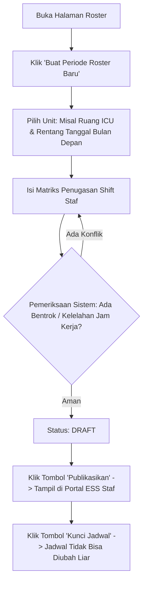

# Panduan Pengguna — Sub-Modul 06: Penjadwalan Roster & On-Call 24/7

## 1. Informasi Modul

| Field | Keterangan |
| --- | --- |
| Nama Sub-Modul | Penjadwalan Kerja, Matriks Roster Shift & Siaga On-Call 24/7 |
| Sasaran Pengguna | Kepala Ruangan, Kepala Instalasi, Manajer Pelayanan Medis / Keperawatan |
| Lokasi Menu Sidebar | **Operasional HR $\rightarrow$ Penjadwalan Roster** |
| Alamat URL | `http://localhost:3000/hr/scheduling/roster` |

---

## 2. Kapan & Mengapa Modul Ini Digunakan?

Pelayanan rumah sakit beroperasi tanpa henti. Kepala Ruangan menggunakan layar ini setiap akhir bulan (biasanya tanggal 20–25) untuk menyusun jadwal dinas rotasi (Pagi, Siang, Malam, Libur) seluruh perawat dan dokter jaga untuk bulan berikutnya, serta mengatur tim siaga panggilan darurat (*on-call*).

---

## 3. Langkah-Langkah Penggunaan Layar

### Langkah 1: Membuka Dasbor Roster
1. Masuk ke alamat `http://localhost:3000/hr/scheduling/roster`.
2. Periksa kartu ringkasan di atas:
   - **Periode Aktif**: Jumlah jadwal bulan berjalan yang sedang berlaku.
   - **Total Unit Terjadwal**: Jumlah ruangan yang sudah memiliki roster resmi.
   - **Tim Siaga On-Call**: Jumlah staf yang memegang mandat siaga panggilan darurat.

### Langkah 2: Membuat Periode Jadwal Baru
1. Klik tombol **"Buat Periode Roster"** di pojok kanan atas.
2. Pada modal dialog, isi formulir:
   - **Nama Periode**: Contoh: `Jadwal Dinas Rawat Inap Melati - November 2026`.
   - **Unit Pelayanan**: Pilih unit (misal: `Ruang Rawat Inap Melati`).
   - **Tanggal Mulai**: `2026-11-01` s/d **Tanggal Selesai**: `2026-11-30`.
3. Klik **Simpan Draf**. Jadwal akan berstatus `DRAFT`.

### Langkah 3: Mempublikasikan Jadwal (*Publish*)
1. Setelah seluruh pembagian shift (Pagi, Siang, Malam) selesai disusun dan diverifikasi, Kepala Ruangan menekan tombol **"Publikasikan (*Publish*)"**.
2. **Dampaknya**: Seluruh perawat dan dokter jaga di ruangan tersebut dapat langsung melihat jadwal kerjanya melalui HP atau portal mandiri mereka di `/self-services/human-resource/schedule`.

### Langkah 4: Mengunci Jadwal (*Lock*)
1. Tekan tombol **"Kunci Jadwal (*Lock*)"**.
2. **Dampaknya**: Jadwal terkunci mutlak. Tidak ada staf yang dapat mengubah jadwal secara sepihak, kecuali melalui jalur resmi permohonan tukar shift dengan persetujuan atasan.

---

## 4. Skenario Latihan Mandiri untuk Klien

* **Latihan 1: Membuat & Menerbitkan Jadwal**:
  - Buat 1 periode roster untuk `Instalasi Gawat Darurat`.
  - Klik tombol **Publikasikan**. Perhatikan badge status berubah dari abu-abu (`DRAFT`) menjadi hijau (`PUBLISHED`).
* **Latihan 2: Menguji Penguncian**:
  - Klik tombol **Kunci Jadwal**. Badge status berubah menjadi biru gelap (`LOCKED`).
  - Coba klik sunting; sistem akan memberitahukan bahwa jadwal sudah berstatus terkunci dan hanya bisa diubah melalui mekanisme tukar shift resmi.

---

## 5. Dampak pada Modul Lain

* Jadwal yang diterbitkan di sini menjadi dasar pencocokan jam hadir pada **Sub-Modul 07 (Presensi Harian)**.
* Jika staf datang di luar jadwal yang diterbitkan, sistem presensi akan mendeteksinya sebagai anomali atau lembur.
