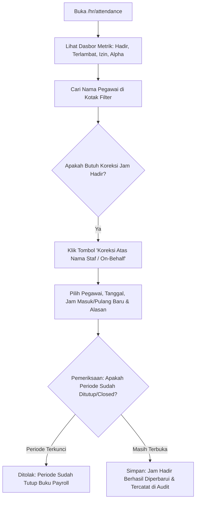

# Panduan Pengguna — Sub-Modul 07: Presensi & Kehadiran Harian

## 1. Informasi Modul

| Field | Keterangan |
| --- | --- |
| Nama Sub-Modul | Monitoring Presensi HR, Koreksi On-Behalf & Penutupan Periode (*Closed Period*) |
| Sasaran Pengguna | Staf Personalia HR, Supervisor Kehadiran, dan Seluruh Staf Rumah Sakit |
| Alamat URL | • Monitoring & Koreksi HR: `http://localhost:3000/hr/attendance` • Presensi Mandiri Staf: `http://localhost:3000/self-services/human-resource/attendance` |

---

## 2. Kapan & Mengapa Modul Ini Digunakan?

1. **Staf Medis / Non-Medis**: Melakukan pencatatan jam masuk dan jam pulang setiap hari dinas.
2. **Tim HR**: Memantau kepatuhan kehadiran harian (siapa yang hadir, terlambat, izin sakit, atau mangkir).
3. **Kondisi Khusus (Koreksi On-Behalf)**: Staf mengalami kendala darurat (misal staf IGD sedang menangani resusitasi henti jantung pasien sehingga tidak sempat tap mesin absensi, atau staf sakit parah). HR berwenang memasukkan jam hadir atas nama staf bersangkutan.
4. **Penutupan Periode (*Closed Period*)**: Mengunci absensi bulanan menjelang proses penggajian (*payroll*).

---

## 3. Langkah-Langkah Penggunaan Layar

### Langkah 1: Memantau Dasbor Kehadiran HR
1. Akses halaman `http://localhost:3000/hr/attendance`.
2. Perhatikan 4 kartu ringkasan di bagian atas:
   - **Hadir Tepat Waktu**: Jumlah staf yang tap masuk sebelum jam shift dimulai.
   - **Terlambat**: Jumlah staf yang terlambat dinas.
   - **Izin / Sakit / Cuti**: Staf yang memiliki surat izin resmi.
   - **Mangkir (Alpha)**: Staf yang terjadwal namun tidak tap absensi tanpa keterangan.

### Langkah 2: Melakukan Koreksi Atas Nama Staf (*On-Behalf*)
1. Klik tombol **"Koreksi Atas Nama Staf (On-Behalf)"**.
2. Pada modal dialog, isi field:
   - **Nama Pegawai**: Pilih staf yang bersangkutan.
   - **Tanggal Absensi**: Tanggal dinas yang ingin dikoreksi.
   - **Jam Masuk Baru & Jam Pulang Baru**: Contoh `07:00` dan `14:00`.
   - **Alasan Audit HR (Wajib Diisi)**: Contoh: *Staf menangani operasi darurat cito pasca kecelakaan lalu lintas; tidak sempat tap biometrik*.
3. Klik **Simpan Koreksi**. Sistem memperbarui status baris menjadi `Koreksi Disetujui`.

### Langkah 3: Pengamanan Periode Terkunci (*Closed Period Guard*)
* Jika Anda mencoba melakukan koreksi pada tanggal di bulan lampau yang sudah tutup buku penggajian (*Closed Period*), sistem otomatis memblokir form dan menampilkan pesan peringatan merah:
  *"Periode kehadiran untuk tanggal ini telah ditutup (Closed Period). Perubahan kehadiran tidak diizinkan demi integritas data payroll."*

---

## 4. Skenario Latihan Mandiri untuk Klien

* **Latihan 1: Simulasi Koreksi Jam Hadir**:
  - Buka `/hr/attendance` $\rightarrow$ klik tombol koreksi.
  - Pilih tanggal hari ini, masukkan jam masuk `07:00`, isi alasan *"Mesin sidik jari lantai 3 error saat mati listrik"*.
  - Simpan dan amati toast notifikasi hijau muncul di pojok kanan layar.
* **Latihan 2: Pengujian Validasi Alasan Kosong**:
  - Coba kosongkan kolom alasan pada modal koreksi, lalu klik simpan.
  - Sistem menolak dan menandai field alasan dengan warna merah: *"Alasan koreksi wajib diisi untuk rekam jejak audit."*

---

## 5. Dampak pada Modul Lain

* Data jam hadir yang telah dikunci pada periode ini menjadi dasar perhitungan tunjangan kehadiran, potongan keterlambatan, dan upah dinas malam di **Sub-Modul 10 (Penggajian Payroll)**.
