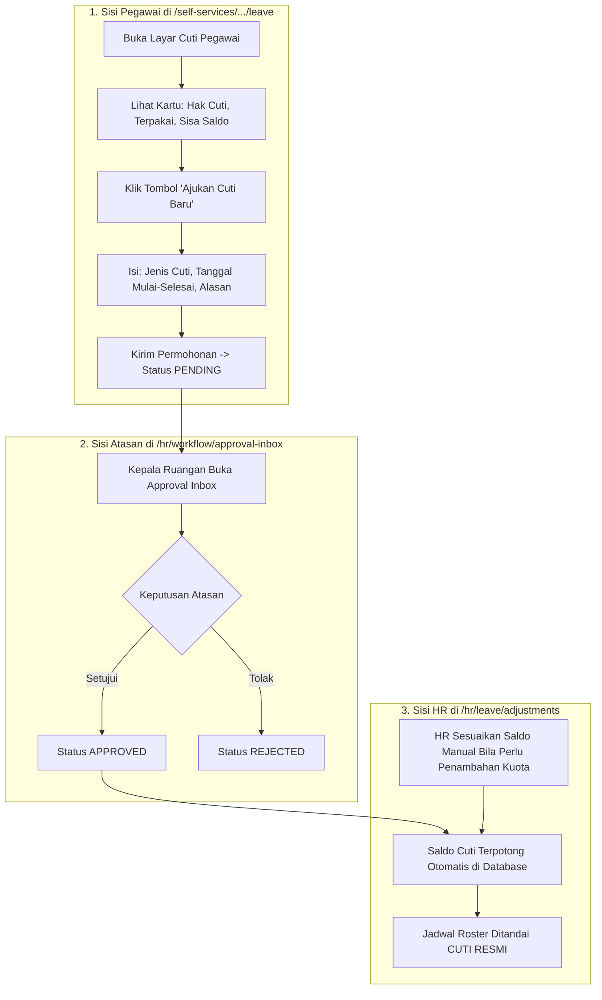

# Panduan Pengguna — Sub-Modul 08: Manajemen Cuti & Izin Staf

## 1. Informasi Modul

| Field | Keterangan |
| --- | --- |
| Nama Sub-Modul | Manajemen Hak Cuti, Pengajuan Mandiri & Penyesuaian Saldo Tahunan |
| Sasaran Pengguna | Seluruh Pegawai RS (Pemohon), Atasan/Kepala Ruangan (Penyetuju), dan HR Admin (Pengelola Saldo) |
| Alamat URL | • Layanan Mandiri Pegawai: `http://localhost:3000/self-services/human-resource/leave` • Administrasi Saldo HR: `http://localhost:3000/hr/leave/adjustments` |

---

## 2. Kapan & Mengapa Modul Ini Digunakan?

1. **Pegawai**: Memeriksa sisa kuota hak cuti tahunan dan mengajukan izin istirahat tanpa perlu menggunakan formulir kertas.
2. **Atasan (Kepala Ruangan)**: Menilai apakah ruangan pelayanan tetap aman jika staf mengambil cuti pada tanggal tersebut.
3. **HR**: Mengalokasikan hak cuti tahunan baru (misal 12 hari kerja setiap tanggal 1 Januari) atau melakukan penyesuaian saldo karena kebijakan khusus direksi.

---

## 3. Langkah-Langkah Penggunaan Layar

### Langkah A: Pegawai Mengajukan Cuti Mandiri
1. Masuk ke `http://localhost:3000/self-services/human-resource/leave`.
2. Periksa kartu informasi saldo:
   - **Total Kuota Hak Cuti**: Contoh `12 Hari`.
   - **Cuti Terpakai**: Contoh `3 Hari`.
   - **Sisa Saldo Berlaku**: Contoh `9 Hari`.
3. Klik tombol **"Ajukan Cuti Baru"**.
4. Pada formulir dialog, isi:
   - **Jenis Cuti**: Pilih `Cuti Tahunan` (atau `Cuti Sakit`, `Cuti Melahirkan`, dll.).
   - **Tanggal Mulai**: Contoh `2026-11-10`.
   - **Tanggal Selesai**: Contoh `2026-11-12` (Total 3 hari kerja).
   - **Alasan Pengajuan**: Contoh: *Keperluan keluarga di luar kota*.
   - **Kontak Darurat**: Nomor telepon yang dapat dihubungi saat tidak bertugas.
5. Klik **Kirim Permohonan**. Permohonan tercatat di tabel dengan status `Pending`.

### Langkah B: HR Menyesuaikan Saldo Cuti Karyawan
1. Masuk ke `http://localhost:3000/hr/leave/adjustments`.
2. Halaman ini memuat daftar rekapitulasi saldo cuti seluruh karyawan rumah sakit.
3. Cari nama staf $\rightarrow$ klik tombol **"Sesuaikan Saldo"**.
4. Pilih jenis operasi:
   - **Tambah Saldo**: Menambahkan hari cuti (misal penghargaan tugas khusus darurat Covid/Bencana +2 hari).
   - **Kurang Saldo**: Pengurangan manual karena mangkir atau kebijakan lain.
5. Masukkan **Alasan Penyesuaian** $\rightarrow$ klik **Simpan Penyesuaian**.

---

## 4. Skenario Latihan Mandiri untuk Klien

* **Latihan 1: Mengajukan Cuti**:
  - Ajukan cuti 2 hari melalui portal mandiri pegawai.
  - Perhatikan status baris baru berstatus kuning (`Pending`).
  - Setelah disetujui di Approval Inbox, perhatikan sisa saldo pada kartu otomatis berkurang 2 hari secara instan.
* **Latihan 2: Pengujian Saldo Tidak Cukup**:
  - Coba ajukan cuti 20 hari (melebihi sisa kuota yang ada).
  - Sistem akan menolak pengajuan: *"Jumlah hari cuti yang diajukan melampaui sisa kuota saldo yang tersedia."*

---

## 5. Dampak pada Modul Lain

* Saat cuti berstatus `Approved`, jadwal kerja staf pada **Sub-Modul 06 (Roster)** otomatis ditandai *"Cuti Resmi"* sehingga namanya tidak dianggap mangkir/alpha oleh **Sub-Modul 07 (Presensi Harian)**.
